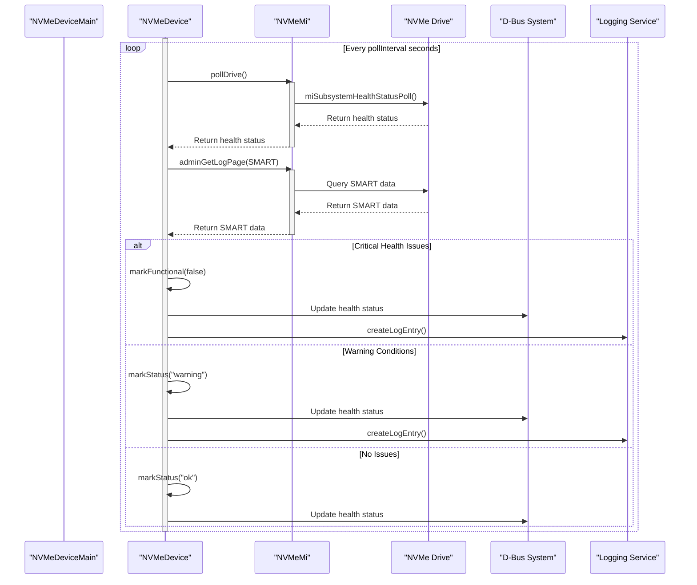
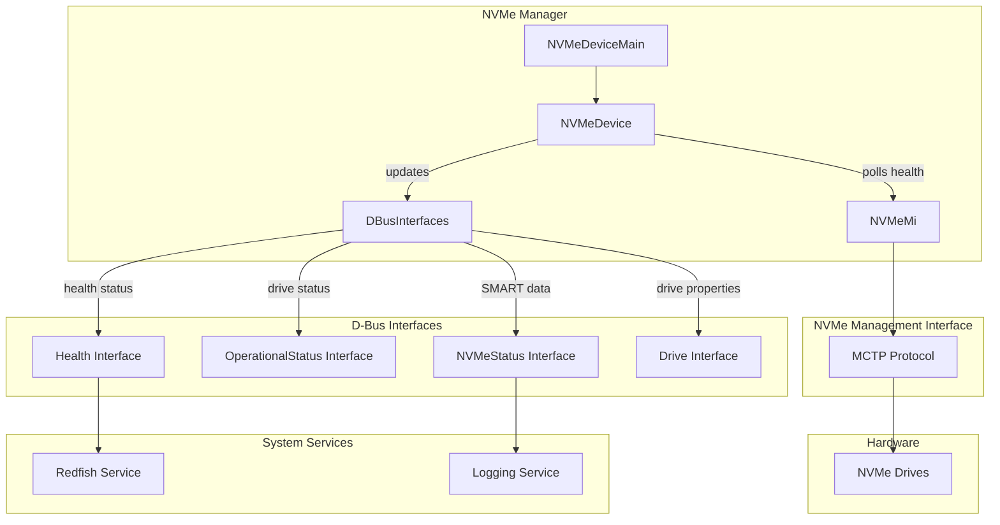
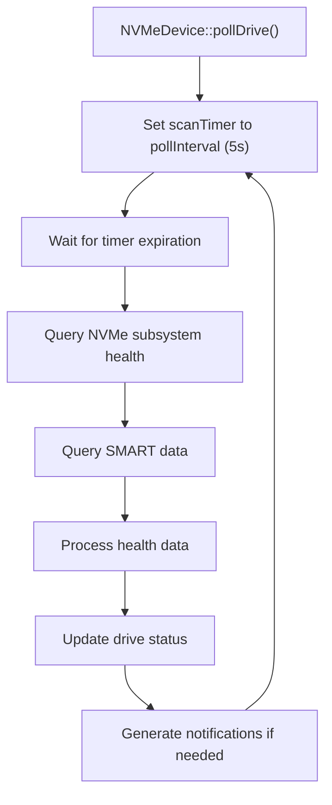
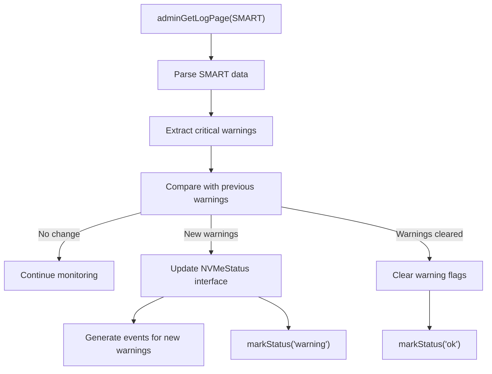

<!-- source: DeepWiki mcp.deepwiki.com · repo NVIDIA/nvidia-nvme-manager · page 4.1 Drive Health Monitoring · fetched 2026-10-26 -->

# Drive Health Monitoring

<details>
<summary>Relevant source files</summary>

The following files were used as context for generating this wiki page:

- [include/NVMeDevice.hpp](include/NVMeDevice.hpp)
- [src/NVMeDevice.cpp](src/NVMeDevice.cpp)

</details>


The Drive Health Monitoring subsystem of NVIDIA NVMe Manager provides continuous health monitoring of NVMe drives in the system. It periodically polls NVMe devices to collect health status information, processes SMART (Self-Monitoring, Analysis, and Reporting Technology) data, detects potential issues, and generates appropriate notifications when problems are identified.

For information about drive secure erase operations, see [Secure Erase Operations](#4.2).

## Health Monitoring Architecture

The Drive Health Monitoring system follows a polling-based architecture that periodically queries NVMe devices for health status information.



Sources: [src/NVMeDevice.cpp:472-673]()

## Health Monitoring Components

The following diagram shows the key components involved in drive health monitoring:



Sources: [include/NVMeDevice.hpp:25-50](), [src/NVMeDevice.cpp:471-474]()

## Health Monitoring Process

### Polling Mechanism

The health monitoring process is implemented through a periodic polling mechanism:

1. The `NVMeDevice` class maintains a timer (`scanTimer`) that triggers health checks at regular intervals
2. The default polling interval is 5 seconds ([src/NVMeDevice.cpp:28]())
3. Each time the timer expires, the `pollDrive()` method is called to initiate health checks



Sources: [src/NVMeDevice.cpp:472-474](), [src/NVMeDevice.cpp:28]()

### Health Status Collection

The health monitoring system collects the following information from NVMe drives:

1. **System Health Status**: Collected via `miSubsystemHealthStatusPoll()` call
   - Drive Life Used percentage
   - NVMe subsystem health status

2. **SMART Data**: Collected via `adminGetLogPage()` call with NVME_LOG_LID_SMART parameter
   - Critical warnings
   - Temperature information
   - Available spare capacity
   - Media and memory status

Sources: [src/NVMeDevice.cpp:576-595](), [src/NVMeDevice.cpp:596-671]()

## Health Status Types and Fault Detection

The NVMe Manager monitors several types of health issues:

| Fault Type | SMART Warning Flag | Description |
|------------|-------------------|-------------|
| Media Fault | NVME_SMART_CRIT_MEDIA | Media has been placed in read-only mode |
| Temperature Fault | NVME_SMART_CRIT_TEMPERATURE | Temperature is outside acceptable thresholds |
| Capacity Fault | NVME_SMART_CRIT_SPARE | Available spare capacity has fallen below threshold |
| Backup Device Fault | NVME_SMART_CRIT_VOLATILE_MEMORY | Volatile memory backup device has failed |
| Reliability Degradation | NVME_SMART_CRIT_DEGRADED | NVMe subsystem reliability has been degraded |
| PMR Failure | NVME_SMART_CRIT_PMR_RO | Persistent Memory Region is read-only or unreliable |

Sources: [src/NVMeDevice.cpp:400-447](), [src/NVMeDevice.cpp:635-652]()

### Health Status Classification

NVMe Manager classifies drive health status into three categories:

1. **OK** - The drive is functioning normally with no issues detected
2. **Warning** - Non-critical issues detected (SMART warnings)
3. **Critical** - Critical issues detected, drive is no longer fully functional

These health states are exposed through the D-Bus interface and used for event generation.

Sources: [src/NVMeDevice.cpp:344-372](), [src/NVMeDevice.cpp:374-398]()

## Fault Notification System

### Event Generation

When health issues are detected, the NVMe Manager generates events to notify other system components:

1. For critical failures:
   - Sets the operational status to "Fault"
   - Updates the health status to "Critical"
   - Creates a log entry with "ResourceErrorsDetected" message type

2. For warning conditions:
   - Updates the health status to "Warning"
   - Creates a log entry with appropriate warning message

### Example Notifications

The system generates specific notifications for different fault conditions:

```
Drive Failure:
"Ensure all cables are properly and securely connected. Ensure all drives are fully seated. Replace the defective cables, drive, or both."

Drive Predictive Failure:
"If this drive is not part of a fault-tolerant volume, first back up all data, then replace the drive and restore all data afterward. If this drive is part of a fault-tolerant volume, replace this drive as soon as possible."
```

Sources: [src/NVMeDevice.cpp:12-16](), [src/NVMeDevice.cpp:400-447]()

## D-Bus Interface Integration

The health monitoring system exposes drive health information through several D-Bus interfaces:

| Interface | Purpose | Properties |
|-----------|---------|------------|
| `xyz.openbmc_project.State.Decorator.Health` | General health status | `health` |
| `xyz.openbmc_project.State.Decorator.OperationalStatus` | Drive functionality status | `functional`, `state` |
| `xyz.openbmc_project.Nvme.Status` | NVMe-specific health information | `backupDeviceFault`, `capacityFault`, `degradesFault`, `mediaFault`, `temperatureFault`, `driveLifeUsed`, `smartWarnings` |
| `xyz.openbmc_project.Association.Definitions` | Relationship to other objects | `associations` |

These interfaces allow other system components, such as the Redfish service, to access health information and present it to users or management software.

Sources: [include/NVMeDevice.hpp:25-50](), [src/NVMeDevice.cpp:344-398]()

## SMART Data Processing

When SMART data is received from a drive, the system processes it as follows:

1. Extract critical warning flags from the SMART log
2. Compare with previously stored warning flags to detect changes
3. Update drive status properties based on warning flags
4. Generate events for any newly detected issues

The following code flow diagram illustrates this process:



Sources: [src/NVMeDevice.cpp:596-671](), [src/NVMeDevice.cpp:400-447]()

## Redfish Integration

The health monitoring system integrates with Redfish by:

1. Creating log entries that can be accessed through the Redfish event service
2. Updating health status properties that are exposed through the Redfish Drive resource
3. Setting associations between drive objects and health status to enable Redfish clients to navigate between related resources

This integration allows external management systems to monitor drive health through the standardized Redfish API.

Sources: [src/NVMeDevice.cpp:12-16](), [src/NVMeDevice.cpp:400-447]()

---

