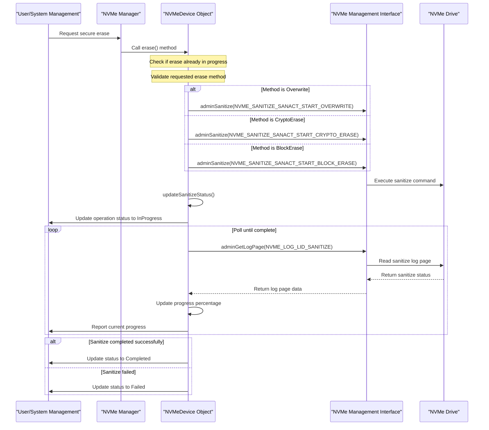
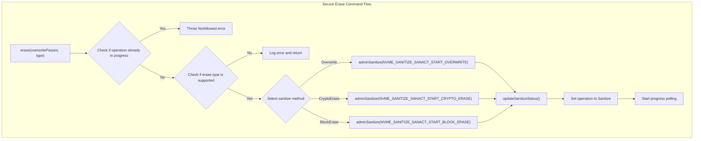

<!-- source: DeepWiki mcp.deepwiki.com · repo NVIDIA/nvidia-nvme-manager · page 4.2 Secure Erase Operations · fetched 2026-10-26 -->

# Secure Erase Operations

<details>
<summary>Relevant source files</summary>

The following files were used as context for generating this wiki page:

- [include/NVMeDevice.hpp](include/NVMeDevice.hpp)
- [src/NVMeDevice.cpp](src/NVMeDevice.cpp)

</details>


## Purpose and Scope

This page documents the secure erase functionality for NVMe drives in the NVIDIA NVMe Manager. It covers the supported sanitize methods, implementation details, operation flow, progress tracking, and error handling for secure erase operations. For information about drive health monitoring, see [Drive Health Monitoring](#4.1).

## Overview

Secure erase operations allow system administrators to completely erase data from NVMe drives through the NVMe Management Interface (NVMe-MI). The NVIDIA NVMe Manager implements the NVMe sanitize command, which provides hardware-based mechanisms for securely erasing all user data on NVMe devices.

Sources: [include/NVMeDevice.hpp:49-50](). [src/NVMeDevice.cpp:684-751]()

## Supported Sanitize Methods

The NVIDIA NVMe Manager supports three standard NVMe sanitize methods:

| Method | Description | Capability Flag |
|--------|-------------|----------------|
| **Crypto Erase** | Changes the internal encryption key used for user data, making the previous data cryptographically inaccessible | NVME_CTRL_SANICAP_CES |
| **Block Erase** | Writes a vendor-specific fixed pattern to all NAND flash memory cells | NVME_CTRL_SANICAP_BES |
| **Overwrite** | Writes a user-specified pattern across all user data, with configurable passes | NVME_CTRL_SANICAP_OWS |

The support for these methods is determined at device discovery time and exposed through the `sanitizeCapability` property of the `SecureErase` interface.

Sources: [src/NVMeDevice.cpp:264-279]()

## Secure Erase Operation Flow

The diagram below illustrates the sequence of operations when a secure erase command is initiated:



Sources: [src/NVMeDevice.cpp:684-751](), [src/NVMeDevice.cpp:493-570]()

## Implementation Details

### NVMeDevice Class Sanitize Components

```mermaid
classDiagram
    class "NVMeDevice" {
        -bool inProgress
        -uint32_t nodmmas
        -EraseMethod eraseType
        -uint32_t estimatedTime
        +erase(uint16_t overwritePasses, EraseMethod type)
        +updateSanitizeStatus(EraseMethod type)
        +updatePercent(uint32_t endTime)
        +getEraseType()
        +setEraseType(EraseMethod type)
        +getEstimateTime()
        +setEstimateTime(uint32_t time)
        +getNodmmas()
        +setNodmmas(uint8_t value)
    }
    
    class "SecureErase Interface" {
        +vector<EraseMethod> sanitizeCapability
        +erase(uint16_t overwritePasses, EraseMethod type)
    }
    
    class "Progress Interface" {
        +uint8_t progress
        +OperationStatus status
    }
    
    class "Operation Interface" {
        +OperationType operation
    }
    
    class "NVMeMi" {
        +adminSanitize(ctrl, sanact, owpass, owpattern, callback)
        +adminGetLogPage(ctrl, lid, nsid, lsp, callback)
    }
    
    "NVMeDevice" --|> "SecureErase Interface" : implements
    "NVMeDevice" --|> "Progress Interface" : implements
    "NVMeDevice" --|> "Operation Interface" : implements
    "NVMeDevice" --> "NVMeMi" : uses
```

Sources: [include/NVMeDevice.hpp:49-53](), [include/NVMeDevice.hpp:147](), [include/NVMeDevice.hpp:197-199]()

### Sanitize Command Implementation

The `erase` method in `NVMeDevice` implements the secure erase functionality:

1. First, it checks if a sanitize operation is already in progress
2. Then it validates if the requested sanitize method is supported by the drive
3. Based on the sanitize method requested, it calls the appropriate `adminSanitize` function with the correct parameters
4. Upon successful initiation, it calls `updateSanitizeStatus` to start tracking the progress

Sources: [src/NVMeDevice.cpp:684-751]()

## Progress Tracking

The NVIDIA NVMe Manager tracks sanitize progress and provides updates to management applications through D-Bus interfaces. Progress tracking includes:

1. Progress percentage (0-100%)
2. Operation status (InProgress, Completed, Failed)
3. Estimated completion time based on device-reported time values

During sanitize operations, the `pollDrive` method polls the sanitize log page to update the progress:

1. It reads the sanitize status log page using `adminGetLogPage`
2. Determines the current status of the sanitize operation
3. Uses the estimated time values reported by the device to calculate progress percentage
4. Updates the `Progress` interface properties

The progress calculation takes into account the `No-Deallocate Modifies Media After Sanitize` (NODMMAS) capability of the drive, which affects completion time estimates.

Sources: [src/NVMeDevice.cpp:450-470](), [src/NVMeDevice.cpp:493-570]()

## Error Handling

The following error conditions are handled during secure erase operations:

| Error Condition | Handling |
|-----------------|----------|
| Erase already in progress | Throws `sdbusplus::xyz::openbmc_project::Common::Error::NotAllowed` error |
| Unsupported erase method | Logs error and returns without starting operation |
| Sanitize command failure | Sets operation status to Failed and logs error |
| Polling failure | Logs error and continues polling |
| Sanitize operation failure | Sets operation status to Failed and stops tracking progress |

When a sanitize operation completes successfully, the operation status is set to `Completed` and the progress percentage to 100%.

Sources: [src/NVMeDevice.cpp:684-689](), [src/NVMeDevice.cpp:691-696](), [src/NVMeDevice.cpp:511-525]()

## D-Bus Interface

The secure erase functionality is exposed through D-Bus interfaces that allow other system components to initiate and monitor sanitize operations. The relevant interfaces are:

1. **xyz.openbmc_project.Nvme.SecureErase**: Provides sanitize capabilities and erase method
   - `sanitizeCapability` property: Lists supported sanitize methods
   - `erase(uint16_t overwritePasses, EraseMethod type)` method: Initiates sanitize operation

2. **xyz.openbmc_project.Common.Progress**: Reports operation progress
   - `progress` property: Current progress percentage
   - `status` property: Current operation status

3. **xyz.openbmc_project.Nvme.Operation**: Indicates current operation
   - `operation` property: Set to `Sanitize` during erase operations

Sources: [include/NVMeDevice.hpp:49-50](), [src/NVMeDevice.cpp:675-682]()

## Technical Implementation Details



Sources: [src/NVMeDevice.cpp:684-751](), [src/NVMeDevice.cpp:675-682]()

---

