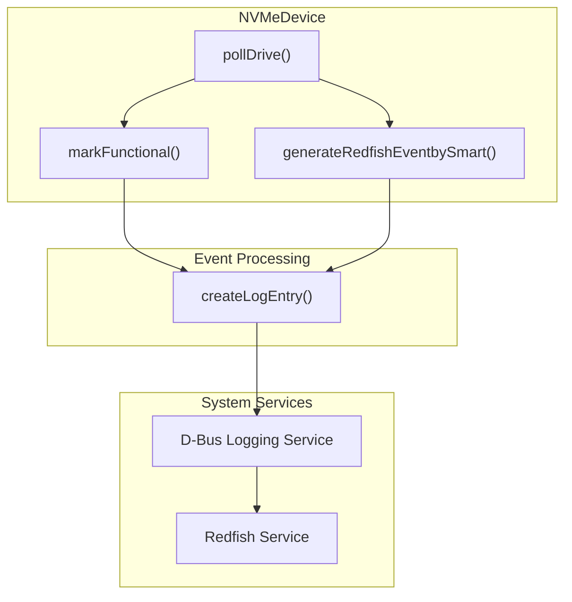
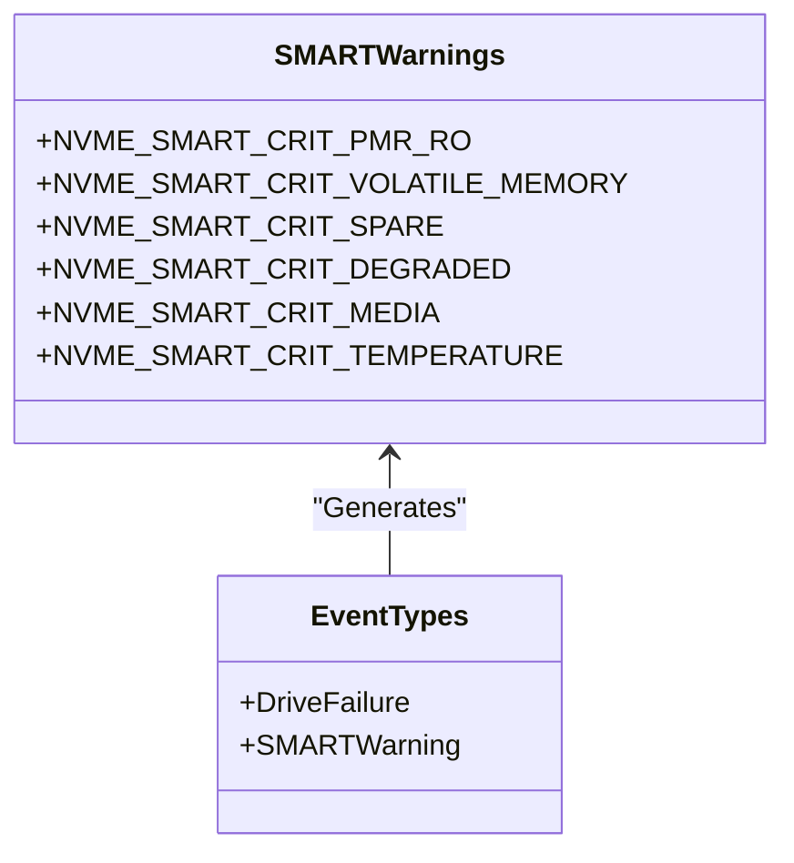
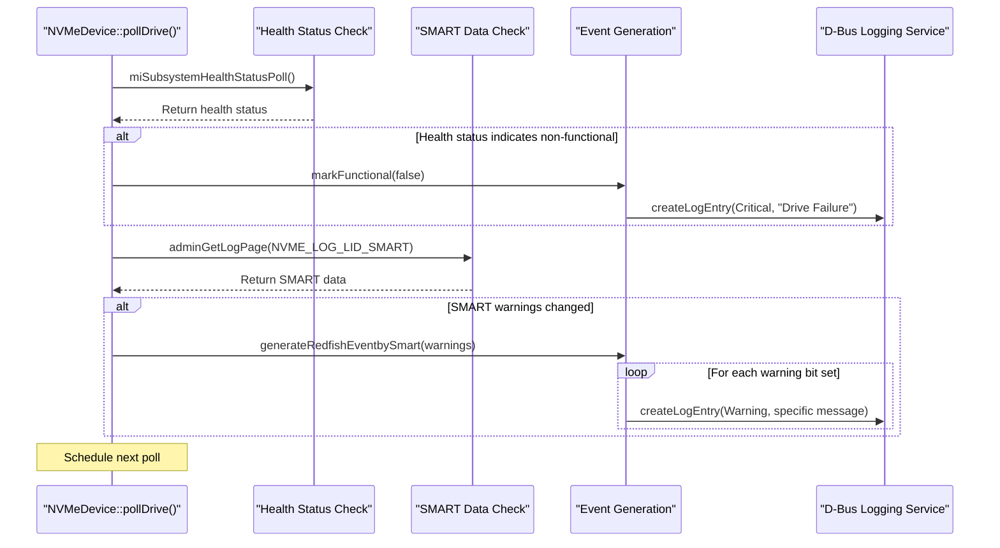
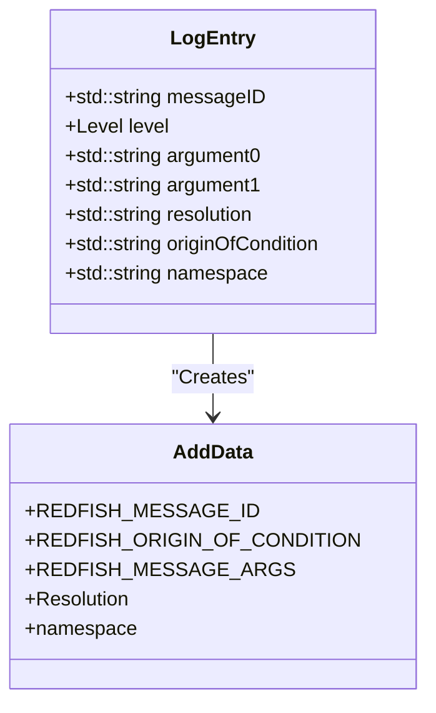
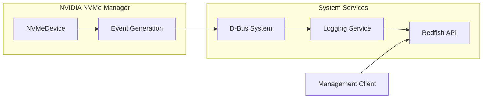

<!-- source: DeepWiki mcp.deepwiki.com · repo NVIDIA/nvidia-nvme-manager · page 4.3 Event Generation · fetched 2026-10-26 -->

# Event Generation

<details>
<summary>Relevant source files</summary>

The following files were used as context for generating this wiki page:

- [include/dbusutil.hpp](include/dbusutil.hpp)
- [src/NVMeDevice.cpp](src/NVMeDevice.cpp)

</details>


This page documents the event generation system in the NVIDIA NVMe Manager, which detects drive-related conditions and produces standardized event notifications. The event generation system monitors NVMe drive health status and creates appropriate log entries when specific conditions are detected. This provides system administrators with visibility into drive issues through standardized Redfish-compatible events.

For information about drive health monitoring mechanisms, see [Drive Health Monitoring](#4.1).

## Event Generation Architecture

The NVIDIA NVMe Manager monitors NVMe drives for various condition changes, particularly those related to drive health and operational status. When significant conditions are detected, the system generates standardized event messages using the D-Bus logging service.



Sources: [src/NVMeDevice.cpp:400-448](), [src/NVMeDevice.cpp:374-398](), [include/dbusutil.hpp:12-69]()

## Event Types and Conditions

The NVIDIA NVMe Manager generates events for two primary categories of conditions:

### Drive Failure Events

When a drive becomes non-functional (as detected through the NVMe Management Interface), the system generates a critical event. These events indicate severe issues that require immediate attention.

### SMART Warning Events

The system monitors the SMART warning byte from NVMe drives and generates specific events based on which warning bits are set. Each bit represents a different potential issue with the drive.



Sources: [src/NVMeDevice.cpp:400-448]()

The table below shows the SMART warning conditions that trigger events:

| Warning Bit | Condition | Description |
|-------------|-----------|-------------|
| `NVME_SMART_CRIT_PMR_RO` | Persistent Memory Region Issue | PMR has become read-only or unreliable |
| `NVME_SMART_CRIT_VOLATILE_MEMORY` | Backup Device Failure | Volatile memory backup device has failed |
| `NVME_SMART_CRIT_SPARE` | Low Spare Capacity | Available spare capacity below threshold |
| `NVME_SMART_CRIT_DEGRADED` | Subsystem Degradation | NVM subsystem reliability has degraded |
| `NVME_SMART_CRIT_MEDIA` | Media Read-Only | Media has been placed in read-only mode |
| `NVME_SMART_CRIT_TEMPERATURE` | Temperature Issue | Temperature over or under threshold |

Sources: [src/NVMeDevice.cpp:400-448]()

## Event Generation Process

The event generation process is integrated into the drive polling mechanism. The `NVMeDevice` class regularly polls drives for health status and SMART data, then generates events when concerning conditions are detected.



Sources: [src/NVMeDevice.cpp:472-673](), [src/NVMeDevice.cpp:374-398](), [src/NVMeDevice.cpp:400-448]()

## Event Message Structure

Events are generated using the `createLogEntry` function, which produces standardized log entries via D-Bus. These log entries are structured to be compatible with Redfish event reporting.



Sources: [include/dbusutil.hpp:12-69]()

The log entry contains the following fields:

| Field | Description |
|-------|-------------|
| `messageID` | Identifier for the message (e.g., "ResourceEvent.1.0.ResourceErrorsDetected") |
| `level` | Severity level (Critical, Warning, etc.) |
| `argument0` | First argument (typically drive name) |
| `argument1` | Second argument (error description) |
| `resolution` | Suggested resolution text |
| `originOfCondition` | Redfish path to the affected resource |
| `namespace` | Logging namespace (default: "StorageDevice") |

Sources: [include/dbusutil.hpp:20-25]()

## Integration with System Services

The event generation system integrates with other system components through D-Bus and provides information that is exposed via the Redfish API.



Sources: [include/dbusutil.hpp:54-69](), [src/NVMeDevice.cpp:385-388](), [src/NVMeDevice.cpp:404-447]()

## Event Generation Examples

Here are examples of how events are generated for different conditions:

### Drive Failure Event

When a drive is marked as non-functional, the following event is generated:

```
messageID: ResourceEvent.1.0.ResourceErrorsDetected
level: Critical
argument0: NVMe Drive{driveIndex}
argument1: Drive Failure
resolution: Ensure all cables are properly and securely connected. Ensure all drives are fully seated. Replace the defective cables, drive, or both.
originOfCondition: /redfish/v1/Systems/System_0/Storage/1/Drives/{driveIndex}
```

Sources: [src/NVMeDevice.cpp:385-388](), [src/NVMeDevice.cpp:12-14]()

### SMART Warning Event

When a SMART warning bit is set, an event like the following is generated:

```
messageID: ResourceEvent.1.0.ResourceErrorsDetected
level: Warning
argument0: NVMe Drive{driveIndex}
argument1: {specific warning message}
resolution: If this drive is not part of a fault-tolerant volume, first back up all data, then replace the drive and restore all data afterward. If this drive is part of a fault-tolerant volume, replace this drive as soon as possible as long as the health is OK
originOfCondition: /redfish/v1/Systems/System_0/Storage/1/Drives/{driveIndex}
```

Sources: [src/NVMeDevice.cpp:404-447](), [src/NVMeDevice.cpp:15-19]()

## Technical Implementation

The event generation system is primarily implemented in two key files:

1. `NVMeDevice.cpp` - Contains the code for monitoring drive status and generating events
2. `dbusutil.hpp` - Contains the utility function for creating standardized log entries

The most relevant functions for event generation are:

- `markFunctional()` - Generates events when a drive becomes non-functional
- `generateRedfishEventbySmart()` - Generates events based on SMART warning bits
- `createLogEntry()` - Creates standardized log entries via D-Bus

Sources: [src/NVMeDevice.cpp:374-398](), [src/NVMeDevice.cpp:400-448](), [include/dbusutil.hpp:20-69]()

---

