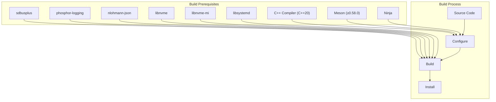
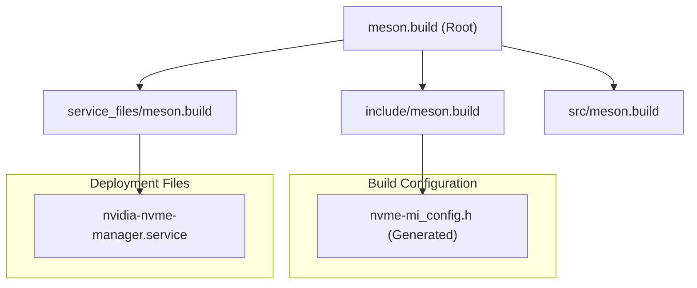
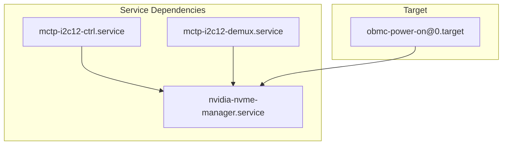
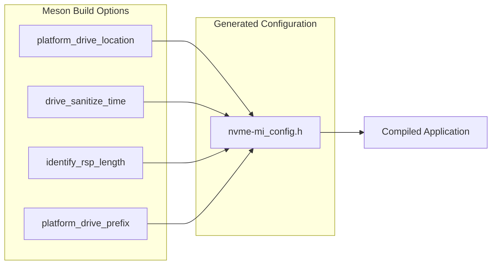

<!-- source: DeepWiki mcp.deepwiki.com · repo NVIDIA/nvidia-nvme-manager · page 5 Building and Deployment · fetched 2026-10-26 -->

# Building and Deployment

<details>
<summary>Relevant source files</summary>

The following files were used as context for generating this wiki page:

- [LICENSE](LICENSE)
- [include/meson.build](include/meson.build)
- [meson.build](meson.build)
- [service_files/meson.build](service_files/meson.build)
- [service_files/nvidia-nvme-manager.service](service_files/nvidia-nvme-manager.service)

</details>


This document provides instructions for building the NVIDIA NVMe Manager from source and deploying it within a target system environment. It covers the build prerequisites, compilation process, configuration options, and service deployment. For detailed information about configuration options and service configuration, please refer to [Configuration Options](#5.1) and [Service Configuration](#5.2).

## Prerequisites

Before building the NVIDIA NVMe Manager, ensure that your development environment has the following dependencies installed:

- C++ compiler with C++20 support
- Meson build system (version 0.58.0 or later)
- Ninja build tool
- The following libraries:
  - sdbusplus (D-Bus C++ bindings)
  - phosphor-logging (Logging framework)
  - nlohmann-json (JSON for Modern C++)
  - libnvme (NVMe base library)
  - libnvme-mi (NVMe Management Interface library)
  - libsystemd (Systemd development libraries)



Sources: [meson.build:1-71]()

## Building From Source

### 1. Obtaining the Source Code

Clone the NVIDIA NVMe Manager repository from GitHub:

```bash
git clone https://github.com/NVIDIA/nvidia-nvme-manager.git
cd nvidia-nvme-manager
```

### 2. Configuring the Build

Use Meson to configure the build with desired options:

```bash
meson setup builddir -Dplatform_drive_location="/xyz/openbmc_project/inventory/system/chassis/motherboard/drives" \
                     -Ddrive_sanitize_time=180 \
                     -Didentify_rsp_length=4096 \
                     -Dplatform_drive_prefix="nvme"
```

The configuration options are explained in the [Configuration Options](#5.1) page.

### 3. Building the Project

Build the project using Ninja:

```bash
ninja -C builddir
```

### 4. Installing

Install the compiled binaries and service files:

```bash
sudo ninja -C builddir install
```

This will install:
- The executable to `/usr/bin/nvme`
- The systemd service file to the appropriate systemd unit directory

Sources: [meson.build:73-75](), [include/meson.build:1-9]()

## Build System Structure

The NVIDIA NVMe Manager build system is organized into several subdirectories:



The build system handles:
1. Defining project properties and default options
2. Setting up dependencies
3. Generating configuration headers
4. Compiling source code
5. Installing binaries and service files

Sources: [meson.build:73-75](), [include/meson.build:1-9](), [service_files/meson.build:1-13]()

## Dependency Management

The NVIDIA NVMe Manager manages dependencies through the Meson build system. Dependencies are either resolved from system packages or, if unavailable, downloaded and built as subprojects.

| Dependency | Purpose | Resolution Method |
|------------|---------|------------------|
| sdbusplus | D-Bus communication | System or fallback to subproject |
| phosphor-logging | Logging framework | System or fallback to subproject |
| nlohmann-json | JSON parsing | System or header-only inclusion |
| libnvme | NVMe support | System package required |
| libnvme-mi | NVMe Management Interface | System package required |
| systemd | Service management | System package required |

Sources: [meson.build:31-71]()

## Deployment Configuration

### Service Dependencies

The NVIDIA NVMe Manager service depends on MCTP (Management Component Transport Protocol) services that must be running for proper operation:



The service is configured to restart automatically if it fails, with a 5-second delay between restart attempts.

Sources: [service_files/nvidia-nvme-manager.service:1-14]()

### Service Installation

During installation, the service file is placed in the systemd unit directory. To enable the service to start automatically, you need to run:

```bash
sudo systemctl enable nvidia-nvme-manager.service
```

To start the service immediately:

```bash
sudo systemctl start nvidia-nvme-manager.service
```

Sources: [service_files/meson.build:1-13](), [service_files/nvidia-nvme-manager.service:1-14]()

## Runtime Configuration

The NVIDIA NVMe Manager uses a configuration header that is generated during the build process. The configuration parameters are set at compile time through Meson options:



Sources: [include/meson.build:1-9]()

## Verification

After deployment, verify that the service is running correctly:

```bash
systemctl status nvidia-nvme-manager.service
```

The service should appear as active (running). Check the logs for any startup issues:

```bash
journalctl -u nvidia-nvme-manager.service
```

## Troubleshooting

Common issues during build and deployment:

1. **Missing dependencies**: Ensure all required libraries are installed
2. **Configuration issues**: Verify the configuration options match your system setup
3. **Service failures**: Check journal logs for detailed error messages
4. **MCTP service dependencies**: Ensure the required MCTP services are running

If the service fails to start, check that the MCTP services it depends on are running:

```bash
systemctl status mctp-i2c12-ctrl.service mctp-i2c12-demux.service
```

Sources: [service_files/nvidia-nvme-manager.service:1-14]()

---

