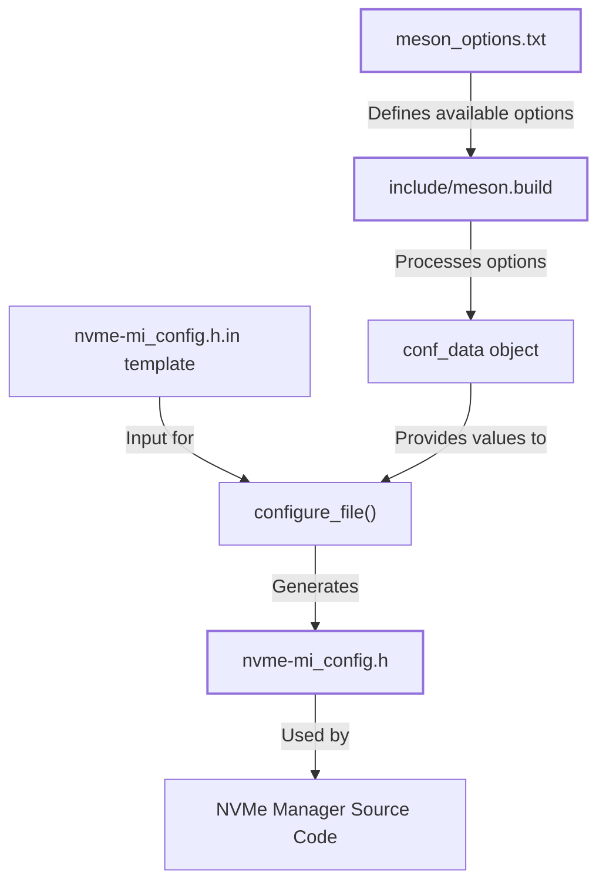
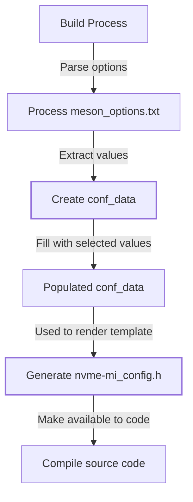

<!-- source: DeepWiki mcp.deepwiki.com · repo NVIDIA/nvidia-nvme-manager · page 5.1 Configuration Options · fetched 2026-10-26 -->

# Configuration Options

<details>
<summary>Relevant source files</summary>

The following files were used as context for generating this wiki page:

- [include/meson.build](include/meson.build)
- [meson_options.txt](meson_options.txt)

</details>


This page documents the configurable parameters available in the NVIDIA NVMe Manager. These options allow for customizing the behavior of the NVMe Manager to match specific platform requirements and operational needs.

For information about service deployment and runtime configuration, see [Service Configuration](#5.2).

## Overview of Configuration System

The NVIDIA NVMe Manager uses Meson's build configuration system to customize various aspects of its operation. The configuration options are defined in the project's `meson_options.txt` file and are incorporated into the codebase through a generated configuration header.



Sources: [meson_options.txt](), [include/meson.build]()

## Available Configuration Options

The following table summarizes all available configuration options in the NVIDIA NVMe Manager:

| Option | Type | Default Value | Description |
|--------|------|---------------|-------------|
| `platform_drive_location` | string | `/xyz/openbmc_project/inventory/system/chassis/Baseboard_0` | D-Bus path specifying which board contains the NVMe drives |
| `drive_sanitize_time` | integer | 30 | Default sanitize operation time (in seconds) if not reported by drive |
| `identify_rsp_length` | integer | 384 | Default response length (in bytes) expected from identify commands |
| `platform_drive_prefix` | string | `NVMe_SSD_` | Prefix used in drive resource identifiers |

Sources: [meson_options.txt]()

## Detailed Description of Options

### Platform Drive Location

The `platform_drive_location` option defines the D-Bus object path where NVMe drives are expected to be located within the system inventory structure. This setting is crucial for proper device discovery and management.


This path is used during device initialization to establish the proper relationship in the system inventory between physical drives and their logical representation.

Sources: [meson_options.txt:1-1]()

### Drive Sanitize Time

The `drive_sanitize_time` option specifies the default time (in seconds) that the system will assume for a complete sanitize operation if the drive itself does not report progress. This value affects secure erase operations and progress reporting.

During sanitize operations, the system uses this value as a fallback to:
- Set appropriate timeouts
- Calculate approximate progress percentage
- Schedule status check operations

Sources: [meson_options.txt:2-2]()

### Identify Response Length

The `identify_rsp_length` option sets the default buffer size (in bytes) for NVMe identify command responses. This value must be large enough to accommodate the responses from the NVMe identify command, which returns controller and namespace information.

The standard NVMe identify command returns data structures that are typically 4KB in size, but the NVIDIA NVMe Manager optimizes this to receive only the essential portion (384 bytes by default) to improve performance.

Sources: [meson_options.txt:3-3]()

### Platform Drive Prefix

The `platform_drive_prefix` option defines the naming prefix used when creating D-Bus objects and inventory entries for NVMe drives. This prefix helps distinguish NVMe SSDs from other storage devices in the system.

For example, with the default prefix `NVMe_SSD_`, drives would be named:
- `NVMe_SSD_0`
- `NVMe_SSD_1`
- etc.

This naming convention is used in the inventory system, logs, and event messages.

Sources: [meson_options.txt:5-5]()

## Configuration Generation Process

During the build process, the configuration values are processed and incorporated into the codebase through these steps:

1. The `meson_options.txt` file defines all available options and their default values
2. The `include/meson.build` script creates a configuration data object
3. Configuration values are set in this object using `conf_data.set()` and `conf_data.set_quoted()`
4. The `configure_file()` function generates `nvme-mi_config.h` from the template `nvme-mi_config.h.in`
5. The generated header file is included in the source code where these configuration values are needed



Sources: [include/meson.build:1-8]()

## Customizing Configuration Options

To modify any of these configuration options, use Meson's configuration system during the build process:

```bash
# Example: Change the drive prefix and sanitize timeout
meson configure -Dplatform_drive_prefix='NVMe_Drive_' -Ddrive_sanitize_time=60
```

Or when initially configuring the build:

```bash
# Initial configuration with custom values
meson setup builddir -Dplatform_drive_location='/xyz/openbmc_project/inventory/system/chassis/Custom_Board' -Didentify_rsp_length=512
```

These options should be adjusted based on:
1. The specific hardware platform's D-Bus topology
2. Performance requirements
3. Naming conventions in your deployment

After changing configuration options, a full rebuild is required for the changes to take effect.

Sources: [include/meson.build](), [meson_options.txt]()

---

