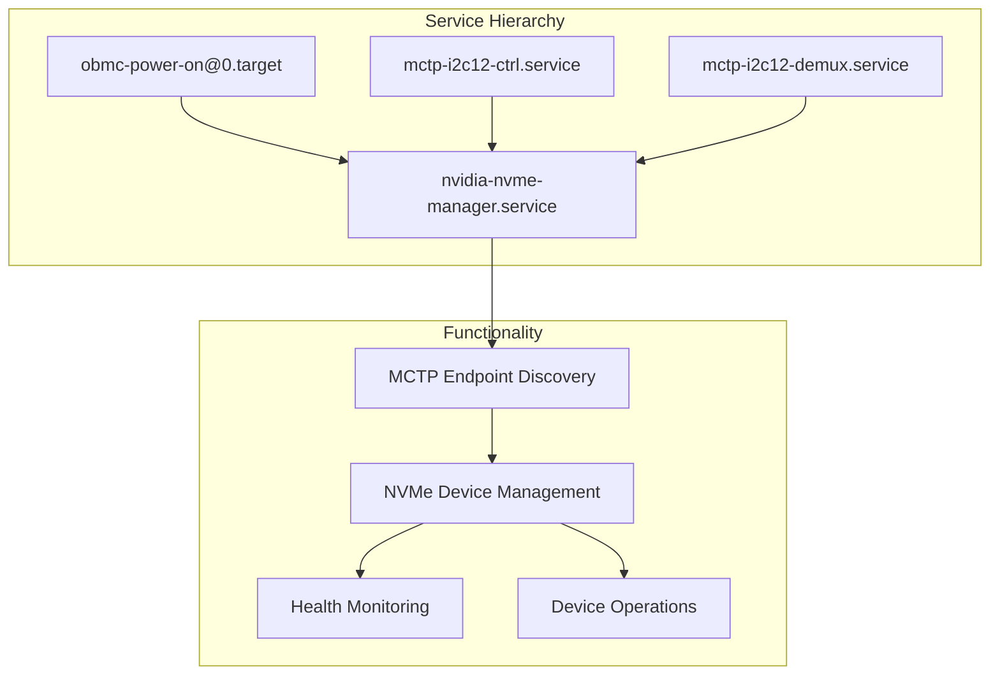
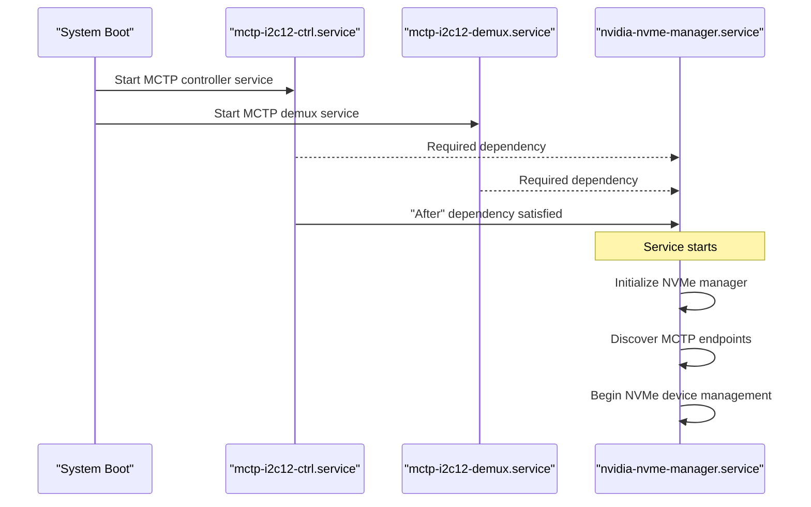

<!-- source: DeepWiki mcp.deepwiki.com · repo NVIDIA/nvidia-nvme-manager · page 5.2 Service Configuration · fetched 2026-10-26 -->

# Service Configuration

<details>
<summary>Relevant source files</summary>

The following files were used as context for generating this wiki page:

- [LICENSE](LICENSE)
- [meson.build](meson.build)
- [service_files/meson.build](service_files/meson.build)
- [service_files/nvidia-nvme-manager.service](service_files/nvidia-nvme-manager.service)

</details>


This page documents how to configure and manage the NVIDIA NVMe Manager service within a system. It covers service dependencies, installation, configuration options, and runtime management. For information about available configuration parameters and customization options, see [Configuration Options](#5.1).

## Service Overview

The NVIDIA NVMe Manager runs as a systemd service that manages NVMe drives through the MCTP (Management Component Transport Protocol) interface. The service is configured to start automatically during system boot and provides continuous monitoring and management of NVMe devices.



Sources: [service_files/nvidia-nvme-manager.service]()

## Service File Configuration

The NVIDIA NVMe Manager service is defined in a systemd unit file that specifies its runtime behavior, dependencies, and startup conditions.

```mermaid
classDiagram
    class "nvidia-nvme-manager.service" {
        Description: NVMe-MI management service
        Requires: mctp-i2c12-ctrl.service mctp-i2c12-demux.service
        After: mctp-i2c12-ctrl.service
        Restart: always
        RestartSec: 5
        ExecStart: /usr/bin/nvme
        SyslogIdentifier: nvme-manager
        WantedBy: obmc-power-on@0.target
    }
```

The service file consists of three main sections:

| Section | Purpose | Configuration |
|---------|---------|---------------|
| Unit | Describes the service and its dependencies | Defines requirements and ordering |
| Service | Configures how the service runs | Sets execution parameters and restart behavior |
| Install | Defines service installation | Specifies when the service should start |

Sources: [service_files/nvidia-nvme-manager.service:1-14]()

## Service Dependencies

The NVIDIA NVMe Manager service depends on MCTP services to communicate with NVMe devices. These dependencies are defined in the systemd unit file:



The service requires both MCTP services to be active before it can start, ensuring that the communication channel to NVMe devices is established first.

Sources: [service_files/nvidia-nvme-manager.service:2-4]()

## Installation and Build Configuration

The NVIDIA NVMe Manager service is installed as part of the build process using the meson build system. The service file is copied to the appropriate systemd directory during installation.


The installation path is determined by the systemd package configuration during the build process.

Sources: [service_files/meson.build:1-13](), [meson.build:59-62]()

## Service Runtime Management

### Starting and Stopping the Service

The NVIDIA NVMe Manager service can be managed using standard systemd commands:

| Operation | Command |
|-----------|---------|
| Start the service | `systemctl start nvidia-nvme-manager.service` |
| Stop the service | `systemctl stop nvidia-nvme-manager.service` |
| Restart the service | `systemctl restart nvidia-nvme-manager.service` |
| Check service status | `systemctl status nvidia-nvme-manager.service` |
| Enable service at boot | `systemctl enable nvidia-nvme-manager.service` |
| Disable service at boot | `systemctl disable nvidia-nvme-manager.service` |

### Automatic Restart Behavior

The service is configured to automatically restart if it fails:

- `Restart=always` ensures the service will restart under any exit condition
- `RestartSec=5` sets a 5-second delay between restart attempts

This configuration ensures high availability of the NVMe management functionality.

Sources: [service_files/nvidia-nvme-manager.service:6-8]()

## Service Logging

The NVIDIA NVMe Manager service logs its activity to the system journal with the identifier `nvme-manager`. You can view the service logs using:

```
journalctl -u nvidia-nvme-manager.service
```

or filter by the identifier:

```
journalctl -t nvme-manager
```

Sources: [service_files/nvidia-nvme-manager.service:10]()

## Integration with System Power States

The service is configured to start automatically when the system reaches the `obmc-power-on@0.target` state. This ensures that NVMe management begins when the system power is on and drives are accessible.

```mermaid
stateDiagram-v2
    [*] --> SystemBoot
    SystemBoot --> PoweringOn
    PoweringOn --> "obmc-power-on@0.target"
    "obmc-power-on@0.target" --> "nvidia-nvme-manager.service"
    "nvidia-nvme-manager.service" --> Running
    Running --> [*]
```

Sources: [service_files/nvidia-nvme-manager.service:12-13]()

## Troubleshooting Service Issues

If the NVIDIA NVMe Manager service fails to start or behaves unexpectedly, consider these troubleshooting steps:

1. Check service status: `systemctl status nvidia-nvme-manager.service`
2. Verify dependency services are running: 
   - `systemctl status mctp-i2c12-ctrl.service`
   - `systemctl status mctp-i2c12-demux.service`
3. Check service logs: `journalctl -u nvidia-nvme-manager.service -n 100`
4. Verify NVMe drives are physically present and connected properly
5. Restart the service: `systemctl restart nvidia-nvme-manager.service`

Common issues include:
- Missing or incorrect MCTP service configuration
- Hardware connectivity problems
- Permission issues for accessing device nodes

Sources: [service_files/nvidia-nvme-manager.service]()