# Page: Overview

# Overview

<details>
<summary>Relevant source files</summary>

The following files were used as context for generating this wiki page:

- [LICENSE](LICENSE)
- [include/NVMeDevice.hpp](include/NVMeDevice.hpp)
- [meson.build](meson.build)
- [src/NVMeDevice.cpp](src/NVMeDevice.cpp)
- [src/NVMeDeviceMain.cpp](src/NVMeDeviceMain.cpp)

</details>


The NVIDIA NVMe Manager is a system service that provides discovery, monitoring, and management capabilities for NVMe storage devices in server environments. It serves as a bridge between the server's management infrastructure and NVMe drives, enabling health monitoring, secure erase operations, and drive inventory management.

This document provides an introduction to the NVIDIA NVMe Manager system, its key components, and high-level architecture. For detailed information about specific components, please refer to their respective sections in the documentation:

- For detailed system architecture, see [System Architecture](#2)
- For NVMe device management, see [NVMe Device Management](#2.1)
- For MCTP endpoint discovery, see [MCTP Endpoint Discovery](#2.2)
- For information about secure erase operations, see [Secure Erase Operations](#4.2)

Sources: [LICENSE:1-8](), [meson.build:1-8]()

## System Purpose and Capabilities

The NVIDIA NVMe Manager provides the following key capabilities:

1. **NVMe Drive Discovery**: Automatically discovers NVMe drives via MCTP endpoints
2. **Health Monitoring**: Polls NVMe SMART data to detect potential drive failures
3. **Secure Erase Operations**: Implements sanitize commands with multiple erase methods
4. **Event Generation**: Creates system events for drive status changes
5. **D-Bus Interface**: Exposes drive properties and operations to other system services

The manager operates as a daemon service and integrates with the system's D-Bus infrastructure to provide standardized interfaces for NVMe drive management.

Sources: [src/NVMeDevice.cpp:10-26](), [src/NVMeDeviceMain.cpp:1-12]()

## System Architecture

The NVIDIA NVMe Manager follows a modular architecture with clear separation between device management, communication protocols, and system integration components.

### High-Level Architecture

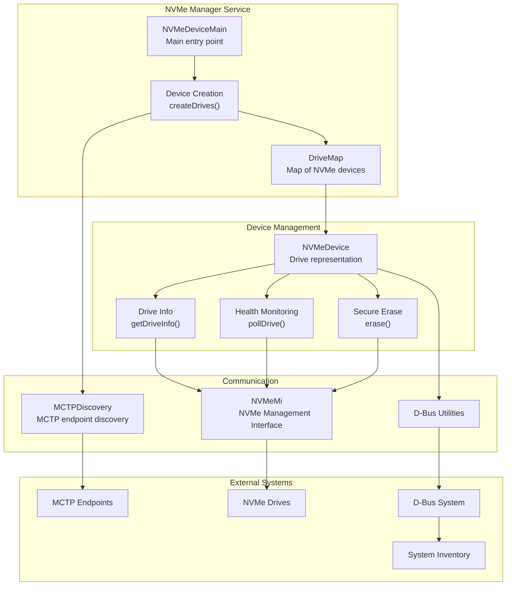

Sources: [src/NVMeDeviceMain.cpp:213-211](), [src/NVMeDevice.cpp:31-53]()

### Key Components and Their Roles

| Component | File | Description |
|-----------|------|-------------|
| `NVMeDeviceMain` | `src/NVMeDeviceMain.cpp` | Main application entry point that initializes the service and handles MCTP endpoint discovery |
| `NVMeDevice` | `src/NVMeDevice.cpp` | Class representing an individual NVMe device with health monitoring and erase capabilities |
| `NVMeMi` | Included in `NVMeDevice.hpp` | NVMe Management Interface that handles low-level communication with NVMe drives |
| `MCTPDiscovery` | Referenced in `NVMeDeviceMain.cpp` | Discovers MCTP endpoints that support NVMe Management Interface |
| `DriveMap` | Used in `NVMeDeviceMain.cpp` | A global map that maintains all active NVMe drive objects |

Sources: [include/NVMeDevice.hpp:1-25](), [src/NVMeDeviceMain.cpp:14-18]()

## Operational Flow

The following sequence diagram illustrates the typical operational flow of the NVIDIA NVMe Manager:

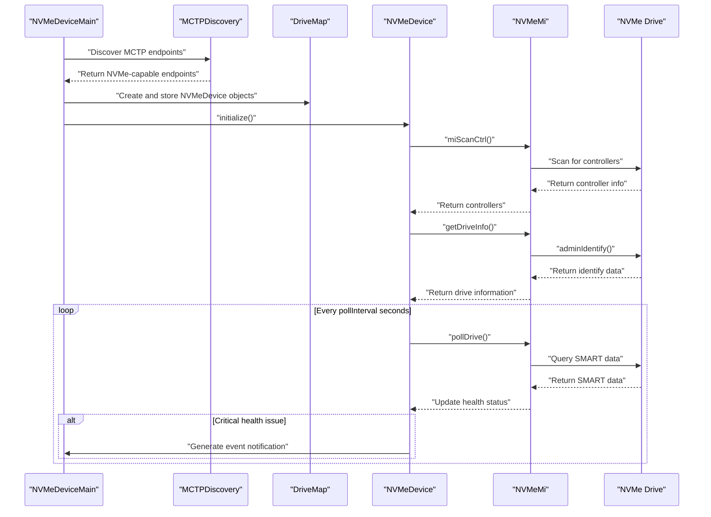

Sources: [src/NVMeDevice.cpp:472-672](), [src/NVMeDeviceMain.cpp:258-353]()

## Drive Discovery Process

The NVMe Manager discovers drives through the following process:

1. The main service starts and monitors D-Bus for MCTP endpoint announcements
2. When an endpoint with NVMe-MI capability is found, it creates an `NVMeDevice` object
3. The `NVMeDevice` initializes and scans for NVMe controllers via the management interface
4. Drive information is retrieved and the device is added to the inventory
5. Regular health polling begins for the discovered drive

Sources: [src/NVMeDeviceMain.cpp:124-211](), [src/NVMeDevice.cpp:310-342]()

## Health Monitoring

The NVMe Manager continuously monitors drive health through:

1. Polling SMART data from NVMe drives at regular intervals
2. Checking critical warning flags in SMART data
3. Updating drive status properties on D-Bus
4. Generating events for detected issues

The polling interval is defined as a constant in [src/NVMeDevice.cpp:28]().

### Monitored Health Indicators

| Health Indicator | Description | Event Generated |
|------------------|-------------|-----------------|
| Backup Device Fault | Volatile memory backup device failure | Warning event |
| Capacity Fault | Available spare capacity below threshold | Warning event |
| Temperature Fault | Temperature over/under threshold | Warning event |
| Degrades Fault | NVM subsystem reliability degraded | Warning event |
| Media Fault | Media in read-only mode | Warning event |
| Drive Failure | Drive is not functional | Critical event |

Sources: [src/NVMeDevice.cpp:400-448](), [src/NVMeDevice.cpp:576-672]()

## Secure Erase Operations

The NVMe Manager supports multiple secure erase methods for NVMe drives:

1. **Crypto Erase**: Cryptographic erase using the drive's internal encryption
2. **Block Erase**: Low-level block erasure of all data
3. **Overwrite**: Overwriting all data with patterns

The erase operations are implemented via the NVMe sanitize command and progress is tracked and reported via D-Bus properties.

Sources: [src/NVMeDevice.cpp:674-751](), [include/NVMeDevice.hpp:95-120]()

## System Integration

The NVIDIA NVMe Manager integrates with the larger system through:

1. **D-Bus Interfaces**: Exposing drive properties and operations
2. **Event Generation**: Creating system log entries for drive issues
3. **Inventory Management**: Adding drives to the system inventory
4. **Redfish Integration**: Supporting Redfish API for management standardization

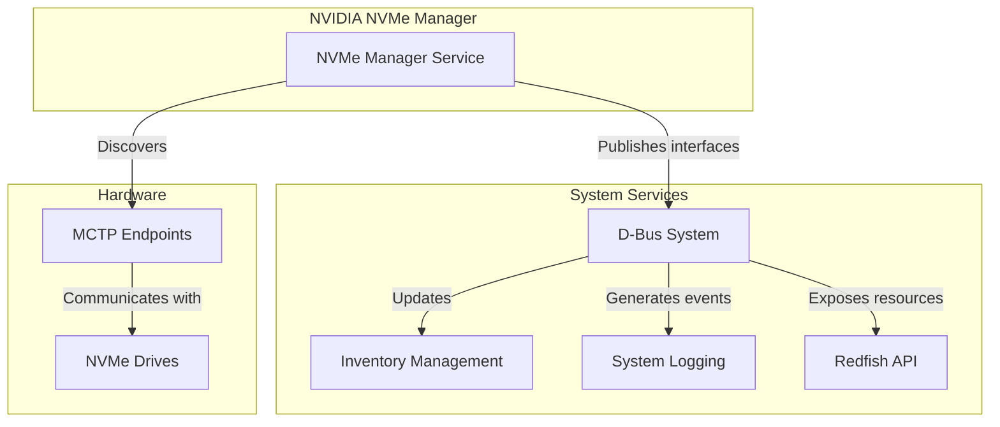

Sources: [src/NVMeDevice.cpp:19-26](), [src/NVMeDeviceMain.cpp:295-308]()

## Key Classes and Interfaces

The NVMe Manager implements multiple D-Bus interfaces for drive management:

| Interface | Purpose |
|-----------|---------|
| `xyz.openbmc_project.Inventory.Item.Drive` | Basic drive properties like capacity and form factor |
| `xyz.openbmc_project.State.Decorator.Health` | Health status of the drive |
| `xyz.openbmc_project.State.Decorator.OperationalStatus` | Operational state (functional/non-functional) |
| `xyz.openbmc_project.Nvme.Status` | NVMe-specific status information |
| `xyz.openbmc_project.Nvme.SecureErase` | Secure erase capabilities and operations |
| `xyz.openbmc_project.Common.Progress` | Progress tracking for operations |

The key class `NVMeDevice` implements all these interfaces as shown in [include/NVMeDevice.hpp:54-56]().

Sources: [include/NVMeDevice.hpp:26-56](), [src/NVMeDevice.cpp:33-53]()

## Conclusion

The NVIDIA NVMe Manager provides a comprehensive solution for managing NVMe drives in server environments. With its modular architecture, it enables discovery, monitoring, and management of NVMe drives through standardized interfaces. For more detailed information about specific components and functionalities, please refer to the more specific documentation pages listed at the beginning of this overview.

---

# Page: System Architecture

# System Architecture

<details>
<summary>Relevant source files</summary>

The following files were used as context for generating this wiki page:

- [include/NVMeDevice.hpp](include/NVMeDevice.hpp)
- [src/NVMeDevice.cpp](src/NVMeDevice.cpp)
- [src/NVMeDeviceMain.cpp](src/NVMeDeviceMain.cpp)
- [src/NVMeMi.cpp](src/NVMeMi.cpp)

</details>


This page provides a detailed overview of the NVIDIA NVMe Manager system architecture, including component relationships and data flows. For information about specific components, refer to [NVMe Device Management](#2.1), [MCTP Endpoint Discovery](#2.2), and [NVMe Management Interface](#2.3).

## System Overview

The NVIDIA NVMe Manager is designed to discover, monitor, and manage NVMe (Non-Volatile Memory Express) storage devices in server environments. It leverages the following key technologies:

- **D-Bus**: For system-level inter-process communication
- **MCTP** (Management Component Transport Protocol): For communication with NVMe devices
- **NVMe-MI**: NVMe Management Interface protocol for device control

The system follows a modular architecture separating device management, communication protocols, and system integration components.

## Component Architecture

The following diagram shows the primary components of the NVIDIA NVMe Manager system and their relationships:

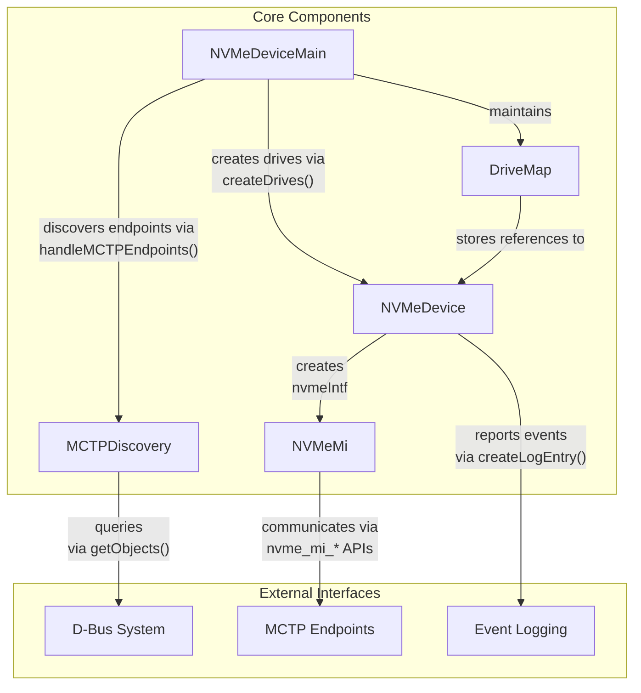

Sources: [src/NVMeDeviceMain.cpp:213-226](). [src/NVMeDevice.cpp:33-52](). [src/NVMeMi.cpp:28-72]().

## System Operation Flow

This sequence diagram illustrates the typical operational flow within the NVIDIA NVMe Manager system, from startup through device monitoring and management:

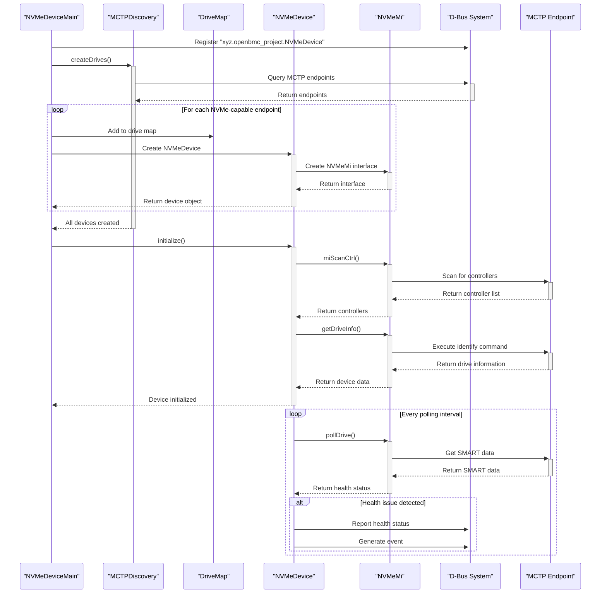

Sources: [src/NVMeDeviceMain.cpp:258-353](). [src/NVMeDevice.cpp:314-342](). [src/NVMeDevice.cpp:472-673]().

## Class Relationships

This diagram shows the key classes in the system and their relationships:

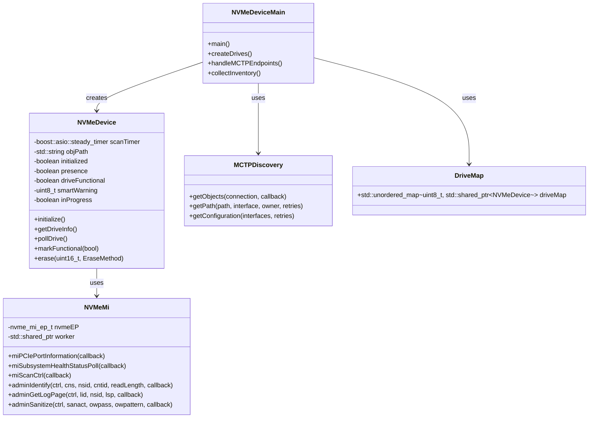

Sources: [include/NVMeDevice.hpp:62-207](). [src/NVMeMi.cpp:28-72]().

## Key Architectural Components

### 1. NVMeDeviceMain

The `NVMeDeviceMain` component serves as the application entry point and manages the overall system lifecycle:

- Initializes the system and creates a D-Bus object server
- Discovers MCTP endpoints capable of NVMe-MI communication
- Creates and manages `NVMeDevice` objects
- Handles D-Bus signals for device hotplug events
- Maintains the drive map for tracking all NVMe devices

Sources: [src/NVMeDeviceMain.cpp:258-365]().

### 2. NVMeDevice

The `NVMeDevice` class represents individual NVMe drives in the system:

- Implements multiple D-Bus interfaces for device management
- Manages device lifecycle (initialization, monitoring, shutdown)
- Polls device health status and SMART data periodically
- Executes secure erase operations when requested
- Reports device status changes via D-Bus events

The class inherits from multiple interface classes:

```
NVMeDevice
├── Item
├── StorageController
├── PortInfo
├── Drive
├── Health
├── OperationalStatus
├── Asset
├── Version
├── NVMeStatus
├── Associations
├── Progress
├── SecureErase
└── Operation
```

Sources: [include/NVMeDevice.hpp:62-207](). [src/NVMeDevice.cpp:33-751]().

### 3. NVMeMi

The `NVMeMi` class provides the low-level interface to communicate with NVMe devices:

- Establishes communication with MCTP endpoints
- Executes NVMe-MI and NVMe Admin commands
- Provides asynchronous worker thread for non-blocking operations
- Handles command execution and response processing
- Implements specialized interfaces for common operations:
  - Device identification
  - Health monitoring
  - Secure erase
  - Log page retrieval

Sources: [src/NVMeMi.cpp:28-1208]().

### 4. MCTPDiscovery

The `MCTPDiscovery` component provides utilities for discovering MCTP endpoints:

- Queries D-Bus for MCTP endpoint information
- Filters endpoints that support NVMe-MI
- Retrieves endpoint connection details (EID, socket address)
- Returns discovered endpoints to the main application

Sources: [src/NVMeDeviceMain.cpp:124-211]().

## Asynchronous Architecture

The NVIDIA NVMe Manager uses an asynchronous architecture based on Boost.Asio for event-driven, non-blocking operations:

| Component | Asynchronous Mechanism |
|-----------|------------------------|
| NVMeDeviceMain | Uses Boost.Asio io_service for the main event loop |
| NVMeDevice | Uses steady_timer for periodic polling |
| NVMeMi | Uses a dedicated worker thread for command execution |
| D-Bus Communication | Uses asynchronous signal handlers and method calls |

This approach enables the system to:
- Handle multiple devices simultaneously
- Respond to events without blocking
- Process long-running operations (like secure erase) efficiently
- Maintain responsiveness to management requests

Sources: [src/NVMeDeviceMain.cpp:258-265](). [src/NVMeDevice.cpp:472-487](). [src/NVMeMi.cpp:75-99]().

## Communication Patterns

### D-Bus Communication

The system exposes and consumes several D-Bus interfaces:

1. **Exposed Interfaces**:
   - Drive status and properties
   - Health monitoring
   - Operational controls
   - Event generation

2. **Consumed Interfaces**:
   - MCTP endpoint discovery
   - System inventory information
   - Logging service

### MCTP Communication

NVMe-MI commands are transported over MCTP:

1. Commands are constructed in the `NVMeMi` class
2. The `nvme_mi_*` API is used to send commands through MCTP
3. Responses are processed asynchronously
4. Results are passed back via callbacks

Sources: [src/NVMeMi.cpp:381-556](). [src/NVMeMi.cpp:686-952]().

## Fault Handling and Resilience

The system implements several mechanisms for fault tolerance:

1. **Device Monitoring**:
   - Regular polling detects device failures
   - SMART data analysis identifies potential issues
   - Secure isolation of failing devices

2. **Error Recovery**:
   - Command retries for transient failures
   - Automatic reconnection attempts
   - Graceful degradation for non-critical components

3. **Event Reporting**:
   - Structured event logging
   - Health status notifications
   - Integration with system monitoring

Sources: [src/NVMeDevice.cpp:374-398](). [src/NVMeDevice.cpp:400-448]().

## Integration Points

The NVIDIA NVMe Manager integrates with several external systems:

1. **System Bus (D-Bus)**:
   - For component discovery and registration
   - For system-wide event propagation
   - For management operations

2. **Redfish API**:
   - Standard interface for drive management
   - Event generation using Redfish event schema
   - Consistent resource model for drives

3. **MCTP Service**:
   - Transport for NVMe-MI commands
   - Endpoint discovery and binding
   - Communication channel management

Sources: [src/NVMeDevice.cpp:21-22](). [src/NVMeDevice.cpp:385-388]().

---

# Page: NVMe Device Management

# NVMe Device Management

<details>
<summary>Relevant source files</summary>

The following files were used as context for generating this wiki page:

- [include/NVMeDevice.hpp](include/NVMeDevice.hpp)
- [src/NVMeDevice.cpp](src/NVMeDevice.cpp)

</details>


This page describes how the NVIDIA NVMe Manager represents, discovers, monitors, and manages NVMe storage devices within the system. It covers the NVMeDevice class architecture, device discovery process, health monitoring, and secure erase operations. For information about the lower-level NVMe Management Interface (NVMe-MI), see [NVMe Management Interface](#2.3). For details about MCTP endpoint discovery, see [MCTP Endpoint Discovery](#2.2).

## NVMeDevice Class Architecture

The `NVMeDevice` class is the central component for managing NVMe devices in the system. It implements multiple interfaces to provide a comprehensive representation of NVMe devices.

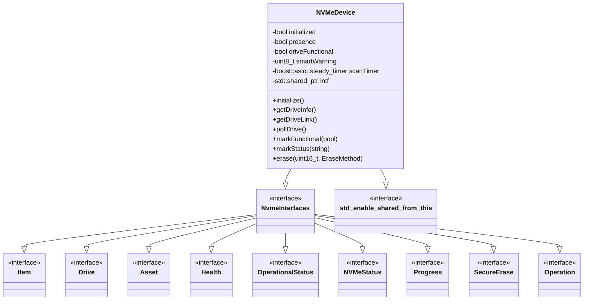

Sources: [include/NVMeDevice.hpp:54-65](), [include/NVMeDevice.hpp:26-53]()

The `NVMeDevice` class implements multiple D-Bus interfaces to represent various aspects of NVMe drives:

| Interface | Purpose |
|-----------|---------|
| Item | Basic inventory item functionality |
| Drive | Drive-specific properties (capacity, type, etc.) |
| Asset | Asset information (manufacturer, model, serial number) |
| Health | Drive health status representation |
| OperationalStatus | Drive operational state |
| NVMeStatus | NVMe-specific status information |
| Progress | Progress tracking for operations |
| SecureErase | Secure erase functionality |
| Operation | Drive operation management |

Sources: [include/NVMeDevice.hpp:26-53]()

## Device Lifecycle Management

The NVMeDevice class manages the complete lifecycle of NVMe devices, from discovery to monitoring and operation execution.

```mermaid
stateDiagram-v2
    [*] --> "Discovery" : System Start
    "Discovery" --> "Initialization" : Device Found
    "Discovery" --> "Missing" : No Device
    "Missing" --> "Discovery" : Scan Timer
    "Initialization" --> "Ready" : getDriveInfo Complete
    "Ready" --> "Health Monitoring" : Poll Timer
    "Health Monitoring" --> "Ready" : Update Status
    "Ready" --> "Sanitize Operation" : erase() Called
    "Sanitize Operation" --> "Monitoring Progress" : Operation Started
    "Monitoring Progress" --> "Ready" : Operation Complete
    "Health Monitoring" --> "Warning State" : SMART Warnings
    "Health Monitoring" --> "Critical State" : Drive Failure
    "Warning State" --> "Health Monitoring" : Poll Timer
    "Critical State" --> "Health Monitoring" : Poll Timer
```

Sources: [src/NVMeDevice.cpp:310-342](), [src/NVMeDevice.cpp:472-673](), [src/NVMeDevice.cpp:684-751]()

## Device Initialization and Discovery

The NVMeDevice initialization process follows these steps:

1. The `NVMeDevice` constructor sets up the object and prepares for initialization
2. The `initialize()` method is called to begin device discovery
3. The MCTP endpoint scan identifies NVMe controllers
4. Device information is retrieved via NVMe Management Interface commands
5. Regular polling is established for health monitoring

The `initialize()` method triggers the device discovery process:

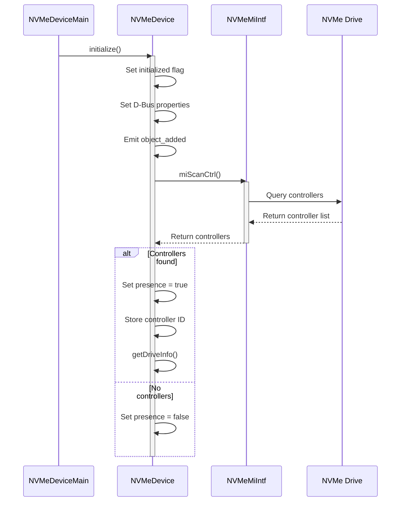

Sources: [src/NVMeDevice.cpp:310-342]()

## Device Information Collection

After initialization, the NVMeDevice collects detailed information about the drive using NVMe Admin commands:

1. `getDriveInfo()` - Retrieves basic device identification information
2. `getDriveLink()` - Retrieves PCIe link information

The device information process executes NVMe Identify commands through the Management Interface to collect:

- Manufacturer information
- Model number
- Serial number
- Firmware version
- Drive capacity
- Sanitize capabilities

Sources: [src/NVMeDevice.cpp:214-283](), [src/NVMeDevice.cpp:285-308]()

## Health Monitoring and Status Management

The NVMeDevice implements a robust health monitoring system through regular polling of the NVMe device's SMART data and health status.

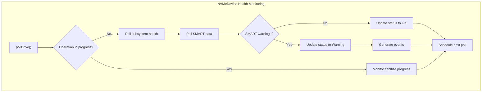

Sources: [src/NVMeDevice.cpp:472-673]()

The health monitoring system:

1. Uses a timer to regularly poll drive health (every 5 seconds by default)
2. Collects NVMe subsystem health status
3. Retrieves SMART log data
4. Analyzes critical warning fields
5. Updates drive health status based on detected issues
6. Generates appropriate events for detected issues

When issues are detected, the device status is updated through:

- `markFunctional()` - Updates the drive's functional status
- `markStatus()` - Updates the drive's health status
- `generateRedfishEventbySmart()` - Generates events for specific SMART warnings

Sources: [src/NVMeDevice.cpp:374-398](), [src/NVMeDevice.cpp:344-372](), [src/NVMeDevice.cpp:400-448]()

## Secure Erase Operations

The NVMeDevice supports NVMe sanitize operations for secure data erasure through several methods:

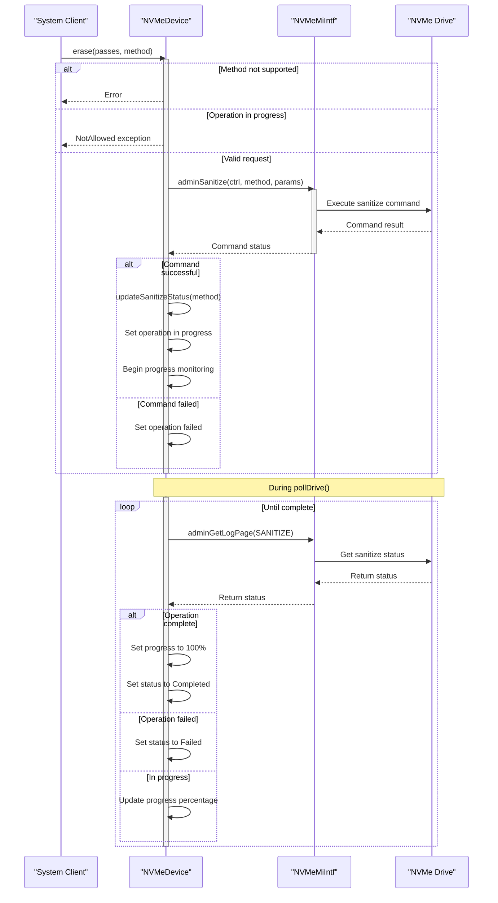

Sources: [src/NVMeDevice.cpp:684-751](), [src/NVMeDevice.cpp:450-469]()

The secure erase functionality supports three methods:
1. **Crypto Erase** - Invalidates the encryption key
2. **Block Erase** - Erases physical blocks
3. **Overwrite** - Overwrites data with patterns

The sanitize operation progress is monitored through:
1. Regular polling of sanitize log page
2. Tracking estimated completion time
3. Updating operation progress percentage
4. Reporting completion or failure status

Sources: [src/NVMeDevice.cpp:684-751](), [src/NVMeDevice.cpp:450-469](), [src/NVMeDevice.cpp:675-682]()

## System Integration

The NVMeDevice integrates with other system components through D-Bus interfaces:

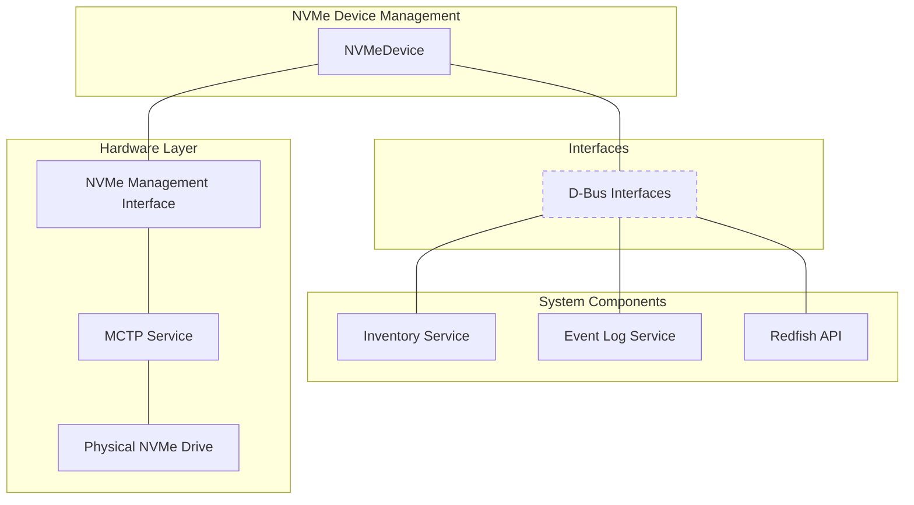

Sources: [include/NVMeDevice.hpp:54-65](), [src/NVMeDevice.cpp:400-448]()

Key integration points include:

1. **Inventory Integration**
   - Exposes drive information via standardized inventory interfaces
   - Updates drive properties and status

2. **Event Generation**
   - Creates log entries for drive failures and warnings
   - Generates Redfish events for critical conditions

3. **Operational Status Management**
   - Reports drive functional state
   - Updates health status for system monitoring

Sources: [src/NVMeDevice.cpp:344-372](), [src/NVMeDevice.cpp:400-448](), [src/NVMeDevice.cpp:374-398]()

---

# Page: MCTP Endpoint Discovery

# MCTP Endpoint Discovery

<details>
<summary>Relevant source files</summary>

The following files were used as context for generating this wiki page:

- [include/MCTPDiscovery.hpp](include/MCTPDiscovery.hpp)
- [src/NVMeDeviceMain.cpp](src/NVMeDeviceMain.cpp)

</details>


## Purpose and Scope

This document details the MCTP (Management Component Transport Protocol) Endpoint Discovery process in the NVIDIA NVMe Manager system. It covers how the system identifies NVMe storage devices by discovering MCTP endpoints that support NVMe Management Interface (NVMe-MI) communication. For information about the NVMe Management Interface itself, see [NVMe Management Interface](#2.3).

## Overview

MCTP Endpoint Discovery is a critical first step in the NVIDIA NVMe Manager's operation. The system must identify which MCTP endpoints in the platform represent NVMe drives before it can manage them. This discovery process leverages D-Bus communication to find endpoints that support the NVMe-MI message type and then creates appropriate device objects for them.

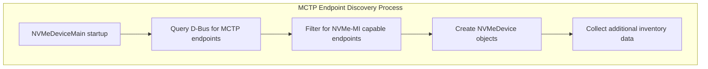

Sources: [src/NVMeDeviceMain.cpp:213-226](), [src/NVMeDeviceMain.cpp:124-211]()

## Discovery Components

The MCTP Endpoint Discovery subsystem consists of the following key components:

```mermaid
classDiagram
    class "GetObjects" {
        +shared_ptr~connection~ dbusConnection
        +function callback
        +ManagedObjectType respData
        +getPath()
        +getConfiguration()
    }
    
    class "handleMCTPEndpoints()" {
        Process discovered endpoints
        Create NVMeDevice objects
    }
    
    class "createDrives()" {
        Initiate MCTP endpoint discovery
    }
    
    class "NVMeDeviceMain" {
        Main application entry point
    }
    
    "NVMeDeviceMain" --> "createDrives()"
    "createDrives()" --> "GetObjects"
    "GetObjects" --> "handleMCTPEndpoints()"
    "handleMCTPEndpoints()" --> "NVMeDevice"
```

Sources: [include/MCTPDiscovery.hpp:71-212](), [src/NVMeDeviceMain.cpp:124-211](), [src/NVMeDeviceMain.cpp:213-226]()

## Discovery Process

### 1. Initialization and D-Bus Setup

The discovery process begins in the `main()` function, which initializes the D-Bus connection and sets up signal handlers for detecting when MCTP endpoints are added or removed.

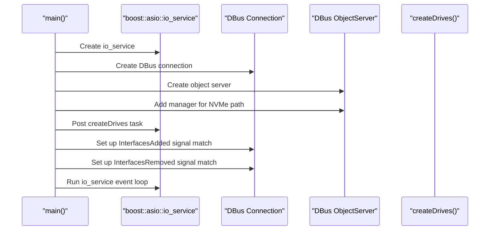

Sources: [src/NVMeDeviceMain.cpp:258-365]()

### 2. MCTP Endpoint Query

The `createDrives()` function initiates the discovery by creating a `GetObjects` instance that queries D-Bus for objects implementing specific interfaces related to MCTP endpoints.

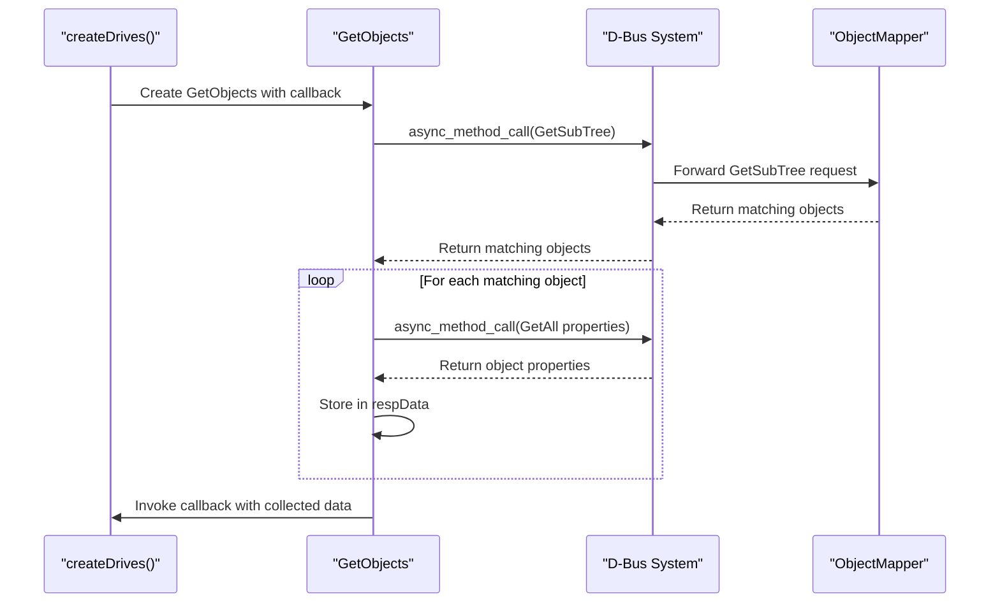

Sources: [include/MCTPDiscovery.hpp:127-202](), [src/NVMeDeviceMain.cpp:213-226]()

### 3. NVMe-Capable Endpoint Filtering

Once MCTP endpoints are discovered, the system filters for those that support the NVMe-MI message type through the `handleMCTPEndpoints()` function.

| Interface | Property | Purpose |
|-----------|----------|---------|
| xyz.openbmc_project.MCTP.Endpoint | EID | Endpoint Identifier |
| xyz.openbmc_project.MCTP.Endpoint | SupportedMessageTypes | Lists supported message types |
| xyz.openbmc_project.Common.UnixSocket | Address | Socket address for communication |
| xyz.openbmc_project.Inventory.Decorator.I2CDevice | Bus | I2C bus number |

Sources: [src/NVMeDeviceMain.cpp:124-169]()

### 4. NVMe Device Creation

For each endpoint that supports NVMe-MI, the system creates an `NVMeDevice` object and adds it to the drive map.

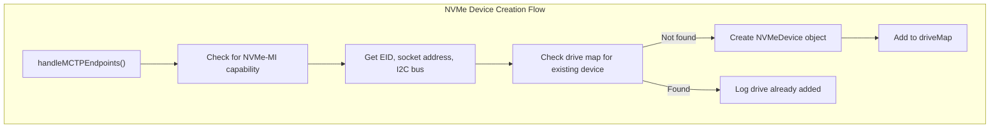

Sources: [src/NVMeDeviceMain.cpp:189-210]()

### 5. Inventory Collection

After creating NVMe device objects, the system collects additional inventory data through the `collectInventory()` function.

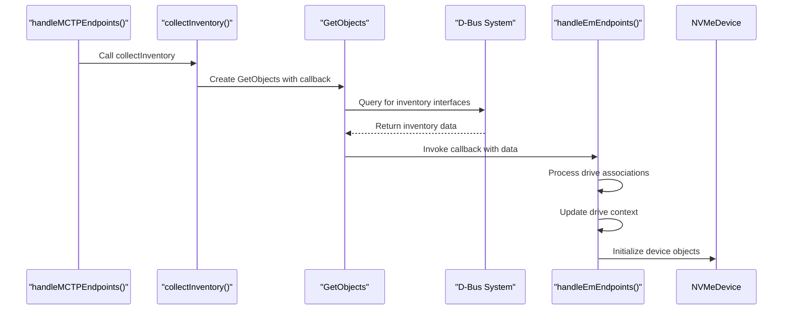

Sources: [src/NVMeDeviceMain.cpp:107-122](), [src/NVMeDeviceMain.cpp:20-105]()

## Key Data Structures

### ManagedObjectType

The core data structure used throughout the discovery process is `ManagedObjectType`, which stores D-Bus object paths mapped to their interfaces and properties.

```
ManagedObjectType = boost::container::flat_map<
    sdbusplus::message::object_path,      // Object path
    boost::container::flat_map<           // DbusObject
        std::string,                      // Interface name
        boost::container::flat_map<       // Properties
            std::string,                  // Property name
            BasicVariantType              // Property value
        >
    >
>
```

Sources: [include/MCTPDiscovery.hpp:32-34]()

## Dynamic Discovery and Monitoring

The NVIDIA NVMe Manager continues to monitor for new MCTP endpoints after initialization by setting up signal handlers for D-Bus `InterfacesAdded` and `InterfacesRemoved` events.

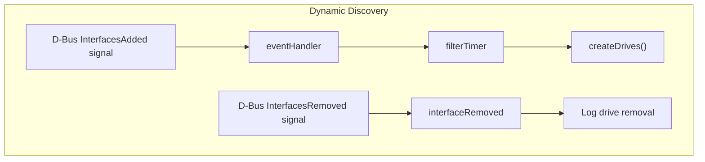

Sources: [src/NVMeDeviceMain.cpp:312-350]()

## Error Handling

The discovery process includes retry mechanisms for D-Bus operations that might fail temporarily. If an operation fails, the system will retry up to 5 times with a 10-second delay between attempts.

Sources: [include/MCTPDiscovery.hpp:85-126](), [include/MCTPDiscovery.hpp:127-202]()

## Integration with NVMe Device Management

Once MCTP endpoints are discovered and NVMeDevice objects are created, the system initializes them and begins monitoring their health status. For more details on NVMe device management, see [NVMe Device Management](#2.1).

Sources: [src/NVMeDeviceMain.cpp:190-202]()

---

# Page: NVMe Management Interface

# NVMe Management Interface

<details>
<summary>Relevant source files</summary>

The following files were used as context for generating this wiki page:

- [include/NVMeIntf.hpp](include/NVMeIntf.hpp)
- [include/NVMeMi.hpp](include/NVMeMi.hpp)
- [src/NVMeMi.cpp](src/NVMeMi.cpp)

</details>


The NVMe Management Interface (NVMeMi) provides a low-level communication channel between the NVIDIA NVMe Manager and physical NVMe storage devices. It implements the NVMe Management Interface protocol for executing administrative commands, monitoring drive health, performing secure operations, and other management functions through the MCTP (Management Component Transport Protocol).

For information about higher-level NVMe device management, see [NVMe Device Management](#2.1). For MCTP endpoint discovery, see [MCTP Endpoint Discovery](#2.2).

## Overview and Purpose

The NVMe Management Interface component encapsulates all the functionality required for direct interaction with NVMe drives using the NVMe-MI protocol specification. This interface acts as a bridge between the higher-level drive management logic and the physical storage hardware.

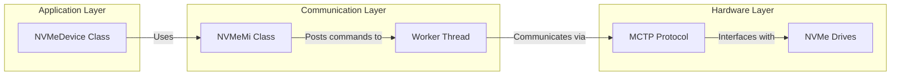

Sources: [include/NVMeMi.hpp:9-134](), [src/NVMeMi.cpp:28-111]()

## Architecture

The NVMe Management Interface is implemented through the `NVMeMi` class which inherits from `NVMeMiIntf`. It uses an asynchronous execution model with a dedicated worker thread to prevent blocking the main application while waiting for device responses.

```mermaid
classDiagram
    class NVMeMiIntf {
        <<interface>>
        +miPCIePortInformation()
        +miSubsystemHealthStatusPoll()
        +miScanCtrl()
        +adminIdentify()
        +adminGetLogPage()
        +adminSanitize()
        +adminFwCommit()
        +adminXfer()
        +adminSecuritySend()
        +adminSecurityReceive()
    }
    
    class NVMeMi {
        -nvme_mi_ep_t nvmeEP
        -std::shared_ptr<Worker> worker
        -boost::asio::io_context& io
        -std::mutex mctpMtx
        +NVMeMi(io_context, connection, sockName, eid)
        +miPCIePortInformation()
        +miSubsystemHealthStatusPoll()
        +miScanCtrl()
        +adminIdentify()
        +adminGetLogPage()
        +adminSanitize()
        +adminFwCommit()
        +adminXfer()
        +adminSecuritySend()
        +adminSecurityReceive()
    }
    
    class Worker {
        -bool workerStop
        -std::mutex workerMtx
        -std::condition_variable workerCv
        -boost::asio::io_context workerIO
        -std::thread thread
        +post(function)
    }
    
    NVMeMiIntf <|-- NVMeMi
    NVMeMi *-- Worker
```

Sources: [include/NVMeMi.hpp:9-134](), [include/NVMeIntf.hpp:116-256]()

### Worker Thread Implementation

The NVMe Management Interface uses a dedicated worker thread to execute commands without blocking the main application thread. This worker thread is implemented as an inner class (`Worker`) within the `NVMeMi` class.

Key characteristics of the worker thread implementation:

1. Each `NVMeMi` instance uses a shared worker to handle all commands for that endpoint
2. The worker thread runs in a loop, processing commands posted to its queue
3. Thread synchronization is handled via mutex and condition variable
4. The system avoids creating redundant workers for endpoints on the same bus

Sources: [src/NVMeMi.cpp:75-110](), [src/NVMeMi.cpp:113-126](), [include/NVMeMi.hpp:90-108]()

## Command Execution Flow

All NVMe-MI operations follow a similar asynchronous execution pattern:

1. Client code calls a method on the `NVMeMi` instance
2. The method validates parameters and endpoint availability
3. Command execution is posted to the worker thread
4. Worker thread executes the command via libnvme-mi library
5. Results are posted back to the main I/O context
6. Client-provided callback is invoked with results

```mermaid
sequenceDiagram
    participant Client as "Client Code"
    participant NVMeMi as "NVMeMi Instance"
    participant Worker as "Worker Thread"
    participant libnvme as "libnvme-mi Library"
    participant NVMe as "NVMe Device"

    Client->>NVMeMi: Call operation method
    NVMeMi->>NVMeMi: Validate parameters
    NVMeMi->>Worker: post(lambda function)
    activate Worker
    Worker->>libnvme: Execute NVMe-MI command
    libnvme->>NVMe: Send command via MCTP
    NVMe-->>libnvme: Return response
    libnvme-->>Worker: Return result
    Worker->>NVMeMi: Post callback to io_context
    deactivate Worker
    NVMeMi->>Client: Invoke callback with result
```

Sources: [src/NVMeMi.cpp:127-150](), [src/NVMeMi.cpp:382-409]()

## Key Interface Operations

The NVMe Management Interface provides several categories of operations for interacting with NVMe devices:

### Management Interface Commands

These commands interact directly with the NVMe Management Interface rather than with specific controllers:

| Method | Description | Source |
|--------|-------------|--------|
| `miPCIePortInformation` | Retrieves PCIe port information for the device | [src/NVMeMi.cpp:152-253]() |
| `miSubsystemHealthStatusPoll` | Polls the subsystem health status | [src/NVMeMi.cpp:255-316]() |
| `miScanCtrl` | Scans for available NVMe controllers | [src/NVMeMi.cpp:318-380]() |

Sources: [include/NVMeMi.hpp:25-33]()

### Administrative Commands

These commands are passed to a specific NVMe controller for execution:

| Method | Description | Source |
|--------|-------------|--------|
| `adminIdentify` | Retrieves identification information | [src/NVMeMi.cpp:382-556]() |
| `adminGetLogPage` | Retrieves various log pages (SMART, firmware, etc.) | [src/NVMeMi.cpp:687-952]() |
| `adminSanitize` | Initiates secure erase operations | [src/NVMeMi.cpp:612-685]() |
| `adminFwCommit` | Commits firmware updates | [src/NVMeMi.cpp:1043-1116]() |
| `adminSecuritySend` | Sends security protocol commands | [src/NVMeMi.cpp:1118-1150]() |
| `adminSecurityReceive` | Receives security protocol data | [src/NVMeMi.cpp:1152-1208]() |
| `adminXfer` | Raw NVMe admin command transfer interface | [src/NVMeMi.cpp:954-1041]() |

Sources: [include/NVMeMi.hpp:34-68](), [include/NVMeIntf.hpp:179-244]()

### Special Case: Telemetry Logs

The interface provides special handling for telemetry logs which can be large and require specific processing:

```mermaid
flowchart TD
    start["Request Telemetry Log"]
    getHeader["Get Telemetry Log Header"]
    calcSize["Calculate Full Log Size"]
    getFullLog["Retrieve Full Log"]
    returnLog["Return Log to Caller"]
    
    start --> getHeader
    getHeader --> calcSize
    calcSize --> getFullLog
    getFullLog --> returnLog
```

Sources: [src/NVMeMi.cpp:558-610](), [src/NVMeMi.cpp:826-861]()

## Error Handling and Status Reporting

The NVMe Management Interface handles errors at multiple levels:

1. **Protocol Errors**: Communication failures with the MCTP endpoint
2. **NVMe-MI Protocol Errors**: Standard response status codes from the NVMe-MI protocol
3. **NVMe Admin Command Errors**: Status codes returned by specific admin commands

Errors are propagated back to callers through the callback mechanism using standard C++ `std::error_code` objects.

The interface provides a helper function `statusToString` that translates numeric NVMe-MI response status codes into human-readable error messages.

Sources: [include/NVMeIntf.hpp:119-165](), [src/NVMeMi.cpp:907-934]()

## Initialization and Endpoint Management

When initialized, the NVMe Management Interface:

1. Creates or reuses a worker thread
2. Opens an MCTP endpoint using the specified socket and EID
3. Establishes communication with the NVMe device

```mermaid
flowchart LR
    init["NVMeMi Constructor"]
    getRoot["Get NVMe Root"]
    checkWorker["Check for Existing Worker"]
    createWorker["Create New Worker"]
    reuseWorker["Reuse Existing Worker"]
    openEP["Open MCTP Endpoint"]
    end["NVMeMi Ready"]
    
    init --> getRoot
    getRoot --> checkWorker
    checkWorker -->|"Not Found/Expired"| createWorker
    checkWorker -->|"Found"| reuseWorker
    createWorker --> openEP
    reuseWorker --> openEP
    openEP --> end
```

Sources: [src/NVMeMi.cpp:28-73](), [src/NVMeMi.cpp:14-26]()

## Performance Considerations

The NVMe Management Interface is designed with several performance considerations:

1. **Worker Thread Pooling**: The interface reuses worker threads for multiple endpoints on the same bus, avoiding thread proliferation
2. **Asynchronous I/O**: All operations are non-blocking and use callbacks
3. **Request Batching**: For operations like telemetry log retrieval, the interface intelligently batches requests to minimize round trips
4. **Timeouts**: Commands can specify timeouts to prevent hangs on unresponsive devices

Sources: [include/NVMeMi.hpp:110-118](), [src/NVMeMi.cpp:996-1003]()

## Integration with NVMeDevice

The NVMe Management Interface is typically used by the `NVMeDevice` class to perform management operations on specific drives. The `NVMeDevice` class maintains a higher-level abstraction of the drive while delegating low-level commands to the NVMeMi interface.

For detailed information about how the NVMeDevice class integrates with the NVMeMi interface, see [NVMeDevice Class](#3.1).

---

# Page: Key Components

# Key Components

<details>
<summary>Relevant source files</summary>

The following files were used as context for generating this wiki page:

- [src/NVMeDevice.cpp](src/NVMeDevice.cpp)
- [src/NVMeDeviceMain.cpp](src/NVMeDeviceMain.cpp)
- [src/NVMeMi.cpp](src/NVMeMi.cpp)

</details>


This page provides an overview of the major software components that make up the NVIDIA NVMe Manager system. It covers the primary classes, their responsibilities, and how they interact to provide NVMe drive management capabilities. For detailed information about the overall system architecture, see [System Architecture](#2).

## Component Overview

The NVIDIA NVMe Manager consists of several key components that work together to discover, monitor, and manage NVMe drives within a system. These components handle tasks such as:

- Discovering NVMe devices through MCTP endpoints
- Monitoring drive health status
- Managing drive lifecycle events
- Providing interfaces for drive operations (e.g., secure erase)
- Communicating with other system services via D-Bus

### Component Relationship Diagram

```mermaid
graph TD
    subgraph "Application Entry Point"
        NVMeDeviceMain["NVMeDeviceMain"]
    end
    
    subgraph "Device Management"
        DriveMap["DriveMap (shared)"]
        NVMeDevice["NVMeDevice"]
    end
    
    subgraph "Communication Layer"
        NVMeMi["NVMeMi"]
        Worker["NVMeMi::Worker"]
    end
    
    subgraph "External Interfaces"
        DBus["D-Bus System"]
        MCTP["MCTP Protocol"]
    end
    
    NVMeDeviceMain -->|"creates/manages"| DriveMap
    NVMeDeviceMain -->|"discovers via"| MCTP
    DriveMap -->|"contains"| NVMeDevice
    NVMeDevice -->|"communicates through"| NVMeMi
    NVMeMi -->|"delegates commands to"| Worker
    NVMeMi -->|"sends requests via"| MCTP
    NVMeDeviceMain -->|"registers with"| DBus
    NVMeDevice -->|"publishes interfaces on"| DBus
```

Sources: [src/NVMeDeviceMain.cpp:125-212](), [src/NVMeDevice.cpp:31-53](), [src/NVMeMi.cpp:14-73]()

## Key Classes

The system is built around several key classes, each with specific responsibilities in the NVMe drive management ecosystem.

### NVMeDeviceMain

The NVMeDeviceMain class serves as the application entry point and central coordinator. It is responsible for:

- Initializing the D-Bus connection and object server
- Discovering MCTP endpoints that support NVMe-MI
- Creating and managing NVMeDevice instances
- Setting up event handlers for device addition/removal

This component maintains a global drive map (accessible via `getDriveMap()`) that tracks all NVMe devices in the system.

```mermaid
classDiagram
    class NVMeDeviceMain {
        +main()
        +createDrives()
        +handleMCTPEndpoints()
        +collectInventory()
        +interfaceRemoved()
    }
    
    class DriveMap {
        +unordered_map~uint8_t, shared_ptr~NVMeDevice~ driveMap
    }
    
    NVMeDeviceMain --> DriveMap : uses
```

Sources: [src/NVMeDeviceMain.cpp:258-365](), [src/NVMeDeviceMain.cpp:14-18]()

### NVMeDevice

The NVMeDevice class represents a single NVMe drive in the system. It handles:

- Initialization and discovery of drive properties
- Monitoring of drive health and status
- Execution of drive operations (e.g., secure erase)
- Updating D-Bus interfaces with drive information
- Event generation for critical conditions

Each NVMeDevice instance is created when a compatible MCTP endpoint is discovered and is responsible for the complete lifecycle management of that specific drive.

```mermaid
classDiagram
    class NVMeDevice {
        -boost::asio::steady_timer scanTimer
        -std::string objPath
        -boolean initialized
        -boolean presence
        -boolean driveFunctional
        -uint8_t smartWarning
        -boolean inProgress
        +initialize()
        +getDriveInfo()
        +pollDrive()
        +markFunctional(bool)
        +erase(uint16_t, EraseMethod)
    }
    
    class NVMeIntf {
        +getInterface()
    }
    
    NVMeDevice --> NVMeIntf : uses
```

Sources: [src/NVMeDevice.cpp:31-53](), [src/NVMeDevice.cpp:310-342](), [src/NVMeDevice.cpp:472-673]()

### NVMeMi

The NVMeMi class provides the low-level NVMe Management Interface functionality. It:

- Establishes communication with NVMe devices via MCTP
- Executes NVMe-MI and Admin commands
- Manages asynchronous command execution
- Handles errors and retry logic

NVMeMi uses a worker thread model to execute commands asynchronously, preventing blocking of the main application thread.

```mermaid
classDiagram
    class NVMeMi {
        -boost::asio::io_context& io
        -std::shared_ptr~Worker~ worker
        -nvme_mi_ep_t nvmeEP
        +miPCIePortInformation(callback)
        +miSubsystemHealthStatusPoll(callback)
        +miScanCtrl(callback)
        +adminIdentify(ctrl, cns, nsid, cntid, readLength, callback)
        +adminGetLogPage(ctrl, lid, nsid, lsp, callback)
        +adminSanitize(ctrl, sanact, owpass, owpattern, callback)
    }
    
    class Worker {
        -std::thread thread
        -boost::asio::io_context workerIO
        -std::mutex workerMtx
        -std::condition_variable workerCv
        -boolean workerStop
        +post(function~void(void)~)
    }
    
    NVMeMi --> Worker : uses
```

Sources: [src/NVMeMi.cpp:28-73](), [src/NVMeMi.cpp:75-126](), [src/NVMeMi.cpp:152-1208]()

## Asynchronous Operation Model

The NVIDIA NVMe Manager uses an asynchronous operation model to handle NVMe commands without blocking the main application thread. This is particularly important for operations that might take a long time to complete, such as drive identification, health polling, and secure erase operations.

### Worker Thread Architecture

```mermaid
sequenceDiagram
    participant Main as Main Thread
    participant NVMeDevice as NVMeDevice
    participant NVMeMi as NVMeMi
    participant Worker as Worker Thread
    participant MCTP as MCTP/NVMe Hardware
    
    Main->>NVMeDevice: Initialize drive
    NVMeDevice->>NVMeMi: Execute command (e.g., identify)
    NVMeMi->>Worker: post(command function)
    Worker->>MCTP: Execute NVMe-MI command
    Note over Worker,MCTP: Command executes asynchronously
    MCTP-->>Worker: Command response
    Worker-->>NVMeMi: Process response
    NVMeMi-->>NVMeDevice: Callback with results
    NVMeDevice-->>Main: Update D-Bus interfaces
```

Sources: [src/NVMeMi.cpp:75-126](), [src/NVMeMi.cpp:128-150]()

The worker thread model ensures that:
- Long-running NVMe operations don't block the main application
- Multiple commands can be processed concurrently
- The system remains responsive during intensive operations

## Key Operations

### Drive Discovery and Initialization

When the application starts, it performs the following sequence to discover and initialize NVMe drives:

1. NVMeDeviceMain discovers MCTP endpoints through D-Bus
2. For each endpoint that supports NVMe-MI, an NVMeDevice object is created
3. The NVMeDevice initializes itself by:
   - Creating an NVMeMi interface to communicate with the hardware
   - Scanning for controllers on the device
   - Retrieving drive information (model, serial number, etc.)
   - Setting up periodic health monitoring

```mermaid
flowchart TD
    Start["NVMeDeviceMain starts"] --> DiscoverMCTP["Discover MCTP endpoints"]
    DiscoverMCTP --> FilterNVMe["Filter for NVMe-MI capability"]
    FilterNVMe --> CreateDevices["Create NVMeDevice objects"]
    CreateDevices --> InitDevices["Initialize each device"]
    InitDevices --> ScanCtrl["Scan for controllers"]
    ScanCtrl --> GetInfo["Get drive information"]
    GetInfo --> StartPolling["Start health polling"]
```

Sources: [src/NVMeDeviceMain.cpp:213-226](), [src/NVMeDeviceMain.cpp:125-211](), [src/NVMeDevice.cpp:310-342]()

### Drive Health Monitoring

NVMeDevice objects continuously monitor the health of their associated drives:

1. A timer triggers periodic health checks via `pollDrive()`
2. The device queries health status through NVMeMi
3. SMART attributes and subsystem health status are analyzed
4. Critical conditions trigger status updates and event generation
5. Health information is published through D-Bus interfaces

The health monitoring cycle identifies issues such as:
- Drive failure
- Spare capacity warnings
- Temperature problems
- Media errors
- Backup device failures

Sources: [src/NVMeDevice.cpp:472-673](), [src/NVMeDevice.cpp:400-448]()

### Secure Erase Operations

The NVMe Manager provides secure erase capability through the following sequence:

1. An erase request is received through D-Bus
2. The NVMeDevice validates the request and supported erase methods
3. An appropriate sanitize command is sent via NVMeMi
4. The operation progress is monitored through periodic status checks
5. Status updates are published through D-Bus interfaces

Three sanitize operations are supported:
- Crypto Erase - Fast, cryptographically erases the drive
- Block Erase - Performs a low-level block erase
- Overwrite - Overwrites the entire drive with a pattern

Sources: [src/NVMeDevice.cpp:674-751](), [src/NVMeMi.cpp:612-685]()

## Summary Table of Component Responsibilities

| Component | Primary Responsibilities |
|-----------|--------------------------|
| NVMeDeviceMain | Application entry point, MCTP endpoint discovery, NVMeDevice creation and management |
| NVMeDevice | Drive representation, health monitoring, drive operations, D-Bus interface management |
| NVMeMi | Low-level NVMe-MI command execution, asynchronous operation handling |
| Worker | Asynchronous command processing, thread management |
| DriveMap | Central repository of NVMeDevice objects |

Sources: [src/NVMeDeviceMain.cpp](), [src/NVMeDevice.cpp](), [src/NVMeMi.cpp]()

---

# Page: NVMeDevice Class

# NVMeDevice Class

<details>
<summary>Relevant source files</summary>

The following files were used as context for generating this wiki page:

- [include/NVMeDevice.hpp](include/NVMeDevice.hpp)
- [src/NVMeDevice.cpp](src/NVMeDevice.cpp)

</details>


The NVMeDevice class is the core component responsible for managing individual NVMe storage devices within the NVIDIA NVMe Manager system. It provides functionality for device initialization, health monitoring, secure erase operations, and status reporting through D-Bus interfaces.

For information about the overall system architecture, see [System Architecture](#2). For details about the NVMe Management Interface implementation, see [NVMe Management Interface](#2.3).

## Class Overview and Position in Architecture

The NVMeDevice class represents a single NVMe drive in the system. It communicates with the physical device using the NVMeMi (NVMe Management Interface) and exposes device information and capabilities through D-Bus interfaces.

```mermaid
classDiagram
    class NvmeInterfaces {
        "Combines multiple D-Bus interfaces"
    }
    
    class std_enable_shared_from_this {
        "+shared_from_this()"
    }
    
    class NVMeDevice {
        "-boost::asio::steady_timer scanTimer"
        "-std::string objPath"
        "-bool initialized"
        "-bool presence"
        "-bool driveFunctional"
        "-uint8_t smartWarning"
        "-bool inProgress"
        "+initialize()"
        "+getDriveInfo()"
        "+pollDrive()"
        "+markFunctional(bool)"
        "+erase(uint16_t, EraseMethod)"
    }
    
    NvmeInterfaces <|-- NVMeDevice : "implements"
    std_enable_shared_from_this <|-- NVMeDevice : "extends"
```

Sources: [include/NVMeDevice.hpp:54-65](), [src/NVMeDevice.cpp:31-53]()

## Implemented Interfaces

NVMeDevice implements multiple D-Bus interfaces to provide functionality and report status:

| Interface | Purpose |
|-----------|---------|
| Item | Basic inventory item attributes |
| StorageController | Storage controller specific attributes |
| PortInfo | PCIe port information |
| Drive | Drive-specific attributes like capacity and type |
| Health | Drive health status |
| OperationalStatus | Functional status information |
| Asset | Manufacturer, model, and serial number |
| Version | Firmware version |
| NVMeStatus | NVMe-specific status like drive life and SMART warnings |
| Associations | Associations with other objects |
| Progress | Operation progress tracking |
| SecureErase | Secure erase capabilities and operations |
| Operation | Drive operation status |

Sources: [include/NVMeDevice.hpp:54-56](), [include/NVMeDevice.hpp:26-52]()

## Component Interactions

NVMeDevice interacts with multiple system components to provide NVMe drive management:

```mermaid
graph TD
    subgraph "Main Application" 
        NVMeDeviceMain["NVMeDeviceMain"]
    end
    
    subgraph "Device Management"
        NVMeDevice["NVMeDevice"]
    end
    
    subgraph "Communication"
        NVMeMi["NVMe Management Interface"]
        DBus["D-Bus System"]
    end
    
    subgraph "Hardware"
        NVMeDrive["NVMe Drive Hardware"]
    end
    
    subgraph "External Systems"
        Redfish["Redfish API"]
        LogService["Logging Service"]
    end
    
    NVMeDeviceMain -->|"creates"| NVMeDevice
    NVMeDevice -->|"uses"| NVMeMi
    NVMeMi -->|"sends commands to"| NVMeDrive
    NVMeDevice -->|"exposes interfaces on"| DBus
    NVMeDevice -->|"generates events for"| LogService
    NVMeDevice -->|"supplies data for"| Redfish
```

Sources: [src/NVMeDevice.cpp:31-53](), [src/NVMeDevice.cpp:674-751]()

## Key Properties and Fields

The NVMeDevice class maintains state information for each drive:

| Field | Type | Purpose |
|-------|------|---------|
| initialized | bool | Indicates if the device has been initialized |
| presence | bool | Indicates physical presence of the drive |
| driveFunctional | bool | Indicates if the drive is functioning correctly |
| smartWarning | uint8_t | Stores SMART warning flags |
| inProgress | bool | Indicates if an operation is in progress |
| eid | uint8_t | MCTP Endpoint ID |
| bus | uint32_t | I2C bus number |
| ctrl | nvme_mi_ctrl_t | NVMe controller handle |

Sources: [include/NVMeDevice.hpp:180-195]()

## Initialization Flow

When a new NVMe device is detected, it undergoes the following initialization process:

```mermaid
sequenceDiagram
    participant Main as "NVMeDeviceMain"
    participant Device as "NVMeDevice"
    participant MI as "NVMeMi"
    participant Drive as "NVMe Drive"
    
    Main->>Device: "Create NVMeDevice"
    Note over Device: "Constructor initializes base properties"
    Main->>Device: "initialize()"
    
    Device->>MI: "miScanCtrl()"
    MI->>Drive: "Discover controllers"
    Drive-->>MI: "Return controller info"
    MI-->>Device: "Controller list"
    
    Note over Device: "If no controllers found, mark not present"
    
    Device->>Device: "getDriveInfo()"
    Device->>MI: "adminIdentify()"
    MI->>Drive: "NVME_IDENTIFY_CNS_CTRL command"
    Drive-->>MI: "Return identity data"
    MI-->>Device: "Controller identification"
    
    Device->>Device: "Update manufacturer, serial, model"
    Device->>Device: "Update firmware version"
    Device->>Device: "Update capacity"
    Device->>Device: "Update sanitize capability"
    
    Device->>Device: "getDriveLink()"
    Device->>MI: "miPCIePortInformation()"
    MI->>Drive: "Query PCIe port info"
    Drive-->>MI: "Return port info"
    MI-->>Device: "PCIe port information"
    
    Device->>Device: "Update max and current link speed"
    Device->>Device: "Begin pollDrive() cycle"
```

Sources: [src/NVMeDevice.cpp:310-342](), [src/NVMeDevice.cpp:214-283](), [src/NVMeDevice.cpp:285-308]()

## Health Monitoring

A key function of NVMeDevice is to monitor drive health through regular polling:

```mermaid
sequenceDiagram
    participant Device as "NVMeDevice"
    participant MI as "NVMeMi"
    participant Drive as "NVMe Drive"
    participant DBus as "D-Bus"
    participant Log as "Logging Service"
    
    loop "Every pollInterval seconds"
        Device->>MI: "miSubsystemHealthStatusPoll()"
        MI->>Drive: "Query health status"
        Drive-->>MI: "Return health status"
        MI-->>Device: "Health status data"
        
        Note over Device: "Update driveLifeUsed and predictedMediaLifeLeft"
        
        Device->>MI: "adminGetLogPage(NVME_LOG_LID_SMART)"
        MI->>Drive: "Request SMART log"
        Drive-->>MI: "Return SMART data"
        MI-->>Device: "SMART log data"
        
        alt "Critical warnings changed"
            Device->>Device: "Update NVMeStatus properties"
            Device->>Device: "markStatus() to update health"
            Device->>Log: "generateRedfishEventbySmart()"
            Log-->>DBus: "Create log entry"
        end
        
        Device->>Device: "Schedule next poll"
    end
```

Sources: [src/NVMeDevice.cpp:472-673](), [src/NVMeDevice.cpp:400-448]()

## Secure Erase Operations

NVMeDevice supports secure erase operations using the NVMe sanitize command:

```mermaid
sequenceDiagram
    participant User as "System/User"
    participant Device as "NVMeDevice"
    participant MI as "NVMeMi"
    participant Drive as "NVMe Drive"
    
    User->>Device: "erase(passes, method)"
    
    alt "Operation already in progress"
        Device-->>User: "Throw NotAllowed exception"
    end
    
    alt "Method not supported"
        Device-->>User: "Error: method not supported"
    end
    
    alt "method == EraseMethod::Overwrite"
        Device->>MI: "adminSanitize(NVME_SANITIZE_SANACT_START_OVERWRITE)"
    else "method == EraseMethod::CryptoErase"
        Device->>MI: "adminSanitize(NVME_SANITIZE_SANACT_START_CRYPTO_ERASE)"
    else "method == EraseMethod::BlockErase"
        Device->>MI: "adminSanitize(NVME_SANITIZE_SANACT_START_BLOCK_ERASE)"
    end
    
    MI->>Drive: "Execute sanitize command"
    MI-->>Device: "Command result"
    
    alt "Command succeeded"
        Device->>Device: "updateSanitizeStatus(type)"
        Device->>Device: "Set operation in progress"
    else "Command failed"
        Device->>Device: "Set status to Failed"
    end
    
    loop "During pollDrive() while inProgress"
        Device->>MI: "adminGetLogPage(NVME_LOG_LID_SANITIZE)"
        MI->>Drive: "Query sanitize status"
        Drive-->>MI: "Return status"
        MI-->>Device: "Sanitize log"
        
        alt "Sanitize complete"
            Device->>Device: "Set status to Completed"
            Device->>Device: "Set progress to 100%"
            Device->>Device: "Set inProgress to false"
        else "Sanitize failed"
            Device->>Device: "Set status to Failed"
            Device->>Device: "Set inProgress to false"
        else "Sanitize in progress"
            Device->>Device: "Update progress percentage"
        end
    end
    
    Device-->>User: "Operation result via D-Bus properties"
```

Sources: [src/NVMeDevice.cpp:674-751](), [src/NVMeDevice.cpp:450-470](), [src/NVMeDevice.cpp:497-572]()

## Status Reporting and Event Generation

NVMeDevice reports status changes and generates events through D-Bus:

| Function | Purpose |
|----------|---------|
| markFunctional() | Updates the functional status of the drive and generates events for drive failures |
| markStatus() | Updates the health status and associations |
| generateRedfishEventbySmart() | Creates Redfish events for specific SMART warnings |

When critical errors are detected, the NVMeDevice generates events through the logging service with appropriate resolution information.

Sources: [src/NVMeDevice.cpp:344-372](), [src/NVMeDevice.cpp:374-398](), [src/NVMeDevice.cpp:400-448]()

## Key Methods

| Method | Description |
|--------|-------------|
| initialize() | Initializes the device, discovers controllers, and begins health monitoring |
| getDriveInfo() | Retrieves drive identification information using NVMe Admin commands |
| getDriveLink() | Retrieves PCIe link information |
| pollDrive() | Periodically polls device health and handles ongoing sanitize operations |
| erase() | Initiates a secure erase operation with specified method |
| markFunctional() | Updates the functional status and generates appropriate events |
| markStatus() | Updates the health status and associations |

Sources: [include/NVMeDevice.hpp:83-147](), [src/NVMeDevice.cpp:310-751]()

---

# Page: NVMeDeviceMain

# NVMeDeviceMain

<details>
<summary>Relevant source files</summary>

The following files were used as context for generating this wiki page:

- [src/NVMeDeviceMain.cpp](src/NVMeDeviceMain.cpp)

</details>


## Purpose and Overview

The `NVMeDeviceMain` component serves as the main application entry point and central coordinator for the NVIDIA NVMe Manager system. It is responsible for discovering NVMe devices via MCTP (Management Component Transport Protocol) endpoints, creating and managing device objects for each discovered drive, and handling device lifecycle events.

This document focuses specifically on the main application structure and MCTP endpoint management. For information about the NVMe device representation, see [NVMeDevice Class](#3.1), and for details on the low-level NVMe communication, see [NVMe Management Interface](#3.3).

Sources: [src/NVMeDeviceMain.cpp:258-365]()

## Component Architecture

The `NVMeDeviceMain` component orchestrates the discovery and management of NVMe devices by connecting various subsystems together. It acts as the central hub that initializes the system, discovers and monitors devices, and manages their lifecycle.

### Architecture Diagram

```mermaid
graph TD
    subgraph "NVMeDeviceMain Application"
        main["main()"]
        createDrives["createDrives()"]
        handleMCTP["handleMCTPEndpoints()"]
        collectInventory["collectInventory()"]
        interfaceRemoved["interfaceRemoved()"]
        getDriveMap["getDriveMap()"]
    end
    
    subgraph "External Systems"
        DBus["D-Bus System"]
        MCTP["MCTP Service"]
        Inventory["Inventory Service"]
    end
    
    subgraph "Device Management"
        DriveMap["driveMap (static unordered_map)"]
        NVMeDevice["NVMeDevice objects"]
    end
    
    main --> createDrives
    main --> DBus
    createDrives --> handleMCTP
    createDrives --> collectInventory
    handleMCTP --> getDriveMap
    handleMCTP --> NVMeDevice
    collectInventory --> Inventory
    interfaceRemoved --> DriveMap
    
    MCTP --> main
    DBus --> main
    
    handleMCTP --> DriveMap
    getDriveMap --> DriveMap
    DriveMap --> NVMeDevice
```

Sources: [src/NVMeDeviceMain.cpp:14-18](), [src/NVMeDeviceMain.cpp:124-211](), [src/NVMeDeviceMain.cpp:258-365]()

## Core Data Structures

The primary data structure in `NVMeDeviceMain` is the drive map, which maintains a collection of all active NVMe device objects keyed by their Endpoint ID (EID).

```mermaid
classDiagram
    class DriveMap {
        "static std::unordered_map<uint8_t, std::shared_ptr<NVMeDevice>> driveMap"
        "getDriveMap()"
    }
    
    class NVMeDevice {
        "NVMeDevice(io, objectServer, dbusConnection, eid, bus, addr, path)"
        "initialize()"
        "getI2CBus()"
        "updateFormFactor()"
    }
    
    DriveMap "1" --> "*" NVMeDevice : contains
```

Sources: [src/NVMeDeviceMain.cpp:14-18]()

## Key Functions

### Main Application Flow

The `main()` function initializes the application environment and sets up the necessary event handlers and signal matchers for device discovery and management.

Key responsibilities include:
- Setting up the Boost ASIO IO service
- Creating a D-Bus connection
- Configuring signal handlers for MCTP endpoint discovery
- Initializing the drive discovery process
- Setting up event handlers for interface additions and removals
- Running the main event loop

Sources: [src/NVMeDeviceMain.cpp:258-365]()

### Drive Discovery and Management

```mermaid
sequenceDiagram
    participant Main as "main()"
    participant CreateDrives as "createDrives()"
    participant Getter as "GetObjects"
    participant Handler as "handleMCTPEndpoints()"
    participant DriveMap as "driveMap"
    participant Device as "NVMeDevice"
    participant Inventory as "collectInventory()"
    
    Main->>CreateDrives: Call to discover drives
    CreateDrives->>Getter: Create GetObjects for MCTP endpoints
    Getter-->>Handler: Return discovered endpoints
    
    loop For each endpoint
        Handler->>Handler: Check for NVMe capability
        alt NVMe-capable endpoint
            Handler->>DriveMap: Check if drive exists
            alt New drive
                Handler->>Device: Create new NVMeDevice
                Device-->>DriveMap: Store in driveMap
            end
        end
    end
    
    Handler->>Inventory: Collect inventory data
    Inventory-->>Device: Update device information
```

Sources: [src/NVMeDeviceMain.cpp:213-226](), [src/NVMeDeviceMain.cpp:124-211]()

### MCTP Endpoint Handling

The `handleMCTPEndpoints()` function processes discovered MCTP endpoints to identify NVMe-capable devices and create corresponding `NVMeDevice` objects. It:

1. Examines each endpoint for NVMe Management Interface (NVMe-MI) capability
2. Extracts the endpoint ID (EID) and communication address
3. Retrieves I2C bus information if available
4. Creates new `NVMeDevice` objects for previously undiscovered endpoints
5. Stores new devices in the drive map for lifecycle management

Sources: [src/NVMeDeviceMain.cpp:124-211]()

### Inventory Collection

The `collectInventory()` function retrieves inventory data from the system to enhance drive information:

1. Creates a `GetObjects` instance to query the system inventory service
2. Requests inventory items with specific interfaces related to drives, NVMe, I2C devices, and location information
3. Processes the retrieved data in `handleEmEndpoints()` to update drive properties
4. Initializes drives with the collected information

Sources: [src/NVMeDeviceMain.cpp:107-122](), [src/NVMeDeviceMain.cpp:20-105]()

## Event Handling

`NVMeDeviceMain` employs an event-driven architecture to respond to changes in the system, such as:

### Interface Addition
When a new MCTP endpoint or NVMe drive is added to the system, the application receives a D-Bus signal and triggers the drive discovery process after a short debounce period.

### Interface Removal
When an MCTP endpoint is removed, the `interfaceRemoved()` function is called to handle the cleanup of the corresponding NVMe device object.

```mermaid
flowchart TD
    subgraph "Signal Handling"
        DBusSignal["D-Bus InterfacesAdded Signal"]
        Timer["filterTimer (debounce)"]
        Discovery["createDrives() / collectInventory()"]
        
        RemoveSignal["D-Bus InterfacesRemoved Signal"]
        RemoveHandler["interfaceRemoved()"]
    end
    
    DBusSignal --> Timer
    Timer --> Discovery
    
    RemoveSignal --> RemoveHandler
    RemoveHandler --> |"Find and remove drive"| DriveMap["driveMap"]
```

Sources: [src/NVMeDeviceMain.cpp:312-332](), [src/NVMeDeviceMain.cpp:228-256]()

## System Integration

`NVMeDeviceMain` integrates with several other system components:

1. **D-Bus System**: Used for inter-process communication and signal handling
2. **MCTP Service**: Provides endpoint discovery and communication channel to NVMe devices
3. **Inventory Service**: Supplies detailed information about NVMe drives
4. **Storage Interface**: Exposes drive information through a standardized interface

```mermaid
graph TB
    subgraph "NVMeDeviceMain"
        Main["main()"]
        DriveMap["driveMap"]
    end
    
    subgraph "System Services"
        DBus["D-Bus"]
        MCTP["MCTP Service"]
        Inventory["Inventory Service"]
    end
    
    subgraph "Components"
        NVMeDevice["NVMeDevice Objects"]
        MCTPDiscovery["MCTP Discovery"]
        StorageIface["Storage Interface"]
    end
    
    Main --> DBus
    Main --> MCTP
    Main --> MCTPDiscovery
    Main --> StorageIface
    
    MCTPDiscovery --> MCTP
    Main --> DriveMap
    DriveMap --> NVMeDevice
    
    Inventory --> NVMeDevice
    NVMeDevice --> DBus
```

Sources: [src/NVMeDeviceMain.cpp:297-301](), [src/NVMeDeviceMain.cpp:267-271]()

## Error Handling

The main function includes robust error handling to catch and log any exceptions that occur during operation. This ensures that unexpected errors don't crash the application without proper logging.

Sources: [src/NVMeDeviceMain.cpp:354-364]()

---

# Page: NVMeMi Class

# NVMeMi Class

<details>
<summary>Relevant source files</summary>

The following files were used as context for generating this wiki page:

- [include/NVMeMi.hpp](include/NVMeMi.hpp)
- [src/NVMeMi.cpp](src/NVMeMi.cpp)

</details>


## Purpose

The NVMeMi class provides the low-level interface for communicating with NVMe storage devices using the NVMe Management Interface (NVMe-MI) protocol over MCTP (Management Component Transport Protocol). It implements operations for drive health monitoring, controller scanning, device identification, log page retrieval, and administrative commands like secure erase operations. This class serves as the critical bridge between the NVMe Manager and the physical NVMe devices.

For information about the high-level NVMe device management, see [NVMeDevice Class](#3.1).

Sources: [include/NVMeMi.hpp:9-10](), [src/NVMeMi.cpp:28-73]()

## Class Architecture

NVMeMi inherits from NVMeMiIntf interface and uses std::enable_shared_from_this for proper lifecycle management. It implements a worker thread model for executing NVMe-MI commands asynchronously to avoid blocking the main application thread.

### Class Relationship Diagram

```mermaid
classDiagram
    class NVMeMiIntf {
        <<interface>>
        +miPCIePortInformation()
        +miSubsystemHealthStatusPoll()
        +miScanCtrl()
        +adminIdentify()
        +adminGetLogPage()
        +adminSanitize()
        +adminFwCommit()
        +adminXfer()
        +adminSecuritySend()
        +adminSecurityReceive()
    }
    
    class NVMeMi {
        -nvme_mi_ep_t nvmeEP
        -std::shared_ptr<Worker> worker
        -boost::asio::io_context& io
        -std::mutex mctpMtx
        +NVMeMi(io_context&, connection&, vector<uint8_t>, uint8_t)
        +miPCIePortInformation()
        +miSubsystemHealthStatusPoll()
        +miScanCtrl()
        +adminIdentify()
        +adminGetLogPage()
        +adminSanitize()
        +adminFwCommit()
        +adminXfer()
        +adminSecuritySend()
        +adminSecurityReceive()
        -post(function<void()>)
        -tryPost(function<void()>)
    }
    
    class Worker {
        -bool workerStop
        -std::mutex workerMtx
        -std::condition_variable workerCv
        -boost::asio::io_context workerIO
        -std::thread thread
        +Worker()
        +~Worker()
        +post(function<void()>)
    }
    
    class NVMeDevice {
        -boost::asio::steady_timer scanTimer
        -std::shared_ptr<NVMeMi> nvmeMi
        +initialize()
        +getDriveInfo()
        +pollDrive()
        +markFunctional(bool)
        +erase()
    }
    
    NVMeMiIntf <|-- NVMeMi : implements
    NVMeMi o-- Worker : contains
    NVMeDevice --> NVMeMi : uses
```

Sources: [include/NVMeMi.hpp:9-10](), [include/NVMeMi.hpp:90-108](), [src/NVMeMi.cpp:75-110]()

## Worker Thread Model

The NVMeMi class uses a dedicated worker thread model to handle asynchronous operations without blocking the main application thread. The worker thread executes NVMe-MI commands and posts results back to the main IO context upon completion.

### Key features of the worker thread model:

1. **Thread pooling**: Worker threads are shared among NVMe-MI endpoints that use the same underlying bus, preventing unnecessary thread creation
2. **Asynchronous execution**: All NVMe-MI operations are executed in the worker thread and results are posted back to the main IO context
3. **Thread safety**: Operations are serialized using mutexes to ensure thread safety

### Worker Execution Flow

```mermaid
sequenceDiagram
    participant App as "NVMeDevice"
    participant NVMeMi
    participant Worker as "Worker Thread"
    participant MCTP as "NVMe Drive via MCTP"
    
    App->>NVMeMi: "Call operation (e.g., adminGetLogPage)"
    NVMeMi->>Worker: "post(operation function)"
    Worker->>MCTP: "Execute NVMe-MI command"
    MCTP-->>Worker: "Command response"
    Worker->>NVMeMi: "Post result to IO context"
    NVMeMi->>App: "Invoke callback with result"
```

Sources: [include/NVMeMi.hpp:90-108](), [src/NVMeMi.cpp:75-126](), [src/NVMeMi.cpp:14-18]()

## Core Operations

The NVMeMi class provides several categories of operations for interacting with NVMe devices. All operations follow an asynchronous callback pattern, where results are delivered through a provided callback function.

### Management Interface Operations

| Method | Description | Parameters |
|--------|-------------|------------|
| miPCIePortInformation | Retrieves PCIe port information | Callback for port info |
| miSubsystemHealthStatusPoll | Polls health status of the NVMe subsystem | Callback for health status |
| miScanCtrl | Scans for NVMe controllers on the endpoint | Callback for controller list |

### Admin Commands

| Method | Description | Parameters |
|--------|-------------|------------|
| adminIdentify | Retrieves identification data from an NVMe controller | Controller, CNS, NSID, CNTID, readLength, callback |
| adminGetLogPage | Retrieves log pages (SMART, errors, etc.) | Controller, LID, NSID, LSP, callback |
| adminSanitize | Executes sanitize operations (secure erase) | Controller, sanitize action, overwrite parameters, callback |
| adminFwCommit | Commits firmware images | Controller, action, slot, BPID, callback |
| adminXfer | Low-level interface for arbitrary admin commands | Controller, request header, data, timeout, callback |

### Security Operations

| Method | Description | Parameters |
|--------|-------------|------------|
| adminSecuritySend | Sends security protocol data | Controller, protocol, protocol specific, data, callback |
| adminSecurityReceive | Receives security protocol data | Controller, protocol, protocol specific, transfer length, callback |

Sources: [include/NVMeMi.hpp:25-68](), [src/NVMeMi.cpp:152-1208]()

## Command Execution Flow

All NVMeMi operations follow a similar pattern for execution and error handling:

```mermaid
flowchart TD
    A["Operation Called\n(e.g., adminGetLogPage)"] --> B["Check if nvmeEP is valid"]
    B -->|"Invalid"| C["Post error callback\n(no_such_device)"]
    B -->|"Valid"| D["Post operation to worker thread"]
    D --> E["Execute NVMe-MI command in worker thread"]
    E --> F["Check command result"]
    F -->|"Error < 0"| G["Post error callback\n(system error)"]
    F -->|"Error > 0"| H["Post error callback\n(bad_message)"]
    F -->|"Success (0)"| I["Post success callback with data"]
    C --> J["Invoke user callback"]
    G --> J
    H --> J
    I --> J
```

Sources: [src/NVMeMi.cpp:687-952]()

## Error Handling

NVMeMi uses `std::error_code` for error reporting, which is passed to callback functions along with any data retrieved from the device:

| Error Code | Description | When Used |
|------------|-------------|-----------|
| std::errc::no_such_device | NVMe endpoint is invalid or inaccessible | When nvmeEP is null or worker thread has stopped |
| std::errc::bad_message | NVMe-MI protocol error | When command returns positive error code |
| std::errc::invalid_argument | Invalid parameters | When parameters like transfer length exceed limits |
| System error codes | Underlying system errors | When commands return negative error codes |

In addition to the error code, most operations also return NVMe-specific status information to provide more detailed error information to the caller.

Sources: [src/NVMeMi.cpp:135-150](), [src/NVMeMi.cpp:242-252]()

## Implementation Details

### Key Class Members

| Member | Type | Description |
|--------|------|-------------|
| nvmeEP | nvme_mi_ep_t | NVMe-MI endpoint handle from libnvme-mi |
| worker | std::shared_ptr\<Worker\> | Worker thread for asynchronous operations |
| io | boost::asio::io_context& | Reference to main IO context |
| mctpMtx | std::mutex | Mutex for thread-safe MCTP operations |
| nvme_mi_xfer_size | constexpr int | Maximum transfer size for NVMe-MI messages |

### Special NVMe-MI Commands

The class implements specialized handling for certain complex operations:

1. **Telemetry Log Retrieval**: Handles both host and controller telemetry logs with special create/retain options
2. **Identify Command**: Provides both full and partial data retrieval options for efficiency
3. **Secure Erase**: Implements the sanitize command with various erase methods

Sources: [include/NVMeMi.hpp:71-133](), [src/NVMeMi.cpp:558-610](), [src/NVMeMi.cpp:411-556]()

## Usage Example

When the NVMeDevice class needs to retrieve SMART data for health monitoring, it would use the NVMeMi interface like this:

```
NVMeDevice calls:
  nvmeMi->adminGetLogPage(controller, NVME_LOG_LID_SMART, 0, 0, [callback])

NVMeMi:
  1. Posts the operation to worker thread
  2. Worker thread executes nvme_mi_admin_get_nsid_log()
  3. Result is posted back to IO context
  4. Callback is invoked with SMART data

NVMeDevice then:
  - Processes SMART data
  - Updates health status
  - Generates events if needed
```

Sources: [src/NVMeMi.cpp:687-940]()

---

# Page: D-Bus Utilities

# D-Bus Utilities

<details>
<summary>Relevant source files</summary>

The following files were used as context for generating this wiki page:

- [include/MCTPDiscovery.hpp](include/MCTPDiscovery.hpp)
- [include/dbusutil.hpp](include/dbusutil.hpp)

</details>


## Purpose and Scope

This document details the D-Bus utilities used within the NVIDIA NVMe Manager. These utilities facilitate communication with the D-Bus system, enabling device discovery, property retrieval, and system logging. The D-Bus utilities serve as a critical bridge between the NVMe Manager and other system components, providing standardized interfaces for inter-process communication.

For information about the NVMe Management Interface implementation, see [NVMeMi Class](#3.3). For details about how MCTP endpoints are discovered, see [MCTP Endpoint Discovery](#2.2).

## Overview of D-Bus in NVIDIA NVMe Manager

The NVIDIA NVMe Manager uses D-Bus for two primary purposes:

1. **Device Discovery** - Finding MCTP endpoints and NVMe devices through D-Bus object queries
2. **System Logging** - Creating structured log entries for system events and errors

```mermaid
flowchart TD
    subgraph "NVMe Manager Components"
        NVMeDeviceMain["NVMeDeviceMain"]
        NVMeDevice["NVMeDevice"]
        MCTPDiscovery["MCTPDiscovery"]
        DBusUtilities["D-Bus Utilities"]
    end
    
    subgraph "System D-Bus"
        ObjectMapper["xyz.openbmc_project.ObjectMapper"]
        LoggingService["xyz.openbmc_project.Logging"]
        MCTPService["MCTP Service"]
    end
    
    NVMeDeviceMain --> MCTPDiscovery
    NVMeDevice --> DBusUtilities
    MCTPDiscovery --> ObjectMapper
    DBusUtilities --> LoggingService
    MCTPDiscovery --> MCTPService
```

Sources: [include/MCTPDiscovery.hpp](include/MCTPDiscovery.hpp), [include/dbusutil.hpp](include/dbusutil.hpp)

## D-Bus Discovery Utilities

The D-Bus discovery utilities provide mechanisms to find and interact with objects on the D-Bus system. These utilities are primarily implemented in the `GetObjects` class.

### GetObjects Class

The `GetObjects` class is designed to asynchronously discover D-Bus objects that match specific interfaces. It provides methods to query object paths, retrieve their properties, and handle the discovery process with retry capabilities.

```mermaid
classDiagram
    class GetObjects {
        -shared_ptr~sdbusplus::asio::connection~ dbusConnection
        -function~void(ManagedObjectType&)~ callback
        -ManagedObjectType respData
        +getPath(string path, string interface, string owner, size_t retries)
        +getConfiguration(vector~string~ interfaces, size_t retries)
    }
```

Sources: [include/MCTPDiscovery.hpp:71-212](include/MCTPDiscovery.hpp:71-212)

### Key Methods

#### getPath

The `getPath` method retrieves properties for a specific D-Bus path and interface, owned by a particular service:

```
void getPath(const std::string& path, const std::string& interface, 
             const std::string& owner, size_t retries = 5)
```

This method:
- Makes an asynchronous D-Bus method call to the specified owner
- Requests property data via the `org.freedesktop.DBus.Properties.GetAll` interface
- Stores retrieved data in the `respData` member
- Implements retry logic with exponential backoff in case of failures

Sources: [include/MCTPDiscovery.hpp:85-126](include/MCTPDiscovery.hpp:85-126)

#### getConfiguration

The `getConfiguration` method discovers D-Bus objects that implement specific interfaces:

```
void getConfiguration(const std::vector<std::string>& interfaces, size_t retries = 0)
```

This method:
- Queries the D-Bus Object Mapper for objects implementing specified interfaces
- For matching objects, calls `getPath` to retrieve their properties
- Implements retry logic if the mapper call fails

Sources: [include/MCTPDiscovery.hpp:128-202](include/MCTPDiscovery.hpp:128-202)

### Discovery Process Flow

The following diagram illustrates the process flow for discovering D-Bus objects:

```mermaid
sequenceDiagram
    participant NVMeDeviceMain as "NVMeDeviceMain"
    participant GetObjects as "GetObjects"
    participant ObjectMapper as "ObjectMapper"
    participant DBusService as "D-Bus Service"
    
    NVMeDeviceMain->>GetObjects: Create with callback
    GetObjects->>ObjectMapper: getConfiguration(interfaces)
    ObjectMapper-->>GetObjects: Return matching objects
    
    loop For each matching object
        GetObjects->>DBusService: getPath(path, interface, owner)
        DBusService-->>GetObjects: Return properties
        
        alt Error occurs
            GetObjects->>GetObjects: Wait and retry
        end
    end
    
    GetObjects->>NVMeDeviceMain: Invoke callback with results
```

Sources: [include/MCTPDiscovery.hpp:71-212](include/MCTPDiscovery.hpp:71-212)

## D-Bus Logging Utilities

The D-Bus logging utilities provide a standardized way to create log entries in the system journal via D-Bus. These utilities are implemented in the `dbusutil.hpp` file.

### createLogEntry Function

The `createLogEntry` function creates structured log entries through the D-Bus logging service:

```
void createLogEntry(std::shared_ptr<sdbusplus::asio::connection>& conn,
                   const std::string& messageID, const Level& level,
                   const std::string& arg0, const std::string& arg1,
                   const std::string& resolution,
                   const std::string& ooc,
                   const std::string& logNamespace = "StorageDevice")
```

This function:
- Creates a log entry with Redfish-compatible message formatting
- Specifies severity levels and additional metadata
- Sends the log entry to the system logging service via D-Bus

Sources: [include/dbusutil.hpp:20-69](include/dbusutil.hpp:20-69)

### Logging Data Flow

The following diagram illustrates the flow of logging data through the D-Bus interfaces:

```mermaid
sequenceDiagram
    participant NVMeDevice as "NVMeDevice"
    participant createLogEntry as "createLogEntry()"
    participant LoggingService as "xyz.openbmc_project.Logging"
    
    NVMeDevice->>createLogEntry: Call with message parameters
    createLogEntry->>createLogEntry: Format log data
    createLogEntry->>LoggingService: async_method_call to Create
    LoggingService-->>createLogEntry: Acknowledgment
    createLogEntry-->>NVMeDevice: Return
```

Sources: [include/dbusutil.hpp:20-69](include/dbusutil.hpp:20-69)

## D-Bus Message Structure

The D-Bus utilities use specific message structures for different operations. The table below summarizes the main message types:

| Operation | D-Bus Interface | Method | Parameters | Return Type |
|-----------|----------------|--------|------------|-------------|
| Object Discovery | xyz.openbmc_project.ObjectMapper | GetSubTree | path, depth, interfaces | GetSubTreeType |
| Property Retrieval | org.freedesktop.DBus.Properties | GetAll | interface | Properties map |
| Log Creation | xyz.openbmc_project.Logging.Create | Create | messageID, severity, additionalData | None |

Sources: [include/MCTPDiscovery.hpp:45-58](include/MCTPDiscovery.hpp:45-58), [include/dbusutil.hpp:57-68](include/dbusutil.hpp:57-68)

## Integration with NVMe Manager

The D-Bus utilities integrate with the NVMe Manager system in several key areas:

```mermaid
flowchart TD
    subgraph "NVMe Manager System"
        NVMeDeviceMain["NVMeDeviceMain"]
        NVMeDevice["NVMeDevice"]
        
        subgraph "D-Bus Utilities"
            GetObjects["GetObjects"]
            createLogEntry["createLogEntry"]
        end
    end
    
    subgraph "External Systems"
        ObjectMapper["ObjectMapper"]
        LoggingService["LoggingService"]
        MCTPEndpoints["MCTP Endpoints"]
    end
    
    NVMeDeviceMain -->|"Discovers devices"| GetObjects
    GetObjects -->|"Queries"| ObjectMapper
    ObjectMapper -->|"Returns endpoints"| GetObjects
    GetObjects -->|"Returns discovered devices"| NVMeDeviceMain
    NVMeDeviceMain -->|"Creates"| NVMeDevice
    
    NVMeDevice -->|"Logs events"| createLogEntry
    createLogEntry -->|"Creates entries"| LoggingService
    
    GetObjects -.->|"Enables discovery of"| MCTPEndpoints
```

Sources: [include/MCTPDiscovery.hpp](include/MCTPDiscovery.hpp), [include/dbusutil.hpp](include/dbusutil.hpp)

## Type Definitions

The D-Bus utilities use several custom type definitions to handle D-Bus messages and objects:

| Type | Definition | Purpose |
|------|------------|---------|
| BasicVariantType | std::variant<...> | Represents various D-Bus property value types |
| Properties | boost::container::flat_map<std::string, BasicVariantType> | Map of property names to values |
| DbusObject | boost::container::flat_map<std::string, Properties> | Map of interface names to properties |
| ManagedObjectType | boost::container::flat_map<object_path, DbusObject> | Map of object paths to objects |
| GetSubTreeType | std::vector<std::pair<...>> | Result type for GetSubTree operations |

Sources: [include/MCTPDiscovery.hpp:27-38](include/MCTPDiscovery.hpp:27-38)

## Error Handling

The D-Bus utilities implement robust error handling to deal with transient failures in D-Bus communication:

1. **Retry Mechanism** - Both `getPath` and `getConfiguration` methods support retrying failed operations
2. **Timeout Handling** - Asynchronous timers are used to implement backoff between retries
3. **Error Logging** - Errors are logged to the system journal via the `lg2` logging facility

For example, if an endpoint is temporarily unavailable, the discovery process will retry up to 5 times with a 10-second delay between attempts.

Sources: [include/MCTPDiscovery.hpp:97-120](include/MCTPDiscovery.hpp:97-120), [include/MCTPDiscovery.hpp:138-161](include/MCTPDiscovery.hpp:138-161)

## Summary

The D-Bus utilities in the NVIDIA NVMe Manager provide essential functionality for:

1. Discovering MCTP endpoints and NVMe devices
2. Retrieving property information from D-Bus objects
3. Creating structured log entries for system events
4. Handling communication errors with robust retry mechanisms

These utilities abstract the complexity of D-Bus communication, allowing the rest of the system to interact with D-Bus services through a simplified interface.

---

# Page: Features and Operations

# Features and Operations

<details>
<summary>Relevant source files</summary>

The following files were used as context for generating this wiki page:

- [include/NVMeDevice.hpp](include/NVMeDevice.hpp)
- [src/NVMeDevice.cpp](src/NVMeDevice.cpp)
- [src/NVMeDeviceMain.cpp](src/NVMeDeviceMain.cpp)

</details>


This document provides an overview of the key features and operational capabilities of the NVIDIA NVMe Manager. This component is responsible for managing NVMe storage devices within a server environment, providing health monitoring, secure erase operations, and event generation for NVMe drives discovered through MCTP endpoints.

For detailed information about the system architecture, see [System Architecture](#2), and for information about the specific components, see [Key Components](#3).

## Drive Discovery and Management

The NVIDIA NVMe Manager discovers and manages NVMe drives connected to the system through the MCTP (Management Component Transport Protocol) interface. It creates and manages NVMeDevice objects that represent physical NVMe drives.

```mermaid
sequenceDiagram
    participant Main as "NVMeDeviceMain"
    participant MCTP as "MCTPDiscovery"
    participant Drive as "NVMeDevice"
    participant Mi as "NVMeMi"
    participant DB as "D-Bus System"

    Main->>MCTP: createDrives()
    MCTP->>DB: getConfiguration()
    DB-->>MCTP: Return MCTP endpoints
    MCTP-->>Main: Return endpoints with NVMe capability
    Main->>Drive: Create NVMeDevice for each endpoint
    Drive->>Mi: Initialize NVMe-MI interface
    Drive->>Mi: miScanCtrl() to detect controllers
    Mi-->>Drive: Return controller list
    Drive->>Drive: initialize() to fully set up the drive
    Drive->>Mi: getDriveInfo() to retrieve drive details
    Drive->>Drive: Start polling with pollDrive()
```

Sources: [src/NVMeDeviceMain.cpp:213-226](), [src/NVMeDeviceMain.cpp:124-211](), [src/NVMeDevice.cpp:310-342]()

## Drive Health Monitoring

The NVMe Manager continuously monitors the health status of connected NVMe drives by periodically polling them for SMART (Self-Monitoring, Analysis, and Reporting Technology) data and subsystem health information.

### Health Monitoring Process

```mermaid
flowchart TD
    subgraph "NVMeDevice::pollDrive"
        Start["pollDrive() invoked"]
        CheckProgress{"Is sanitize\nin progress?"}
        PollSanitize["Query sanitize status"]
        HealthStatus["Query subsystem health"]
        SmartData["Query SMART data\nadminGetLogPage()"]
        UpdateHealth["Update health status"]
        Events["Generate events if needed"]
        RescheduleTimer["Reschedule timer for next poll"]
    end

    Start --> CheckProgress
    CheckProgress -->|Yes| PollSanitize --> RescheduleTimer
    CheckProgress -->|No| HealthStatus
    HealthStatus --> SmartData
    SmartData --> UpdateHealth
    UpdateHealth --> Events
    Events --> RescheduleTimer
```

The NVMeDevice polls each drive at regular intervals (defined by `pollInterval` which is set to 5 seconds) to check:

1. Overall subsystem health status through `miSubsystemHealthStatusPoll()`
2. SMART data through `adminGetLogPage()` with the `NVME_LOG_LID_SMART` parameter
3. During sanitize operations, it polls the sanitize progress instead of health data

The system monitors several critical health indicators:

| Health Indicator | Description | Source Field |
|------------------|-------------|--------------|
| Drive Life Used | Percentage of drive life that has been used | `pdlu` from subsystem health status |
| Backup Device Fault | Volatile memory backup device failure | `NVME_SMART_CRIT_VOLATILE_MEMORY` flag |
| Capacity Fault | Available spare capacity below threshold | `NVME_SMART_CRIT_SPARE` flag |
| Temperature Fault | Drive temperature exceeds thresholds | `NVME_SMART_CRIT_TEMPERATURE` flag |
| Degraded Reliability | NVMe subsystem reliability degradation | `NVME_SMART_CRIT_DEGRADED` flag |
| Media Fault | Media has been placed in read-only mode | `NVME_SMART_CRIT_MEDIA` flag |
| PMR Read-Only | Persistent Memory Region is read-only | `NVME_SMART_CRIT_PMR_RO` flag |

When health issues are detected, the system updates the drive's health status and generates appropriate events.

Sources: [src/NVMeDevice.cpp:472-673](), [src/NVMeDevice.cpp:373-398](), [src/NVMeDevice.cpp:400-448]()

## Secure Erase Operations

The NVIDIA NVMe Manager supports secure erase operations for NVMe drives, allowing for the secure deletion of data on the drives. These operations use the NVMe sanitize command to ensure data is properly cleared.

### Supported Erase Methods

The system determines the supported erase methods for each drive during initialization by examining the drive's sanitize capability (`sanicap`) field. It supports three methods:

| Erase Method | Description | Capability Flag |
|--------------|-------------|----------------|
| Crypto Erase | Uses cryptographic erasure for quick secure erase | `NVME_CTRL_SANICAP_CES` |
| Block Erase | Erases blocks of data on the physical media | `NVME_CTRL_SANICAP_BES` |
| Overwrite | Overwrites data with a predefined pattern | `NVME_CTRL_SANICAP_OWS` |

### Erase Operation Flow

```mermaid
sequenceDiagram
    participant User as "System/User"
    participant Device as "NVMeDevice"
    participant NVMeMi as "NVMeMi Interface"
    participant Drive as "NVMe Drive"
    
    User->>Device: erase(overwritePasses, eraseType)
    Device->>Device: Check if operation already in progress
    Device->>Device: Check if erase method is supported
    
    alt Overwrite Method
        Device->>NVMeMi: adminSanitize(NVME_SANITIZE_SANACT_START_OVERWRITE, passes, pattern)
    else Crypto Erase Method
        Device->>NVMeMi: adminSanitize(NVME_SANITIZE_SANACT_START_CRYPTO_ERASE)
    else Block Erase Method
        Device->>NVMeMi: adminSanitize(NVME_SANITIZE_SANACT_START_BLOCK_ERASE)
    end
    
    NVMeMi->>Drive: Issue sanitize command
    Drive-->>NVMeMi: Command acknowledgement
    Device->>Device: updateSanitizeStatus()
    Device->>Device: Poll sanitize progress periodically
    
    loop Until operation completes
        Device->>NVMeMi: Query sanitize status (adminGetLogPage)
        NVMeMi->>Drive: Request sanitize log page
        Drive-->>NVMeMi: Return sanitize status
        NVMeMi-->>Device: Return sanitize log
        Device->>Device: Update progress percentage
    end
    
    Device-->>User: Operation complete
```

During sanitize operations, the system:
1. Initiates the appropriate sanitize command based on the selected method
2. Sets the operation status to InProgress
3. Periodically polls the sanitize status log to check progress
4. Updates the progress percentage based on estimated completion time
5. Finalizes the operation when complete

The sanitize progress is tracked and can be monitored through the D-Bus interface.

Sources: [src/NVMeDevice.cpp:674-751](), [src/NVMeDevice.cpp:450-470](), [include/NVMeDevice.hpp:120-138]()

## Event Generation

The NVIDIA NVMe Manager generates events for various drive conditions to notify system administrators and management software of potential issues or status changes.

### Event Types and Conditions

```mermaid
flowchart TD
    subgraph "Event Generation"
        SmartData["SMART Data\nAnalysis"]
        DriveFailure["Drive Failure\nDetection"]
        
        SmartData -->|"Critical Warning Bits"| GenerateEvents["generateRedfishEventbySmart()"]
        DriveFailure -->|"Drive Not Functional"| CreateLogEntry["createLogEntry()"]
        
        GenerateEvents -->|"PMR Read-Only"| PMREvent["PMR Read-Only Event"]
        GenerateEvents -->|"Backup Device Failure"| BackupEvent["Backup Device Failure Event"]
        GenerateEvents -->|"Spare Capacity Low"| SpareEvent["Spare Capacity Warning Event"]
        GenerateEvents -->|"Degraded Reliability"| DegradedEvent["Degraded Reliability Event"]
        GenerateEvents -->|"Media Read-Only"| MediaEvent["Media Read-Only Event"]
        GenerateEvents -->|"Temperature Issue"| TempEvent["Temperature Warning Event"]
    end
```

The system generates Redfish events for the following conditions:

1. Drive Failure Events
   - Generated when a drive becomes non-functional
   - Uses critical severity level
   - Includes resolution guidance for drive replacement

2. SMART Warning Events
   - Generated when specific SMART warning bits are set
   - Uses warning severity level
   - Includes specific details about the warning condition
   - Provides guidance appropriate for the condition (typically PFA - Predictive Failure Analysis)

3. Temperature Events
   - Generated when temperature exceeds or falls below thresholds
   - Includes guidance to check the resource condition

All events include:
- Event type (typically ResourceEvent.1.0.ResourceErrorsDetected)
- Severity level (Warning or Critical)
- Drive identifier
- Description of the issue
- Resolution guidance
- Redfish resource path for the affected drive

Events are generated through the D-Bus logging interface and can be accessed through the system's event log and Redfish API.

Sources: [src/NVMeDevice.cpp:400-448](), [src/NVMeDevice.cpp:373-398](), [src/NVMeDevice.cpp:600-665]()

## Drive Status Management

The NVIDIA NVMe Manager maintains and updates the status of each NVMe drive based on health information and drive presence.

### Drive Status States

The system tracks various status states for each drive:

| Status Type | Description | D-Bus Interface |
|-------------|-------------|-----------------|
| Functional Status | Whether the drive is operational | OperationalStatus |
| Health Status | OK, Warning, or Critical based on SMART data | Health |
| Presence Status | Whether the drive is physically present | Item |
| Progress Status | Status and percentage of ongoing operations | Progress |

### Status Update Flow

```mermaid
flowchart TD
    subgraph "Drive Status Management"
        HealthPoll["Health Polling\npollDrive()"]
        FunctionalCheck["Check Functional Status\nmarkFunctional()"]
        HealthUpdate["Update Health Status\nmarkStatus()"]
        AssociationUpdate["Update Associations\nupdateDriveAssociations()"]
        EventGen["Generate Events if Needed"]
        DBusUpdate["Update D-Bus Properties"]
    end
    
    HealthPoll --> FunctionalCheck
    FunctionalCheck -->|"Drive Functional"| HealthUpdate
    FunctionalCheck -->|"Drive Not Functional"| EventGen
    HealthUpdate --> AssociationUpdate
    EventGen --> DBusUpdate
    AssociationUpdate --> DBusUpdate
```

When drive health or status changes, the system:
1. Updates the internal status flags
2. Updates the corresponding D-Bus properties
3. Modifies the drive's associations to reflect the new status
4. Generates appropriate events if needed

The status information is exposed through the D-Bus interface, allowing other system components to monitor and respond to drive status changes.

Sources: [src/NVMeDevice.cpp:373-398](), [src/NVMeDevice.cpp:343-372](), [src/NVMeDevice.cpp:138-157]()

## Inventory Integration

The NVMe Manager integrates with the system inventory to provide comprehensive information about the NVMe drives.

### Drive Information

During drive initialization, the system collects detailed information about each drive, including:

| Information | Description | Source |
|-------------|-------------|--------|
| Manufacturer | Drive manufacturer, determined from vendor ID | From identify data |
| Serial Number | Drive serial number | From identify data |
| Model | Drive model name | From identify data |
| Firmware Version | Drive firmware version | From identify data |
| Capacity | Drive storage capacity | From identify data |
| Form Factor | Physical form factor of the drive | From inventory data |
| PCIe Link Speed | Current and maximum PCIe link speed | From PCIe port information |

This information is published through the D-Bus interface, making it available to other system components. The data is collected primarily through the NVMe Identify command and PCIe port information queries.

Sources: [src/NVMeDevice.cpp:214-283](), [src/NVMeDevice.cpp:284-308](), [src/NVMeDeviceMain.cpp:20-105]()

---

# Page: Drive Health Monitoring

# Drive Health Monitoring

<details>
<summary>Relevant source files</summary>

The following files were used as context for generating this wiki page:

- [include/NVMeDevice.hpp](include/NVMeDevice.hpp)
- [src/NVMeDevice.cpp](src/NVMeDevice.cpp)

</details>


The Drive Health Monitoring subsystem of NVIDIA NVMe Manager provides continuous health monitoring of NVMe drives in the system. It periodically polls NVMe devices to collect health status information, processes SMART (Self-Monitoring, Analysis, and Reporting Technology) data, detects potential issues, and generates appropriate notifications when problems are identified.

For information about drive secure erase operations, see [Secure Erase Operations](#4.2).

## Health Monitoring Architecture

The Drive Health Monitoring system follows a polling-based architecture that periodically queries NVMe devices for health status information.

```mermaid
sequenceDiagram
    participant Main as "NVMeDeviceMain"
    participant Device as "NVMeDevice"
    participant MI as "NVMeMi"
    participant Drive as "NVMe Drive"
    participant DBus as "D-Bus System"
    participant Log as "Logging Service"
    
    activate Device
    loop Every pollInterval seconds
        Device->>MI: pollDrive()
        activate MI
        MI->>Drive: miSubsystemHealthStatusPoll()
        Drive-->>MI: Return health status
        MI-->>Device: Return health status
        deactivate MI
        
        Device->>MI: adminGetLogPage(SMART)
        activate MI
        MI->>Drive: Query SMART data
        Drive-->>MI: Return SMART data
        MI-->>Device: Return SMART data
        deactivate MI
        
        alt Critical Health Issues
            Device->>Device: markFunctional(false)
            Device->>DBus: Update health status
            Device->>Log: createLogEntry()
        else Warning Conditions
            Device->>Device: markStatus("warning")
            Device->>DBus: Update health status
            Device->>Log: createLogEntry()
        else No Issues
            Device->>Device: markStatus("ok")
            Device->>DBus: Update health status
        end
    end
    deactivate Device
```

Sources: [src/NVMeDevice.cpp:472-673]()

## Health Monitoring Components

The following diagram shows the key components involved in drive health monitoring:

```mermaid
graph TD
    subgraph "NVMe Manager"
        NVMeDeviceMain["NVMeDeviceMain"] --> NVMeDevice
        NVMeDevice["NVMeDevice"] -- "polls health" --> NVMeMi
        NVMeDevice -- "updates" --> DBusInterfaces
    end
    
    subgraph "NVMe Management Interface"
        NVMeMi["NVMeMi"] --> MCTP["MCTP Protocol"]
    end
    
    subgraph "Hardware"
        MCTP --> NVMeDrives["NVMe Drives"]
    end
    
    subgraph "D-Bus Interfaces"
        DBusInterfaces -- "health status" --> Health["Health Interface"]
        DBusInterfaces -- "drive status" --> Operation["OperationalStatus Interface"]
        DBusInterfaces -- "SMART data" --> NVMeStatus["NVMeStatus Interface"]
        DBusInterfaces -- "drive properties" --> Inventory["Drive Interface"]
    end
    
    subgraph "System Services"
        Health --> RedfishService["Redfish Service"]
        NVMeStatus --> LoggingService["Logging Service"]
    end
```

Sources: [include/NVMeDevice.hpp:25-50](), [src/NVMeDevice.cpp:471-474]()

## Health Monitoring Process

### Polling Mechanism

The health monitoring process is implemented through a periodic polling mechanism:

1. The `NVMeDevice` class maintains a timer (`scanTimer`) that triggers health checks at regular intervals
2. The default polling interval is 5 seconds ([src/NVMeDevice.cpp:28]())
3. Each time the timer expires, the `pollDrive()` method is called to initiate health checks

```mermaid
flowchart TD
    Start["NVMeDevice::pollDrive()"] --> Timer["Set scanTimer to pollInterval (5s)"]
    Timer --> Check["Wait for timer expiration"]
    Check --> QueryHealth["Query NVMe subsystem health"]
    QueryHealth --> QuerySMART["Query SMART data"]
    QuerySMART --> Process["Process health data"]
    Process --> Update["Update drive status"]
    Update --> Notify["Generate notifications if needed"]
    Notify --> Timer
```

Sources: [src/NVMeDevice.cpp:472-474](), [src/NVMeDevice.cpp:28]()

### Health Status Collection

The health monitoring system collects the following information from NVMe drives:

1. **System Health Status**: Collected via `miSubsystemHealthStatusPoll()` call
   - Drive Life Used percentage
   - NVMe subsystem health status

2. **SMART Data**: Collected via `adminGetLogPage()` call with NVME_LOG_LID_SMART parameter
   - Critical warnings
   - Temperature information
   - Available spare capacity
   - Media and memory status

Sources: [src/NVMeDevice.cpp:576-595](), [src/NVMeDevice.cpp:596-671]()

## Health Status Types and Fault Detection

The NVMe Manager monitors several types of health issues:

| Fault Type | SMART Warning Flag | Description |
|------------|-------------------|-------------|
| Media Fault | NVME_SMART_CRIT_MEDIA | Media has been placed in read-only mode |
| Temperature Fault | NVME_SMART_CRIT_TEMPERATURE | Temperature is outside acceptable thresholds |
| Capacity Fault | NVME_SMART_CRIT_SPARE | Available spare capacity has fallen below threshold |
| Backup Device Fault | NVME_SMART_CRIT_VOLATILE_MEMORY | Volatile memory backup device has failed |
| Reliability Degradation | NVME_SMART_CRIT_DEGRADED | NVMe subsystem reliability has been degraded |
| PMR Failure | NVME_SMART_CRIT_PMR_RO | Persistent Memory Region is read-only or unreliable |

Sources: [src/NVMeDevice.cpp:400-447](), [src/NVMeDevice.cpp:635-652]()

### Health Status Classification

NVMe Manager classifies drive health status into three categories:

1. **OK** - The drive is functioning normally with no issues detected
2. **Warning** - Non-critical issues detected (SMART warnings)
3. **Critical** - Critical issues detected, drive is no longer fully functional

These health states are exposed through the D-Bus interface and used for event generation.

Sources: [src/NVMeDevice.cpp:344-372](), [src/NVMeDevice.cpp:374-398]()

## Fault Notification System

### Event Generation

When health issues are detected, the NVMe Manager generates events to notify other system components:

1. For critical failures:
   - Sets the operational status to "Fault"
   - Updates the health status to "Critical"
   - Creates a log entry with "ResourceErrorsDetected" message type

2. For warning conditions:
   - Updates the health status to "Warning"
   - Creates a log entry with appropriate warning message

### Example Notifications

The system generates specific notifications for different fault conditions:

```
Drive Failure:
"Ensure all cables are properly and securely connected. Ensure all drives are fully seated. Replace the defective cables, drive, or both."

Drive Predictive Failure:
"If this drive is not part of a fault-tolerant volume, first back up all data, then replace the drive and restore all data afterward. If this drive is part of a fault-tolerant volume, replace this drive as soon as possible."
```

Sources: [src/NVMeDevice.cpp:12-16](), [src/NVMeDevice.cpp:400-447]()

## D-Bus Interface Integration

The health monitoring system exposes drive health information through several D-Bus interfaces:

| Interface | Purpose | Properties |
|-----------|---------|------------|
| `xyz.openbmc_project.State.Decorator.Health` | General health status | `health` |
| `xyz.openbmc_project.State.Decorator.OperationalStatus` | Drive functionality status | `functional`, `state` |
| `xyz.openbmc_project.Nvme.Status` | NVMe-specific health information | `backupDeviceFault`, `capacityFault`, `degradesFault`, `mediaFault`, `temperatureFault`, `driveLifeUsed`, `smartWarnings` |
| `xyz.openbmc_project.Association.Definitions` | Relationship to other objects | `associations` |

These interfaces allow other system components, such as the Redfish service, to access health information and present it to users or management software.

Sources: [include/NVMeDevice.hpp:25-50](), [src/NVMeDevice.cpp:344-398]()

## SMART Data Processing

When SMART data is received from a drive, the system processes it as follows:

1. Extract critical warning flags from the SMART log
2. Compare with previously stored warning flags to detect changes
3. Update drive status properties based on warning flags
4. Generate events for any newly detected issues

The following code flow diagram illustrates this process:

```mermaid
flowchart TD
    QuerySMART["adminGetLogPage(SMART)"] --> ParseSMART["Parse SMART data"]
    ParseSMART --> CheckWarnings["Extract critical warnings"]
    CheckWarnings --> CompareFlags["Compare with previous warnings"]
    
    CompareFlags -->|No change| Continue["Continue monitoring"]
    
    CompareFlags -->|New warnings| UpdateStatus["Update NVMeStatus interface"]
    UpdateStatus --> GenerateEvent["Generate events for new warnings"]
    UpdateStatus --> MarkStatus["markStatus('warning')"]
    
    CompareFlags -->|Warnings cleared| ClearStatus["Clear warning flags"]
    ClearStatus --> UpdateOK["markStatus('ok')"]
```

Sources: [src/NVMeDevice.cpp:596-671](), [src/NVMeDevice.cpp:400-447]()

## Redfish Integration

The health monitoring system integrates with Redfish by:

1. Creating log entries that can be accessed through the Redfish event service
2. Updating health status properties that are exposed through the Redfish Drive resource
3. Setting associations between drive objects and health status to enable Redfish clients to navigate between related resources

This integration allows external management systems to monitor drive health through the standardized Redfish API.

Sources: [src/NVMeDevice.cpp:12-16](), [src/NVMeDevice.cpp:400-447]()

---

# Page: Secure Erase Operations

# Secure Erase Operations

<details>
<summary>Relevant source files</summary>

The following files were used as context for generating this wiki page:

- [include/NVMeDevice.hpp](include/NVMeDevice.hpp)
- [src/NVMeDevice.cpp](src/NVMeDevice.cpp)

</details>


## Purpose and Scope

This page documents the secure erase functionality for NVMe drives in the NVIDIA NVMe Manager. It covers the supported sanitize methods, implementation details, operation flow, progress tracking, and error handling for secure erase operations. For information about drive health monitoring, see [Drive Health Monitoring](#4.1).

## Overview

Secure erase operations allow system administrators to completely erase data from NVMe drives through the NVMe Management Interface (NVMe-MI). The NVIDIA NVMe Manager implements the NVMe sanitize command, which provides hardware-based mechanisms for securely erasing all user data on NVMe devices.

Sources: [include/NVMeDevice.hpp:49-50](). [src/NVMeDevice.cpp:684-751]()

## Supported Sanitize Methods

The NVIDIA NVMe Manager supports three standard NVMe sanitize methods:

| Method | Description | Capability Flag |
|--------|-------------|----------------|
| **Crypto Erase** | Changes the internal encryption key used for user data, making the previous data cryptographically inaccessible | NVME_CTRL_SANICAP_CES |
| **Block Erase** | Writes a vendor-specific fixed pattern to all NAND flash memory cells | NVME_CTRL_SANICAP_BES |
| **Overwrite** | Writes a user-specified pattern across all user data, with configurable passes | NVME_CTRL_SANICAP_OWS |

The support for these methods is determined at device discovery time and exposed through the `sanitizeCapability` property of the `SecureErase` interface.

Sources: [src/NVMeDevice.cpp:264-279]()

## Secure Erase Operation Flow

The diagram below illustrates the sequence of operations when a secure erase command is initiated:

```mermaid
sequenceDiagram
    participant User as "User/System Management"
    participant NVMeManager as "NVMe Manager"
    participant NVMeDevice as "NVMeDevice Object"
    participant NVMeMi as "NVMe Management Interface"
    participant NVMeDrive as "NVMe Drive"

    User->>NVMeManager: Request secure erase
    NVMeManager->>NVMeDevice: Call erase() method
    
    Note over NVMeDevice: Check if erase already in progress
    Note over NVMeDevice: Validate requested erase method

    alt Method is Overwrite
        NVMeDevice->>NVMeMi: adminSanitize(NVME_SANITIZE_SANACT_START_OVERWRITE)
    else Method is CryptoErase
        NVMeDevice->>NVMeMi: adminSanitize(NVME_SANITIZE_SANACT_START_CRYPTO_ERASE)
    else Method is BlockErase
        NVMeDevice->>NVMeMi: adminSanitize(NVME_SANITIZE_SANACT_START_BLOCK_ERASE)
    end

    NVMeMi->>NVMeDrive: Execute sanitize command
    NVMeDevice->>NVMeDevice: updateSanitizeStatus()
    NVMeDevice->>User: Update operation status to InProgress

    loop Poll until complete
        NVMeDevice->>NVMeMi: adminGetLogPage(NVME_LOG_LID_SANITIZE)
        NVMeMi->>NVMeDrive: Read sanitize log page
        NVMeDrive-->>NVMeMi: Return sanitize status
        NVMeMi-->>NVMeDevice: Return log page data
        NVMeDevice->>NVMeDevice: Update progress percentage
        NVMeDevice->>User: Report current progress
    end

    alt Sanitize completed successfully
        NVMeDevice->>User: Update status to Completed
    else Sanitize failed
        NVMeDevice->>User: Update status to Failed
    end
```

Sources: [src/NVMeDevice.cpp:684-751](), [src/NVMeDevice.cpp:493-570]()

## Implementation Details

### NVMeDevice Class Sanitize Components

```mermaid
classDiagram
    class "NVMeDevice" {
        -bool inProgress
        -uint32_t nodmmas
        -EraseMethod eraseType
        -uint32_t estimatedTime
        +erase(uint16_t overwritePasses, EraseMethod type)
        +updateSanitizeStatus(EraseMethod type)
        +updatePercent(uint32_t endTime)
        +getEraseType()
        +setEraseType(EraseMethod type)
        +getEstimateTime()
        +setEstimateTime(uint32_t time)
        +getNodmmas()
        +setNodmmas(uint8_t value)
    }
    
    class "SecureErase Interface" {
        +vector<EraseMethod> sanitizeCapability
        +erase(uint16_t overwritePasses, EraseMethod type)
    }
    
    class "Progress Interface" {
        +uint8_t progress
        +OperationStatus status
    }
    
    class "Operation Interface" {
        +OperationType operation
    }
    
    class "NVMeMi" {
        +adminSanitize(ctrl, sanact, owpass, owpattern, callback)
        +adminGetLogPage(ctrl, lid, nsid, lsp, callback)
    }
    
    "NVMeDevice" --|> "SecureErase Interface" : implements
    "NVMeDevice" --|> "Progress Interface" : implements
    "NVMeDevice" --|> "Operation Interface" : implements
    "NVMeDevice" --> "NVMeMi" : uses
```

Sources: [include/NVMeDevice.hpp:49-53](), [include/NVMeDevice.hpp:147](), [include/NVMeDevice.hpp:197-199]()

### Sanitize Command Implementation

The `erase` method in `NVMeDevice` implements the secure erase functionality:

1. First, it checks if a sanitize operation is already in progress
2. Then it validates if the requested sanitize method is supported by the drive
3. Based on the sanitize method requested, it calls the appropriate `adminSanitize` function with the correct parameters
4. Upon successful initiation, it calls `updateSanitizeStatus` to start tracking the progress

Sources: [src/NVMeDevice.cpp:684-751]()

## Progress Tracking

The NVIDIA NVMe Manager tracks sanitize progress and provides updates to management applications through D-Bus interfaces. Progress tracking includes:

1. Progress percentage (0-100%)
2. Operation status (InProgress, Completed, Failed)
3. Estimated completion time based on device-reported time values

During sanitize operations, the `pollDrive` method polls the sanitize log page to update the progress:

1. It reads the sanitize status log page using `adminGetLogPage`
2. Determines the current status of the sanitize operation
3. Uses the estimated time values reported by the device to calculate progress percentage
4. Updates the `Progress` interface properties

The progress calculation takes into account the `No-Deallocate Modifies Media After Sanitize` (NODMMAS) capability of the drive, which affects completion time estimates.

Sources: [src/NVMeDevice.cpp:450-470](), [src/NVMeDevice.cpp:493-570]()

## Error Handling

The following error conditions are handled during secure erase operations:

| Error Condition | Handling |
|-----------------|----------|
| Erase already in progress | Throws `sdbusplus::xyz::openbmc_project::Common::Error::NotAllowed` error |
| Unsupported erase method | Logs error and returns without starting operation |
| Sanitize command failure | Sets operation status to Failed and logs error |
| Polling failure | Logs error and continues polling |
| Sanitize operation failure | Sets operation status to Failed and stops tracking progress |

When a sanitize operation completes successfully, the operation status is set to `Completed` and the progress percentage to 100%.

Sources: [src/NVMeDevice.cpp:684-689](), [src/NVMeDevice.cpp:691-696](), [src/NVMeDevice.cpp:511-525]()

## D-Bus Interface

The secure erase functionality is exposed through D-Bus interfaces that allow other system components to initiate and monitor sanitize operations. The relevant interfaces are:

1. **xyz.openbmc_project.Nvme.SecureErase**: Provides sanitize capabilities and erase method
   - `sanitizeCapability` property: Lists supported sanitize methods
   - `erase(uint16_t overwritePasses, EraseMethod type)` method: Initiates sanitize operation

2. **xyz.openbmc_project.Common.Progress**: Reports operation progress
   - `progress` property: Current progress percentage
   - `status` property: Current operation status

3. **xyz.openbmc_project.Nvme.Operation**: Indicates current operation
   - `operation` property: Set to `Sanitize` during erase operations

Sources: [include/NVMeDevice.hpp:49-50](), [src/NVMeDevice.cpp:675-682]()

## Technical Implementation Details

```mermaid
flowchart TD
    subgraph "Secure Erase Command Flow"
        A["erase(overwritePasses, type)"] --> B{"Check if operation already in progress"}
        B -->|"Yes"| C["Throw NotAllowed error"]
        B -->|"No"| D{"Check if erase type is supported"}
        D -->|"No"| E["Log error and return"]
        D -->|"Yes"| F{"Select sanitize method"}
        
        F -->|"Overwrite"| G["adminSanitize(NVME_SANITIZE_SANACT_START_OVERWRITE)"]
        F -->|"CryptoErase"| H["adminSanitize(NVME_SANITIZE_SANACT_START_CRYPTO_ERASE)"]
        F -->|"BlockErase"| I["adminSanitize(NVME_SANITIZE_SANACT_START_BLOCK_ERASE)"]
        
        G --> J["updateSanitizeStatus()"]
        H --> J
        I --> J
        
        J --> K["Set operation to Sanitize"]
        K --> L["Start progress polling"]
    end
```

Sources: [src/NVMeDevice.cpp:684-751](), [src/NVMeDevice.cpp:675-682]()

---

# Page: Event Generation

# Event Generation

<details>
<summary>Relevant source files</summary>

The following files were used as context for generating this wiki page:

- [include/dbusutil.hpp](include/dbusutil.hpp)
- [src/NVMeDevice.cpp](src/NVMeDevice.cpp)

</details>


This page documents the event generation system in the NVIDIA NVMe Manager, which detects drive-related conditions and produces standardized event notifications. The event generation system monitors NVMe drive health status and creates appropriate log entries when specific conditions are detected. This provides system administrators with visibility into drive issues through standardized Redfish-compatible events.

For information about drive health monitoring mechanisms, see [Drive Health Monitoring](#4.1).

## Event Generation Architecture

The NVIDIA NVMe Manager monitors NVMe drives for various condition changes, particularly those related to drive health and operational status. When significant conditions are detected, the system generates standardized event messages using the D-Bus logging service.

```mermaid
flowchart TD
    subgraph "NVMeDevice"
        pollDrive["pollDrive()"]
        markFunctional["markFunctional()"]
        generateRedfishEventbySmart["generateRedfishEventbySmart()"]
    end

    subgraph "Event Processing"
        createLogEntry["createLogEntry()"]
    end

    subgraph "System Services"
        LoggingService["D-Bus Logging Service"]
        Redfish["Redfish Service"]
    end

    pollDrive --> markFunctional
    pollDrive --> generateRedfishEventbySmart
    markFunctional --> createLogEntry
    generateRedfishEventbySmart --> createLogEntry
    createLogEntry --> LoggingService
    LoggingService --> Redfish
```

Sources: [src/NVMeDevice.cpp:400-448](), [src/NVMeDevice.cpp:374-398](), [include/dbusutil.hpp:12-69]()

## Event Types and Conditions

The NVIDIA NVMe Manager generates events for two primary categories of conditions:

### Drive Failure Events

When a drive becomes non-functional (as detected through the NVMe Management Interface), the system generates a critical event. These events indicate severe issues that require immediate attention.

### SMART Warning Events

The system monitors the SMART warning byte from NVMe drives and generates specific events based on which warning bits are set. Each bit represents a different potential issue with the drive.

```mermaid
classDiagram
    class SMARTWarnings {
        +NVME_SMART_CRIT_PMR_RO
        +NVME_SMART_CRIT_VOLATILE_MEMORY
        +NVME_SMART_CRIT_SPARE
        +NVME_SMART_CRIT_DEGRADED
        +NVME_SMART_CRIT_MEDIA
        +NVME_SMART_CRIT_TEMPERATURE
    }
    
    class EventTypes {
        +DriveFailure
        +SMARTWarning
    }
    
    SMARTWarnings <-- EventTypes : "Generates"
```

Sources: [src/NVMeDevice.cpp:400-448]()

The table below shows the SMART warning conditions that trigger events:

| Warning Bit | Condition | Description |
|-------------|-----------|-------------|
| `NVME_SMART_CRIT_PMR_RO` | Persistent Memory Region Issue | PMR has become read-only or unreliable |
| `NVME_SMART_CRIT_VOLATILE_MEMORY` | Backup Device Failure | Volatile memory backup device has failed |
| `NVME_SMART_CRIT_SPARE` | Low Spare Capacity | Available spare capacity below threshold |
| `NVME_SMART_CRIT_DEGRADED` | Subsystem Degradation | NVM subsystem reliability has degraded |
| `NVME_SMART_CRIT_MEDIA` | Media Read-Only | Media has been placed in read-only mode |
| `NVME_SMART_CRIT_TEMPERATURE` | Temperature Issue | Temperature over or under threshold |

Sources: [src/NVMeDevice.cpp:400-448]()

## Event Generation Process

The event generation process is integrated into the drive polling mechanism. The `NVMeDevice` class regularly polls drives for health status and SMART data, then generates events when concerning conditions are detected.

```mermaid
sequenceDiagram
    participant Polling as "NVMeDevice::pollDrive()"
    participant HealthCheck as "Health Status Check"
    participant SmartCheck as "SMART Data Check"
    participant EventGen as "Event Generation"
    participant DBusLog as "D-Bus Logging Service"

    Polling->>HealthCheck: miSubsystemHealthStatusPoll()
    HealthCheck-->>Polling: Return health status
    
    alt Health status indicates non-functional
        Polling->>EventGen: markFunctional(false)
        EventGen->>DBusLog: createLogEntry(Critical, "Drive Failure")
    end
    
    Polling->>SmartCheck: adminGetLogPage(NVME_LOG_LID_SMART)
    SmartCheck-->>Polling: Return SMART data
    
    alt SMART warnings changed
        Polling->>EventGen: generateRedfishEventbySmart(warnings)
        loop For each warning bit set
            EventGen->>DBusLog: createLogEntry(Warning, specific message)
        end
    end
    
    Note over Polling: Schedule next poll
```

Sources: [src/NVMeDevice.cpp:472-673](), [src/NVMeDevice.cpp:374-398](), [src/NVMeDevice.cpp:400-448]()

## Event Message Structure

Events are generated using the `createLogEntry` function, which produces standardized log entries via D-Bus. These log entries are structured to be compatible with Redfish event reporting.

```mermaid
classDiagram
    class LogEntry {
        +std::string messageID
        +Level level
        +std::string argument0
        +std::string argument1
        +std::string resolution
        +std::string originOfCondition
        +std::string namespace
    }
    
    class AddData {
        +REDFISH_MESSAGE_ID
        +REDFISH_ORIGIN_OF_CONDITION
        +REDFISH_MESSAGE_ARGS
        +Resolution
        +namespace
    }
    
    LogEntry --> AddData : "Creates"
```

Sources: [include/dbusutil.hpp:12-69]()

The log entry contains the following fields:

| Field | Description |
|-------|-------------|
| `messageID` | Identifier for the message (e.g., "ResourceEvent.1.0.ResourceErrorsDetected") |
| `level` | Severity level (Critical, Warning, etc.) |
| `argument0` | First argument (typically drive name) |
| `argument1` | Second argument (error description) |
| `resolution` | Suggested resolution text |
| `originOfCondition` | Redfish path to the affected resource |
| `namespace` | Logging namespace (default: "StorageDevice") |

Sources: [include/dbusutil.hpp:20-25]()

## Integration with System Services

The event generation system integrates with other system components through D-Bus and provides information that is exposed via the Redfish API.

```mermaid
flowchart LR
    subgraph "NVIDIA NVMe Manager"
        NVMeDevice["NVMeDevice"]
        EventGen["Event Generation"]
    end
    
    subgraph "System Services"
        DBusSystem["D-Bus System"]
        LoggingService["Logging Service"]
        Redfish["Redfish API"]
    end
    
    NVMeDevice --> EventGen
    EventGen --> DBusSystem
    DBusSystem --> LoggingService
    LoggingService --> Redfish
    
    Client["Management Client"] --> Redfish
```

Sources: [include/dbusutil.hpp:54-69](), [src/NVMeDevice.cpp:385-388](), [src/NVMeDevice.cpp:404-447]()

## Event Generation Examples

Here are examples of how events are generated for different conditions:

### Drive Failure Event

When a drive is marked as non-functional, the following event is generated:

```
messageID: ResourceEvent.1.0.ResourceErrorsDetected
level: Critical
argument0: NVMe Drive{driveIndex}
argument1: Drive Failure
resolution: Ensure all cables are properly and securely connected. Ensure all drives are fully seated. Replace the defective cables, drive, or both.
originOfCondition: /redfish/v1/Systems/System_0/Storage/1/Drives/{driveIndex}
```

Sources: [src/NVMeDevice.cpp:385-388](), [src/NVMeDevice.cpp:12-14]()

### SMART Warning Event

When a SMART warning bit is set, an event like the following is generated:

```
messageID: ResourceEvent.1.0.ResourceErrorsDetected
level: Warning
argument0: NVMe Drive{driveIndex}
argument1: {specific warning message}
resolution: If this drive is not part of a fault-tolerant volume, first back up all data, then replace the drive and restore all data afterward. If this drive is part of a fault-tolerant volume, replace this drive as soon as possible as long as the health is OK
originOfCondition: /redfish/v1/Systems/System_0/Storage/1/Drives/{driveIndex}
```

Sources: [src/NVMeDevice.cpp:404-447](), [src/NVMeDevice.cpp:15-19]()

## Technical Implementation

The event generation system is primarily implemented in two key files:

1. `NVMeDevice.cpp` - Contains the code for monitoring drive status and generating events
2. `dbusutil.hpp` - Contains the utility function for creating standardized log entries

The most relevant functions for event generation are:

- `markFunctional()` - Generates events when a drive becomes non-functional
- `generateRedfishEventbySmart()` - Generates events based on SMART warning bits
- `createLogEntry()` - Creates standardized log entries via D-Bus

Sources: [src/NVMeDevice.cpp:374-398](), [src/NVMeDevice.cpp:400-448](), [include/dbusutil.hpp:20-69]()

---

# Page: Building and Deployment

# Building and Deployment

<details>
<summary>Relevant source files</summary>

The following files were used as context for generating this wiki page:

- [LICENSE](LICENSE)
- [include/meson.build](include/meson.build)
- [meson.build](meson.build)
- [service_files/meson.build](service_files/meson.build)
- [service_files/nvidia-nvme-manager.service](service_files/nvidia-nvme-manager.service)

</details>


This document provides instructions for building the NVIDIA NVMe Manager from source and deploying it within a target system environment. It covers the build prerequisites, compilation process, configuration options, and service deployment. For detailed information about configuration options and service configuration, please refer to [Configuration Options](#5.1) and [Service Configuration](#5.2).

## Prerequisites

Before building the NVIDIA NVMe Manager, ensure that your development environment has the following dependencies installed:

- C++ compiler with C++20 support
- Meson build system (version 0.58.0 or later)
- Ninja build tool
- The following libraries:
  - sdbusplus (D-Bus C++ bindings)
  - phosphor-logging (Logging framework)
  - nlohmann-json (JSON for Modern C++)
  - libnvme (NVMe base library)
  - libnvme-mi (NVMe Management Interface library)
  - libsystemd (Systemd development libraries)

```mermaid
graph TD
    subgraph "Build Prerequisites"
        A["C++ Compiler (C++20)"]
        B["Meson (≥0.58.0)"]
        C["Ninja"]
        D["sdbusplus"]
        E["phosphor-logging"]
        F["nlohmann-json"]
        G["libnvme"]
        H["libnvme-mi"]
        I["libsystemd"]
    end
    
    subgraph "Build Process"
        J["Source Code"]
        K["Configure"]
        L["Build"]
        M["Install"]
    end
    
    A & B & C --> K
    D & E & F & G & H & I --> L
    J --> K --> L --> M
```

Sources: [meson.build:1-71]()

## Building From Source

### 1. Obtaining the Source Code

Clone the NVIDIA NVMe Manager repository from GitHub:

```bash
git clone https://github.com/NVIDIA/nvidia-nvme-manager.git
cd nvidia-nvme-manager
```

### 2. Configuring the Build

Use Meson to configure the build with desired options:

```bash
meson setup builddir -Dplatform_drive_location="/xyz/openbmc_project/inventory/system/chassis/motherboard/drives" \
                     -Ddrive_sanitize_time=180 \
                     -Didentify_rsp_length=4096 \
                     -Dplatform_drive_prefix="nvme"
```

The configuration options are explained in the [Configuration Options](#5.1) page.

### 3. Building the Project

Build the project using Ninja:

```bash
ninja -C builddir
```

### 4. Installing

Install the compiled binaries and service files:

```bash
sudo ninja -C builddir install
```

This will install:
- The executable to `/usr/bin/nvme`
- The systemd service file to the appropriate systemd unit directory

Sources: [meson.build:73-75](), [include/meson.build:1-9]()

## Build System Structure

The NVIDIA NVMe Manager build system is organized into several subdirectories:

```mermaid
graph TD
    A["meson.build (Root)"] --> B["include/meson.build"]
    A --> C["service_files/meson.build"]
    A --> D["src/meson.build"]
    
    B --> E["nvme-mi_config.h (Generated)"]
    C --> F["nvidia-nvme-manager.service"]
    
    subgraph "Build Configuration"
        E
    end
    
    subgraph "Deployment Files"
        F
    end
```

The build system handles:
1. Defining project properties and default options
2. Setting up dependencies
3. Generating configuration headers
4. Compiling source code
5. Installing binaries and service files

Sources: [meson.build:73-75](), [include/meson.build:1-9](), [service_files/meson.build:1-13]()

## Dependency Management

The NVIDIA NVMe Manager manages dependencies through the Meson build system. Dependencies are either resolved from system packages or, if unavailable, downloaded and built as subprojects.

| Dependency | Purpose | Resolution Method |
|------------|---------|------------------|
| sdbusplus | D-Bus communication | System or fallback to subproject |
| phosphor-logging | Logging framework | System or fallback to subproject |
| nlohmann-json | JSON parsing | System or header-only inclusion |
| libnvme | NVMe support | System package required |
| libnvme-mi | NVMe Management Interface | System package required |
| systemd | Service management | System package required |

Sources: [meson.build:31-71]()

## Deployment Configuration

### Service Dependencies

The NVIDIA NVMe Manager service depends on MCTP (Management Component Transport Protocol) services that must be running for proper operation:

```mermaid
graph TD
    subgraph "Service Dependencies"
        A["mctp-i2c12-ctrl.service"] --> B["nvidia-nvme-manager.service"]
        C["mctp-i2c12-demux.service"] --> B
    end
    
    subgraph "Target"
        D["obmc-power-on@0.target"] --> B
    end
```

The service is configured to restart automatically if it fails, with a 5-second delay between restart attempts.

Sources: [service_files/nvidia-nvme-manager.service:1-14]()

### Service Installation

During installation, the service file is placed in the systemd unit directory. To enable the service to start automatically, you need to run:

```bash
sudo systemctl enable nvidia-nvme-manager.service
```

To start the service immediately:

```bash
sudo systemctl start nvidia-nvme-manager.service
```

Sources: [service_files/meson.build:1-13](), [service_files/nvidia-nvme-manager.service:1-14]()

## Runtime Configuration

The NVIDIA NVMe Manager uses a configuration header that is generated during the build process. The configuration parameters are set at compile time through Meson options:

```mermaid
graph LR
    subgraph "Meson Build Options"
        A["platform_drive_location"]
        B["drive_sanitize_time"]
        C["identify_rsp_length"]
        D["platform_drive_prefix"]
    end
    
    subgraph "Generated Configuration"
        E["nvme-mi_config.h"]
    end
    
    A & B & C & D --> E
    
    E --> F["Compiled Application"]
```

Sources: [include/meson.build:1-9]()

## Verification

After deployment, verify that the service is running correctly:

```bash
systemctl status nvidia-nvme-manager.service
```

The service should appear as active (running). Check the logs for any startup issues:

```bash
journalctl -u nvidia-nvme-manager.service
```

## Troubleshooting

Common issues during build and deployment:

1. **Missing dependencies**: Ensure all required libraries are installed
2. **Configuration issues**: Verify the configuration options match your system setup
3. **Service failures**: Check journal logs for detailed error messages
4. **MCTP service dependencies**: Ensure the required MCTP services are running

If the service fails to start, check that the MCTP services it depends on are running:

```bash
systemctl status mctp-i2c12-ctrl.service mctp-i2c12-demux.service
```

Sources: [service_files/nvidia-nvme-manager.service:1-14]()

---

# Page: Configuration Options

# Configuration Options

<details>
<summary>Relevant source files</summary>

The following files were used as context for generating this wiki page:

- [include/meson.build](include/meson.build)
- [meson_options.txt](meson_options.txt)

</details>


This page documents the configurable parameters available in the NVIDIA NVMe Manager. These options allow for customizing the behavior of the NVMe Manager to match specific platform requirements and operational needs.

For information about service deployment and runtime configuration, see [Service Configuration](#5.2).

## Overview of Configuration System

The NVIDIA NVMe Manager uses Meson's build configuration system to customize various aspects of its operation. The configuration options are defined in the project's `meson_options.txt` file and are incorporated into the codebase through a generated configuration header.

```mermaid
graph TD
    A["meson_options.txt"] -->|"Defines available options"| B["include/meson.build"]
    B -->|"Processes options"| C["conf_data object"]
    D["nvme-mi_config.h.in template"] -->|"Input for"| E["configure_file()"]
    C -->|"Provides values to"| E
    E -->|"Generates"| F["nvme-mi_config.h"]
    F -->|"Used by"| G["NVMe Manager Source Code"]

    style A stroke-width:2px
    style B stroke-width:2px
    style F stroke-width:2px
```

Sources: [meson_options.txt](), [include/meson.build]()

## Available Configuration Options

The following table summarizes all available configuration options in the NVIDIA NVMe Manager:

| Option | Type | Default Value | Description |
|--------|------|---------------|-------------|
| `platform_drive_location` | string | `/xyz/openbmc_project/inventory/system/chassis/Baseboard_0` | D-Bus path specifying which board contains the NVMe drives |
| `drive_sanitize_time` | integer | 30 | Default sanitize operation time (in seconds) if not reported by drive |
| `identify_rsp_length` | integer | 384 | Default response length (in bytes) expected from identify commands |
| `platform_drive_prefix` | string | `NVMe_SSD_` | Prefix used in drive resource identifiers |

Sources: [meson_options.txt]()

## Detailed Description of Options

### Platform Drive Location

The `platform_drive_location` option defines the D-Bus object path where NVMe drives are expected to be located within the system inventory structure. This setting is crucial for proper device discovery and management.

```mermaid
graph LR
    A["D-Bus System Hierarchy"] -->|"Root"| B["/xyz/openbmc_project"]
    B -->|"Inventory"| C["/inventory"]
    C -->|"System"| D["/system"]
    D -->|"Chassis"| E["/chassis"]
    E -->|"Board"| F["/Baseboard_0"]
    F -->|"Contains"| G["NVMe Drives"]
    
    style F stroke-width:2px
    style G stroke-width:2px
```

This path is used during device initialization to establish the proper relationship in the system inventory between physical drives and their logical representation.

Sources: [meson_options.txt:1-1]()

### Drive Sanitize Time

The `drive_sanitize_time` option specifies the default time (in seconds) that the system will assume for a complete sanitize operation if the drive itself does not report progress. This value affects secure erase operations and progress reporting.

During sanitize operations, the system uses this value as a fallback to:
- Set appropriate timeouts
- Calculate approximate progress percentage
- Schedule status check operations

Sources: [meson_options.txt:2-2]()

### Identify Response Length

The `identify_rsp_length` option sets the default buffer size (in bytes) for NVMe identify command responses. This value must be large enough to accommodate the responses from the NVMe identify command, which returns controller and namespace information.

The standard NVMe identify command returns data structures that are typically 4KB in size, but the NVIDIA NVMe Manager optimizes this to receive only the essential portion (384 bytes by default) to improve performance.

Sources: [meson_options.txt:3-3]()

### Platform Drive Prefix

The `platform_drive_prefix` option defines the naming prefix used when creating D-Bus objects and inventory entries for NVMe drives. This prefix helps distinguish NVMe SSDs from other storage devices in the system.

For example, with the default prefix `NVMe_SSD_`, drives would be named:
- `NVMe_SSD_0`
- `NVMe_SSD_1`
- etc.

This naming convention is used in the inventory system, logs, and event messages.

Sources: [meson_options.txt:5-5]()

## Configuration Generation Process

During the build process, the configuration values are processed and incorporated into the codebase through these steps:

1. The `meson_options.txt` file defines all available options and their default values
2. The `include/meson.build` script creates a configuration data object
3. Configuration values are set in this object using `conf_data.set()` and `conf_data.set_quoted()`
4. The `configure_file()` function generates `nvme-mi_config.h` from the template `nvme-mi_config.h.in`
5. The generated header file is included in the source code where these configuration values are needed

```mermaid
flowchart TD
    A["Build Process"] -->|"Parse options"| B["Process meson_options.txt"]
    B -->|"Extract values"| C["Create conf_data"]
    C -->|"Fill with selected values"| D["Populated conf_data"]
    D -->|"Used to render template"| E["Generate nvme-mi_config.h"]
    E -->|"Make available to code"| F["Compile source code"]
    
    style C stroke-width:2px
    style E stroke-width:2px
```

Sources: [include/meson.build:1-8]()

## Customizing Configuration Options

To modify any of these configuration options, use Meson's configuration system during the build process:

```bash
# Example: Change the drive prefix and sanitize timeout
meson configure -Dplatform_drive_prefix='NVMe_Drive_' -Ddrive_sanitize_time=60
```

Or when initially configuring the build:

```bash
# Initial configuration with custom values
meson setup builddir -Dplatform_drive_location='/xyz/openbmc_project/inventory/system/chassis/Custom_Board' -Didentify_rsp_length=512
```

These options should be adjusted based on:
1. The specific hardware platform's D-Bus topology
2. Performance requirements
3. Naming conventions in your deployment

After changing configuration options, a full rebuild is required for the changes to take effect.

Sources: [include/meson.build](), [meson_options.txt]()

---

# Page: Service Configuration

# Service Configuration

<details>
<summary>Relevant source files</summary>

The following files were used as context for generating this wiki page:

- [LICENSE](LICENSE)
- [meson.build](meson.build)
- [service_files/meson.build](service_files/meson.build)
- [service_files/nvidia-nvme-manager.service](service_files/nvidia-nvme-manager.service)

</details>


This page documents how to configure and manage the NVIDIA NVMe Manager service within a system. It covers service dependencies, installation, configuration options, and runtime management. For information about available configuration parameters and customization options, see [Configuration Options](#5.1).

## Service Overview

The NVIDIA NVMe Manager runs as a systemd service that manages NVMe drives through the MCTP (Management Component Transport Protocol) interface. The service is configured to start automatically during system boot and provides continuous monitoring and management of NVMe devices.

```mermaid
flowchart TB
    subgraph "Service Hierarchy"
        power["obmc-power-on@0.target"]
        nvmeManager["nvidia-nvme-manager.service"]
        mctp1["mctp-i2c12-ctrl.service"]
        mctp2["mctp-i2c12-demux.service"]
    end
    
    power --> nvmeManager
    mctp1 --> nvmeManager
    mctp2 --> nvmeManager
    
    subgraph "Functionality"
        nvmeManager --> discovery["MCTP Endpoint Discovery"]
        discovery --> deviceMgmt["NVMe Device Management"]
        deviceMgmt --> monitoring["Health Monitoring"]
        deviceMgmt --> operations["Device Operations"]
    end
```

Sources: [service_files/nvidia-nvme-manager.service]()

## Service File Configuration

The NVIDIA NVMe Manager service is defined in a systemd unit file that specifies its runtime behavior, dependencies, and startup conditions.

```mermaid
classDiagram
    class "nvidia-nvme-manager.service" {
        Description: NVMe-MI management service
        Requires: mctp-i2c12-ctrl.service mctp-i2c12-demux.service
        After: mctp-i2c12-ctrl.service
        Restart: always
        RestartSec: 5
        ExecStart: /usr/bin/nvme
        SyslogIdentifier: nvme-manager
        WantedBy: obmc-power-on@0.target
    }
```

The service file consists of three main sections:

| Section | Purpose | Configuration |
|---------|---------|---------------|
| Unit | Describes the service and its dependencies | Defines requirements and ordering |
| Service | Configures how the service runs | Sets execution parameters and restart behavior |
| Install | Defines service installation | Specifies when the service should start |

Sources: [service_files/nvidia-nvme-manager.service:1-14]()

## Service Dependencies

The NVIDIA NVMe Manager service depends on MCTP services to communicate with NVMe devices. These dependencies are defined in the systemd unit file:

```mermaid
sequenceDiagram
    participant System as "System Boot"
    participant MCTP1 as "mctp-i2c12-ctrl.service"
    participant MCTP2 as "mctp-i2c12-demux.service"
    participant NVMe as "nvidia-nvme-manager.service"
    
    System->>MCTP1: Start MCTP controller service
    System->>MCTP2: Start MCTP demux service
    MCTP1-->>NVMe: Required dependency
    MCTP2-->>NVMe: Required dependency
    MCTP1->>NVMe: "After" dependency satisfied
    Note over NVMe: Service starts
    NVMe->>NVMe: Initialize NVMe manager
    NVMe->>NVMe: Discover MCTP endpoints
    NVMe->>NVMe: Begin NVMe device management
```

The service requires both MCTP services to be active before it can start, ensuring that the communication channel to NVMe devices is established first.

Sources: [service_files/nvidia-nvme-manager.service:2-4]()

## Installation and Build Configuration

The NVIDIA NVMe Manager service is installed as part of the build process using the meson build system. The service file is copied to the appropriate systemd directory during installation.

```mermaid
flowchart LR
    build["meson build process"]
    service["nvidia-nvme-manager.service"]
    systemd["systemd system unit directory"]
    
    build -->|"configure_file()"| service
    service -->|"install"| systemd
    systemd -->|"Used by"| systemManager["systemd service manager"]
```

The installation path is determined by the systemd package configuration during the build process.

Sources: [service_files/meson.build:1-13](), [meson.build:59-62]()

## Service Runtime Management

### Starting and Stopping the Service

The NVIDIA NVMe Manager service can be managed using standard systemd commands:

| Operation | Command |
|-----------|---------|
| Start the service | `systemctl start nvidia-nvme-manager.service` |
| Stop the service | `systemctl stop nvidia-nvme-manager.service` |
| Restart the service | `systemctl restart nvidia-nvme-manager.service` |
| Check service status | `systemctl status nvidia-nvme-manager.service` |
| Enable service at boot | `systemctl enable nvidia-nvme-manager.service` |
| Disable service at boot | `systemctl disable nvidia-nvme-manager.service` |

### Automatic Restart Behavior

The service is configured to automatically restart if it fails:

- `Restart=always` ensures the service will restart under any exit condition
- `RestartSec=5` sets a 5-second delay between restart attempts

This configuration ensures high availability of the NVMe management functionality.

Sources: [service_files/nvidia-nvme-manager.service:6-8]()

## Service Logging

The NVIDIA NVMe Manager service logs its activity to the system journal with the identifier `nvme-manager`. You can view the service logs using:

```
journalctl -u nvidia-nvme-manager.service
```

or filter by the identifier:

```
journalctl -t nvme-manager
```

Sources: [service_files/nvidia-nvme-manager.service:10]()

## Integration with System Power States

The service is configured to start automatically when the system reaches the `obmc-power-on@0.target` state. This ensures that NVMe management begins when the system power is on and drives are accessible.

```mermaid
stateDiagram-v2
    [*] --> SystemBoot
    SystemBoot --> PoweringOn
    PoweringOn --> "obmc-power-on@0.target"
    "obmc-power-on@0.target" --> "nvidia-nvme-manager.service"
    "nvidia-nvme-manager.service" --> Running
    Running --> [*]
```

Sources: [service_files/nvidia-nvme-manager.service:12-13]()

## Troubleshooting Service Issues

If the NVIDIA NVMe Manager service fails to start or behaves unexpectedly, consider these troubleshooting steps:

1. Check service status: `systemctl status nvidia-nvme-manager.service`
2. Verify dependency services are running: 
   - `systemctl status mctp-i2c12-ctrl.service`
   - `systemctl status mctp-i2c12-demux.service`
3. Check service logs: `journalctl -u nvidia-nvme-manager.service -n 100`
4. Verify NVMe drives are physically present and connected properly
5. Restart the service: `systemctl restart nvidia-nvme-manager.service`

Common issues include:
- Missing or incorrect MCTP service configuration
- Hardware connectivity problems
- Permission issues for accessing device nodes

Sources: [service_files/nvidia-nvme-manager.service]()