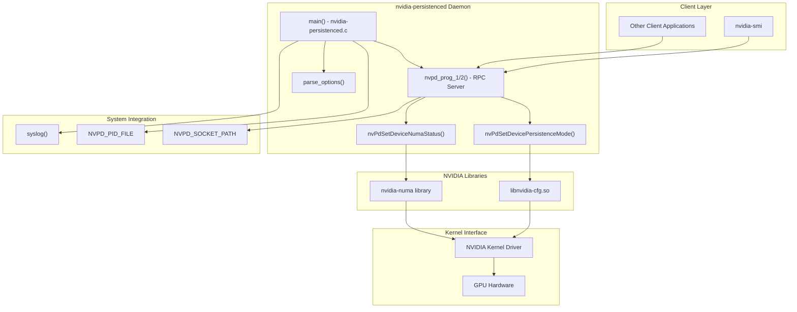
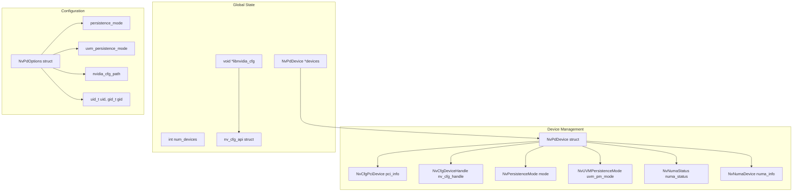
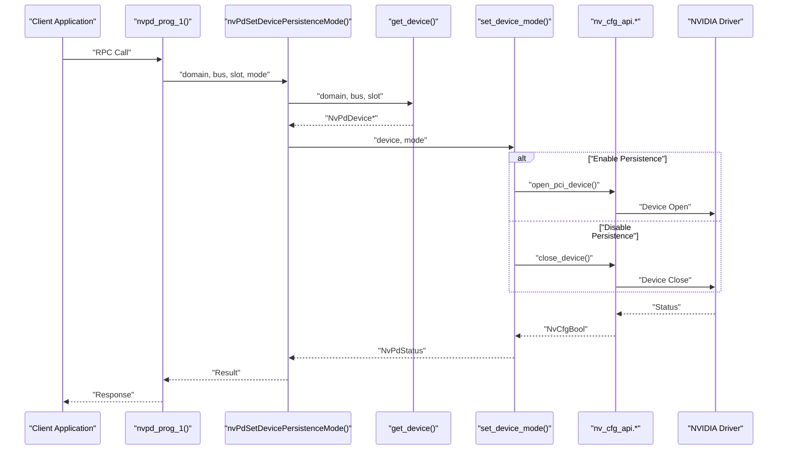
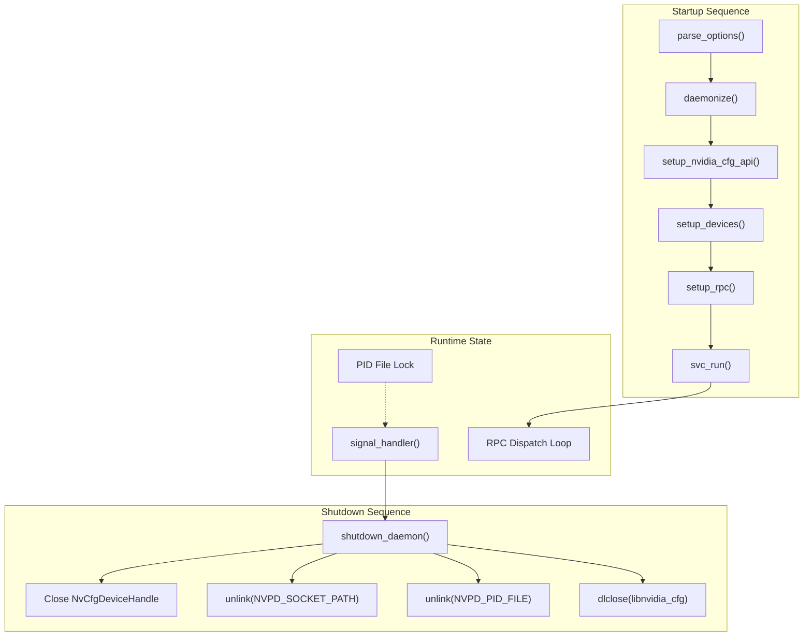

<!-- source: DeepWiki mcp.deepwiki.com · repo NVIDIA/nvidia-persistenced · page 1 Overview · fetched 2026-10-26 -->

# Overview

Relevant source files

The following files were used as context for generating this wiki page:

- [COPYING](COPYING)
- [README](README)
- [nvidia-persistenced.c](nvidia-persistenced.c)
- [nvidia-persistenced.h](nvidia-persistenced.h)

This document provides a comprehensive overview of the nvidia-persistenced repository, which contains the source code for the NVIDIA Persistence Daemon. This daemon maintains persistent NVIDIA driver state across system operations and provides a foundation for managing GPU device persistence modes and NUMA memory management.

This overview covers the high-level architecture, key components, and their relationships. For detailed implementation information, see [Core Architecture](#2). For build system specifics, see [Build System](#3). For user-facing interfaces, see [User Interface](#4).

## Purpose and Scope

The `nvidia-persistenced` daemon serves as a critical system service that:

- **Maintains GPU Device State**: Keeps NVIDIA GPU devices in an active state to avoid driver initialization overhead
- **Manages NUMA Memory**: Controls onlining and offlining of GPU memory for NUMA-aware systems  
- **Provides RPC Interface**: Offers a client-server communication mechanism for device management
- **Integrates with System Services**: Works with init systems (systemd, SysV, Upstart) for automatic startup

The daemon primarily targets Linux systems with NVIDIA GPUs and integrates closely with the NVIDIA kernel driver and associated user-space libraries.

Sources: [nvidia-persistenced.c:1-26](), [README:1-33]()

## System Architecture

The `nvidia-persistenced` system follows a layered architecture where client applications communicate with the daemon through RPC calls, which then interact with NVIDIA libraries and kernel drivers.

### Core Components Architecture

Sources: [nvidia-persistenced.c:42-49](), [nvidia-persistenced.h:57-59](), [nvidia-persistenced.c:998-1043]()

### Key Data Structures and State Management

The daemon manages device state through well-defined data structures that track both persistence mode and NUMA status for each GPU device.

Sources: [nvidia-persistenced.c:56-64](), [nvidia-persistenced.c:67-84](), [nvidia-persistenced.h:36-43]()

## Communication Flow

The daemon operates through a request-response pattern where client applications send RPC commands that result in device state changes through the NVIDIA driver stack.

### RPC Command Processing Flow

Sources: [nvidia-persistenced.c:109-140](), [nvidia-persistenced.c:343-421](), [nvidia-persistenced.c:208-223]()

## Daemon Lifecycle Management

The daemon follows a standard Unix daemon pattern with comprehensive initialization, signal handling, and cleanup procedures.

### Initialization and Shutdown Process

Sources: [nvidia-persistenced.c:998-1043](), [nvidia-persistenced.c:799-996](), [nvidia-persistenced.c:487-584]()

## Key Features and Capabilities

### Device Persistence Management

The daemon's primary function is managing the persistence state of NVIDIA GPU devices. This involves:

- **Device Discovery**: Uses `nvCfgGetPciDevices()` to enumerate available NVIDIA GPUs
- **Persistence Control**: Implements `nvPdSetDevicePersistenceMode()` and `nvPdGetDevicePersistenceMode()`
- **UVM Integration**: Supports Unified Virtual Memory persistence through `nvCfgEnableUVMPersistence()`
- **PCI Device Addressing**: Manages devices by domain:bus:slot addressing scheme

### NUMA Memory Management

For NUMA-aware systems, the daemon provides:

- **Memory Onlining**: `nvNumaOnlineMemory()` brings GPU memory online
- **Memory Offlining**: `nvNumaOfflineMemory()` takes GPU memory offline  
- **Status Tracking**: Maintains `NvNumaStatus` for each device
- **Coordinated Operations**: Synchronizes persistence mode changes with NUMA state

Sources: [nvidia-persistenced.c:668-728](), [nvidia-persistenced.c:427-479](), [nvidia-persistenced.c:290-336]()

## Integration Points

The `nvidia-persistenced` system integrates with several external components:

| Component | Interface | Purpose |
|-----------|-----------|---------|
| **libnvidia-cfg.so** | Dynamic library loading via `dlopen()` | GPU device configuration and control |
| **NVIDIA Kernel Driver** | IOCTL interface through nvidia-cfg | Low-level hardware communication |
| **Init Systems** | Service files (systemd/SysV/Upstart) | Automatic daemon startup and management |
| **Syslog** | `syslog()` calls throughout codebase | System logging and monitoring |
| **Client Applications** | Unix domain socket RPC | External device management requests |

For detailed information about RPC communication, see [RPC Communication System](#2.2). For build system integration, see [Build System](#3). For deployment and service management, see [System Integration](#5).

Sources: [nvidia-persistenced.c:606-662](), [nvidia-persistenced.c:734-771](), [nvidia-persistenced.c:777-793]()

---

