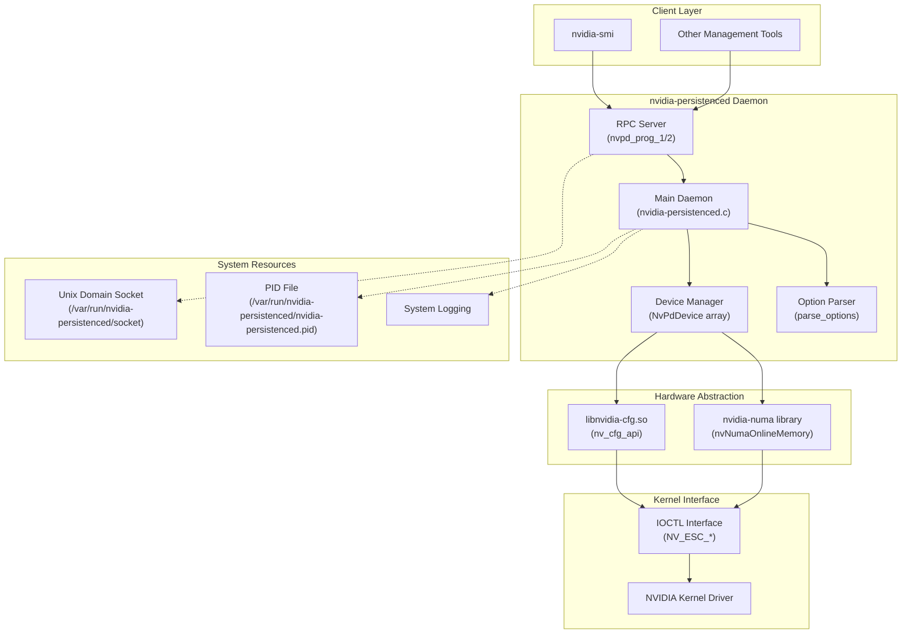
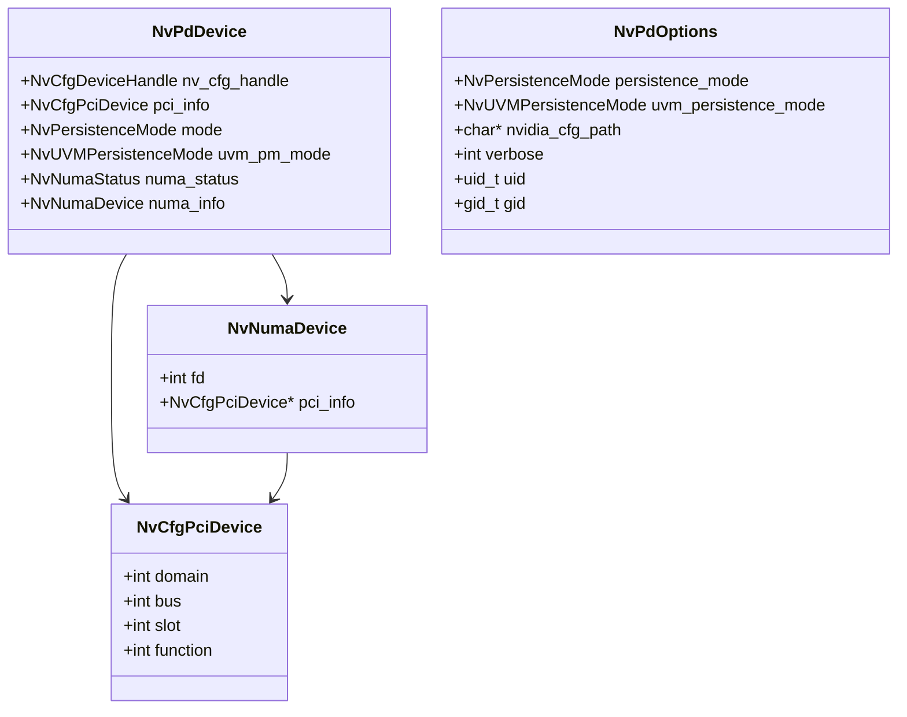
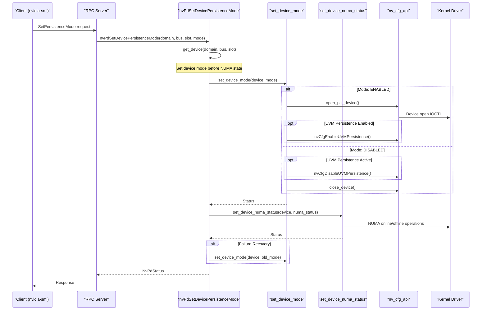
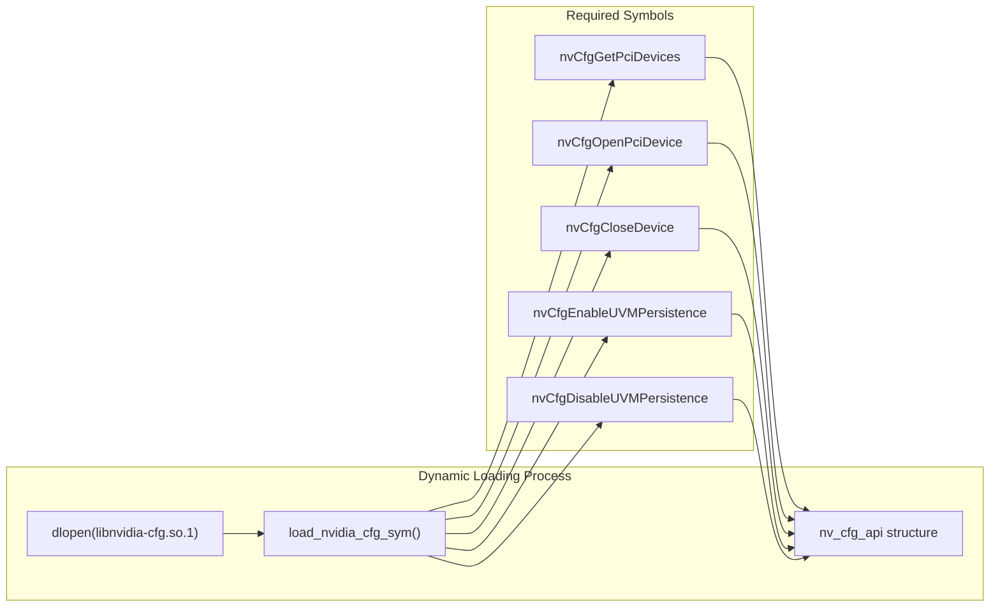
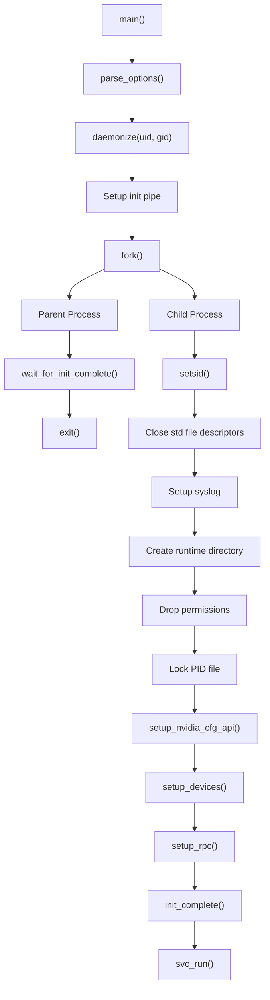
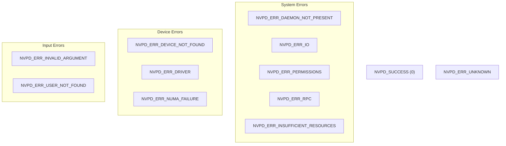

<!-- source: DeepWiki mcp.deepwiki.com · repo NVIDIA/nvidia-persistenced · page 2 Core Architecture · fetched 2026-10-26 -->

# Core Architecture

<details>
<summary>Relevant source files</summary>

The following files were used as context for generating this wiki page:

- [nvidia-persistenced.c](nvidia-persistenced.c)
- [nvidia-persistenced.h](nvidia-persistenced.h)
- [nvpd_rpc.h](nvpd_rpc.h)

</details>


This document describes the overall system architecture of nvidia-persistenced, explaining how the main components interact to provide persistent NVIDIA driver state management. It covers the daemon's internal structure, communication interfaces, and device management subsystems.

For details on specific daemon implementation and lifecycle management, see [Main Daemon Implementation](#2.1). For RPC protocol specifications, see [RPC Communication System](#2.2). For NUMA memory management specifics, see [NUMA Memory Management](#2.4).

## System Overview

nvidia-persistenced is a daemon that maintains persistent driver state for NVIDIA GPUs. The architecture follows a layered design with clear separation between the user interface (RPC), core daemon logic, device management, and hardware abstraction layers.



**Sources:** [nvidia-persistenced.c:1-1044](), [nvidia-persistenced.h:28-64](), [nvpd_rpc.h:1-157]()

## Core Data Structures

The daemon's state management centers around the `NvPdDevice` structure, which encapsulates all device-specific information and state.

### Device State Management



| Field | Purpose | States |
|-------|---------|--------|
| `nv_cfg_handle` | Device handle for nvidia-cfg operations | NULL (closed) or valid handle |
| `mode` | Persistence mode state | `NV_PERSISTENCE_MODE_DISABLED/ENABLED` |
| `uvm_pm_mode` | UVM persistence state | `NV_UVM_PERSISTENCE_MODE_DISABLED/ENABLED` |
| `numa_status` | NUMA memory state | `NV_NUMA_STATUS_OFFLINE/ONLINE` |

**Sources:** [nvidia-persistenced.c:56-64](), [nvidia-persistenced.h:36-43](), [nvpd_rpc.h:33-82]()

## Component Interaction Flow

The daemon processes client requests through a well-defined flow that coordinates persistence mode changes with NUMA memory management.

### Device Persistence Mode Control Flow



**Sources:** [nvidia-persistenced.c:109-140](), [nvidia-persistenced.c:343-421](), [nvidia-persistenced.c:427-479]()

## Dynamic Library Integration

The daemon dynamically loads the nvidia-cfg library to interface with the NVIDIA kernel driver, providing runtime flexibility and dependency management.

### Library Symbol Resolution



The `nv_cfg_api` structure provides function pointers to dynamically loaded symbols:

```c
static struct {
    NvCfgBool (*get_pci_devices)(int *, NvCfgPciDevice **);
    NvCfgBool (*open_pci_device)(int, int, int, int, NvCfgDeviceHandle *);
    NvCfgBool (*close_device)(NvCfgDeviceHandle);
    unsigned int (*nvCfgEnableUVMPersistence)(NvCfgDeviceHandle);
    unsigned int (*nvCfgDisableUVMPersistence)(NvCfgDeviceHandle);
} nv_cfg_api;
```

**Sources:** [nvidia-persistenced.c:78-84](), [nvidia-persistenced.c:590-600](), [nvidia-persistenced.c:606-662]()

## Daemon Lifecycle Management

The daemon follows a structured initialization and shutdown sequence to ensure proper resource management and cleanup.

### Initialization Sequence



### Resource Management

| Resource | Creation | Cleanup Function | Location |
|----------|----------|------------------|----------|
| PID File | `daemonize()` | `shutdown_daemon()` | `/var/run/nvidia-persistenced/nvidia-persistenced.pid` |
| Unix Socket | `setup_rpc()` | `shutdown_daemon()` | `/var/run/nvidia-persistenced/socket` |
| Device Handles | `setup_devices()` | `shutdown_daemon()` | In-memory `devices` array |
| Library Handle | `setup_nvidia_cfg_api()` | `shutdown_daemon()` | `libnvidia_cfg` pointer |

**Sources:** [nvidia-persistenced.c:799-996](), [nvidia-persistenced.c:487-584](), [nvidia-persistenced.c:998-1044]()

## Error Handling and Status Management

The daemon implements comprehensive error handling with standardized status codes and logging integration.

### Status Code Hierarchy



**Sources:** [nvpd_rpc.h:17-31]()

---

