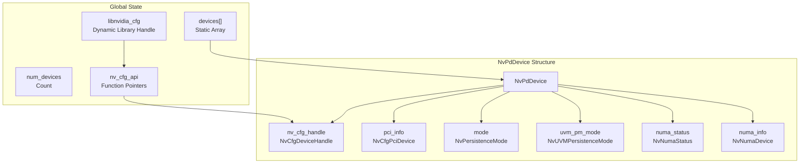
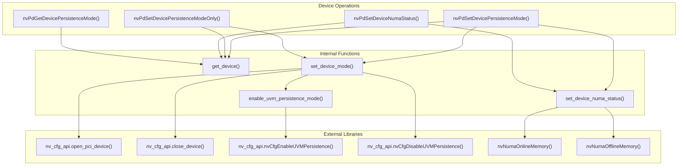
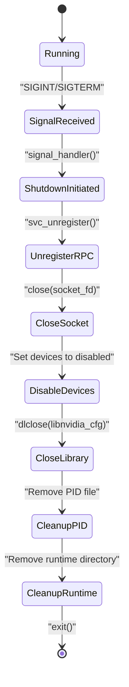
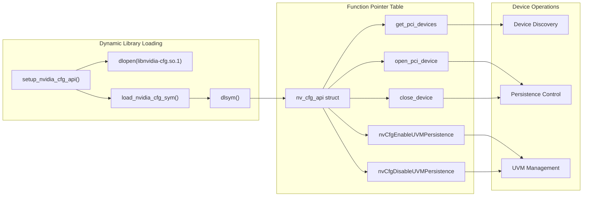

<!-- source: DeepWiki mcp.deepwiki.com · repo NVIDIA/nvidia-persistenced · page 2.1 Main Daemon Implementation · fetched 2026-10-26 -->

# Main Daemon Implementation

Relevant source files

The following files were used as context for generating this wiki page:

- [nvidia-persistenced.c](nvidia-persistenced.c)
- [nvidia-persistenced.h](nvidia-persistenced.h)

This document covers the core daemon implementation of `nvidia-persistenced`, focusing on the daemon lifecycle, device state management, and system integration. The main daemon process handles GPU persistence mode control, NUMA memory management, and RPC communication with client applications.

For information about the RPC communication protocol, see [RPC Communication System](#2.2). For device configuration details, see [Device Configuration Interface](#2.3). For NUMA-specific functionality, see [NUMA Memory Management](#2.4).

## Core Data Structures

The daemon maintains device state through the `NvPdDevice` structure, which encapsulates all per-device information including persistence mode, NUMA status, and hardware handles.

**Core Device Management Functions:**
- `get_device()` - Device lookup by PCI coordinates
- `nvPdSetDevicePersistenceMode()` - Primary device control API
- `nvPdGetDevicePersistenceMode()` - Device state query API
- `set_device_mode()` - Internal persistence mode control
- `set_device_numa_status()` - NUMA memory management

Sources: [nvidia-persistenced.c:56-84](), [nvidia-persistenced.h:35-56]()

## Daemon Lifecycle Management

The daemon follows a structured initialization and shutdown sequence, coordinating between parent and child processes during startup.

```mermaid
sequenceDiagram
    participant Main as "main()"
    participant Daemonize as "daemonize()"
    participant Parent as "Parent Process"
    participant Child as "Child Process"
    participant Setup as "Setup Functions"
    
    Main->>Daemonize: "Start daemon process"
    Daemonize->>Daemonize: "Create init pipe"
    Daemonize->>Parent: "fork()"
    Daemonize->>Child: "fork()"
    
    Parent->>Parent: "wait_for_init_complete()"
    Child->>Child: "Setup session & files"
    Child->>Child: "Drop privileges"
    Child->>Child: "Create PID file"
    Child->>Setup: "setup_nvidia_cfg_api()"
    Setup-->>Child: "Library loaded"
    Child->>Setup: "setup_devices()"
    Setup-->>Child: "Devices initialized"
    Child->>Setup: "setup_rpc()"
    Setup-->>Child: "RPC service ready"
    Child->>Parent: "init_complete()"
    Parent->>Parent: "exit(EXIT_SUCCESS)"
    Child->>Child: "svc_run()"
    
    Note over Child: "Daemon ready for RPC requests"
```

**Initialization Sequence:**
1. **Option Parsing** - Command line argument processing via `parse_options()`
2. **Process Daemonization** - Fork, session creation, privilege dropping
3. **Library Setup** - Dynamic loading of `libnvidia-cfg.so.1`
4. **Device Discovery** - Query and initialize NVIDIA devices
5. **RPC Service** - Unix domain socket creation and service registration
6. **Parent Coordination** - Signal successful initialization via init pipe

**Key Functions:**
- `main()` - Entry point and orchestration [nvidia-persistenced.c:998-1043]()
- `daemonize()` - Process daemonization and privilege management [nvidia-persistenced.c:799-996]()
- `init_complete()` - Parent-child coordination [nvidia-persistenced.c:230-245]()
- `wait_for_init_complete()` - Parent synchronization [nvidia-persistenced.c:254-275]()

Sources: [nvidia-persistenced.c:798-1043]()

## Device Management System

The daemon implements a centralized device management system that coordinates persistence mode control with NUMA memory management.

**Device Lookup and Validation:**
- `get_device()` performs PCI coordinate lookup in the device array [nvidia-persistenced.c:208-223]()
- Device validation ensures operations target valid, registered hardware
- Returns `NVPD_ERR_DEVICE_NOT_FOUND` for invalid device coordinates

**Persistence Mode Control:**
- **Enable Mode**: Opens device handle via `nvCfgOpenPciDevice`, optionally enables UVM persistence
- **Disable Mode**: Disables UVM persistence if active, closes device handle
- **Mode Coordination**: Always sets device mode before NUMA operations for proper sequencing

**UVM Persistence Management:**
- `enable_uvm_persistence_mode()` handles fabric readiness with timeout logic [nvidia-persistenced.c:290-336]()
- Implements retry logic for `NV_ERR_NVLINK_FABRIC_NOT_READY` conditions
- 30-second timeout for fabric probe operations

Sources: [nvidia-persistenced.c:109-479]()

## Signal Handling and Shutdown

The daemon implements graceful shutdown procedures triggered by system signals and coordinated cleanup of all managed resources.

**Signal Processing:**
- `signal_handler()` processes `SIGINT` and `SIGTERM` for graceful shutdown [nvidia-persistenced.c:777-793]()
- Blocked signals include `SIGCHLD`, `SIGTSTP`, `SIGTTOU`, `SIGTTIN` during daemonization
- Unhandled signals generate warning messages in syslog

**Shutdown Sequence:**
1. **RPC Cleanup** - Unregister service mappings, close Unix domain socket
2. **Device Cleanup** - Set all devices to `NV_PERSISTENCE_MODE_DISABLED`
3. **Library Cleanup** - Close dynamic library handles via `dlclose()`
4. **File Cleanup** - Remove PID file, optionally remove runtime directory
5. **Logging** - Final shutdown message with process ID

**Resource Management:**
- PID file locking prevents multiple daemon instances [nvidia-persistenced.c:964-973]()
- Runtime directory ownership follows daemon user/group settings
- Socket file cleanup handles stale filesystem entries

Sources: [nvidia-persistenced.c:487-584](), [nvidia-persistenced.c:777-996]()

## Library Integration

The daemon dynamically loads and interfaces with external NVIDIA libraries for device operations and NUMA management.

**Library Loading Process:**
- `setup_nvidia_cfg_api()` handles dynamic library discovery and loading [nvidia-persistenced.c:606-662]()
- Supports custom library paths via `--nvidia-cfg-path` option
- Symbol loading via `load_nvidia_cfg_sym()` with error reporting [nvidia-persistenced.c:590-600]()

**API Function Pointers:**
- **Device Management**: `nvCfgGetPciDevices`, `nvCfgOpenPciDevice`, `nvCfgCloseDevice`
- **UVM Control**: `nvCfgEnableUVMPersistence`, `nvCfgDisableUVMPersistence` (conditional loading)
- **Validation**: Initial device query confirms library functionality and permissions

**Error Handling:**
- Missing library generates `NVPD_ERR_DRIVER` status
- Symbol loading failures provide specific function names in error messages
- Device file permission issues guide users toward proper `/dev/nvidia*` setup

Sources: [nvidia-persistenced.c:590-662](), [nvidia-persistenced.c:674-728]()

---

