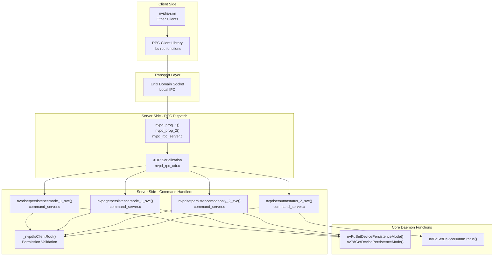
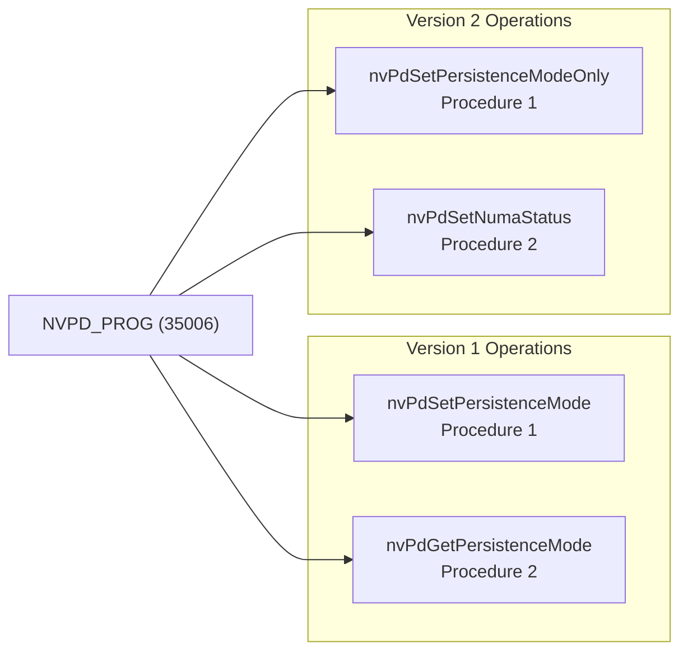
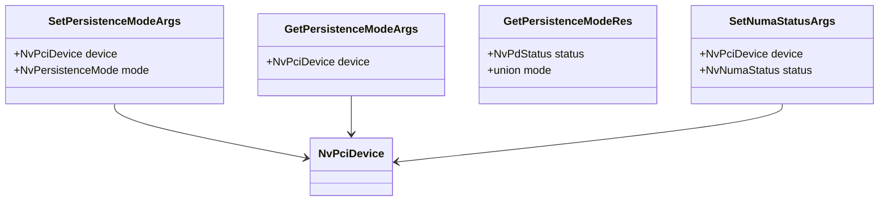
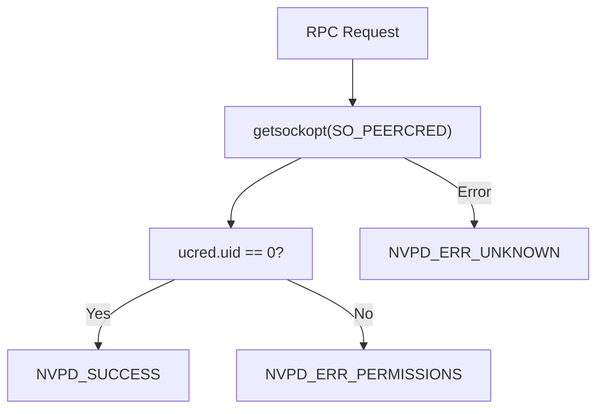
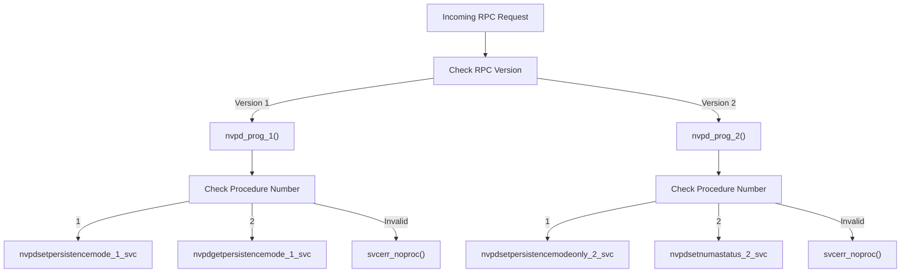
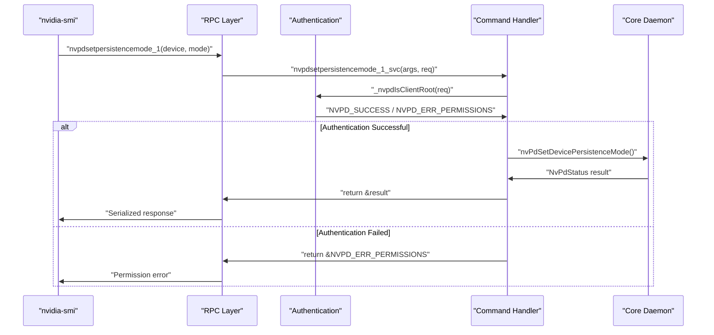

<!-- source: DeepWiki mcp.deepwiki.com · repo NVIDIA/nvidia-persistenced · page 2.2 RPC Communication System · fetched 2026-10-26 -->

# RPC Communication System

<details>
<summary>Relevant source files</summary>

The following files were used as context for generating this wiki page:

- [command_server.c](command_server.c)
- [nvpd_rpc.h](nvpd_rpc.h)
- [nvpd_rpc_server.c](nvpd_rpc_server.c)
- [nvpd_rpc_xdr.c](nvpd_rpc_xdr.c)

</details>


## Purpose and Scope

The RPC Communication System provides the primary interface for external clients to communicate with the nvidia-persistenced daemon. This system enables applications like `nvidia-smi` to request changes to GPU device persistence modes and NUMA memory status through a standardized remote procedure call protocol. The RPC interface abstracts the complexity of device management operations and provides a secure, controlled access mechanism to the daemon's core functionality.

For information about the main daemon implementation that handles these RPC requests, see [Main Daemon Implementation](#2.1). For details about the underlying device configuration operations, see [Device Configuration Interface](#2.3) and [NUMA Memory Management](#2.4).

## RPC Protocol Architecture

The nvidia-persistenced RPC system is built on Sun RPC (ONC-RPC) and uses XDR (eXternal Data Representation) for data serialization. The protocol supports multiple versions to maintain backward compatibility while adding new functionality.



**Sources:** [nvpd_rpc.h:1-156](), [command_server.c:1-144](), [nvpd_rpc_server.c:1-117](), [nvpd_rpc_xdr.c:1-97]()

## Protocol Versions and Program Numbers

The RPC protocol is identified by program number `NVPD_PROG` (35006) and supports two versions with different capabilities:

| Version | Constant | Supported Operations |
|---------|----------|---------------------|
| Version 1 | `VersionOne` (1) | Set/Get Persistence Mode |
| Version 2 | `VersionTwo` (2) | Set Persistence Mode Only, Set NUMA Status |



**Sources:** [nvpd_rpc.h:84-86](), [nvpd_rpc.h:105](), [nvpd_rpc.h:88-91](), [nvpd_rpc.h:108-113]()

## Core Data Types

The RPC protocol defines several key data structures for device identification and operation parameters:

### Device Identification

```c
struct NvPciDevice {
    int domain;    // PCI domain
    int bus;       // PCI bus number
    int slot;      // PCI slot number  
    int function;  // PCI function number
};
```

### Status and Mode Enumerations

| Enumeration | Values | Purpose |
|-------------|--------|---------|
| `NvPdStatus` | `NVPD_SUCCESS`, `NVPD_ERR_*` | Operation result codes |
| `NvPersistenceMode` | `NV_PERSISTENCE_MODE_DISABLED/ENABLED` | GPU persistence state |
| `NvUVMPersistenceMode` | `NV_UVM_PERSISTENCE_MODE_DISABLED/ENABLED` | UVM persistence state |
| `NvNumaStatus` | `NV_NUMA_STATUS_OFFLINE/ONLINE` | NUMA memory state |

### RPC Operation Structures



**Sources:** [nvpd_rpc.h:33-38](), [nvpd_rpc.h:17-30](), [nvpd_rpc.h:41-51](), [nvpd_rpc.h:53-82]()

## RPC Operation Implementations

### Authentication and Security

All RPC operations require root privileges. The `_nvpdIsClientRoot()` function validates client credentials using Unix domain socket peer credentials:



**Sources:** [command_server.c:37-53]()

### Version 1 Operations

#### Set Persistence Mode
- **Function:** `nvpdsetpersistencemode_1_svc()`
- **Purpose:** Sets device persistence mode and manages associated NUMA memory
- **Implementation:** Calls `nvPdSetDevicePersistenceMode()` after authentication

#### Get Persistence Mode  
- **Function:** `nvpdgetpersistencemode_1_svc()`
- **Purpose:** Retrieves current device persistence mode
- **Implementation:** Calls `nvPdGetDevicePersistenceMode()` and returns result in union structure

**Sources:** [command_server.c:59-76](), [command_server.c:82-95]()

### Version 2 Operations

#### Set Persistence Mode Only
- **Function:** `nvpdsetpersistencemodeonly_2_svc()`
- **Purpose:** Sets persistence mode without affecting NUMA status
- **Implementation:** Calls `nvPdSetDevicePersistenceModeOnly()` after authentication

#### Set NUMA Status
- **Function:** `nvpdsetnumastatus_2_svc()`
- **Purpose:** Controls NUMA memory online/offline state independently
- **Implementation:** Calls `nvPdSetDeviceNumaStatus()` after authentication

**Sources:** [command_server.c:103-120](), [command_server.c:126-143]()

## RPC Server Dispatch Logic

The RPC server uses generated dispatch functions to route incoming requests to appropriate handlers:



**Sources:** [nvpd_rpc_server.c:23-68](), [nvpd_rpc_server.c:71-116]()

## XDR Serialization Layer

The XDR layer handles data marshaling and unmarshaling for all RPC data types. Each structure has corresponding XDR functions:

| Data Type | XDR Function | Purpose |
|-----------|--------------|---------|
| `NvPdStatus` | `xdr_NvPdStatus()` | Serialize status enums |
| `NvPciDevice` | `xdr_NvPciDevice()` | Serialize PCI device identifiers |
| `NvPersistenceMode` | `xdr_NvPersistenceMode()` | Serialize persistence mode enums |
| `SetPersistenceModeArgs` | `xdr_SetPersistenceModeArgs()` | Serialize operation arguments |
| `GetPersistenceModeRes` | `xdr_GetPersistenceModeRes()` | Serialize response with union handling |

The XDR functions handle platform-independent data representation, ensuring compatibility across different architectures.

**Sources:** [nvpd_rpc_xdr.c:8-96]()

## Error Handling and Status Codes

The RPC system defines comprehensive error codes for different failure scenarios:

| Status Code | Value | Description |
|-------------|-------|-------------|
| `NVPD_SUCCESS` | 0 | Operation completed successfully |
| `NVPD_ERR_DAEMON_NOT_PRESENT` | 1 | Daemon is not running |
| `NVPD_ERR_DEVICE_NOT_FOUND` | 2 | Specified GPU device not found |
| `NVPD_ERR_DRIVER` | 3 | NVIDIA driver error |
| `NVPD_ERR_INSUFFICIENT_RESOURCES` | 4 | System resource limitation |
| `NVPD_ERR_INVALID_ARGUMENT` | 5 | Invalid input parameters |
| `NVPD_ERR_IO` | 6 | Input/output error |
| `NVPD_ERR_PERMISSIONS` | 7 | Insufficient privileges |
| `NVPD_ERR_RPC` | 8 | RPC communication error |
| `NVPD_ERR_USER_NOT_FOUND` | 9 | User account not found |
| `NVPD_ERR_NUMA_FAILURE` | 10 | NUMA operation failed |
| `NVPD_ERR_UNKNOWN` | 11 | Unspecified error |

**Sources:** [nvpd_rpc.h:17-30]()

## Communication Flow Example



**Sources:** [command_server.c:59-76](), [command_server.c:37-53](), [nvpd_rpc_server.c:33-67]()

---

