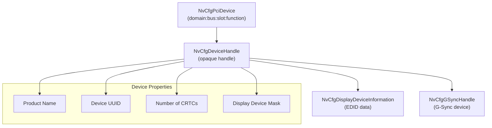
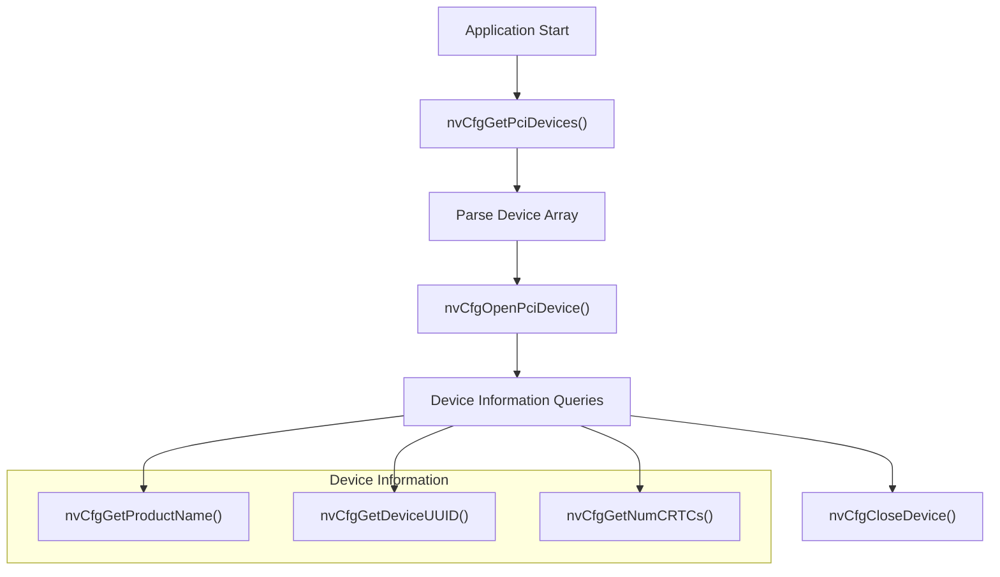
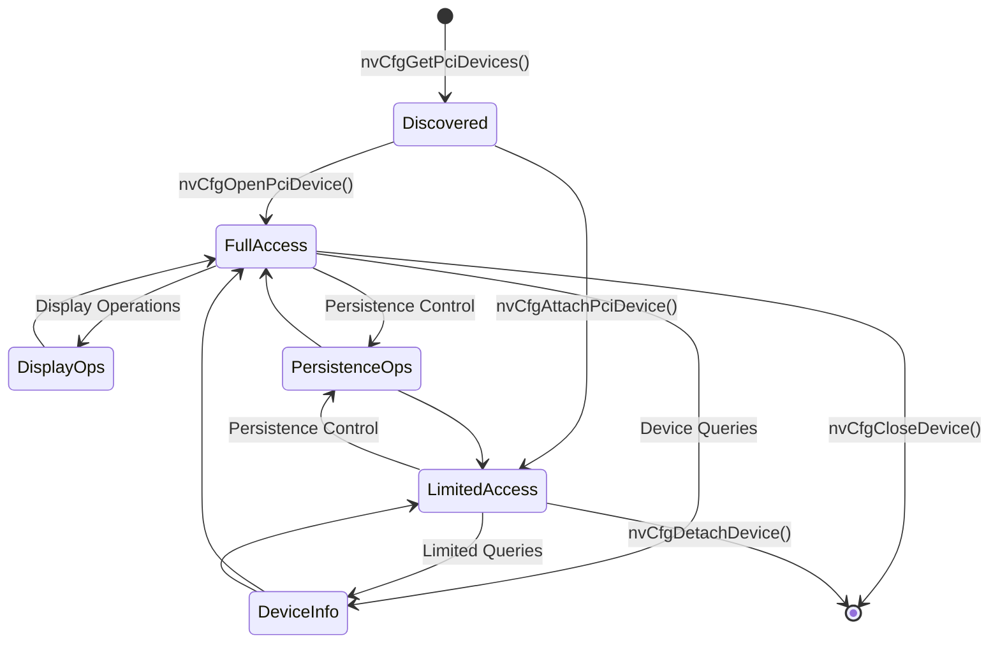
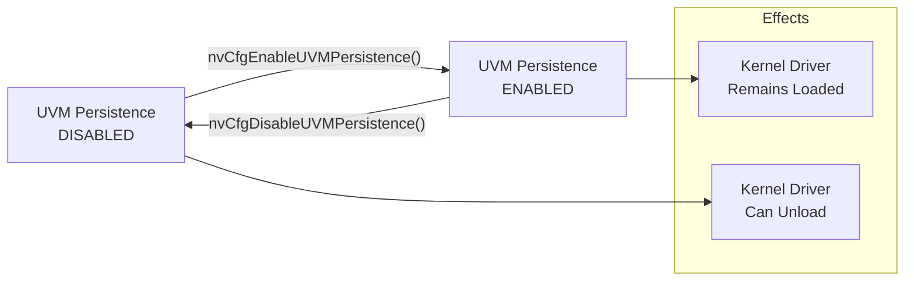
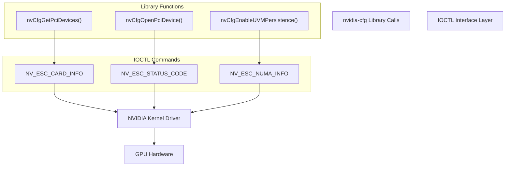

<!-- source: DeepWiki mcp.deepwiki.com · repo NVIDIA/nvidia-persistenced · page 2.3 Device Configuration Interface · fetched 2026-10-26 -->

# Device Configuration Interface

<details>
<summary>Relevant source files</summary>

The following files were used as context for generating this wiki page:

- [common-utils/src.mk](common-utils/src.mk)
- [nv-ioctl-numa.h](nv-ioctl-numa.h)
- [nv-ioctl-numbers.h](nv-ioctl-numbers.h)
- [nvidia-cfg.h](nvidia-cfg.h)

</details>


## Purpose and Scope

The Device Configuration Interface provides the core GPU device discovery, configuration, and management capabilities for nvidia-persistenced through the `libnvidia-cfg.so` library. This interface abstracts the low-level IOCTL communications with the NVIDIA kernel driver and provides a clean C API for device operations including persistence mode control, device enumeration, and hardware configuration management.

This document covers the nvidia-cfg library interface used by nvidia-persistenced for device management. For information about how the daemon integrates this interface into its main operation loop, see [Main Daemon Implementation](#2.1). For details about NUMA-specific memory management operations, see [NUMA Memory Management](#2.4).

## Core Data Structures

The Device Configuration Interface is built around several key data structures that represent different aspects of NVIDIA hardware in the system.

### Device Identification

The primary device identification structure is `NvCfgPciDevice`, which uniquely identifies a GPU on the PCI bus:

```c
typedef struct {
    int domain;
    int bus;
    int slot;
    int function;
} NvCfgPciDevice;
```

Device connections are managed through opaque handles:

```c
typedef void * NvCfgDeviceHandle;
typedef void * NvCfgGSyncHandle;
```

### Device Information Structures

Display device information is captured in the `NvCfgDisplayDeviceInformation` structure, which contains EDID-parsed data including monitor capabilities, preferred timings, and physical dimensions.

**Device Data Structure Relationships**


Sources: [nvidia-cfg.h:59-64](), [nvidia-cfg.h:146](), [nvidia-cfg.h:155](), [nvidia-cfg.h:88-137]()

## Device Discovery and Enumeration

The interface provides multiple approaches for discovering NVIDIA devices in the system, with the modern approach using PCI domain addressing.

### PCI Device Enumeration

The primary device discovery function `nvCfgGetPciDevices()` returns an array of all NVIDIA graphics devices:

```c
NvCfgBool nvCfgGetPciDevices(int *n, NvCfgPciDevice **devs);
```

This function allocates and populates an array of `NvCfgPciDevice` structures representing all detected NVIDIA GPUs.

**Device Discovery Flow**


Sources: [nvidia-cfg.h:186-197](), [nvidia-cfg.h:225-233](), [nvidia-cfg.h:289-296](), [nvidia-cfg.h:301-308]()

### Bulk Operations

For applications that need to work with all devices simultaneously, the interface provides convenience functions:

- `nvCfgOpenAllPciDevices()` - Opens connections to all NVIDIA devices
- `nvCfgCloseAllPciDevices()` - Closes all previously opened connections

These functions manage device handle arrays automatically and are particularly useful for system-wide operations.

Sources: [nvidia-cfg.h:237-247](), [nvidia-cfg.h:268-273]()

## Device Lifecycle Management

Device connections follow a clear open/close pattern with different modes of access depending on the intended use case.

### Standard Device Access

Full device access for display and GPU management:

```c
NvCfgBool nvCfgOpenPciDevice(int domain, int bus, int device, int function,
                             NvCfgDeviceHandle *handle);
NvCfgBool nvCfgCloseDevice(NvCfgDeviceHandle handle);
```

### Limited Device Access

For headless or compute-only scenarios, a display-less attachment mode is available:

```c
NvCfgBool nvCfgAttachPciDevice(int domain, int bus, int device, int function,
                               NvCfgDeviceHandle *handle);
NvCfgBool nvCfgDetachDevice(NvCfgDeviceHandle handle);
```

**Device Connection Lifecycle**


Sources: [nvidia-cfg.h:214-221](), [nvidia-cfg.h:225-233](), [nvidia-cfg.h:251-255](), [nvidia-cfg.h:259-264]()

## Persistence Mode Control

A critical function for nvidia-persistenced is controlling UVM (Unified Virtual Memory) persistence mode, which keeps the NVIDIA kernel driver loaded even when no applications are using the GPU.

### UVM Persistence Functions

```c
unsigned int nvCfgEnableUVMPersistence(NvCfgDeviceHandle handle);
unsigned int nvCfgDisableUVMPersistence(NvCfgDeviceHandle handle);
```

These functions return zero on success and non-zero values on failure. The interface notes indicate these are internal APIs that may be removed in future releases.

**Persistence Mode State Management**


Sources: [nvidia-cfg.h:456-472]()

## Display and G-Sync Device Management

The interface provides comprehensive display device discovery and management capabilities, though these are less central to nvidia-persistenced's primary function.

### Display Device Operations

Display devices are identified using bitmasks where different bit ranges represent different connector types:
- Bits 0-7: CRT devices (CRT-0, CRT-1, etc.)
- Bits 8-15: TV devices  
- Bits 16-23: DFP (Digital Flat Panel) devices

Key display functions include:
- `nvCfgGetDisplayDevices()` - Get connected display devices
- `nvCfgGetSupportedDisplayDevices()` - Get all supported display devices
- `nvCfgGetEDIDData()` - Retrieve EDID data for a display

### G-Sync Device Management

G-Sync devices have their own management interface with functions for:
- Device enumeration (`nvCfgOpenAllGSyncDevices()`)
- Device type and firmware version queries
- Firmware flashing capabilities

Sources: [nvidia-cfg.h:312-337](), [nvidia-cfg.h:341-362](), [nvidia-cfg.h:391-446]()

## Kernel Driver Interface

The Device Configuration Interface ultimately communicates with the NVIDIA kernel driver through a well-defined IOCTL interface.

### IOCTL Command Structure

The IOCTL commands are defined with a consistent numbering scheme:

| Command | Value | Purpose |
|---------|-------|---------|
| `NV_ESC_CARD_INFO` | 200 | Device information |
| `NV_ESC_STATUS_CODE` | 209 | Status code queries |
| `NV_ESC_NUMA_INFO` | 215 | NUMA memory information |
| `NV_ESC_SET_NUMA_STATUS` | 216 | NUMA status control |

**IOCTL Communication Architecture**


Sources: [nv-ioctl-numbers.h:28-43](), [nv-ioctl-numa.h:44-45]()

### NUMA-Specific IOCTLs

For NUMA memory management, specialized IOCTL structures are defined:

```c
typedef struct nv_ioctl_numa_info {
    int32_t  nid;
    int32_t  status;
    uint64_t memblock_size;
    uint64_t numa_mem_addr;
    uint64_t numa_mem_size;
    uint8_t  use_auto_online;
    nv_offline_addresses_t offline_addresses;
} nv_ioctl_numa_info_t;
```

The NUMA status values provide detailed state tracking for memory onlining operations:
- `NV_IOCTL_NUMA_STATUS_DISABLED` (0)
- `NV_IOCTL_NUMA_STATUS_OFFLINE` (1)  
- `NV_IOCTL_NUMA_STATUS_ONLINE` (3)
- `NV_IOCTL_NUMA_STATUS_ONLINE_FAILED` (4)

Sources: [nv-ioctl-numa.h:56-66](), [nv-ioctl-numa.h:73-80]()

## Integration with nvidia-persistenced

The Device Configuration Interface serves as the primary hardware abstraction layer for nvidia-persistenced, enabling the daemon to manage GPU persistence state without directly handling IOCTL operations.

### Typical Usage Pattern in nvidia-persistenced

1. **Initialization**: Discover all NVIDIA devices using `nvCfgGetPciDevices()`
2. **Device Access**: Open connections using `nvCfgOpenPciDevice()` or `nvCfgAttachPciDevice()`
3. **Persistence Control**: Enable persistence using `nvCfgEnableUVMPersistence()`
4. **Monitoring**: Maintain device connections throughout daemon lifetime
5. **Cleanup**: Disable persistence and close connections on shutdown

The interface design allows nvidia-persistenced to operate as a system service, maintaining persistent kernel driver state across application lifecycles while providing a stable foundation for GPU compute workloads.

Sources: [nvidia-cfg.h:34-36]()

---

