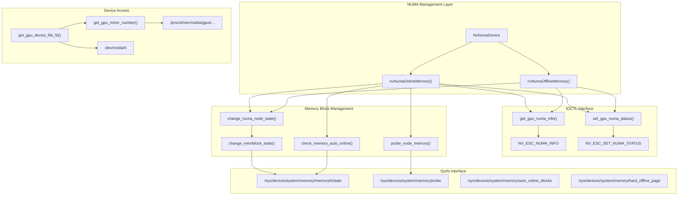
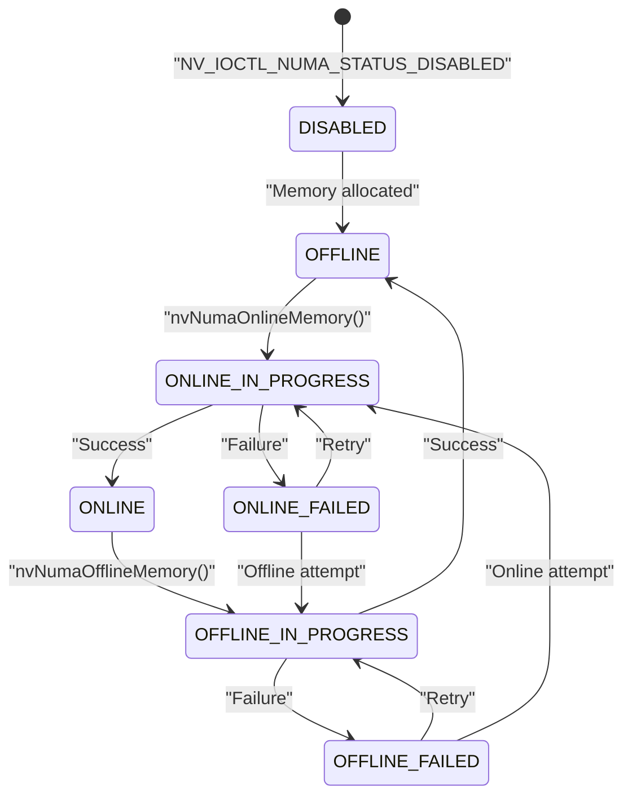
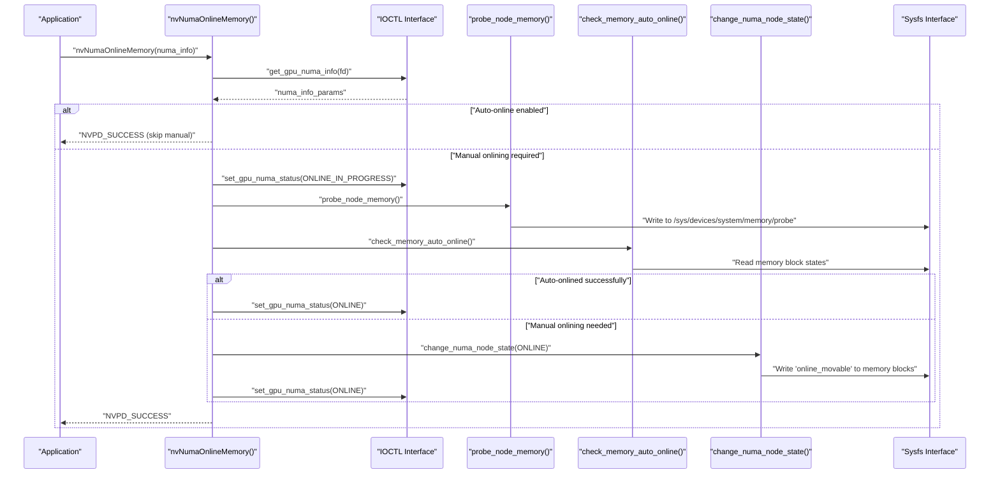
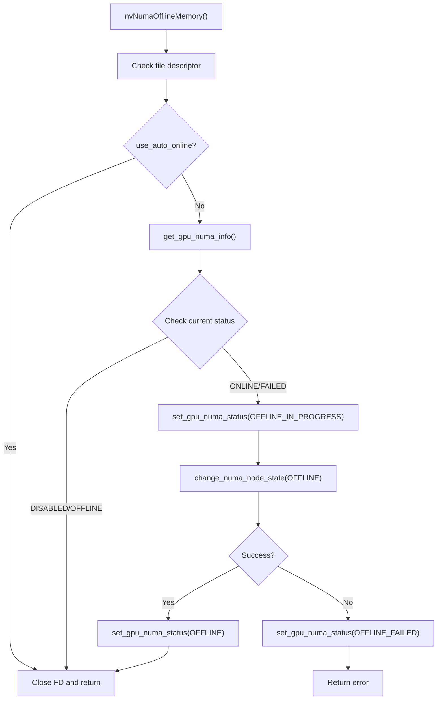
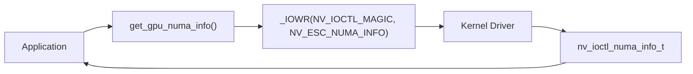
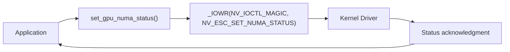

<!-- source: DeepWiki mcp.deepwiki.com · repo NVIDIA/nvidia-persistenced · page 2.4 NUMA Memory Management · fetched 2026-10-26 -->

# NUMA Memory Management

Relevant source files

The following files were used as context for generating this wiki page:

- [nv-ioctl-numa.h](nv-ioctl-numa.h)
- [nv-ioctl-numbers.h](nv-ioctl-numbers.h)
- [nvidia-numa.c](nvidia-numa.c)
- [nvidia-numa.h](nvidia-numa.h)

This document covers the NUMA (Non-Uniform Memory Access) memory management system within nvidia-persistenced, which provides NUMA-aware onlining and offlining of GPU memory. The system manages GPU memory as NUMA nodes to optimize memory locality and system performance.

For information about the overall device configuration interface, see [Device Configuration Interface](#2.3). For details about the main daemon implementation that coordinates NUMA operations, see [Main Daemon Implementation](#2.1).

## Purpose and Scope

The NUMA memory management system handles the complex process of bringing GPU memory online and offline in a NUMA-aware manner. It coordinates between the NVIDIA kernel driver, Linux memory hotplug subsystem, and sysfs interfaces to ensure proper memory management. The system supports both automatic and manual memory onlining strategies depending on system configuration.

Sources: [nvidia-numa.c:24-26](), [nvidia-numa.h:23-41]()

## Architecture Overview

The NUMA management system operates through several interconnected components that handle different aspects of memory management:

Sources: [nvidia-numa.c:688-897](), [nvidia-numa.h:29-39](), [nv-ioctl-numa.h:44-81]()

## Core Data Structures

### NvNumaDevice Structure

The `NvNumaDevice` structure maintains per-device NUMA context:

| Field | Type | Purpose |
|-------|------|---------|
| `fd` | `int` | File descriptor for GPU device |
| `pci_info` | `NvCfgPciDevice*` | PCI device information |
| `use_auto_online` | `uint8_t` | Flag indicating automatic onlining mode |

Sources: [nvidia-numa.h:30-35]()

### NUMA Information Structure

The `nv_ioctl_numa_info_t` structure contains NUMA memory configuration:

| Field | Type | Purpose |
|-------|------|---------|
| `nid` | `int32_t` | NUMA node ID |
| `status` | `int32_t` | Current NUMA memory status |
| `memblock_size` | `uint64_t` | Size of memory blocks |
| `numa_mem_addr` | `uint64_t` | Base address of NUMA memory |
| `numa_mem_size` | `uint64_t` | Total size of NUMA memory |
| `use_auto_online` | `uint8_t` | Auto-online capability flag |
| `offline_addresses` | `nv_offline_addresses_t` | Blacklisted memory addresses |

Sources: [nv-ioctl-numa.h:56-65]()

## NUMA Status State Machine

The NUMA memory management system maintains strict state transitions for memory operations:

The state constants are defined as:

| State | Value | Description |
|-------|-------|-------------|
| `NV_IOCTL_NUMA_STATUS_DISABLED` | 0 | NUMA not available |
| `NV_IOCTL_NUMA_STATUS_OFFLINE` | 1 | Memory offline |
| `NV_IOCTL_NUMA_STATUS_ONLINE_IN_PROGRESS` | 2 | Onlining in progress |
| `NV_IOCTL_NUMA_STATUS_ONLINE` | 3 | Memory online |
| `NV_IOCTL_NUMA_STATUS_ONLINE_FAILED` | 4 | Onlining failed |
| `NV_IOCTL_NUMA_STATUS_OFFLINE_IN_PROGRESS` | 5 | Offlining in progress |
| `NV_IOCTL_NUMA_STATUS_OFFLINE_FAILED` | 6 | Offlining failed |

Sources: [nv-ioctl-numa.h:73-79](), [nvidia-numa.c:72-93]()

## Memory Onlining Process

The memory onlining process follows a specific sequence to ensure proper NUMA-aware memory management:

### Key Implementation Details

1. **Memory Alignment Validation**: The system ensures memory addresses and sizes are aligned to memory block boundaries [nvidia-numa.c:770-778]()

2. **Backward Memory Block Onlining**: Memory blocks are onlined in reverse order to allow placement into movable zones [nvidia-numa.c:364-373]()

3. **Auto-online Detection**: The system checks if memory was automatically onlined by checking the `valid_zones` attribute [nvidia-numa.c:594-682]()

4. **Blacklisted Page Handling**: Bad memory pages are retired using the `hard_offline_page` interface [nvidia-numa.c:413-440]()

Sources: [nvidia-numa.c:688-864]()

## Memory Offlining Process

Memory offlining reverses the onlining process and handles cleanup:

The offlining process writes `"offline"` commands to individual memory block state files in forward order [nvidia-numa.c:376-387]().

Sources: [nvidia-numa.c:866-897](), [nvidia-numa.c:511-583]()

## IOCTL Communication Interface

The system communicates with the kernel driver through two primary IOCTL operations:

### NUMA Information Retrieval

### NUMA Status Updates

### Device File Access

The system accesses GPU devices through a specific path resolution process:

1. **Minor Number Extraction**: Parse `/proc/driver/nvidia/gpus/{domain:bus:slot.function}/information` [nvidia-numa.c:96-131]()
2. **Device File Construction**: Create `/dev/nvidia{minor}` path [nvidia-numa.c:134-149]()
3. **File Descriptor Management**: Open and maintain device file descriptor [nvidia-numa.c:152-171]()

Sources: [nvidia-numa.c:174-216](), [nv-ioctl-numa.h:44-45](), [nv-ioctl-numbers.h:28-44]()

## Sysfs Memory Hotplug Integration

The system extensively uses Linux sysfs interfaces for memory management:

### File System Paths

| Path Pattern | Purpose |
|--------------|---------|
| `/sys/devices/system/memory/memoryN/state` | Memory block online/offline control |
| `/sys/devices/system/memory/memoryN/valid_zones` | Available memory zones |
| `/sys/devices/system/memory/probe` | Memory block probing |
| `/sys/devices/system/memory/hard_offline_page` | Bad page retirement |
| `/sys/devices/system/memory/auto_online_blocks` | Auto-online configuration |

### Memory Block Operations

The system performs these sysfs operations:

1. **State Reading**: Read current memory block state [nvidia-numa.c:293-295]()
2. **State Writing**: Write `"online_movable"` or `"offline"` commands [nvidia-numa.c:315]()
3. **Zone Validation**: Check if memory is in movable zone [nvidia-numa.c:643-662]()
4. **Memory Probing**: Probe new memory ranges [nvidia-numa.c:477-478]()

Sources: [nvidia-numa.c:44-61](), [nvidia-numa.c:283-331](), [nvidia-numa.c:443-508]()

## Error Handling and Logging

The NUMA system provides comprehensive error handling and logging:

### Status Code Translation

The `mem_state_to_string()` function provides human-readable status descriptions [nvidia-numa.c:72-93]().

### Logging Categories

| Log Level | Usage |
|-----------|-------|
| `LOG_ERR` | Critical errors and failures |
| `LOG_NOTICE` | Important state changes |
| `LOG_DEBUG` | Verbose debugging information |
| `LOG_INFO` | General information messages |

### Common Error Scenarios

1. **Alignment Errors**: Memory not aligned to block boundaries [nvidia-numa.c:454-458]()
2. **Auto-online Conflicts**: Memory onlined by external systems [nvidia-numa.c:585-591]()
3. **Partial Failures**: Some memory blocks fail to change state [nvidia-numa.c:392-407]()
4. **IOCTL Failures**: Communication errors with kernel driver [nvidia-numa.c:186-190]()

Sources: [nvidia-numa.c:319-328](), [nvidia-numa.c:851-863](), [nvidia-numa.c:576-582]()

---

