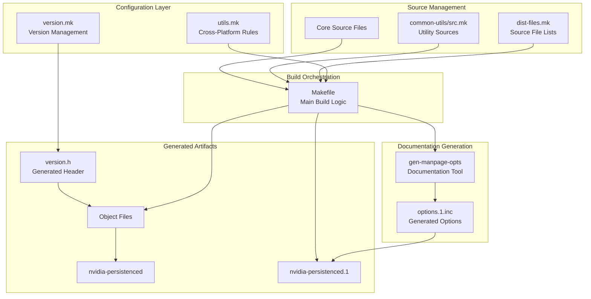
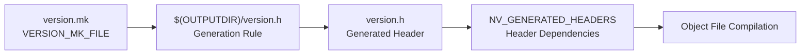
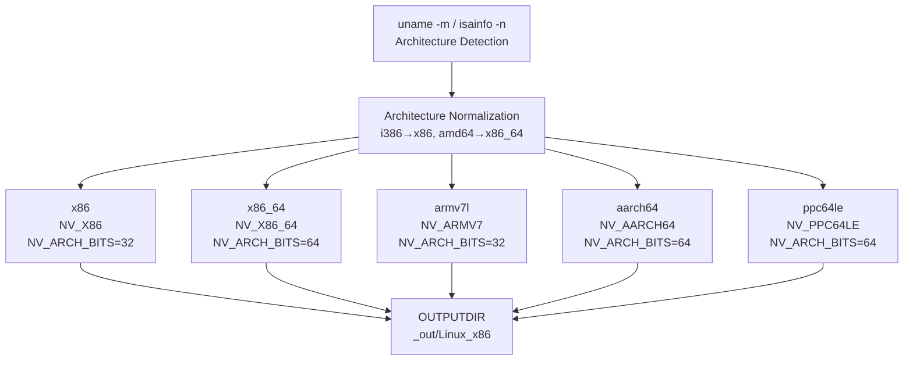
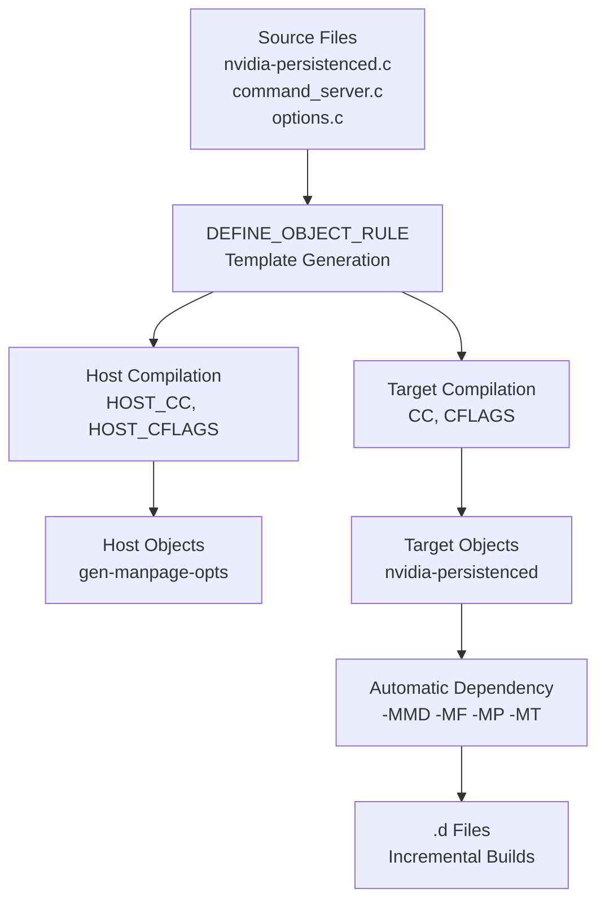
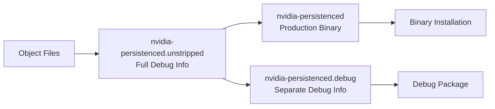
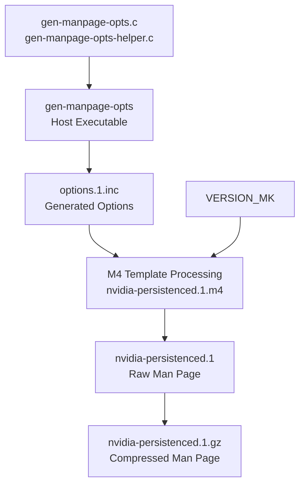

<!-- source: DeepWiki mcp.deepwiki.com · repo NVIDIA/nvidia-persistenced · page 3 Build System · fetched 2026-10-26 -->

# Build System

<details>
<summary>Relevant source files</summary>

The following files were used as context for generating this wiki page:

- [Makefile](Makefile)
- [utils.mk](utils.mk)
- [version.mk](version.mk)

</details>


## Purpose and Scope

The nvidia-persistenced build system provides cross-platform compilation, version management, and packaging capabilities for the daemon and its associated documentation. This system handles architecture detection, compiler configuration, dependency tracking, and installation across multiple Unix-like operating systems including Linux, FreeBSD, and SunOS.

For information about the runtime architecture and daemon implementation, see [Core Architecture](#2). For deployment and system integration details, see [System Integration](#5).

## Build System Architecture

The build system consists of three primary components that work together to produce the final executable and documentation:



**Sources:** [Makefile:1-184](), [utils.mk:1-619](), [version.mk:1-12]()

## Version Management System

The version management system ensures consistent versioning across all build artifacts through a centralized version definition and header generation mechanism.

### Version Definition and Header Generation

The `version.mk` file defines the authoritative version information and creates build rules for generating the corresponding C header file:

| Component | Purpose | Generated Artifact |
|-----------|---------|-------------------|
| `NVIDIA_VERSION` | Primary version string | Used in version.h |
| `NVIDIA_NVID_VERSION` | NVID-specific version | Runtime identification |
| `NVIDIA_NVID_EXTRA` | Additional version info | Build metadata |

The version header generation process creates a dependency chain where any change to version information triggers regeneration of affected build artifacts:



The version header contains preprocessor definitions accessible throughout the codebase:

```c
#define NVIDIA_VERSION "575.57.08"
```

**Sources:** [version.mk:1-12](), [version.mk:7-9]()

## Cross-Platform Configuration

The build system supports multiple operating systems and hardware architectures through the `utils.mk` configuration layer, which provides architecture detection, compiler configuration, and platform-specific build rules.

### Operating System Detection

The system automatically detects the target operating system and sets appropriate compiler flags:

| Operating System | Preprocessor Define | Additional Configuration |
|------------------|-------------------|------------------------|
| Linux | `NV_LINUX` | Dynamic linking support |
| FreeBSD | `NV_BSD` | BSD-specific adjustments |
| SunOS | `NV_SUNOS` | Solaris compatibility |

### Architecture Detection and Configuration

Architecture detection handles multiple CPU architectures with specific compiler flags and preprocessor definitions:



The architecture-specific configuration affects compilation flags, library linking, and output directory structure.

**Sources:** [utils.mk:125-172](), [utils.mk:197-198]()

### Compiler and Tool Configuration

The build system provides comprehensive compiler configuration with support for debug builds, development builds, and release optimization:

| Configuration | Debug Mode | Develop Mode | Release Mode |
|---------------|------------|--------------|--------------|
| Optimization | `-O0` | User-defined | `-O2` |
| Debug Info | `-g` | User-defined | None |
| Stripping | Disabled | Disabled | Enabled |
| Preprocessor | `DEBUG=1` | `DEVELOP=1` | None |

**Sources:** [utils.mk:74-96](), [utils.mk:35-73]()

## Build Process and Object Generation

The build process orchestrates compilation of source files into object files and links them with external libraries to produce the final executable.

### Source File Compilation

The build system uses template-based object file generation rules that handle both host and target platform compilation:



The object file generation includes automatic dependency tracking to support incremental builds and proper rebuild behavior when headers change.

**Sources:** [utils.mk:463-499](), [utils.mk:337-342]()

### Library Integration and Linking

The build process integrates with multiple external libraries and handles platform-specific linking requirements:

| Library Component | Purpose | Configuration |
|------------------|---------|---------------|
| `libnvidia-cfg` | Device configuration | Include path via `NVIDIA_CFG_DIR` |
| `libtirpc` | RPC communication | Optional, detected via pkg-config |
| `libdl` | Dynamic loading | Linux/non-FreeBSD platforms |
| `common-utils` | Shared utilities | Local source integration |

The linking process creates both stripped and unstripped versions of the executable, with optional separate debug information:



**Sources:** [Makefile:86-115](), [Makefile:137-140](), [utils.mk:511-526]()

## Documentation Generation

The build system includes an automated documentation generation pipeline that creates man pages from embedded option definitions.

### Man Page Generation Pipeline

The documentation generation process uses a custom tool to extract option information and generate formatted documentation:



The M4 template processing incorporates version information, build date, and target operating system into the final documentation.

**Sources:** [Makefile:160-183](), [Makefile:50-51](), [Makefile:175-180]()

## Installation and Packaging

The build system provides installation targets that deploy the daemon and documentation to standard system locations.

### Installation Targets

| Target | Destination | Configuration |
|--------|-------------|---------------|
| `nvidia-persistenced` | `$(BINDIR)` | `INSTALL_BIN_ARGS` (755) |
| `nvidia-persistenced.1.gz` | `$(MANDIR)` | `INSTALL_BIN_ARGS` (755) |

The installation system respects standard Unix installation variables:

- `PREFIX` - Installation prefix (default: `/usr/local`)
- `DESTDIR` - Staging directory for package builds
- `BINDIR` - Binary installation directory
- `MANDIR` - Man page installation directory

**Sources:** [Makefile:124-135](), [utils.mk:253-257]()

---

