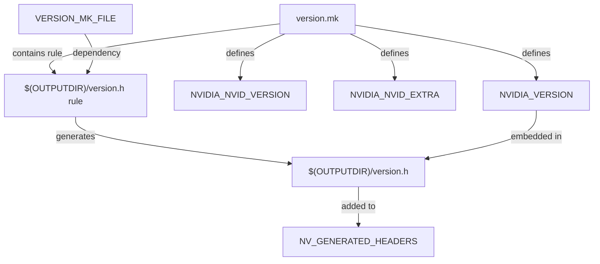
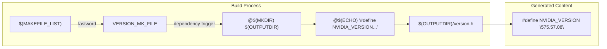
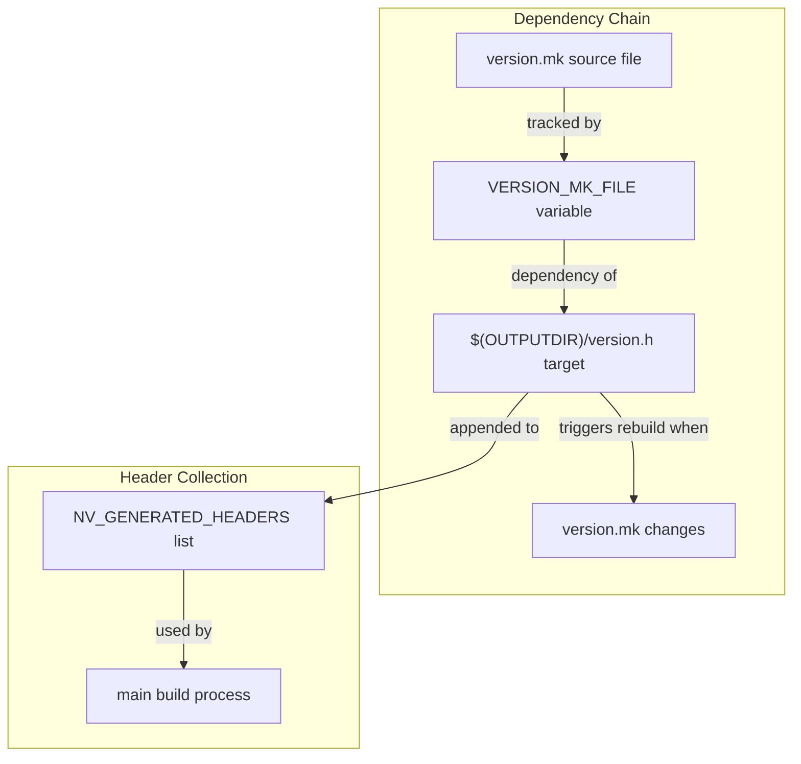

<!-- source: DeepWiki mcp.deepwiki.com · repo NVIDIA/nvidia-persistenced · page 3.1 Version Management · fetched 2026-10-26 -->

# Version Management

<details>
<summary>Relevant source files</summary>

The following files were used as context for generating this wiki page:

- [version.mk](version.mk)

</details>


## Purpose and Scope

This document describes the version management system used in the nvidia-persistenced build process. The system centralizes version information in a single makefile and automatically generates C header files containing version strings for use throughout the compiled daemon. This mechanism ensures consistent version reporting across all components of nvidia-persistenced.

For information about the broader build system configuration, see [Build Configuration and Rules](#3.2).

## Core Version Management System

The version management system is implemented through `version.mk`, which serves as the single source of truth for all version information in the nvidia-persistenced project.

### Version Variables

The system defines three primary version variables:

| Variable | Purpose | Example Value |
|----------|---------|---------------|
| `NVIDIA_VERSION` | Primary version string | 575.57.08 |
| `NVIDIA_NVID_VERSION` | NVID-specific version | 575.57.08 |
| `NVIDIA_NVID_EXTRA` | Additional version suffix | (empty) |

### Version Header Generation

The build system automatically generates a C header file containing version definitions through a makefile rule that creates `$(OUTPUTDIR)/version.h`.



Sources: [version.mk:1-12]()

## Generated Header Structure

The generated `version.h` file contains C preprocessor definitions that embed version information directly into the compiled binary. The generation process uses shell commands to create the header file with appropriate C macro definitions.

### Header Generation Process



The generation rule executes two commands:
1. Creates the output directory if it doesn't exist
2. Writes a C preprocessor definition to the header file

Sources: [version.mk:6-10]()

## Build System Integration

The version management system integrates with the broader build infrastructure through dependency tracking and header collection mechanisms.

### Dependency Management



The system uses Make's `$(lastword $(MAKEFILE_LIST))` to automatically track the `version.mk` file itself as a dependency, ensuring that changes to version information trigger regeneration of the header file.

Sources: [version.mk:6-7](), [version.mk:11]()

## Version String Composition

The version management system maintains separate version identifiers that can be composed for different purposes throughout the codebase.

### Version Variable Relationships

```mermaid
flowchart LR
    subgraph "Version Components"
        BASE["NVIDIA_VERSION<br/>\"575.57.08\""] 
        NVID["NVIDIA_NVID_VERSION<br/>\"575.57.08\""]
        EXTRA["NVIDIA_NVID_EXTRA<br/>\"(empty)\""]
    end
    
    subgraph "Generated Definitions"
        BASE --> |"becomes"| NVIDIA_VERSION_DEFINE["#define NVIDIA_VERSION \"575.57.08\""]
    end
    
    subgraph "Potential Usage"
        NVIDIA_VERSION_DEFINE --> |"available to"| C_CODE["C source files"]
        NVID --> |"available for"| NVID_SPECIFIC["NVID-specific features"]
        EXTRA --> |"available for"| VERSION_SUFFIX["version suffixes"]
    end
```

Currently, the primary `NVIDIA_VERSION` variable is the one automatically converted to a C preprocessor definition. The other variables are available for future use or specialized version string construction.

Sources: [version.mk:1-3](), [version.mk:9]()

## Integration Points

The version management system connects to other build system components through the generated headers list and dependency tracking:

- **Header Collection**: Generated version headers are automatically added to `NV_GENERATED_HEADERS`
- **Dependency Tracking**: Changes to `version.mk` automatically trigger header regeneration
- **Output Directory**: Version headers respect the build system's output directory structure
- **Build Tools**: Uses standard Make variables like `$(MKDIR)` and `$(ECHO)` for portability

This design ensures that version information remains consistent across all compiled components while maintaining clean separation between version definition and version usage.

Sources: [version.mk:6-12]()

---

