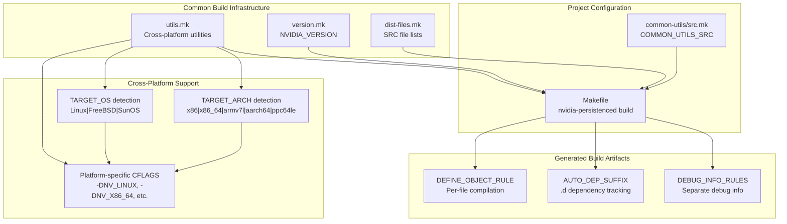
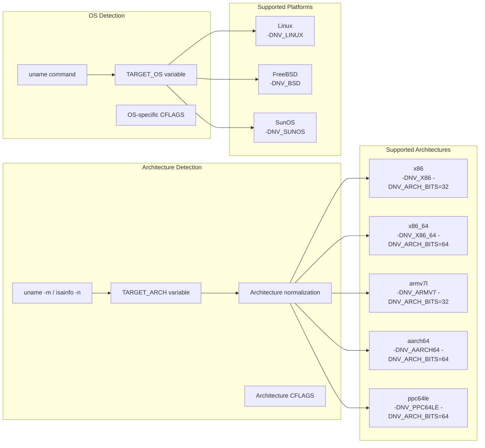
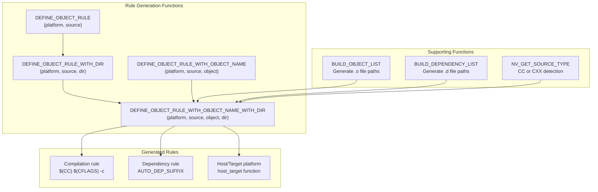
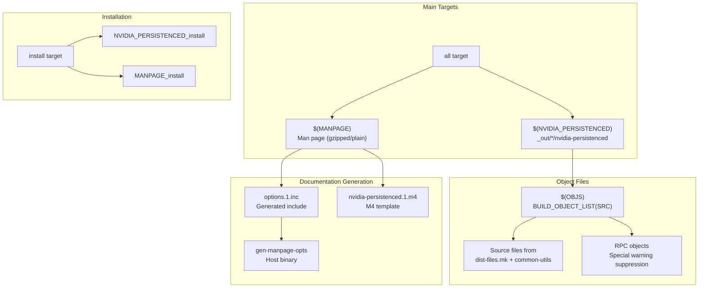
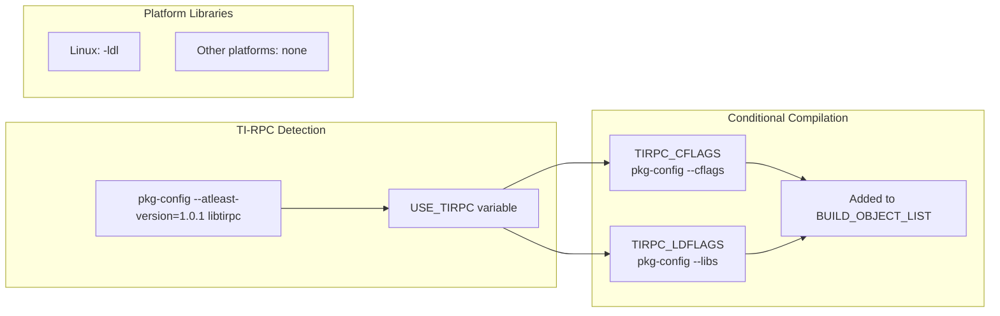

<!-- source: DeepWiki mcp.deepwiki.com · repo NVIDIA/nvidia-persistenced · page 3.2 Build Configuration and Rules · fetched 2026-10-26 -->

# Build Configuration and Rules

<details>
<summary>Relevant source files</summary>

The following files were used as context for generating this wiki page:

- [Makefile](Makefile)
- [utils.mk](utils.mk)

</details>


This document covers the build configuration system and compilation rules used in nvidia-persistenced. It focuses on the common build utilities in `utils.mk` and the main build configuration in `Makefile` that enable cross-platform compilation and dependency management.

For version management details, see [Version Management](#3.1). For information about the common utilities library that gets built, see [Common Utilities Library](#3.3).

## Build System Overview

The nvidia-persistenced build system uses a two-layer architecture with shared build utilities and project-specific configuration.

### Build System Architecture



**Sources:** [utils.mk:23-25](), [Makefile:27-30](), [Makefile:74-78]()

## Cross-Platform Configuration

The build system automatically detects and configures for different operating systems and architectures using runtime detection and conditional compilation flags.

### Platform Detection Logic



**Sources:** [utils.mk:125-127](), [utils.mk:141-152](), [utils.mk:129-139](), [utils.mk:154-172]()

| Platform | Detection Command | Compilation Flags |
|----------|------------------|-------------------|
| Linux | `uname` | `-DNV_LINUX` |
| FreeBSD | `uname` | `-DNV_BSD` |
| SunOS | `uname` | `-DNV_SUNOS` |
| x86 | `uname -m` | `-DNV_X86 -DNV_ARCH_BITS=32` |
| x86_64 | `uname -m` | `-DNV_X86_64 -DNV_ARCH_BITS=64` |
| aarch64 | `uname -m` | `-DNV_AARCH64 -DNV_ARCH_BITS=64` |

## Compiler and Toolchain Configuration

The build system provides comprehensive compiler configuration with safety flags, optimization levels, and toolchain detection.

### Compiler Flag Management

| Variable | Default Value | Purpose |
|----------|---------------|---------|
| `CC` | `gcc` | C compiler |
| `CXX` | `g++` | C++ compiler |
| `CFLAGS` | `-Wall` | Base compilation flags |
| `CC_ONLY_CFLAGS` | `-Wstrict-prototypes -Wold-style-definition` | C-specific warnings |
| `EXTRA_CFLAGS` | Empty | Additional user flags |

**Sources:** [utils.mk:35-48]()

The system automatically adds safety flags to prevent common issues:

```makefile
CFLAGS += -fno-strict-aliasing -fno-omit-frame-pointer -Wformat=2
CFLAGS += -Wno-unused-parameter
CC_ONLY_CFLAGS += -Wno-format-zero-length
```

**Sources:** [utils.mk:42](), [utils.mk:65-68]()

### Debug and Release Configuration

| Build Mode | Triggered By | Compiler Flags | Strip Behavior |
|------------|--------------|----------------|----------------|
| Debug | `DEBUG=1` | `-O0 -g -DDEBUG=1` | `STRIP_CMD=true` |
| Develop | `DEVELOP=1` | `-DDEVELOP=1` | `STRIP_CMD=true` |
| Release | Default | `-O2` | `strip` enabled |

**Sources:** [utils.mk:74-90]()

## Build Rules and Object Generation

The build system uses function-based rule generation to create consistent compilation rules across all source files.

### Object Rule Generation Functions



**Sources:** [utils.mk:463-499](), [utils.mk:405-426](), [utils.mk:291-295]()

### Automatic Dependency Generation

The system generates dependency files automatically during compilation using the `AUTO_DEP_SUFFIX` mechanism:

```makefile
AUTO_DEP_SUFFIX = -MMD -MF $$(@:.o=.d.to_be_processed) -MP -MT $$@ && \
  $$(SED) -e "1,3s| $$< | |" < $$(@:.o=.d.to_be_processed) > $$(@:.o=.d)
```

**Sources:** [utils.mk:337-342]()

This approach:
- Uses `-MMD` to generate dependency output
- Uses `-MT` to rename targets for the output directory
- Uses `-MP` to generate phony targets for deleted prerequisites
- Processes the output with `sed` to handle source file moves

## Main Build Targets

The main `Makefile` defines the primary build targets and their dependencies.

### Primary Targets and Dependencies



**Sources:** [Makefile:121-122](), [Makefile:86](), [Makefile:124-125](), [Makefile:137-140]()

### Source File Management

The build incorporates source files from multiple locations:

| Source Category | Definition Location | Purpose |
|-----------------|-------------------|---------|
| Core sources | `dist-files.mk` | nvidia-persistenced specific code |
| Common utilities | `$(COMMON_UTILS_DIR)/src.mk` | Shared utility functions |
| RPC sources | `$(RPC_SRC)` | Auto-generated RPC stubs |

**Sources:** [Makefile:74-78]()

Special compiler flag handling for generated RPC code:
```makefile
$(call BUILD_OBJECT_LIST,$(RPC_SRC)): CFLAGS += -Wno-unused-variable
$(call BUILD_OBJECT_LIST,$(RPC_SRC)): CFLAGS += $(suppress_cast_func_type_warning)
```

**Sources:** [Makefile:82-84]()

## Library and External Dependencies

The build system manages external library dependencies with conditional compilation based on availability.

### TI-RPC Library Integration



**Sources:** [Makefile:108-115](), [Makefile:104-106]()

### Directory Configuration

The build supports flexible directory configuration for different build environments:

| Variable | Default | Purpose |
|----------|---------|---------|
| `RPC_DIR` | `.` | RPC interface headers |
| `NVIDIA_CFG_DIR` | `.` | Configuration library headers |
| `NVIDIA_NUMA_DIR` | `.` | NUMA management headers |
| `NV_IOCTL_INC_DIR` | `.` | IOCTL definitions |
| `COMMON_UTILS_DIR` | `common-utils` | Shared utilities |

**Sources:** [Makefile:58-72]()

## Debug Information and Stripping

The build system provides sophisticated debug information handling with optional separate debug info generation.

### Debug Information Rules

The `DEBUG_INFO_RULES` function generates rules for handling debug information:

```makefile
$(eval $(call DEBUG_INFO_RULES, $(NVIDIA_PERSISTENCED)))
$(NVIDIA_PERSISTENCED).unstripped: $(OBJS)
```

**Sources:** [Makefile:137-140](), [utils.mk:511-526]()

This system supports:
- Conditional stripping based on `DO_STRIP` and `NV_SEPARATE_DEBUG_INFO`
- Separate `.debug` files when `NV_SEPARATE_DEBUG_INFO=1`
- Retention of unstripped binaries when `NV_KEEP_UNSTRIPPED_BINARIES=1`
- Intermediate file cleanup for disk space management

**Sources:** [utils.mk:200-201](), [utils.mk:518-525]()

---

