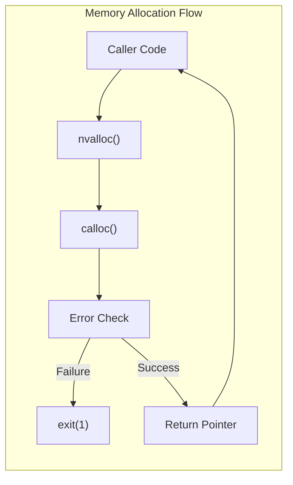
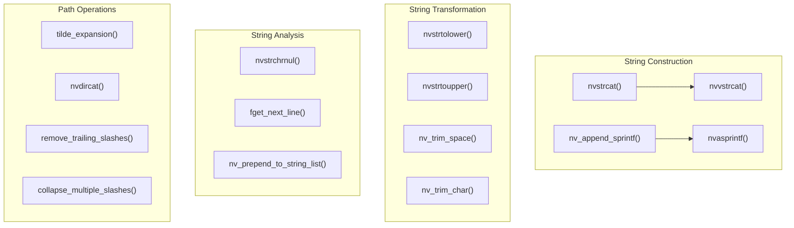
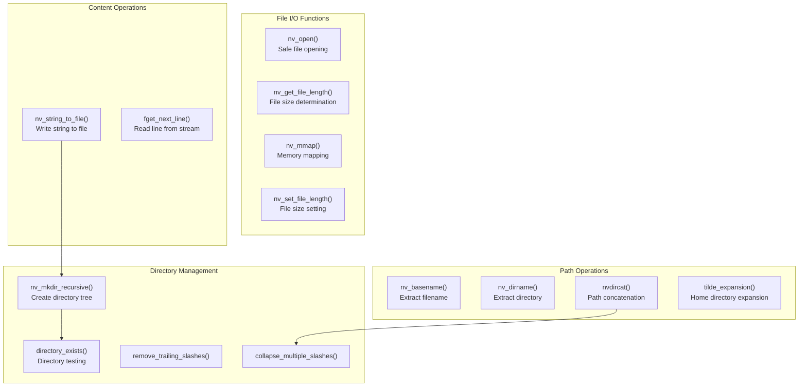
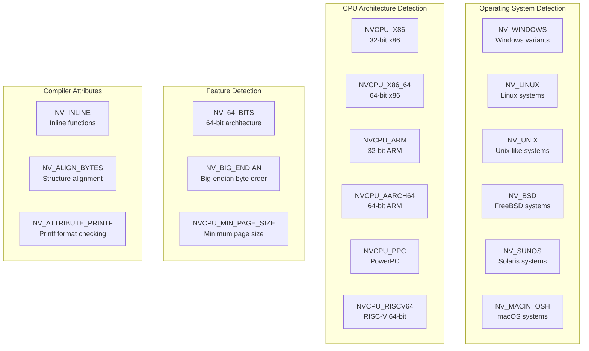
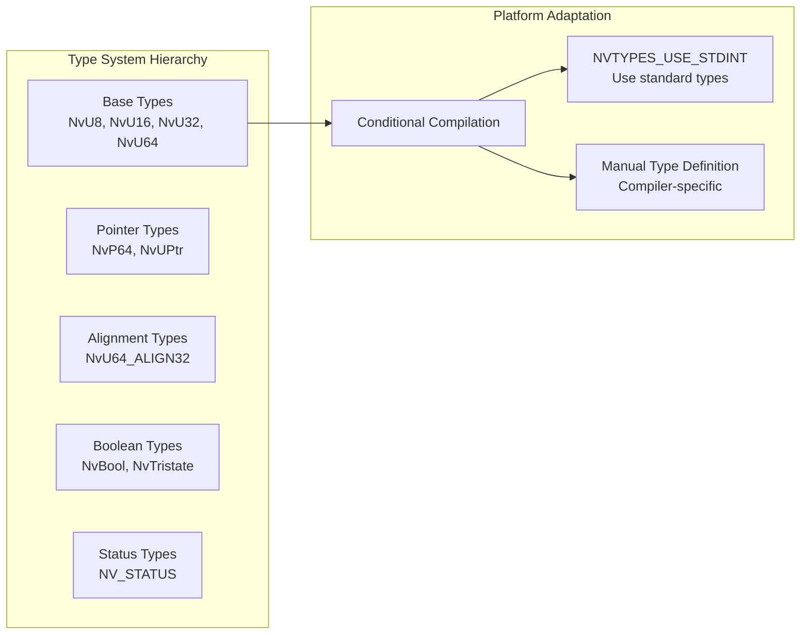
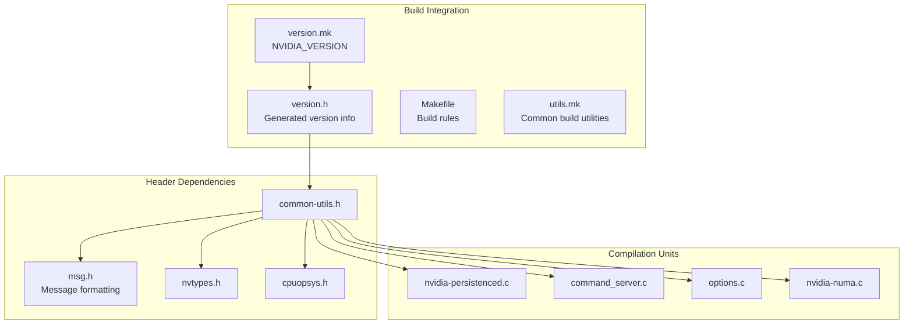

<!-- source: DeepWiki mcp.deepwiki.com · repo NVIDIA/nvidia-persistenced · page 3.3 Common Utilities Library · fetched 2026-10-26 -->

# Common Utilities Library

<details>
<summary>Relevant source files</summary>

The following files were used as context for generating this wiki page:

- [common-utils/common-utils.c](common-utils/common-utils.c)
- [common-utils/common-utils.h](common-utils/common-utils.h)
- [cpuopsys.h](cpuopsys.h)
- [nvstatus.h](nvstatus.h)
- [nvtypes.h](nvtypes.h)

</details>


This document covers the shared utility functions and cross-platform compatibility layer used throughout the nvidia-persistenced codebase. The Common Utilities Library provides essential building blocks for memory management, string operations, file I/O, and platform abstraction that enable the daemon to function consistently across different operating systems and hardware architectures.

For information about how these utilities integrate with the build system configuration, see [Build Configuration and Rules](#3.2). For details about the overall build system architecture, see [Build System](#3).

## Library Architecture Overview

The Common Utilities Library consists of several interconnected components that provide foundational services to the entire codebase:

```mermaid
graph TB
    subgraph "Core Utility Functions"
        COMMON_UTILS["common-utils.c<br/>Memory & String Functions"]
        COMMON_UTILS_H["common-utils.h<br/>Function Declarations"]
    end
    
    subgraph "Platform Abstraction"
        CPUOPSYS["cpuopsys.h<br/>CPU & OS Detection"]
        NVTYPES["nvtypes.h<br/>Type Definitions"]
        NVSTATUS["nvstatus.h<br/>Status Codes"]
    end
    
    subgraph "Memory Management"
        NVALLOC["nvalloc()"]
        NVREALLOC["nvrealloc()"]
        NVFREE["nvfree()"]
        NVSTRDUP["nvstrdup()"]
    end
    
    subgraph "String Operations"
        NVSTRCAT["nvstrcat()"]
        NVVSTRCAT["nvvstrcat()"]
        NVASPRINTF["nvasprintf()"]
        NV_TRIM["nv_trim_space()"]
    end
    
    subgraph "File I/O"
        NV_OPEN["nv_open()"]
        NV_MMAP["nv_mmap()"]
        NV_BASENAME["nv_basename()"]
        NV_MKDIR["nv_mkdir_recursive()"]
    end
    
    subgraph "Cross-Platform Support"
        VERSION_ENCODE["nv_encode_version()"]
        TILDE_EXPAND["tilde_expansion()"]
        DIRECTORY_EXISTS["directory_exists()"]
    end
    
    COMMON_UTILS_H --> COMMON_UTILS
    COMMON_UTILS_H --> NVTYPES
    COMMON_UTILS_H --> CPUOPSYS
    
    COMMON_UTILS --> NVALLOC
    COMMON_UTILS --> NVREALLOC
    COMMON_UTILS --> NVFREE
    COMMON_UTILS --> NVSTRDUP
    
    COMMON_UTILS --> NVSTRCAT
    COMMON_UTILS --> NVVSTRCAT
    COMMON_UTILS --> NVASPRINTF
    COMMON_UTILS --> NV_TRIM
    
    COMMON_UTILS --> NV_OPEN
    COMMON_UTILS --> NV_MMAP
    COMMON_UTILS --> NV_BASENAME
    COMMON_UTILS --> NV_MKDIR
    
    COMMON_UTILS --> VERSION_ENCODE
    COMMON_UTILS --> TILDE_EXPAND
    COMMON_UTILS --> DIRECTORY_EXISTS
```



Sources: [common-utils/common-utils.h:1-143](), [common-utils/common-utils.c:1-839](), [cpuopsys.h:1-437](), [nvtypes.h:1-671](), [nvstatus.h:1-123]()

## Memory Management Functions

The library provides a comprehensive set of memory management functions that wrap standard C library calls with error checking and consistent behavior:

| Function | Purpose | Error Handling |
|----------|---------|----------------|
| `nvalloc(size_t size)` | Zero-initialized memory allocation | Exits on failure |
| `nvrealloc(void *ptr, size_t size)` | Memory reallocation | Exits on failure |
| `nvfree(void *s)` | Safe memory deallocation | NULL-pointer safe |
| `nvstrdup(const char *s)` | String duplication | Exits on failure |
| `nvstrndup(const char *s, size_t n)` | Limited string duplication | Exits on failure |



The memory management functions implement a fail-fast strategy where allocation failures result in program termination with error messages to `stderr`. This design ensures that the daemon never operates in a degraded state due to memory pressure.

Sources: [common-utils/common-utils.c:52-63](), [common-utils/common-utils.c:130-144](), [common-utils/common-utils.c:287-291](), [common-utils/common-utils.c:154-169](), [common-utils/common-utils.c:179-198]()

## String Manipulation Utilities

The library provides extensive string manipulation capabilities that extend beyond standard C library functions:



Key string functions include:

- **`nvstrcat(const char *str, ...)`**: Variadic string concatenation with automatic memory allocation
- **`nvasprintf(const char *fmt, ...)`**: Printf-style string formatting with automatic allocation
- **`nv_trim_space(char *string)`**: Remove leading and trailing whitespace
- **`tilde_expansion(const char *str)`**: Expand `~` and `~user` path prefixes

Sources: [common-utils/common-utils.c:112-122](), [common-utils/common-utils.c:72-104](), [common-utils/common-utils.c:249-257](), [common-utils/common-utils.c:706-715](), [common-utils/common-utils.c:311-362]()

## File I/O and Path Management

The library provides robust file operations with comprehensive error checking and cross-platform path handling:

| Category | Functions | Description |
|----------|-----------|-------------|
| File Operations | `nv_open()`, `nv_get_file_length()`, `nv_mmap()` | Basic file access with error checking |
| Path Manipulation | `nv_basename()`, `nv_dirname()`, `nvdircat()` | Cross-platform path operations |
| Directory Management | `nv_mkdir_recursive()`, `directory_exists()` | Directory creation and testing |
| File Content | `nv_string_to_file()`, `fget_next_line()` | Reading and writing file content |



Sources: [common-utils/common-utils.c:455-466](), [common-utils/common-utils.c:476-489](), [common-utils/common-utils.c:516-528](), [common-utils/common-utils.c:537-545](), [common-utils/common-utils.c:644-652](), [common-utils/common-utils.c:553-607]()

## Cross-Platform Compatibility Layer

The library provides extensive cross-platform support through preprocessor macros and conditional compilation:



The platform detection system uses a two-tiered approach:
1. **Traditional `#ifdef` macros** for legacy compatibility
2. **Numerical constants** (0/1) for safer conditional compilation that can be used in regular `if` statements

Sources: [cpuopsys.h:55-127](), [cpuopsys.h:139-243](), [cpuopsys.h:273-434](), [nvtypes.h:527-665]()

## Type System and Status Handling

The library defines a comprehensive type system that ensures consistent behavior across platforms:

### Core Type Definitions

| Type Category | Types | Description |
|---------------|-------|-------------|
| Integer Types | `NvU8`, `NvU16`, `NvU32`, `NvU64` | Unsigned integers |
| Signed Types | `NvS8`, `NvS16`, `NvS32`, `NvS64` | Signed integers |
| Floating Point | `NvF32`, `NvF64` | IEEE floating point |
| Pointer Types | `NvP64`, `NvUPtr`, `NvSPtr` | Platform-aware pointers |
| Boolean Types | `NvBool`, `NvTristate` | Boolean and tri-state values |



### Version Encoding System

The library provides a sophisticated version encoding system for comparing software versions:

```c
// Version encoding functions from common-utils.h
static NV_INLINE uint64_t nv_encode_version(unsigned int major,
                                            unsigned int minor, 
                                            unsigned int micro,
                                            unsigned int nano);

#define NV_VERSION2(major, minor) nv_encode_version(major, minor, 0, 0)
#define NV_VERSION3(major, minor, micro) nv_encode_version(major, minor, micro, 0)
#define NV_VERSION4(major, minor, micro, nano) nv_encode_version(major, minor, micro, nano)
```

Sources: [nvtypes.h:97-255](), [nvtypes.h:275-348](), [nvstatus.h:33-117](), [common-utils/common-utils.h:103-123](), [common-utils/common-utils.h:135-139]()

## Integration with Build System

The Common Utilities Library integrates tightly with the build system through header inclusion and macro definitions:



The library uses several key macros for build integration:
- **`PROGRAM_NAME`**: Defined by the build system for error messages
- **`NVIDIA_VERSION`**: Injected from `version.mk` for version strings
- **`NV_ID_STRING`**: Combines program name and version for identification

Sources: [common-utils/common-utils.h:30-32](), [common-utils/common-utils.h:141](), [common-utils/common-utils.c:57-58]()

## Usage Patterns and Best Practices

The Common Utilities Library is designed to be used consistently throughout the codebase with specific patterns:

### Memory Management Pattern
```c
// Typical allocation pattern
char *buffer = nvalloc(size);          // Zero-initialized allocation
char *string = nvstrdup(source);       // Safe string duplication
buffer = nvrealloc(buffer, new_size);  // Safe reallocation
nvfree(buffer);                        // Safe deallocation
nvfree(string);
```

### String Building Pattern
```c
// Variadic concatenation
char *path = nvstrcat(base_dir, "/", filename, NULL);

// Printf-style formatting
char *message = nvasprintf("Error %d: %s", code, description);

// Incremental building
char *result = NULL;
nv_append_sprintf(&result, "Part 1: %s\n", part1);
nv_append_sprintf(&result, "Part 2: %d\n", part2);
```

### Platform-Safe Conditional Compilation
```c
// Preferred: numerical constants for safer conditionals
if (NVOS_IS_LINUX) {
    // Linux-specific code
} else if (NVOS_IS_WINDOWS) {
    // Windows-specific code
}

// Alternative: traditional ifdef (when necessary)
#ifdef NV_LINUX
    // Linux-specific definitions
#endif
```

Sources: [common-utils/common-utils.c:52-63](), [common-utils/common-utils.c:112-122](), [common-utils/common-utils.c:266-280](), [cpuopsys.h:289-343]()

---

