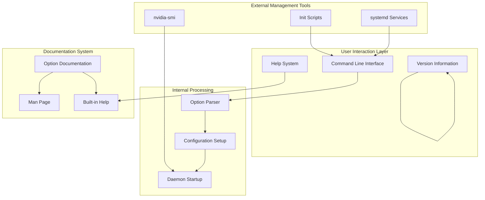
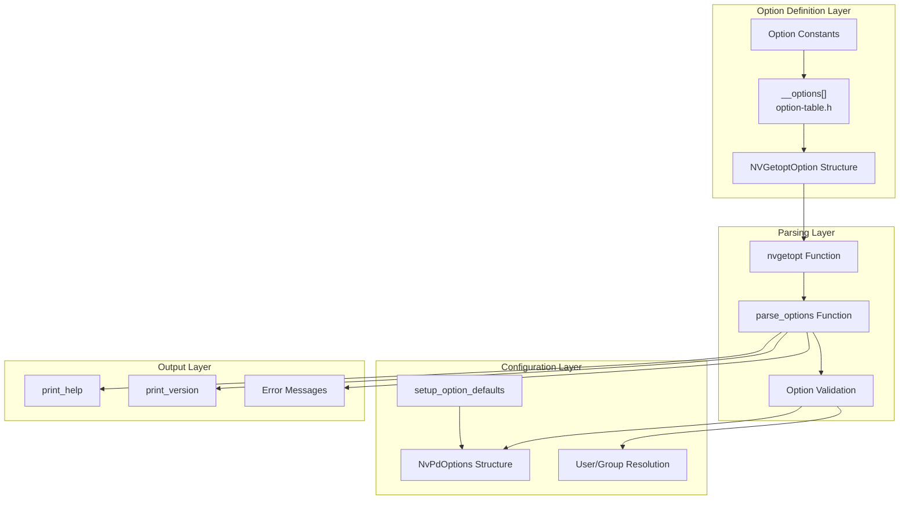
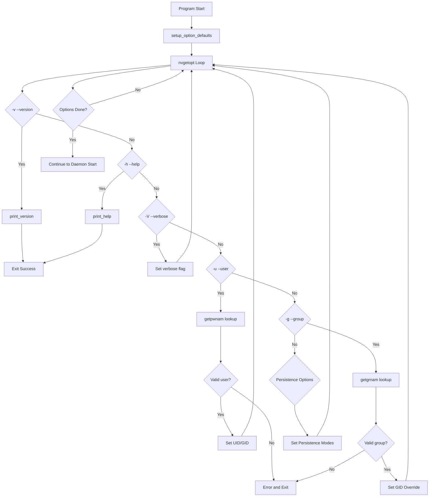
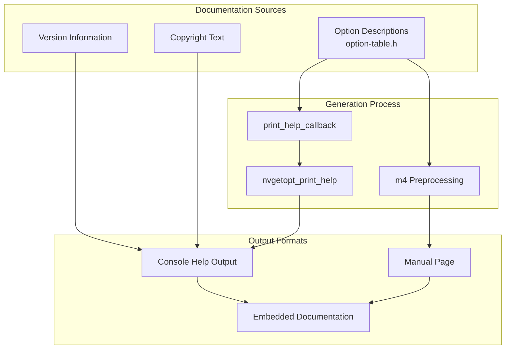
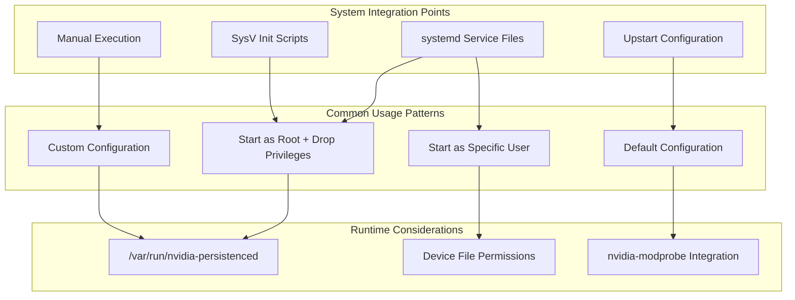
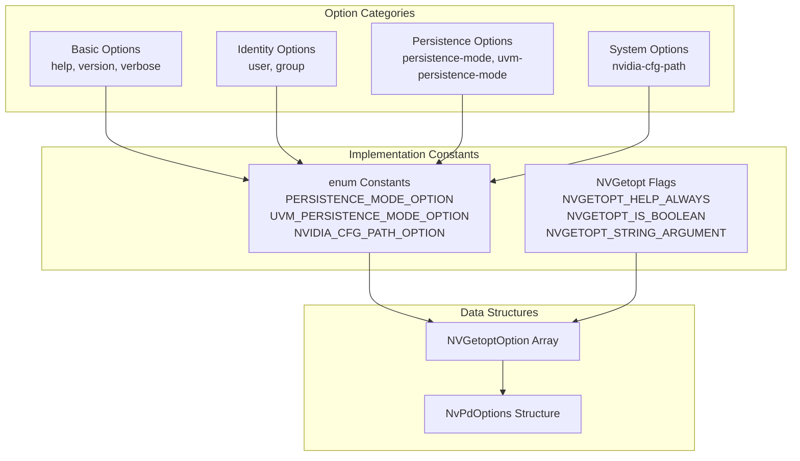

<!-- source: DeepWiki mcp.deepwiki.com · repo NVIDIA/nvidia-persistenced · page 4 User Interface · fetched 2026-10-26 -->

# User Interface

Relevant source files

The following files were used as context for generating this wiki page:

- [nvidia-persistenced.1.m4](nvidia-persistenced.1.m4)
- [option-table.h](option-table.h)
- [options.c](options.c)

This page documents the user interface provided by nvidia-persistenced, covering how users and administrators interact with the daemon through command-line options, help systems, and integration with external management tools. For detailed information about specific command-line options, see [Command Line Options](#4.1). For information about how documentation is generated from option definitions, see [Documentation Generation](#4.2).

## Overview

The nvidia-persistenced daemon provides a command-line interface primarily intended for system administrators and init scripts. End users typically do not interact with the daemon directly, but instead use NVIDIA management utilities like `nvidia-smi` that communicate with the daemon automatically through its RPC interface (documented in [RPC Communication System](#2.2)).

Sources: [option-table.h:36-120](), [options.c:112-193](), [nvidia-persistenced.1.m4:1-105]()

## Command-Line Interface Architecture

The command-line interface is built around the `nvgetopt` library, which provides a standardized way to define and parse options. The interface follows a table-driven approach where all options are defined in a central location and processed systematically.

Sources: [option-table.h:30-120](), [options.c:98-193]()

## Option Processing Flow

The daemon processes command-line options through a systematic workflow that handles validation, user/group resolution, and configuration setup:

Sources: [options.c:112-193](), [options.c:98-106]()

## Help and Documentation System

The daemon provides multiple levels of documentation through integrated help systems and generated documentation:

| Component | Function | Source | Description |
|-----------|----------|---------|-------------|
| Built-in Help | `print_help()` | [options.c:77-92]() | Interactive command-line help |
| Version Info | `print_version()` | [options.c:49-61]() | Version and copyright information |
| Help Callback | `print_help_callback()` | [options.c:66-71]() | Formatted option descriptions |
| Man Page | nvidia-persistenced.1.m4 | [nvidia-persistenced.1.m4:1-105]() | System manual page |

Sources: [options.c:49-92](), [nvidia-persistenced.1.m4:15-51]()

## Integration with System Management

The daemon's user interface is designed to integrate seamlessly with various system management approaches:

Sources: [nvidia-persistenced.1.m4:34-75](), [options.c:62-85]()

## Configuration Options Overview

The daemon accepts several categories of configuration options that control its behavior:

| Category | Options | Purpose |
|----------|---------|---------|
| **Identity** | `--user`, `--group` | Process identity and privilege management |
| **Behavior** | `--verbose` | Logging and output control |
| **Persistence** | `--persistence-mode`, `--uvm-persistence-mode` | GPU persistence state control |
| **System** | `--nvidia-cfg-path` | Library and system integration paths |
| **Information** | `--help`, `--version` | Documentation and version reporting |

The option definitions use several key constants and enumerations:

Sources: [option-table.h:30-120](), [options.c:98-106]()

---

