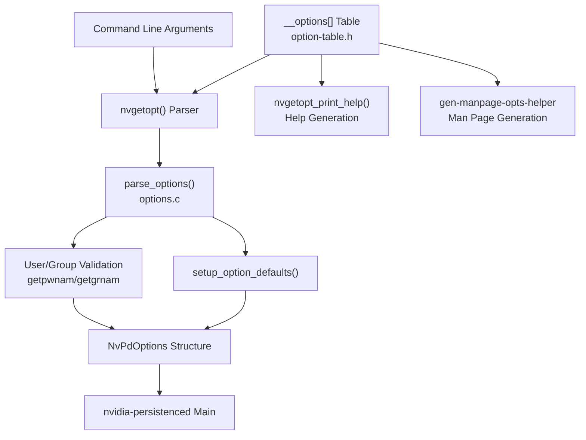
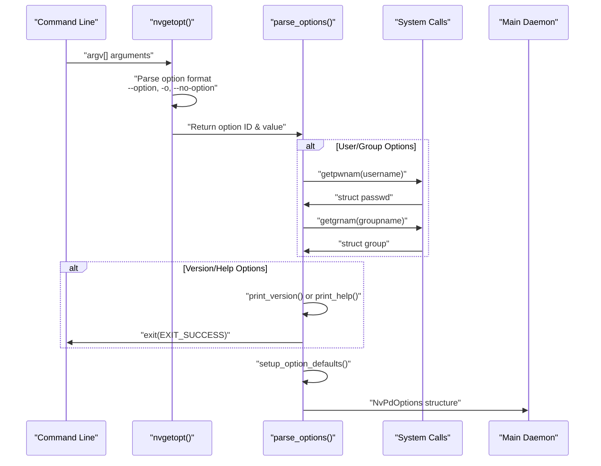
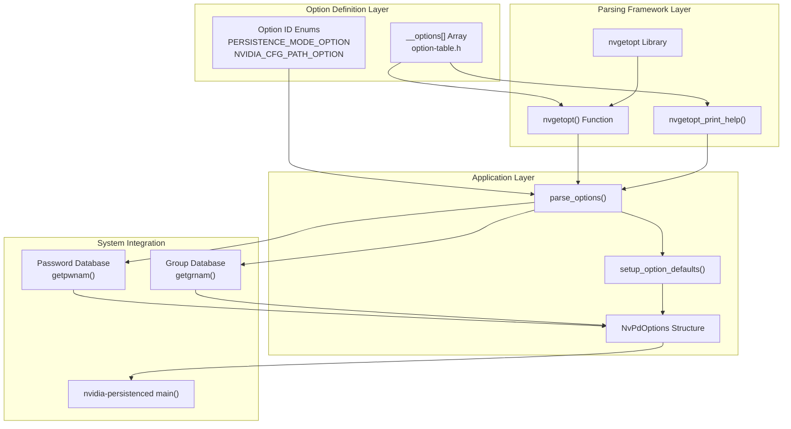

<!-- source: DeepWiki mcp.deepwiki.com · repo NVIDIA/nvidia-persistenced · page 4.1 Command Line Options · fetched 2026-10-26 -->

# Command Line Options

<details>
<summary>Relevant source files</summary>

The following files were used as context for generating this wiki page:

- [common-utils/gen-manpage-opts-helper.c](common-utils/gen-manpage-opts-helper.c)
- [common-utils/nvgetopt.c](common-utils/nvgetopt.c)
- [common-utils/nvgetopt.h](common-utils/nvgetopt.h)
- [common-utils/nvpci-utils.c](common-utils/nvpci-utils.c)
- [common-utils/nvpci-utils.h](common-utils/nvpci-utils.h)
- [option-table.h](option-table.h)
- [options.c](options.c)

</details>


This document covers the command line option system for `nvidia-persistenced`, including all available options, their parsing mechanism, and the underlying option framework. For information about daemon installation and service management, see [Installation and Deployment](#5.1). For details on documentation generation from these options, see [Documentation Generation](#4.2).

## Option Parsing System Overview

The `nvidia-persistenced` daemon uses a custom option parsing framework built around the `nvgetopt` library. This system provides POSIX-compliant argument parsing with support for both short (`-v`) and long (`--version`) option formats, boolean toggles with negation (`--no-persistence-mode`), and automatic help generation.

The option system is designed around three main components:
- **Option Table**: Static definition of all available options in [option-table.h:36-120]()
- **Option Parser**: The `nvgetopt` framework in [common-utils/nvgetopt.c]()
- **Option Processing**: Command line parsing and validation in [options.c:112-193]()



Sources: [option-table.h:36-120](), [options.c:112-193](), [common-utils/nvgetopt.c:37-367]()

## Available Command Line Options

| Option | Short | Type | Default | Description |
|--------|-------|------|---------|-------------|
| `--version` | `-v` | Flag | - | Print version information and exit |
| `--help` | `-h` | Flag | - | Print usage information and exit |
| `--verbose` | `-V` | Flag | `false` | Enable verbose logging to syslog |
| `--user` | `-u` | String | current uid | Run daemon with specified user permissions |
| `--group` | `-g` | String | user's primary gid | Run daemon with specified group permissions |
| `--persistence-mode` | - | Boolean | `enabled` | Enable/disable persistence mode on startup |
| `--uvm-persistence-mode` | - | Boolean | `disabled` | Enable/disable UVM persistence mode on startup |
| `--nvidia-cfg-path` | - | String | auto-detected | Override path to nvidia-cfg library |

Sources: [option-table.h:36-120](), [options.c:98-106]()

### Boolean Option Behavior

Boolean options support negation using the `--no-` prefix. For example:
- `--persistence-mode` enables persistence mode
- `--no-persistence-mode` disables persistence mode

This is implemented through the `NVGETOPT_IS_BOOLEAN` flag in the option framework.

Sources: [option-table.h:87-93](), [common-utils/nvgetopt.c:253-255]()

## Option Processing Flow



Sources: [options.c:112-193](), [common-utils/nvgetopt.c:37-367]()

## Implementation Details

### Option Structure Definition

The option system uses the `NVGetoptOption` structure to define each command line option:

```c
typedef struct {
    const char *name;           // Long option name
    int val;                   // Short option character or unique ID
    unsigned int flags;        // Option behavior flags
    const char *arg_name;      // Argument name for help text
    const char *description;   // Help description
} NVGetoptOption;
```

Sources: [common-utils/nvgetopt.h:135-141]()

### Option Flags

The framework supports several option types through flag combinations:

| Flag | Purpose | Usage |
|------|---------|-------|
| `NVGETOPT_IS_BOOLEAN` | Boolean toggle | `--verbose`, `--no-verbose` |
| `NVGETOPT_STRING_ARGUMENT` | String parameter | `--user USERNAME` |
| `NVGETOPT_HELP_ALWAYS` | Always show in help | Standard options |
| `NVGETOPT_ALLOW_DISABLE` | Allow `--no-` prefix | Disableable features |

Sources: [common-utils/nvgetopt.h:46-92]()

### User and Group Resolution

The `--user` and `--group` options perform system user/group lookups:

- User lookup via `getpwnam()` in [options.c:148-157]()
- Group lookup via `getgrnam()` in [options.c:160-168]()
- Group option overrides user's primary group if both specified
- Errors result in daemon exit with descriptive messages

Sources: [options.c:147-169]()

## Option Parsing Architecture



Sources: [option-table.h:30-120](), [options.c:98-193](), [common-utils/nvgetopt.h:135-204](), [common-utils/nvgetopt.c:37-491]()

### Default Values

The system establishes sensible defaults through `setup_option_defaults()`:

- `persistence_mode`: `NV_PERSISTENCE_MODE_ENABLED`
- `uvm_persistence_mode`: `NV_UVM_PERSISTENCE_MODE_DISABLED`
- `nvidia_cfg_path`: `NULL` (auto-detect)
- `verbose`: `0` (disabled)
- `uid`/`gid`: Current process user/group

Sources: [options.c:98-106]()

### Error Handling

The option parser handles several error conditions:
- Invalid usernames/groups result in immediate exit with error message
- Unknown options display usage information
- Missing required arguments show specific error details
- All errors include the program name and context

Sources: [options.c:149-164](), [options.c:188-191]()

---

