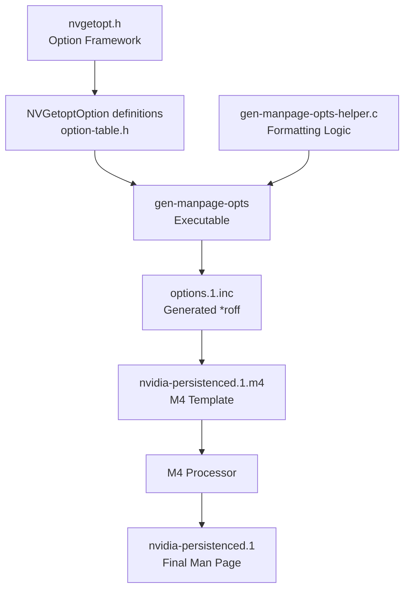
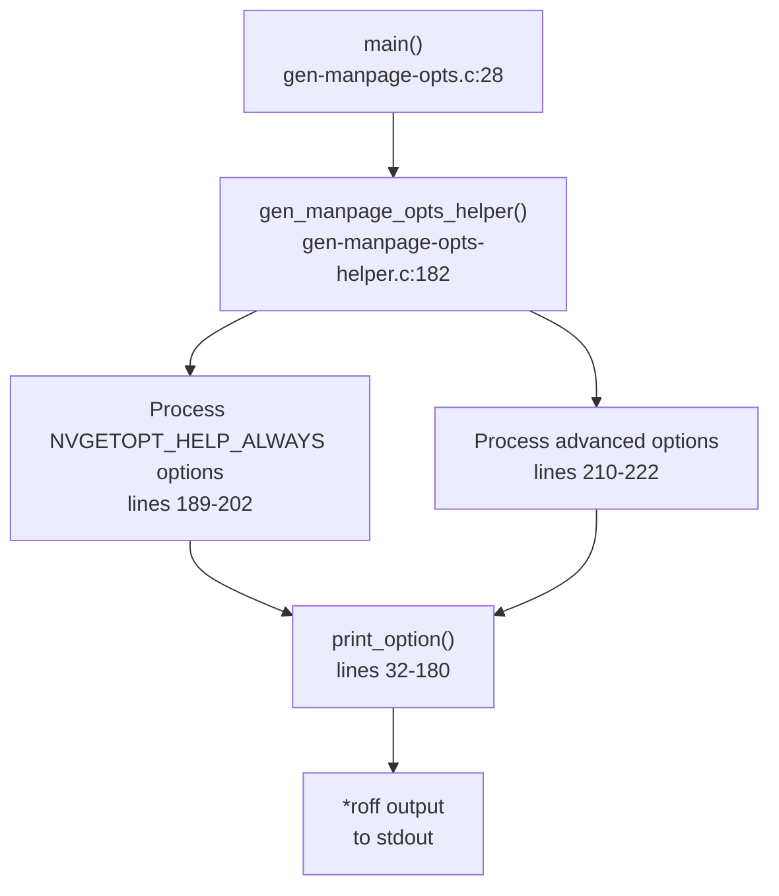
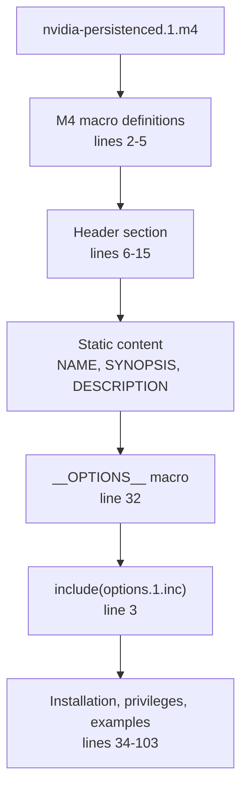
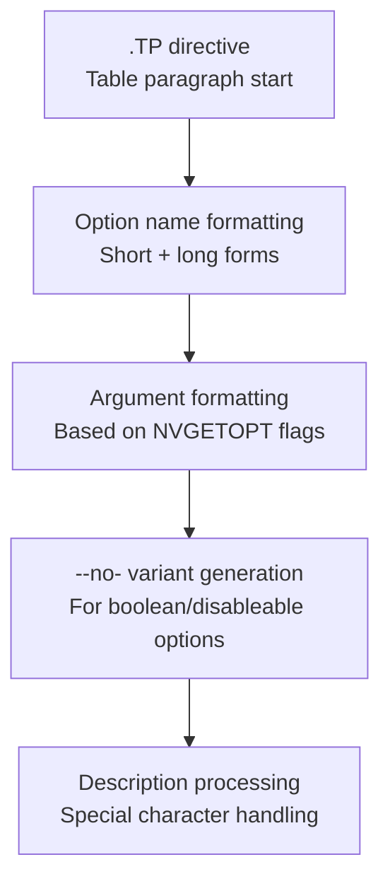
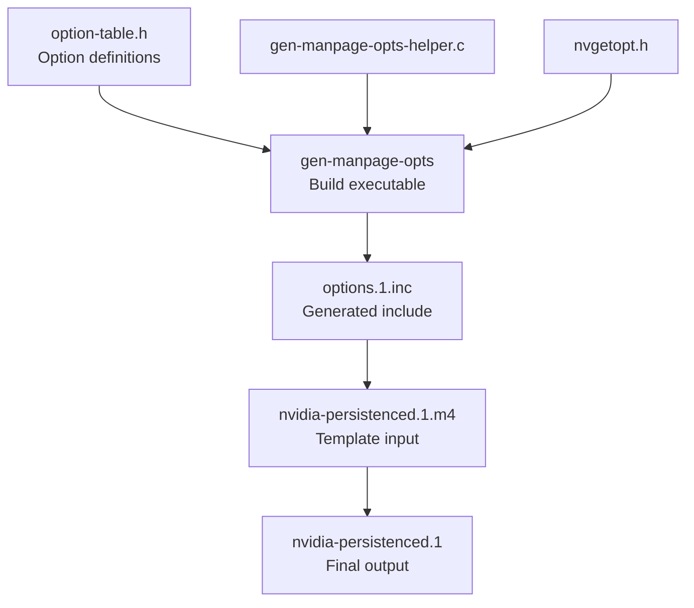

<!-- source: DeepWiki mcp.deepwiki.com · repo NVIDIA/nvidia-persistenced · page 4.2 Documentation Generation · fetched 2026-10-26 -->

# Documentation Generation

Relevant source files

The following files were used as context for generating this wiki page:

- [common-utils/gen-manpage-opts-helper.c](common-utils/gen-manpage-opts-helper.c)
- [common-utils/nvgetopt.h](common-utils/nvgetopt.h)
- [gen-manpage-opts.c](gen-manpage-opts.c)
- [nvidia-persistenced.1.m4](nvidia-persistenced.1.m4)

This page documents the automated documentation generation system used to create man pages and help text for nvidia-persistenced. The system generates consistent documentation directly from the command-line option definitions, ensuring that help text and manual pages remain synchronized with the actual program behavior.

For information about the command-line options themselves, see [Command Line Options](#4.1). For details about the build system that orchestrates documentation generation, see [Build Configuration and Rules](#3.2).

## Overview

The documentation generation system automatically creates man page content from the same option definitions used by the command-line parser. This approach ensures that documentation remains consistent with the actual program behavior and reduces maintenance overhead.

**Documentation Generation Pipeline**

Sources: [gen-manpage-opts.c:1-32](), [nvidia-persistenced.1.m4:1-105](), [common-utils/gen-manpage-opts-helper.c:1-224]()

## Option Definition System

The documentation generation begins with the `NVGetoptOption` structure defined in the nvgetopt framework. Each option definition contains both the runtime parsing information and the documentation content.

**NVGetoptOption Structure Components**

| Field | Purpose | Documentation Role |
|-------|---------|-------------------|
| `name` | Option name | Generates `--option-name` syntax |
| `val` | Short option character | Generates `-c` syntax |
| `flags` | Parsing behavior flags | Controls argument formatting |
| `arg_name` | Argument display name | Used in `--option=ARG` display |
| `description` | Help text | Becomes option description in man page |

The `flags` field uses several constants that affect documentation generation:

- `NVGETOPT_IS_BOOLEAN` - Generates `--no-option` variants
- `NVGETOPT_HAS_ARGUMENT` - Includes argument syntax in documentation
- `NVGETOPT_ALLOW_DISABLE` - Shows both enabled and disabled forms
- `NVGETOPT_HELP_ALWAYS` - Places option in main OPTIONS section vs ADVANCED OPTIONS

Sources: [common-utils/nvgetopt.h:135-141]()

## Documentation Generation Process

The `gen-manpage-opts` executable processes the option definitions to create formatted *roff output suitable for inclusion in man pages.

**Option Processing Flow**

The generation process separates options into two categories:
- **Basic options**: Those marked with `NVGETOPT_HELP_ALWAYS`, shown in the main OPTIONS section
- **Advanced options**: All other documented options, shown in the ADVANCED OPTIONS section

Sources: [gen-manpage-opts.c:28-32](), [common-utils/gen-manpage-opts-helper.c:182-224]()

## Man Page Template System

The generated option documentation is incorporated into the final man page through an M4 template system. The template uses M4 macros to include the generated content and handle platform-specific variations.

**Template Processing Structure**

Key M4 template features:
- **Changequote directive**: Redefines M4 quote characters to avoid conflicts with *roff syntax
- **Conditional macros**: Platform-specific handling (e.g., SunOS URL macro limitations)
- **Variable substitution**: `__VERSION__`, `__DATE__`, `__BUILD_OS__` replaced during processing
- **Include mechanism**: `__OPTIONS__` macro expands to include the generated options documentation

Sources: [nvidia-persistenced.1.m4:1-105]()

## Output Formatting and Special Syntax

The `print_option()` function generates *roff markup with specific formatting rules to create properly formatted man page entries.

**Option Entry Format Structure**

The formatting system handles several special syntax elements in option descriptions:

| Character | Effect | *roff Output |
|-----------|--------|--------------|
| `&` | Toggle italics | `.I` directive |
| `^` | Toggle bold | `.B` directive |
| `-` | Literal hyphen | `\-` escaped |
| `.` at line start | Error - invalid *roff | Build failure |
| `'` at line start | Error - invalid *roff | Build failure |

**Argument Name Processing**

The system determines argument names through this priority:
1. Explicit `arg_name` field if provided
2. Uppercase version of option name as fallback

**Boolean and Disableable Options**

Options with `NVGETOPT_IS_BOOLEAN` or `NVGETOPT_ALLOW_DISABLE` flags generate additional `--no-option` variants in the documentation, showing users how to disable the feature.

Sources: [common-utils/gen-manpage-opts-helper.c:32-180]()

## Integration with Build System

The documentation generation integrates with the build system through generated dependencies and intermediate files. The build system ensures that changes to option definitions trigger regeneration of the documentation.

**Build Dependencies**

This system ensures that documentation remains current with code changes and that the build process can detect when documentation regeneration is necessary.

Sources: [gen-manpage-opts.c:25-26](), [common-utils/gen-manpage-opts-helper.c:28-30]()

---

