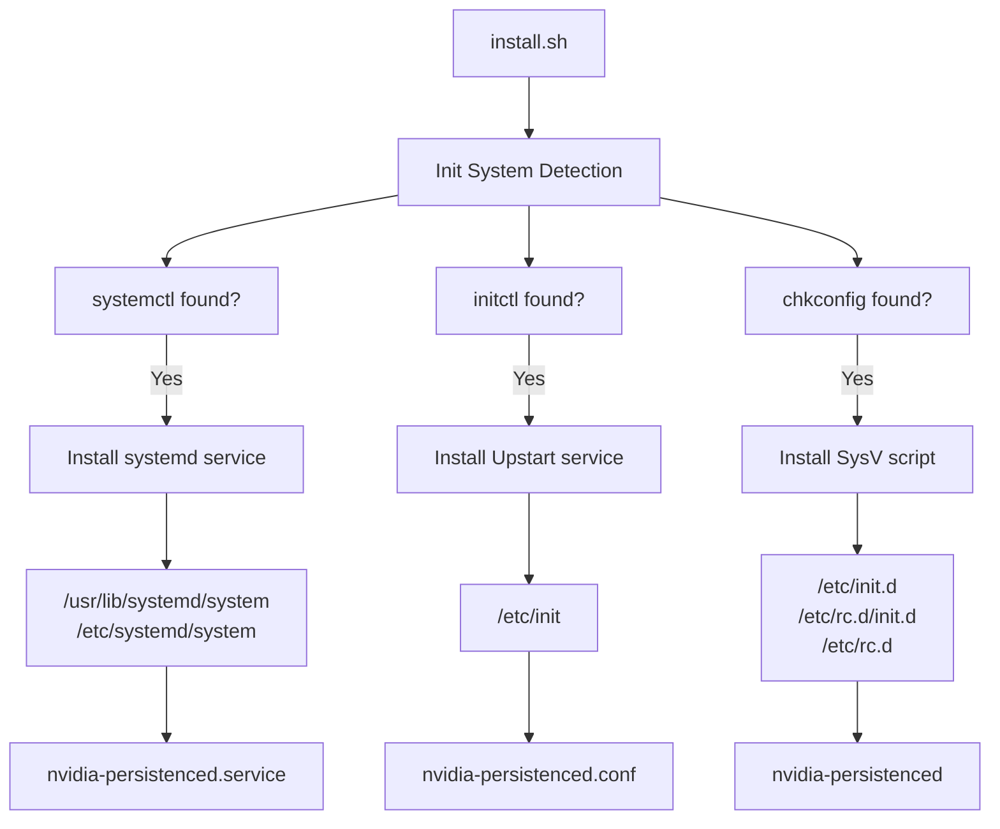
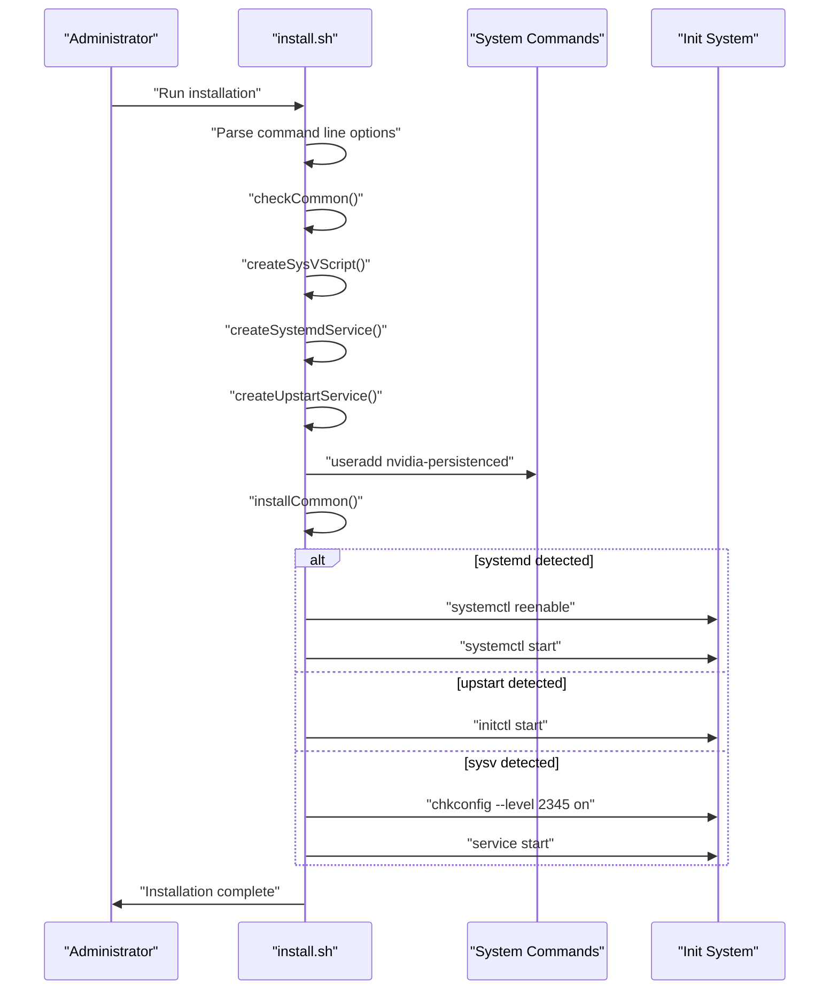
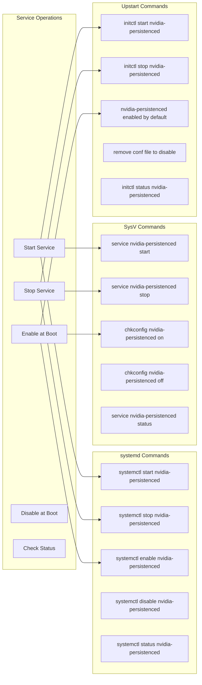
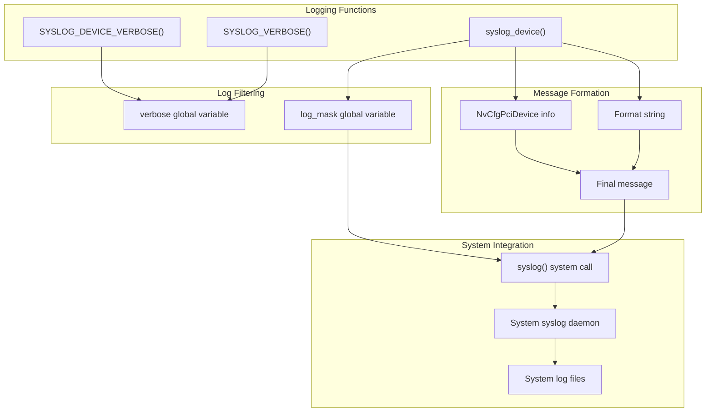
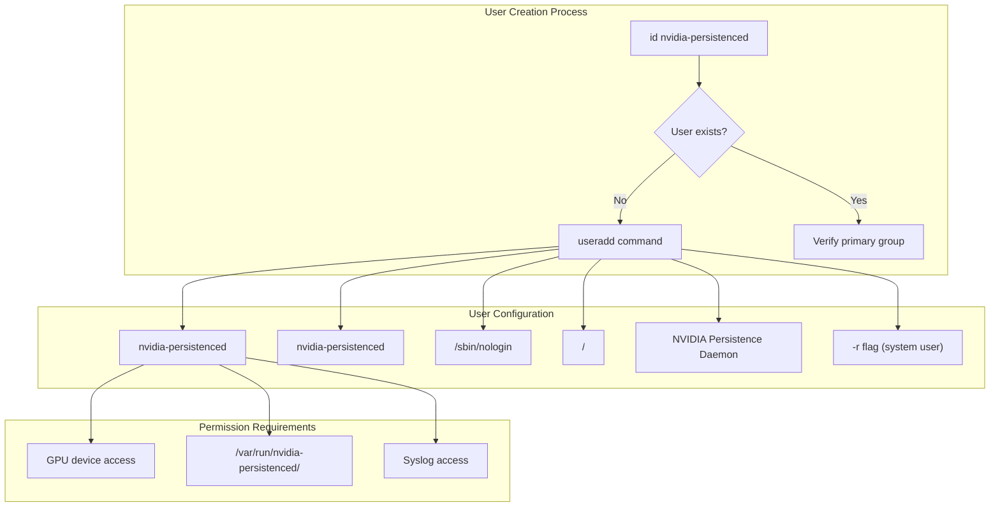
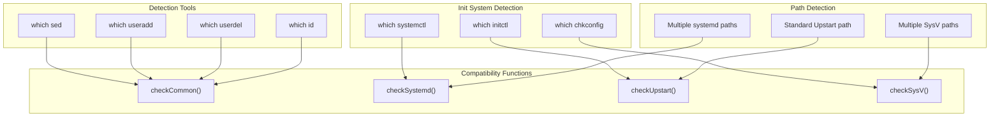
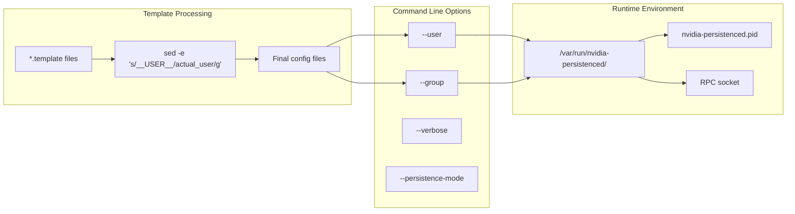

<!-- source: DeepWiki mcp.deepwiki.com · repo NVIDIA/nvidia-persistenced · page 5 System Integration · fetched 2026-10-26 -->

# System Integration

Relevant source files

The following files were used as context for generating this wiki page:

- [dist-files.mk](dist-files.mk)
- [init/README](init/README)
- [init/install.sh](init/install.sh)
- [nvidia-syslog-utils.c](nvidia-syslog-utils.c)
- [nvidia-syslog-utils.h](nvidia-syslog-utils.h)

This document covers the deployment, installation, and runtime integration of nvidia-persistenced with various operating system components. It explains how the daemon integrates with different init systems, manages system logging, handles user permissions, and maintains compatibility across platforms.

For information about command-line configuration options, see [Command Line Options](#4.1). For developer-oriented system interfaces, see [Developer Reference](#6).

## Init System Integration

The nvidia-persistenced daemon supports integration with three major init systems commonly found in Linux distributions: systemd, SysV, and Upstart. The system automatically detects the available init system and installs the appropriate service configuration.

### Supported Init Systems

The installation script checks for init systems in a specific priority order: systemd first, then Upstart, then SysV. This ordering reflects the modern migration path of most Linux distributions.

**Sources:** [init/install.sh:34-39](), [init/install.sh:705-752]()

### Installation Process

The installation process involves template processing, user creation, and service registration:

The template files use the `__USER__` placeholder which gets replaced during installation:

| Init System | Template File | Final File | Installation Path |
|-------------|---------------|------------|-------------------|
| systemd | `nvidia-persistenced.service.template` | `nvidia-persistenced.service` | `/usr/lib/systemd/system` |
| Upstart | `nvidia-persistenced.conf.template` | `nvidia-persistenced.conf` | `/etc/init` |
| SysV | `nvidia-persistenced.template` | `nvidia-persistenced` | `/etc/init.d` |

**Sources:** [init/install.sh:292-305](), [init/install.sh:407-420](), [init/install.sh:522-535](), [dist-files.mk:44-48]()

### Service Management

Each init system provides different commands for managing the service lifecycle:

The installer handles running daemon detection through the `isNvpdRunning()` function which checks for the PID file at `/var/run/nvidia-persistenced/nvidia-persistenced.pid`.

**Sources:** [init/install.sh:164-182](), [init/install.sh:350-379](), [init/install.sh:464-494](), [init/install.sh:577-604]()

## System Logging Integration

The nvidia-persistenced daemon integrates with the system logging infrastructure through syslog. The logging system provides both general logging and device-specific logging capabilities.

The `syslog_device()` function formats device-specific messages with PCI device information in the format `device 0000:01:00.0 - message`. The logging system respects both verbosity settings and log priority masks.

**Sources:** [nvidia-syslog-utils.c:38-70](), [nvidia-syslog-utils.h:39-50]()

## User and Permission Management

The installation process creates a dedicated system user for running the nvidia-persistenced daemon, following security best practices by avoiding root execution when possible.

The installation script supports custom user and group names through command-line options:

| Option | Purpose | Default Value |
|--------|---------|---------------|
| `-u <USER>` | Specify username | `nvidia-persistenced` |
| `-g <GROUP>` | Specify group name | Same as username |
| `-d` | Skip user deletion during uninstall | N/A |

**Sources:** [init/install.sh:243-267](), [init/install.sh:53-63](), [init/install.sh:635-687]()

## Platform Compatibility

The system integration components ensure compatibility across different Linux distributions and architectures through standardized detection and fallback mechanisms.

The system performs comprehensive compatibility checking before attempting installation, ensuring that all required tools and directories are available.

**Sources:** [init/install.sh:184-236](), [init/install.sh:314-342](), [init/install.sh:429-456](), [init/install.sh:544-569]()

## Configuration Management

The daemon configuration is managed through a combination of command-line arguments, template file processing, and runtime directory management.

The installation process creates platform-specific configuration files from templates by replacing the `__USER__` placeholder with the actual username. This approach allows the same template to work across different deployment scenarios while maintaining proper user isolation.

**Sources:** [init/install.sh:292-305](), [init/install.sh:407-420](), [init/install.sh:522-535](), [dist-files.mk:44-48]()

---

