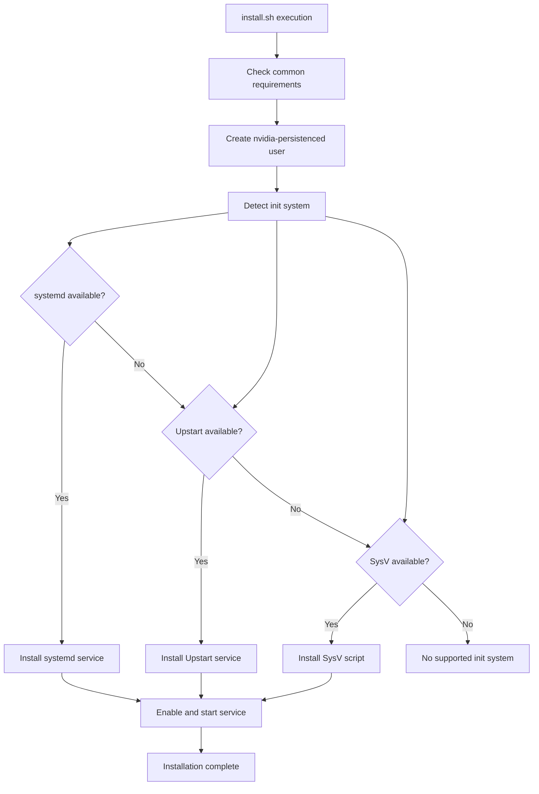
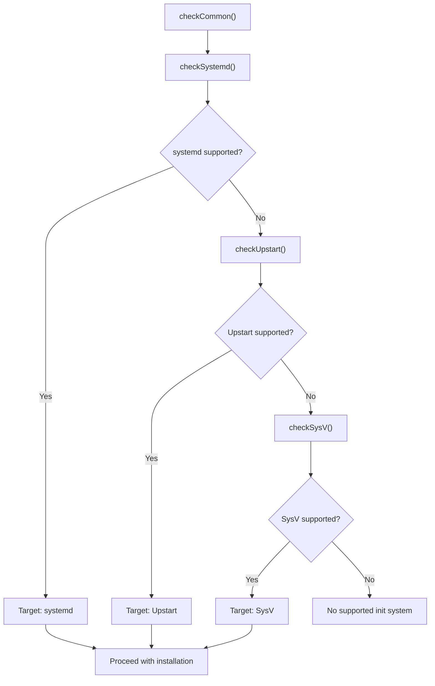
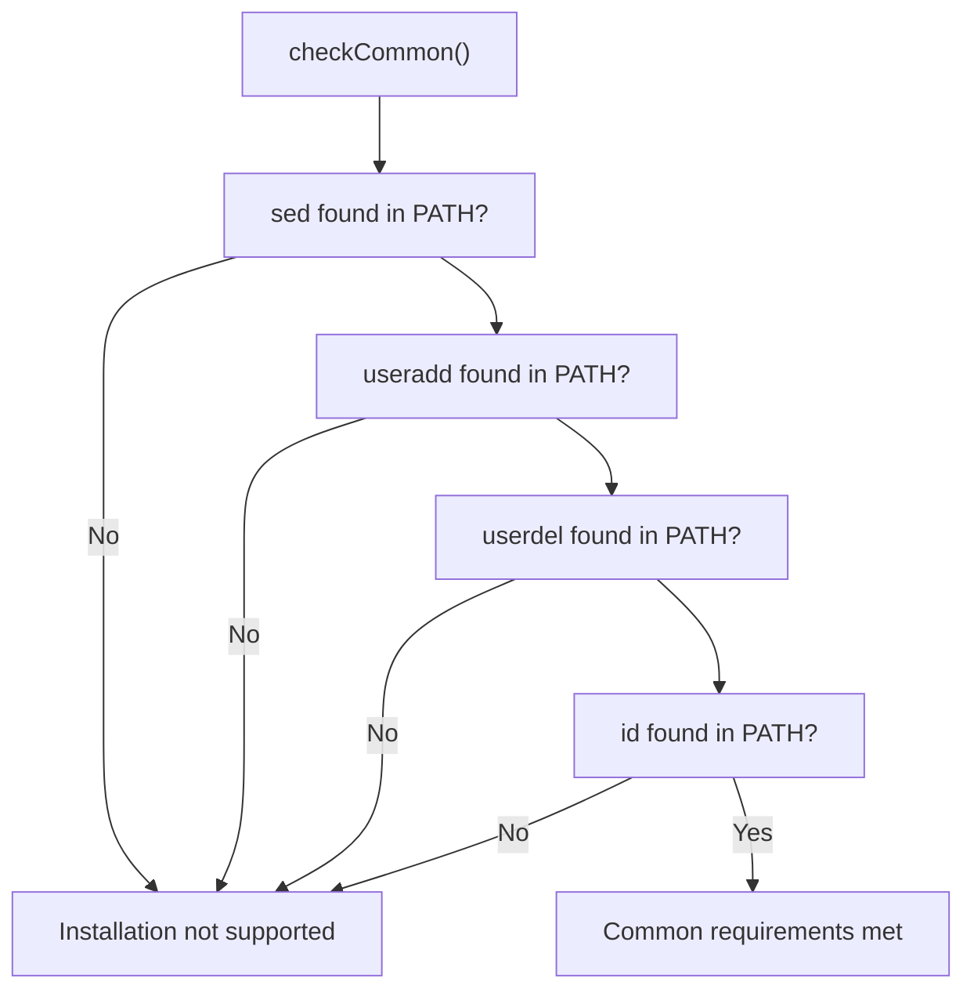
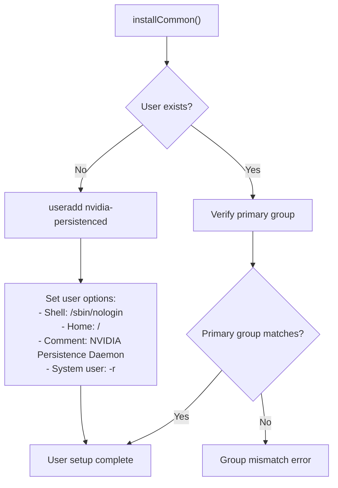
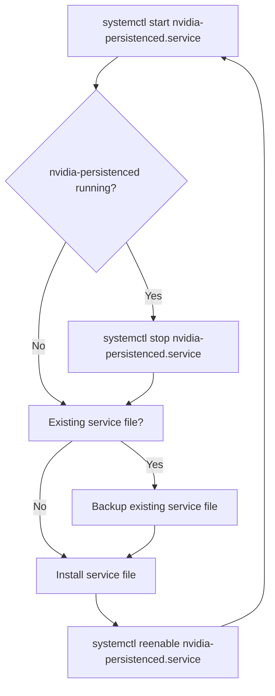
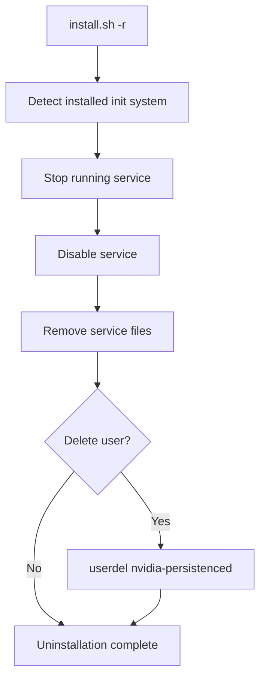

<!-- source: DeepWiki mcp.deepwiki.com · repo NVIDIA/nvidia-persistenced · page 5.1 Installation and Deployment · fetched 2026-10-26 -->

# Installation and Deployment

<details>
<summary>Relevant source files</summary>

The following files were used as context for generating this wiki page:

- [dist-files.mk](dist-files.mk)
- [init/README](init/README)
- [init/install.sh](init/install.sh)
- [nvidia-syslog-utils.c](nvidia-syslog-utils.c)
- [nvidia-syslog-utils.h](nvidia-syslog-utils.h)

</details>


This document covers the installation and deployment of nvidia-persistenced across different init systems including systemd, Upstart, and System V. It documents the automated installation process, user management, service configuration, and lifecycle management.

For information about command-line options and daemon configuration, see [Command Line Options](#4.1). For details about the build system and compilation, see [Build System](#3).

## Installation Overview

The nvidia-persistenced daemon requires system-level installation with appropriate user permissions and init system integration. The installation process is designed to work across multiple Linux distributions and init systems through an automated detection and configuration mechanism.

### Installation Components

The distribution includes several key components for deployment:

| Component | Purpose | Location |
|-----------|---------|----------|
| Main daemon binary | Core persistence daemon | `nvidia-persistenced` |
| Installation script | Automated init system setup | `init/install.sh` |
| Init templates | Service configuration templates | `init/*/` subdirectories |
| Documentation | Installation guidance | `init/README` |

**Installation Flow Overview**



Sources: [init/install.sh:1-814](), [init/README:1-52](), [dist-files.mk:44-48]()

## Init System Support

The installation system supports three major init systems with automatic detection and appropriate configuration for each.

### Init System Detection Logic



### Supported Init Systems

| Init System | Detection Method | Service File Location | Template File |
|-------------|------------------|----------------------|---------------|
| systemd | `systemctl` command | `/usr/lib/systemd/system/` or `/etc/systemd/system/` | `systemd/nvidia-persistenced.service.template` |
| Upstart | `initctl` command | `/etc/init/` | `upstart/nvidia-persistenced.conf.template` |
| System V | `chkconfig` command | `/etc/init.d/` or `/etc/rc.d/init.d/` | `sysv/nvidia-persistenced.template` |

The detection logic is implemented in functions `checkSystemd()`, `checkUpstart()`, and `checkSysV()` which verify both the presence of required commands and appropriate installation directories.

Sources: [init/install.sh:428-455](), [init/install.sh:544-568](), [init/install.sh:314-341]()

## Installation Process

### Prerequisites and Dependencies

The installation script verifies several common requirements before proceeding:



### User Management

The installation process creates a dedicated system user for the daemon with restricted permissions:

**User Creation Process**



Default user configuration:
- Username: `nvidia-persistenced`
- Group: `nvidia-persistenced` (same as username by default)
- Shell: `/sbin/nologin`
- Home directory: `/`
- System user: Yes (created with `-r` flag)

Sources: [init/install.sh:246-267](), [init/install.sh:636-637]()

### Template Processing

The installation script processes template files to create service configurations with the appropriate user settings:

| Template | Function | Output |
|----------|----------|---------|
| `systemd/nvidia-persistenced.service.template` | `createSystemdService()` | `systemd/nvidia-persistenced.service` |
| `upstart/nvidia-persistenced.conf.template` | `createUpstartService()` | `upstart/nvidia-persistenced.conf` |
| `sysv/nvidia-persistenced.template` | `createSysVScript()` | `sysv/nvidia-persistenced` |

The processing involves substituting `__USER__` placeholders with the actual username specified during installation.

Sources: [init/install.sh:407-420](), [init/install.sh:522-535](), [init/install.sh:292-305]()

## Service Management

### Service Installation and Activation

Each init system has specific installation and activation procedures:

**systemd Service Management**



**Service File Locations**

The installation attempts to place service files in standard locations:

| Init System | Primary Location | Secondary Location |
|-------------|------------------|-------------------|
| systemd | `/usr/lib/systemd/system/` | `/etc/systemd/system/` |
| Upstart | `/etc/init/` | N/A |
| System V | `/etc/init.d/` | `/etc/rc.d/init.d/` or `/etc/rc.d/` |

Sources: [init/install.sh:462-494](), [init/install.sh:575-604](), [init/install.sh:348-379]()

### Runtime Configuration

The daemon creates runtime files in standard system locations:

| File Type | Location | Purpose |
|-----------|----------|---------|
| PID file | `/var/run/nvidia-persistenced/nvidia-persistenced.pid` | Process identification |
| Log output | System syslog | Daemon logging via `syslog()` |

The PID file location is used by the installation script to detect running instances of the daemon.

Sources: [init/install.sh:164](), [nvidia-syslog-utils.c:67]()

## Command Line Options

The installation script supports several configuration options:

| Option | Description | Default |
|--------|-------------|---------|
| `-u <USER>` | Username for daemon | `nvidia-persistenced` |
| `-g <GROUP>` | Group for daemon user | Same as username |
| `-p <PATH>` | Custom installation path | Auto-detected |
| `-r` | Uninstall mode | Install mode |
| `-d` | Don't delete user during uninstall | Delete user |

**Usage Examples**

```bash
# Install with default settings
./install.sh

# Install with custom user
./install.sh -u nvpersist -g nvidia

# Install to specific path
./install.sh -p /usr/local/lib/systemd/system

# Force specific init system
./install.sh systemd
./install.sh upstart  
./install.sh sysv
```

Sources: [init/install.sh:49-88](), [init/install.sh:641-682]()

## Uninstallation

The uninstallation process reverses the installation steps:

**Uninstallation Flow**



### Uninstallation Functions

| Init System | Function | Actions |
|-------------|----------|---------|
| systemd | `uninstallSystemdService()` | Stop service, disable, remove file |
| Upstart | `uninstallUpstartService()` | Stop service, remove file |
| System V | `uninstallSysVScript()` | Stop script, disable with chkconfig, remove file |

The `-d` option prevents user deletion during uninstallation, useful when the user account is managed externally.

Sources: [init/install.sh:500-510](), [init/install.sh:610-618](), [init/install.sh:385-395](), [init/install.sh:274-280]()

## Troubleshooting

### Common Installation Issues

| Issue | Cause | Solution |
|-------|-------|----------|
| "No supported init system found" | Missing required commands or directories | Install appropriate init system packages |
| "User exists with wrong group" | Existing user has different primary group | Remove user or specify correct group with `-g` |
| Permission denied errors | Insufficient privileges | Run installation script as root |
| Service fails to start | Missing dependencies or configuration | Check system logs and verify nvidia driver installation |

### Verification

After installation, verify the service status:

```bash
# systemd
systemctl status nvidia-persistenced.service

# Upstart  
initctl status nvidia-persistenced

# System V
service nvidia-persistenced status
```

The daemon logs status information to syslog, which can be monitored for troubleshooting.

Sources: [init/install.sh:754](), [nvidia-syslog-utils.h:36-50]()

---

