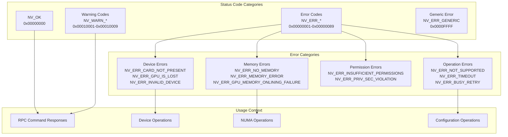
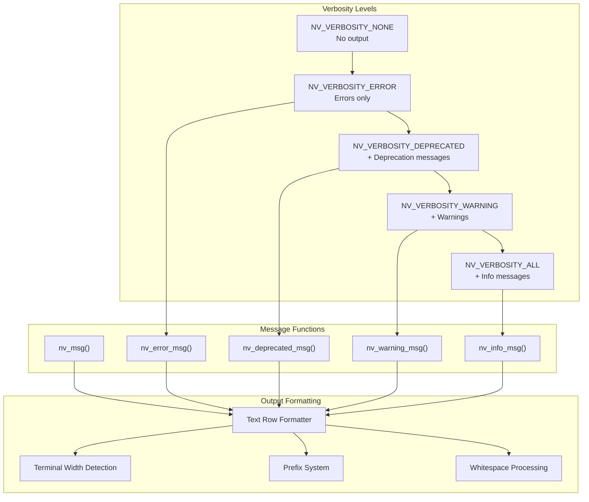
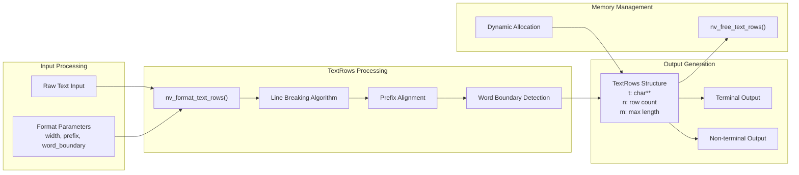
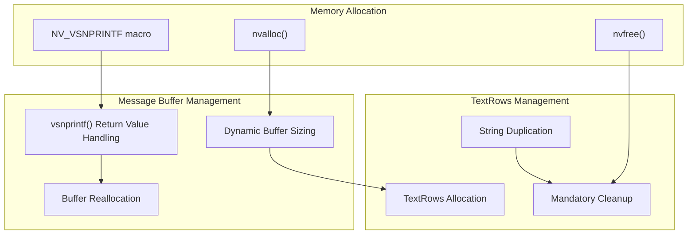
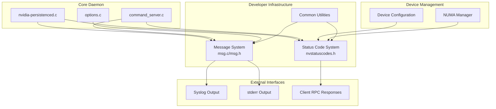

<!-- source: DeepWiki mcp.deepwiki.com · repo NVIDIA/nvidia-persistenced · page 6 Developer Reference · fetched 2026-10-26 -->

# Developer Reference

<details>
<summary>Relevant source files</summary>

The following files were used as context for generating this wiki page:

- [common-utils/gen-manpage-opts-helper.h](common-utils/gen-manpage-opts-helper.h)
- [common-utils/msg.c](common-utils/msg.c)
- [common-utils/msg.h](common-utils/msg.h)
- [nvstatuscodes.h](nvstatuscodes.h)

</details>


This page provides technical reference information for developers working with or extending the nvidia-persistenced codebase. It covers essential development tools, APIs, patterns, and systems that form the foundation for daemon functionality.

For system administration and deployment information, see [System Integration](#5). For build system details, see [Build System](#3).

## Overview

The nvidia-persistenced codebase provides several developer-focused systems that ensure consistent error handling, logging, and status reporting across all components. These systems are designed to be reusable and provide a uniform interface for both internal daemon operations and external client communication.

The core developer infrastructure includes:

- **Status Code System**: Comprehensive error and status reporting using NVIDIA status codes
- **Message and Logging Framework**: Structured logging with verbosity controls and formatted output
- **Common Utilities**: Shared functionality for memory management, string operations, and cross-platform compatibility

## Status Code Architecture

### NVIDIA Status Code System

The daemon uses a comprehensive status code system defined in [nvstatuscodes.h]() that provides standardized error reporting across all NVIDIA software components.



### Status Code Structure

Status codes follow a hierarchical pattern with specific ranges for different categories:

| Range | Category | Usage |
|-------|----------|-------|
| `0x00000000` | Success | Operation completed successfully |
| `0x00000001-0x00000089` | Errors | Specific error conditions |
| `0x0000FFFF` | Generic Error | Fallback for unspecified failures |
| `0x00010001-0x00010009` | Warnings | Non-fatal conditions |

**Sources:** [nvstatuscodes.h:27-178]()

## Message and Logging System

### Verbosity Control Architecture

The logging system implements a hierarchical verbosity model that controls message output based on severity and importance.



### Message System API

The message system provides different functions for various message types, each with appropriate formatting and verbosity checks:

| Function | Purpose | Verbosity Level |
|----------|---------|-----------------|
| `nv_error_msg()` | Error messages with ERROR prefix | `NV_VERBOSITY_ERROR` |
| `nv_deprecated_msg()` | Deprecation warnings | `NV_VERBOSITY_DEPRECATED` |
| `nv_warning_msg()` | Warning messages | `NV_VERBOSITY_WARNING` |
| `nv_info_msg()` | Informational messages | `NV_VERBOSITY_ALL` |
| `nv_msg()` | General messages (always shown) | Always displayed |

**Sources:** [common-utils/msg.h:94-124](), [common-utils/msg.c:126-222]()

### Text Formatting System

The system includes sophisticated text formatting capabilities for terminal output:



**Sources:** [common-utils/msg.c:252-427](), [common-utils/msg.h:130-140]()

## Development Patterns

### Error Handling Pattern

The codebase follows consistent patterns for error handling and status reporting:

```c
// Standard pattern used throughout the codebase
NvStatus function_name(parameters) {
    NvStatus status = NV_OK;
    
    // Validate parameters
    if (!parameter) {
        return NV_ERR_INVALID_PARAMETER;
    }
    
    // Perform operation
    status = operation();
    if (status != NV_OK) {
        nv_error_msg("Operation failed: %s", nvStatusToString(status));
        return status;
    }
    
    return NV_OK;
}
```

### Logging Integration Pattern

Components integrate with the logging system using consistent verbosity and formatting:

```c
// Typical logging pattern
void daemon_operation(void) {
    nv_info_msg("DAEMON: ", "Starting operation...");
    
    NvStatus status = perform_operation();
    if (status != NV_OK) {
        nv_error_msg("Operation failed with status 0x%x", status);
        return;
    }
    
    nv_info_msg("DAEMON: ", "Operation completed successfully");
}
```

### Memory Management Integration

The message system integrates with the common utilities memory management:



**Sources:** [common-utils/msg.h:60-86](), [common-utils/msg.c:369-427]()

## Integration with Daemon Components

The developer infrastructure integrates throughout the daemon architecture:



**Sources:** [nvstatuscodes.h:1-179](), [common-utils/msg.c:1-429](), [common-utils/msg.h:1-143]()

For detailed information about specific status codes and error handling patterns, see [Status Codes and Error Handling](#6.1). For comprehensive logging system documentation, see [Logging and Message System](#6.2).

---

