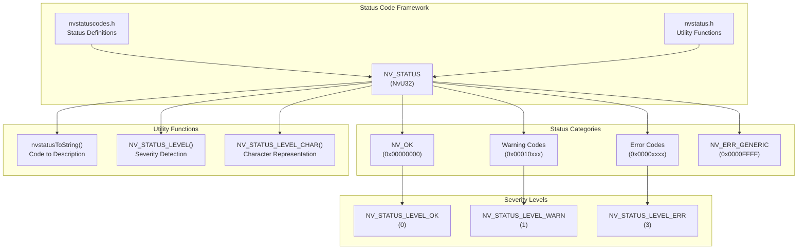
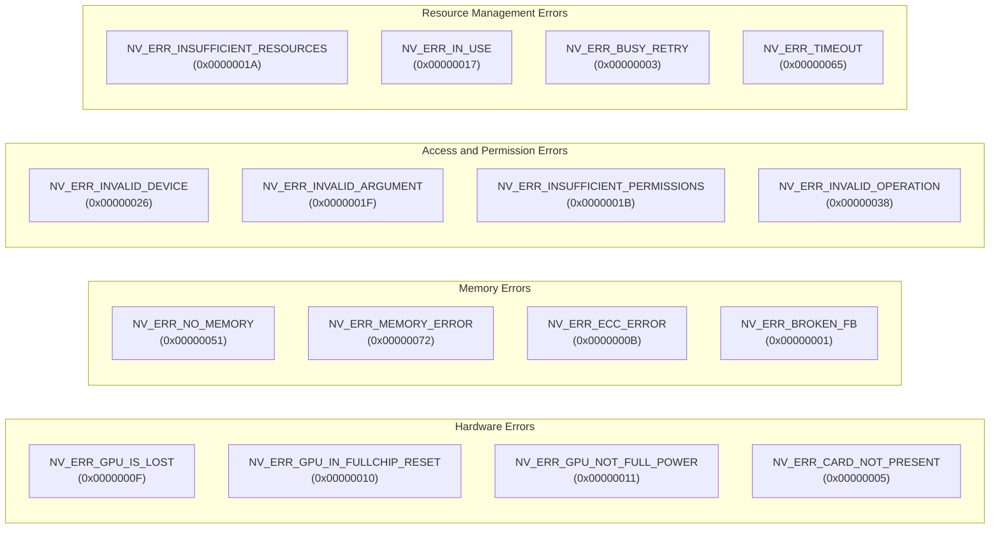
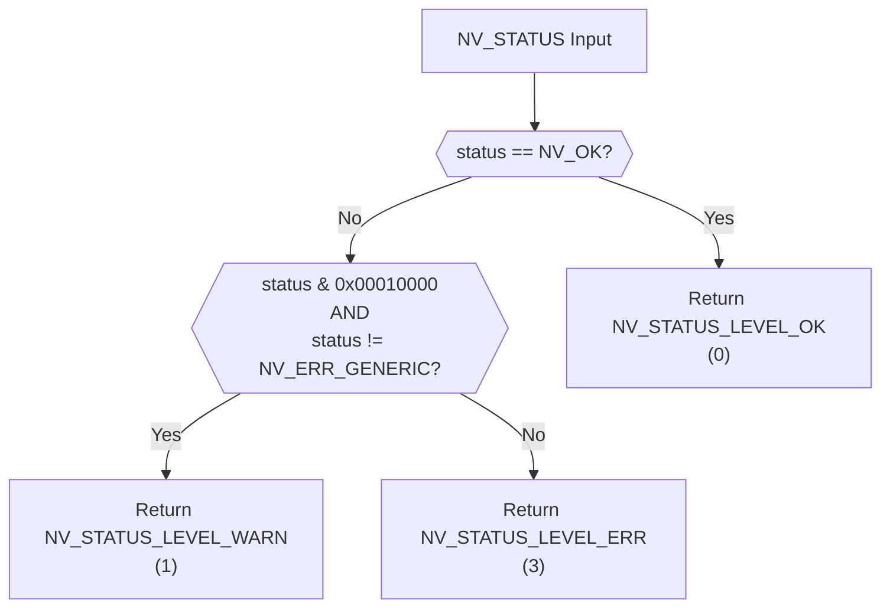
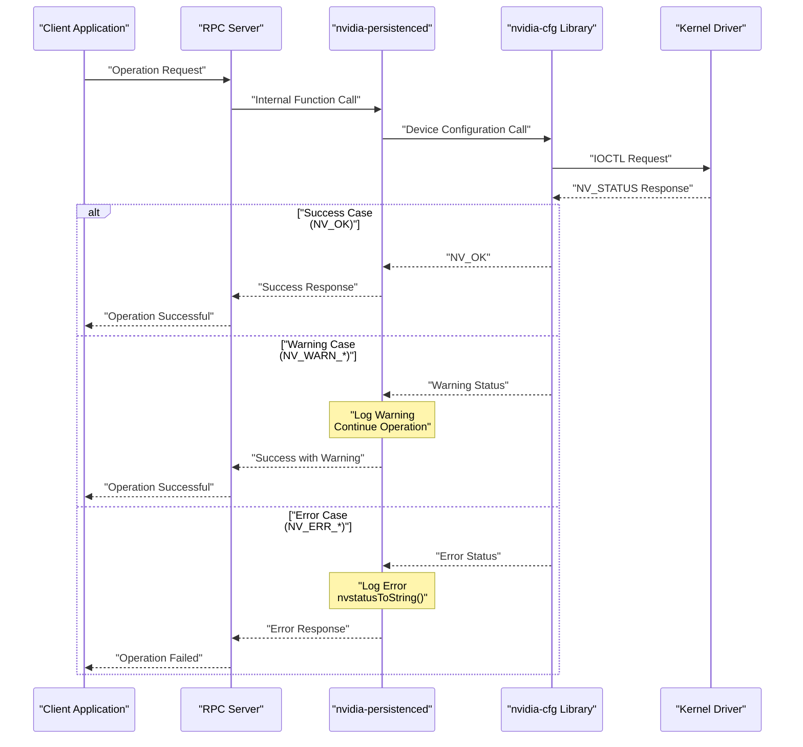

<!-- source: DeepWiki mcp.deepwiki.com · repo NVIDIA/nvidia-persistenced · page 6.1 Status Codes and Error Handling · fetched 2026-10-26 -->

# Status Codes and Error Handling

<details>
<summary>Relevant source files</summary>

The following files were used as context for generating this wiki page:

- [cpuopsys.h](cpuopsys.h)
- [nvstatus.h](nvstatus.h)
- [nvstatuscodes.h](nvstatuscodes.h)

</details>


This document covers the comprehensive status code system and error handling patterns used throughout the nvidia-persistenced daemon. It documents the standardized error reporting mechanism, status code categories, severity levels, and integration patterns used for robust error handling across all daemon components.

For information about logging and message formatting, see [Logging and Message System](#6.2).

## Status Code Architecture

The nvidia-persistenced daemon uses a comprehensive status code system based on the NVIDIA driver's standardized `NV_STATUS` framework. This system provides consistent error reporting across all components, from low-level hardware interactions to high-level daemon operations.



**Sources:** [nvstatus.h:33-123](), [nvstatuscodes.h:27-179]()

## Status Code Categories

### Success and Warning Codes

The system distinguishes between complete success, conditional success with warnings, and various failure conditions. Success codes indicate normal operation, while warning codes signal successful completion with notable conditions that may require attention.

| Category | Code Range | Level | Description |
|----------|------------|-------|-------------|
| Success | `0x00000000` | OK | Complete success with no issues |
| Warnings | `0x00010001-0x00010009` | WARN | Success with notable conditions |
| Errors | `0x00000001-0x00000089` | ERR | Various failure conditions |
| Generic Error | `0x0000FFFF` | ERR | Fallback error condition |

**Sources:** [nvstatuscodes.h:27-179](), [nvstatus.h:49-71]()

### Hardware and Device Error Categories



**Sources:** [nvstatuscodes.h:30-166]()

## Error Handling Patterns

### Status Level Detection

The framework provides macros for determining the severity level of any status code, enabling consistent error handling across different components.



**Sources:** [nvstatus.h:99-102]()

### Recommended Error Checking Patterns

The framework documentation emphasizes specific comparison patterns to ensure forward compatibility with potential new severity levels:

- **Recommended:** `if (NV_STATUS_LEVEL(status) <= NV_STATUS_LEVEL_WARN)`
- **Avoid:** `if (NV_STATUS_LEVEL(status) < NV_STATUS_LEVEL_ERR)`

This approach ensures that code remains compatible if intermediate severity levels are added in the future.

**Sources:** [nvstatus.h:80-98]()

## Status Code Integration Flow



**Sources:** [nvstatus.h:117](), [nvstatuscodes.h:27-179]()

## Utility Functions and Macros

### String Conversion and Debugging

The system provides the `nvstatusToString()` function for converting status codes to human-readable descriptions, essential for logging and debugging operations.

### Status Level Utilities

| Utility | Purpose | Return Type |
|---------|---------|-------------|
| `NV_STATUS_LEVEL(status)` | Determine severity level | `int` (0, 1, or 3) |
| `NV_STATUS_LEVEL_CHAR(status)` | Get character representation | `char` ('0', 'W', or 'E') |
| `nvstatusToString(status)` | Convert to description string | `const char*` |

**Sources:** [nvstatus.h:99-117]()

### Status Code Definition Pattern

Status codes are defined using a macro pattern that ensures consistent formatting and documentation:

```c
NV_STATUS_CODE(NV_OK, 0x00000000, "Success")
NV_STATUS_CODE(NV_ERR_INVALID_DEVICE, 0x00000026, "Current device is not valid")
```

This pattern allows the same definitions to be used for both enum generation and string mapping.

**Sources:** [nvstatuscodes.h:35-42](), [nvstatus.h:35-40]()

## Critical Error Categories for Daemon Operations

### Device Management Errors

- `NV_ERR_CARD_NOT_PRESENT` - GPU hardware not detected
- `NV_ERR_GPU_IS_LOST` - GPU lost from system bus
- `NV_ERR_INVALID_DEVICE` - Invalid device specification
- `NV_ERR_GPU_UUID_NOT_FOUND` - Device UUID lookup failure

### Resource and Permission Errors

- `NV_ERR_INSUFFICIENT_PERMISSIONS` - Inadequate access rights
- `NV_ERR_INSUFFICIENT_RESOURCES` - System resource exhaustion
- `NV_ERR_NO_MEMORY` - Memory allocation failure
- `NV_ERR_IN_USE` - Resource currently unavailable

### NUMA and Memory Management Errors

- `NV_ERR_GPU_MEMORY_ONLINING_FAILURE` - GPU memory onlining failed
- `NV_ERR_MEMORY_ERROR` - Generic memory subsystem error
- `NV_ERR_INVALID_ADDRESS` - Invalid memory address specification

**Sources:** [nvstatuscodes.h:34-161]()

---

