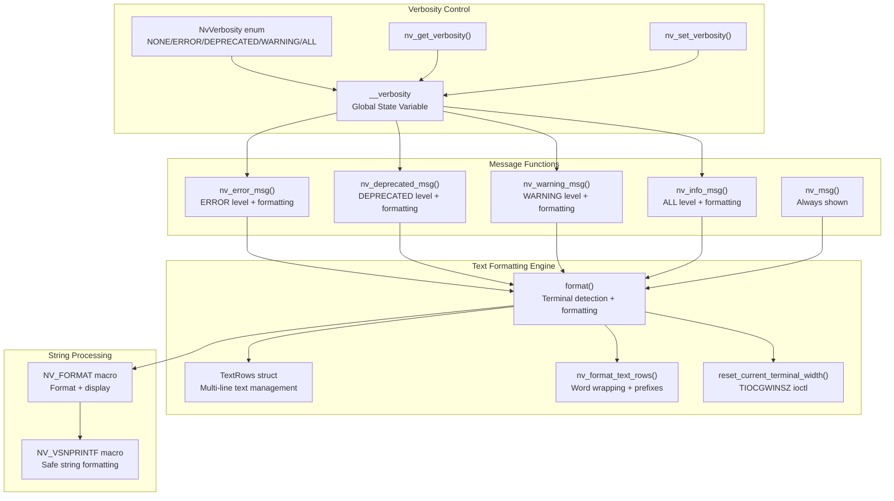
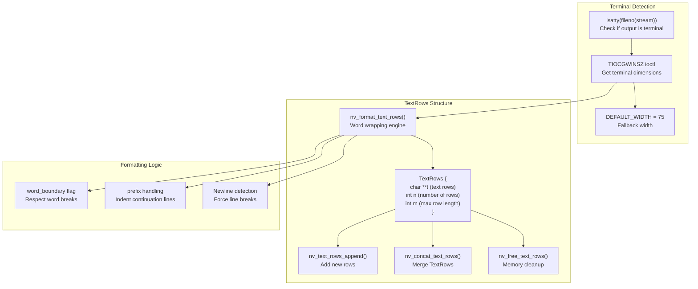
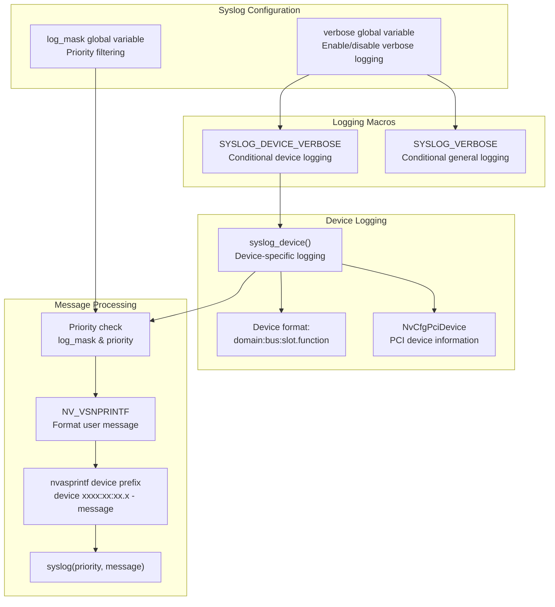
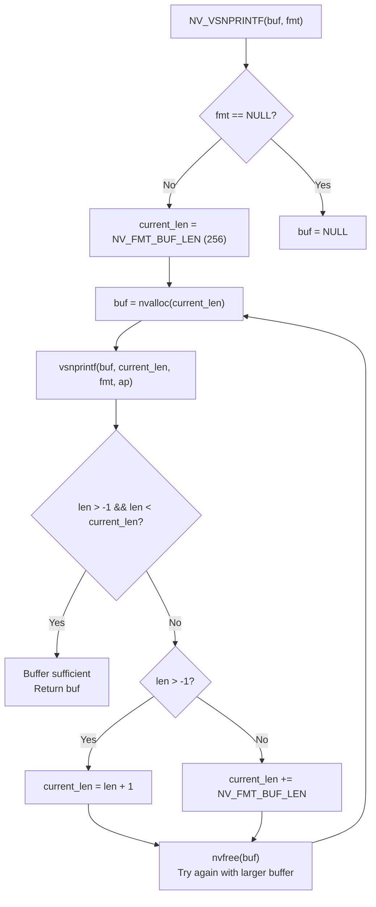

<!-- source: DeepWiki mcp.deepwiki.com · repo NVIDIA/nvidia-persistenced · page 6.2 Logging and Message System · fetched 2026-10-26 -->

# Logging and Message System

<details>
<summary>Relevant source files</summary>

The following files were used as context for generating this wiki page:

- [common-utils/gen-manpage-opts-helper.h](common-utils/gen-manpage-opts-helper.h)
- [common-utils/msg.c](common-utils/msg.c)
- [common-utils/msg.h](common-utils/msg.h)
- [dist-files.mk](dist-files.mk)
- [nvidia-syslog-utils.c](nvidia-syslog-utils.c)
- [nvidia-syslog-utils.h](nvidia-syslog-utils.h)

</details>


This document describes the message formatting, verbosity control, and logging infrastructure used throughout nvidia-persistenced. The system provides structured output to both terminal (stdout/stderr) and syslog with intelligent text formatting and verbosity filtering.

For information about status codes and error handling patterns, see [Status Codes and Error Handling](#6.1). For details about command line verbosity options, see [Command Line Options](#4.1).

## Purpose and Components

The logging system consists of two main subsystems:

1. **Message Formatting System** - Handles structured terminal output with verbosity control and text formatting
2. **Syslog Integration** - Provides daemon logging with device-specific message formatting

## Message Formatting Architecture



**Sources:** [common-utils/msg.h:94-143](), [common-utils/msg.c:40-56](), [common-utils/msg.c:126-182]()

## Verbosity Level System

The message system uses a hierarchical verbosity system where higher levels include all lower level messages:

| Level | Enum Value | Description | Messages Shown |
|-------|------------|-------------|----------------|
| None | `NV_VERBOSITY_NONE` | Silent operation | None |
| Error | `NV_VERBOSITY_ERROR` | Errors only | ERROR |
| Deprecated | `NV_VERBOSITY_DEPRECATED` | Include deprecation warnings | ERROR + DEPRECATED |
| Warning | `NV_VERBOSITY_WARNING` | Include all warnings | ERROR + DEPRECATED + WARNING |
| All | `NV_VERBOSITY_ALL` | Full verbosity | ERROR + DEPRECATED + WARNING + INFO |

Each message function checks the current verbosity level before processing:

```c
// Example from nv_error_msg()
if (__verbosity < NV_VERBOSITY_ERROR) return;
```

**Sources:** [common-utils/msg.h:94-101](), [common-utils/msg.c:45-55](), [common-utils/msg.c:128]()

## Text Formatting and Terminal Handling



**Sources:** [common-utils/msg.c:62-87](), [common-utils/msg.c:90-107](), [common-utils/msg.c:252-428]()

## Syslog Integration System



**Sources:** [nvidia-syslog-utils.h:36-51](), [nvidia-syslog-utils.c:30-70]()

## String Formatting Safety

The system uses a robust string formatting macro `NV_VSNPRINTF` that handles different `vsnprintf()` implementations across systems:



**Sources:** [common-utils/msg.h:58-86]()

## Message Type Functions

The system provides distinct functions for different message types, each with specific formatting and verbosity requirements:

| Function | Verbosity Check | Output Stream | Prefix | Spacing |
|----------|----------------|---------------|---------|---------|
| `nv_error_msg()` | `>= NV_VERBOSITY_ERROR` | stderr | "ERROR: " | Blank lines before/after |
| `nv_deprecated_msg()` | `>= NV_VERBOSITY_DEPRECATED` | stderr | "DEPRECATED: " | Blank lines before/after |
| `nv_warning_msg()` | `>= NV_VERBOSITY_WARNING` | stderr | "WARNING: " | Blank lines before/after |
| `nv_info_msg()` | `>= NV_VERBOSITY_ALL` | stdout | Custom prefix | No spacing |
| `nv_msg()` | Always shown | stdout | Custom prefix | No spacing |

**Sources:** [common-utils/msg.c:126-222]()

## Device-Specific Logging

The `syslog_device()` function formats device messages with PCI bus information:

```c
// Example output format:
"device 0000:01:00.0 - GPU persistence mode enabled"
```

The function performs these steps:
1. Check if message priority matches `log_mask`
2. Format the user message with `NV_VSNPRINTF`
3. Prefix with device PCI coordinates using `nvasprintf`
4. Send to syslog with specified priority

**Sources:** [nvidia-syslog-utils.c:38-70]()

## Integration with nvidia-persistenced

The logging system integrates into the main daemon through:

- **Command line verbosity control** via options parsing
- **Syslog initialization** for daemon operation
- **Device-specific logging** for persistence operations
- **Error reporting** for configuration and NUMA operations

**Sources:** [dist-files.mk:36-42]()