# Page: Overview

# Overview

<details>
<summary>Relevant source files</summary>

The following files were used as context for generating this wiki page:

- [COPYING](COPYING)
- [README](README)
- [nvidia-persistenced.c](nvidia-persistenced.c)
- [nvidia-persistenced.h](nvidia-persistenced.h)

</details>


This document provides a comprehensive overview of the nvidia-persistenced repository, which contains the source code for the NVIDIA Persistence Daemon. This daemon maintains persistent NVIDIA driver state across system operations and provides a foundation for managing GPU device persistence modes and NUMA memory management.

This overview covers the high-level architecture, key components, and their relationships. For detailed implementation information, see [Core Architecture](#2). For build system specifics, see [Build System](#3). For user-facing interfaces, see [User Interface](#4).

## Purpose and Scope

The `nvidia-persistenced` daemon serves as a critical system service that:

- **Maintains GPU Device State**: Keeps NVIDIA GPU devices in an active state to avoid driver initialization overhead
- **Manages NUMA Memory**: Controls onlining and offlining of GPU memory for NUMA-aware systems  
- **Provides RPC Interface**: Offers a client-server communication mechanism for device management
- **Integrates with System Services**: Works with init systems (systemd, SysV, Upstart) for automatic startup

The daemon primarily targets Linux systems with NVIDIA GPUs and integrates closely with the NVIDIA kernel driver and associated user-space libraries.

Sources: [nvidia-persistenced.c:1-26](), [README:1-33]()

## System Architecture

The `nvidia-persistenced` system follows a layered architecture where client applications communicate with the daemon through RPC calls, which then interact with NVIDIA libraries and kernel drivers.

### Core Components Architecture

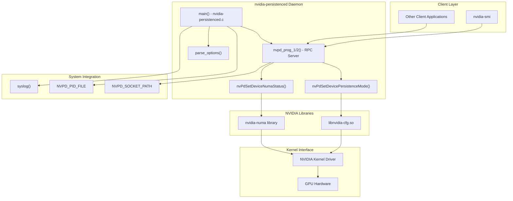

Sources: [nvidia-persistenced.c:42-49](), [nvidia-persistenced.h:57-59](), [nvidia-persistenced.c:998-1043]()

### Key Data Structures and State Management

The daemon manages device state through well-defined data structures that track both persistence mode and NUMA status for each GPU device.

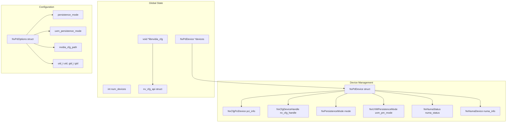

Sources: [nvidia-persistenced.c:56-64](), [nvidia-persistenced.c:67-84](), [nvidia-persistenced.h:36-43]()

## Communication Flow

The daemon operates through a request-response pattern where client applications send RPC commands that result in device state changes through the NVIDIA driver stack.

### RPC Command Processing Flow

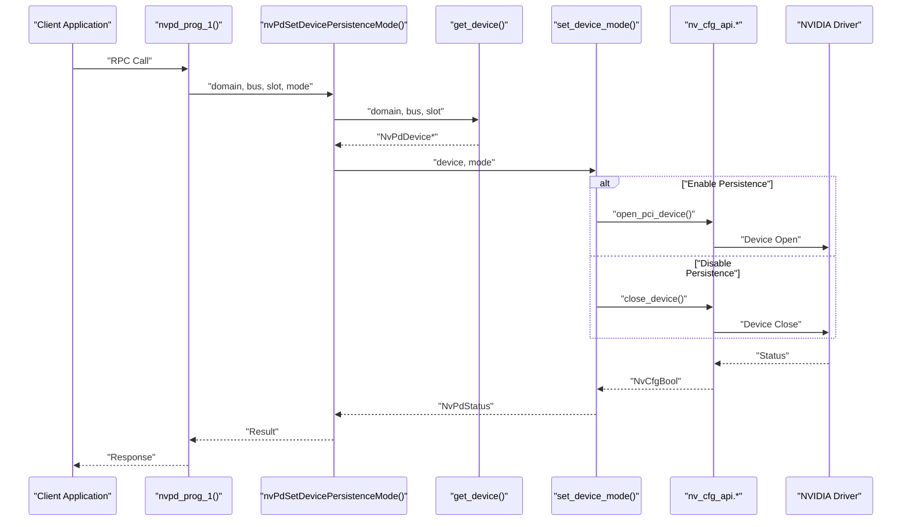

Sources: [nvidia-persistenced.c:109-140](), [nvidia-persistenced.c:343-421](), [nvidia-persistenced.c:208-223]()

## Daemon Lifecycle Management

The daemon follows a standard Unix daemon pattern with comprehensive initialization, signal handling, and cleanup procedures.

### Initialization and Shutdown Process

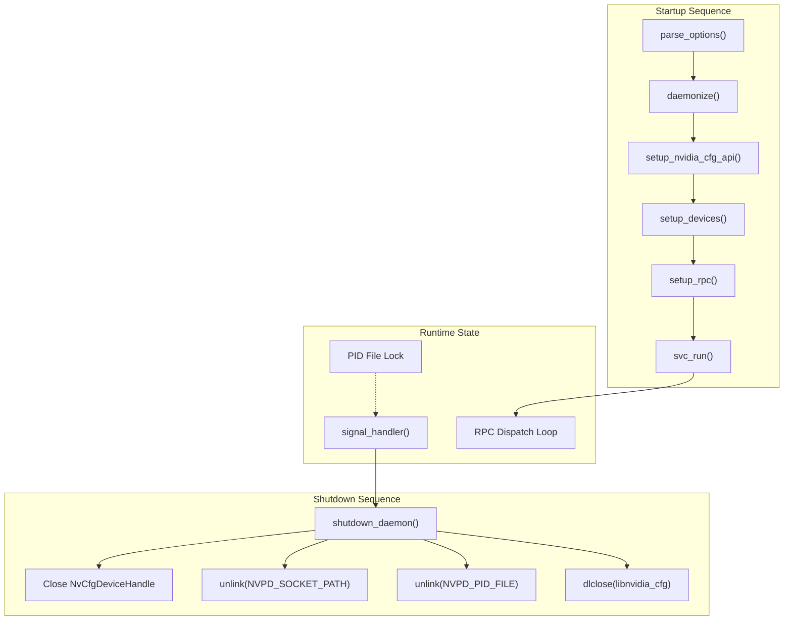

Sources: [nvidia-persistenced.c:998-1043](), [nvidia-persistenced.c:799-996](), [nvidia-persistenced.c:487-584]()

## Key Features and Capabilities

### Device Persistence Management

The daemon's primary function is managing the persistence state of NVIDIA GPU devices. This involves:

- **Device Discovery**: Uses `nvCfgGetPciDevices()` to enumerate available NVIDIA GPUs
- **Persistence Control**: Implements `nvPdSetDevicePersistenceMode()` and `nvPdGetDevicePersistenceMode()`
- **UVM Integration**: Supports Unified Virtual Memory persistence through `nvCfgEnableUVMPersistence()`
- **PCI Device Addressing**: Manages devices by domain:bus:slot addressing scheme

### NUMA Memory Management

For NUMA-aware systems, the daemon provides:

- **Memory Onlining**: `nvNumaOnlineMemory()` brings GPU memory online
- **Memory Offlining**: `nvNumaOfflineMemory()` takes GPU memory offline  
- **Status Tracking**: Maintains `NvNumaStatus` for each device
- **Coordinated Operations**: Synchronizes persistence mode changes with NUMA state

Sources: [nvidia-persistenced.c:668-728](), [nvidia-persistenced.c:427-479](), [nvidia-persistenced.c:290-336]()

## Integration Points

The `nvidia-persistenced` system integrates with several external components:

| Component | Interface | Purpose |
|-----------|-----------|---------|
| **libnvidia-cfg.so** | Dynamic library loading via `dlopen()` | GPU device configuration and control |
| **NVIDIA Kernel Driver** | IOCTL interface through nvidia-cfg | Low-level hardware communication |
| **Init Systems** | Service files (systemd/SysV/Upstart) | Automatic daemon startup and management |
| **Syslog** | `syslog()` calls throughout codebase | System logging and monitoring |
| **Client Applications** | Unix domain socket RPC | External device management requests |

For detailed information about RPC communication, see [RPC Communication System](#2.2). For build system integration, see [Build System](#3). For deployment and service management, see [System Integration](#5).

Sources: [nvidia-persistenced.c:606-662](), [nvidia-persistenced.c:734-771](), [nvidia-persistenced.c:777-793]()

---

# Page: Core Architecture

# Core Architecture

<details>
<summary>Relevant source files</summary>

The following files were used as context for generating this wiki page:

- [nvidia-persistenced.c](nvidia-persistenced.c)
- [nvidia-persistenced.h](nvidia-persistenced.h)
- [nvpd_rpc.h](nvpd_rpc.h)

</details>


This document describes the overall system architecture of nvidia-persistenced, explaining how the main components interact to provide persistent NVIDIA driver state management. It covers the daemon's internal structure, communication interfaces, and device management subsystems.

For details on specific daemon implementation and lifecycle management, see [Main Daemon Implementation](#2.1). For RPC protocol specifications, see [RPC Communication System](#2.2). For NUMA memory management specifics, see [NUMA Memory Management](#2.4).

## System Overview

nvidia-persistenced is a daemon that maintains persistent driver state for NVIDIA GPUs. The architecture follows a layered design with clear separation between the user interface (RPC), core daemon logic, device management, and hardware abstraction layers.

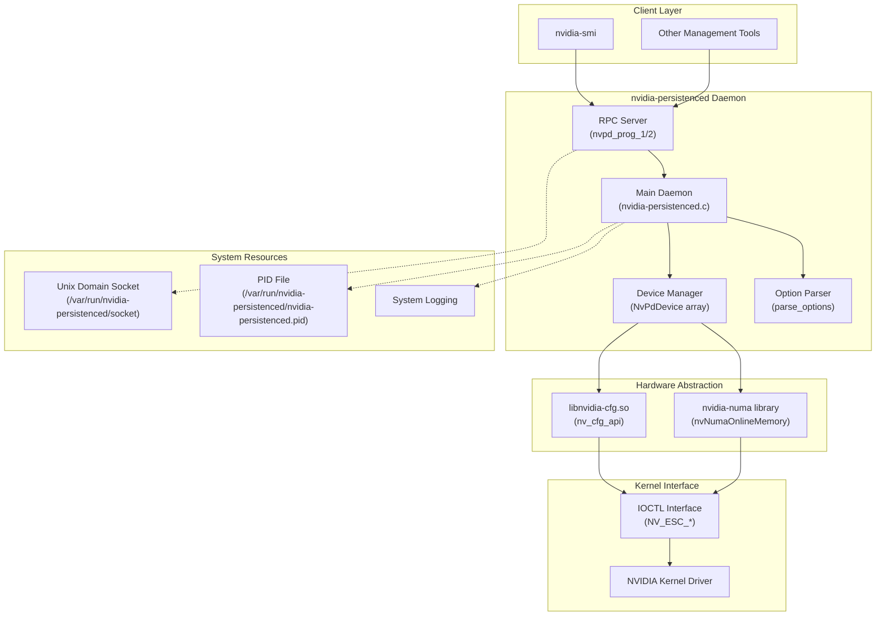

**Sources:** [nvidia-persistenced.c:1-1044](), [nvidia-persistenced.h:28-64](), [nvpd_rpc.h:1-157]()

## Core Data Structures

The daemon's state management centers around the `NvPdDevice` structure, which encapsulates all device-specific information and state.

### Device State Management

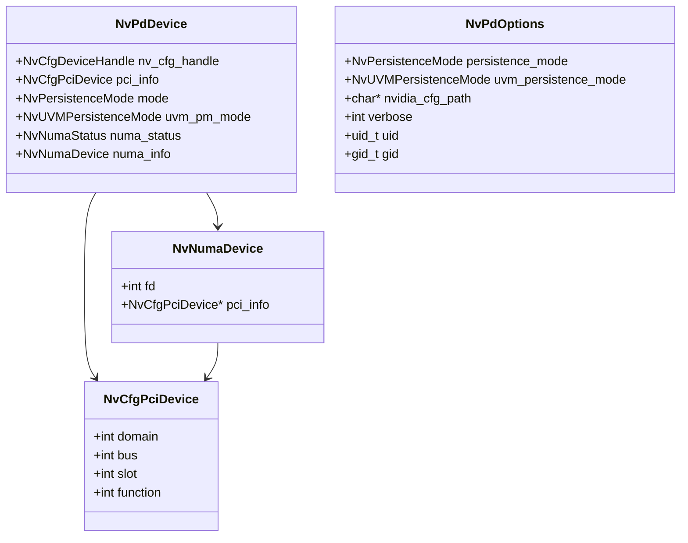

| Field | Purpose | States |
|-------|---------|--------|
| `nv_cfg_handle` | Device handle for nvidia-cfg operations | NULL (closed) or valid handle |
| `mode` | Persistence mode state | `NV_PERSISTENCE_MODE_DISABLED/ENABLED` |
| `uvm_pm_mode` | UVM persistence state | `NV_UVM_PERSISTENCE_MODE_DISABLED/ENABLED` |
| `numa_status` | NUMA memory state | `NV_NUMA_STATUS_OFFLINE/ONLINE` |

**Sources:** [nvidia-persistenced.c:56-64](), [nvidia-persistenced.h:36-43](), [nvpd_rpc.h:33-82]()

## Component Interaction Flow

The daemon processes client requests through a well-defined flow that coordinates persistence mode changes with NUMA memory management.

### Device Persistence Mode Control Flow

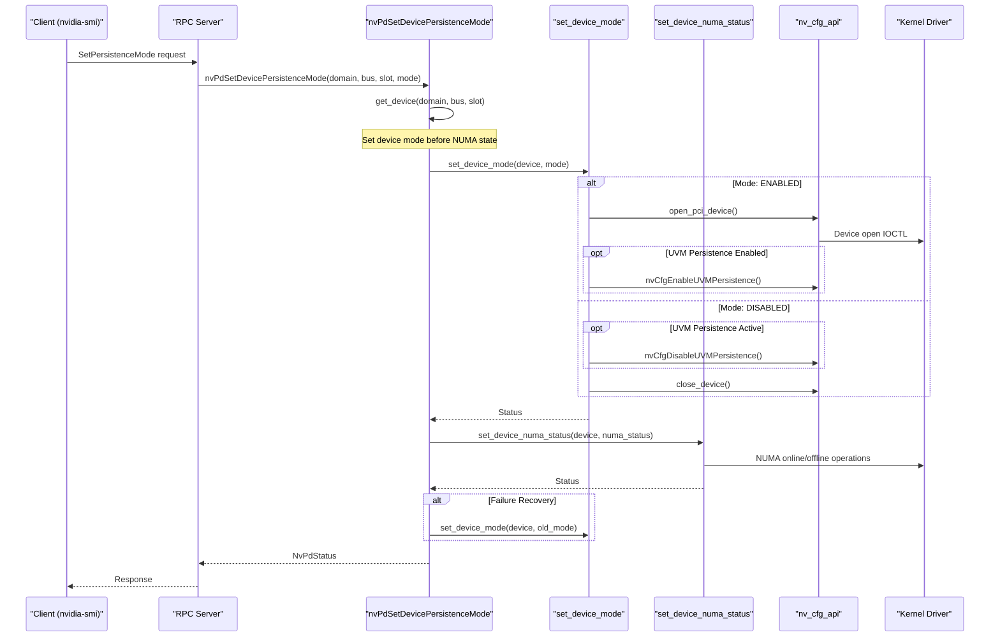

**Sources:** [nvidia-persistenced.c:109-140](), [nvidia-persistenced.c:343-421](), [nvidia-persistenced.c:427-479]()

## Dynamic Library Integration

The daemon dynamically loads the nvidia-cfg library to interface with the NVIDIA kernel driver, providing runtime flexibility and dependency management.

### Library Symbol Resolution

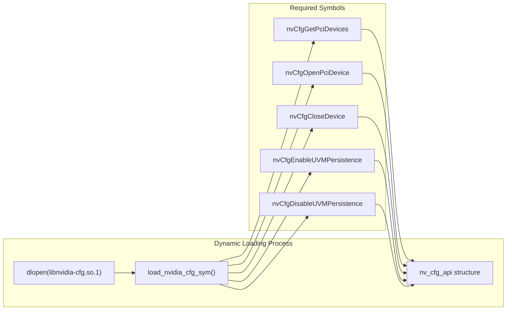

The `nv_cfg_api` structure provides function pointers to dynamically loaded symbols:

```c
static struct {
    NvCfgBool (*get_pci_devices)(int *, NvCfgPciDevice **);
    NvCfgBool (*open_pci_device)(int, int, int, int, NvCfgDeviceHandle *);
    NvCfgBool (*close_device)(NvCfgDeviceHandle);
    unsigned int (*nvCfgEnableUVMPersistence)(NvCfgDeviceHandle);
    unsigned int (*nvCfgDisableUVMPersistence)(NvCfgDeviceHandle);
} nv_cfg_api;
```

**Sources:** [nvidia-persistenced.c:78-84](), [nvidia-persistenced.c:590-600](), [nvidia-persistenced.c:606-662]()

## Daemon Lifecycle Management

The daemon follows a structured initialization and shutdown sequence to ensure proper resource management and cleanup.

### Initialization Sequence

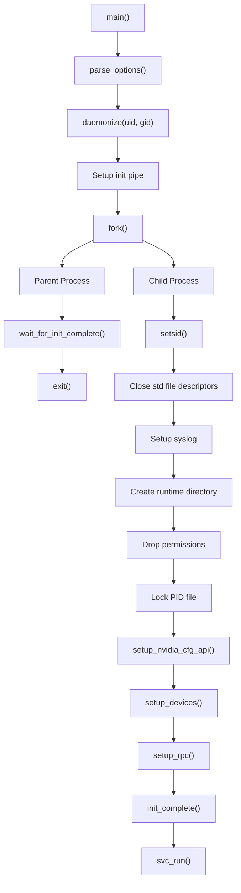

### Resource Management

| Resource | Creation | Cleanup Function | Location |
|----------|----------|------------------|----------|
| PID File | `daemonize()` | `shutdown_daemon()` | `/var/run/nvidia-persistenced/nvidia-persistenced.pid` |
| Unix Socket | `setup_rpc()` | `shutdown_daemon()` | `/var/run/nvidia-persistenced/socket` |
| Device Handles | `setup_devices()` | `shutdown_daemon()` | In-memory `devices` array |
| Library Handle | `setup_nvidia_cfg_api()` | `shutdown_daemon()` | `libnvidia_cfg` pointer |

**Sources:** [nvidia-persistenced.c:799-996](), [nvidia-persistenced.c:487-584](), [nvidia-persistenced.c:998-1044]()

## Error Handling and Status Management

The daemon implements comprehensive error handling with standardized status codes and logging integration.

### Status Code Hierarchy

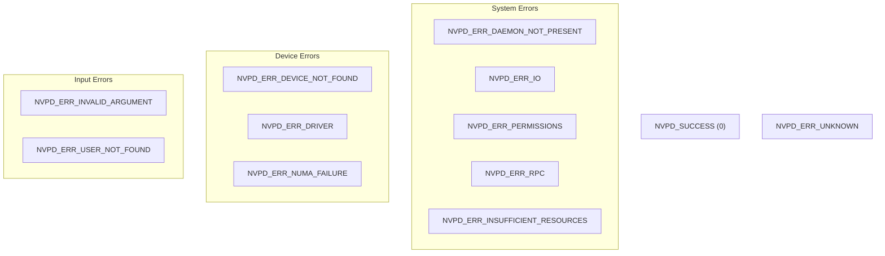

**Sources:** [nvpd_rpc.h:17-31]()

---

# Page: Main Daemon Implementation

# Main Daemon Implementation

<details>
<summary>Relevant source files</summary>

The following files were used as context for generating this wiki page:

- [nvidia-persistenced.c](nvidia-persistenced.c)
- [nvidia-persistenced.h](nvidia-persistenced.h)

</details>


This document covers the core daemon implementation of `nvidia-persistenced`, focusing on the daemon lifecycle, device state management, and system integration. The main daemon process handles GPU persistence mode control, NUMA memory management, and RPC communication with client applications.

For information about the RPC communication protocol, see [RPC Communication System](#2.2). For device configuration details, see [Device Configuration Interface](#2.3). For NUMA-specific functionality, see [NUMA Memory Management](#2.4).

## Core Data Structures

The daemon maintains device state through the `NvPdDevice` structure, which encapsulates all per-device information including persistence mode, NUMA status, and hardware handles.

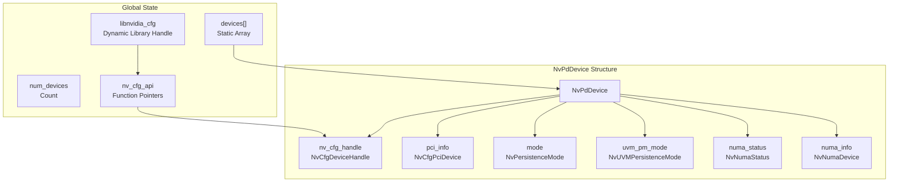

**Core Device Management Functions:**
- `get_device()` - Device lookup by PCI coordinates
- `nvPdSetDevicePersistenceMode()` - Primary device control API
- `nvPdGetDevicePersistenceMode()` - Device state query API
- `set_device_mode()` - Internal persistence mode control
- `set_device_numa_status()` - NUMA memory management

Sources: [nvidia-persistenced.c:56-84](), [nvidia-persistenced.h:35-56]()

## Daemon Lifecycle Management

The daemon follows a structured initialization and shutdown sequence, coordinating between parent and child processes during startup.

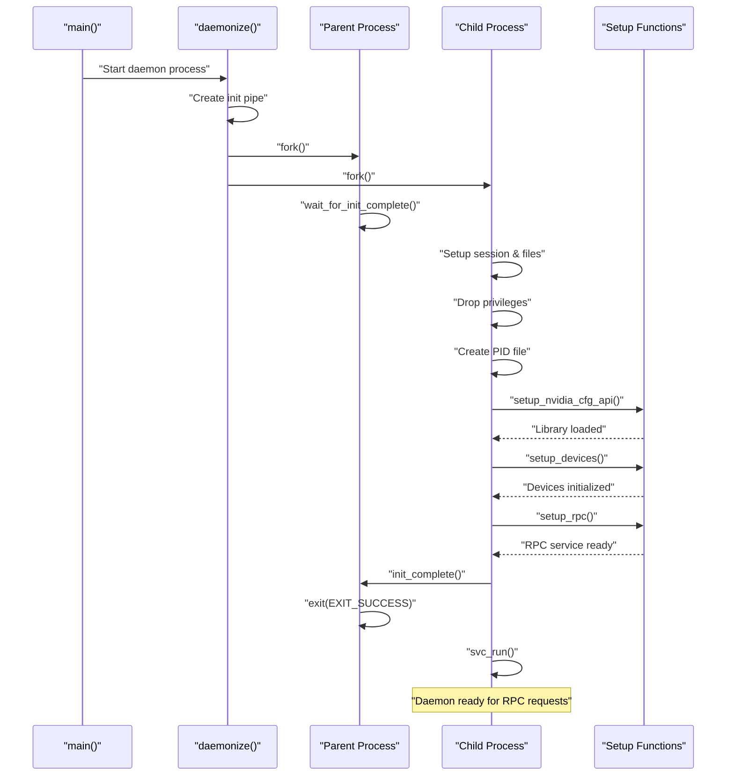

**Initialization Sequence:**
1. **Option Parsing** - Command line argument processing via `parse_options()`
2. **Process Daemonization** - Fork, session creation, privilege dropping
3. **Library Setup** - Dynamic loading of `libnvidia-cfg.so.1`
4. **Device Discovery** - Query and initialize NVIDIA devices
5. **RPC Service** - Unix domain socket creation and service registration
6. **Parent Coordination** - Signal successful initialization via init pipe

**Key Functions:**
- `main()` - Entry point and orchestration [nvidia-persistenced.c:998-1043]()
- `daemonize()` - Process daemonization and privilege management [nvidia-persistenced.c:799-996]()
- `init_complete()` - Parent-child coordination [nvidia-persistenced.c:230-245]()
- `wait_for_init_complete()` - Parent synchronization [nvidia-persistenced.c:254-275]()

Sources: [nvidia-persistenced.c:798-1043]()

## Device Management System

The daemon implements a centralized device management system that coordinates persistence mode control with NUMA memory management.

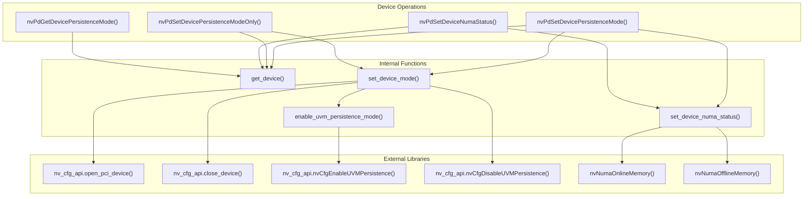

**Device Lookup and Validation:**
- `get_device()` performs PCI coordinate lookup in the device array [nvidia-persistenced.c:208-223]()
- Device validation ensures operations target valid, registered hardware
- Returns `NVPD_ERR_DEVICE_NOT_FOUND` for invalid device coordinates

**Persistence Mode Control:**
- **Enable Mode**: Opens device handle via `nvCfgOpenPciDevice`, optionally enables UVM persistence
- **Disable Mode**: Disables UVM persistence if active, closes device handle
- **Mode Coordination**: Always sets device mode before NUMA operations for proper sequencing

**UVM Persistence Management:**
- `enable_uvm_persistence_mode()` handles fabric readiness with timeout logic [nvidia-persistenced.c:290-336]()
- Implements retry logic for `NV_ERR_NVLINK_FABRIC_NOT_READY` conditions
- 30-second timeout for fabric probe operations

Sources: [nvidia-persistenced.c:109-479]()

## Signal Handling and Shutdown

The daemon implements graceful shutdown procedures triggered by system signals and coordinated cleanup of all managed resources.

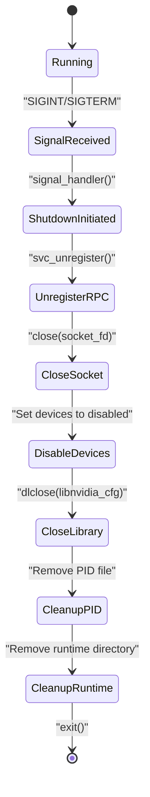

**Signal Processing:**
- `signal_handler()` processes `SIGINT` and `SIGTERM` for graceful shutdown [nvidia-persistenced.c:777-793]()
- Blocked signals include `SIGCHLD`, `SIGTSTP`, `SIGTTOU`, `SIGTTIN` during daemonization
- Unhandled signals generate warning messages in syslog

**Shutdown Sequence:**
1. **RPC Cleanup** - Unregister service mappings, close Unix domain socket
2. **Device Cleanup** - Set all devices to `NV_PERSISTENCE_MODE_DISABLED`
3. **Library Cleanup** - Close dynamic library handles via `dlclose()`
4. **File Cleanup** - Remove PID file, optionally remove runtime directory
5. **Logging** - Final shutdown message with process ID

**Resource Management:**
- PID file locking prevents multiple daemon instances [nvidia-persistenced.c:964-973]()
- Runtime directory ownership follows daemon user/group settings
- Socket file cleanup handles stale filesystem entries

Sources: [nvidia-persistenced.c:487-584](), [nvidia-persistenced.c:777-996]()

## Library Integration

The daemon dynamically loads and interfaces with external NVIDIA libraries for device operations and NUMA management.

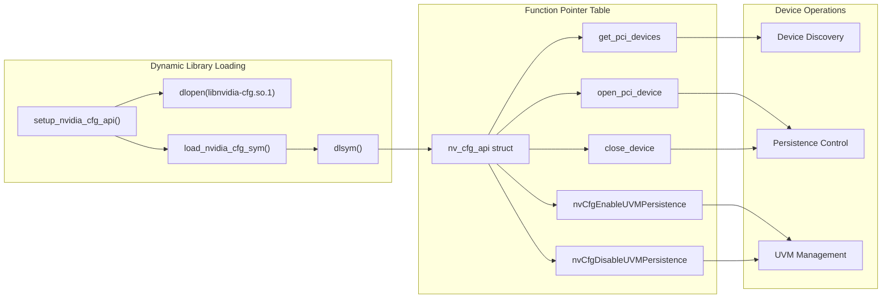

**Library Loading Process:**
- `setup_nvidia_cfg_api()` handles dynamic library discovery and loading [nvidia-persistenced.c:606-662]()
- Supports custom library paths via `--nvidia-cfg-path` option
- Symbol loading via `load_nvidia_cfg_sym()` with error reporting [nvidia-persistenced.c:590-600]()

**API Function Pointers:**
- **Device Management**: `nvCfgGetPciDevices`, `nvCfgOpenPciDevice`, `nvCfgCloseDevice`
- **UVM Control**: `nvCfgEnableUVMPersistence`, `nvCfgDisableUVMPersistence` (conditional loading)
- **Validation**: Initial device query confirms library functionality and permissions

**Error Handling:**
- Missing library generates `NVPD_ERR_DRIVER` status
- Symbol loading failures provide specific function names in error messages
- Device file permission issues guide users toward proper `/dev/nvidia*` setup

Sources: [nvidia-persistenced.c:590-662](), [nvidia-persistenced.c:674-728]()

---

# Page: RPC Communication System

# RPC Communication System

<details>
<summary>Relevant source files</summary>

The following files were used as context for generating this wiki page:

- [command_server.c](command_server.c)
- [nvpd_rpc.h](nvpd_rpc.h)
- [nvpd_rpc_server.c](nvpd_rpc_server.c)
- [nvpd_rpc_xdr.c](nvpd_rpc_xdr.c)

</details>


## Purpose and Scope

The RPC Communication System provides the primary interface for external clients to communicate with the nvidia-persistenced daemon. This system enables applications like `nvidia-smi` to request changes to GPU device persistence modes and NUMA memory status through a standardized remote procedure call protocol. The RPC interface abstracts the complexity of device management operations and provides a secure, controlled access mechanism to the daemon's core functionality.

For information about the main daemon implementation that handles these RPC requests, see [Main Daemon Implementation](#2.1). For details about the underlying device configuration operations, see [Device Configuration Interface](#2.3) and [NUMA Memory Management](#2.4).

## RPC Protocol Architecture

The nvidia-persistenced RPC system is built on Sun RPC (ONC-RPC) and uses XDR (eXternal Data Representation) for data serialization. The protocol supports multiple versions to maintain backward compatibility while adding new functionality.

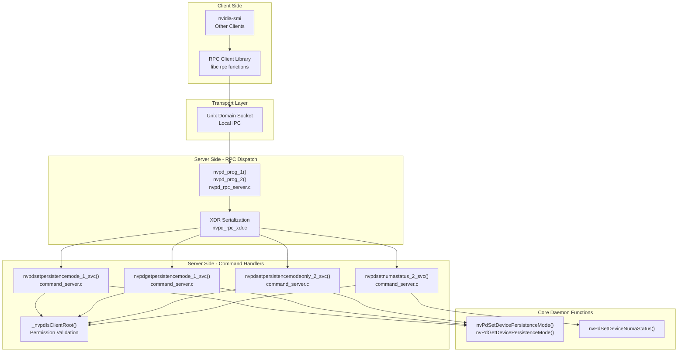

**Sources:** [nvpd_rpc.h:1-156](), [command_server.c:1-144](), [nvpd_rpc_server.c:1-117](), [nvpd_rpc_xdr.c:1-97]()

## Protocol Versions and Program Numbers

The RPC protocol is identified by program number `NVPD_PROG` (35006) and supports two versions with different capabilities:

| Version | Constant | Supported Operations |
|---------|----------|---------------------|
| Version 1 | `VersionOne` (1) | Set/Get Persistence Mode |
| Version 2 | `VersionTwo` (2) | Set Persistence Mode Only, Set NUMA Status |

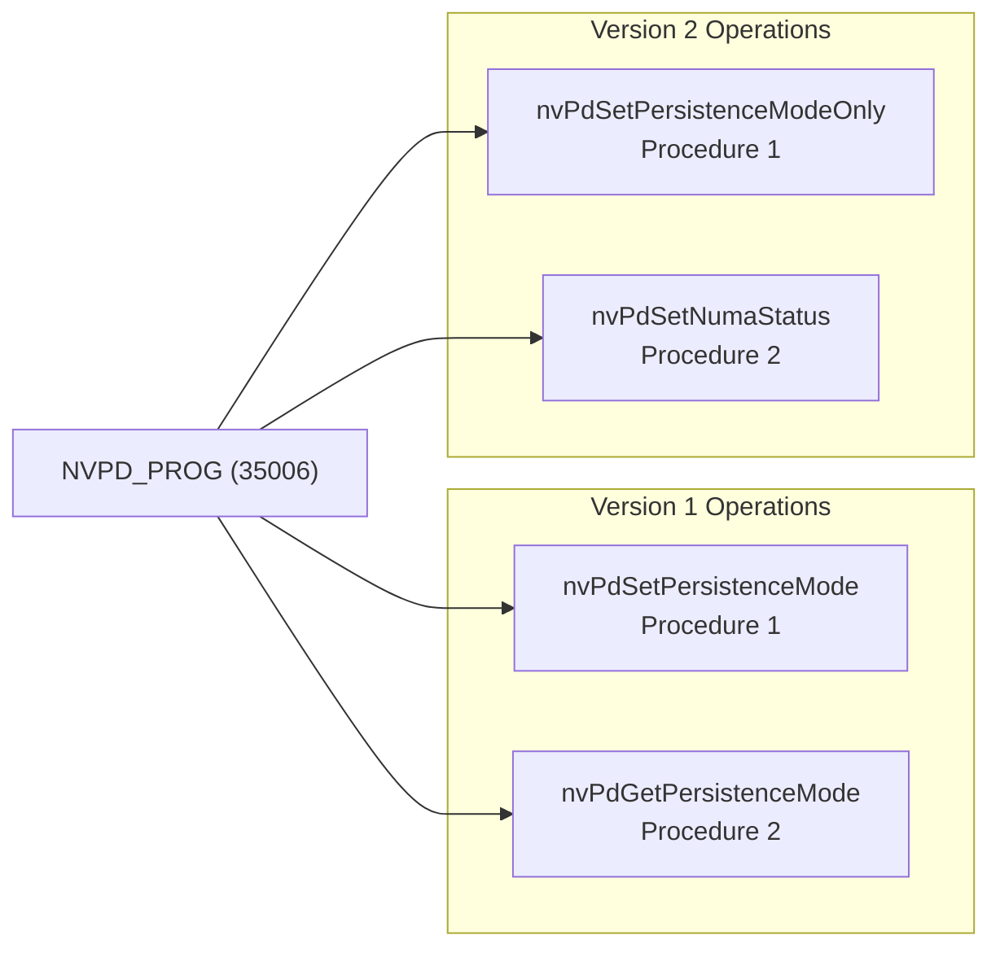

**Sources:** [nvpd_rpc.h:84-86](), [nvpd_rpc.h:105](), [nvpd_rpc.h:88-91](), [nvpd_rpc.h:108-113]()

## Core Data Types

The RPC protocol defines several key data structures for device identification and operation parameters:

### Device Identification

```c
struct NvPciDevice {
    int domain;    // PCI domain
    int bus;       // PCI bus number
    int slot;      // PCI slot number  
    int function;  // PCI function number
};
```

### Status and Mode Enumerations

| Enumeration | Values | Purpose |
|-------------|--------|---------|
| `NvPdStatus` | `NVPD_SUCCESS`, `NVPD_ERR_*` | Operation result codes |
| `NvPersistenceMode` | `NV_PERSISTENCE_MODE_DISABLED/ENABLED` | GPU persistence state |
| `NvUVMPersistenceMode` | `NV_UVM_PERSISTENCE_MODE_DISABLED/ENABLED` | UVM persistence state |
| `NvNumaStatus` | `NV_NUMA_STATUS_OFFLINE/ONLINE` | NUMA memory state |

### RPC Operation Structures

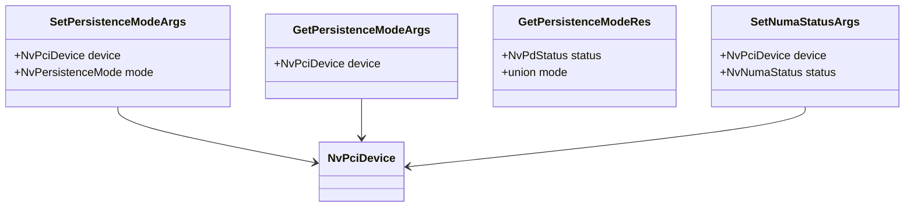

**Sources:** [nvpd_rpc.h:33-38](), [nvpd_rpc.h:17-30](), [nvpd_rpc.h:41-51](), [nvpd_rpc.h:53-82]()

## RPC Operation Implementations

### Authentication and Security

All RPC operations require root privileges. The `_nvpdIsClientRoot()` function validates client credentials using Unix domain socket peer credentials:

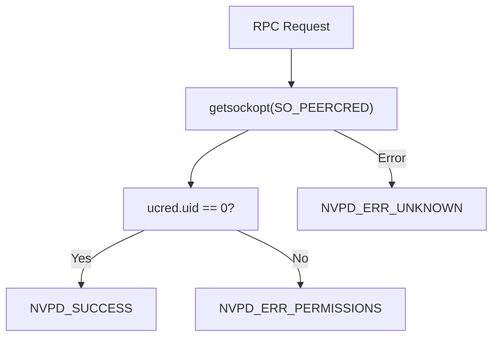

**Sources:** [command_server.c:37-53]()

### Version 1 Operations

#### Set Persistence Mode
- **Function:** `nvpdsetpersistencemode_1_svc()`
- **Purpose:** Sets device persistence mode and manages associated NUMA memory
- **Implementation:** Calls `nvPdSetDevicePersistenceMode()` after authentication

#### Get Persistence Mode  
- **Function:** `nvpdgetpersistencemode_1_svc()`
- **Purpose:** Retrieves current device persistence mode
- **Implementation:** Calls `nvPdGetDevicePersistenceMode()` and returns result in union structure

**Sources:** [command_server.c:59-76](), [command_server.c:82-95]()

### Version 2 Operations

#### Set Persistence Mode Only
- **Function:** `nvpdsetpersistencemodeonly_2_svc()`
- **Purpose:** Sets persistence mode without affecting NUMA status
- **Implementation:** Calls `nvPdSetDevicePersistenceModeOnly()` after authentication

#### Set NUMA Status
- **Function:** `nvpdsetnumastatus_2_svc()`
- **Purpose:** Controls NUMA memory online/offline state independently
- **Implementation:** Calls `nvPdSetDeviceNumaStatus()` after authentication

**Sources:** [command_server.c:103-120](), [command_server.c:126-143]()

## RPC Server Dispatch Logic

The RPC server uses generated dispatch functions to route incoming requests to appropriate handlers:

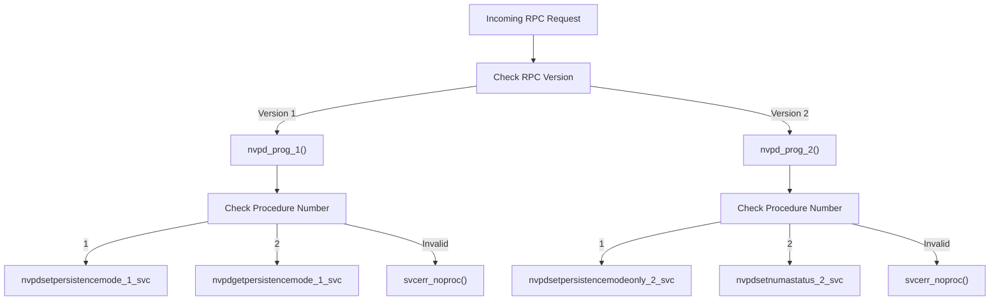

**Sources:** [nvpd_rpc_server.c:23-68](), [nvpd_rpc_server.c:71-116]()

## XDR Serialization Layer

The XDR layer handles data marshaling and unmarshaling for all RPC data types. Each structure has corresponding XDR functions:

| Data Type | XDR Function | Purpose |
|-----------|--------------|---------|
| `NvPdStatus` | `xdr_NvPdStatus()` | Serialize status enums |
| `NvPciDevice` | `xdr_NvPciDevice()` | Serialize PCI device identifiers |
| `NvPersistenceMode` | `xdr_NvPersistenceMode()` | Serialize persistence mode enums |
| `SetPersistenceModeArgs` | `xdr_SetPersistenceModeArgs()` | Serialize operation arguments |
| `GetPersistenceModeRes` | `xdr_GetPersistenceModeRes()` | Serialize response with union handling |

The XDR functions handle platform-independent data representation, ensuring compatibility across different architectures.

**Sources:** [nvpd_rpc_xdr.c:8-96]()

## Error Handling and Status Codes

The RPC system defines comprehensive error codes for different failure scenarios:

| Status Code | Value | Description |
|-------------|-------|-------------|
| `NVPD_SUCCESS` | 0 | Operation completed successfully |
| `NVPD_ERR_DAEMON_NOT_PRESENT` | 1 | Daemon is not running |
| `NVPD_ERR_DEVICE_NOT_FOUND` | 2 | Specified GPU device not found |
| `NVPD_ERR_DRIVER` | 3 | NVIDIA driver error |
| `NVPD_ERR_INSUFFICIENT_RESOURCES` | 4 | System resource limitation |
| `NVPD_ERR_INVALID_ARGUMENT` | 5 | Invalid input parameters |
| `NVPD_ERR_IO` | 6 | Input/output error |
| `NVPD_ERR_PERMISSIONS` | 7 | Insufficient privileges |
| `NVPD_ERR_RPC` | 8 | RPC communication error |
| `NVPD_ERR_USER_NOT_FOUND` | 9 | User account not found |
| `NVPD_ERR_NUMA_FAILURE` | 10 | NUMA operation failed |
| `NVPD_ERR_UNKNOWN` | 11 | Unspecified error |

**Sources:** [nvpd_rpc.h:17-30]()

## Communication Flow Example

```mermaid
sequenceDiagram
    participant Client as "nvidia-smi"
    participant RPC as "RPC Layer"
    participant Auth as "Authentication"
    participant Handler as "Command Handler"
    participant Daemon as "Core Daemon"
    
    Client->>RPC: "nvpdsetpersistencemode_1(device, mode)"
    RPC->>Handler: "nvpdsetpersistencemode_1_svc(args, req)"
    Handler->>Auth: "_nvpdIsClientRoot(req)"
    Auth->>Handler: "NVPD_SUCCESS / NVPD_ERR_PERMISSIONS"
    
    alt Authentication Successful
        Handler->>Daemon: "nvPdSetDevicePersistenceMode()"
        Daemon->>Handler: "NvPdStatus result"
        Handler->>RPC: "return &result"
        RPC->>Client: "Serialized response"
    else Authentication Failed
        Handler->>RPC: "return &NVPD_ERR_PERMISSIONS"
        RPC->>Client: "Permission error"
    end
```

**Sources:** [command_server.c:59-76](), [command_server.c:37-53](), [nvpd_rpc_server.c:33-67]()

---

# Page: Device Configuration Interface

# Device Configuration Interface

<details>
<summary>Relevant source files</summary>

The following files were used as context for generating this wiki page:

- [common-utils/src.mk](common-utils/src.mk)
- [nv-ioctl-numa.h](nv-ioctl-numa.h)
- [nv-ioctl-numbers.h](nv-ioctl-numbers.h)
- [nvidia-cfg.h](nvidia-cfg.h)

</details>


## Purpose and Scope

The Device Configuration Interface provides the core GPU device discovery, configuration, and management capabilities for nvidia-persistenced through the `libnvidia-cfg.so` library. This interface abstracts the low-level IOCTL communications with the NVIDIA kernel driver and provides a clean C API for device operations including persistence mode control, device enumeration, and hardware configuration management.

This document covers the nvidia-cfg library interface used by nvidia-persistenced for device management. For information about how the daemon integrates this interface into its main operation loop, see [Main Daemon Implementation](#2.1). For details about NUMA-specific memory management operations, see [NUMA Memory Management](#2.4).

## Core Data Structures

The Device Configuration Interface is built around several key data structures that represent different aspects of NVIDIA hardware in the system.

### Device Identification

The primary device identification structure is `NvCfgPciDevice`, which uniquely identifies a GPU on the PCI bus:

```c
typedef struct {
    int domain;
    int bus;
    int slot;
    int function;
} NvCfgPciDevice;
```

Device connections are managed through opaque handles:

```c
typedef void * NvCfgDeviceHandle;
typedef void * NvCfgGSyncHandle;
```

### Device Information Structures

Display device information is captured in the `NvCfgDisplayDeviceInformation` structure, which contains EDID-parsed data including monitor capabilities, preferred timings, and physical dimensions.

**Device Data Structure Relationships**
```mermaid
graph TB
    PciDevice["NvCfgPciDevice<br/>(domain:bus:slot:function)"]
    DeviceHandle["NvCfgDeviceHandle<br/>(opaque handle)"]
    DisplayInfo["NvCfgDisplayDeviceInformation<br/>(EDID data)"]
    GSyncHandle["NvCfgGSyncHandle<br/>(G-Sync device)"]
    
    PciDevice --> DeviceHandle
    DeviceHandle --> DisplayInfo
    DeviceHandle --> GSyncHandle
    
    subgraph "Device Properties"
        ProductName["Product Name"]
        DeviceUUID["Device UUID"]
        NumCRTCs["Number of CRTCs"]
        DisplayMask["Display Device Mask"]
    end
    
    DeviceHandle --> ProductName
    DeviceHandle --> DeviceUUID
    DeviceHandle --> NumCRTCs
    DeviceHandle --> DisplayMask
```

Sources: [nvidia-cfg.h:59-64](), [nvidia-cfg.h:146](), [nvidia-cfg.h:155](), [nvidia-cfg.h:88-137]()

## Device Discovery and Enumeration

The interface provides multiple approaches for discovering NVIDIA devices in the system, with the modern approach using PCI domain addressing.

### PCI Device Enumeration

The primary device discovery function `nvCfgGetPciDevices()` returns an array of all NVIDIA graphics devices:

```c
NvCfgBool nvCfgGetPciDevices(int *n, NvCfgPciDevice **devs);
```

This function allocates and populates an array of `NvCfgPciDevice` structures representing all detected NVIDIA GPUs.

**Device Discovery Flow**
```mermaid
graph TD
    Start["Application Start"]
    GetDevices["nvCfgGetPciDevices()"]
    ParseDevices["Parse Device Array"]
    OpenDevice["nvCfgOpenPciDevice()"]
    GetInfo["Device Information Queries"]
    CloseDevice["nvCfgCloseDevice()"]
    
    Start --> GetDevices
    GetDevices --> ParseDevices
    ParseDevices --> OpenDevice
    OpenDevice --> GetInfo
    GetInfo --> CloseDevice
    
    subgraph "Device Information"
        ProductName["nvCfgGetProductName()"]
        DeviceUUID["nvCfgGetDeviceUUID()"]
        NumCRTCs["nvCfgGetNumCRTCs()"]
    end
    
    GetInfo --> ProductName
    GetInfo --> DeviceUUID
    GetInfo --> NumCRTCs
```

Sources: [nvidia-cfg.h:186-197](), [nvidia-cfg.h:225-233](), [nvidia-cfg.h:289-296](), [nvidia-cfg.h:301-308]()

### Bulk Operations

For applications that need to work with all devices simultaneously, the interface provides convenience functions:

- `nvCfgOpenAllPciDevices()` - Opens connections to all NVIDIA devices
- `nvCfgCloseAllPciDevices()` - Closes all previously opened connections

These functions manage device handle arrays automatically and are particularly useful for system-wide operations.

Sources: [nvidia-cfg.h:237-247](), [nvidia-cfg.h:268-273]()

## Device Lifecycle Management

Device connections follow a clear open/close pattern with different modes of access depending on the intended use case.

### Standard Device Access

Full device access for display and GPU management:

```c
NvCfgBool nvCfgOpenPciDevice(int domain, int bus, int device, int function,
                             NvCfgDeviceHandle *handle);
NvCfgBool nvCfgCloseDevice(NvCfgDeviceHandle handle);
```

### Limited Device Access

For headless or compute-only scenarios, a display-less attachment mode is available:

```c
NvCfgBool nvCfgAttachPciDevice(int domain, int bus, int device, int function,
                               NvCfgDeviceHandle *handle);
NvCfgBool nvCfgDetachDevice(NvCfgDeviceHandle handle);
```

**Device Connection Lifecycle**
```mermaid
stateDiagram-v2
    [*] --> Discovered: nvCfgGetPciDevices()
    Discovered --> FullAccess: nvCfgOpenPciDevice()
    Discovered --> LimitedAccess: nvCfgAttachPciDevice()
    
    FullAccess --> DisplayOps: Display Operations
    FullAccess --> PersistenceOps: Persistence Control
    FullAccess --> DeviceInfo: Device Queries
    
    LimitedAccess --> PersistenceOps: Persistence Control
    LimitedAccess --> DeviceInfo: Limited Queries
    
    DisplayOps --> FullAccess
    PersistenceOps --> FullAccess
    PersistenceOps --> LimitedAccess
    DeviceInfo --> FullAccess
    DeviceInfo --> LimitedAccess
    
    FullAccess --> [*]: nvCfgCloseDevice()
    LimitedAccess --> [*]: nvCfgDetachDevice()
```

Sources: [nvidia-cfg.h:214-221](), [nvidia-cfg.h:225-233](), [nvidia-cfg.h:251-255](), [nvidia-cfg.h:259-264]()

## Persistence Mode Control

A critical function for nvidia-persistenced is controlling UVM (Unified Virtual Memory) persistence mode, which keeps the NVIDIA kernel driver loaded even when no applications are using the GPU.

### UVM Persistence Functions

```c
unsigned int nvCfgEnableUVMPersistence(NvCfgDeviceHandle handle);
unsigned int nvCfgDisableUVMPersistence(NvCfgDeviceHandle handle);
```

These functions return zero on success and non-zero values on failure. The interface notes indicate these are internal APIs that may be removed in future releases.

**Persistence Mode State Management**
```mermaid
graph LR
    Disabled["UVM Persistence<br/>DISABLED"]
    Enabled["UVM Persistence<br/>ENABLED"]
    
    Disabled -->|"nvCfgEnableUVMPersistence()"| Enabled
    Enabled -->|"nvCfgDisableUVMPersistence()"| Disabled
    
    subgraph "Effects"
        DriverLoaded["Kernel Driver<br/>Remains Loaded"]
        DriverUnloaded["Kernel Driver<br/>Can Unload"]
    end
    
    Enabled --> DriverLoaded
    Disabled --> DriverUnloaded
```

Sources: [nvidia-cfg.h:456-472]()

## Display and G-Sync Device Management

The interface provides comprehensive display device discovery and management capabilities, though these are less central to nvidia-persistenced's primary function.

### Display Device Operations

Display devices are identified using bitmasks where different bit ranges represent different connector types:
- Bits 0-7: CRT devices (CRT-0, CRT-1, etc.)
- Bits 8-15: TV devices  
- Bits 16-23: DFP (Digital Flat Panel) devices

Key display functions include:
- `nvCfgGetDisplayDevices()` - Get connected display devices
- `nvCfgGetSupportedDisplayDevices()` - Get all supported display devices
- `nvCfgGetEDIDData()` - Retrieve EDID data for a display

### G-Sync Device Management

G-Sync devices have their own management interface with functions for:
- Device enumeration (`nvCfgOpenAllGSyncDevices()`)
- Device type and firmware version queries
- Firmware flashing capabilities

Sources: [nvidia-cfg.h:312-337](), [nvidia-cfg.h:341-362](), [nvidia-cfg.h:391-446]()

## Kernel Driver Interface

The Device Configuration Interface ultimately communicates with the NVIDIA kernel driver through a well-defined IOCTL interface.

### IOCTL Command Structure

The IOCTL commands are defined with a consistent numbering scheme:

| Command | Value | Purpose |
|---------|-------|---------|
| `NV_ESC_CARD_INFO` | 200 | Device information |
| `NV_ESC_STATUS_CODE` | 209 | Status code queries |
| `NV_ESC_NUMA_INFO` | 215 | NUMA memory information |
| `NV_ESC_SET_NUMA_STATUS` | 216 | NUMA status control |

**IOCTL Communication Architecture**
```mermaid
graph TB
    LibraryCalls["nvidia-cfg Library Calls"]
    IOCTLLayer["IOCTL Interface Layer"]
    KernelDriver["NVIDIA Kernel Driver"]
    Hardware["GPU Hardware"]
    
    subgraph "Library Functions"
        GetDevices["nvCfgGetPciDevices()"]
        OpenDevice["nvCfgOpenPciDevice()"]
        EnablePersist["nvCfgEnableUVMPersistence()"]
    end
    
    subgraph "IOCTL Commands"
        CardInfo["NV_ESC_CARD_INFO"]
        StatusCode["NV_ESC_STATUS_CODE"]
        NumaInfo["NV_ESC_NUMA_INFO"]
    end
    
    GetDevices --> CardInfo
    OpenDevice --> StatusCode
    EnablePersist --> NumaInfo
    
    CardInfo --> KernelDriver
    StatusCode --> KernelDriver
    NumaInfo --> KernelDriver
    
    KernelDriver --> Hardware
```

Sources: [nv-ioctl-numbers.h:28-43](), [nv-ioctl-numa.h:44-45]()

### NUMA-Specific IOCTLs

For NUMA memory management, specialized IOCTL structures are defined:

```c
typedef struct nv_ioctl_numa_info {
    int32_t  nid;
    int32_t  status;
    uint64_t memblock_size;
    uint64_t numa_mem_addr;
    uint64_t numa_mem_size;
    uint8_t  use_auto_online;
    nv_offline_addresses_t offline_addresses;
} nv_ioctl_numa_info_t;
```

The NUMA status values provide detailed state tracking for memory onlining operations:
- `NV_IOCTL_NUMA_STATUS_DISABLED` (0)
- `NV_IOCTL_NUMA_STATUS_OFFLINE` (1)  
- `NV_IOCTL_NUMA_STATUS_ONLINE` (3)
- `NV_IOCTL_NUMA_STATUS_ONLINE_FAILED` (4)

Sources: [nv-ioctl-numa.h:56-66](), [nv-ioctl-numa.h:73-80]()

## Integration with nvidia-persistenced

The Device Configuration Interface serves as the primary hardware abstraction layer for nvidia-persistenced, enabling the daemon to manage GPU persistence state without directly handling IOCTL operations.

### Typical Usage Pattern in nvidia-persistenced

1. **Initialization**: Discover all NVIDIA devices using `nvCfgGetPciDevices()`
2. **Device Access**: Open connections using `nvCfgOpenPciDevice()` or `nvCfgAttachPciDevice()`
3. **Persistence Control**: Enable persistence using `nvCfgEnableUVMPersistence()`
4. **Monitoring**: Maintain device connections throughout daemon lifetime
5. **Cleanup**: Disable persistence and close connections on shutdown

The interface design allows nvidia-persistenced to operate as a system service, maintaining persistent kernel driver state across application lifecycles while providing a stable foundation for GPU compute workloads.

Sources: [nvidia-cfg.h:34-36]()

---

# Page: NUMA Memory Management

# NUMA Memory Management

<details>
<summary>Relevant source files</summary>

The following files were used as context for generating this wiki page:

- [nv-ioctl-numa.h](nv-ioctl-numa.h)
- [nv-ioctl-numbers.h](nv-ioctl-numbers.h)
- [nvidia-numa.c](nvidia-numa.c)
- [nvidia-numa.h](nvidia-numa.h)

</details>


This document covers the NUMA (Non-Uniform Memory Access) memory management system within nvidia-persistenced, which provides NUMA-aware onlining and offlining of GPU memory. The system manages GPU memory as NUMA nodes to optimize memory locality and system performance.

For information about the overall device configuration interface, see [Device Configuration Interface](#2.3). For details about the main daemon implementation that coordinates NUMA operations, see [Main Daemon Implementation](#2.1).

## Purpose and Scope

The NUMA memory management system handles the complex process of bringing GPU memory online and offline in a NUMA-aware manner. It coordinates between the NVIDIA kernel driver, Linux memory hotplug subsystem, and sysfs interfaces to ensure proper memory management. The system supports both automatic and manual memory onlining strategies depending on system configuration.

Sources: [nvidia-numa.c:24-26](), [nvidia-numa.h:23-41]()

## Architecture Overview

The NUMA management system operates through several interconnected components that handle different aspects of memory management:

```mermaid
graph TB
    subgraph "NUMA Management Layer"
        ONLINE["nvNumaOnlineMemory()"]
        OFFLINE["nvNumaOfflineMemory()"]
        DEVICE["NvNumaDevice"]
    end
    
    subgraph "IOCTL Interface"
        GET_INFO["get_gpu_numa_info()"]
        SET_STATUS["set_gpu_numa_status()"]
        NUMA_INFO_IOCTL["NV_ESC_NUMA_INFO"]
        SET_STATUS_IOCTL["NV_ESC_SET_NUMA_STATUS"]
    end
    
    subgraph "Memory Block Management"
        CHANGE_STATE["change_memblock_state()"]
        CHANGE_NODE["change_numa_node_state()"]
        PROBE_MEM["probe_node_memory()"]
        AUTO_CHECK["check_memory_auto_online()"]
    end
    
    subgraph "Sysfs Interface"
        MEMBLK_STATE["/sys/devices/system/memory/memoryN/state"]
        MEMORY_PROBE["/sys/devices/system/memory/probe"]
        AUTO_ONLINE["/sys/devices/system/memory/auto_online_blocks"]
        HARD_OFFLINE["/sys/devices/system/memory/hard_offline_page"]
    end
    
    subgraph "Device Access"
        GPU_FD["get_gpu_device_file_fd()"]
        MINOR_NUM["get_gpu_minor_number()"]
        DEV_FILE["/dev/nvidiaN"]
        PROC_INFO["/proc/driver/nvidia/gpus/..."]
    end
    
    ONLINE --> GET_INFO
    ONLINE --> SET_STATUS
    OFFLINE --> GET_INFO
    OFFLINE --> SET_STATUS
    
    GET_INFO --> NUMA_INFO_IOCTL
    SET_STATUS --> SET_STATUS_IOCTL
    
    ONLINE --> PROBE_MEM
    ONLINE --> AUTO_CHECK
    ONLINE --> CHANGE_NODE
    OFFLINE --> CHANGE_NODE
    
    CHANGE_NODE --> CHANGE_STATE
    CHANGE_STATE --> MEMBLK_STATE
    PROBE_MEM --> MEMORY_PROBE
    AUTO_CHECK --> MEMBLK_STATE
    
    GPU_FD --> MINOR_NUM
    MINOR_NUM --> PROC_INFO
    GPU_FD --> DEV_FILE
    
    DEVICE --> ONLINE
    DEVICE --> OFFLINE
```

Sources: [nvidia-numa.c:688-897](), [nvidia-numa.h:29-39](), [nv-ioctl-numa.h:44-81]()

## Core Data Structures

### NvNumaDevice Structure

The `NvNumaDevice` structure maintains per-device NUMA context:

| Field | Type | Purpose |
|-------|------|---------|
| `fd` | `int` | File descriptor for GPU device |
| `pci_info` | `NvCfgPciDevice*` | PCI device information |
| `use_auto_online` | `uint8_t` | Flag indicating automatic onlining mode |

Sources: [nvidia-numa.h:30-35]()

### NUMA Information Structure

The `nv_ioctl_numa_info_t` structure contains NUMA memory configuration:

| Field | Type | Purpose |
|-------|------|---------|
| `nid` | `int32_t` | NUMA node ID |
| `status` | `int32_t` | Current NUMA memory status |
| `memblock_size` | `uint64_t` | Size of memory blocks |
| `numa_mem_addr` | `uint64_t` | Base address of NUMA memory |
| `numa_mem_size` | `uint64_t` | Total size of NUMA memory |
| `use_auto_online` | `uint8_t` | Auto-online capability flag |
| `offline_addresses` | `nv_offline_addresses_t` | Blacklisted memory addresses |

Sources: [nv-ioctl-numa.h:56-65]()

## NUMA Status State Machine

The NUMA memory management system maintains strict state transitions for memory operations:

```mermaid
stateDiagram-v2
    [*] --> DISABLED : "NV_IOCTL_NUMA_STATUS_DISABLED"
    DISABLED --> OFFLINE : "Memory allocated"
    
    OFFLINE --> ONLINE_IN_PROGRESS : "nvNumaOnlineMemory()"
    ONLINE_IN_PROGRESS --> ONLINE : "Success"
    ONLINE_IN_PROGRESS --> ONLINE_FAILED : "Failure"
    ONLINE_FAILED --> ONLINE_IN_PROGRESS : "Retry"
    
    ONLINE --> OFFLINE_IN_PROGRESS : "nvNumaOfflineMemory()"
    OFFLINE_IN_PROGRESS --> OFFLINE : "Success"
    OFFLINE_IN_PROGRESS --> OFFLINE_FAILED : "Failure"
    OFFLINE_FAILED --> OFFLINE_IN_PROGRESS : "Retry"
    
    OFFLINE_FAILED --> ONLINE_IN_PROGRESS : "Online attempt"
    ONLINE_FAILED --> OFFLINE_IN_PROGRESS : "Offline attempt"
```

The state constants are defined as:

| State | Value | Description |
|-------|-------|-------------|
| `NV_IOCTL_NUMA_STATUS_DISABLED` | 0 | NUMA not available |
| `NV_IOCTL_NUMA_STATUS_OFFLINE` | 1 | Memory offline |
| `NV_IOCTL_NUMA_STATUS_ONLINE_IN_PROGRESS` | 2 | Onlining in progress |
| `NV_IOCTL_NUMA_STATUS_ONLINE` | 3 | Memory online |
| `NV_IOCTL_NUMA_STATUS_ONLINE_FAILED` | 4 | Onlining failed |
| `NV_IOCTL_NUMA_STATUS_OFFLINE_IN_PROGRESS` | 5 | Offlining in progress |
| `NV_IOCTL_NUMA_STATUS_OFFLINE_FAILED` | 6 | Offlining failed |

Sources: [nv-ioctl-numa.h:73-79](), [nvidia-numa.c:72-93]()

## Memory Onlining Process

The memory onlining process follows a specific sequence to ensure proper NUMA-aware memory management:

```mermaid
sequenceDiagram
    participant APP as "Application"
    participant NUMA as "nvNumaOnlineMemory()"
    participant IOCTL as "IOCTL Interface"
    participant PROBE as "probe_node_memory()"
    participant CHECK as "check_memory_auto_online()"
    participant CHANGE as "change_numa_node_state()"
    participant SYSFS as "Sysfs Interface"
    
    APP->>NUMA: "nvNumaOnlineMemory(numa_info)"
    NUMA->>IOCTL: "get_gpu_numa_info(fd)"
    IOCTL-->>NUMA: "numa_info_params"
    
    alt "Auto-online enabled"
        NUMA-->>APP: "NVPD_SUCCESS (skip manual)"
    else "Manual onlining required"
        NUMA->>IOCTL: "set_gpu_numa_status(ONLINE_IN_PROGRESS)"
        NUMA->>PROBE: "probe_node_memory()"
        PROBE->>SYSFS: "Write to /sys/devices/system/memory/probe"
        NUMA->>CHECK: "check_memory_auto_online()"
        CHECK->>SYSFS: "Read memory block states"
        
        alt "Auto-onlined successfully"
            NUMA->>IOCTL: "set_gpu_numa_status(ONLINE)"
        else "Manual onlining needed"
            NUMA->>CHANGE: "change_numa_node_state(ONLINE)"
            CHANGE->>SYSFS: "Write 'online_movable' to memory blocks"
            NUMA->>IOCTL: "set_gpu_numa_status(ONLINE)"
        end
        
        NUMA-->>APP: "NVPD_SUCCESS"
    end
```

### Key Implementation Details

1. **Memory Alignment Validation**: The system ensures memory addresses and sizes are aligned to memory block boundaries [nvidia-numa.c:770-778]()

2. **Backward Memory Block Onlining**: Memory blocks are onlined in reverse order to allow placement into movable zones [nvidia-numa.c:364-373]()

3. **Auto-online Detection**: The system checks if memory was automatically onlined by checking the `valid_zones` attribute [nvidia-numa.c:594-682]()

4. **Blacklisted Page Handling**: Bad memory pages are retired using the `hard_offline_page` interface [nvidia-numa.c:413-440]()

Sources: [nvidia-numa.c:688-864]()

## Memory Offlining Process

Memory offlining reverses the onlining process and handles cleanup:

```mermaid
flowchart TD
    START["nvNumaOfflineMemory()"] --> CHECK_FD["Check file descriptor"]
    CHECK_FD --> AUTO_CHECK{"use_auto_online?"}
    
    AUTO_CHECK -->|Yes| DONE["Close FD and return"]
    AUTO_CHECK -->|No| GET_INFO["get_gpu_numa_info()"]
    
    GET_INFO --> STATUS_CHECK{"Check current status"}
    STATUS_CHECK -->|"DISABLED/OFFLINE"| DONE
    STATUS_CHECK -->|"ONLINE/FAILED"| SET_PROGRESS["set_gpu_numa_status(OFFLINE_IN_PROGRESS)"]
    
    SET_PROGRESS --> CHANGE_STATE["change_numa_node_state(OFFLINE)"]
    CHANGE_STATE --> SUCCESS{"Success?"}
    
    SUCCESS -->|Yes| SET_OFFLINE["set_gpu_numa_status(OFFLINE)"]
    SUCCESS -->|No| SET_FAILED["set_gpu_numa_status(OFFLINE_FAILED)"]
    
    SET_OFFLINE --> DONE
    SET_FAILED --> ERROR["Return error"]
```

The offlining process writes `"offline"` commands to individual memory block state files in forward order [nvidia-numa.c:376-387]().

Sources: [nvidia-numa.c:866-897](), [nvidia-numa.c:511-583]()

## IOCTL Communication Interface

The system communicates with the kernel driver through two primary IOCTL operations:

### NUMA Information Retrieval

```mermaid
graph LR
    APP["Application"] --> GET_INFO["get_gpu_numa_info()"]
    GET_INFO --> IOCTL_REQ["_IOWR(NV_IOCTL_MAGIC, NV_ESC_NUMA_INFO)"]
    IOCTL_REQ --> DRIVER["Kernel Driver"]
    DRIVER --> RESPONSE["nv_ioctl_numa_info_t"]
    RESPONSE --> APP
```

### NUMA Status Updates

```mermaid
graph LR
    APP["Application"] --> SET_STATUS["set_gpu_numa_status()"]
    SET_STATUS --> IOCTL_REQ["_IOWR(NV_IOCTL_MAGIC, NV_ESC_SET_NUMA_STATUS)"]
    IOCTL_REQ --> DRIVER["Kernel Driver"]
    DRIVER --> ACK["Status acknowledgment"]
    ACK --> APP
```

### Device File Access

The system accesses GPU devices through a specific path resolution process:

1. **Minor Number Extraction**: Parse `/proc/driver/nvidia/gpus/{domain:bus:slot.function}/information` [nvidia-numa.c:96-131]()
2. **Device File Construction**: Create `/dev/nvidia{minor}` path [nvidia-numa.c:134-149]()
3. **File Descriptor Management**: Open and maintain device file descriptor [nvidia-numa.c:152-171]()

Sources: [nvidia-numa.c:174-216](), [nv-ioctl-numa.h:44-45](), [nv-ioctl-numbers.h:28-44]()

## Sysfs Memory Hotplug Integration

The system extensively uses Linux sysfs interfaces for memory management:

### File System Paths

| Path Pattern | Purpose |
|--------------|---------|
| `/sys/devices/system/memory/memoryN/state` | Memory block online/offline control |
| `/sys/devices/system/memory/memoryN/valid_zones` | Available memory zones |
| `/sys/devices/system/memory/probe` | Memory block probing |
| `/sys/devices/system/memory/hard_offline_page` | Bad page retirement |
| `/sys/devices/system/memory/auto_online_blocks` | Auto-online configuration |

### Memory Block Operations

The system performs these sysfs operations:

1. **State Reading**: Read current memory block state [nvidia-numa.c:293-295]()
2. **State Writing**: Write `"online_movable"` or `"offline"` commands [nvidia-numa.c:315]()
3. **Zone Validation**: Check if memory is in movable zone [nvidia-numa.c:643-662]()
4. **Memory Probing**: Probe new memory ranges [nvidia-numa.c:477-478]()

Sources: [nvidia-numa.c:44-61](), [nvidia-numa.c:283-331](), [nvidia-numa.c:443-508]()

## Error Handling and Logging

The NUMA system provides comprehensive error handling and logging:

### Status Code Translation

The `mem_state_to_string()` function provides human-readable status descriptions [nvidia-numa.c:72-93]().

### Logging Categories

| Log Level | Usage |
|-----------|-------|
| `LOG_ERR` | Critical errors and failures |
| `LOG_NOTICE` | Important state changes |
| `LOG_DEBUG` | Verbose debugging information |
| `LOG_INFO` | General information messages |

### Common Error Scenarios

1. **Alignment Errors**: Memory not aligned to block boundaries [nvidia-numa.c:454-458]()
2. **Auto-online Conflicts**: Memory onlined by external systems [nvidia-numa.c:585-591]()
3. **Partial Failures**: Some memory blocks fail to change state [nvidia-numa.c:392-407]()
4. **IOCTL Failures**: Communication errors with kernel driver [nvidia-numa.c:186-190]()

Sources: [nvidia-numa.c:319-328](), [nvidia-numa.c:851-863](), [nvidia-numa.c:576-582]()

---

# Page: Build System

# Build System

<details>
<summary>Relevant source files</summary>

The following files were used as context for generating this wiki page:

- [Makefile](Makefile)
- [utils.mk](utils.mk)
- [version.mk](version.mk)

</details>


## Purpose and Scope

The nvidia-persistenced build system provides cross-platform compilation, version management, and packaging capabilities for the daemon and its associated documentation. This system handles architecture detection, compiler configuration, dependency tracking, and installation across multiple Unix-like operating systems including Linux, FreeBSD, and SunOS.

For information about the runtime architecture and daemon implementation, see [Core Architecture](#2). For deployment and system integration details, see [System Integration](#5).

## Build System Architecture

The build system consists of three primary components that work together to produce the final executable and documentation:

```mermaid
graph TD
    subgraph "Configuration Layer"
        VERSION_MK["version.mk<br/>Version Management"]
        UTILS_MK["utils.mk<br/>Cross-Platform Rules"]
    end
    
    subgraph "Source Management"
        DIST_FILES["dist-files.mk<br/>Source File Lists"]
        COMMON_UTILS["common-utils/src.mk<br/>Utility Sources"]
        MAIN_SRC["Core Source Files"]
    end
    
    subgraph "Build Orchestration"
        MAKEFILE["Makefile<br/>Main Build Logic"]
    end
    
    subgraph "Generated Artifacts"
        VERSION_H["version.h<br/>Generated Header"]
        OBJS["Object Files"]
        EXECUTABLE["nvidia-persistenced"]
        MANPAGE["nvidia-persistenced.1"]
    end
    
    subgraph "Documentation Generation"
        GEN_TOOL["gen-manpage-opts<br/>Documentation Tool"]
        OPTIONS_INC["options.1.inc<br/>Generated Options"]
    end
    
    VERSION_MK --> VERSION_H
    UTILS_MK --> MAKEFILE
    DIST_FILES --> MAKEFILE
    COMMON_UTILS --> MAKEFILE
    MAIN_SRC --> MAKEFILE
    
    MAKEFILE --> OBJS
    VERSION_H --> OBJS
    OBJS --> EXECUTABLE
    
    GEN_TOOL --> OPTIONS_INC
    OPTIONS_INC --> MANPAGE
    
    MAKEFILE --> GEN_TOOL
    MAKEFILE --> MANPAGE
```

**Sources:** [Makefile:1-184](), [utils.mk:1-619](), [version.mk:1-12]()

## Version Management System

The version management system ensures consistent versioning across all build artifacts through a centralized version definition and header generation mechanism.

### Version Definition and Header Generation

The `version.mk` file defines the authoritative version information and creates build rules for generating the corresponding C header file:

| Component | Purpose | Generated Artifact |
|-----------|---------|-------------------|
| `NVIDIA_VERSION` | Primary version string | Used in version.h |
| `NVIDIA_NVID_VERSION` | NVID-specific version | Runtime identification |
| `NVIDIA_NVID_EXTRA` | Additional version info | Build metadata |

The version header generation process creates a dependency chain where any change to version information triggers regeneration of affected build artifacts:

```mermaid
graph LR
    VERSION_MK_FILE["version.mk<br/>VERSION_MK_FILE"] --> VERSION_H_RULE["$(OUTPUTDIR)/version.h<br/>Generation Rule"]
    VERSION_H_RULE --> VERSION_H_FILE["version.h<br/>Generated Header"]
    VERSION_H_FILE --> NV_GENERATED_HEADERS["NV_GENERATED_HEADERS<br/>Header Dependencies"]
    NV_GENERATED_HEADERS --> COMPILATION["Object File Compilation"]
```

The version header contains preprocessor definitions accessible throughout the codebase:

```c
#define NVIDIA_VERSION "575.57.08"
```

**Sources:** [version.mk:1-12](), [version.mk:7-9]()

## Cross-Platform Configuration

The build system supports multiple operating systems and hardware architectures through the `utils.mk` configuration layer, which provides architecture detection, compiler configuration, and platform-specific build rules.

### Operating System Detection

The system automatically detects the target operating system and sets appropriate compiler flags:

| Operating System | Preprocessor Define | Additional Configuration |
|------------------|-------------------|------------------------|
| Linux | `NV_LINUX` | Dynamic linking support |
| FreeBSD | `NV_BSD` | BSD-specific adjustments |
| SunOS | `NV_SUNOS` | Solaris compatibility |

### Architecture Detection and Configuration

Architecture detection handles multiple CPU architectures with specific compiler flags and preprocessor definitions:

```mermaid
graph TD
    TARGET_ARCH_DETECTION["uname -m / isainfo -n<br/>Architecture Detection"] --> ARCH_NORMALIZATION["Architecture Normalization<br/>i386→x86, amd64→x86_64"]
    
    ARCH_NORMALIZATION --> X86["x86<br/>NV_X86<br/>NV_ARCH_BITS=32"]
    ARCH_NORMALIZATION --> X86_64["x86_64<br/>NV_X86_64<br/>NV_ARCH_BITS=64"]
    ARCH_NORMALIZATION --> ARMV7L["armv7l<br/>NV_ARMV7<br/>NV_ARCH_BITS=32"]
    ARCH_NORMALIZATION --> AARCH64["aarch64<br/>NV_AARCH64<br/>NV_ARCH_BITS=64"]
    ARCH_NORMALIZATION --> PPC64LE["ppc64le<br/>NV_PPC64LE<br/>NV_ARCH_BITS=64"]
    
    X86 --> OUTPUTDIR["OUTPUTDIR<br/>_out/Linux_x86"]
    X86_64 --> OUTPUTDIR
    ARMV7L --> OUTPUTDIR
    AARCH64 --> OUTPUTDIR
    PPC64LE --> OUTPUTDIR
```

The architecture-specific configuration affects compilation flags, library linking, and output directory structure.

**Sources:** [utils.mk:125-172](), [utils.mk:197-198]()

### Compiler and Tool Configuration

The build system provides comprehensive compiler configuration with support for debug builds, development builds, and release optimization:

| Configuration | Debug Mode | Develop Mode | Release Mode |
|---------------|------------|--------------|--------------|
| Optimization | `-O0` | User-defined | `-O2` |
| Debug Info | `-g` | User-defined | None |
| Stripping | Disabled | Disabled | Enabled |
| Preprocessor | `DEBUG=1` | `DEVELOP=1` | None |

**Sources:** [utils.mk:74-96](), [utils.mk:35-73]()

## Build Process and Object Generation

The build process orchestrates compilation of source files into object files and links them with external libraries to produce the final executable.

### Source File Compilation

The build system uses template-based object file generation rules that handle both host and target platform compilation:

```mermaid
graph TD
    SRC_FILES["Source Files<br/>nvidia-persistenced.c<br/>command_server.c<br/>options.c"] --> OBJECT_RULES["DEFINE_OBJECT_RULE<br/>Template Generation"]
    
    OBJECT_RULES --> HOST_COMPILATION["Host Compilation<br/>HOST_CC, HOST_CFLAGS"]
    OBJECT_RULES --> TARGET_COMPILATION["Target Compilation<br/>CC, CFLAGS"]
    
    HOST_COMPILATION --> HOST_OBJS["Host Objects<br/>gen-manpage-opts"]
    TARGET_COMPILATION --> TARGET_OBJS["Target Objects<br/>nvidia-persistenced"]
    
    TARGET_OBJS --> DEPENDENCY_TRACKING["Automatic Dependency<br/>-MMD -MF -MP -MT"]
    DEPENDENCY_TRACKING --> DEP_FILES[".d Files<br/>Incremental Builds"]
```

The object file generation includes automatic dependency tracking to support incremental builds and proper rebuild behavior when headers change.

**Sources:** [utils.mk:463-499](), [utils.mk:337-342]()

### Library Integration and Linking

The build process integrates with multiple external libraries and handles platform-specific linking requirements:

| Library Component | Purpose | Configuration |
|------------------|---------|---------------|
| `libnvidia-cfg` | Device configuration | Include path via `NVIDIA_CFG_DIR` |
| `libtirpc` | RPC communication | Optional, detected via pkg-config |
| `libdl` | Dynamic loading | Linux/non-FreeBSD platforms |
| `common-utils` | Shared utilities | Local source integration |

The linking process creates both stripped and unstripped versions of the executable, with optional separate debug information:

```mermaid
graph LR
    OBJS["Object Files"] --> UNSTRIPPED["nvidia-persistenced.unstripped<br/>Full Debug Info"]
    UNSTRIPPED --> STRIPPED["nvidia-persistenced<br/>Production Binary"]
    UNSTRIPPED --> DEBUG_INFO["nvidia-persistenced.debug<br/>Separate Debug Info"]
    
    STRIPPED --> INSTALLATION["Binary Installation"]
    DEBUG_INFO --> DEBUG_INSTALLATION["Debug Package"]
```

**Sources:** [Makefile:86-115](), [Makefile:137-140](), [utils.mk:511-526]()

## Documentation Generation

The build system includes an automated documentation generation pipeline that creates man pages from embedded option definitions.

### Man Page Generation Pipeline

The documentation generation process uses a custom tool to extract option information and generate formatted documentation:

```mermaid
graph TD
    GEN_TOOL_SRC["gen-manpage-opts.c<br/>gen-manpage-opts-helper.c"] --> GEN_TOOL_BINARY["gen-manpage-opts<br/>Host Executable"]
    
    GEN_TOOL_BINARY --> OPTIONS_INC["options.1.inc<br/>Generated Options"]
    OPTIONS_INC --> M4_PROCESSING["M4 Template Processing<br/>nvidia-persistenced.1.m4"]
    
    VERSION_MK --> M4_PROCESSING
    M4_PROCESSING --> MANPAGE_RAW["nvidia-persistenced.1<br/>Raw Man Page"]
    MANPAGE_RAW --> MANPAGE_GZIPPED["nvidia-persistenced.1.gz<br/>Compressed Man Page"]
```

The M4 template processing incorporates version information, build date, and target operating system into the final documentation.

**Sources:** [Makefile:160-183](), [Makefile:50-51](), [Makefile:175-180]()

## Installation and Packaging

The build system provides installation targets that deploy the daemon and documentation to standard system locations.

### Installation Targets

| Target | Destination | Configuration |
|--------|-------------|---------------|
| `nvidia-persistenced` | `$(BINDIR)` | `INSTALL_BIN_ARGS` (755) |
| `nvidia-persistenced.1.gz` | `$(MANDIR)` | `INSTALL_BIN_ARGS` (755) |

The installation system respects standard Unix installation variables:

- `PREFIX` - Installation prefix (default: `/usr/local`)
- `DESTDIR` - Staging directory for package builds
- `BINDIR` - Binary installation directory
- `MANDIR` - Man page installation directory

**Sources:** [Makefile:124-135](), [utils.mk:253-257]()

---

# Page: Version Management

# Version Management

<details>
<summary>Relevant source files</summary>

The following files were used as context for generating this wiki page:

- [version.mk](version.mk)

</details>


## Purpose and Scope

This document describes the version management system used in the nvidia-persistenced build process. The system centralizes version information in a single makefile and automatically generates C header files containing version strings for use throughout the compiled daemon. This mechanism ensures consistent version reporting across all components of nvidia-persistenced.

For information about the broader build system configuration, see [Build Configuration and Rules](#3.2).

## Core Version Management System

The version management system is implemented through `version.mk`, which serves as the single source of truth for all version information in the nvidia-persistenced project.

### Version Variables

The system defines three primary version variables:

| Variable | Purpose | Example Value |
|----------|---------|---------------|
| `NVIDIA_VERSION` | Primary version string | 575.57.08 |
| `NVIDIA_NVID_VERSION` | NVID-specific version | 575.57.08 |
| `NVIDIA_NVID_EXTRA` | Additional version suffix | (empty) |

### Version Header Generation

The build system automatically generates a C header file containing version definitions through a makefile rule that creates `$(OUTPUTDIR)/version.h`.

```mermaid
flowchart TD
    VERSION_MK["version.mk"] --> |"defines"| NVIDIA_VERSION["NVIDIA_VERSION"]
    VERSION_MK --> |"defines"| NVIDIA_NVID_VERSION["NVIDIA_NVID_VERSION"] 
    VERSION_MK --> |"defines"| NVIDIA_NVID_EXTRA["NVIDIA_NVID_EXTRA"]
    
    VERSION_MK --> |"contains rule"| RULE["$(OUTPUTDIR)/version.h rule"]
    VERSION_MK_FILE["VERSION_MK_FILE"] --> |"dependency"| RULE
    
    RULE --> |"generates"| VERSION_H["$(OUTPUTDIR)/version.h"]
    NVIDIA_VERSION --> |"embedded in"| VERSION_H
    
    VERSION_H --> |"added to"| NV_GENERATED_HEADERS["NV_GENERATED_HEADERS"]
```

Sources: [version.mk:1-12]()

## Generated Header Structure

The generated `version.h` file contains C preprocessor definitions that embed version information directly into the compiled binary. The generation process uses shell commands to create the header file with appropriate C macro definitions.

### Header Generation Process

```mermaid
flowchart LR
    subgraph "Build Process"
        MAKEFILE_LIST["$(MAKEFILE_LIST)"] --> |"lastword"| VERSION_MK_FILE["VERSION_MK_FILE"]
        VERSION_MK_FILE --> |"dependency trigger"| MKDIR_CMD["@$(MKDIR) $(OUTPUTDIR)"]
        MKDIR_CMD --> ECHO_CMD["@$(ECHO) '#define NVIDIA_VERSION...'"]
        ECHO_CMD --> VERSION_H_OUTPUT["$(OUTPUTDIR)/version.h"]
    end
    
    subgraph "Generated Content"
        VERSION_H_OUTPUT --> DEFINE_MACRO["#define NVIDIA_VERSION \"575.57.08\""]
    end
```

The generation rule executes two commands:
1. Creates the output directory if it doesn't exist
2. Writes a C preprocessor definition to the header file

Sources: [version.mk:6-10]()

## Build System Integration

The version management system integrates with the broader build infrastructure through dependency tracking and header collection mechanisms.

### Dependency Management

```mermaid
flowchart TD
    subgraph "Dependency Chain"
        VERSION_MK_SOURCE["version.mk source file"] --> |"tracked by"| VERSION_MK_FILE_VAR["VERSION_MK_FILE variable"]
        VERSION_MK_FILE_VAR --> |"dependency of"| VERSION_H_TARGET["$(OUTPUTDIR)/version.h target"]
        VERSION_H_TARGET --> |"triggers rebuild when"| VERSION_CHANGE["version.mk changes"]
    end
    
    subgraph "Header Collection"
        VERSION_H_TARGET --> |"appended to"| NV_GENERATED_HEADERS_LIST["NV_GENERATED_HEADERS list"]
        NV_GENERATED_HEADERS_LIST --> |"used by"| MAIN_BUILD["main build process"]
    end
```

The system uses Make's `$(lastword $(MAKEFILE_LIST))` to automatically track the `version.mk` file itself as a dependency, ensuring that changes to version information trigger regeneration of the header file.

Sources: [version.mk:6-7](), [version.mk:11]()

## Version String Composition

The version management system maintains separate version identifiers that can be composed for different purposes throughout the codebase.

### Version Variable Relationships

```mermaid
flowchart LR
    subgraph "Version Components"
        BASE["NVIDIA_VERSION<br/>\"575.57.08\""] 
        NVID["NVIDIA_NVID_VERSION<br/>\"575.57.08\""]
        EXTRA["NVIDIA_NVID_EXTRA<br/>\"(empty)\""]
    end
    
    subgraph "Generated Definitions"
        BASE --> |"becomes"| NVIDIA_VERSION_DEFINE["#define NVIDIA_VERSION \"575.57.08\""]
    end
    
    subgraph "Potential Usage"
        NVIDIA_VERSION_DEFINE --> |"available to"| C_CODE["C source files"]
        NVID --> |"available for"| NVID_SPECIFIC["NVID-specific features"]
        EXTRA --> |"available for"| VERSION_SUFFIX["version suffixes"]
    end
```

Currently, the primary `NVIDIA_VERSION` variable is the one automatically converted to a C preprocessor definition. The other variables are available for future use or specialized version string construction.

Sources: [version.mk:1-3](), [version.mk:9]()

## Integration Points

The version management system connects to other build system components through the generated headers list and dependency tracking:

- **Header Collection**: Generated version headers are automatically added to `NV_GENERATED_HEADERS`
- **Dependency Tracking**: Changes to `version.mk` automatically trigger header regeneration
- **Output Directory**: Version headers respect the build system's output directory structure
- **Build Tools**: Uses standard Make variables like `$(MKDIR)` and `$(ECHO)` for portability

This design ensures that version information remains consistent across all compiled components while maintaining clean separation between version definition and version usage.

Sources: [version.mk:6-12]()

---

# Page: Build Configuration and Rules

# Build Configuration and Rules

<details>
<summary>Relevant source files</summary>

The following files were used as context for generating this wiki page:

- [Makefile](Makefile)
- [utils.mk](utils.mk)

</details>


This document covers the build configuration system and compilation rules used in nvidia-persistenced. It focuses on the common build utilities in `utils.mk` and the main build configuration in `Makefile` that enable cross-platform compilation and dependency management.

For version management details, see [Version Management](#3.1). For information about the common utilities library that gets built, see [Common Utilities Library](#3.3).

## Build System Overview

The nvidia-persistenced build system uses a two-layer architecture with shared build utilities and project-specific configuration.

### Build System Architecture

```mermaid
graph TD
    subgraph "Common Build Infrastructure"
        UTILS_MK["utils.mk<br/>Cross-platform utilities"]
        VERSION_MK["version.mk<br/>NVIDIA_VERSION"]
        DIST_FILES["dist-files.mk<br/>SRC file lists"]
    end
    
    subgraph "Project Configuration"
        MAKEFILE["Makefile<br/>nvidia-persistenced build"]
        COMMON_UTILS_SRC["common-utils/src.mk<br/>COMMON_UTILS_SRC"]
    end
    
    subgraph "Generated Build Artifacts"
        OBJECT_RULES["DEFINE_OBJECT_RULE<br/>Per-file compilation"]
        DEPENDENCY_FILES["AUTO_DEP_SUFFIX<br/>.d dependency tracking"]
        DEBUG_RULES["DEBUG_INFO_RULES<br/>Separate debug info"]
    end
    
    subgraph "Cross-Platform Support"
        TARGET_OS["TARGET_OS detection<br/>Linux|FreeBSD|SunOS"]
        TARGET_ARCH["TARGET_ARCH detection<br/>x86|x86_64|armv7l|aarch64|ppc64le"]
        COMPILER_FLAGS["Platform-specific CFLAGS<br/>-DNV_LINUX, -DNV_X86_64, etc."]
    end
    
    UTILS_MK --> MAKEFILE
    VERSION_MK --> MAKEFILE
    DIST_FILES --> MAKEFILE
    COMMON_UTILS_SRC --> MAKEFILE
    
    MAKEFILE --> OBJECT_RULES
    MAKEFILE --> DEPENDENCY_FILES
    MAKEFILE --> DEBUG_RULES
    
    UTILS_MK --> TARGET_OS
    UTILS_MK --> TARGET_ARCH
    UTILS_MK --> COMPILER_FLAGS
    
    TARGET_OS --> COMPILER_FLAGS
    TARGET_ARCH --> COMPILER_FLAGS
```

**Sources:** [utils.mk:23-25](), [Makefile:27-30](), [Makefile:74-78]()

## Cross-Platform Configuration

The build system automatically detects and configures for different operating systems and architectures using runtime detection and conditional compilation flags.

### Platform Detection Logic

```mermaid
graph LR
    subgraph "OS Detection"
        UNAME_OS["uname command"]
        TARGET_OS_VAR["TARGET_OS variable"]
        OS_FLAGS["OS-specific CFLAGS"]
    end
    
    subgraph "Architecture Detection"
        UNAME_ARCH["uname -m / isainfo -n"]
        TARGET_ARCH_VAR["TARGET_ARCH variable"]
        ARCH_NORMALIZE["Architecture normalization"]
        ARCH_FLAGS["Architecture CFLAGS"]
    end
    
    subgraph "Supported Platforms"
        LINUX["Linux<br/>-DNV_LINUX"]
        FREEBSD["FreeBSD<br/>-DNV_BSD"]
        SUNOS["SunOS<br/>-DNV_SUNOS"]
    end
    
    subgraph "Supported Architectures"
        X86["x86<br/>-DNV_X86 -DNV_ARCH_BITS=32"]
        X86_64["x86_64<br/>-DNV_X86_64 -DNV_ARCH_BITS=64"]
        ARMV7L["armv7l<br/>-DNV_ARMV7 -DNV_ARCH_BITS=32"]
        AARCH64["aarch64<br/>-DNV_AARCH64 -DNV_ARCH_BITS=64"]
        PPC64LE["ppc64le<br/>-DNV_PPC64LE -DNV_ARCH_BITS=64"]
    end
    
    UNAME_OS --> TARGET_OS_VAR
    TARGET_OS_VAR --> LINUX
    TARGET_OS_VAR --> FREEBSD
    TARGET_OS_VAR --> SUNOS
    
    UNAME_ARCH --> TARGET_ARCH_VAR
    TARGET_ARCH_VAR --> ARCH_NORMALIZE
    ARCH_NORMALIZE --> X86
    ARCH_NORMALIZE --> X86_64
    ARCH_NORMALIZE --> ARMV7L
    ARCH_NORMALIZE --> AARCH64
    ARCH_NORMALIZE --> PPC64LE
```

**Sources:** [utils.mk:125-127](), [utils.mk:141-152](), [utils.mk:129-139](), [utils.mk:154-172]()

| Platform | Detection Command | Compilation Flags |
|----------|------------------|-------------------|
| Linux | `uname` | `-DNV_LINUX` |
| FreeBSD | `uname` | `-DNV_BSD` |
| SunOS | `uname` | `-DNV_SUNOS` |
| x86 | `uname -m` | `-DNV_X86 -DNV_ARCH_BITS=32` |
| x86_64 | `uname -m` | `-DNV_X86_64 -DNV_ARCH_BITS=64` |
| aarch64 | `uname -m` | `-DNV_AARCH64 -DNV_ARCH_BITS=64` |

## Compiler and Toolchain Configuration

The build system provides comprehensive compiler configuration with safety flags, optimization levels, and toolchain detection.

### Compiler Flag Management

| Variable | Default Value | Purpose |
|----------|---------------|---------|
| `CC` | `gcc` | C compiler |
| `CXX` | `g++` | C++ compiler |
| `CFLAGS` | `-Wall` | Base compilation flags |
| `CC_ONLY_CFLAGS` | `-Wstrict-prototypes -Wold-style-definition` | C-specific warnings |
| `EXTRA_CFLAGS` | Empty | Additional user flags |

**Sources:** [utils.mk:35-48]()

The system automatically adds safety flags to prevent common issues:

```makefile
CFLAGS += -fno-strict-aliasing -fno-omit-frame-pointer -Wformat=2
CFLAGS += -Wno-unused-parameter
CC_ONLY_CFLAGS += -Wno-format-zero-length
```

**Sources:** [utils.mk:42](), [utils.mk:65-68]()

### Debug and Release Configuration

| Build Mode | Triggered By | Compiler Flags | Strip Behavior |
|------------|--------------|----------------|----------------|
| Debug | `DEBUG=1` | `-O0 -g -DDEBUG=1` | `STRIP_CMD=true` |
| Develop | `DEVELOP=1` | `-DDEVELOP=1` | `STRIP_CMD=true` |
| Release | Default | `-O2` | `strip` enabled |

**Sources:** [utils.mk:74-90]()

## Build Rules and Object Generation

The build system uses function-based rule generation to create consistent compilation rules across all source files.

### Object Rule Generation Functions

```mermaid
graph TD
    subgraph "Rule Generation Functions"
        DEFINE_OBJECT_RULE["DEFINE_OBJECT_RULE<br/>(platform, source)"]
        DEFINE_OBJECT_RULE_WITH_DIR["DEFINE_OBJECT_RULE_WITH_DIR<br/>(platform, source, dir)"]
        DEFINE_OBJECT_RULE_WITH_OBJECT_NAME["DEFINE_OBJECT_RULE_WITH_OBJECT_NAME<br/>(platform, source, object)"]
        DEFINE_OBJECT_RULE_WITH_OBJECT_NAME_WITH_DIR["DEFINE_OBJECT_RULE_WITH_OBJECT_NAME_WITH_DIR<br/>(platform, source, object, dir)"]
    end
    
    subgraph "Supporting Functions"
        BUILD_OBJECT_LIST["BUILD_OBJECT_LIST<br/>Generate .o file paths"]
        BUILD_DEPENDENCY_LIST["BUILD_DEPENDENCY_LIST<br/>Generate .d file paths"]
        NV_GET_SOURCE_TYPE["NV_GET_SOURCE_TYPE<br/>CC or CXX detection"]
    end
    
    subgraph "Generated Rules"
        COMPILATION_RULE["Compilation rule<br/>$(CC) $(CFLAGS) -c"]
        DEPENDENCY_RULE["Dependency rule<br/>AUTO_DEP_SUFFIX"]
        HOST_TARGET_LOGIC["Host/Target platform<br/>host_target function"]
    end
    
    DEFINE_OBJECT_RULE --> DEFINE_OBJECT_RULE_WITH_DIR
    DEFINE_OBJECT_RULE_WITH_DIR --> DEFINE_OBJECT_RULE_WITH_OBJECT_NAME_WITH_DIR
    DEFINE_OBJECT_RULE_WITH_OBJECT_NAME --> DEFINE_OBJECT_RULE_WITH_OBJECT_NAME_WITH_DIR
    
    BUILD_OBJECT_LIST --> DEFINE_OBJECT_RULE_WITH_OBJECT_NAME_WITH_DIR
    BUILD_DEPENDENCY_LIST --> DEFINE_OBJECT_RULE_WITH_OBJECT_NAME_WITH_DIR
    NV_GET_SOURCE_TYPE --> DEFINE_OBJECT_RULE_WITH_OBJECT_NAME_WITH_DIR
    
    DEFINE_OBJECT_RULE_WITH_OBJECT_NAME_WITH_DIR --> COMPILATION_RULE
    DEFINE_OBJECT_RULE_WITH_OBJECT_NAME_WITH_DIR --> DEPENDENCY_RULE
    DEFINE_OBJECT_RULE_WITH_OBJECT_NAME_WITH_DIR --> HOST_TARGET_LOGIC
```

**Sources:** [utils.mk:463-499](), [utils.mk:405-426](), [utils.mk:291-295]()

### Automatic Dependency Generation

The system generates dependency files automatically during compilation using the `AUTO_DEP_SUFFIX` mechanism:

```makefile
AUTO_DEP_SUFFIX = -MMD -MF $$(@:.o=.d.to_be_processed) -MP -MT $$@ && \
  $$(SED) -e "1,3s| $$< | |" < $$(@:.o=.d.to_be_processed) > $$(@:.o=.d)
```

**Sources:** [utils.mk:337-342]()

This approach:
- Uses `-MMD` to generate dependency output
- Uses `-MT` to rename targets for the output directory
- Uses `-MP` to generate phony targets for deleted prerequisites
- Processes the output with `sed` to handle source file moves

## Main Build Targets

The main `Makefile` defines the primary build targets and their dependencies.

### Primary Targets and Dependencies

```mermaid
graph TD
    subgraph "Main Targets"
        ALL["all target"]
        NVIDIA_PERSISTENCED["$(NVIDIA_PERSISTENCED)<br/>_out/*/nvidia-persistenced"]
        MANPAGE["$(MANPAGE)<br/>Man page (gzipped/plain)"]
    end
    
    subgraph "Object Files"
        OBJS["$(OBJS)<br/>BUILD_OBJECT_LIST(SRC)"]
        SRC_FILES["Source files from<br/>dist-files.mk + common-utils"]
        RPC_OBJS["RPC objects<br/>Special warning suppression"]
    end
    
    subgraph "Documentation Generation"
        GEN_MANPAGE_OPTS["gen-manpage-opts<br/>Host binary"]
        OPTIONS_1_INC["options.1.inc<br/>Generated include"]
        MANPAGE_M4["nvidia-persistenced.1.m4<br/>M4 template"]
    end
    
    subgraph "Installation"
        INSTALL["install target"]
        NVIDIA_PERSISTENCED_INSTALL["NVIDIA_PERSISTENCED_install"]
        MANPAGE_INSTALL["MANPAGE_install"]
    end
    
    ALL --> NVIDIA_PERSISTENCED
    ALL --> MANPAGE
    
    NVIDIA_PERSISTENCED --> OBJS
    OBJS --> SRC_FILES
    OBJS --> RPC_OBJS
    
    MANPAGE --> OPTIONS_1_INC
    OPTIONS_1_INC --> GEN_MANPAGE_OPTS
    MANPAGE --> MANPAGE_M4
    
    INSTALL --> NVIDIA_PERSISTENCED_INSTALL
    INSTALL --> MANPAGE_INSTALL
```

**Sources:** [Makefile:121-122](), [Makefile:86](), [Makefile:124-125](), [Makefile:137-140]()

### Source File Management

The build incorporates source files from multiple locations:

| Source Category | Definition Location | Purpose |
|-----------------|-------------------|---------|
| Core sources | `dist-files.mk` | nvidia-persistenced specific code |
| Common utilities | `$(COMMON_UTILS_DIR)/src.mk` | Shared utility functions |
| RPC sources | `$(RPC_SRC)` | Auto-generated RPC stubs |

**Sources:** [Makefile:74-78]()

Special compiler flag handling for generated RPC code:
```makefile
$(call BUILD_OBJECT_LIST,$(RPC_SRC)): CFLAGS += -Wno-unused-variable
$(call BUILD_OBJECT_LIST,$(RPC_SRC)): CFLAGS += $(suppress_cast_func_type_warning)
```

**Sources:** [Makefile:82-84]()

## Library and External Dependencies

The build system manages external library dependencies with conditional compilation based on availability.

### TI-RPC Library Integration

```mermaid
graph LR
    subgraph "TI-RPC Detection"
        PKG_CONFIG_CHECK["pkg-config --atleast-version=1.0.1 libtirpc"]
        USE_TIRPC_VAR["USE_TIRPC variable"]
    end
    
    subgraph "Conditional Compilation"
        TIRPC_CFLAGS["TIRPC_CFLAGS<br/>pkg-config --cflags"]
        TIRPC_LDFLAGS["TIRPC_LDFLAGS<br/>pkg-config --libs"]
        BUILD_INTEGRATION["Added to BUILD_OBJECT_LIST"]
    end
    
    subgraph "Platform Libraries"
        LIBDL_LINUX["Linux: -ldl"]
        LIBDL_OTHER["Other platforms: none"]
    end
    
    PKG_CONFIG_CHECK --> USE_TIRPC_VAR
    USE_TIRPC_VAR --> TIRPC_CFLAGS
    USE_TIRPC_VAR --> TIRPC_LDFLAGS
    TIRPC_CFLAGS --> BUILD_INTEGRATION
    TIRPC_LDFLAGS --> BUILD_INTEGRATION
```

**Sources:** [Makefile:108-115](), [Makefile:104-106]()

### Directory Configuration

The build supports flexible directory configuration for different build environments:

| Variable | Default | Purpose |
|----------|---------|---------|
| `RPC_DIR` | `.` | RPC interface headers |
| `NVIDIA_CFG_DIR` | `.` | Configuration library headers |
| `NVIDIA_NUMA_DIR` | `.` | NUMA management headers |
| `NV_IOCTL_INC_DIR` | `.` | IOCTL definitions |
| `COMMON_UTILS_DIR` | `common-utils` | Shared utilities |

**Sources:** [Makefile:58-72]()

## Debug Information and Stripping

The build system provides sophisticated debug information handling with optional separate debug info generation.

### Debug Information Rules

The `DEBUG_INFO_RULES` function generates rules for handling debug information:

```makefile
$(eval $(call DEBUG_INFO_RULES, $(NVIDIA_PERSISTENCED)))
$(NVIDIA_PERSISTENCED).unstripped: $(OBJS)
```

**Sources:** [Makefile:137-140](), [utils.mk:511-526]()

This system supports:
- Conditional stripping based on `DO_STRIP` and `NV_SEPARATE_DEBUG_INFO`
- Separate `.debug` files when `NV_SEPARATE_DEBUG_INFO=1`
- Retention of unstripped binaries when `NV_KEEP_UNSTRIPPED_BINARIES=1`
- Intermediate file cleanup for disk space management

**Sources:** [utils.mk:200-201](), [utils.mk:518-525]()

---

# Page: Common Utilities Library

# Common Utilities Library

<details>
<summary>Relevant source files</summary>

The following files were used as context for generating this wiki page:

- [common-utils/common-utils.c](common-utils/common-utils.c)
- [common-utils/common-utils.h](common-utils/common-utils.h)
- [cpuopsys.h](cpuopsys.h)
- [nvstatus.h](nvstatus.h)
- [nvtypes.h](nvtypes.h)

</details>


This document covers the shared utility functions and cross-platform compatibility layer used throughout the nvidia-persistenced codebase. The Common Utilities Library provides essential building blocks for memory management, string operations, file I/O, and platform abstraction that enable the daemon to function consistently across different operating systems and hardware architectures.

For information about how these utilities integrate with the build system configuration, see [Build Configuration and Rules](#3.2). For details about the overall build system architecture, see [Build System](#3).

## Library Architecture Overview

The Common Utilities Library consists of several interconnected components that provide foundational services to the entire codebase:

```mermaid
graph TB
    subgraph "Core Utility Functions"
        COMMON_UTILS["common-utils.c<br/>Memory & String Functions"]
        COMMON_UTILS_H["common-utils.h<br/>Function Declarations"]
    end
    
    subgraph "Platform Abstraction"
        CPUOPSYS["cpuopsys.h<br/>CPU & OS Detection"]
        NVTYPES["nvtypes.h<br/>Type Definitions"]
        NVSTATUS["nvstatus.h<br/>Status Codes"]
    end
    
    subgraph "Memory Management"
        NVALLOC["nvalloc()"]
        NVREALLOC["nvrealloc()"]
        NVFREE["nvfree()"]
        NVSTRDUP["nvstrdup()"]
    end
    
    subgraph "String Operations"
        NVSTRCAT["nvstrcat()"]
        NVVSTRCAT["nvvstrcat()"]
        NVASPRINTF["nvasprintf()"]
        NV_TRIM["nv_trim_space()"]
    end
    
    subgraph "File I/O"
        NV_OPEN["nv_open()"]
        NV_MMAP["nv_mmap()"]
        NV_BASENAME["nv_basename()"]
        NV_MKDIR["nv_mkdir_recursive()"]
    end
    
    subgraph "Cross-Platform Support"
        VERSION_ENCODE["nv_encode_version()"]
        TILDE_EXPAND["tilde_expansion()"]
        DIRECTORY_EXISTS["directory_exists()"]
    end
    
    COMMON_UTILS_H --> COMMON_UTILS
    COMMON_UTILS_H --> NVTYPES
    COMMON_UTILS_H --> CPUOPSYS
    
    COMMON_UTILS --> NVALLOC
    COMMON_UTILS --> NVREALLOC
    COMMON_UTILS --> NVFREE
    COMMON_UTILS --> NVSTRDUP
    
    COMMON_UTILS --> NVSTRCAT
    COMMON_UTILS --> NVVSTRCAT
    COMMON_UTILS --> NVASPRINTF
    COMMON_UTILS --> NV_TRIM
    
    COMMON_UTILS --> NV_OPEN
    COMMON_UTILS --> NV_MMAP
    COMMON_UTILS --> NV_BASENAME
    COMMON_UTILS --> NV_MKDIR
    
    COMMON_UTILS --> VERSION_ENCODE
    COMMON_UTILS --> TILDE_EXPAND
    COMMON_UTILS --> DIRECTORY_EXISTS
```

Sources: [common-utils/common-utils.h:1-143](), [common-utils/common-utils.c:1-839](), [cpuopsys.h:1-437](), [nvtypes.h:1-671](), [nvstatus.h:1-123]()

## Memory Management Functions

The library provides a comprehensive set of memory management functions that wrap standard C library calls with error checking and consistent behavior:

| Function | Purpose | Error Handling |
|----------|---------|----------------|
| `nvalloc(size_t size)` | Zero-initialized memory allocation | Exits on failure |
| `nvrealloc(void *ptr, size_t size)` | Memory reallocation | Exits on failure |
| `nvfree(void *s)` | Safe memory deallocation | NULL-pointer safe |
| `nvstrdup(const char *s)` | String duplication | Exits on failure |
| `nvstrndup(const char *s, size_t n)` | Limited string duplication | Exits on failure |

```mermaid
graph LR
    subgraph "Memory Allocation Flow"
        CALLER["Caller Code"]
        NVALLOC["nvalloc()"]
        CALLOC["calloc()"]
        ERROR_CHECK["Error Check"]
        EXIT["exit(1)"]
        SUCCESS["Return Pointer"]
    end
    
    CALLER --> NVALLOC
    NVALLOC --> CALLOC
    CALLOC --> ERROR_CHECK
    ERROR_CHECK -->|"Failure"| EXIT
    ERROR_CHECK -->|"Success"| SUCCESS
    SUCCESS --> CALLER
```

The memory management functions implement a fail-fast strategy where allocation failures result in program termination with error messages to `stderr`. This design ensures that the daemon never operates in a degraded state due to memory pressure.

Sources: [common-utils/common-utils.c:52-63](), [common-utils/common-utils.c:130-144](), [common-utils/common-utils.c:287-291](), [common-utils/common-utils.c:154-169](), [common-utils/common-utils.c:179-198]()

## String Manipulation Utilities

The library provides extensive string manipulation capabilities that extend beyond standard C library functions:

```mermaid
graph TB
    subgraph "String Construction"
        NVSTRCAT["nvstrcat()"]
        NVVSTRCAT["nvvstrcat()"]
        NVASPRINTF["nvasprintf()"]
        NV_APPEND_SPRINTF["nv_append_sprintf()"]
    end
    
    subgraph "String Transformation"
        NVSTRTOLOWER["nvstrtolower()"]
        NVSTRTOUPPER["nvstrtoupper()"]
        NV_TRIM_SPACE["nv_trim_space()"]
        NV_TRIM_CHAR["nv_trim_char()"]
    end
    
    subgraph "String Analysis"
        NVSTRCHRNUL["nvstrchrnul()"]
        FGET_NEXT_LINE["fget_next_line()"]
        NV_PREPEND_LIST["nv_prepend_to_string_list()"]
    end
    
    subgraph "Path Operations"
        TILDE_EXPANSION["tilde_expansion()"]
        NVDIRCAT["nvdircat()"]
        REMOVE_TRAILING["remove_trailing_slashes()"]
        COLLAPSE_SLASHES["collapse_multiple_slashes()"]
    end
    
    NVSTRCAT --> NVVSTRCAT
    NV_APPEND_SPRINTF --> NVASPRINTF
```

Key string functions include:

- **`nvstrcat(const char *str, ...)`**: Variadic string concatenation with automatic memory allocation
- **`nvasprintf(const char *fmt, ...)`**: Printf-style string formatting with automatic allocation
- **`nv_trim_space(char *string)`**: Remove leading and trailing whitespace
- **`tilde_expansion(const char *str)`**: Expand `~` and `~user` path prefixes

Sources: [common-utils/common-utils.c:112-122](), [common-utils/common-utils.c:72-104](), [common-utils/common-utils.c:249-257](), [common-utils/common-utils.c:706-715](), [common-utils/common-utils.c:311-362]()

## File I/O and Path Management

The library provides robust file operations with comprehensive error checking and cross-platform path handling:

| Category | Functions | Description |
|----------|-----------|-------------|
| File Operations | `nv_open()`, `nv_get_file_length()`, `nv_mmap()` | Basic file access with error checking |
| Path Manipulation | `nv_basename()`, `nv_dirname()`, `nvdircat()` | Cross-platform path operations |
| Directory Management | `nv_mkdir_recursive()`, `directory_exists()` | Directory creation and testing |
| File Content | `nv_string_to_file()`, `fget_next_line()` | Reading and writing file content |

```mermaid
graph TD
    subgraph "File I/O Functions"
        NV_OPEN["nv_open()<br/>Safe file opening"]
        NV_GET_LEN["nv_get_file_length()<br/>File size determination"]
        NV_MMAP["nv_mmap()<br/>Memory mapping"]
        NV_SET_LEN["nv_set_file_length()<br/>File size setting"]
    end
    
    subgraph "Path Operations"
        NV_BASENAME["nv_basename()<br/>Extract filename"]
        NV_DIRNAME["nv_dirname()<br/>Extract directory"]
        NVDIRCAT["nvdircat()<br/>Path concatenation"]
        TILDE_EXP["tilde_expansion()<br/>Home directory expansion"]
    end
    
    subgraph "Directory Management"
        NV_MKDIR_REC["nv_mkdir_recursive()<br/>Create directory tree"]
        DIR_EXISTS["directory_exists()<br/>Directory testing"]
        REMOVE_SLASH["remove_trailing_slashes()"]
        COLLAPSE_SLASH["collapse_multiple_slashes()"]
    end
    
    subgraph "Content Operations"
        STRING_TO_FILE["nv_string_to_file()<br/>Write string to file"]
        FGET_LINE["fget_next_line()<br/>Read line from stream"]
    end
    
    NV_MKDIR_REC --> DIR_EXISTS
    NVDIRCAT --> COLLAPSE_SLASH
    STRING_TO_FILE --> NV_MKDIR_REC
```

Sources: [common-utils/common-utils.c:455-466](), [common-utils/common-utils.c:476-489](), [common-utils/common-utils.c:516-528](), [common-utils/common-utils.c:537-545](), [common-utils/common-utils.c:644-652](), [common-utils/common-utils.c:553-607]()

## Cross-Platform Compatibility Layer

The library provides extensive cross-platform support through preprocessor macros and conditional compilation:

```mermaid
graph TB
    subgraph "Operating System Detection"
        NV_WINDOWS["NV_WINDOWS<br/>Windows variants"]
        NV_LINUX["NV_LINUX<br/>Linux systems"]
        NV_UNIX["NV_UNIX<br/>Unix-like systems"]
        NV_BSD["NV_BSD<br/>FreeBSD systems"]
        NV_SUNOS["NV_SUNOS<br/>Solaris systems"]
        NV_MACINTOSH["NV_MACINTOSH<br/>macOS systems"]
    end
    
    subgraph "CPU Architecture Detection"
        NVCPU_X86["NVCPU_X86<br/>32-bit x86"]
        NVCPU_X86_64["NVCPU_X86_64<br/>64-bit x86"]
        NVCPU_ARM["NVCPU_ARM<br/>32-bit ARM"]
        NVCPU_AARCH64["NVCPU_AARCH64<br/>64-bit ARM"]
        NVCPU_PPC["NVCPU_PPC<br/>PowerPC"]
        NVCPU_RISCV64["NVCPU_RISCV64<br/>RISC-V 64-bit"]
    end
    
    subgraph "Feature Detection"
        NV_64_BITS["NV_64_BITS<br/>64-bit architecture"]
        NV_BIG_ENDIAN["NV_BIG_ENDIAN<br/>Big-endian byte order"]
        NVCPU_MIN_PAGE["NVCPU_MIN_PAGE_SIZE<br/>Minimum page size"]
    end
    
    subgraph "Compiler Attributes"
        NV_INLINE["NV_INLINE<br/>Inline functions"]
        NV_ALIGN_BYTES["NV_ALIGN_BYTES<br/>Structure alignment"]
        NV_ATTRIBUTE_PRINTF["NV_ATTRIBUTE_PRINTF<br/>Printf format checking"]
    end
```

The platform detection system uses a two-tiered approach:
1. **Traditional `#ifdef` macros** for legacy compatibility
2. **Numerical constants** (0/1) for safer conditional compilation that can be used in regular `if` statements

Sources: [cpuopsys.h:55-127](), [cpuopsys.h:139-243](), [cpuopsys.h:273-434](), [nvtypes.h:527-665]()

## Type System and Status Handling

The library defines a comprehensive type system that ensures consistent behavior across platforms:

### Core Type Definitions

| Type Category | Types | Description |
|---------------|-------|-------------|
| Integer Types | `NvU8`, `NvU16`, `NvU32`, `NvU64` | Unsigned integers |
| Signed Types | `NvS8`, `NvS16`, `NvS32`, `NvS64` | Signed integers |
| Floating Point | `NvF32`, `NvF64` | IEEE floating point |
| Pointer Types | `NvP64`, `NvUPtr`, `NvSPtr` | Platform-aware pointers |
| Boolean Types | `NvBool`, `NvTristate` | Boolean and tri-state values |

```mermaid
graph LR
    subgraph "Type System Hierarchy"
        BASE_TYPES["Base Types<br/>NvU8, NvU16, NvU32, NvU64"]
        POINTER_TYPES["Pointer Types<br/>NvP64, NvUPtr"]
        ALIGNMENT_TYPES["Alignment Types<br/>NvU64_ALIGN32"]
        BOOLEAN_TYPES["Boolean Types<br/>NvBool, NvTristate"]
        STATUS_TYPES["Status Types<br/>NV_STATUS"]
    end
    
    subgraph "Platform Adaptation"
        STDINT_PATH["NVTYPES_USE_STDINT<br/>Use standard types"]
        MANUAL_PATH["Manual Type Definition<br/>Compiler-specific"]
        CONDITIONAL["Conditional Compilation"]
    end
    
    BASE_TYPES --> CONDITIONAL
    CONDITIONAL --> STDINT_PATH
    CONDITIONAL --> MANUAL_PATH
```

### Version Encoding System

The library provides a sophisticated version encoding system for comparing software versions:

```c
// Version encoding functions from common-utils.h
static NV_INLINE uint64_t nv_encode_version(unsigned int major,
                                            unsigned int minor, 
                                            unsigned int micro,
                                            unsigned int nano);

#define NV_VERSION2(major, minor) nv_encode_version(major, minor, 0, 0)
#define NV_VERSION3(major, minor, micro) nv_encode_version(major, minor, micro, 0)
#define NV_VERSION4(major, minor, micro, nano) nv_encode_version(major, minor, micro, nano)
```

Sources: [nvtypes.h:97-255](), [nvtypes.h:275-348](), [nvstatus.h:33-117](), [common-utils/common-utils.h:103-123](), [common-utils/common-utils.h:135-139]()

## Integration with Build System

The Common Utilities Library integrates tightly with the build system through header inclusion and macro definitions:

```mermaid
graph TD
    subgraph "Build Integration"
        VERSION_MK["version.mk<br/>NVIDIA_VERSION"]
        VERSION_H["version.h<br/>Generated version info"]
        MAKEFILE["Makefile<br/>Build rules"]
        UTILS_MK["utils.mk<br/>Common build utilities"]
    end
    
    subgraph "Header Dependencies"
        COMMON_UTILS_H["common-utils.h"]
        MSG_H["msg.h<br/>Message formatting"]
        NVTYPES_H["nvtypes.h"]
        CPUOPSYS_H["cpuopsys.h"]
    end
    
    subgraph "Compilation Units"
        DAEMON_C["nvidia-persistenced.c"]
        CMD_SERVER_C["command_server.c"]
        OPTIONS_C["options.c"]
        NUMA_C["nvidia-numa.c"]
    end
    
    VERSION_MK --> VERSION_H
    VERSION_H --> COMMON_UTILS_H
    COMMON_UTILS_H --> NVTYPES_H
    COMMON_UTILS_H --> CPUOPSYS_H
    COMMON_UTILS_H --> MSG_H
    
    COMMON_UTILS_H --> DAEMON_C
    COMMON_UTILS_H --> CMD_SERVER_C
    COMMON_UTILS_H --> OPTIONS_C
    COMMON_UTILS_H --> NUMA_C
```

The library uses several key macros for build integration:
- **`PROGRAM_NAME`**: Defined by the build system for error messages
- **`NVIDIA_VERSION`**: Injected from `version.mk` for version strings
- **`NV_ID_STRING`**: Combines program name and version for identification

Sources: [common-utils/common-utils.h:30-32](), [common-utils/common-utils.h:141](), [common-utils/common-utils.c:57-58]()

## Usage Patterns and Best Practices

The Common Utilities Library is designed to be used consistently throughout the codebase with specific patterns:

### Memory Management Pattern
```c
// Typical allocation pattern
char *buffer = nvalloc(size);          // Zero-initialized allocation
char *string = nvstrdup(source);       // Safe string duplication
buffer = nvrealloc(buffer, new_size);  // Safe reallocation
nvfree(buffer);                        // Safe deallocation
nvfree(string);
```

### String Building Pattern
```c
// Variadic concatenation
char *path = nvstrcat(base_dir, "/", filename, NULL);

// Printf-style formatting
char *message = nvasprintf("Error %d: %s", code, description);

// Incremental building
char *result = NULL;
nv_append_sprintf(&result, "Part 1: %s\n", part1);
nv_append_sprintf(&result, "Part 2: %d\n", part2);
```

### Platform-Safe Conditional Compilation
```c
// Preferred: numerical constants for safer conditionals
if (NVOS_IS_LINUX) {
    // Linux-specific code
} else if (NVOS_IS_WINDOWS) {
    // Windows-specific code
}

// Alternative: traditional ifdef (when necessary)
#ifdef NV_LINUX
    // Linux-specific definitions
#endif
```

Sources: [common-utils/common-utils.c:52-63](), [common-utils/common-utils.c:112-122](), [common-utils/common-utils.c:266-280](), [cpuopsys.h:289-343]()

---

# Page: User Interface

# User Interface

<details>
<summary>Relevant source files</summary>

The following files were used as context for generating this wiki page:

- [nvidia-persistenced.1.m4](nvidia-persistenced.1.m4)
- [option-table.h](option-table.h)
- [options.c](options.c)

</details>


This page documents the user interface provided by nvidia-persistenced, covering how users and administrators interact with the daemon through command-line options, help systems, and integration with external management tools. For detailed information about specific command-line options, see [Command Line Options](#4.1). For information about how documentation is generated from option definitions, see [Documentation Generation](#4.2).

## Overview

The nvidia-persistenced daemon provides a command-line interface primarily intended for system administrators and init scripts. End users typically do not interact with the daemon directly, but instead use NVIDIA management utilities like `nvidia-smi` that communicate with the daemon automatically through its RPC interface (documented in [RPC Communication System](#2.2)).

```mermaid
graph TD
    subgraph "User Interaction Layer"
        CLI[Command Line Interface]
        HELP[Help System]
        VERSION[Version Information]
    end
    
    subgraph "External Management Tools"
        NVIDIA_SMI[nvidia-smi]
        INIT_SCRIPTS[Init Scripts]
        SYSTEMD[systemd Services]
    end
    
    subgraph "Internal Processing"
        OPTION_PARSER[Option Parser]
        CONFIG[Configuration Setup]
        DAEMON_START[Daemon Startup]
    end
    
    subgraph "Documentation System"
        MAN_PAGE[Man Page]
        HELP_TEXT[Built-in Help]
        OPTION_DOCS[Option Documentation]
    end
    
    CLI --> OPTION_PARSER
    HELP --> HELP_TEXT
    VERSION --> VERSION
    
    NVIDIA_SMI --> DAEMON_START
    INIT_SCRIPTS --> CLI
    SYSTEMD --> CLI
    
    OPTION_PARSER --> CONFIG
    CONFIG --> DAEMON_START
    
    OPTION_DOCS --> MAN_PAGE
    OPTION_DOCS --> HELP_TEXT
```

Sources: [option-table.h:36-120](), [options.c:112-193](), [nvidia-persistenced.1.m4:1-105]()

## Command-Line Interface Architecture

The command-line interface is built around the `nvgetopt` library, which provides a standardized way to define and parse options. The interface follows a table-driven approach where all options are defined in a central location and processed systematically.

```mermaid
graph TD
    subgraph "Option Definition Layer"
        OPTION_TABLE["__options[]<br/>option-table.h"]
        NVGETOPT_OPTION[NVGetoptOption Structure]
        OPTION_ENUMS[Option Constants]
    end
    
    subgraph "Parsing Layer"
        NVGETOPT_FUNC[nvgetopt Function]
        PARSE_OPTIONS[parse_options Function]
        OPTION_VALIDATION[Option Validation]
    end
    
    subgraph "Configuration Layer"
        NVPD_OPTIONS[NvPdOptions Structure]
        DEFAULTS[setup_option_defaults]
        UID_GID_LOOKUP[User/Group Resolution]
    end
    
    subgraph "Output Layer"
        HELP_OUTPUT[print_help]
        VERSION_OUTPUT[print_version]
        ERROR_HANDLING[Error Messages]
    end
    
    OPTION_TABLE --> NVGETOPT_OPTION
    OPTION_ENUMS --> OPTION_TABLE
    
    NVGETOPT_OPTION --> NVGETOPT_FUNC
    NVGETOPT_FUNC --> PARSE_OPTIONS
    PARSE_OPTIONS --> OPTION_VALIDATION
    
    OPTION_VALIDATION --> NVPD_OPTIONS
    DEFAULTS --> NVPD_OPTIONS
    OPTION_VALIDATION --> UID_GID_LOOKUP
    
    PARSE_OPTIONS --> HELP_OUTPUT
    PARSE_OPTIONS --> VERSION_OUTPUT
    PARSE_OPTIONS --> ERROR_HANDLING
```

Sources: [option-table.h:30-120](), [options.c:98-193]()

## Option Processing Flow

The daemon processes command-line options through a systematic workflow that handles validation, user/group resolution, and configuration setup:

```mermaid
flowchart TD
    START[Program Start] --> SETUP_DEFAULTS[setup_option_defaults]
    SETUP_DEFAULTS --> PARSE_LOOP[nvgetopt Loop]
    
    PARSE_LOOP --> VERSION_CHECK{"-v --version"}
    VERSION_CHECK -->|Yes| PRINT_VERSION[print_version]
    PRINT_VERSION --> EXIT_SUCCESS[Exit Success]
    
    VERSION_CHECK -->|No| HELP_CHECK{"-h --help"}
    HELP_CHECK -->|Yes| PRINT_HELP[print_help]
    PRINT_HELP --> EXIT_SUCCESS
    
    HELP_CHECK -->|No| VERBOSE_CHECK{"-V --verbose"}
    VERBOSE_CHECK -->|Yes| SET_VERBOSE[Set verbose flag]
    
    VERBOSE_CHECK -->|No| USER_CHECK{"-u --user"}
    USER_CHECK -->|Yes| USER_LOOKUP[getpwnam lookup]
    USER_LOOKUP --> USER_VALID{Valid user?}
    USER_VALID -->|No| ERROR_EXIT[Error and Exit]
    USER_VALID -->|Yes| SET_UID_GID[Set UID/GID]
    
    USER_CHECK -->|No| GROUP_CHECK{"-g --group"}
    GROUP_CHECK -->|Yes| GROUP_LOOKUP[getgrnam lookup]
    GROUP_LOOKUP --> GROUP_VALID{Valid group?}
    GROUP_VALID -->|No| ERROR_EXIT
    GROUP_VALID -->|Yes| SET_GID[Set GID Override]
    
    GROUP_CHECK -->|No| PERSIST_CHECK{Persistence Options}
    PERSIST_CHECK --> SET_PERSIST_MODE[Set Persistence Modes]
    
    SET_VERBOSE --> PARSE_LOOP
    SET_UID_GID --> PARSE_LOOP
    SET_GID --> PARSE_LOOP
    SET_PERSIST_MODE --> PARSE_LOOP
    
    PARSE_LOOP --> DONE{Options Done?}
    DONE -->|No| PARSE_LOOP
    DONE -->|Yes| CONTINUE[Continue to Daemon Start]
```

Sources: [options.c:112-193](), [options.c:98-106]()

## Help and Documentation System

The daemon provides multiple levels of documentation through integrated help systems and generated documentation:

| Component | Function | Source | Description |
|-----------|----------|---------|-------------|
| Built-in Help | `print_help()` | [options.c:77-92]() | Interactive command-line help |
| Version Info | `print_version()` | [options.c:49-61]() | Version and copyright information |
| Help Callback | `print_help_callback()` | [options.c:66-71]() | Formatted option descriptions |
| Man Page | nvidia-persistenced.1.m4 | [nvidia-persistenced.1.m4:1-105]() | System manual page |

```mermaid
graph TD
    subgraph "Documentation Sources"
        OPTION_TABLE_DESC["Option Descriptions<br/>option-table.h"]
        VERSION_INFO[Version Information]
        COPYRIGHT[Copyright Text]
    end
    
    subgraph "Generation Process"
        HELP_FORMATTER[print_help_callback]
        NVGETOPT_HELP[nvgetopt_print_help]
        M4_PROCESSING[m4 Preprocessing]
    end
    
    subgraph "Output Formats"
        CONSOLE_HELP[Console Help Output]
        MAN_PAGE_OUT[Manual Page]
        EMBEDDED_DOCS[Embedded Documentation]
    end
    
    OPTION_TABLE_DESC --> HELP_FORMATTER
    OPTION_TABLE_DESC --> M4_PROCESSING
    VERSION_INFO --> CONSOLE_HELP
    COPYRIGHT --> CONSOLE_HELP
    
    HELP_FORMATTER --> NVGETOPT_HELP
    NVGETOPT_HELP --> CONSOLE_HELP
    M4_PROCESSING --> MAN_PAGE_OUT
    
    CONSOLE_HELP --> EMBEDDED_DOCS
    MAN_PAGE_OUT --> EMBEDDED_DOCS
```

Sources: [options.c:49-92](), [nvidia-persistenced.1.m4:15-51]()

## Integration with System Management

The daemon's user interface is designed to integrate seamlessly with various system management approaches:

```mermaid
graph TD
    subgraph "System Integration Points"
        SYSTEMD_SERVICE[systemd Service Files]
        SYSV_SCRIPTS[SysV Init Scripts]
        UPSTART_CONF[Upstart Configuration]
        MANUAL_START[Manual Execution]
    end
    
    subgraph "Common Usage Patterns"
        ROOT_START[Start as Root + Drop Privileges]
        USER_START[Start as Specific User]
        DEFAULT_CONFIG[Default Configuration]
        CUSTOM_CONFIG[Custom Configuration]
    end
    
    subgraph "Runtime Considerations"
        RUNTIME_DIR["/var/run/nvidia-persistenced"]
        DEVICE_PERMS[Device File Permissions]
        NVIDIA_MODPROBE[nvidia-modprobe Integration]
    end
    
    SYSTEMD_SERVICE --> ROOT_START
    SYSTEMD_SERVICE --> USER_START
    SYSV_SCRIPTS --> ROOT_START
    UPSTART_CONF --> DEFAULT_CONFIG
    MANUAL_START --> CUSTOM_CONFIG
    
    ROOT_START --> RUNTIME_DIR
    USER_START --> DEVICE_PERMS
    DEFAULT_CONFIG --> NVIDIA_MODPROBE
    CUSTOM_CONFIG --> RUNTIME_DIR
```

Sources: [nvidia-persistenced.1.m4:34-75](), [options.c:62-85]()

## Configuration Options Overview

The daemon accepts several categories of configuration options that control its behavior:

| Category | Options | Purpose |
|----------|---------|---------|
| **Identity** | `--user`, `--group` | Process identity and privilege management |
| **Behavior** | `--verbose` | Logging and output control |
| **Persistence** | `--persistence-mode`, `--uvm-persistence-mode` | GPU persistence state control |
| **System** | `--nvidia-cfg-path` | Library and system integration paths |
| **Information** | `--help`, `--version` | Documentation and version reporting |

The option definitions use several key constants and enumerations:

```mermaid
graph TD
    subgraph "Option Categories"
        BASIC_OPTS[Basic Options<br/>help, version, verbose]
        IDENTITY_OPTS[Identity Options<br/>user, group]
        PERSIST_OPTS[Persistence Options<br/>persistence-mode, uvm-persistence-mode]
        SYSTEM_OPTS[System Options<br/>nvidia-cfg-path]
    end
    
    subgraph "Implementation Constants"
        ENUM_CONSTANTS["enum Constants<br/>PERSISTENCE_MODE_OPTION<br/>UVM_PERSISTENCE_MODE_OPTION<br/>NVIDIA_CFG_PATH_OPTION"]
        NVGETOPT_FLAGS["NVGetopt Flags<br/>NVGETOPT_HELP_ALWAYS<br/>NVGETOPT_IS_BOOLEAN<br/>NVGETOPT_STRING_ARGUMENT"]
    end
    
    subgraph "Data Structures"
        NVGETOPT_OPTION[NVGetoptOption Array]
        NVPD_OPTIONS[NvPdOptions Structure]
    end
    
    BASIC_OPTS --> ENUM_CONSTANTS
    IDENTITY_OPTS --> ENUM_CONSTANTS
    PERSIST_OPTS --> ENUM_CONSTANTS
    SYSTEM_OPTS --> ENUM_CONSTANTS
    
    ENUM_CONSTANTS --> NVGETOPT_OPTION
    NVGETOPT_FLAGS --> NVGETOPT_OPTION
    NVGETOPT_OPTION --> NVPD_OPTIONS
```

Sources: [option-table.h:30-120](), [options.c:98-106]()

---

# Page: Command Line Options

# Command Line Options

<details>
<summary>Relevant source files</summary>

The following files were used as context for generating this wiki page:

- [common-utils/gen-manpage-opts-helper.c](common-utils/gen-manpage-opts-helper.c)
- [common-utils/nvgetopt.c](common-utils/nvgetopt.c)
- [common-utils/nvgetopt.h](common-utils/nvgetopt.h)
- [common-utils/nvpci-utils.c](common-utils/nvpci-utils.c)
- [common-utils/nvpci-utils.h](common-utils/nvpci-utils.h)
- [option-table.h](option-table.h)
- [options.c](options.c)

</details>


This document covers the command line option system for `nvidia-persistenced`, including all available options, their parsing mechanism, and the underlying option framework. For information about daemon installation and service management, see [Installation and Deployment](#5.1). For details on documentation generation from these options, see [Documentation Generation](#4.2).

## Option Parsing System Overview

The `nvidia-persistenced` daemon uses a custom option parsing framework built around the `nvgetopt` library. This system provides POSIX-compliant argument parsing with support for both short (`-v`) and long (`--version`) option formats, boolean toggles with negation (`--no-persistence-mode`), and automatic help generation.

The option system is designed around three main components:
- **Option Table**: Static definition of all available options in [option-table.h:36-120]()
- **Option Parser**: The `nvgetopt` framework in [common-utils/nvgetopt.c]()
- **Option Processing**: Command line parsing and validation in [options.c:112-193]()

```mermaid
graph TD
    CMDLINE["Command Line Arguments"] --> NVGETOPT["nvgetopt() Parser"]
    OPTION_TABLE["__options[] Table<br/>option-table.h"] --> NVGETOPT
    NVGETOPT --> PARSE_OPTIONS["parse_options()<br/>options.c"]
    PARSE_OPTIONS --> VALIDATION["User/Group Validation<br/>getpwnam/getgrnam"]
    PARSE_OPTIONS --> DEFAULTS["setup_option_defaults()"]
    VALIDATION --> OPTIONS_STRUCT["NvPdOptions Structure"]
    DEFAULTS --> OPTIONS_STRUCT
    OPTIONS_STRUCT --> DAEMON["nvidia-persistenced Main"]
    
    OPTION_TABLE --> HELP_GEN["nvgetopt_print_help()<br/>Help Generation"]
    OPTION_TABLE --> MAN_GEN["gen-manpage-opts-helper<br/>Man Page Generation"]
```

Sources: [option-table.h:36-120](), [options.c:112-193](), [common-utils/nvgetopt.c:37-367]()

## Available Command Line Options

| Option | Short | Type | Default | Description |
|--------|-------|------|---------|-------------|
| `--version` | `-v` | Flag | - | Print version information and exit |
| `--help` | `-h` | Flag | - | Print usage information and exit |
| `--verbose` | `-V` | Flag | `false` | Enable verbose logging to syslog |
| `--user` | `-u` | String | current uid | Run daemon with specified user permissions |
| `--group` | `-g` | String | user's primary gid | Run daemon with specified group permissions |
| `--persistence-mode` | - | Boolean | `enabled` | Enable/disable persistence mode on startup |
| `--uvm-persistence-mode` | - | Boolean | `disabled` | Enable/disable UVM persistence mode on startup |
| `--nvidia-cfg-path` | - | String | auto-detected | Override path to nvidia-cfg library |

Sources: [option-table.h:36-120](), [options.c:98-106]()

### Boolean Option Behavior

Boolean options support negation using the `--no-` prefix. For example:
- `--persistence-mode` enables persistence mode
- `--no-persistence-mode` disables persistence mode

This is implemented through the `NVGETOPT_IS_BOOLEAN` flag in the option framework.

Sources: [option-table.h:87-93](), [common-utils/nvgetopt.c:253-255]()

## Option Processing Flow

```mermaid
sequenceDiagram
    participant CLI as "Command Line"
    participant NVGETOPT as "nvgetopt()"
    participant PARSE as "parse_options()"
    participant SYSTEM as "System Calls"
    participant DAEMON as "Main Daemon"
    
    CLI->>NVGETOPT: "argv[] arguments"
    NVGETOPT->>NVGETOPT: "Parse option format<br/>--option, -o, --no-option"
    NVGETOPT->>PARSE: "Return option ID & value"
    
    alt User/Group Options
        PARSE->>SYSTEM: "getpwnam(username)"
        SYSTEM->>PARSE: "struct passwd"
        PARSE->>SYSTEM: "getgrnam(groupname)"
        SYSTEM->>PARSE: "struct group"
    end
    
    alt Version/Help Options
        PARSE->>PARSE: "print_version() or print_help()"
        PARSE->>CLI: "exit(EXIT_SUCCESS)"
    end
    
    PARSE->>PARSE: "setup_option_defaults()"
    PARSE->>DAEMON: "NvPdOptions structure"
```

Sources: [options.c:112-193](), [common-utils/nvgetopt.c:37-367]()

## Implementation Details

### Option Structure Definition

The option system uses the `NVGetoptOption` structure to define each command line option:

```c
typedef struct {
    const char *name;           // Long option name
    int val;                   // Short option character or unique ID
    unsigned int flags;        // Option behavior flags
    const char *arg_name;      // Argument name for help text
    const char *description;   // Help description
} NVGetoptOption;
```

Sources: [common-utils/nvgetopt.h:135-141]()

### Option Flags

The framework supports several option types through flag combinations:

| Flag | Purpose | Usage |
|------|---------|-------|
| `NVGETOPT_IS_BOOLEAN` | Boolean toggle | `--verbose`, `--no-verbose` |
| `NVGETOPT_STRING_ARGUMENT` | String parameter | `--user USERNAME` |
| `NVGETOPT_HELP_ALWAYS` | Always show in help | Standard options |
| `NVGETOPT_ALLOW_DISABLE` | Allow `--no-` prefix | Disableable features |

Sources: [common-utils/nvgetopt.h:46-92]()

### User and Group Resolution

The `--user` and `--group` options perform system user/group lookups:

- User lookup via `getpwnam()` in [options.c:148-157]()
- Group lookup via `getgrnam()` in [options.c:160-168]()
- Group option overrides user's primary group if both specified
- Errors result in daemon exit with descriptive messages

Sources: [options.c:147-169]()

## Option Parsing Architecture

```mermaid
graph TB
    subgraph "Option Definition Layer"
        OPT_TABLE["__options[] Array<br/>option-table.h"]
        OPT_ENUM["Option ID Enums<br/>PERSISTENCE_MODE_OPTION<br/>NVIDIA_CFG_PATH_OPTION"]
    end
    
    subgraph "Parsing Framework Layer"
        NVGETOPT_LIB["nvgetopt Library"]
        NVGETOPT_FUNC["nvgetopt() Function"]
        HELP_PRINT["nvgetopt_print_help()"]
    end
    
    subgraph "Application Layer"
        PARSE_OPTS["parse_options()"]
        SETUP_DEFAULTS["setup_option_defaults()"]
        NVPD_OPTIONS["NvPdOptions Structure"]
    end
    
    subgraph "System Integration"
        PASSWD_DB["Password Database<br/>getpwnam()"]
        GROUP_DB["Group Database<br/>getgrnam()"]
        MAIN_DAEMON["nvidia-persistenced main()"]
    end
    
    OPT_TABLE --> NVGETOPT_FUNC
    OPT_ENUM --> PARSE_OPTS
    NVGETOPT_LIB --> NVGETOPT_FUNC
    NVGETOPT_FUNC --> PARSE_OPTS
    OPT_TABLE --> HELP_PRINT
    HELP_PRINT --> PARSE_OPTS
    
    PARSE_OPTS --> SETUP_DEFAULTS
    PARSE_OPTS --> PASSWD_DB
    PARSE_OPTS --> GROUP_DB
    SETUP_DEFAULTS --> NVPD_OPTIONS
    PASSWD_DB --> NVPD_OPTIONS
    GROUP_DB --> NVPD_OPTIONS
    
    NVPD_OPTIONS --> MAIN_DAEMON
```

Sources: [option-table.h:30-120](), [options.c:98-193](), [common-utils/nvgetopt.h:135-204](), [common-utils/nvgetopt.c:37-491]()

### Default Values

The system establishes sensible defaults through `setup_option_defaults()`:

- `persistence_mode`: `NV_PERSISTENCE_MODE_ENABLED`
- `uvm_persistence_mode`: `NV_UVM_PERSISTENCE_MODE_DISABLED`
- `nvidia_cfg_path`: `NULL` (auto-detect)
- `verbose`: `0` (disabled)
- `uid`/`gid`: Current process user/group

Sources: [options.c:98-106]()

### Error Handling

The option parser handles several error conditions:
- Invalid usernames/groups result in immediate exit with error message
- Unknown options display usage information
- Missing required arguments show specific error details
- All errors include the program name and context

Sources: [options.c:149-164](), [options.c:188-191]()

---

# Page: Documentation Generation

# Documentation Generation

<details>
<summary>Relevant source files</summary>

The following files were used as context for generating this wiki page:

- [common-utils/gen-manpage-opts-helper.c](common-utils/gen-manpage-opts-helper.c)
- [common-utils/nvgetopt.h](common-utils/nvgetopt.h)
- [gen-manpage-opts.c](gen-manpage-opts.c)
- [nvidia-persistenced.1.m4](nvidia-persistenced.1.m4)

</details>


This page documents the automated documentation generation system used to create man pages and help text for nvidia-persistenced. The system generates consistent documentation directly from the command-line option definitions, ensuring that help text and manual pages remain synchronized with the actual program behavior.

For information about the command-line options themselves, see [Command Line Options](#4.1). For details about the build system that orchestrates documentation generation, see [Build Configuration and Rules](#3.2).

## Overview

The documentation generation system automatically creates man page content from the same option definitions used by the command-line parser. This approach ensures that documentation remains consistent with the actual program behavior and reduces maintenance overhead.

**Documentation Generation Pipeline**

```mermaid
flowchart TD
    optdef["NVGetoptOption definitions<br/>option-table.h"] --> gentool["gen-manpage-opts<br/>Executable"]
    gentool --> optinc["options.1.inc<br/>Generated *roff"]
    optinc --> m4template["nvidia-persistenced.1.m4<br/>M4 Template"]
    m4template --> m4proc["M4 Processor"]
    m4proc --> manpage["nvidia-persistenced.1<br/>Final Man Page"]
    
    helperlib["gen-manpage-opts-helper.c<br/>Formatting Logic"] --> gentool
    nvgetopt["nvgetopt.h<br/>Option Framework"] --> optdef
```

Sources: [gen-manpage-opts.c:1-32](), [nvidia-persistenced.1.m4:1-105](), [common-utils/gen-manpage-opts-helper.c:1-224]()

## Option Definition System

The documentation generation begins with the `NVGetoptOption` structure defined in the nvgetopt framework. Each option definition contains both the runtime parsing information and the documentation content.

**NVGetoptOption Structure Components**

| Field | Purpose | Documentation Role |
|-------|---------|-------------------|
| `name` | Option name | Generates `--option-name` syntax |
| `val` | Short option character | Generates `-c` syntax |
| `flags` | Parsing behavior flags | Controls argument formatting |
| `arg_name` | Argument display name | Used in `--option=ARG` display |
| `description` | Help text | Becomes option description in man page |

The `flags` field uses several constants that affect documentation generation:

- `NVGETOPT_IS_BOOLEAN` - Generates `--no-option` variants
- `NVGETOPT_HAS_ARGUMENT` - Includes argument syntax in documentation
- `NVGETOPT_ALLOW_DISABLE` - Shows both enabled and disabled forms
- `NVGETOPT_HELP_ALWAYS` - Places option in main OPTIONS section vs ADVANCED OPTIONS

Sources: [common-utils/nvgetopt.h:135-141]()

## Documentation Generation Process

The `gen-manpage-opts` executable processes the option definitions to create formatted *roff output suitable for inclusion in man pages.

**Option Processing Flow**

```mermaid
flowchart TD
    main["main()<br/>gen-manpage-opts.c:28"] --> helper["gen_manpage_opts_helper()<br/>gen-manpage-opts-helper.c:182"]
    helper --> basic["Process NVGETOPT_HELP_ALWAYS options<br/>lines 189-202"]
    helper --> advanced["Process advanced options<br/>lines 210-222"]
    basic --> printopt["print_option()<br/>lines 32-180"]
    advanced --> printopt
    printopt --> roff["*roff output<br/>to stdout"]
```

The generation process separates options into two categories:
- **Basic options**: Those marked with `NVGETOPT_HELP_ALWAYS`, shown in the main OPTIONS section
- **Advanced options**: All other documented options, shown in the ADVANCED OPTIONS section

Sources: [gen-manpage-opts.c:28-32](), [common-utils/gen-manpage-opts-helper.c:182-224]()

## Man Page Template System

The generated option documentation is incorporated into the final man page through an M4 template system. The template uses M4 macros to include the generated content and handle platform-specific variations.

**Template Processing Structure**

```mermaid
flowchart TD
    m4template["nvidia-persistenced.1.m4"] --> macros["M4 macro definitions<br/>lines 2-5"]
    macros --> header["Header section<br/>lines 6-15"]
    header --> content["Static content<br/>NAME, SYNOPSIS, DESCRIPTION"]
    content --> optmacro["__OPTIONS__ macro<br/>line 32"]
    optmacro --> include["include(options.1.inc)<br/>line 3"]
    include --> sections["Installation, privileges, examples<br/>lines 34-103"]
```

Key M4 template features:
- **Changequote directive**: Redefines M4 quote characters to avoid conflicts with *roff syntax
- **Conditional macros**: Platform-specific handling (e.g., SunOS URL macro limitations)
- **Variable substitution**: `__VERSION__`, `__DATE__`, `__BUILD_OS__` replaced during processing
- **Include mechanism**: `__OPTIONS__` macro expands to include the generated options documentation

Sources: [nvidia-persistenced.1.m4:1-105]()

## Output Formatting and Special Syntax

The `print_option()` function generates *roff markup with specific formatting rules to create properly formatted man page entries.

**Option Entry Format Structure**

```mermaid
flowchart TD
    entry[".TP directive<br/>Table paragraph start"] --> nameformat["Option name formatting<br/>Short + long forms"]
    nameformat --> argformat["Argument formatting<br/>Based on NVGETOPT flags"]
    argformat --> noformat["--no- variant generation<br/>For boolean/disableable options"]
    noformat --> desc["Description processing<br/>Special character handling"]
```

The formatting system handles several special syntax elements in option descriptions:

| Character | Effect | *roff Output |
|-----------|--------|--------------|
| `&` | Toggle italics | `.I` directive |
| `^` | Toggle bold | `.B` directive |
| `-` | Literal hyphen | `\-` escaped |
| `.` at line start | Error - invalid *roff | Build failure |
| `'` at line start | Error - invalid *roff | Build failure |

**Argument Name Processing**

The system determines argument names through this priority:
1. Explicit `arg_name` field if provided
2. Uppercase version of option name as fallback

**Boolean and Disableable Options**

Options with `NVGETOPT_IS_BOOLEAN` or `NVGETOPT_ALLOW_DISABLE` flags generate additional `--no-option` variants in the documentation, showing users how to disable the feature.

Sources: [common-utils/gen-manpage-opts-helper.c:32-180]()

## Integration with Build System

The documentation generation integrates with the build system through generated dependencies and intermediate files. The build system ensures that changes to option definitions trigger regeneration of the documentation.

**Build Dependencies**

```mermaid
flowchart TD
    opttable["option-table.h<br/>Option definitions"] --> genbin["gen-manpage-opts<br/>Build executable"]
    genbin --> optinc["options.1.inc<br/>Generated include"]
    optinc --> m4input["nvidia-persistenced.1.m4<br/>Template input"]
    m4input --> manpage["nvidia-persistenced.1<br/>Final output"]
    
    helper["gen-manpage-opts-helper.c"] --> genbin
    nvgetopt["nvgetopt.h"] --> genbin
```

This system ensures that documentation remains current with code changes and that the build process can detect when documentation regeneration is necessary.

Sources: [gen-manpage-opts.c:25-26](), [common-utils/gen-manpage-opts-helper.c:28-30]()

---

# Page: System Integration

# System Integration

<details>
<summary>Relevant source files</summary>

The following files were used as context for generating this wiki page:

- [dist-files.mk](dist-files.mk)
- [init/README](init/README)
- [init/install.sh](init/install.sh)
- [nvidia-syslog-utils.c](nvidia-syslog-utils.c)
- [nvidia-syslog-utils.h](nvidia-syslog-utils.h)

</details>


This document covers the deployment, installation, and runtime integration of nvidia-persistenced with various operating system components. It explains how the daemon integrates with different init systems, manages system logging, handles user permissions, and maintains compatibility across platforms.

For information about command-line configuration options, see [Command Line Options](#4.1). For developer-oriented system interfaces, see [Developer Reference](#6).

## Init System Integration

The nvidia-persistenced daemon supports integration with three major init systems commonly found in Linux distributions: systemd, SysV, and Upstart. The system automatically detects the available init system and installs the appropriate service configuration.

### Supported Init Systems

```mermaid
graph TD
    INSTALLER["install.sh"] --> DETECT["Init System Detection"]
    
    DETECT --> SYSTEMD_CHECK["systemctl found?"]
    DETECT --> UPSTART_CHECK["initctl found?"] 
    DETECT --> SYSV_CHECK["chkconfig found?"]
    
    SYSTEMD_CHECK -->|Yes| SYSTEMD_INSTALL["Install systemd service"]
    UPSTART_CHECK -->|Yes| UPSTART_INSTALL["Install Upstart service"]
    SYSV_CHECK -->|Yes| SYSV_INSTALL["Install SysV script"]
    
    SYSTEMD_INSTALL --> SYSTEMD_PATHS["/usr/lib/systemd/system<br/>/etc/systemd/system"]
    UPSTART_INSTALL --> UPSTART_PATHS["/etc/init"]
    SYSV_INSTALL --> SYSV_PATHS["/etc/init.d<br/>/etc/rc.d/init.d<br/>/etc/rc.d"]
    
    SYSTEMD_PATHS --> SERVICE_FILE["nvidia-persistenced.service"]
    UPSTART_PATHS --> CONF_FILE["nvidia-persistenced.conf"]
    SYSV_PATHS --> SCRIPT_FILE["nvidia-persistenced"]
```

The installation script checks for init systems in a specific priority order: systemd first, then Upstart, then SysV. This ordering reflects the modern migration path of most Linux distributions.

**Sources:** [init/install.sh:34-39](), [init/install.sh:705-752]()

### Installation Process

The installation process involves template processing, user creation, and service registration:

```mermaid
sequenceDiagram
    participant USER as "Administrator"
    participant INSTALLER as "install.sh"
    participant SYSTEM as "System Commands"
    participant INIT as "Init System"
    
    USER->>INSTALLER: "Run installation"
    INSTALLER->>INSTALLER: "Parse command line options"
    INSTALLER->>INSTALLER: "checkCommon()"
    
    INSTALLER->>INSTALLER: "createSysVScript()"
    INSTALLER->>INSTALLER: "createSystemdService()" 
    INSTALLER->>INSTALLER: "createUpstartService()"
    
    INSTALLER->>SYSTEM: "useradd nvidia-persistenced"
    INSTALLER->>INSTALLER: "installCommon()"
    
    alt systemd detected
        INSTALLER->>INIT: "systemctl reenable"
        INSTALLER->>INIT: "systemctl start"
    else upstart detected  
        INSTALLER->>INIT: "initctl start"
    else sysv detected
        INSTALLER->>INIT: "chkconfig --level 2345 on"
        INSTALLER->>INIT: "service start"
    end
    
    INSTALLER->>USER: "Installation complete"
```

The template files use the `__USER__` placeholder which gets replaced during installation:

| Init System | Template File | Final File | Installation Path |
|-------------|---------------|------------|-------------------|
| systemd | `nvidia-persistenced.service.template` | `nvidia-persistenced.service` | `/usr/lib/systemd/system` |
| Upstart | `nvidia-persistenced.conf.template` | `nvidia-persistenced.conf` | `/etc/init` |
| SysV | `nvidia-persistenced.template` | `nvidia-persistenced` | `/etc/init.d` |

**Sources:** [init/install.sh:292-305](), [init/install.sh:407-420](), [init/install.sh:522-535](), [dist-files.mk:44-48]()

### Service Management

Each init system provides different commands for managing the service lifecycle:

```mermaid
graph LR
    subgraph "Service Operations"
        START["Start Service"]
        STOP["Stop Service"] 
        ENABLE["Enable at Boot"]
        DISABLE["Disable at Boot"]
        STATUS["Check Status"]
    end
    
    subgraph "systemd Commands"
        SYSTEMCTL_START["systemctl start nvidia-persistenced"]
        SYSTEMCTL_STOP["systemctl stop nvidia-persistenced"]
        SYSTEMCTL_ENABLE["systemctl enable nvidia-persistenced"]
        SYSTEMCTL_DISABLE["systemctl disable nvidia-persistenced"]
        SYSTEMCTL_STATUS["systemctl status nvidia-persistenced"]
    end
    
    subgraph "SysV Commands"
        SERVICE_START["service nvidia-persistenced start"]
        SERVICE_STOP["service nvidia-persistenced stop"]
        CHKCONFIG_ON["chkconfig nvidia-persistenced on"]
        CHKCONFIG_OFF["chkconfig nvidia-persistenced off"]
        SERVICE_STATUS["service nvidia-persistenced status"]
    end
    
    subgraph "Upstart Commands"
        INITCTL_START["initctl start nvidia-persistenced"]
        INITCTL_STOP["initctl stop nvidia-persistenced"]
        INITCTL_ENABLE["nvidia-persistenced enabled by default"]
        INITCTL_DISABLE["remove conf file to disable"]
        INITCTL_STATUS["initctl status nvidia-persistenced"]
    end
    
    START --> SYSTEMCTL_START
    START --> SERVICE_START
    START --> INITCTL_START
    
    STOP --> SYSTEMCTL_STOP
    STOP --> SERVICE_STOP
    STOP --> INITCTL_STOP
    
    ENABLE --> SYSTEMCTL_ENABLE
    ENABLE --> CHKCONFIG_ON
    ENABLE --> INITCTL_ENABLE
```

The installer handles running daemon detection through the `isNvpdRunning()` function which checks for the PID file at `/var/run/nvidia-persistenced/nvidia-persistenced.pid`.

**Sources:** [init/install.sh:164-182](), [init/install.sh:350-379](), [init/install.sh:464-494](), [init/install.sh:577-604]()

## System Logging Integration

The nvidia-persistenced daemon integrates with the system logging infrastructure through syslog. The logging system provides both general logging and device-specific logging capabilities.

```mermaid
graph TD
    subgraph "Logging Functions"
        SYSLOG_DEVICE["syslog_device()"]
        SYSLOG_DEVICE_VERBOSE["SYSLOG_DEVICE_VERBOSE()"]
        SYSLOG_VERBOSE["SYSLOG_VERBOSE()"]
    end
    
    subgraph "Log Filtering"
        VERBOSE_FLAG["verbose global variable"]
        LOG_MASK["log_mask global variable"]
    end
    
    subgraph "System Integration"
        SYSLOG_CALL["syslog() system call"]
        SYSLOG_DAEMON["System syslog daemon"]
        LOG_FILES["System log files"]
    end
    
    subgraph "Message Formation"
        DEVICE_INFO["NvCfgPciDevice info"]
        FORMAT_STR["Format string"]
        FINAL_MSG["Final message"]
    end
    
    SYSLOG_DEVICE --> DEVICE_INFO
    SYSLOG_DEVICE --> FORMAT_STR
    DEVICE_INFO --> FINAL_MSG
    FORMAT_STR --> FINAL_MSG
    
    SYSLOG_DEVICE_VERBOSE --> VERBOSE_FLAG
    SYSLOG_VERBOSE --> VERBOSE_FLAG
    
    SYSLOG_DEVICE --> LOG_MASK
    LOG_MASK --> SYSLOG_CALL
    
    FINAL_MSG --> SYSLOG_CALL
    SYSLOG_CALL --> SYSLOG_DAEMON
    SYSLOG_DAEMON --> LOG_FILES
```

The `syslog_device()` function formats device-specific messages with PCI device information in the format `device 0000:01:00.0 - message`. The logging system respects both verbosity settings and log priority masks.

**Sources:** [nvidia-syslog-utils.c:38-70](), [nvidia-syslog-utils.h:39-50]()

## User and Permission Management

The installation process creates a dedicated system user for running the nvidia-persistenced daemon, following security best practices by avoiding root execution when possible.

```mermaid
graph TD
    subgraph "User Creation Process"
        CHECK_USER["id nvidia-persistenced"]
        USER_EXISTS{"User exists?"}
        CREATE_USER["useradd command"]
        VERIFY_GROUP["Verify primary group"]
    end
    
    subgraph "User Configuration"
        USERNAME["nvidia-persistenced"]
        GROUP["nvidia-persistenced"]
        SHELL["/sbin/nologin"]
        HOMEDIR["/"]
        COMMENT["NVIDIA Persistence Daemon"]
        SYSTEM_USER["-r flag (system user)"]
    end
    
    subgraph "Permission Requirements"
        DEVICE_ACCESS["GPU device access"]
        PID_FILE_DIR["/var/run/nvidia-persistenced/"]
        LOG_ACCESS["Syslog access"]
    end
    
    CHECK_USER --> USER_EXISTS
    USER_EXISTS -->|No| CREATE_USER
    USER_EXISTS -->|Yes| VERIFY_GROUP
    
    CREATE_USER --> USERNAME
    CREATE_USER --> GROUP
    CREATE_USER --> SHELL
    CREATE_USER --> HOMEDIR
    CREATE_USER --> COMMENT
    CREATE_USER --> SYSTEM_USER
    
    USERNAME --> DEVICE_ACCESS
    USERNAME --> PID_FILE_DIR
    USERNAME --> LOG_ACCESS
```

The installation script supports custom user and group names through command-line options:

| Option | Purpose | Default Value |
|--------|---------|---------------|
| `-u <USER>` | Specify username | `nvidia-persistenced` |
| `-g <GROUP>` | Specify group name | Same as username |
| `-d` | Skip user deletion during uninstall | N/A |

**Sources:** [init/install.sh:243-267](), [init/install.sh:53-63](), [init/install.sh:635-687]()

## Platform Compatibility

The system integration components ensure compatibility across different Linux distributions and architectures through standardized detection and fallback mechanisms.

```mermaid
graph TD
    subgraph "Detection Tools"
        WHICH_SED["which sed"]
        WHICH_USERADD["which useradd"]
        WHICH_USERDEL["which userdel"]
        WHICH_ID["which id"]
    end
    
    subgraph "Init System Detection"
        WHICH_SYSTEMCTL["which systemctl"]
        WHICH_INITCTL["which initctl"]
        WHICH_CHKCONFIG["which chkconfig"]
    end
    
    subgraph "Path Detection"
        SYSTEMD_PATHS["Multiple systemd paths"]
        UPSTART_PATHS["Standard Upstart path"]
        SYSV_PATHS["Multiple SysV paths"]
    end
    
    subgraph "Compatibility Functions"
        CHECK_COMMON["checkCommon()"]
        CHECK_SYSTEMD["checkSystemd()"]
        CHECK_UPSTART["checkUpstart()"]
        CHECK_SYSV["checkSysV()"]
    end
    
    WHICH_SED --> CHECK_COMMON
    WHICH_USERADD --> CHECK_COMMON
    WHICH_USERDEL --> CHECK_COMMON
    WHICH_ID --> CHECK_COMMON
    
    WHICH_SYSTEMCTL --> CHECK_SYSTEMD
    WHICH_INITCTL --> CHECK_UPSTART
    WHICH_CHKCONFIG --> CHECK_SYSV
    
    SYSTEMD_PATHS --> CHECK_SYSTEMD
    UPSTART_PATHS --> CHECK_UPSTART
    SYSV_PATHS --> CHECK_SYSV
```

The system performs comprehensive compatibility checking before attempting installation, ensuring that all required tools and directories are available.

**Sources:** [init/install.sh:184-236](), [init/install.sh:314-342](), [init/install.sh:429-456](), [init/install.sh:544-569]()

## Configuration Management

The daemon configuration is managed through a combination of command-line arguments, template file processing, and runtime directory management.

```mermaid
graph LR
    subgraph "Template Processing"
        TEMPLATE_FILES["*.template files"]
        SED_REPLACEMENT["sed -e 's/__USER__/actual_user/g'"]
        FINAL_CONFIG["Final config files"]
    end
    
    subgraph "Runtime Environment"
        RUNTIME_DIR["/var/run/nvidia-persistenced/"]
        PID_FILE["nvidia-persistenced.pid"]
        SOCKET_FILE["RPC socket"]
    end
    
    subgraph "Command Line Options"
        USER_OPT["--user"]
        GROUP_OPT["--group"]
        VERBOSE_OPT["--verbose"]
        PERSISTENCE_OPT["--persistence-mode"]
    end
    
    TEMPLATE_FILES --> SED_REPLACEMENT
    SED_REPLACEMENT --> FINAL_CONFIG
    
    FINAL_CONFIG --> USER_OPT
    FINAL_CONFIG --> GROUP_OPT
    
    USER_OPT --> RUNTIME_DIR
    GROUP_OPT --> RUNTIME_DIR
    RUNTIME_DIR --> PID_FILE
    RUNTIME_DIR --> SOCKET_FILE
```

The installation process creates platform-specific configuration files from templates by replacing the `__USER__` placeholder with the actual username. This approach allows the same template to work across different deployment scenarios while maintaining proper user isolation.

**Sources:** [init/install.sh:292-305](), [init/install.sh:407-420](), [init/install.sh:522-535](), [dist-files.mk:44-48]()

---

# Page: Installation and Deployment

# Installation and Deployment

<details>
<summary>Relevant source files</summary>

The following files were used as context for generating this wiki page:

- [dist-files.mk](dist-files.mk)
- [init/README](init/README)
- [init/install.sh](init/install.sh)
- [nvidia-syslog-utils.c](nvidia-syslog-utils.c)
- [nvidia-syslog-utils.h](nvidia-syslog-utils.h)

</details>


This document covers the installation and deployment of nvidia-persistenced across different init systems including systemd, Upstart, and System V. It documents the automated installation process, user management, service configuration, and lifecycle management.

For information about command-line options and daemon configuration, see [Command Line Options](#4.1). For details about the build system and compilation, see [Build System](#3).

## Installation Overview

The nvidia-persistenced daemon requires system-level installation with appropriate user permissions and init system integration. The installation process is designed to work across multiple Linux distributions and init systems through an automated detection and configuration mechanism.

### Installation Components

The distribution includes several key components for deployment:

| Component | Purpose | Location |
|-----------|---------|----------|
| Main daemon binary | Core persistence daemon | `nvidia-persistenced` |
| Installation script | Automated init system setup | `init/install.sh` |
| Init templates | Service configuration templates | `init/*/` subdirectories |
| Documentation | Installation guidance | `init/README` |

**Installation Flow Overview**

```mermaid
flowchart TD
    START["install.sh execution"] --> CHECK_REQ["Check common requirements"]
    CHECK_REQ --> USER_MGMT["Create nvidia-persistenced user"]
    USER_MGMT --> DETECT["Detect init system"]
    DETECT --> SYSTEMD{"systemd available?"}
    DETECT --> UPSTART{"Upstart available?"}
    DETECT --> SYSV{"SysV available?"}
    
    SYSTEMD -->|Yes| SYSTEMD_INSTALL["Install systemd service"]
    UPSTART -->|Yes| UPSTART_INSTALL["Install Upstart service"]
    SYSV -->|Yes| SYSV_INSTALL["Install SysV script"]
    
    SYSTEMD_INSTALL --> ENABLE_SERVICE["Enable and start service"]
    UPSTART_INSTALL --> ENABLE_SERVICE
    SYSV_INSTALL --> ENABLE_SERVICE
    
    ENABLE_SERVICE --> COMPLETE["Installation complete"]
    
    SYSTEMD -->|No| UPSTART
    UPSTART -->|No| SYSV
    SYSV -->|No| ERROR["No supported init system"]
```

Sources: [init/install.sh:1-814](), [init/README:1-52](), [dist-files.mk:44-48]()

## Init System Support

The installation system supports three major init systems with automatic detection and appropriate configuration for each.

### Init System Detection Logic

```mermaid
flowchart TD
    START["checkCommon()"] --> SYSTEMD_CHECK["checkSystemd()"]
    SYSTEMD_CHECK --> SYSTEMD_OK{"systemd supported?"}
    SYSTEMD_OK -->|Yes| SYSTEMD_TARGET["Target: systemd"]
    SYSTEMD_OK -->|No| UPSTART_CHECK["checkUpstart()"]
    
    UPSTART_CHECK --> UPSTART_OK{"Upstart supported?"}
    UPSTART_OK -->|Yes| UPSTART_TARGET["Target: Upstart"]
    UPSTART_OK -->|No| SYSV_CHECK["checkSysV()"]
    
    SYSV_CHECK --> SYSV_OK{"SysV supported?"}
    SYSV_OK -->|Yes| SYSV_TARGET["Target: SysV"]
    SYSV_OK -->|No| ERROR["No supported init system"]
    
    SYSTEMD_TARGET --> INSTALL["Proceed with installation"]
    UPSTART_TARGET --> INSTALL
    SYSV_TARGET --> INSTALL
```

### Supported Init Systems

| Init System | Detection Method | Service File Location | Template File |
|-------------|------------------|----------------------|---------------|
| systemd | `systemctl` command | `/usr/lib/systemd/system/` or `/etc/systemd/system/` | `systemd/nvidia-persistenced.service.template` |
| Upstart | `initctl` command | `/etc/init/` | `upstart/nvidia-persistenced.conf.template` |
| System V | `chkconfig` command | `/etc/init.d/` or `/etc/rc.d/init.d/` | `sysv/nvidia-persistenced.template` |

The detection logic is implemented in functions `checkSystemd()`, `checkUpstart()`, and `checkSysV()` which verify both the presence of required commands and appropriate installation directories.

Sources: [init/install.sh:428-455](), [init/install.sh:544-568](), [init/install.sh:314-341]()

## Installation Process

### Prerequisites and Dependencies

The installation script verifies several common requirements before proceeding:

```mermaid
flowchart TD
    START["checkCommon()"] --> SED_CHECK["sed found in PATH?"]
    SED_CHECK --> USERADD_CHECK["useradd found in PATH?"]
    USERADD_CHECK --> USERDEL_CHECK["userdel found in PATH?"]
    USERDEL_CHECK --> ID_CHECK["id found in PATH?"]
    
    SED_CHECK -->|No| FAIL["Installation not supported"]
    USERADD_CHECK -->|No| FAIL
    USERDEL_CHECK -->|No| FAIL
    ID_CHECK -->|No| FAIL
    
    ID_CHECK -->|Yes| SUCCESS["Common requirements met"]
```

### User Management

The installation process creates a dedicated system user for the daemon with restricted permissions:

**User Creation Process**

```mermaid
flowchart TD
    START["installCommon()"] --> USER_EXISTS{"User exists?"}
    USER_EXISTS -->|No| CREATE_USER["useradd nvidia-persistenced"]
    USER_EXISTS -->|Yes| CHECK_GROUP["Verify primary group"]
    
    CREATE_USER --> USER_OPTS["Set user options:<br/>- Shell: /sbin/nologin<br/>- Home: /<br/>- Comment: NVIDIA Persistence Daemon<br/>- System user: -r"]
    CHECK_GROUP --> GROUP_OK{"Primary group matches?"}
    GROUP_OK -->|Yes| COMPLETE["User setup complete"]
    GROUP_OK -->|No| ERROR["Group mismatch error"]
    
    USER_OPTS --> COMPLETE
```

Default user configuration:
- Username: `nvidia-persistenced`
- Group: `nvidia-persistenced` (same as username by default)
- Shell: `/sbin/nologin`
- Home directory: `/`
- System user: Yes (created with `-r` flag)

Sources: [init/install.sh:246-267](), [init/install.sh:636-637]()

### Template Processing

The installation script processes template files to create service configurations with the appropriate user settings:

| Template | Function | Output |
|----------|----------|---------|
| `systemd/nvidia-persistenced.service.template` | `createSystemdService()` | `systemd/nvidia-persistenced.service` |
| `upstart/nvidia-persistenced.conf.template` | `createUpstartService()` | `upstart/nvidia-persistenced.conf` |
| `sysv/nvidia-persistenced.template` | `createSysVScript()` | `sysv/nvidia-persistenced` |

The processing involves substituting `__USER__` placeholders with the actual username specified during installation.

Sources: [init/install.sh:407-420](), [init/install.sh:522-535](), [init/install.sh:292-305]()

## Service Management

### Service Installation and Activation

Each init system has specific installation and activation procedures:

**systemd Service Management**

```mermaid
flowchart TD
    START["installSystemdService()"] --> RUNNING_CHECK{"nvidia-persistenced running?"}
    RUNNING_CHECK -->|Yes| STOP_SERVICE["systemctl stop nvidia-persistenced.service"]
    RUNNING_CHECK -->|No| BACKUP_CHECK["Existing service file?"]
    
    STOP_SERVICE --> BACKUP_CHECK
    BACKUP_CHECK -->|Yes| BACKUP["Backup existing service file"]
    BACKUP_CHECK -->|No| INSTALL_FILE["Install service file"]
    
    BACKUP --> INSTALL_FILE
    INSTALL_FILE --> ENABLE["systemctl reenable nvidia-persistenced.service"]
    ENABLE --> START["systemctl start nvidia-persistenced.service"]
```

**Service File Locations**

The installation attempts to place service files in standard locations:

| Init System | Primary Location | Secondary Location |
|-------------|------------------|-------------------|
| systemd | `/usr/lib/systemd/system/` | `/etc/systemd/system/` |
| Upstart | `/etc/init/` | N/A |
| System V | `/etc/init.d/` | `/etc/rc.d/init.d/` or `/etc/rc.d/` |

Sources: [init/install.sh:462-494](), [init/install.sh:575-604](), [init/install.sh:348-379]()

### Runtime Configuration

The daemon creates runtime files in standard system locations:

| File Type | Location | Purpose |
|-----------|----------|---------|
| PID file | `/var/run/nvidia-persistenced/nvidia-persistenced.pid` | Process identification |
| Log output | System syslog | Daemon logging via `syslog()` |

The PID file location is used by the installation script to detect running instances of the daemon.

Sources: [init/install.sh:164](), [nvidia-syslog-utils.c:67]()

## Command Line Options

The installation script supports several configuration options:

| Option | Description | Default |
|--------|-------------|---------|
| `-u <USER>` | Username for daemon | `nvidia-persistenced` |
| `-g <GROUP>` | Group for daemon user | Same as username |
| `-p <PATH>` | Custom installation path | Auto-detected |
| `-r` | Uninstall mode | Install mode |
| `-d` | Don't delete user during uninstall | Delete user |

**Usage Examples**

```bash
# Install with default settings
./install.sh

# Install with custom user
./install.sh -u nvpersist -g nvidia

# Install to specific path
./install.sh -p /usr/local/lib/systemd/system

# Force specific init system
./install.sh systemd
./install.sh upstart  
./install.sh sysv
```

Sources: [init/install.sh:49-88](), [init/install.sh:641-682]()

## Uninstallation

The uninstallation process reverses the installation steps:

**Uninstallation Flow**

```mermaid
flowchart TD
    START["install.sh -r"] --> DETECT_SYSTEM["Detect installed init system"]
    DETECT_SYSTEM --> STOP_SERVICE["Stop running service"]
    STOP_SERVICE --> DISABLE_SERVICE["Disable service"]
    DISABLE_SERVICE --> REMOVE_FILES["Remove service files"]
    REMOVE_FILES --> DELETE_USER{"Delete user?"}
    DELETE_USER -->|Yes| USER_DELETE["userdel nvidia-persistenced"]
    DELETE_USER -->|No| COMPLETE["Uninstallation complete"]
    USER_DELETE --> COMPLETE
```

### Uninstallation Functions

| Init System | Function | Actions |
|-------------|----------|---------|
| systemd | `uninstallSystemdService()` | Stop service, disable, remove file |
| Upstart | `uninstallUpstartService()` | Stop service, remove file |
| System V | `uninstallSysVScript()` | Stop script, disable with chkconfig, remove file |

The `-d` option prevents user deletion during uninstallation, useful when the user account is managed externally.

Sources: [init/install.sh:500-510](), [init/install.sh:610-618](), [init/install.sh:385-395](), [init/install.sh:274-280]()

## Troubleshooting

### Common Installation Issues

| Issue | Cause | Solution |
|-------|-------|----------|
| "No supported init system found" | Missing required commands or directories | Install appropriate init system packages |
| "User exists with wrong group" | Existing user has different primary group | Remove user or specify correct group with `-g` |
| Permission denied errors | Insufficient privileges | Run installation script as root |
| Service fails to start | Missing dependencies or configuration | Check system logs and verify nvidia driver installation |

### Verification

After installation, verify the service status:

```bash
# systemd
systemctl status nvidia-persistenced.service

# Upstart  
initctl status nvidia-persistenced

# System V
service nvidia-persistenced status
```

The daemon logs status information to syslog, which can be monitored for troubleshooting.

Sources: [init/install.sh:754](), [nvidia-syslog-utils.h:36-50]()

---

# Page: Developer Reference

# Developer Reference

<details>
<summary>Relevant source files</summary>

The following files were used as context for generating this wiki page:

- [common-utils/gen-manpage-opts-helper.h](common-utils/gen-manpage-opts-helper.h)
- [common-utils/msg.c](common-utils/msg.c)
- [common-utils/msg.h](common-utils/msg.h)
- [nvstatuscodes.h](nvstatuscodes.h)

</details>


This page provides technical reference information for developers working with or extending the nvidia-persistenced codebase. It covers essential development tools, APIs, patterns, and systems that form the foundation for daemon functionality.

For system administration and deployment information, see [System Integration](#5). For build system details, see [Build System](#3).

## Overview

The nvidia-persistenced codebase provides several developer-focused systems that ensure consistent error handling, logging, and status reporting across all components. These systems are designed to be reusable and provide a uniform interface for both internal daemon operations and external client communication.

The core developer infrastructure includes:

- **Status Code System**: Comprehensive error and status reporting using NVIDIA status codes
- **Message and Logging Framework**: Structured logging with verbosity controls and formatted output
- **Common Utilities**: Shared functionality for memory management, string operations, and cross-platform compatibility

## Status Code Architecture

### NVIDIA Status Code System

The daemon uses a comprehensive status code system defined in [nvstatuscodes.h]() that provides standardized error reporting across all NVIDIA software components.

```mermaid
graph TD
    subgraph "Status Code Categories"
        SUCCESS["NV_OK<br/>0x00000000"]
        ERRORS["Error Codes<br/>NV_ERR_*<br/>0x00000001-0x00000089"]
        WARNINGS["Warning Codes<br/>NV_WARN_*<br/>0x00010001-0x00010009"]
        GENERIC["Generic Error<br/>NV_ERR_GENERIC<br/>0x0000FFFF"]
    end
    
    subgraph "Error Categories"
        DEVICE_ERRORS["Device Errors<br/>NV_ERR_CARD_NOT_PRESENT<br/>NV_ERR_GPU_IS_LOST<br/>NV_ERR_INVALID_DEVICE"]
        MEMORY_ERRORS["Memory Errors<br/>NV_ERR_NO_MEMORY<br/>NV_ERR_MEMORY_ERROR<br/>NV_ERR_GPU_MEMORY_ONLINING_FAILURE"]
        PERMISSION_ERRORS["Permission Errors<br/>NV_ERR_INSUFFICIENT_PERMISSIONS<br/>NV_ERR_PRIV_SEC_VIOLATION"]
        OPERATION_ERRORS["Operation Errors<br/>NV_ERR_NOT_SUPPORTED<br/>NV_ERR_TIMEOUT<br/>NV_ERR_BUSY_RETRY"]
    end
    
    subgraph "Usage Context"
        RPC_RESPONSES["RPC Command Responses"]
        DEVICE_OPS["Device Operations"]
        NUMA_OPS["NUMA Operations"]
        CONFIG_OPS["Configuration Operations"]
    end
    
    ERRORS --> DEVICE_ERRORS
    ERRORS --> MEMORY_ERRORS
    ERRORS --> PERMISSION_ERRORS
    ERRORS --> OPERATION_ERRORS
    
    SUCCESS --> RPC_RESPONSES
    DEVICE_ERRORS --> DEVICE_OPS
    MEMORY_ERRORS --> NUMA_OPS
    OPERATION_ERRORS --> CONFIG_OPS
    WARNINGS --> RPC_RESPONSES
```

### Status Code Structure

Status codes follow a hierarchical pattern with specific ranges for different categories:

| Range | Category | Usage |
|-------|----------|-------|
| `0x00000000` | Success | Operation completed successfully |
| `0x00000001-0x00000089` | Errors | Specific error conditions |
| `0x0000FFFF` | Generic Error | Fallback for unspecified failures |
| `0x00010001-0x00010009` | Warnings | Non-fatal conditions |

**Sources:** [nvstatuscodes.h:27-178]()

## Message and Logging System

### Verbosity Control Architecture

The logging system implements a hierarchical verbosity model that controls message output based on severity and importance.

```mermaid
graph TB
    subgraph "Verbosity Levels"
        V_NONE["NV_VERBOSITY_NONE<br/>No output"]
        V_ERROR["NV_VERBOSITY_ERROR<br/>Errors only"]
        V_DEPRECATED["NV_VERBOSITY_DEPRECATED<br/>+ Deprecation messages"]
        V_WARNING["NV_VERBOSITY_WARNING<br/>+ Warnings"]
        V_ALL["NV_VERBOSITY_ALL<br/>+ Info messages"]
    end
    
    subgraph "Message Functions"
        ERROR_MSG["nv_error_msg()"]
        DEPRECATED_MSG["nv_deprecated_msg()"]
        WARNING_MSG["nv_warning_msg()"]
        INFO_MSG["nv_info_msg()"]
        MSG["nv_msg()"]
    end
    
    subgraph "Output Formatting"
        TERMINAL_WIDTH["Terminal Width Detection"]
        TEXT_FORMATTER["Text Row Formatter"]
        PREFIX_SYSTEM["Prefix System"]
        WHITESPACE_HANDLING["Whitespace Processing"]
    end
    
    V_NONE --> V_ERROR
    V_ERROR --> V_DEPRECATED
    V_DEPRECATED --> V_WARNING
    V_WARNING --> V_ALL
    
    V_ERROR --> ERROR_MSG
    V_DEPRECATED --> DEPRECATED_MSG
    V_WARNING --> WARNING_MSG
    V_ALL --> INFO_MSG
    MSG --> TEXT_FORMATTER
    
    ERROR_MSG --> TEXT_FORMATTER
    DEPRECATED_MSG --> TEXT_FORMATTER
    WARNING_MSG --> TEXT_FORMATTER
    INFO_MSG --> TEXT_FORMATTER
    
    TEXT_FORMATTER --> TERMINAL_WIDTH
    TEXT_FORMATTER --> PREFIX_SYSTEM
    TEXT_FORMATTER --> WHITESPACE_HANDLING
```

### Message System API

The message system provides different functions for various message types, each with appropriate formatting and verbosity checks:

| Function | Purpose | Verbosity Level |
|----------|---------|-----------------|
| `nv_error_msg()` | Error messages with ERROR prefix | `NV_VERBOSITY_ERROR` |
| `nv_deprecated_msg()` | Deprecation warnings | `NV_VERBOSITY_DEPRECATED` |
| `nv_warning_msg()` | Warning messages | `NV_VERBOSITY_WARNING` |
| `nv_info_msg()` | Informational messages | `NV_VERBOSITY_ALL` |
| `nv_msg()` | General messages (always shown) | Always displayed |

**Sources:** [common-utils/msg.h:94-124](), [common-utils/msg.c:126-222]()

### Text Formatting System

The system includes sophisticated text formatting capabilities for terminal output:

```mermaid
graph LR
    subgraph "Input Processing"
        RAW_TEXT["Raw Text Input"]
        FORMAT_PARAMS["Format Parameters<br/>width, prefix, word_boundary"]
    end
    
    subgraph "TextRows Processing"
        TEXT_PARSER["nv_format_text_rows()"]
        LINE_BREAKING["Line Breaking Algorithm"]
        PREFIX_HANDLING["Prefix Alignment"]
        WORD_BOUNDARY["Word Boundary Detection"]
    end
    
    subgraph "Output Generation"
        TEXT_ROWS["TextRows Structure<br/>t: char**<br/>n: row count<br/>m: max length"]
        TERMINAL_OUTPUT["Terminal Output"]
        NON_TERMINAL["Non-terminal Output"]
    end
    
    subgraph "Memory Management"
        ALLOCATION["Dynamic Allocation"]
        CLEANUP["nv_free_text_rows()"]
    end
    
    RAW_TEXT --> TEXT_PARSER
    FORMAT_PARAMS --> TEXT_PARSER
    TEXT_PARSER --> LINE_BREAKING
    LINE_BREAKING --> PREFIX_HANDLING
    PREFIX_HANDLING --> WORD_BOUNDARY
    WORD_BOUNDARY --> TEXT_ROWS
    
    TEXT_ROWS --> TERMINAL_OUTPUT
    TEXT_ROWS --> NON_TERMINAL
    
    TEXT_ROWS --> CLEANUP
    ALLOCATION --> TEXT_ROWS
```

**Sources:** [common-utils/msg.c:252-427](), [common-utils/msg.h:130-140]()

## Development Patterns

### Error Handling Pattern

The codebase follows consistent patterns for error handling and status reporting:

```c
// Standard pattern used throughout the codebase
NvStatus function_name(parameters) {
    NvStatus status = NV_OK;
    
    // Validate parameters
    if (!parameter) {
        return NV_ERR_INVALID_PARAMETER;
    }
    
    // Perform operation
    status = operation();
    if (status != NV_OK) {
        nv_error_msg("Operation failed: %s", nvStatusToString(status));
        return status;
    }
    
    return NV_OK;
}
```

### Logging Integration Pattern

Components integrate with the logging system using consistent verbosity and formatting:

```c
// Typical logging pattern
void daemon_operation(void) {
    nv_info_msg("DAEMON: ", "Starting operation...");
    
    NvStatus status = perform_operation();
    if (status != NV_OK) {
        nv_error_msg("Operation failed with status 0x%x", status);
        return;
    }
    
    nv_info_msg("DAEMON: ", "Operation completed successfully");
}
```

### Memory Management Integration

The message system integrates with the common utilities memory management:

```mermaid
graph TD
    subgraph "Memory Allocation"
        NVALLOC["nvalloc()"]
        NVFREE["nvfree()"]
        NV_VSNPRINTF["NV_VSNPRINTF macro"]
    end
    
    subgraph "Message Buffer Management"
        DYNAMIC_SIZING["Dynamic Buffer Sizing"]
        VSNPRINTF_HANDLING["vsnprintf() Return Value Handling"]
        BUFFER_REALLOCATION["Buffer Reallocation"]
    end
    
    subgraph "TextRows Management"
        TEXTROWS_ALLOC["TextRows Allocation"]
        STRING_DUPLICATION["String Duplication"]
        CLEANUP_REQUIRED["Mandatory Cleanup"]
    end
    
    NVALLOC --> DYNAMIC_SIZING
    NV_VSNPRINTF --> VSNPRINTF_HANDLING
    VSNPRINTF_HANDLING --> BUFFER_REALLOCATION
    DYNAMIC_SIZING --> TEXTROWS_ALLOC
    STRING_DUPLICATION --> CLEANUP_REQUIRED
    NVFREE --> CLEANUP_REQUIRED
```

**Sources:** [common-utils/msg.h:60-86](), [common-utils/msg.c:369-427]()

## Integration with Daemon Components

The developer infrastructure integrates throughout the daemon architecture:

```mermaid
graph TB
    subgraph "Core Daemon"
        MAIN_DAEMON["nvidia-persistenced.c"]
        RPC_SERVER["command_server.c"]
        OPTIONS_PARSER["options.c"]
    end
    
    subgraph "Device Management"
        DEVICE_CONFIG["Device Configuration"]
        NUMA_MANAGER["NUMA Manager"]
    end
    
    subgraph "Developer Infrastructure"
        STATUS_CODES["Status Code System<br/>nvstatuscodes.h"]
        MESSAGE_SYSTEM["Message System<br/>msg.c/msg.h"]
        COMMON_UTILS["Common Utilities"]
    end
    
    subgraph "External Interfaces"
        SYSLOG_OUTPUT["Syslog Output"]
        STDERR_OUTPUT["stderr Output"]
        CLIENT_RESPONSES["Client RPC Responses"]
    end
    
    MAIN_DAEMON --> STATUS_CODES
    RPC_SERVER --> STATUS_CODES
    DEVICE_CONFIG --> STATUS_CODES
    NUMA_MANAGER --> STATUS_CODES
    
    MAIN_DAEMON --> MESSAGE_SYSTEM
    RPC_SERVER --> MESSAGE_SYSTEM
    OPTIONS_PARSER --> MESSAGE_SYSTEM
    
    MESSAGE_SYSTEM --> SYSLOG_OUTPUT
    MESSAGE_SYSTEM --> STDERR_OUTPUT
    STATUS_CODES --> CLIENT_RESPONSES
    
    COMMON_UTILS --> MESSAGE_SYSTEM
    COMMON_UTILS --> STATUS_CODES
```

**Sources:** [nvstatuscodes.h:1-179](), [common-utils/msg.c:1-429](), [common-utils/msg.h:1-143]()

For detailed information about specific status codes and error handling patterns, see [Status Codes and Error Handling](#6.1). For comprehensive logging system documentation, see [Logging and Message System](#6.2).

---

# Page: Status Codes and Error Handling

# Status Codes and Error Handling

<details>
<summary>Relevant source files</summary>

The following files were used as context for generating this wiki page:

- [cpuopsys.h](cpuopsys.h)
- [nvstatus.h](nvstatus.h)
- [nvstatuscodes.h](nvstatuscodes.h)

</details>


This document covers the comprehensive status code system and error handling patterns used throughout the nvidia-persistenced daemon. It documents the standardized error reporting mechanism, status code categories, severity levels, and integration patterns used for robust error handling across all daemon components.

For information about logging and message formatting, see [Logging and Message System](#6.2).

## Status Code Architecture

The nvidia-persistenced daemon uses a comprehensive status code system based on the NVIDIA driver's standardized `NV_STATUS` framework. This system provides consistent error reporting across all components, from low-level hardware interactions to high-level daemon operations.

```mermaid
graph TB
    subgraph "Status Code Framework"
        NV_STATUS_TYPE["NV_STATUS<br/>(NvU32)"]
        STATUS_CODES["nvstatuscodes.h<br/>Status Definitions"]
        STATUS_UTILS["nvstatus.h<br/>Utility Functions"]
    end
    
    subgraph "Status Categories"
        SUCCESS["NV_OK<br/>(0x00000000)"]
        WARNINGS["Warning Codes<br/>(0x00010xxx)"]
        ERRORS["Error Codes<br/>(0x0000xxxx)"]
        GENERIC_ERR["NV_ERR_GENERIC<br/>(0x0000FFFF)"]
    end
    
    subgraph "Severity Levels"
        LEVEL_OK["NV_STATUS_LEVEL_OK<br/>(0)"]
        LEVEL_WARN["NV_STATUS_LEVEL_WARN<br/>(1)"]
        LEVEL_ERR["NV_STATUS_LEVEL_ERR<br/>(3)"]
    end
    
    subgraph "Utility Functions"
        TO_STRING["nvstatusToString()<br/>Code to Description"]
        LEVEL_MACRO["NV_STATUS_LEVEL()<br/>Severity Detection"]
        LEVEL_CHAR["NV_STATUS_LEVEL_CHAR()<br/>Character Representation"]
    end
    
    STATUS_CODES --> NV_STATUS_TYPE
    STATUS_UTILS --> NV_STATUS_TYPE
    
    NV_STATUS_TYPE --> SUCCESS
    NV_STATUS_TYPE --> WARNINGS
    NV_STATUS_TYPE --> ERRORS
    NV_STATUS_TYPE --> GENERIC_ERR
    
    SUCCESS --> LEVEL_OK
    WARNINGS --> LEVEL_WARN
    ERRORS --> LEVEL_ERR
    
    NV_STATUS_TYPE --> TO_STRING
    NV_STATUS_TYPE --> LEVEL_MACRO
    NV_STATUS_TYPE --> LEVEL_CHAR
```

**Sources:** [nvstatus.h:33-123](), [nvstatuscodes.h:27-179]()

## Status Code Categories

### Success and Warning Codes

The system distinguishes between complete success, conditional success with warnings, and various failure conditions. Success codes indicate normal operation, while warning codes signal successful completion with notable conditions that may require attention.

| Category | Code Range | Level | Description |
|----------|------------|-------|-------------|
| Success | `0x00000000` | OK | Complete success with no issues |
| Warnings | `0x00010001-0x00010009` | WARN | Success with notable conditions |
| Errors | `0x00000001-0x00000089` | ERR | Various failure conditions |
| Generic Error | `0x0000FFFF` | ERR | Fallback error condition |

**Sources:** [nvstatuscodes.h:27-179](), [nvstatus.h:49-71]()

### Hardware and Device Error Categories

```mermaid
graph LR
    subgraph "Hardware Errors"
        GPU_LOST["NV_ERR_GPU_IS_LOST<br/>(0x0000000F)"]
        GPU_RESET["NV_ERR_GPU_IN_FULLCHIP_RESET<br/>(0x00000010)"]
        GPU_POWER["NV_ERR_GPU_NOT_FULL_POWER<br/>(0x00000011)"]
        CARD_MISSING["NV_ERR_CARD_NOT_PRESENT<br/>(0x00000005)"]
    end
    
    subgraph "Memory Errors"
        NO_MEMORY["NV_ERR_NO_MEMORY<br/>(0x00000051)"]
        MEMORY_ERROR["NV_ERR_MEMORY_ERROR<br/>(0x00000072)"]
        ECC_ERROR["NV_ERR_ECC_ERROR<br/>(0x0000000B)"]
        BROKEN_FB["NV_ERR_BROKEN_FB<br/>(0x00000001)"]
    end
    
    subgraph "Access and Permission Errors"
        INVALID_DEVICE["NV_ERR_INVALID_DEVICE<br/>(0x00000026)"]
        INVALID_ARGUMENT["NV_ERR_INVALID_ARGUMENT<br/>(0x0000001F)"]
        INSUFFICIENT_PERMISSIONS["NV_ERR_INSUFFICIENT_PERMISSIONS<br/>(0x0000001B)"]
        INVALID_OPERATION["NV_ERR_INVALID_OPERATION<br/>(0x00000038)"]
    end
    
    subgraph "Resource Management Errors"
        INSUFFICIENT_RESOURCES["NV_ERR_INSUFFICIENT_RESOURCES<br/>(0x0000001A)"]
        IN_USE["NV_ERR_IN_USE<br/>(0x00000017)"]
        BUSY_RETRY["NV_ERR_BUSY_RETRY<br/>(0x00000003)"]
        TIMEOUT["NV_ERR_TIMEOUT<br/>(0x00000065)"]
    end
```

**Sources:** [nvstatuscodes.h:30-166]()

## Error Handling Patterns

### Status Level Detection

The framework provides macros for determining the severity level of any status code, enabling consistent error handling across different components.

```mermaid
flowchart TD
    STATUS_INPUT["NV_STATUS Input"]
    
    CHECK_OK{{"status == NV_OK?"}}
    CHECK_WARN{{"status & 0x00010000<br/>AND<br/>status != NV_ERR_GENERIC?"}}
    
    RETURN_OK["Return NV_STATUS_LEVEL_OK<br/>(0)"]
    RETURN_WARN["Return NV_STATUS_LEVEL_WARN<br/>(1)"]
    RETURN_ERR["Return NV_STATUS_LEVEL_ERR<br/>(3)"]
    
    STATUS_INPUT --> CHECK_OK
    CHECK_OK -->|"Yes"| RETURN_OK
    CHECK_OK -->|"No"| CHECK_WARN
    CHECK_WARN -->|"Yes"| RETURN_WARN
    CHECK_WARN -->|"No"| RETURN_ERR
```

**Sources:** [nvstatus.h:99-102]()

### Recommended Error Checking Patterns

The framework documentation emphasizes specific comparison patterns to ensure forward compatibility with potential new severity levels:

- **Recommended:** `if (NV_STATUS_LEVEL(status) <= NV_STATUS_LEVEL_WARN)`
- **Avoid:** `if (NV_STATUS_LEVEL(status) < NV_STATUS_LEVEL_ERR)`

This approach ensures that code remains compatible if intermediate severity levels are added in the future.

**Sources:** [nvstatus.h:80-98]()

## Status Code Integration Flow

```mermaid
sequenceDiagram
    participant Client as "Client Application"
    participant RPC as "RPC Server"
    participant Daemon as "nvidia-persistenced"
    participant CFG as "nvidia-cfg Library"
    participant Driver as "Kernel Driver"
    
    Client->>RPC: "Operation Request"
    RPC->>Daemon: "Internal Function Call"
    Daemon->>CFG: "Device Configuration Call"
    CFG->>Driver: "IOCTL Request"
    
    Driver-->>CFG: "NV_STATUS Response"
    
    alt "Success Case (NV_OK)"
        CFG-->>Daemon: "NV_OK"
        Daemon-->>RPC: "Success Response"
        RPC-->>Client: "Operation Successful"
    else "Warning Case (NV_WARN_*)"
        CFG-->>Daemon: "Warning Status"
        Note over Daemon: "Log Warning<br/>Continue Operation"
        Daemon-->>RPC: "Success with Warning"
        RPC-->>Client: "Operation Successful"
    else "Error Case (NV_ERR_*)"
        CFG-->>Daemon: "Error Status"
        Note over Daemon: "Log Error<br/>nvstatusToString()"
        Daemon-->>RPC: "Error Response"
        RPC-->>Client: "Operation Failed"
    end
```

**Sources:** [nvstatus.h:117](), [nvstatuscodes.h:27-179]()

## Utility Functions and Macros

### String Conversion and Debugging

The system provides the `nvstatusToString()` function for converting status codes to human-readable descriptions, essential for logging and debugging operations.

### Status Level Utilities

| Utility | Purpose | Return Type |
|---------|---------|-------------|
| `NV_STATUS_LEVEL(status)` | Determine severity level | `int` (0, 1, or 3) |
| `NV_STATUS_LEVEL_CHAR(status)` | Get character representation | `char` ('0', 'W', or 'E') |
| `nvstatusToString(status)` | Convert to description string | `const char*` |

**Sources:** [nvstatus.h:99-117]()

### Status Code Definition Pattern

Status codes are defined using a macro pattern that ensures consistent formatting and documentation:

```c
NV_STATUS_CODE(NV_OK, 0x00000000, "Success")
NV_STATUS_CODE(NV_ERR_INVALID_DEVICE, 0x00000026, "Current device is not valid")
```

This pattern allows the same definitions to be used for both enum generation and string mapping.

**Sources:** [nvstatuscodes.h:35-42](), [nvstatus.h:35-40]()

## Critical Error Categories for Daemon Operations

### Device Management Errors

- `NV_ERR_CARD_NOT_PRESENT` - GPU hardware not detected
- `NV_ERR_GPU_IS_LOST` - GPU lost from system bus
- `NV_ERR_INVALID_DEVICE` - Invalid device specification
- `NV_ERR_GPU_UUID_NOT_FOUND` - Device UUID lookup failure

### Resource and Permission Errors

- `NV_ERR_INSUFFICIENT_PERMISSIONS` - Inadequate access rights
- `NV_ERR_INSUFFICIENT_RESOURCES` - System resource exhaustion
- `NV_ERR_NO_MEMORY` - Memory allocation failure
- `NV_ERR_IN_USE` - Resource currently unavailable

### NUMA and Memory Management Errors

- `NV_ERR_GPU_MEMORY_ONLINING_FAILURE` - GPU memory onlining failed
- `NV_ERR_MEMORY_ERROR` - Generic memory subsystem error
- `NV_ERR_INVALID_ADDRESS` - Invalid memory address specification

**Sources:** [nvstatuscodes.h:34-161]()

---

# Page: Logging and Message System

# Logging and Message System

<details>
<summary>Relevant source files</summary>

The following files were used as context for generating this wiki page:

- [common-utils/gen-manpage-opts-helper.h](common-utils/gen-manpage-opts-helper.h)
- [common-utils/msg.c](common-utils/msg.c)
- [common-utils/msg.h](common-utils/msg.h)
- [dist-files.mk](dist-files.mk)
- [nvidia-syslog-utils.c](nvidia-syslog-utils.c)
- [nvidia-syslog-utils.h](nvidia-syslog-utils.h)

</details>


This document describes the message formatting, verbosity control, and logging infrastructure used throughout nvidia-persistenced. The system provides structured output to both terminal (stdout/stderr) and syslog with intelligent text formatting and verbosity filtering.

For information about status codes and error handling patterns, see [Status Codes and Error Handling](#6.1). For details about command line verbosity options, see [Command Line Options](#4.1).

## Purpose and Components

The logging system consists of two main subsystems:

1. **Message Formatting System** - Handles structured terminal output with verbosity control and text formatting
2. **Syslog Integration** - Provides daemon logging with device-specific message formatting

## Message Formatting Architecture

```mermaid
graph TB
    subgraph "Verbosity Control"
        VERBOSITY_ENUM["NvVerbosity enum<br/>NONE/ERROR/DEPRECATED/WARNING/ALL"]
        VERBOSITY_VAR["__verbosity<br/>Global State Variable"]
        GET_VERB["nv_get_verbosity()"]
        SET_VERB["nv_set_verbosity()"]
    end
    
    subgraph "Message Functions"
        ERROR_MSG["nv_error_msg()<br/>ERROR level + formatting"]
        DEPRECATED_MSG["nv_deprecated_msg()<br/>DEPRECATED level + formatting"]
        WARNING_MSG["nv_warning_msg()<br/>WARNING level + formatting"]
        INFO_MSG["nv_info_msg()<br/>ALL level + formatting"]
        MSG["nv_msg()<br/>Always shown"]
    end
    
    subgraph "Text Formatting Engine"
        FORMAT_FUNC["format()<br/>Terminal detection + formatting"]
        TEXT_ROWS["TextRows struct<br/>Multi-line text management"]
        FORMAT_TEXT_ROWS["nv_format_text_rows()<br/>Word wrapping + prefixes"]
        TERMINAL_WIDTH["reset_current_terminal_width()<br/>TIOCGWINSZ ioctl"]
    end
    
    subgraph "String Processing"
        NV_VSNPRINTF["NV_VSNPRINTF macro<br/>Safe string formatting"]
        NV_FORMAT["NV_FORMAT macro<br/>Format + display"]
    end
    
    VERBOSITY_ENUM --> VERBOSITY_VAR
    GET_VERB --> VERBOSITY_VAR
    SET_VERB --> VERBOSITY_VAR
    
    ERROR_MSG --> FORMAT_FUNC
    DEPRECATED_MSG --> FORMAT_FUNC
    WARNING_MSG --> FORMAT_FUNC
    INFO_MSG --> FORMAT_FUNC
    MSG --> FORMAT_FUNC
    
    FORMAT_FUNC --> TEXT_ROWS
    FORMAT_FUNC --> FORMAT_TEXT_ROWS
    FORMAT_FUNC --> TERMINAL_WIDTH
    
    FORMAT_FUNC --> NV_FORMAT
    NV_FORMAT --> NV_VSNPRINTF
    
    VERBOSITY_VAR --> ERROR_MSG
    VERBOSITY_VAR --> DEPRECATED_MSG
    VERBOSITY_VAR --> WARNING_MSG
    VERBOSITY_VAR --> INFO_MSG
```

**Sources:** [common-utils/msg.h:94-143](), [common-utils/msg.c:40-56](), [common-utils/msg.c:126-182]()

## Verbosity Level System

The message system uses a hierarchical verbosity system where higher levels include all lower level messages:

| Level | Enum Value | Description | Messages Shown |
|-------|------------|-------------|----------------|
| None | `NV_VERBOSITY_NONE` | Silent operation | None |
| Error | `NV_VERBOSITY_ERROR` | Errors only | ERROR |
| Deprecated | `NV_VERBOSITY_DEPRECATED` | Include deprecation warnings | ERROR + DEPRECATED |
| Warning | `NV_VERBOSITY_WARNING` | Include all warnings | ERROR + DEPRECATED + WARNING |
| All | `NV_VERBOSITY_ALL` | Full verbosity | ERROR + DEPRECATED + WARNING + INFO |

Each message function checks the current verbosity level before processing:

```c
// Example from nv_error_msg()
if (__verbosity < NV_VERBOSITY_ERROR) return;
```

**Sources:** [common-utils/msg.h:94-101](), [common-utils/msg.c:45-55](), [common-utils/msg.c:128]()

## Text Formatting and Terminal Handling

```mermaid
graph TB
    subgraph "Terminal Detection"
        ISATTY["isatty(fileno(stream))<br/>Check if output is terminal"]
        WIDTH_DETECT["TIOCGWINSZ ioctl<br/>Get terminal dimensions"]
        DEFAULT_WIDTH["DEFAULT_WIDTH = 75<br/>Fallback width"]
    end
    
    subgraph "TextRows Structure"
        TEXT_ROWS_STRUCT["TextRows {<br/>char **t (text rows)<br/>int n (number of rows)<br/>int m (max row length)<br/>}"]
        FORMAT_TEXT["nv_format_text_rows()<br/>Word wrapping engine"]
        APPEND_ROWS["nv_text_rows_append()<br/>Add new rows"]
        CONCAT_ROWS["nv_concat_text_rows()<br/>Merge TextRows"]
        FREE_ROWS["nv_free_text_rows()<br/>Memory cleanup"]
    end
    
    subgraph "Formatting Logic"
        WORD_BOUNDARY["word_boundary flag<br/>Respect word breaks"]
        PREFIX_HANDLING["prefix handling<br/>Indent continuation lines"]
        NEWLINE_DETECTION["Newline detection<br/>Force line breaks"]
    end
    
    ISATTY --> WIDTH_DETECT
    WIDTH_DETECT --> DEFAULT_WIDTH
    WIDTH_DETECT --> FORMAT_TEXT
    
    FORMAT_TEXT --> TEXT_ROWS_STRUCT
    FORMAT_TEXT --> WORD_BOUNDARY
    FORMAT_TEXT --> PREFIX_HANDLING
    FORMAT_TEXT --> NEWLINE_DETECTION
    
    TEXT_ROWS_STRUCT --> APPEND_ROWS
    TEXT_ROWS_STRUCT --> CONCAT_ROWS
    TEXT_ROWS_STRUCT --> FREE_ROWS
```

**Sources:** [common-utils/msg.c:62-87](), [common-utils/msg.c:90-107](), [common-utils/msg.c:252-428]()

## Syslog Integration System

```mermaid
graph TB
    subgraph "Syslog Configuration"
        VERBOSE_FLAG["verbose global variable<br/>Enable/disable verbose logging"]
        LOG_MASK["log_mask global variable<br/>Priority filtering"]
    end
    
    subgraph "Device Logging"
        SYSLOG_DEVICE["syslog_device()<br/>Device-specific logging"]
        DEVICE_FORMAT["Device format:<br/>domain:bus:slot.function"]
        PCI_INFO["NvCfgPciDevice<br/>PCI device information"]
    end
    
    subgraph "Logging Macros"
        SYSLOG_DEVICE_VERBOSE["SYSLOG_DEVICE_VERBOSE<br/>Conditional device logging"]
        SYSLOG_VERBOSE["SYSLOG_VERBOSE<br/>Conditional general logging"]
    end
    
    subgraph "Message Processing"
        PRIORITY_CHECK["Priority check<br/>log_mask & priority"]
        FORMAT_MSG["NV_VSNPRINTF<br/>Format user message"]
        PREFIX_DEVICE["nvasprintf device prefix<br/>device xxxx:xx:xx.x - message"]
        SYSLOG_CALL["syslog(priority, message)"]
    end
    
    VERBOSE_FLAG --> SYSLOG_DEVICE_VERBOSE
    VERBOSE_FLAG --> SYSLOG_VERBOSE
    LOG_MASK --> PRIORITY_CHECK
    
    SYSLOG_DEVICE_VERBOSE --> SYSLOG_DEVICE
    SYSLOG_DEVICE --> PCI_INFO
    SYSLOG_DEVICE --> DEVICE_FORMAT
    
    SYSLOG_DEVICE --> PRIORITY_CHECK
    PRIORITY_CHECK --> FORMAT_MSG
    FORMAT_MSG --> PREFIX_DEVICE
    PREFIX_DEVICE --> SYSLOG_CALL
```

**Sources:** [nvidia-syslog-utils.h:36-51](), [nvidia-syslog-utils.c:30-70]()

## String Formatting Safety

The system uses a robust string formatting macro `NV_VSNPRINTF` that handles different `vsnprintf()` implementations across systems:

```mermaid
graph TD
    START["NV_VSNPRINTF(buf, fmt)"]
    NULL_CHECK{"fmt == NULL?"}
    INIT_BUFFER["current_len = NV_FMT_BUF_LEN (256)"]
    ALLOC_BUFFER["buf = nvalloc(current_len)"]
    VSNPRINTF_CALL["vsnprintf(buf, current_len, fmt, ap)"]
    LENGTH_CHECK{"len > -1 && len < current_len?"}
    SUCCESS["Buffer sufficient<br/>Return buf"]
    CALC_NEW_SIZE{"len > -1?"}
    KNOWN_SIZE["current_len = len + 1"]
    GROW_SIZE["current_len += NV_FMT_BUF_LEN"]
    FREE_RETRY["nvfree(buf)<br/>Try again with larger buffer"]
    
    START --> NULL_CHECK
    NULL_CHECK -->|Yes| NULL_RESULT["buf = NULL"]
    NULL_CHECK -->|No| INIT_BUFFER
    INIT_BUFFER --> ALLOC_BUFFER
    ALLOC_BUFFER --> VSNPRINTF_CALL
    VSNPRINTF_CALL --> LENGTH_CHECK
    LENGTH_CHECK -->|Yes| SUCCESS
    LENGTH_CHECK -->|No| CALC_NEW_SIZE
    CALC_NEW_SIZE -->|Yes| KNOWN_SIZE
    CALC_NEW_SIZE -->|No| GROW_SIZE
    KNOWN_SIZE --> FREE_RETRY
    GROW_SIZE --> FREE_RETRY
    FREE_RETRY --> ALLOC_BUFFER
```

**Sources:** [common-utils/msg.h:58-86]()

## Message Type Functions

The system provides distinct functions for different message types, each with specific formatting and verbosity requirements:

| Function | Verbosity Check | Output Stream | Prefix | Spacing |
|----------|----------------|---------------|---------|---------|
| `nv_error_msg()` | `>= NV_VERBOSITY_ERROR` | stderr | "ERROR: " | Blank lines before/after |
| `nv_deprecated_msg()` | `>= NV_VERBOSITY_DEPRECATED` | stderr | "DEPRECATED: " | Blank lines before/after |
| `nv_warning_msg()` | `>= NV_VERBOSITY_WARNING` | stderr | "WARNING: " | Blank lines before/after |
| `nv_info_msg()` | `>= NV_VERBOSITY_ALL` | stdout | Custom prefix | No spacing |
| `nv_msg()` | Always shown | stdout | Custom prefix | No spacing |

**Sources:** [common-utils/msg.c:126-222]()

## Device-Specific Logging

The `syslog_device()` function formats device messages with PCI bus information:

```c
// Example output format:
"device 0000:01:00.0 - GPU persistence mode enabled"
```

The function performs these steps:
1. Check if message priority matches `log_mask`
2. Format the user message with `NV_VSNPRINTF`
3. Prefix with device PCI coordinates using `nvasprintf`
4. Send to syslog with specified priority

**Sources:** [nvidia-syslog-utils.c:38-70]()

## Integration with nvidia-persistenced

The logging system integrates into the main daemon through:

- **Command line verbosity control** via options parsing
- **Syslog initialization** for daemon operation
- **Device-specific logging** for persistence operations
- **Error reporting** for configuration and NUMA operations

**Sources:** [dist-files.mk:36-42]()