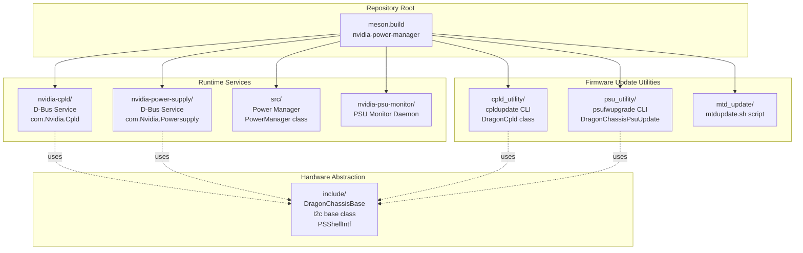
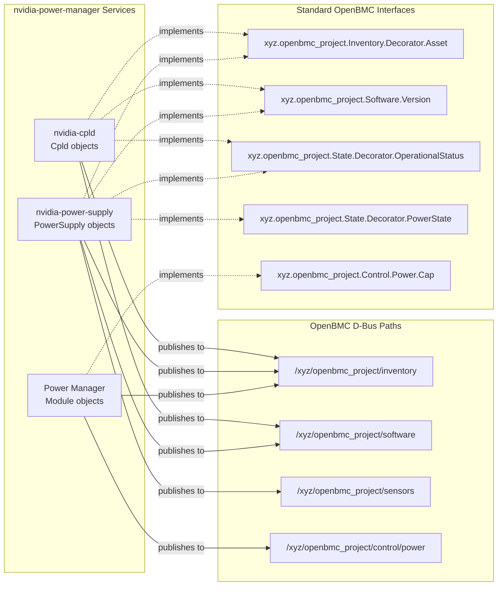
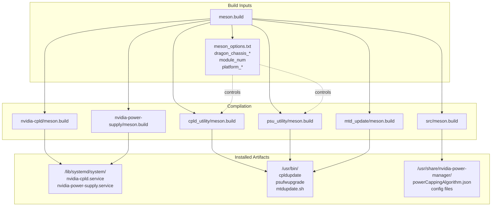

<!-- source: DeepWiki mcp.deepwiki.com · repo NVIDIA/nvidia-power-manager · page 1 Home · fetched 2026-10-26 -->

# Home

Relevant source files

The following files were used as context for generating this wiki page:

- [meson.build](meson.build)

## Purpose and Scope

This documentation covers the **nvidia-power-manager** repository, an OpenBMC component that provides comprehensive power management and firmware update capabilities for NVIDIA server platforms. The repository contains D-Bus services for runtime monitoring, command-line utilities for firmware updates, and hardware abstraction layers for device communication.

The nvidia-power-manager project encompasses four primary management domains:

1. **CPLD Management** - Real-time monitoring and firmware updates for Complex Programmable Logic Devices
2. **Power Supply Management** - Inventory tracking, sensor monitoring, and firmware updates for PSUs
3. **Power Capping** - System-wide and per-module power limit enforcement with configurable distribution algorithms
4. **MTD Firmware Updates** - Generic flash memory partition updates via Memory Technology Device interface

For detailed information about specific subsystems, refer to:
- CPLD management details: [CPLD Management Subsystem](#3)
- PSU management details: [Power Supply Management Subsystem](#4)
- Power capping implementation: [Power Manager Service](#5)
- Build configuration: [Build System](#7)
- Hardware abstraction: [Hardware Abstraction Layer](#8)

## Repository Structure

The repository follows a modular architecture with distinct directories for each management domain. The [meson.build:1-17]() root build file orchestrates compilation of seven subsystems.

**Directory Organization**

| Directory | Primary Artifact | Purpose |
|-----------|-----------------|---------|
| `nvidia-cpld/` | `nvidia-cpld` D-Bus service | CPLD runtime monitoring and inventory management |
| `cpld_utility/` | `cpldupdate` CLI tool | CPLD firmware update utility |
| `nvidia-power-supply/` | `nvidia-power-supply` D-Bus service | PSU monitoring, sensors, and inventory |
| `psu_utility/` | `psufwupgrade` CLI tool | PSU firmware update utility |
| `src/` | Power Manager service | System power capping and mode management |
| `mtd_update/` | `mtdupdate.sh` shell script | MTD partition firmware updates |
| `nvidia-psu-monitor/` | `nvidia-psu-monitor` service | PSU monitoring daemon |

The separation between D-Bus services (runtime monitoring) and CLI utilities (firmware updates) enables independent lifecycle management—services run continuously as systemd units while utilities execute on-demand for maintenance operations.

**Repository Component Overview**

Sources: [meson.build:1-17]()

## Major Subsystems

### CPLD Management

The CPLD subsystem provides both runtime monitoring and firmware update capabilities. The `nvidia-cpld` D-Bus service publishes inventory objects under `/xyz/openbmc_project/inventory/system/motherboard/CPLD*` and software version objects under `/xyz/openbmc_project/software/CPLD*`. The service implements standard OpenBMC interfaces: `xyz.openbmc_project.Inventory.Decorator.Asset`, `xyz.openbmc_project.Software.Version`, and `xyz.openbmc_project.State.Decorator.OperationalStatus`.

For firmware updates, the `cpldupdate` utility supports two compilation modes:
- **Generic mode**: Direct I2C communication via `libcpld` functions
- **Dragon Chassis mode**: Enhanced update flow via `DragonCpld` class with I2C arbitration, GPIO refresh signaling, and PEC validation

The Dragon Chassis implementation inherits from `DragonChassisBase`, which provides foundational I2C operations and arbitration management through kernel driver coordination via sysfs (`/sys/.../i2carb/arb_state`).

**Key Classes**: `Cpld`, `CPLDManager`, `DragonCpld`, `DragonChassisBase`

See [CPLD Management Subsystem](#3) for detailed documentation.

### Power Supply Management

The PSU subsystem mirrors the CPLD architecture with a D-Bus service and update utility. The `nvidia-power-supply` service creates `PowerSupply` objects that implement multiple OpenBMC interfaces:
- `xyz.openbmc_project.State.Decorator.PowerState` - Power on/off state tracking
- `xyz.openbmc_project.State.Decorator.OperationalStatus` - Functional status
- `xyz.openbmc_project.Inventory.Decorator.Asset` - Manufacturing data
- `xyz.openbmc_project.Software.Version` - Firmware version information

Additionally, the service publishes sensor objects under `/xyz/openbmc_project/sensors/` for real-time PSU telemetry. The `psufwupgrade` utility provides firmware update capability with conditional Dragon Chassis support via `DragonChassisPsuUpdate` class.

**Key Classes**: `PowerSupply`, `DragonChassisPsuUpdate`, `PSShellIntf`

See [Power Supply Management Subsystem](#4) for detailed documentation.

### Power Manager

The Power Manager service implements system-wide power capping with per-module power limit distribution. It manages power policies through D-Bus properties published under `/xyz/openbmc_project/control/power/` and module-specific paths under `/xyz/openbmc_project/inventory/system/chassis/Module*/`.

The service implements a dual-persistence architecture:
1. **JSON configuration** (`powerCappingAlgorithm.json`) - Defines percentage-based power distribution algorithms across modules
2. **Binary state file** (`PowerCappingInfo`) - Stores runtime power limits with checksum validation for persistence across reboots

When a system power cap is modified via D-Bus, the `PowerManager::PropertyTriggered` callback validates the new limit, calculates per-module allocations using the JSON algorithm, updates module D-Bus objects, and persists the state with a two's complement checksum.

**Key Classes**: `PowerManager`, `Property`, `PowerCappingInfo`

See [Power Manager Service](#5) for detailed documentation.

### MTD Firmware Updates

The `mtdupdate.sh` shell script provides a generic interface for updating MTD (Memory Technology Device) flash partitions. The script accepts three parameters: I2C bus number, image file path, and MTD partition identifier. It integrates with OpenBMC logging through D-Bus using `busctl` for status reporting.

The script implements pre/post update hooks (`mtd_update_setup.sh`, `mtd_update_cleanup.sh`) for platform-specific setup and cleanup operations, such as GPIO configuration or power sequencing.

See [MTD Firmware Update Utility](#6) for detailed documentation.

## OpenBMC Integration

All services in nvidia-power-manager integrate with the OpenBMC D-Bus infrastructure using standard interface specifications. This ensures compatibility with OpenBMC management tools (busctl, ipmitool, Redfish APIs) and other BMC components.

**D-Bus Integration Pattern**

Sources: Derived from high-level system architecture diagrams

### Association Pattern

CPLD and PSU services implement the `xyz.openbmc_project.Association.Definitions` interface to link inventory objects with their corresponding software version objects. This bidirectional association enables navigation from hardware components to firmware versions and vice versa:

- Forward association: `inventory → software_version`
- Reverse association: `software_version → inventory`

This pattern is standard across OpenBMC and enables management tools to query "which firmware version is installed on PSU0?" or "which hardware component uses this software version?"

## Build System and Platform Configuration

The repository uses Meson build system with extensive conditional compilation support. Build behavior is controlled via options defined in `meson_options.txt`:

| Option | Type | Purpose |
|--------|------|---------|
| `dragon_chassis_cpld` | feature | Enable Dragon Chassis CPLD update implementation |
| `dragon_chassis_psu` | feature | Enable Dragon Chassis PSU update implementation |
| `tests` | feature | Enable test suite compilation |
| `module_num` | integer | Configure number of power modules (default: 8) |
| `platform_prefix` | string | Platform-specific path prefix |
| `platform_fw_prefix` | string | Platform-specific firmware path prefix |

When Dragon Chassis features are enabled, the build system includes additional source files (`dragonCpld.cpp`, `dragonChassisPsuUpdate.cpp`) and links against `libgpiodcxx` for GPIO control. This compile-time polymorphism eliminates runtime branching overhead while supporting multiple hardware platforms from a single codebase.

**Build Output Artifacts**

Sources: [meson.build:1-17]()

See [Build System](#7) for detailed build configuration documentation.

## Hardware Abstraction Architecture

For Dragon Chassis platforms, nvidia-power-manager provides a rich C++ hardware abstraction layer. The `DragonChassisBase` abstract base class centralizes common behaviors:

- **I2C Arbitration**: Coordinates bus access via kernel driver through sysfs interface (`/sys/.../i2carb/arb_state`)
- **GPIO Control**: Manages refresh signaling via `libgpiodcxx` character device interface
- **PEC Validation**: Implements SMBus Packet Error Code calculation for data integrity
- **Image Loading**: Provides firmware image parsing and validation infrastructure

Derived classes (`DragonCpld`, `DragonChassisPsuUpdate`) inherit these capabilities and implement device-specific update sequences (Lattice CPLD programming flow, PSU bootloader protocols).

For non-Dragon platforms, the repository provides simpler C library functions (`libcpld.c`, `libi2c.c`) for direct I2C communication without arbitration or GPIO complexity.

**Hardware Access Stack**

| Layer | Dragon Chassis | Generic Platform |
|-------|----------------|------------------|
| Application | `DragonCpld` class | C functions in `libcpld.c` |
| Abstraction | `DragonChassisBase` class | Direct I2C library calls |
| Kernel Interface | sysfs + `/dev/i2c-*` + libgpiod | `/dev/i2c-*` only |
| Hardware | I2C bus + GPIO pins | I2C bus only |

See [Hardware Abstraction Layer](#8) for detailed implementation documentation.

## Testing Infrastructure

The repository includes comprehensive test infrastructure for the CPLD D-Bus service, using the sdbusplus D-Bus mock framework for unit testing. Tests validate:
- D-Bus property initialization and updates
- Association interface implementation
- Inventory and software version object creation
- OperationalStatus state transitions

The test suite is conditionally compiled via the `tests` build option and integrates with code quality tools configured in `.clang-format` and `.clang-tidy`.

See [Testing and Development](#9) for detailed test infrastructure documentation.

Sources: [meson.build:1-17](), high-level system architecture diagrams, build system diagram

---

