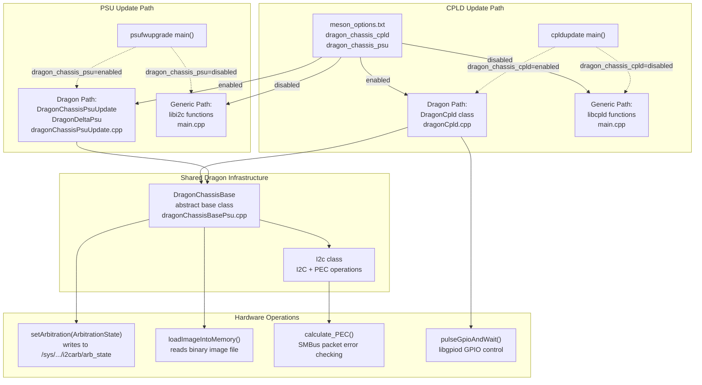
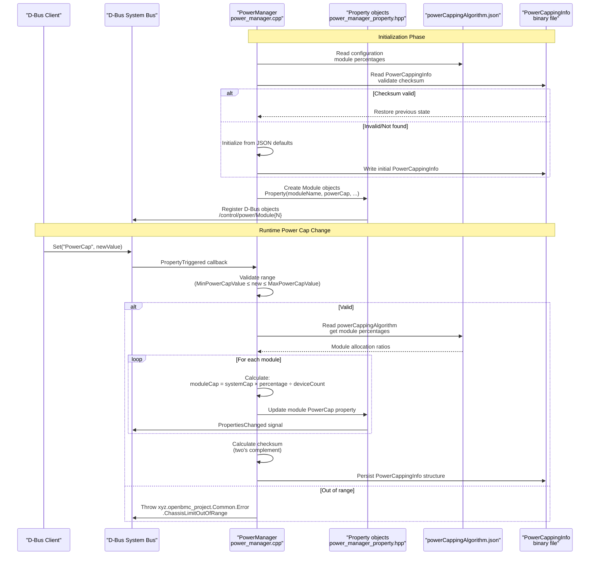
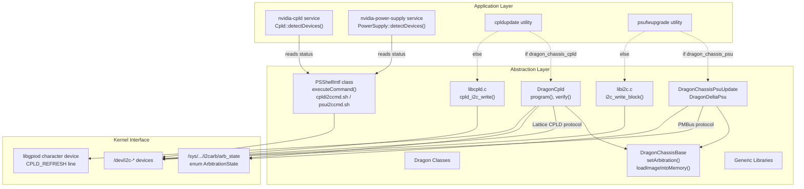

<!-- source: DeepWiki mcp.deepwiki.com · repo NVIDIA/nvidia-power-manager · page 2 System Architecture · fetched 2026-10-26 -->

# System Architecture

<details>
<summary>Relevant source files</summary>

The following files were used as context for generating this wiki page:

- [meson.build](meson.build)
- [meson_options.txt](meson_options.txt)
- [psu_utility/meson.build](psu_utility/meson.build)

</details>


## Purpose and Scope

This page describes the high-level architecture of the nvidia-power-manager repository, showing how its components integrate within an OpenBMC system. The document covers:

- Major subsystems and their relationships
- D-Bus service integration patterns
- Firmware update utilities and hardware abstraction
- Data flow between components
- Build system organization

For detailed information on specific subsystems, see:
- CPLD management: [CPLD Management Subsystem](#3)
- PSU management: [Power Supply Management Subsystem](#4)
- Power capping: [Power Manager Service](#5)
- Build configuration: [Build System](#7)
- Hardware interfaces: [Hardware Abstraction Layer](#8)

---

## System Overview

The repository implements three management domains operating within OpenBMC's D-Bus infrastructure:

| Domain | Runtime Service | Update Utility | Hardware Interface |
|--------|----------------|----------------|-------------------|
| **CPLD Management** | `nvidia-cpld` | `cpldupdate` | I2C bus |
| **PSU Management** | `nvidia-power-supply` | `psufwupgrade` | I2C bus |
| **Power Management** | Power Manager | N/A | D-Bus only |
| **Flash Management** | N/A | `mtdupdate.sh` | MTD devices |

Each domain follows a consistent pattern: **runtime monitoring via D-Bus services** and **maintenance operations via CLI utilities**. This separation enables services to run continuously for system monitoring while update utilities execute on-demand for firmware management.

**Sources:** [meson.build:1-17]()

---

## Component Architecture

### Overview Diagram

```mermaid
graph TB
    subgraph "D-Bus Services (systemd)"
        CPLD_SVC["nvidia-cpld<br/>D-Bus: com.Nvidia.Cpld<br/>Class: Cpld, CPLDManager"]
        PSU_SVC["nvidia-power-supply<br/>D-Bus: com.Nvidia.Powersupply<br/>Class: PowerSupply"]
        PM_SVC["Power Manager<br/>Class: PowerManager, Property"]
    end
    
    subgraph "Firmware Update Utilities (CLI)"
        CPLD_CLI["cpldupdate<br/>main() / DragonCpld"]
        PSU_CLI["psufwupgrade<br/>main() / DragonChassisPsuUpdate"]
        MTD_CLI["mtdupdate.sh"]
    end
    
    subgraph "OpenBMC D-Bus Paths"
        INV["/xyz/openbmc_project/inventory/system/<br/>motherboard/CPLD*<br/>motherboard/PSU*<br/>chassis/Module*"]
        SW["/xyz/openbmc_project/software/<br/>CPLD* versions<br/>PSU* versions"]
        SENSOR["/xyz/openbmc_project/sensors/<br/>motherboard/PSU* sensors"]
        POWER["/xyz/openbmc_project/control/power/<br/>Module* power caps"]
    end
    
    subgraph "Hardware Layer"
        I2C["/dev/i2c-*<br/>CPLD & PSU devices"]
        MTD["/dev/mtd*<br/>Flash partitions"]
        SYSFS["/sys/.../i2carb/arb_state<br/>I2C arbitration"]
        GPIO["GPIO (libgpiod)<br/>CPLD refresh signals"]
    end
    
    CPLD_SVC -->|"publishes inventory"| INV
    CPLD_SVC -->|"publishes versions"| SW
    PSU_SVC -->|"publishes inventory"| INV
    PSU_SVC -->|"publishes versions"| SW
    PSU_SVC -->|"publishes sensor data"| SENSOR
    PM_SVC -->|"publishes modules"| INV
    PM_SVC -->|"publishes power caps"| POWER
    
    CPLD_SVC -->|"monitors via PSShellIntf"| I2C
    PSU_SVC -->|"monitors via PSShellIntf"| I2C
    
    CPLD_CLI -->|"DragonCpld::program()"| I2C
    CPLD_CLI -->|"DragonChassisBase::setArbitration()"| SYSFS
    CPLD_CLI -->|"DragonCpld::pulseGpioAndWait()"| GPIO
    PSU_CLI -->|"DragonChassisPsuUpdate::program()"| I2C
    PSU_CLI -->|"DragonChassisBase::setArbitration()"| SYSFS
    MTD_CLI -->|"flash image"| MTD
```



This architecture demonstrates several key patterns:

1. **Dual Access Pattern**: Hardware is accessed by both monitoring services (read-only via shell interfaces) and update utilities (read-write via direct I2C/MTD)
2. **D-Bus Publication Model**: Services publish objects to standard OpenBMC paths (`/xyz/openbmc_project/*`)
3. **Conditional Hardware Abstraction**: Dragon Chassis builds add arbitration (`setArbitration()`) and GPIO signaling (`pulseGpioAndWait()`)
4. **Hierarchical Inventory**: Components appear in both `/inventory` (hardware) and `/software` (firmware versions)

**Sources:** [meson.build:10-16](), [meson_options.txt:1-12]()

---

## D-Bus Interface Architecture

### D-Bus Object Hierarchy

```mermaid
graph TB
    subgraph "nvidia-cpld Service"
        CPLD_OBJ["D-Bus Objects per CPLD device"]
        CPLD_INV["/xyz/openbmc_project/inventory/system/motherboard/CPLD{N}"]
        CPLD_SW["/xyz/openbmc_project/software/CPLD{N}"]
        
        CPLD_OBJ --> CPLD_INV
        CPLD_OBJ --> CPLD_SW
    end
    
    subgraph "nvidia-power-supply Service"
        PSU_OBJ["D-Bus Objects per PSU"]
        PSU_INV["/xyz/openbmc_project/inventory/system/motherboard/PSU{N}"]
        PSU_SW["/xyz/openbmc_project/software/PSU{N}"]
        PSU_SENSOR["/xyz/openbmc_project/sensors/..."]
        
        PSU_OBJ --> PSU_INV
        PSU_OBJ --> PSU_SW
        PSU_OBJ --> PSU_SENSOR
    end
    
    subgraph "Power Manager Service"
        PM_OBJ["Module Objects (Property class)"]
        PM_INV["/xyz/openbmc_project/inventory/system/chassis/Module{N}"]
        PM_CAP["/xyz/openbmc_project/control/power/Module{N}"]
        
        PM_OBJ --> PM_INV
        PM_OBJ --> PM_CAP
    end
    
    subgraph "OpenBMC Interfaces Implemented"
        ASSET["xyz.openbmc_project.Inventory.Decorator.Asset"]
        VERSION["xyz.openbmc_project.Software.Version"]
        OPSTATUS["xyz.openbmc_project.State.Decorator.OperationalStatus"]
        PWRSTATE["xyz.openbmc_project.State.Decorator.PowerState"]
        PWRCAP["xyz.openbmc_project.Control.Power.Cap"]
        ASSOC["xyz.openbmc_project.Association.Definitions"]
    end
    
    CPLD_INV -.implements.- ASSET
    CPLD_INV -.implements.- OPSTATUS
    CPLD_SW -.implements.- VERSION
    CPLD_OBJ -.implements.- ASSOC
    
    PSU_INV -.implements.- ASSET
    PSU_INV -.implements.- OPSTATUS
    PSU_INV -.implements.- PWRSTATE
    PSU_SW -.implements.- VERSION
    
    PM_CAP -.implements.- PWRCAP
```



### Interface Implementation Details

| Service | D-Bus Interface | Properties Published | Purpose |
|---------|----------------|---------------------|---------|
| `Cpld` | `Asset` | `Manufacturer`, `Model`, `SerialNumber`, `PartNumber` | Hardware identification |
| `Cpld` | `Software.Version` | `Version`, `Purpose` | Firmware version tracking |
| `Cpld` | `OperationalStatus` | `Functional` | Health status |
| `Cpld` | `Association.Definitions` | `Associations` | Links inventory ↔ software |
| `PowerSupply` | `Asset` | `Manufacturer`, `Model`, `SerialNumber`, `PartNumber` | Hardware identification |
| `PowerSupply` | `Software.Version` | `Version`, `Purpose` | Firmware version tracking |
| `PowerSupply` | `OperationalStatus` | `Functional` | Health status |
| `PowerSupply` | `PowerState` | `PowerState` | On/Off state |
| `PowerManager` | `Power.Cap` | `PowerCap`, `PowerCapEnable`, `MinPowerCapValue`, `MaxPowerCapValue` | Power limits |

The D-Bus architecture implements OpenBMC's standard interface contracts, enabling interoperability with Redfish APIs, `busctl` CLI tools, and other BMC services. Each service creates D-Bus objects dynamically based on hardware detection, publishing both inventory metadata and software version information.

**Sources:** [meson.build:11-15](), Diagram 2 from context

---

## Firmware Update Architecture

### Conditional Compilation Model

The build system uses Meson options to select between generic and Dragon Chassis-specific implementations:



This compile-time selection eliminates runtime overhead. The `meson_options.txt` configuration determines which source files are compiled:

**Dragon Chassis Enabled:**
- CPLD: `dragonCpld.cpp` → `DragonCpld` class → includes arbitration and GPIO refresh
- PSU: `dragonChassisPsuUpdate.cpp`, `dragonChassisBasePsu.cpp`, `dragonDeltaPsu.cpp`

**Dragon Chassis Disabled:**
- CPLD: `main.cpp` → direct `libcpld.c` function calls
- PSU: `main.cpp` → direct `libi2c.c` function calls

**Sources:** [meson_options.txt:1-12](), [psu_utility/meson.build:7-32]()

---

## Data Flow: Power Cap Distribution

### Power Manager Data Flow



The `PowerManager` class orchestrates this flow:

1. **Initialization** ([src/power_manager.cpp]()): Reads `powerCappingAlgorithm.json` for distribution algorithm, attempts to restore state from `PowerCappingInfo` binary file
2. **Validation**: Enforces system-level min/max constraints before accepting changes
3. **Distribution**: Applies JSON-defined percentage allocations to calculate per-module limits
4. **Persistence**: Serializes `PowerCappingInfo` struct with two's complement checksum
5. **Propagation**: Uses `Property` class to update D-Bus properties and emit `PropertiesChanged` signals

The `Property` class ([src/power_manager_property.hpp]()) wraps D-Bus property registration and change notification, handling both single properties and grouped property updates.

**Sources:** [meson.build:15](), Diagram 5 from context

---

## Hardware Communication Stack

### I2C Access Layers



The stack implements three distinct access patterns:

### Pattern 1: Service Monitoring (Shell-Based)
- Services use `PSShellIntf` class to execute shell scripts (`cpldi2ccmd.sh`, `psui2ccmd.sh`)
- Scripts perform simple I2C reads for status monitoring
- Decouples service code from hardware specifics

### Pattern 2: Dragon Chassis Updates (C++ Class Hierarchy)
- `DragonChassisBase` provides common infrastructure:
  - `setArbitration()`: Writes to `/sys/.../i2carb/arb_state` for bus coordination
  - `loadImageIntoMemory()`: Reads firmware image into memory buffer
  - `calculate_PEC()`: Computes SMBus packet error codes
- `DragonCpld` adds Lattice CPLD-specific protocol:
  - `program()`: Implements ISC programming sequence
  - `pulseGpioAndWait()`: Signals CPLD refresh via GPIO
- `DragonChassisPsuUpdate` / `DragonDeltaPsu` implement PMBus protocols

### Pattern 3: Generic Updates (C Functions)
- Direct calls to `libcpld.c` or `libi2c.c`
- No arbitration or GPIO handling
- Simpler platforms without bus contention concerns

**Sources:** [psu_utility/meson.build:7-32](), Diagram 6 from context

---

## Build System Integration

The root `meson.build` orchestrates compilation of seven subdirectories:

```
nvidia-power-manager/
├── meson.build              # Root build orchestration
├── meson_options.txt        # Configurable options
├── psu_utility/             # psufwupgrade utility
├── nvidia-power-supply/     # nvidia-power-supply service
├── nvidia-cpld/             # nvidia-cpld service  
├── nvidia-psu-monitor/      # Legacy monitor
├── cpld_utility/            # cpldupdate utility
├── src/                     # Power Manager service
└── mtd_update/              # mtdupdate.sh script
```

### Key Build Options

| Option | Type | Default | Effect |
|--------|------|---------|--------|
| `dragon_chassis_psu` | feature | disabled | Includes Dragon PSU update classes |
| `dragon_chassis_cpld` | feature | disabled | Includes Dragon CPLD update classes |
| `tests` | feature | enabled | Builds test suite |
| `module_num` | integer (1-4) | 1 | Number of power modules |
| `module_obj_path_prefix` | string | `ProcessorModule_` | D-Bus path prefix for modules |
| `platform_prefix` | string | empty | Platform-specific path prefix |
| `platform_fw_prefix` | string | empty | Firmware path prefix |

The build system uses these options to:
- Select source files for compilation (conditional compilation)
- Configure D-Bus object paths (`module_obj_path_prefix`)
- Set system parameters (`module_num`)
- Add dependencies (`libgpiodcxx` for Dragon builds)

For detailed build system documentation, see [Build System](#7).

**Sources:** [meson.build:1-17](), [meson_options.txt:1-40]()

---

## Integration with OpenBMC

The system integrates with OpenBMC through several mechanisms:

### D-Bus Integration
- **Bus Name Claiming**: Services claim `com.Nvidia.Cpld` and `com.Nvidia.Powersupply` names
- **Standard Interfaces**: Implements `xyz.openbmc_project.*` interfaces for Redfish compatibility
- **Signal Propagation**: Emits `PropertiesChanged` signals for property updates

### Systemd Integration
- **Service Units**: Installed to `/lib/systemd/system/` 
- **Dependencies**: Services declare D-Bus activation and after/before relationships
- **Automatic Restart**: Configured with restart policies for resilience

### Redfish Mapping
OpenBMC's Redfish implementation automatically maps D-Bus interfaces:
- `Asset` properties → Redfish resource metadata
- `Software.Version` → `/redfish/v1/UpdateService/FirmwareInventory/`
- `Power.Cap` → `/redfish/v1/Chassis/{id}/Power/` PowerControl entries
- `Sensor` objects → `/redfish/v1/Chassis/{id}/Power/` sensor readings

### File System Conventions
- Configuration: `/usr/share/nvidia-power-manager/`
- Executables: `/usr/bin/`
- State persistence: `/var/lib/` (for `PowerCappingInfo`)

**Sources:** [meson.build:1-17](), Diagrams 1-2 from context

---

