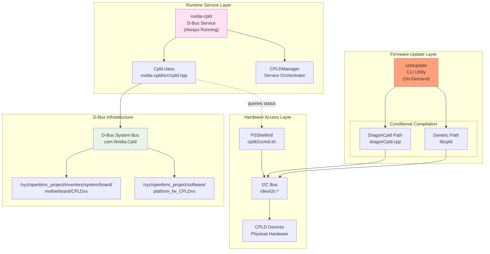
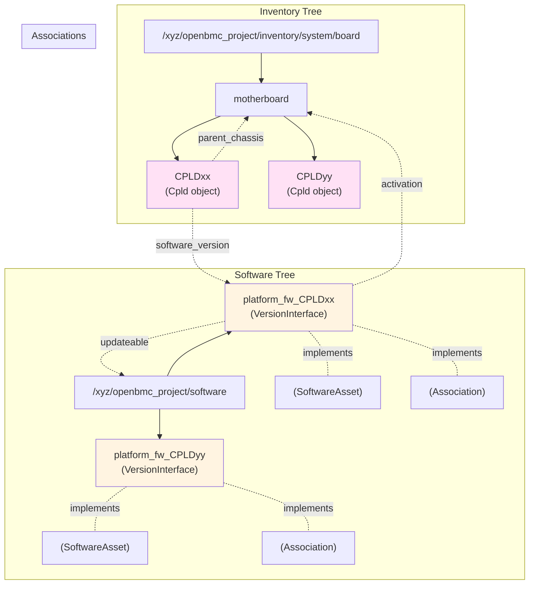
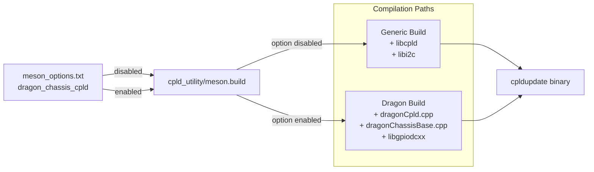
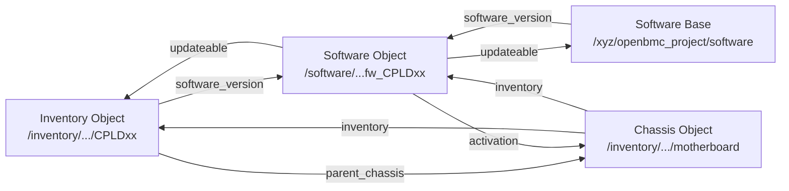
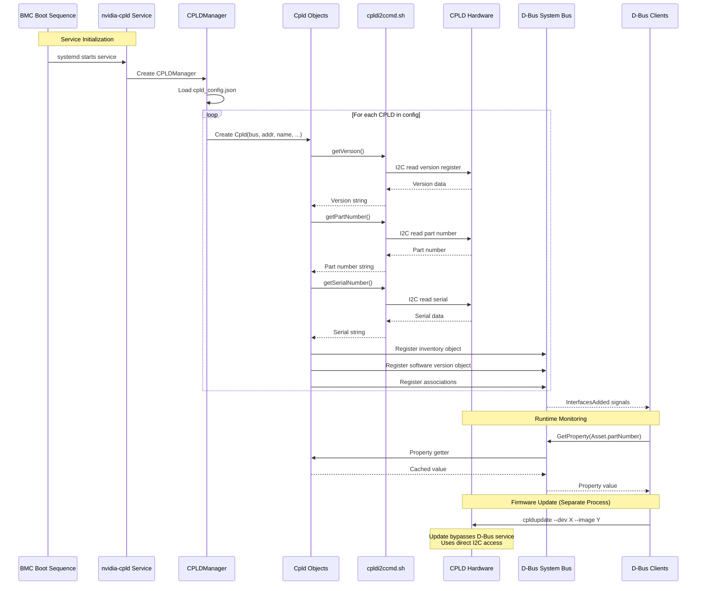

<!-- source: DeepWiki mcp.deepwiki.com · repo NVIDIA/nvidia-power-manager · page 3 CPLD Management Subsystem · fetched 2026-10-26 -->

# CPLD Management Subsystem

<details>
<summary>Relevant source files</summary>

The following files were used as context for generating this wiki page:

- [nvidia-cpld/meson.build](nvidia-cpld/meson.build)
- [nvidia-cpld/src/cpld.hpp](nvidia-cpld/src/cpld.hpp)

</details>


## Purpose and Scope

The CPLD Management Subsystem provides comprehensive management of Complex Programmable Logic Device (CPLD) components in NVIDIA systems. This subsystem encompasses two primary functions:

1. **Runtime Monitoring** - A persistent D-Bus service that exposes CPLD inventory, version information, and operational status
2. **Firmware Updates** - Command-line utilities for flashing CPLD firmware images

This page provides an overview of the CPLD management architecture and the relationships between its components. For detailed documentation of specific components, see:
- [CPLD D-Bus Service](#3.1) - Runtime monitoring service implementation
- [CPLD Firmware Update Utilities](#3.2) - Firmware update tools and flows

The subsystem integrates with OpenBMC's standard D-Bus interfaces and follows the dual-hierarchy pattern where CPLDs appear in both the inventory tree (`/xyz/openbmc_project/inventory`) and software tree (`/xyz/openbmc_project/software`).

---

## CPLD Management Architecture

The CPLD Management Subsystem is organized into two independent but complementary components that share hardware access but operate at different layers of the system:



**Architecture Overview**: The D-Bus service (`nvidia-cpld`) operates continuously, exposing CPLD information through standard OpenBMC interfaces. The update utility (`cpldupdate`) runs on-demand for firmware maintenance. Both components access CPLD hardware via I2C, but through different abstraction layers: the service uses shell script wrappers (`cpldi2ccmd.sh`) for status queries, while the update utility uses direct I2C access through either generic libraries or platform-specific C++ classes.

**Sources**: [nvidia-cpld/src/cpld.hpp](), [nvidia-cpld/meson.build](), [cpld_utility/meson.build]()

---

## D-Bus Service Component

The `nvidia-cpld` service is implemented as a systemd service that publishes CPLD information to the D-Bus system bus using the bus name `com.Nvidia.Cpld`. The core implementation consists of:

| Component | File | Purpose |
|-----------|------|---------|
| `Cpld` class | [nvidia-cpld/src/cpld.hpp:126-267]() | Represents individual CPLD devices with full D-Bus interface implementation |
| `CPLDManager` | [nvidia-cpld/src/cpld_manager.hpp]() | Service orchestrator that creates and manages `Cpld` instances from JSON configuration |
| `Util` base class | [nvidia-cpld/src/cpld_util.hpp]() | Hardware abstraction providing I2C communication via shell interface |
| JSON configuration | `/usr/share/nvidia-power-manager/cpld_config.json` | Defines CPLD inventory: bus addresses, names, associations |

### D-Bus Interfaces Implemented

Each `Cpld` object implements the following OpenBMC D-Bus interfaces through multiple inheritance:

| Interface | Purpose | Key Properties |
|-----------|---------|----------------|
| `xyz.openbmc_project.State.Decorator.OperationalStatus` | Operational state tracking | `functional`, `state` (Enabled/Disabled) |
| `xyz.openbmc_project.Inventory.Item` | Basic inventory properties | `present`, `prettyName` |
| `xyz.openbmc_project.Inventory.Item.Chassis` | Chassis classification | `type` (Module) |
| `xyz.openbmc_project.Inventory.Decorator.Asset` | Asset identification | `manufacturer`, `model`, `partNumber`, `serialNumber` |
| `xyz.openbmc_project.Inventory.Decorator.Location` | Physical location metadata | `locationType` |
| `xyz.openbmc_project.Association.Definitions` | Relationship definitions | `associations` (parent-child links) |

The interface inheritance is defined via the `CpldInherit` type alias at [nvidia-cpld/src/cpld.hpp:39-46]().

### D-Bus Object Hierarchy



**Object Structure**: Each CPLD device creates objects in both the inventory tree (physical representation) and software tree (firmware representation). The inventory object path follows the pattern `/xyz/openbmc_project/inventory/system/board/motherboard/{PLATFORM_PREFIX}CPLD{N}`. The software object path inserts a firmware prefix into the name: `/xyz/openbmc_project/software/{PLATFORM_PREFIX}{PLATFORM_FW_PREFIX}CPLD{N}`. Associations bidirectionally link these representations.

The construction logic is implemented in:
- Inventory object creation: [nvidia-cpld/src/cpld.hpp:136-184]()
- Software version registration: [nvidia-cpld/src/cpld.hpp:209-219]()
- Association setup: [nvidia-cpld/src/cpld.hpp:186-208]()
- Asset object creation: [nvidia-cpld/src/cpld.hpp:243-253]()

**Sources**: [nvidia-cpld/src/cpld.hpp:39-267](), [nvidia-cpld/meson.build:10-16]()

---

## Firmware Update Component

The `cpldupdate` utility provides command-line firmware update capabilities for CPLD devices. The utility supports two distinct implementation paths selected at compile time:

| Implementation | Meson Option | Source Files | Platform Support |
|----------------|--------------|--------------|------------------|
| **Generic Path** | `dragon_chassis_cpld=disabled` | `libcpld` C library | Standard I2C-based platforms |
| **Dragon Chassis Path** | `dragon_chassis_cpld=enabled` | [cpld_utility/dragonCpld.cpp]() | Dragon chassis with arbitration |

### Implementation Selection

The build system uses conditional compilation to select the appropriate implementation:



**Build Configuration**: The Meson build system evaluates the `dragon_chassis_cpld` option and includes different source files and dependencies accordingly. When Dragon support is enabled, the build adds C++ source files (`dragonCpld.cpp`, `dragonChassisBase.cpp`) and the `libgpiodcxx` dependency for GPIO control. The generic path uses simpler C libraries for direct I2C access.

### Update Utility Capabilities

Both implementation paths support the following update workflow:

1. **Image Validation** - Verify firmware image format and checksums
2. **Hardware Detection** - Identify CPLD device via I2C bus scanning
3. **Pre-Update State** - Query current firmware version
4. **Firmware Programming** - Erase and program CPLD flash memory
5. **Post-Update Verification** - Verify new firmware version

The Dragon Chassis implementation adds:
- **I2C Arbitration** - Coordinate bus access with kernel driver via sysfs
- **GPIO Refresh Signaling** - Trigger CPLD refresh using libgpiod
- **PEC (Packet Error Code)** - Enhanced I2C data integrity checking
- **Retry Logic** - Robust error handling with exponential backoff

Command-line interface example:
```bash
# Generic platform update
cpldupdate --dev <i2c_bus> --image <firmware.bin> --config <device_config.json>

# Dragon chassis update (same interface, different implementation)
cpldupdate --dev <i2c_bus> --image <firmware.bin> --config <device_config.json>
```

**Sources**: [cpld_utility/meson.build](), [cpld_utility/dragonCpld.cpp](), [cpld_utility/dragonChassisBase.cpp]()

---

## Integration with OpenBMC

The CPLD Management Subsystem follows OpenBMC architectural patterns for seamless integration with other BMC services and management interfaces:

### Service Registration

The D-Bus service is registered as a systemd unit that integrates with the BMC boot sequence:

| Configuration | Value | Location |
|---------------|-------|----------|
| **D-Bus Bus Name** | `com.Nvidia.Cpld` | [nvidia-cpld/meson.build:10]() |
| **Service Unit** | `nvidia-cpld.service` | [nvidia-cpld/services/]() |
| **Configuration Path** | `/usr/share/nvidia-power-manager/cpld_config.json` | [nvidia-cpld/meson.build:6-8]() |
| **Shell Interface** | `cpldi2ccmd.sh` | [nvidia-cpld/meson.build:24-28]() |

### Inventory Integration

CPLD objects appear in the OpenBMC inventory system with full asset management support:

- **Inventory Path Pattern**: `/xyz/openbmc_project/inventory/system/board/motherboard/{PLATFORM_PREFIX}CPLD{N}`
- **Chassis Type**: `xyz.openbmc_project.Inventory.Item.Chassis.ChassisType.Module` ([nvidia-cpld/src/cpld.hpp:163-168]())
- **Asset Properties**: Retrieved via `Util` class methods calling shell interface
  - `manufacturer()` - Manufacturer identification
  - `model()` - Model name
  - `partNumber()` - Retrieved via `getPartNumber()` ([nvidia-cpld/src/cpld.hpp:150]())
  - `serialNumber()` - Retrieved via `getSerialNumber()` ([nvidia-cpld/src/cpld.hpp:152]())

### Software Version Tracking

CPLD firmware versions are published to the OpenBMC software management tree:

- **Software Path Pattern**: `/xyz/openbmc_project/software/{PLATFORM_PREFIX}{PLATFORM_FW_PREFIX}CPLD{N}`
- **Version Interface**: `xyz.openbmc_project.Software.Version` ([nvidia-cpld/src/cpld.hpp:51-52]())
- **Version Purpose**: `xyz.openbmc_project.Software.Version.VersionPurpose.Other` ([nvidia-cpld/src/cpld.hpp:98](), [263-264]())
- **Version Retrieval**: Implemented via `getVersion()` method ([nvidia-cpld/src/cpld.hpp:216]())

### Association Model

The subsystem implements bidirectional associations linking inventory objects to software versions:



**Association Configuration**: The `Cpld` class creates multiple association types during initialization. The `createAssociation()` method ([nvidia-cpld/src/cpld.hpp:231-238]()) establishes parent-chassis relationships. The `registerAssociationInterface()` method ([nvidia-cpld/src/cpld.hpp:186-208]()) creates bidirectional links between inventory and software objects using forward association `"software_version"` and reverse association `"updateable"` (defined at [nvidia-cpld/src/cpld.hpp:261-262]()).

**Sources**: [nvidia-cpld/src/cpld.hpp:126-267](), [nvidia-cpld/meson.build:10-16]()

---

## Data Flow and Component Interaction

The following diagram illustrates how data flows through the CPLD Management Subsystem during typical operations:



**Initialization Flow**: During boot, the `nvidia-cpld` service reads the JSON configuration file to determine which CPLDs exist in the system. For each configured CPLD, it creates a `Cpld` object that immediately queries hardware via the shell interface to retrieve asset information and firmware versions. These values are cached in D-Bus properties for efficient runtime access. The service then registers all objects and interfaces on the D-Bus system bus, triggering `InterfacesAdded` signals that notify other BMC services of the new inventory items.

**Runtime vs. Update**: During normal operation, D-Bus clients query CPLD information through standard OpenBMC interfaces without direct hardware access. Firmware updates occur through a separate process (`cpldupdate` utility) that accesses hardware directly via I2C, completely independent of the D-Bus service. After an update completes, the D-Bus service must be restarted or the system rebooted to refresh the cached version information.

**Sources**: [nvidia-cpld/src/cpld.hpp:126-184](), [nvidia-cpld/src/cpld_util.hpp](), [nvidia-cpld/src/main.cpp]()

---

