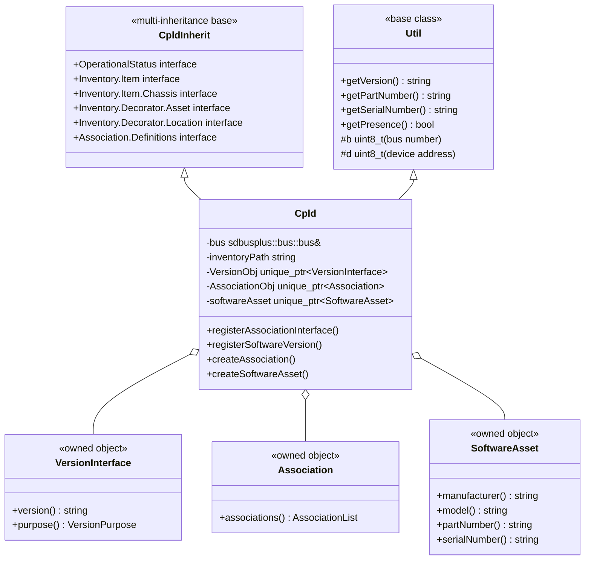
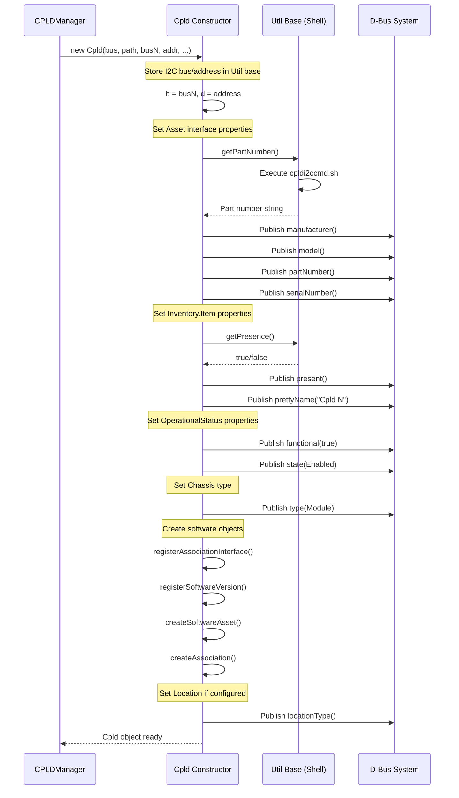
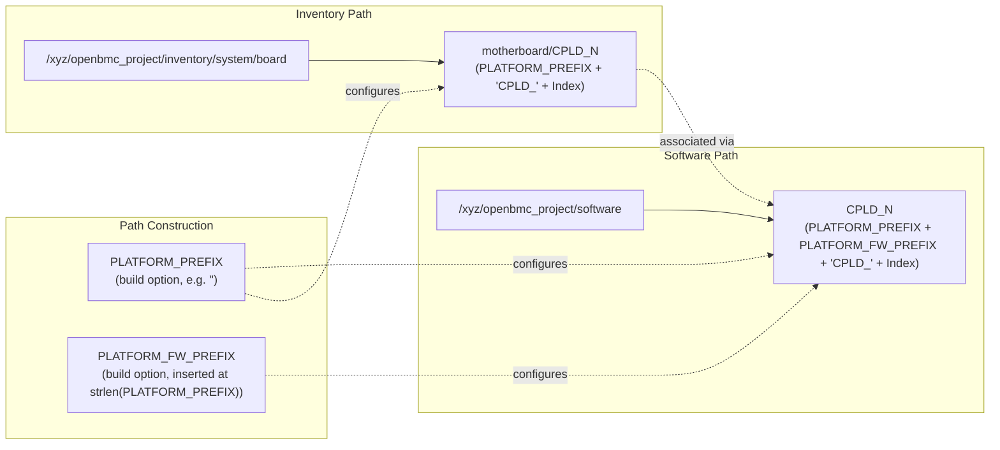
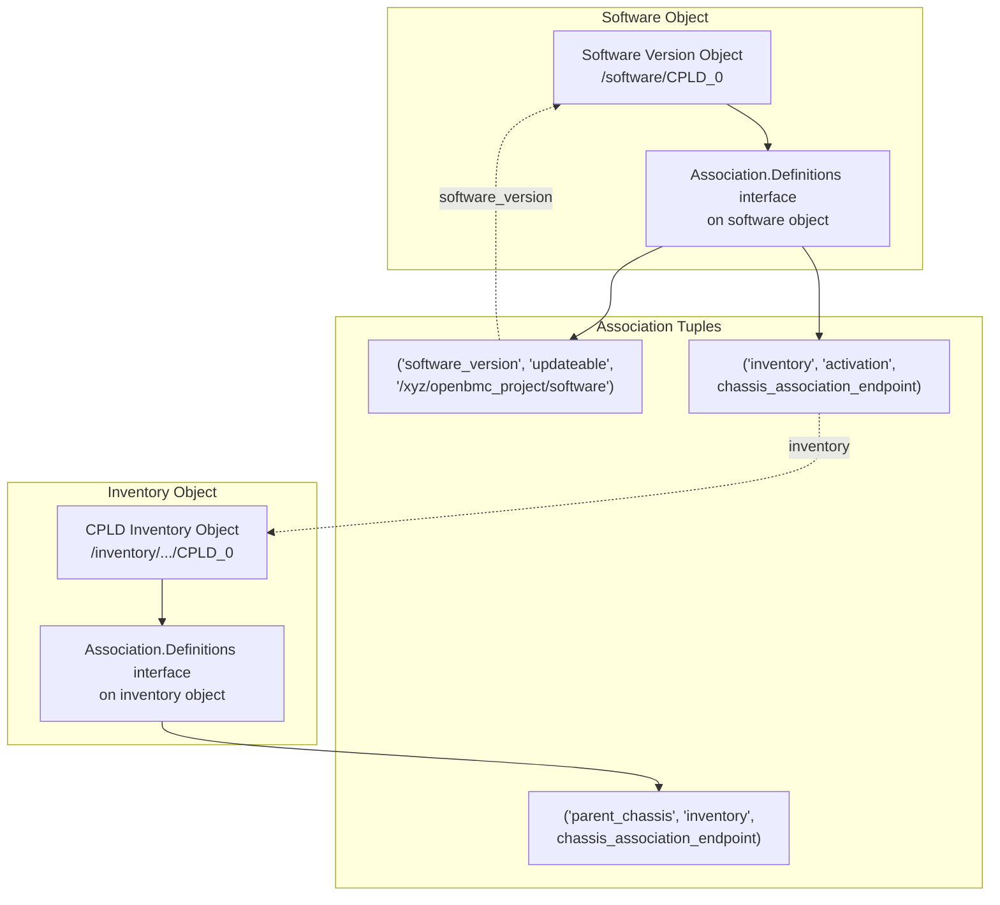
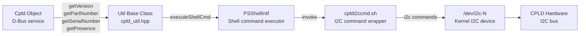
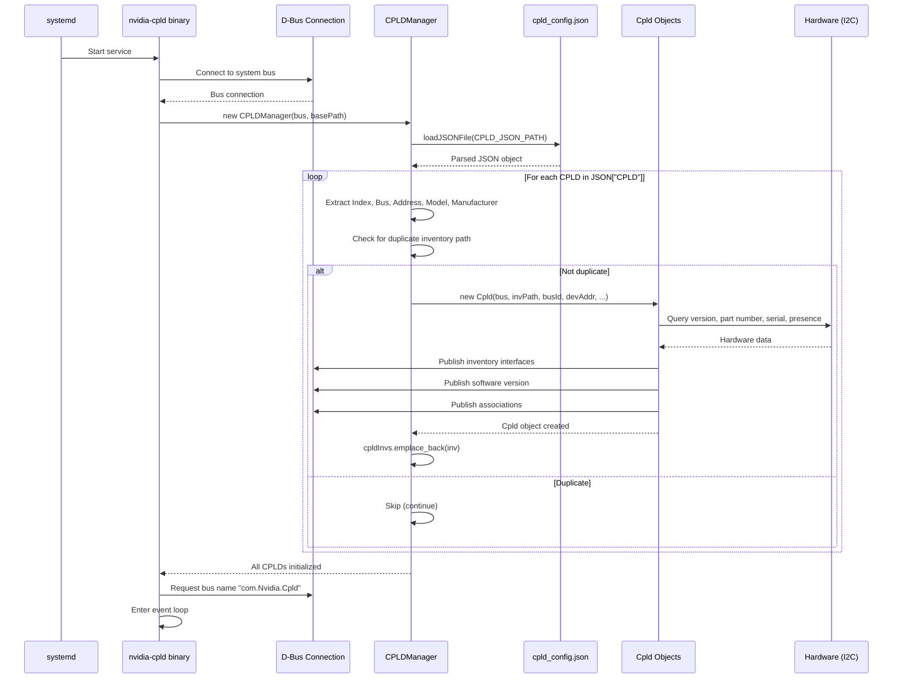
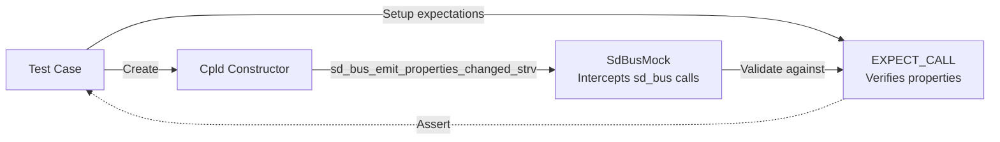

<!-- source: DeepWiki mcp.deepwiki.com · repo NVIDIA/nvidia-power-manager · page 3.1 CPLD D-Bus Service · fetched 2026-10-26 -->

# CPLD D-Bus Service

<details>
<summary>Relevant source files</summary>

The following files were used as context for generating this wiki page:

- [nvidia-cpld/meson.build](nvidia-cpld/meson.build)
- [nvidia-cpld/src/cpld.hpp](nvidia-cpld/src/cpld.hpp)
- [nvidia-cpld/src/cpld_manager.cpp](nvidia-cpld/src/cpld_manager.cpp)
- [nvidia-cpld/tests/test_cpld.cpp](nvidia-cpld/tests/test_cpld.cpp)

</details>


## Purpose and Scope

The CPLD D-Bus Service (`nvidia-cpld`) is a runtime monitoring daemon that publishes CPLD device inventory, firmware versions, and operational status to the OpenBMC D-Bus system. The service creates D-Bus objects for each CPLD device defined in a JSON configuration file, implementing standard OpenBMC interfaces for asset management, versioning, and state tracking.

This document covers the runtime D-Bus service architecture and object management. For CPLD firmware update functionality, see [CPLD Firmware Update Utilities](#3.2).

---

## Architecture Overview

The service consists of a manager class that orchestrates creation of individual CPLD device objects, each of which exposes multiple D-Bus interfaces.

**Architecture: CPLD D-Bus Service Components**

```mermaid
graph TB
    subgraph "Service Entry Point"
        MAIN["main()<br/>nvidia-cpld binary"]
    end
    
    subgraph "Manager Layer"
        MGR["CPLDManager<br/>Reads JSON config<br/>Creates Cpld objects"]
    end
    
    subgraph "Device Representation"
        CPLD["Cpld Class<br/>Per-device D-Bus object"]
        UTIL["Util Base Class<br/>I2C communication<br/>via shell scripts"]
    end
    
    subgraph "D-Bus Interface Objects"
        VERSION["VersionInterface<br/>Software.Version"]
        ASSOC["Association<br/>Association.Definitions"]
        SWASSET["SoftwareAsset<br/>Asset properties"]
    end
    
    subgraph "Multiple Inheritance Base"
        INHERIT["CpldInherit<br/>OperationalStatus<br/>Inventory.Item<br/>Inventory.Item.Chassis<br/>Inventory.Decorator.Asset<br/>Inventory.Decorator.Location<br/>Association.Definitions"]
    end
    
    subgraph "D-Bus System"
        INV_PATH["/xyz/openbmc_project/inventory/<br/>system/board/motherboard/CPLD_N"]
        SW_PATH["/xyz/openbmc_project/software/<br/>CPLD_N"]
    end
    
    subgraph "Configuration"
        JSON["cpld_config.json<br/>Device definitions"]
    end
    
    MAIN --> MGR
    MGR --> JSON
    MGR -->|"Creates N instances"| CPLD
    CPLD --|inherits| INHERIT
    CPLD --|inherits| UTIL
    CPLD -->|owns| VERSION
    CPLD -->|owns| ASSOC
    CPLD -->|owns| SWASSET
    
    CPLD -->|publishes at| INV_PATH
    VERSION -->|publishes at| SW_PATH
    ASSOC -->|publishes at| SW_PATH
    SWASSET -->|publishes at| SW_PATH
```

**Sources:** [nvidia-cpld/src/cpld.hpp:1-270](), [nvidia-cpld/src/cpld_manager.cpp:1-95]()

---

## Class Structure

### CPLDManager

The `CPLDManager` class is responsible for initializing all CPLD devices at service startup.

**Responsibilities:**
- Load JSON configuration from `/usr/share/nvidia-power-manager/cpld_config.json`
- Parse device definitions (bus number, I2C address, manufacturer, model)
- Instantiate `Cpld` objects for each defined device
- Maintain lifetime of all CPLD device objects

**Key Implementation Details:**

| Aspect | Implementation |
|--------|----------------|
| Configuration Source | `CPLD_JSON_PATH` macro, defined in [nvidia-cpld/meson.build:6-8]() |
| JSON Structure | Array of objects under `"CPLD"` key, each with `Index`, `Bus`, `Address`, `Model`, `Manufacturer` |
| Storage | `std::vector<std::unique_ptr<Cpld>> cpldInvs` |
| Duplicate Detection | Checks inventory path before creating new object [nvidia-cpld/src/cpld_manager.cpp:74-81]() |

**Sources:** [nvidia-cpld/src/cpld_manager.cpp:34-92]()

---

### Cpld Class

The `Cpld` class represents a single CPLD device and implements all required D-Bus interfaces through multiple inheritance.

**Core Inheritance Structure:**



**Sources:** [nvidia-cpld/src/cpld.hpp:39-46](), [nvidia-cpld/src/cpld.hpp:126-184]()

---

### Constructor Initialization Sequence

The `Cpld` constructor performs extensive D-Bus object setup:

**Initialization Flow:**



**Sources:** [nvidia-cpld/src/cpld.hpp:136-184]()

---

## D-Bus Interfaces Implemented

The `Cpld` class implements multiple OpenBMC standard interfaces through the `CpldInherit` base class:

| Interface | Purpose | Key Properties | Published Path |
|-----------|---------|----------------|----------------|
| `xyz.openbmc_project.State.Decorator.OperationalStatus` | Device health state | `Functional` (bool)<br/>`State` (enum: Enabled) | Inventory path |
| `xyz.openbmc_project.Inventory.Item` | Basic inventory item | `Present` (bool)<br/>`PrettyName` (string) | Inventory path |
| `xyz.openbmc_project.Inventory.Item.Chassis` | Chassis type classification | `Type` (enum: Module) | Inventory path |
| `xyz.openbmc_project.Inventory.Decorator.Asset` | Hardware asset information | `Manufacturer` (string)<br/>`Model` (string)<br/>`PartNumber` (string)<br/>`SerialNumber` (string) | Inventory path |
| `xyz.openbmc_project.Inventory.Decorator.Location` | Physical location | `LocationType` (enum) | Inventory path |
| `xyz.openbmc_project.Association.Definitions` | Relationship definitions | `Associations` (array of tuples) | Both paths |

**Additional Objects Created:**

| Class | Interface | Purpose | Path |
|-------|-----------|---------|------|
| `VersionInterface` | `xyz.openbmc_project.Software.Version` | Firmware version tracking | Software path |
| `SoftwareAsset` | `xyz.openbmc_project.Inventory.Decorator.Asset` | Asset info in software tree | Software path |

**Sources:** [nvidia-cpld/src/cpld.hpp:39-52](), [nvidia-cpld/src/cpld.hpp:83-100](), [nvidia-cpld/src/cpld.hpp:67-81]()

---

## D-Bus Object Path Structure

The service creates a dual-path structure for each CPLD device, linking hardware inventory to firmware versions.

**Path Naming Convention:**



**Path Construction Logic:**

The software path is derived from the inventory path by inserting `PLATFORM_FW_PREFIX` after `PLATFORM_PREFIX`:

```
inventory path: /xyz/openbmc_project/inventory/system/board/motherboard/CPLD_0
software path:  /xyz/openbmc_project/software/CPLD_0
```

Implementation at [nvidia-cpld/src/cpld.hpp:192-196]() and [nvidia-cpld/src/cpld.hpp:213-215]().

**Sources:** [nvidia-cpld/src/cpld.hpp:186-208](), [nvidia-cpld/meson.build:12-16]()

---

## Association System

The service creates bidirectional D-Bus associations to link hardware inventory objects with their corresponding software version objects.

**Association Types Created:**

| Forward Type | Reverse Type | Endpoint | Purpose |
|--------------|--------------|----------|---------|
| `software_version` | `updateable` | `/xyz/openbmc_project/software` | Links inventory to software management |
| `inventory` | `activation` | Chassis path from JSON | Links software version to inventory item |
| `parent_chassis` | `inventory` | Chassis association endpoint | Hierarchical chassis relationship |

**Association Implementation Details:**



**Association Registration:**

1. **Software Path Associations** [nvidia-cpld/src/cpld.hpp:186-208]()
   - Created by `registerAssociationInterface()`
   - Links to chassis if `ChassisAssociationEndpoint` provided in JSON
   - Always links to generic software updateable path

2. **Inventory Path Associations** [nvidia-cpld/src/cpld.hpp:231-238]()
   - Created by `createAssociation()`
   - Establishes parent chassis relationship

**Sources:** [nvidia-cpld/src/cpld.hpp:186-238](), [nvidia-cpld/src/cpld.hpp:105-121]()

---

## Hardware Data Retrieval

The `Cpld` class inherits from `Util` base class, which provides hardware query methods via shell script execution.

**Data Retrieval Architecture:**



**Queried Properties:**

| Property | Source Method | Shell Script | Purpose |
|----------|---------------|--------------|---------|
| Firmware Version | `getVersion()` | `cpldi2ccmd.sh` | Populates `Software.Version.version` |
| Part Number | `getPartNumber()` | `cpldi2ccmd.sh` | Populates `Asset.partNumber` |
| Serial Number | `getSerialNumber()` | `cpldi2ccmd.sh` | Populates `Asset.serialNumber` |
| Presence | `getPresence()` | `cpldi2ccmd.sh` | Populates `Inventory.Item.present` |

**Shell Script Interface:**

The shell script `cpldi2ccmd.sh` is installed to `/usr/bin/` [nvidia-cpld/meson.build:24-28]() and provides I2C communication abstraction. The `Util` base class uses bus number (`b`) and device address (`d`) members to construct I2C commands.

**Sources:** [nvidia-cpld/src/cpld.hpp:126-184](), [nvidia-cpld/meson.build:24-28]()

---

## Configuration Format

The service reads device definitions from a JSON configuration file at startup.

**JSON Configuration Schema:**

| Field | Type | Required | Description |
|-------|------|----------|-------------|
| `Index` | string | Yes | Numeric identifier for CPLD (e.g., "0", "1") |
| `Bus` | string | Yes | I2C bus number (decimal string) |
| `Address` | string | Yes | I2C device address (hexadecimal string) |
| `Model` | string | Yes | CPLD model name |
| `Manufacturer` | string | Yes | Manufacturer name |
| `ChassisAssociationEndpoint` | string | No | D-Bus path to parent chassis object |
| `LocationType` | string | No | OpenBMC LocationType enum value |

**Example Configuration:**

```json
{
    "CPLD": [
        {
            "Index": "0",
            "Bus": "2",
            "Address": "3c",
            "Model": "LCMXO3LF-6900C",
            "Manufacturer": "Lattice",
            "ChassisAssociationEndpoint": "/xyz/openbmc_project/inventory/system/chassis",
            "LocationType": "xyz.openbmc_project.Inventory.Decorator.Location.LocationTypes.Embedded"
        }
    ]
}
```

**Configuration Processing:**

[nvidia-cpld/src/cpld_manager.cpp:39-92]() shows the parsing logic:
- Loads JSON from path defined by `CPLD_JSON_PATH` macro
- Iterates over `"CPLD"` array
- Converts bus number to `uint8_t` (decimal)
- Converts address to `uint8_t` (hexadecimal with base 16)
- Creates inventory path by concatenating base path + platform prefix + "CPLD_" + index
- Skips duplicate inventory paths

**Sources:** [nvidia-cpld/src/cpld_manager.cpp:39-92](), [nvidia-cpld/meson.build:6-8]()

---

## Service Startup and Initialization

**Service Startup Sequence:**



**Service Configuration:**

The service is installed as a systemd unit defined in `nvidia-cpld/services/` directory [nvidia-cpld/meson.build:30](). The D-Bus bus name is configured as `com.Nvidia.Cpld` [nvidia-cpld/meson.build:10]().

**Sources:** [nvidia-cpld/src/cpld_manager.cpp:34-92](), [nvidia-cpld/meson.build:1-36]()

---

## Testing Infrastructure

The CPLD D-Bus service includes unit tests using Google Test framework with sdbusplus mock support.

**Test Coverage:**

| Test Case | Purpose | File Reference |
|-----------|---------|----------------|
| `CpldTestDbus` | Validates D-Bus property emissions during object creation | [nvidia-cpld/tests/test_cpld.cpp:70-103]() |
| `JsonFiles` | Tests JSON configuration loading and error handling | [nvidia-cpld/tests/test_cpld.cpp:106-144]() |

**D-Bus Mock Testing Pattern:**

The tests use `sdbusplus::SdBusMock` to intercept D-Bus property change emissions without requiring an actual D-Bus daemon:



**Property Validation:**

The test verifies that all expected interfaces emit property changes during construction:
- `Inventory.Item`: `Present`, `PrettyName`
- `Inventory.Decorator.Asset`: `Manufacturer`, `Model`, `PartNumber`, `SerialNumber`
- `State.Decorator.OperationalStatus`: `Functional`, `State`
- `Inventory.Item.Chassis`: `Type`
- `Software.Version`: `Purpose`, `SoftwareId`, `Version`
- `Association.Definitions`: `Associations`

**Sources:** [nvidia-cpld/tests/test_cpld.cpp:1-145]()

---

## Build Configuration

The CPLD D-Bus service build is configured through Meson build system with compile-time constants.

**Build Options:**

| Option | Purpose | Default | Usage |
|--------|---------|---------|-------|
| `platform_prefix` | Prefix for inventory object names | `""` | Inserted before "CPLD_" in paths |
| `platform_fw_prefix` | Additional prefix for software paths | `""` | Inserted after `platform_prefix` |

**Compile-Time Constants:**

The following constants are set via `configuration_data()` in [nvidia-cpld/meson.build:4-16]():

| Constant | Value | Purpose |
|----------|-------|---------|
| `CPLD_JSON_PATH` | `/usr/share/nvidia-power-manager/cpld_config.json` | Configuration file location |
| `BUSNAME` | `com.Nvidia.Cpld` | D-Bus service bus name |
| `BASE_INV_PATH` | `/xyz/openbmc_project/inventory/system/board` | Base inventory path |
| `SW_INV_PATH` | `/xyz/openbmc_project/software` | Software version base path |
| `SOFTWARE_INTERFACE` | `xyz.openbmc_project.Software.Version` | Version interface name |
| `PLATFORM_PREFIX` | Build option value | Platform-specific path prefix |
| `PLATFORM_FW_PREFIX` | Build option value | Firmware path prefix component |

**Dependencies:**

| Dependency | Purpose |
|------------|---------|
| `sdbusplus` | D-Bus C++ bindings |
| `sdeventplus` | Event loop integration |
| `fmt` | String formatting |
| `phosphor-dbus-interfaces` | OpenBMC D-Bus interface definitions |
| `phosphor-logging` | Logging infrastructure |

**Sources:** [nvidia-cpld/meson.build:1-36]()

---

