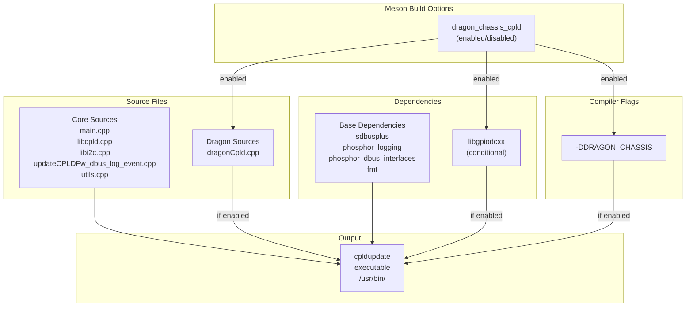
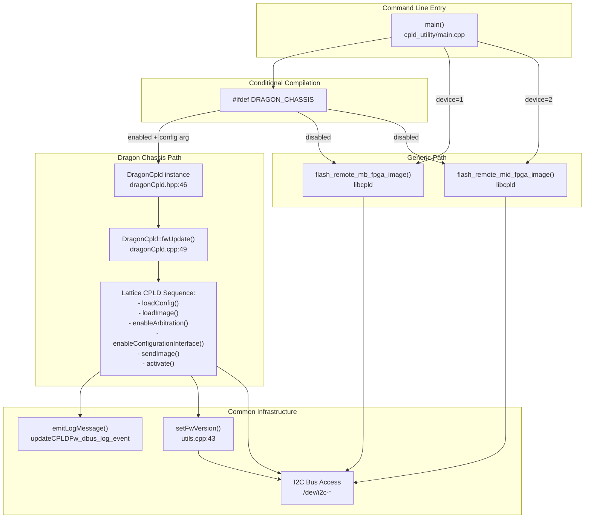
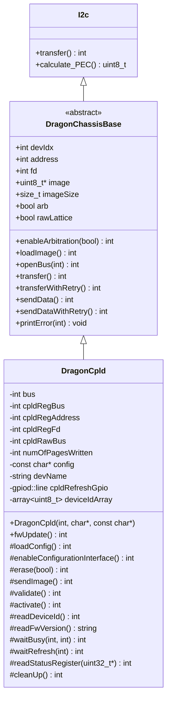
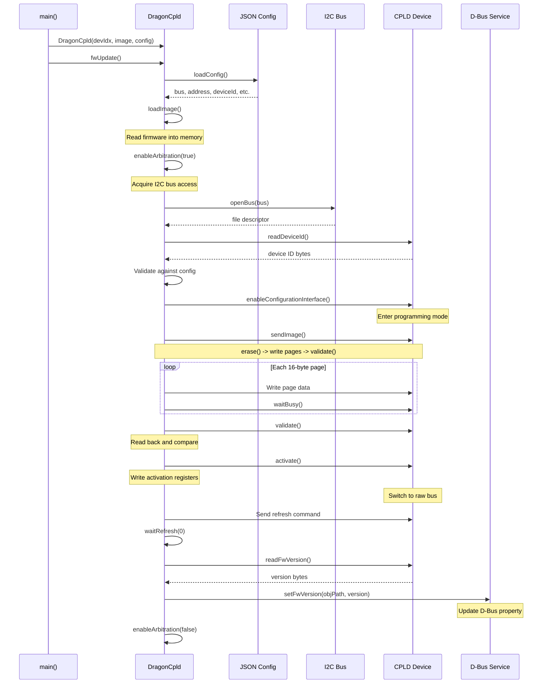
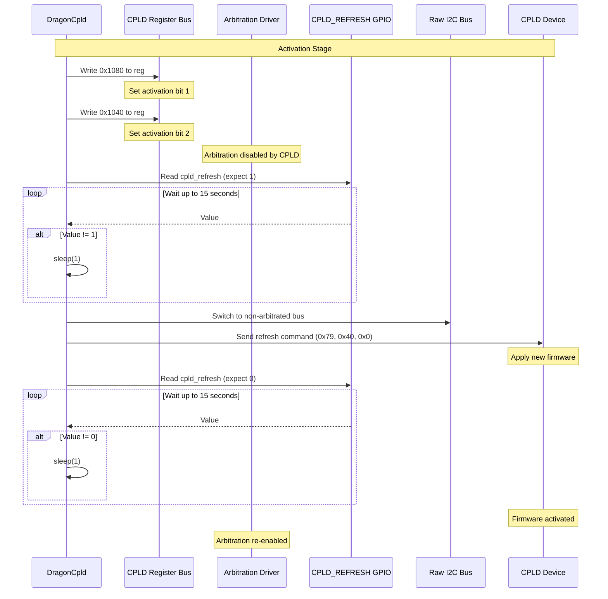

<!-- source: DeepWiki mcp.deepwiki.com · repo NVIDIA/nvidia-power-manager · page 3.2 CPLD Firmware Update Utilities · fetched 2026-10-26 -->

# CPLD Firmware Update Utilities

<details>
<summary>Relevant source files</summary>

The following files were used as context for generating this wiki page:

- [cpld_utility/dragonCpld.cpp](cpld_utility/dragonCpld.cpp)
- [cpld_utility/dragonCpld.hpp](cpld_utility/dragonCpld.hpp)
- [cpld_utility/main.cpp](cpld_utility/main.cpp)
- [cpld_utility/meson.build](cpld_utility/meson.build)
- [cpld_utility/utils.cpp](cpld_utility/utils.cpp)
- [cpld_utility/utils.hpp](cpld_utility/utils.hpp)

</details>


## Purpose and Scope

This document describes the `cpldupdate` command-line utility, which performs firmware updates on CPLD devices via I2C communication. The utility supports two implementation paths selected at compile time: a generic path using C library functions and a Dragon Chassis-specific path using C++ class hierarchies with enhanced features like I2C arbitration and GPIO-based refresh signaling.

For information about the CPLD D-Bus service that monitors CPLD devices at runtime, see [CPLD D-Bus Service](#3.1). For details on the generic update implementation, see [Generic CPLD Update Flow](#3.2.1). For Dragon Chassis-specific implementation details, see [Dragon Chassis CPLD Update](#3.2.2).

## Overview

The `cpldupdate` utility is a command-line tool that flashes firmware images to CPLD devices. It operates independently from the CPLD D-Bus service and is typically invoked during maintenance windows. After a successful update, the utility can optionally update the firmware version property in the D-Bus service via the `setFwVersion()` function.

**Key Characteristics:**
- Standalone executable installed to `/usr/bin/cpldupdate`
- Conditional compilation via `dragon_chassis_cpld` Meson option
- Supports multiple CPLD device selection (motherboard, middle plane)
- Integrates with D-Bus logging for event reporting
- Updates firmware version properties in D-Bus after successful flash

Sources: [cpld_utility/main.cpp:1-134](), [cpld_utility/meson.build:1-41]()

## Command-Line Interface

The `cpldupdate` utility accepts the following command-line arguments:

| Position | Argument | Description | Example |
|----------|----------|-------------|---------|
| 1 | I2C Bus Number | I2C bus for communication (1-255) | `11` |
| 2 | Image Select | Image selection parameter | `1` |
| 3 | Firmware File | Path to firmware image file | `/tmp/cpld.bin` |
| 4 | CPLD Device Selection | `1` = Motherboard, `2` = Middle Plane | `1` |
| 5 | Version String | Optional firmware version identifier | `v1.2.3` |
| 6 | Config/Debug | Config file path (Dragon) or debug flag `-v`/`-vv` | `/etc/cpld.json` |

**Example Usage:**
```bash
# Generic mode update
cpldupdate 11 1 /tmp/cpld_fw.bin 1 v1.2.3 -v

# Dragon Chassis mode update (requires config file)
cpldupdate 11 1 /tmp/cpld_fw.bin 1 v1.2.3 /etc/cpld_config.json
```

The version string defaults to `"Unknown"` if not provided. Debug levels include `-v` (high-level) and `-vv` (low-level).

Sources: [cpld_utility/main.cpp:45-57](), [cpld_utility/main.cpp:59-133]()

## Build System and Conditional Compilation

### cpldupdate Build Configuration



The Meson build file [cpld_utility/meson.build:1-41]() controls compilation behavior:

- **Core sources** are always compiled: `main.cpp`, `libcpld.cpp`, `libi2c.cpp`
- **Dragon Chassis sources** (`dragonCpld.cpp`) are added only when `dragon_chassis_cpld` option is enabled
- **libgpiodcxx dependency** is added for GPIO refresh signal handling in Dragon mode
- **DRAGON_CHASSIS macro** is defined to enable conditional code paths in `main.cpp`

Sources: [cpld_utility/meson.build:16-24]()

## Architecture Overview

### Dual Implementation Paths



The utility branches at runtime based on compilation configuration and command-line arguments:

**Dragon Chassis Mode (requires config file argument):**
- Creates `DragonCpld` instance [cpld_utility/main.cpp:109]()
- Calls `DragonCpld::fwUpdate()` [cpld_utility/main.cpp:110]()
- Implements full Lattice CPLD update protocol

**Generic Mode (no config file):**
- Calls `flash_remote_mb_fpga_image()` for motherboard CPLD [cpld_utility/main.cpp:117-118]()
- Calls `flash_remote_mid_fpga_image()` for middle plane CPLD [cpld_utility/main.cpp:122-123]()
- Uses simpler C library functions

Sources: [cpld_utility/main.cpp:106-130]()

## Dragon Chassis Class Hierarchy

### DragonCpld Class Structure



The `DragonCpld` class extends `DragonChassisBase` (documented in [Hardware Abstraction Layer](#8)) to implement Lattice CPLD-specific firmware update sequences. Key components:

**Configuration Management:**
- Loads JSON configuration file specifying bus numbers, addresses, device IDs
- Supports arbitration control and GPIO refresh signal configuration
- Parses per-device parameters: `CPLDDeviceNo`, `Bus`, `Address`, `CpldRegBus`, `CpldRawBus`

**Hardware Access:**
- Multiple I2C buses: main bus, register bus, raw (non-arbitrated) bus
- GPIO line `CPLD_REFRESH_IN_PRGRS_L-I` for refresh status monitoring
- Device ID validation against expected values in config

Sources: [cpld_utility/dragonCpld.hpp:28-167](), [cpld_utility/dragonCpld.cpp:38-42]()

## Lattice CPLD Update Flow

### High-Level Update Sequence



The `fwUpdate()` method implements a multi-stage update process defined by Lattice CPLD specifications:

**Stages:**
1. **Configuration Loading**: Parse JSON config, initialize GPIO if needed [cpld_utility/dragonCpld.cpp:55-57]()
2. **Image Loading**: Read firmware file into memory [cpld_utility/dragonCpld.cpp:58-60]()
3. **Arbitration**: Enable I2C bus arbitration if configured [cpld_utility/dragonCpld.cpp:62-67]()
4. **Device Validation**: Read and verify CPLD device ID [cpld_utility/dragonCpld.cpp:88-90]()
5. **Configuration Interface**: Enable CPLD programming mode [cpld_utility/dragonCpld.cpp:94-96]()
6. **Image Transfer**: Erase, write, and validate firmware pages [cpld_utility/dragonCpld.cpp:98-100]()
7. **Activation**: Trigger internal refresh to apply new firmware [cpld_utility/dragonCpld.cpp:104-106]()
8. **Version Update**: Read new version and update D-Bus property [cpld_utility/dragonCpld.cpp:108-113]()

Sources: [cpld_utility/dragonCpld.cpp:49-128]()

## Configuration File Format

The Dragon Chassis mode requires a JSON configuration file with the following structure:

```json
{
  "CPLD": [
    {
      "CPLDDeviceNo": 1,
      "Name": "CPLD_MB",
      "Bus": "11",
      "Address": "0x40",
      "CpldRegBus": "12",
      "CpldRegAddress": "0x30",
      "CpldRawBus": "13",
      "ImageOffset": 0,
      "DeviceId": ["0x01", "0x2b", "0xd0", "0x43"],
      "Arbitration": "1",
      "RawLattice": false
    }
  ]
}
```

**Configuration Parameters:**

| Field | Type | Description |
|-------|------|-------------|
| `CPLDDeviceNo` | int | Device index matching command-line argument |
| `Name` | string | Device name for logging and D-Bus paths |
| `Bus` | string | Primary I2C bus number (arbitrated) |
| `Address` | string | I2C address (hex or decimal) |
| `CpldRegBus` | string | I2C bus for register access |
| `CpldRegAddress` | string | I2C address for register access |
| `CpldRawBus` | string | Non-arbitrated I2C bus for refresh command |
| `ImageOffset` | int | Offset into firmware image file |
| `DeviceId` | array | Expected 4-byte device ID for validation |
| `Arbitration` | string | `"1"` to enable I2C arbitration, `"0"` to disable |
| `RawLattice` | bool | `true` for raw Lattice access mode |

The `loadConfig()` method parses this file and initializes bus numbers, addresses, and GPIO configuration based on arbitration settings [cpld_utility/dragonCpld.cpp:585-662]().

Sources: [cpld_utility/dragonCpld.cpp:585-662]()

## Firmware Validation and Retry Mechanism

### Validation Flow

The `sendImage()` method includes a sophisticated validation and retry mechanism to handle Lattice CPLD instability:

**Key Features:**
- **Automatic Retry**: Up to 2 attempts (`VALIDATE_RETRY = 1`) [cpld_utility/dragonCpld.cpp:296]()
- **Page-by-Page Verification**: Reads back each written page and compares with source image [cpld_utility/dragonCpld.cpp:466-507]()
- **I2C Failure Recovery**: Resets page number on I2C transaction failures [cpld_utility/dragonCpld.cpp:341-356]()
- **Special Pattern Handling**: Tolerates known failure patterns (all zeros/all ones) [cpld_utility/dragonCpld.cpp:482-486]()

**Update Process:**
1. Erase CPLD flash with reset [cpld_utility/dragonCpld.cpp:325]()
2. Write firmware in 16-byte pages (`PAGE_SIZE = 16`) [cpld_utility/dragonCpld.cpp:329-365]()
3. Validate written data by reading back [cpld_utility/dragonCpld.cpp:366]()
4. On validation failure, retry entire erase/write/validate sequence [cpld_utility/dragonCpld.cpp:316-372]()
5. Clean up (erase and activate) if all retries fail [cpld_utility/dragonCpld.cpp:401-403]()

**Status Monitoring:**
- `waitBusy()`: Polls busy register until operation completes [cpld_utility/dragonCpld.cpp:139-162]()
- `readStatusRegister()`: Checks `BUSY_BIT`, `FAIL_BIT`, `DONE_BIT` [cpld_utility/dragonCpld.cpp:130-137]()

Sources: [cpld_utility/dragonCpld.cpp:297-404](), [cpld_utility/dragonCpld.cpp:445-510]()

## Activation and Refresh Sequence

### Activation Flow with GPIO Handshake



The `activate()` method implements a complex sequence to apply the new firmware:

**Activation Registers:**
1. Write `0x1080` to CPLD register (set bit 7) [cpld_utility/dragonCpld.cpp:526-528]()
2. Write `0x1040` to CPLD register (set bit 6) [cpld_utility/dragonCpld.cpp:530-532]()
3. This disables I2C arbitration on the CPLD side per specification

**Refresh Monitoring:**
- `waitRefresh(1)`: Wait for refresh signal to go high (CPLD entering refresh) [cpld_utility/dragonCpld.cpp:536-538]()
- Switch to raw (non-arbitrated) bus [cpld_utility/dragonCpld.cpp:540-545]()
- Send Lattice refresh command `{0x79, 0x40, 0x0}` [cpld_utility/dragonCpld.cpp:547-554]()
- `waitRefresh(0)`: Wait for refresh signal to go low (refresh complete) [cpld_utility/dragonCpld.cpp:557-559]()

**Refresh Signal Sources:**
- **With Arbitration**: Read from sysfs `/sys/devices/platform/i2carb/cpld_refresh` [cpld_utility/dragonCpld.cpp:411-421]()
- **Without Arbitration**: Read directly from GPIO via libgpiod [cpld_utility/dragonCpld.cpp:424-426]()

**Raw Lattice Mode:**
- For unstable Lattice devices, skip GPIO monitoring and wait 30 seconds after refresh command [cpld_utility/dragonCpld.cpp:561-566]()

Sources: [cpld_utility/dragonCpld.cpp:512-571](), [cpld_utility/dragonCpld.cpp:406-443]()

## D-Bus Integration

### Firmware Version Update

After successful firmware update, the utility updates the D-Bus property to reflect the new firmware version:

**Version Reading:**
- Send Lattice command `{0xc0, 0x00, 0x00}` to read firmware version [cpld_utility/dragonCpld.cpp:186]()
- Receive 4-byte version response [cpld_utility/dragonCpld.cpp:187-193]()
- Format as hex string: `"0xXX 0xXX 0xXX 0xXX"` [cpld_utility/dragonCpld.cpp:198-213]()

**D-Bus Property Update:**
```cpp
// Update D-Bus software version property
std::string objPath = swBasePath + devName;
setFwVersion(objPath, newFwVersion);
```

The `setFwVersion()` function [cpld_utility/utils.cpp:43-48]():
1. Constructs D-Bus object path: `/xyz/openbmc_project/software/{devName}`
2. Calls D-Bus `Set` method on service `com.Nvidia.Cpld`
3. Updates `xyz.openbmc_project.Software.Version` interface `Version` property

This ensures the CPLD D-Bus service (see [CPLD D-Bus Service](#3.1)) reflects the updated firmware version after the flash operation completes.

### Event Logging

The utility emits D-Bus log events at key stages:

| Event | Severity | Trigger Point |
|-------|----------|---------------|
| `target_deter` | Info | After device ID validation [cpld_utility/dragonCpld.cpp:92]() |
| `update_succ` | Info | After successful image write [cpld_utility/dragonCpld.cpp:102]() |
| `ver_failed` | Critical | On validation failure [cpld_utility/dragonCpld.cpp:370-371]() |

These events use the `emitLogMessage()` function defined in [cpld_utility/updateCPLDFw_dbus_log_event.h]() to publish log entries to D-Bus for system monitoring and diagnostics.

Sources: [cpld_utility/dragonCpld.cpp:183-225](), [cpld_utility/utils.cpp:43-48](), [cpld_utility/utils.hpp:25-29]()

## Error Handling

### Error Code Definitions

The `DragonCpld` class uses enumerated error codes defined in the base class to provide detailed failure diagnostics:

**Common Error Categories:**
- **Configuration Errors**: `ERROR_CONFIG_NOT_FOUND`, `ERROR_CONFIG_FORMAT`, `ERROR_CONFIG_PARSE_FAILED`
- **Bus Access Errors**: `ERROR_OPEN_BUS`, `ERROR_INVALID_DEVICE_ID`
- **Programming Errors**: `ERROR_ENABLE_CFG_INTER`, `ERROR_ERASE`, `ERROR_SEND_IMAGE`, `ERROR_SEND_IMAGE_DONE`
- **Activation Errors**: `ERROR_ACTIVATE_CPLD_REG1`, `ERROR_ACTIVATE_CPLD_REG2`, `ERROR_SEND_INTERNAL_CPLD_REFRESH_FAILED`
- **Timeout Errors**: `ERROR_READ_CPLD_REFRESH_TIMEOUT`, `ERROR_READ_CPLD_REFRESH_TIMEOUT_ZERO`
- **GPIO Errors**: `ERROR_FAILED_TO_GET_GPIO`

**Error Propagation:**
- All error codes are returned as negative integers
- `printError()` method translates codes to human-readable messages
- Cleanup operations (`cleanUp()`) execute on failure to restore CPLD state [cpld_utility/dragonCpld.cpp:573-583]()

**Cleanup on Failure:**
```cpp
int DragonCpld::cleanUp()
{
    int ret = erase(false);  // Erase without reset
    if (ret)
        return ERROR_CLEANUP_ERASE;
    
    ret = activate();  // Attempt to restore previous firmware
    return ret;
}
```

Sources: [cpld_utility/dragonCpld.cpp:573-583]()

## I2C Communication Details

### Transfer Functions with Retry Logic

The CPLD update uses I2C transfer functions with built-in retry mechanisms:

**Key Functions:**
- `transferWithRetry()`: Combined write-then-read with retries [cpld_utility/dragonCpld.cpp:135-136]()
- `sendDataWithRetry()`: Write-only with retries [cpld_utility/dragonCpld.cpp:234-237]()
- Retry count: `I2C_RETRY_ATTEMPTS = 5` [cpld_utility/dragonCpld.cpp:34]()

**Usage Examples:**

```cpp
// Read device ID with retry
ret = transferWithRetry(fd, 1, address, cmd, dev_id, 4, 4, I2C_RETRY_ATTEMPTS);

// Write enable configuration command with retry
ret = sendDataWithRetry(fd, address, cmd, 4, 
                       ERROR_ENABLE_CFG_INTER_WRITE,
                       I2C_RETRY_ATTEMPTS);
```

**Lattice CPLD Commands:**
- **Read Device ID**: `{0xe0, 0x00, 0x00, 0x00}` [cpld_utility/dragonCpld.cpp:166-168]()
- **Read Status Register**: `{0x3c, 0x00, 0x00, 0x00}` [cpld_utility/dragonCpld.cpp:132-133]()
- **Read Busy Register**: `{0xf0, 0x00, 0x00, 0x00}` [cpld_utility/dragonCpld.cpp:142-143]()
- **Enable Configuration**: `{0x74, 0x08, 0x00, 0x00}` [cpld_utility/dragonCpld.cpp:230]()
- **Erase Flash**: `{0x0e, 0x04, 0x00, 0x00}` [cpld_utility/dragonCpld.cpp:256]()
- **Reset**: `{0x46, 0x00, 0x00, 0x00}` [cpld_utility/dragonCpld.cpp:258]()
- **Write Page**: `{0x70, 0x00, 0x00, 0x01}` + 16 data bytes [cpld_utility/dragonCpld.cpp:302]()
- **Set Page Number**: `{0xb4, 0x00, 0x00, 0x00, 0x00, 0x00, pageHigh, pageLow}` [cpld_utility/dragonCpld.cpp:305]()
- **Done Writing**: `{0x5e, 0x00, 0x00, 0x00}` [cpld_utility/dragonCpld.cpp:304]()
- **Read Page**: `{0x73, 0x00, 0x00, 0x01}` [cpld_utility/dragonCpld.cpp:448]()
- **Refresh**: `{0x79, 0x40, 0x00}` [cpld_utility/dragonCpld.cpp:520]()

All commands follow Lattice CPLD I2C protocol specifications available from Lattice Semiconductor's website (requires account).

Sources: [cpld_utility/dragonCpld.cpp:28-34](), [cpld_utility/dragonCpld.cpp:130-137](), [cpld_utility/dragonCpld.cpp:164-181]()

---

