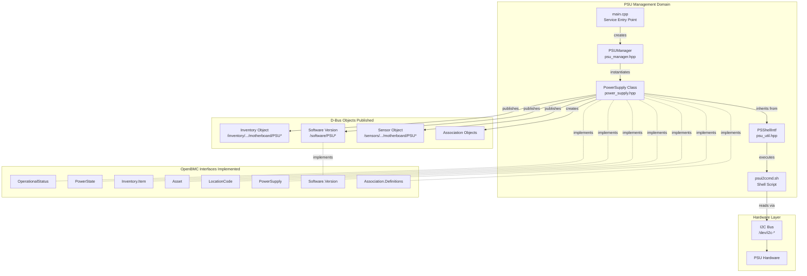
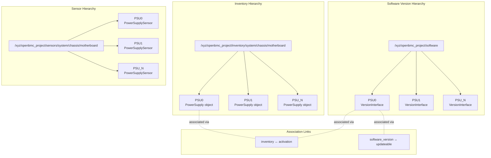
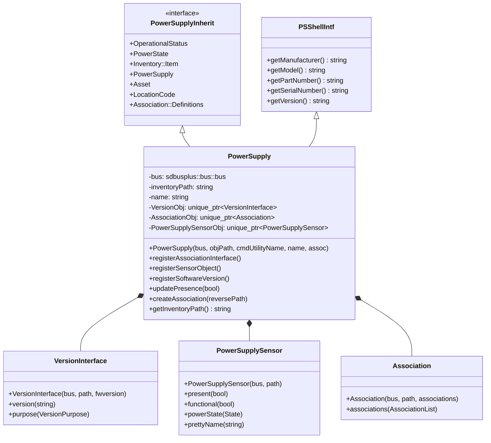
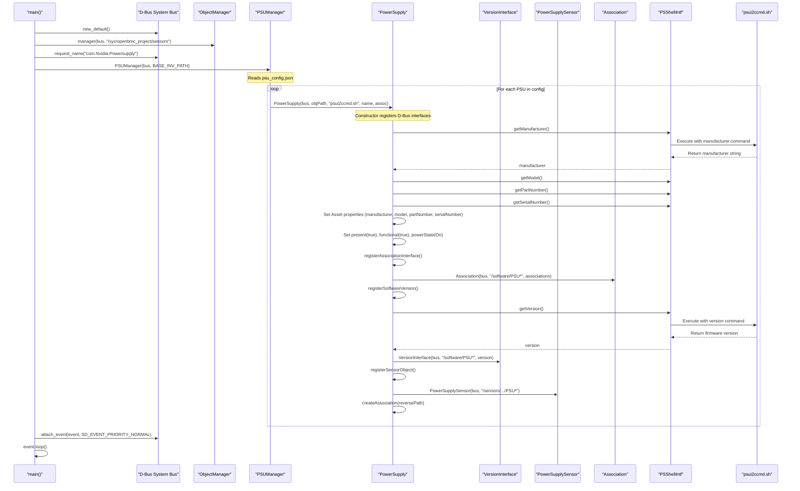
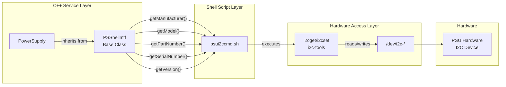
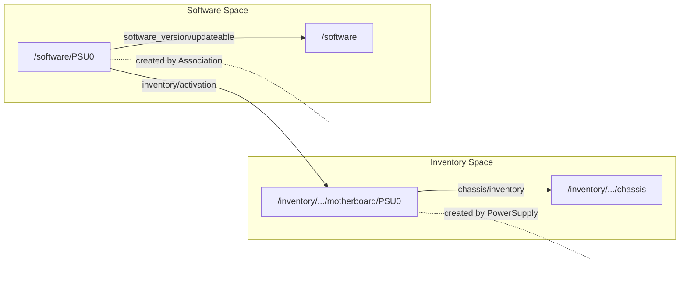
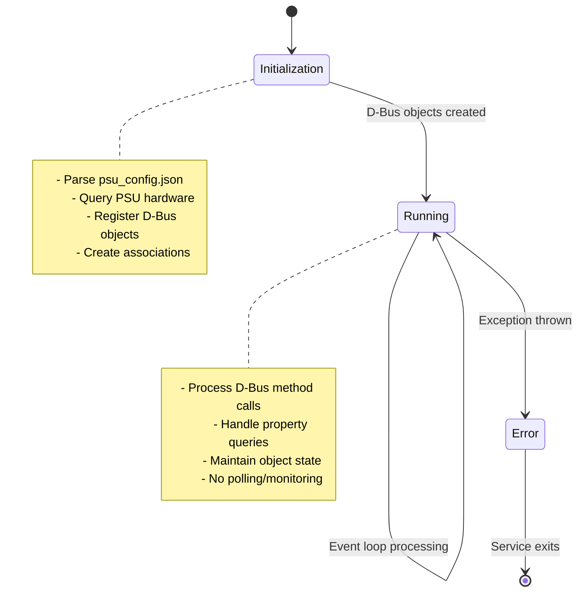

<!-- source: DeepWiki mcp.deepwiki.com · repo NVIDIA/nvidia-power-manager · page 4 Power Supply Management Subsystem · fetched 2026-10-26 -->

# Power Supply Management Subsystem

<details>
<summary>Relevant source files</summary>

The following files were used as context for generating this wiki page:

- [nvidia-power-supply/meson.build](nvidia-power-supply/meson.build)
- [nvidia-power-supply/src/main.cpp](nvidia-power-supply/src/main.cpp)
- [nvidia-power-supply/src/power_supply.hpp](nvidia-power-supply/src/power_supply.hpp)

</details>


## Purpose and Scope

The Power Supply Management Subsystem provides runtime monitoring and management of Power Supply Units (PSUs) within the OpenBMC ecosystem. This subsystem consists of two primary components: a D-Bus service (`nvidia-power-supply`) for continuous monitoring and inventory management, and firmware update utilities for maintenance operations.

This document covers the overall architecture and components of the PSU management subsystem. For detailed documentation of the D-Bus service implementation, see [PSU D-Bus Service](#4.1). For firmware update utility documentation, see [PSU Firmware Update Utilities](#4.2).

**Sources:** [nvidia-power-supply/meson.build:1-46](), [nvidia-power-supply/src/power_supply.hpp:1-277]()

## Architecture Overview

The PSU subsystem follows a dual-mode architecture pattern common throughout the nvidia-power-manager repository: a long-running D-Bus service for monitoring and a separate command-line utility for firmware updates.

### Component Architecture



**Key Components:**

| Component | File | Purpose |
|-----------|------|---------|
| `main.cpp` | [nvidia-power-supply/src/main.cpp]() | Service entry point, D-Bus setup |
| `PSUManager` | psu_manager.hpp | Manages multiple PSU instances |
| `PowerSupply` | [nvidia-power-supply/src/power_supply.hpp:137-274]() | Core PSU class, implements D-Bus interfaces |
| `PSShellIntf` | psu_util.hpp | Hardware abstraction via shell scripts |
| `psui2ccmd.sh` | [nvidia-power-supply/meson.build:32-36]() | Shell script for I2C communication |

**Sources:** [nvidia-power-supply/src/main.cpp:1-52](), [nvidia-power-supply/src/power_supply.hpp:1-277](), [nvidia-power-supply/meson.build:1-46]()

## D-Bus Service Configuration

The PSU D-Bus service is configured through build-time definitions and runtime configuration files.

### Build Configuration

The service uses several compile-time constants defined in the Meson build system:

| Constant | Value | Purpose |
|----------|-------|---------|
| `BUSNAME` | `com.Nvidia.Powersupply` | D-Bus service name |
| `BASE_INV_PATH` | `/xyz/openbmc_project/inventory/system/chassis/motherboard` | Base inventory path |
| `SW_INV_PATH` | `/xyz/openbmc_project/software` | Software version path |
| `PSU_SENSOR_PATH` | `/xyz/openbmc_project/sensors/system/chassis/motherboard` | Sensor object path |
| `OBJ_MANAGER_PATH` | `/xyz/openbmc_project/sensors` | Object Manager root |
| `PSU_JSON_PATH` | `/usr/share/nvidia-power-manager/psu_config.json` | Configuration file |

**Sources:** [nvidia-power-supply/meson.build:4-23]()

## D-Bus Object Hierarchy

The PSU service publishes objects to three distinct D-Bus path hierarchies, following OpenBMC conventions:

### Object Path Structure



**Path Construction:**

Each PSU creates three related D-Bus objects with consistent naming:

1. **Inventory Object:** `${BASE_INV_PATH}/PSU${N}` - Main hardware inventory item
2. **Software Version Object:** `${SW_INV_PATH}/PSU${N}` - Firmware version information
3. **Sensor Object:** `${PSU_SENSOR_PATH}/PSU${N}` - Runtime sensor data

**Sources:** [nvidia-power-supply/src/power_supply.hpp:186-225](), [nvidia-power-supply/meson.build:12-22]()

## Class Architecture

The PSU subsystem uses a multi-inheritance pattern to implement OpenBMC D-Bus interfaces while maintaining hardware abstraction.

### PowerSupply Class Structure



**Interface Implementations:**

The `PowerSupply` class inherits from `PowerSupplyInherit`, which is a typedef for a multi-interface server object:

```cpp
using PowerSupplyInherit = sdbusplus::server::object::object<
    OperationalStatus,
    PowerState,
    Inventory::Item,
    Inventory::Item::PowerSupply,
    Inventory::Decorator::Asset,
    Inventory::Decorator::LocationCode,
    Association::Definitions>;
```

**Sources:** [nvidia-power-supply/src/power_supply.hpp:41-49](), [nvidia-power-supply/src/power_supply.hpp:137-274]()

## Object Creation and Initialization

The PSU service follows a structured initialization sequence to create and register all D-Bus objects.

### Initialization Sequence



**Key Initialization Steps:**

1. **D-Bus Setup** [nvidia-power-supply/src/main.cpp:34-40](): Create bus connection, request service name
2. **Object Manager** [nvidia-power-supply/src/main.cpp:37](): Create ObjectManager at `/xyz/openbmc_project/sensors`
3. **PSU Manager Creation** [nvidia-power-supply/src/main.cpp:42](): Instantiate `PSUManager` which reads configuration
4. **PowerSupply Construction** [nvidia-power-supply/src/power_supply.hpp:156-184](): For each PSU:
   - Query hardware via `PSShellIntf` methods
   - Set Asset properties (manufacturer, model, etc.)
   - Register association interface
   - Register software version object
   - Register sensor object
5. **Event Loop** [nvidia-power-supply/src/main.cpp:44](): Enter main event loop

**Sources:** [nvidia-power-supply/src/main.cpp:28-51](), [nvidia-power-supply/src/power_supply.hpp:156-184]()

## Hardware Communication Abstraction

The PSU service abstracts hardware communication through the `PSShellIntf` interface and shell scripts.

### Shell Interface Pattern



**Interface Methods:**

The `PSShellIntf` class provides five query methods that the `PowerSupply` class uses to retrieve hardware information:

| Method | Purpose | Used For |
|--------|---------|----------|
| `getManufacturer()` | Query PSU manufacturer | Asset.manufacturer property |
| `getModel()` | Query PSU model number | Asset.model property |
| `getPartNumber()` | Query PSU part number | Asset.partNumber property |
| `getSerialNumber()` | Query PSU serial number | Asset.serialNumber property |
| `getVersion()` | Query firmware version | Software.Version.version property |

Each method constructs a command string that invokes `psui2ccmd.sh` with appropriate arguments and parses the output.

**Sources:** [nvidia-power-supply/src/power_supply.hpp:137-184](), [nvidia-power-supply/meson.build:32-36]()

## D-Bus Interface Properties

The `PowerSupply` class exposes numerous D-Bus properties through its inherited interfaces. These properties are set during initialization and can be queried by D-Bus clients.

### Properties Exposed

| Interface | Property | Data Type | Set During | Example Value |
|-----------|----------|-----------|------------|---------------|
| `Inventory.Decorator.Asset` | `manufacturer` | string | Construction | Retrieved via `getManufacturer()` |
| `Inventory.Decorator.Asset` | `model` | string | Construction | Retrieved via `getModel()` |
| `Inventory.Decorator.Asset` | `partNumber` | string | Construction | Retrieved via `getPartNumber()` |
| `Inventory.Decorator.Asset` | `serialNumber` | string | Construction | Retrieved via `getSerialNumber()` |
| `Inventory.Item` | `present` | bool | Construction | `true` |
| `Inventory.Item` | `prettyName` | string | Construction | `"Power Supply " + name` |
| `State.Decorator.OperationalStatus` | `functional` | bool | Construction | `true` |
| `State.Decorator.PowerState` | `powerState` | enum | Construction | `State::On` |
| `Software.Version` | `version` | string | Software registration | Retrieved via `getVersion()` |
| `Software.Version` | `purpose` | enum | Software registration | `VersionPurpose::Other` |
| `Association.Definitions` | `associations` | vector<tuple> | Construction | Chassis and software associations |

**Sources:** [nvidia-power-supply/src/power_supply.hpp:163-183](), [nvidia-power-supply/src/power_supply.hpp:217-224]()

## Association Management

The PSU service creates bidirectional associations linking inventory objects to software versions and chassis components.

### Association Types



**Association Creation:**

The `PowerSupply` class creates three types of associations:

1. **Chassis Association** [nvidia-power-supply/src/power_supply.hpp:249-255]():
   - Forward: `"chassis"` → Reverse: `"inventory"`
   - Links PSU inventory object to chassis object

2. **Inventory-Activation Association** [nvidia-power-supply/src/power_supply.hpp:192-193]():
   - Forward: `"inventory"` → Reverse: `"activation"`
   - Links software version object to inventory object

3. **Software Version Association** [nvidia-power-supply/src/power_supply.hpp:194-195]():
   - Forward: `"software_version"` → Reverse: `"updateable"`
   - Links software version object to `/xyz/openbmc_project/software` root

**Sources:** [nvidia-power-supply/src/power_supply.hpp:186-199](), [nvidia-power-supply/src/power_supply.hpp:249-255](), [nvidia-power-supply/src/power_supply.hpp:269-273]()

## Sensor Object Management

The service publishes separate sensor objects for each PSU, allowing sensor monitoring systems to track PSU state independently of inventory.

### PowerSupplySensor Class

The `PowerSupplySensor` class implements a subset of interfaces compared to the main `PowerSupply` class:

```cpp
using PowerSupplySensorInherit = sdbusplus::server::object::object<
    OperationalStatus,
    PowerState,
    Inventory::Item,
    Inventory::Item::PowerSupply>;
```

**Sensor Object Creation** [nvidia-power-supply/src/power_supply.hpp:201-215]():

1. Constructs path: `${PSU_SENSOR_PATH}/PSU${N}`
2. Creates `PowerSupplySensor` object at sensor path
3. Sets properties:
   - `prettyName`: `"Power Supply " + name`
   - `present`: `true`
   - `functional`: `true`
   - `powerState`: `State::On`

**Presence Updates** [nvidia-power-supply/src/power_supply.hpp:227-232]():

The `updatePresence()` method allows dynamic updates to PSU presence, updating both the main inventory object and sensor object:

```cpp
void updatePresence(bool present)
{
    Inventory::Item::present(present);
    PowerSupplySensorObj->present(present);
}
```

**Sources:** [nvidia-power-supply/src/power_supply.hpp:51-56](), [nvidia-power-supply/src/power_supply.hpp:201-215](), [nvidia-power-supply/src/power_supply.hpp:227-232]()

## Dependencies and Build Requirements

The PSU service requires several external libraries provided by the OpenBMC ecosystem.

### Runtime Dependencies

| Dependency | Purpose | Usage |
|------------|---------|-------|
| `sdbusplus` | D-Bus C++ bindings | All D-Bus object creation and interface implementation |
| `sdeventplus` | Event loop management | Main event loop in `main()` |
| `phosphor-dbus-interfaces` | OpenBMC interface definitions | Interface typedefs (Asset, PowerState, etc.) |
| `phosphor-logging` | Logging infrastructure | Error logging in exception handlers |
| `fmt` | String formatting | General string operations |
| `systemd` | Service management | Systemd unit file installation |

### Build-Time Configuration

The Meson build system installs:
- **Service Binary:** Compiled from sources in `src/`
- **Systemd Service File:** Located in `services/` subdirectory
- **Shell Script:** `psui2ccmd.sh` installed to `${bindir}`
- **Configuration:** `psu_config.json` installed to `/usr/share/nvidia-power-manager/`

**Sources:** [nvidia-power-supply/meson.build:1-46]()

## Service Lifecycle

The PSU service runs continuously as a systemd service, maintaining D-Bus objects throughout its lifecycle.

### Runtime Behavior



**Key Characteristics:**

1. **Static Object Model:** PSU objects are created once at startup based on configuration file
2. **Event-Driven:** Service responds to D-Bus method calls and property accesses
3. **No Active Monitoring:** The service does not continuously poll hardware; it queries during initialization
4. **Error Handling:** Exceptions during initialization cause service exit [nvidia-power-supply/src/main.cpp:46-50]()

**Sources:** [nvidia-power-supply/src/main.cpp:28-51]()

## Integration with OpenBMC Ecosystem

The PSU service integrates with standard OpenBMC subsystems through its D-Bus interface implementation.

### Integration Points

| OpenBMC System | Integration Method | Purpose |
|----------------|-------------------|---------|
| **Inventory Manager** | Publishes to `/xyz/openbmc_project/inventory` | Hardware inventory tracking |
| **Software Manager** | Publishes to `/xyz/openbmc_project/software` | Firmware version tracking |
| **Sensor Manager** | Publishes to `/xyz/openbmc_project/sensors` | Runtime monitoring |
| **Association Manager** | Implements `Association.Definitions` | Links inventory↔software |
| **Redfish** | Via standard interfaces | Exposes PSU data in Redfish API |
| **BMCWeb** | Via D-Bus queries | Web UI display of PSU information |

**ObjectManager Registration:**

The service creates an ObjectManager at `/xyz/openbmc_project/sensors` [nvidia-power-supply/src/main.cpp:37](), enabling D-Bus clients to discover all PSU sensor objects through the standard `GetManagedObjects()` method.

**Sources:** [nvidia-power-supply/src/main.cpp:37](), [nvidia-power-supply/meson.build:10-22]()

---

