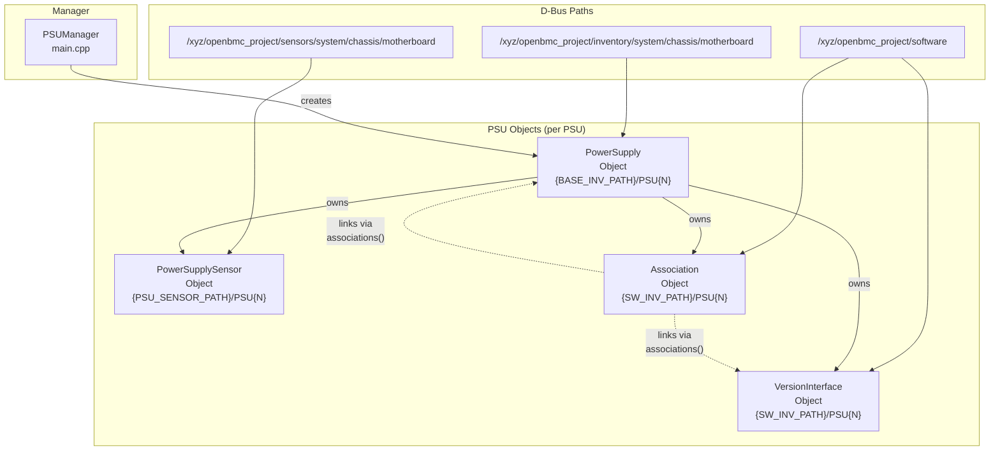
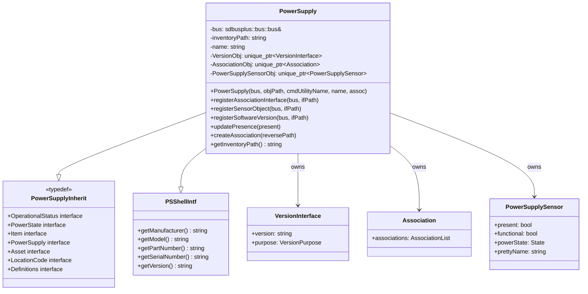
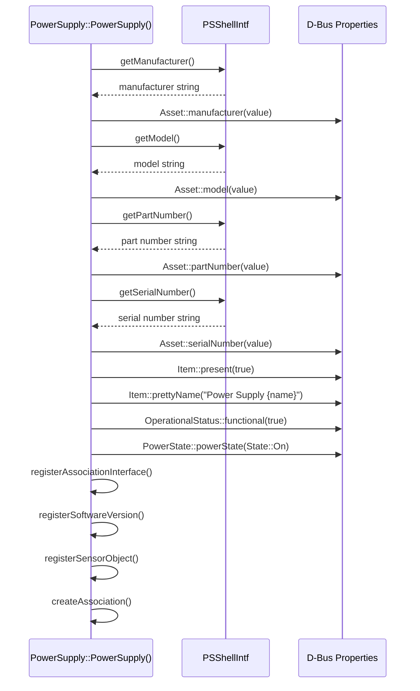
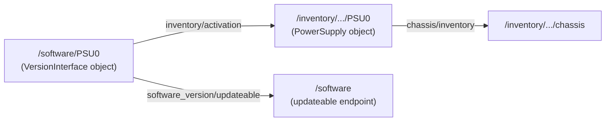
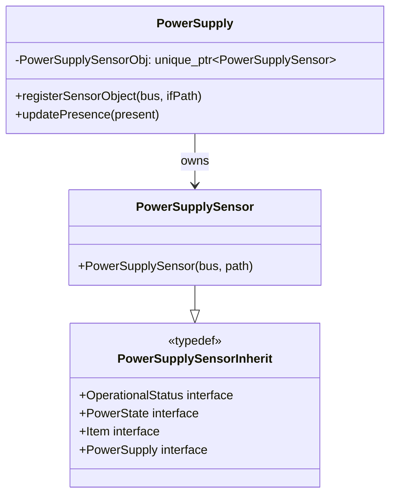
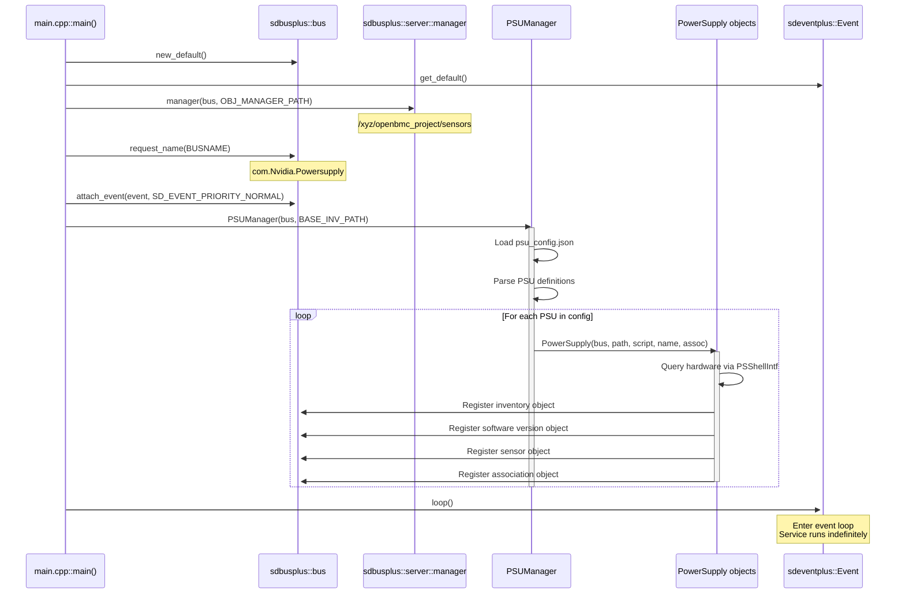

<!-- source: DeepWiki mcp.deepwiki.com · repo NVIDIA/nvidia-power-manager · page 4.1 PSU D-Bus Service · fetched 2026-10-26 -->

# PSU D-Bus Service

<details>
<summary>Relevant source files</summary>

The following files were used as context for generating this wiki page:

- [nvidia-power-supply/meson.build](nvidia-power-supply/meson.build)
- [nvidia-power-supply/src/main.cpp](nvidia-power-supply/src/main.cpp)
- [nvidia-power-supply/src/power_supply.hpp](nvidia-power-supply/src/power_supply.hpp)

</details>


## Purpose and Scope

The PSU D-Bus Service (`nvidia-power-supply`) is a runtime monitoring daemon that exposes Power Supply Unit (PSU) information through the OpenBMC D-Bus interface. This service provides inventory management, asset tracking, firmware version reporting, operational status monitoring, and sensor data integration for all PSUs in the system. It runs continuously as a systemd service and integrates with standard OpenBMC D-Bus paths and interfaces.

For PSU firmware update operations, see [PSU Firmware Update Utilities](#4.2). For the broader context of PSU management, see [Power Supply Management Subsystem](#4).

---

## Service Overview

The `nvidia-power-supply` service operates as a D-Bus daemon that:

- **Registers on the system bus** as `com.Nvidia.Powersupply`
- **Creates D-Bus objects** for each PSU in three separate hierarchies: inventory, software, and sensors
- **Implements standard OpenBMC interfaces** for interoperability with BMC management tools
- **Queries PSU hardware** through shell script interfaces (`psui2ccmd.sh`) to retrieve asset information, firmware versions, and operational status
- **Maintains associations** between inventory items and software versions

The service architecture follows OpenBMC conventions, enabling integration with tools like `busctl`, WebUI dashboards, and Redfish endpoints.

**Sources:** [nvidia-power-supply/meson.build:1-46](), [nvidia-power-supply/src/main.cpp:1-52]()

---

## D-Bus Configuration and Paths

The service uses compile-time configuration to define D-Bus paths and interface names:

| Configuration Key | Value | Purpose |
|-------------------|-------|---------|
| `BUSNAME` | `com.Nvidia.Powersupply` | D-Bus service name |
| `BASE_INV_PATH` | `/xyz/openbmc_project/inventory/system/chassis/motherboard` | Base path for PSU inventory objects |
| `SW_INV_PATH` | `/xyz/openbmc_project/software` | Path for software version objects |
| `PSU_SENSOR_PATH` | `/xyz/openbmc_project/sensors/system/chassis/motherboard` | Path for PSU sensor objects |
| `OBJ_MANAGER_PATH` | `/xyz/openbmc_project/sensors` | Object manager registration path |
| `SOFTWARE_INTERFACE` | `xyz.openbmc_project.Software.Version` | Software version interface name |
| `PSU_JSON_PATH` | `/usr/share/nvidia-power-manager/psu_config.json` | PSU configuration file |

Each PSU is represented by three distinct D-Bus objects at different paths:

1. **Inventory object**: `{BASE_INV_PATH}/PSU{N}`
2. **Software version object**: `{SW_INV_PATH}/PSU{N}`
3. **Sensor object**: `{PSU_SENSOR_PATH}/PSU{N}`

**Sources:** [nvidia-power-supply/meson.build:4-22]()

---

## D-Bus Object Architecture

### Object Hierarchy Diagram



**Sources:** [nvidia-power-supply/src/power_supply.hpp:156-224](), [nvidia-power-supply/meson.build:13-22]()

---

## Class Architecture

### PowerSupply Class Hierarchy



The `PowerSupply` class combines multiple inheritance patterns:

- **Interface inheritance** via `PowerSupplyInherit` (D-Bus interface implementations)
- **Hardware abstraction** via `PSShellIntf` (shell script-based hardware queries)
- **Composition** of helper objects for version, association, and sensor management

**Sources:** [nvidia-power-supply/src/power_supply.hpp:41-274]()

---

## D-Bus Interfaces Implementation

The `PowerSupply` class implements seven standard OpenBMC D-Bus interfaces:

### Interface Summary Table

| Interface | D-Bus Name | Properties Set by PowerSupply | Purpose |
|-----------|------------|-------------------------------|---------|
| **OperationalStatus** | `xyz.openbmc_project.State.Decorator.OperationalStatus` | `functional` (bool) | Indicates PSU health status |
| **PowerState** | `xyz.openbmc_project.State.Decorator.PowerState` | `powerState` (State enum) | Indicates PSU power state (On/Off) |
| **Item** | `xyz.openbmc_project.Inventory.Item` | `present` (bool), `prettyName` (string) | Basic inventory properties |
| **PowerSupply** | `xyz.openbmc_project.Inventory.Item.PowerSupply` | (marker interface) | Type identification |
| **Asset** | `xyz.openbmc_project.Inventory.Decorator.Asset` | `manufacturer`, `model`, `partNumber`, `serialNumber` | Asset tracking information |
| **LocationCode** | `xyz.openbmc_project.Inventory.Decorator.LocationCode` | (not set in code) | Physical location identifier |
| **Definitions** | `xyz.openbmc_project.Association.Definitions` | `associations` (AssociationList) | Links inventory ↔ software objects |

### Property Initialization Flow

During construction, the `PowerSupply` class queries hardware and sets D-Bus properties:



**Sources:** [nvidia-power-supply/src/power_supply.hpp:156-184]()

---

## Inventory and Version Management

### Software Version Object

The `VersionInterface` class creates a separate D-Bus object at `/xyz/openbmc_project/software/PSU{N}` implementing the `Software.Version` interface:

```cpp
// Simplified view from power_supply.hpp:76-93
class VersionInterface : public VersionObject
{
    VersionInterface(bus, path, fwversion) {
        version(fwversion);              // Set firmware version string
        purpose(VersionPurpose::Other);  // Indicate version purpose
    }
};
```

The `PowerSupply::registerSoftwareVersion()` method:
1. Constructs software path: `{SW_INV_PATH}/{filename}` (e.g., `/xyz/openbmc_project/software/PSU0`)
2. Queries firmware version via `PSShellIntf::getVersion()`
3. Creates `VersionInterface` object with `emit_interface_added` action

**Sources:** [nvidia-power-supply/src/power_supply.hpp:76-93](), [nvidia-power-supply/src/power_supply.hpp:217-225]()

### Association Management

The service creates bidirectional associations between inventory and software objects:



Association types defined in the code:

| Forward Type | Reverse Type | Target Path | Purpose |
|--------------|--------------|-------------|---------|
| `inventory` | `activation` | `/software/PSU{N}` | Link software version to inventory |
| `software_version` | `updateable` | `/xyz/openbmc_project/software` | Mark as firmware-updateable |
| `chassis` | `inventory` | Parent chassis path | Associate PSU with chassis |

**Sources:** [nvidia-power-supply/src/power_supply.hpp:186-199](), [nvidia-power-supply/src/power_supply.hpp:249-255](), [nvidia-power-supply/src/power_supply.hpp:269-273]()

---

## Sensor Integration

### PowerSupplySensor Object

Each PSU creates a sensor object at `/xyz/openbmc_project/sensors/system/chassis/motherboard/PSU{N}`:



The sensor object duplicates presence and operational status properties from the main inventory object but at a different D-Bus path hierarchy. This enables:
- **Sensor tree queries**: Tools can enumerate `/xyz/openbmc_project/sensors` to find all sensors
- **Consistent status**: `updatePresence()` method synchronizes both inventory and sensor objects

**Implementation details:**

[nvidia-power-supply/src/power_supply.hpp:201-215]() - The `registerSensorObject()` method:
1. Constructs sensor path: `{PSU_SENSOR_PATH}/{filename}`
2. Creates `PowerSupplySensor` object with `emit_interface_added`
3. Sets `prettyName`, `present`, `functional`, and `powerState` properties

[nvidia-power-supply/src/power_supply.hpp:227-232]() - The `updatePresence()` method:
1. Updates `Item::present` on main inventory object
2. Updates `present` on sensor object
3. Ensures consistency across both D-Bus hierarchies

**Sources:** [nvidia-power-supply/src/power_supply.hpp:51-56](), [nvidia-power-supply/src/power_supply.hpp:98-111](), [nvidia-power-supply/src/power_supply.hpp:201-232]()

---

## Hardware Communication Layer

### PSShellIntf Interface

The `PowerSupply` class inherits from `PSShellIntf`, which provides an abstraction for querying PSU hardware information. This interface invokes shell scripts to communicate with PSU hardware via I2C:

```mermaid
graph TB
    subgraph "C++ Layer"
        PS["PowerSupply<br/>class"]
        SHELL["PSShellIntf<br/>base class"]
    end
    
    subgraph "Shell Layer"
        SCRIPT["psui2ccmd.sh<br/>shell script"]
    end
    
    subgraph "Hardware Layer"
        I2C["/dev/i2c-* devices"]
        PSU_HW["PSU Hardware<br/>I2C Bus"]
    end
    
    PS --|"inherits"| SHELL
    SHELL -->|"executes"| SCRIPT
    SCRIPT -->|"reads/writes"| I2C
    I2C <-->|"communicates"| PSU_HW
    
    SHELL -.->|"getManufacturer()"| SCRIPT
    SHELL -.->|"getModel()"| SCRIPT
    SHELL -.->|"getPartNumber()"| SCRIPT
    SHELL -.->|"getSerialNumber()"| SCRIPT
    SHELL -.->|"getVersion()"| SCRIPT
```

**Shell Script Integration:**

The `psui2ccmd.sh` script is installed to `/usr/bin/` by the build system ([nvidia-power-supply/meson.build:32-36]()) and provides standardized command-line interface for PSU queries. The `PSShellIntf` constructor receives:
- `name`: PSU identifier (e.g., "PSU0")
- `cmdUtilityName`: Path to shell script

This design decouples the D-Bus service from hardware-specific I2C communication details, allowing the shell script to be modified without recompiling the service.

**Sources:** [nvidia-power-supply/src/power_supply.hpp:137-184](), [nvidia-power-supply/meson.build:32-36]()

---

## Service Initialization Flow

### Service Startup Sequence



### Main Entry Point

[nvidia-power-supply/src/main.cpp:28-51]() - The `main()` function:
1. Creates default D-Bus connection (`sdbusplus::bus::new_default()`)
2. Creates event loop (`sdeventplus::Event::get_default()`)
3. Registers object manager at `OBJ_MANAGER_PATH` (`/xyz/openbmc_project/sensors`)
4. Requests D-Bus service name `com.Nvidia.Powersupply`
5. Attaches event loop to D-Bus bus
6. Creates `PSUManager` with `BASE_INV_PATH` (`/xyz/openbmc_project/inventory/system/chassis/motherboard`)
7. Enters event loop (`event.loop()`)

The service runs indefinitely, responding to D-Bus method calls and property queries.

**Sources:** [nvidia-power-supply/src/main.cpp:28-51]()

---

## Configuration File Format

The service reads PSU definitions from `/usr/share/nvidia-power-manager/psu_config.json` (configured via [nvidia-power-supply/meson.build:5-8]()). While the exact JSON schema is not visible in the provided files, the `PSUManager` class uses this configuration to:

- Determine the number of PSUs in the system
- Construct D-Bus object paths for each PSU
- Provide PSU names for `prettyName` properties
- Configure association paths to parent chassis objects

---

## Dependencies

The service requires the following libraries, configured in [nvidia-power-supply/meson.build:26-30]():

| Dependency | Purpose |
|------------|---------|
| `sdbusplus` | D-Bus C++ bindings for object creation and property management |
| `sdeventplus` | Event loop integration for D-Bus signal handling |
| `fmt` | String formatting utilities |
| `phosphor-dbus-interfaces` | OpenBMC standard D-Bus interface definitions |
| `phosphor-logging` | Logging infrastructure for error reporting |

**Sources:** [nvidia-power-supply/meson.build:26-30]()

---

## Summary

The `nvidia-power-supply` D-Bus service provides comprehensive PSU monitoring within the OpenBMC ecosystem. It creates a **triple-hierarchy representation** (inventory, software, sensor) for each PSU, implements seven standard D-Bus interfaces, and maintains bidirectional associations between objects. Hardware communication is abstracted through shell scripts, allowing platform-specific I2C logic to remain separate from the D-Bus service implementation. The service integrates with OpenBMC's object manager pattern and provides data to higher-level management interfaces like Redfish and WebUI.

---

