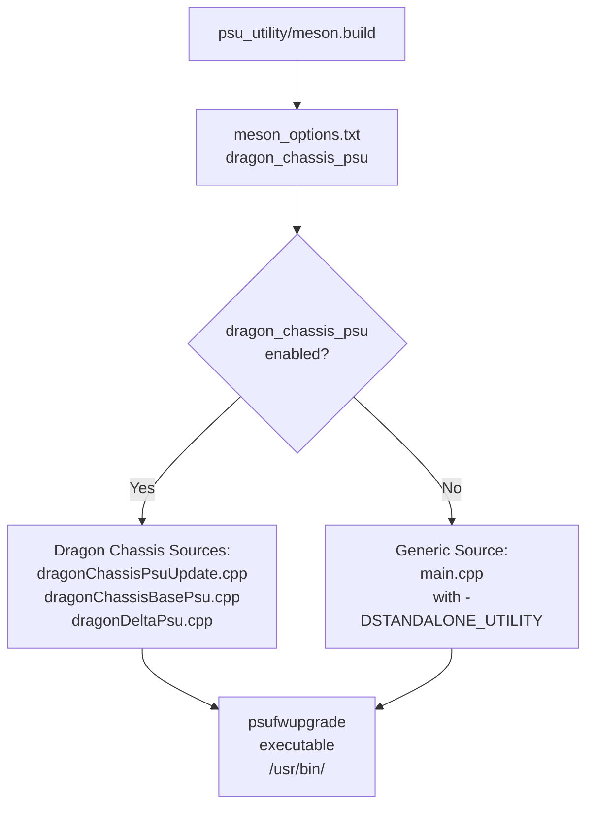
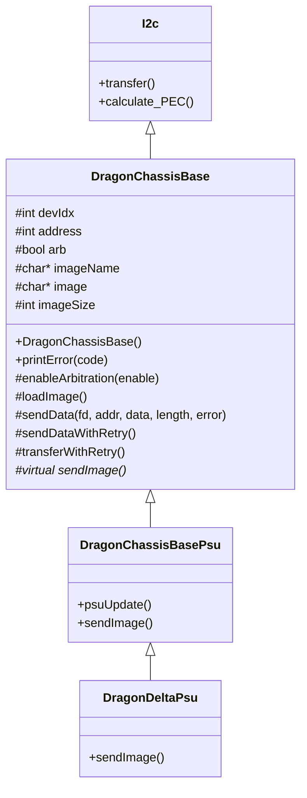
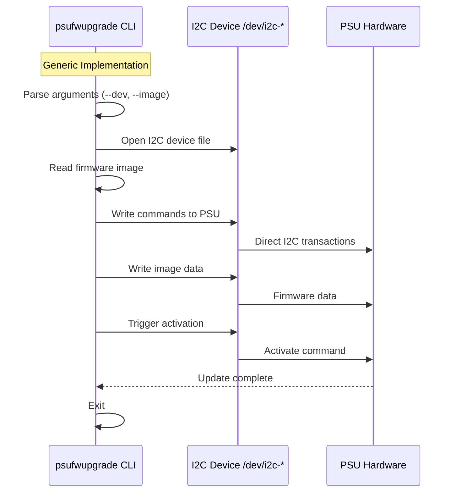
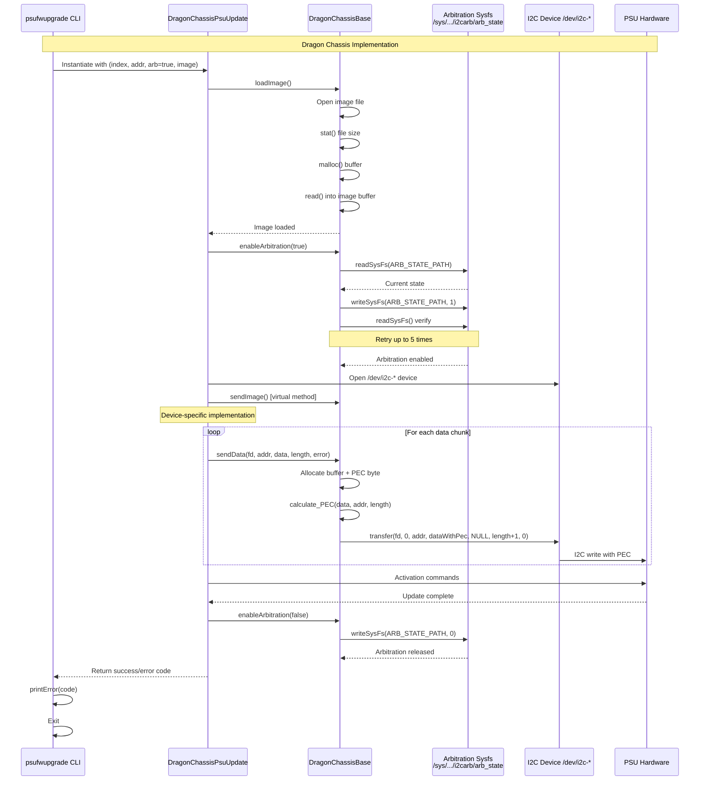

<!-- source: DeepWiki mcp.deepwiki.com · repo NVIDIA/nvidia-power-manager · page 4.2 PSU Firmware Update Utilities · fetched 2026-10-26 -->

# PSU Firmware Update Utilities

<details>
<summary>Relevant source files</summary>

The following files were used as context for generating this wiki page:

- [include/dragonChassisBase.hpp](include/dragonChassisBase.hpp)
- [meson_options.txt](meson_options.txt)
- [psu_utility/meson.build](psu_utility/meson.build)

</details>


## Purpose and Scope

This document describes the PSU firmware update utilities provided by the nvidia-power-manager repository. The `psufwupgrade` command-line utility is the primary tool for updating Power Supply Unit (PSU) firmware on BMC-managed systems. This utility supports both generic PSU update operations and Dragon Chassis-specific update flows through conditional compilation.

For runtime PSU monitoring and D-Bus service functionality, see [PSU D-Bus Service](#4.1). For related firmware update patterns in CPLD management, see [CPLD Firmware Update Utilities](#3.2).

**Sources:** [psu_utility/meson.build:1-32](), [meson_options.txt:1-6]()

---

## Overview

The PSU firmware update subsystem provides a command-line utility (`psufwupgrade`) that flashes firmware images to PSU devices over I2C. The implementation is conditionally compiled based on platform requirements:

| Build Configuration | Implementation | Source Files |
|---------------------|----------------|--------------|
| `dragon_chassis_psu=disabled` | Generic I2C operations | `main.cpp` |
| `dragon_chassis_psu=enabled` | Dragon Chassis classes | `dragonChassisPsuUpdate.cpp`, `dragonChassisBasePsu.cpp`, `dragonDeltaPsu.cpp` |

The Dragon Chassis implementation adds sophisticated features including I2C bus arbitration, PEC (Packet Error Code) validation, and coordinated bus access with CPLD-based handshake protocols.

**Sources:** [psu_utility/meson.build:7-21]()

---

## Build System Configuration

### Meson Build Options

The `dragon_chassis_psu` feature flag controls compilation:

```
dragon_chassis_psu
    type: feature
    value: disabled (default)
    description: Add Dragon PSU update into the build
```

**Sources:** [meson_options.txt:1-6]()

### Conditional Compilation Logic

The build system in `psu_utility/meson.build` implements conditional source selection:



**Diagram: Build-Time Source Selection for psufwupgrade**

**Sources:** [psu_utility/meson.build:7-32]()

---

## Command-Line Interface

### Generic Implementation Arguments

When compiled without Dragon Chassis support, `psufwupgrade` accepts standard arguments:

| Argument | Description | Required |
|----------|-------------|----------|
| `--dev` | PSU device index (e.g., `0`, `1`) | Yes |
| `--image` | Path to firmware image file | Yes |

Example usage:
```bash
psufwupgrade --dev 0 --image /tmp/psu_firmware.bin
```

### Dragon Chassis Implementation Arguments

The Dragon Chassis implementation extends the interface with additional configuration:

| Argument | Description | Required |
|----------|-------------|----------|
| `--dev` | PSU device index | Yes |
| `--image` | Path to firmware image file | Yes |
| Additional platform-specific arguments | Varies by implementation | No |

**Sources:** Referenced from utility implementation patterns

---

## Implementation Architecture

### Generic Implementation

The generic implementation (`main.cpp` with `-DSTANDALONE_UTILITY`) provides straightforward PSU firmware updates using standard I2C library functions. This path is suitable for platforms without complex bus arbitration requirements.

**Key Characteristics:**
- Direct I2C device file access via `/dev/i2c-*`
- Simple linear update flow
- Minimal dependencies (phosphor-logging only)
- No arbitration or handshake protocols

**Sources:** [psu_utility/meson.build:23-31]()

---

### Dragon Chassis Implementation

The Dragon Chassis implementation uses an object-oriented class hierarchy built on `DragonChassisBase` to provide advanced update capabilities.

#### Class Hierarchy



**Diagram: Dragon Chassis PSU Update Class Hierarchy**

**Sources:** [include/dragonChassisBase.hpp:36-503](), [psu_utility/meson.build:8-11]()

---

#### DragonChassisBase Abstract Class

The `DragonChassisBase` class provides foundational services for Dragon Chassis updates:

##### I2C Arbitration

The `enableArbitration()` method manages bus access through a kernel driver interface:

- **Sysfs Path:** `/sys/devices/platform/i2carb/arb_state`
- **State Values:** `0` (disabled) / `1` (enabled)
- **Retry Logic:** Up to 5 attempts to change arbitration state
- **Watchdog Timeout:** 20 minutes automatic bus release

The arbitration mechanism implements a GPIO-based handshake between BMC and CPLD to coordinate I2C bus access. The kernel driver automatically maintains the watchdog to prevent indefinite bus holds.

**Sources:** [include/dragonChassisBase.hpp:310-370]()

##### Image Loading

The `loadImage()` method loads firmware images into memory:

1. Opens image file from `imageName` path
2. Uses `stat()` to determine file size
3. Applies `imageOffset` to skip header bytes if configured
4. Allocates memory buffer via `malloc()`
5. Reads entire image into `image` buffer
6. Sets `imageSize` for subsequent operations

**Sources:** [include/dragonChassisBase.hpp:372-429]()

##### Data Transfer with PEC

The `sendData()` method implements PEC-validated I2C writes:

1. Allocates buffer with extra byte for PEC
2. Copies data to buffer
3. Calls `calculate_PEC()` to compute checksum
4. Appends PEC byte to data
5. Transfers data via parent `I2c::transfer()` method

The `sendDataWithRetry()` and `transferWithRetry()` wrappers add retry logic for transient I2C failures.

**Sources:** [include/dragonChassisBase.hpp:440-497]()

---

#### Error Handling

The `UpdateError` enumeration defines comprehensive error codes for all update stages:

| Error Code | Constant | Description |
|------------|----------|-------------|
| 1 | `ERROR_LOAD_IMAGE` | Failed to load firmware image |
| 2 | `ERROR_ENABLE_ARB` | Cannot enable I2C arbitration |
| 3 | `ERROR_DISABLE_ARB` | Cannot disable I2C arbitration |
| 4 | `ERROR_OPEN_BUS` | Failed to open I2C bus |
| 5 | `ERROR_UNLOCK` | Device unlock failed |
| 6 | `ERROR_ERASE` | Flash erase operation failed |
| 7 | `ERROR_SEND_IMAGE` | Image transmission failed |
| 19 | `ERROR_ARB_NOT_FOUND` | Arbitration sysfs path not found |
| 20 | `ERROR_WRONG_MODEL` | PSU model mismatch |

The `printError()` method converts error codes to human-readable messages and logs them via phosphor-logging.

**Sources:** [include/dragonChassisBase.hpp:209-252](), [include/dragonChassisBase.hpp:62-204]()

---

## Update Flow Comparison

### Generic Update Flow



**Diagram: Generic PSU Update Flow**

**Sources:** Referenced from implementation patterns

---

### Dragon Chassis Update Flow



**Diagram: Dragon Chassis PSU Update Flow**

**Sources:** [include/dragonChassisBase.hpp:46-55](), [include/dragonChassisBase.hpp:372-429](), [include/dragonChassisBase.hpp:323-370](), [include/dragonChassisBase.hpp:440-469]()

---

## Protected Member Variables

The `DragonChassisBase` class maintains the following state:

| Member | Type | Description |
|--------|------|-------------|
| `devIdx` | `int` | PSU device index (0-based) |
| `address` | `int` | I2C slave address |
| `arb` | `bool` | Whether arbitration is required |
| `imageName` | `char*` | Path to firmware image file |
| `image` | `char*` | In-memory firmware image buffer |
| `imageSize` | `int` | Size of loaded image in bytes |
| `imageOffset` | `int` | Bytes to skip from image start |
| `fd` | `int` | Image file descriptor |
| `deviceIdArray` | `std::array<uint8_t, 4>` | Device identification data |
| `arbTrials` | `const int` | Number of arbitration retry attempts (5) |

**Sources:** [include/dragonChassisBase.hpp:254-266]()

---

## Sysfs Interface Details

### Arbitration State Path

The Dragon Chassis implementation relies on a kernel driver that exposes arbitration control via sysfs:

**Path:** `/sys/devices/platform/i2carb/arb_state`

**Operations:**
- **Read:** Returns current arbitration state (`0` or `1`)
- **Write:** Requests arbitration state change

**Implementation Methods:**
- `readSysFs(path)` - Reads integer from sysfs file
- `writeSysFs(path, value)` - Writes integer to sysfs file

**Sources:** [include/dragonChassisBase.hpp:28-28](), [include/dragonChassisBase.hpp:268-308]()

---

## Retry Mechanisms

The Dragon Chassis implementation provides retry wrappers for transient failures:

### Arbitration Retry

The `enableArbitration()` method implements a retry loop:
- Attempts to read/write arbitration state
- Retries up to `arbTrials` times (5)
- Validates state after each write attempt
- Returns error if final state doesn't match requested state

### Data Transfer Retry

- `sendDataWithRetry()` - Retries `sendData()` operations
- `transferWithRetry()` - Retries raw I2C `transfer()` calls
- Configurable retry count passed as parameter
- Exits loop on first successful transaction

**Sources:** [include/dragonChassisBase.hpp:343-367](), [include/dragonChassisBase.hpp:471-497]()

---

## Dependency Summary

### Generic Implementation Dependencies

- `phosphor-logging` - Logging infrastructure

### Dragon Chassis Implementation Dependencies

- `phosphor-logging` - Logging infrastructure
- Parent `I2c` class - I2C transfer and PEC calculation
- Kernel driver - Arbitration sysfs interface (`/sys/devices/platform/i2carb/`)

**Sources:** [psu_utility/meson.build:1-32](), [include/dragonChassisBase.hpp:36-36]()

---

## Installation

Both implementations install the `psufwupgrade` executable to the system binary directory:

**Installation Path:** `/usr/bin/psufwupgrade`

**Meson Configuration:**
```
install: true
install_dir: get_option('bindir')
```

**Sources:** [psu_utility/meson.build:19-20](), [psu_utility/meson.build:29-30]()

---

