<!-- source: DeepWiki mcp.deepwiki.com · repo NVIDIA/nvidia-power-manager · page 5 Power Manager Service · fetched 2026-10-26 -->

# Power Manager Service

<details>
<summary>Relevant source files</summary>

The following files were used as context for generating this wiki page:

- [src/power_manager.cpp](src/power_manager.cpp)
- [src/power_manager_property.hpp](src/power_manager_property.hpp)

</details>


## Purpose and Scope

The Power Manager Service is a D-Bus-based daemon that provides system-wide power capping and power mode management for NVIDIA OpenBMC systems. It implements proportional power distribution algorithms that allocate chassis-level power limits across multiple modules (e.g., GPUs, processors) while maintaining configurable minimum and maximum bounds. The service persists power configuration state across reboots using a checksummed binary format and exposes OpenBMC-standard power control interfaces via D-Bus.

This page covers the `PowerManager` class implementation, the `Property` class for D-Bus property management, and the power capping data persistence mechanisms. For hardware-specific component management, see [CPLD Management Subsystem](#3) and [Power Supply Management Subsystem](#4). For the build system configuration, see [Build System](#7).

---

## System Architecture

The Power Manager Service operates as a standalone D-Bus service that monitors system power state, manages power capping configurations, and distributes power limits to modules based on JSON-configured algorithms.

### Component Hierarchy

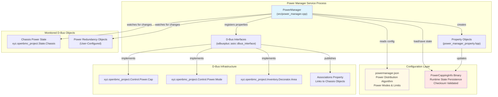

**Sources:** [src/power_manager.cpp:197-369](), [src/power_manager_property.hpp:167-558]()

---

## Core Components

### PowerManager Class

The `PowerManager` class is the main service implementation that orchestrates power capping functionality.

| Component | Type | Purpose |
|-----------|------|---------|
| `PowerManager` | Class | Main service controller, initializes D-Bus interfaces and manages power distribution |
| `powerCappingInfo` | `PowerCappingInfo` struct | In-memory representation of all power limits and mode state |
| `propertyObjs` | `vector<unique_ptr<Property>>` | Collection of all D-Bus property wrappers |
| `enabledInterface` | `vector<shared_ptr<dbus_interface>>` | D-Bus interface objects registered on the bus |
| `matchEvent` | `vector<unique_ptr<sdbusplus::bus::match_t>>` | D-Bus signal match handlers for power state and redundancy events |

**Key Methods:**

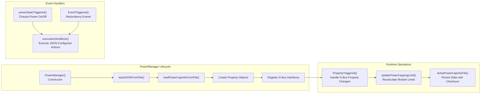

**Sources:** [src/power_manager.cpp:197-369](), [src/power_manager.hpp]()

### Property Class

The `Property` class wraps individual D-Bus properties with validation logic and state synchronization.

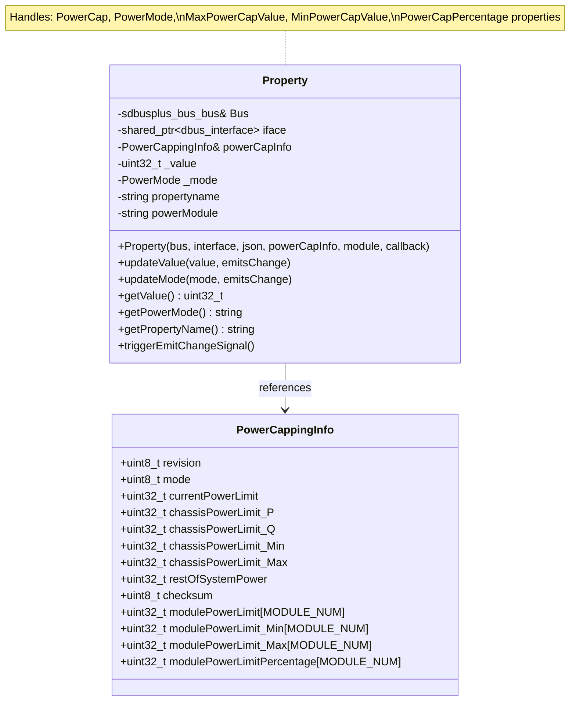

**Property Registration Flow:**

The `Property` constructor [src/power_manager_property.hpp:186-449]() performs:
1. Extracts module index from D-Bus object path (e.g., `/ProcessorModule_0`)
2. Initializes `_value` from `PowerCappingInfo` based on property name and mode
3. Registers property with D-Bus interface using `register_property()` or `register_property_r()`
4. Installs setter callback that validates new values and updates `PowerCappingInfo`

**Sources:** [src/power_manager_property.hpp:94-558]()

---

## Power Capping Data Structures

### PowerCappingInfo Structure

The `PowerCappingInfo` struct [src/power_manager_property.hpp:37-53]() is a packed binary structure that stores all power configuration state.

| Field | Type | Description |
|-------|------|-------------|
| `revision` | `uint8_t` | Data structure version (default: 0x01) |
| `mode` | `uint8_t` | Active power mode (maps to `PowerMode` enum) |
| `currentPowerLimit` | `uint32_t` | Current chassis-level power cap (watts) |
| `chassisPowerLimit_P` | `uint32_t` | Maximum performance mode power limit |
| `chassisPowerLimit_Q` | `uint32_t` | Power saving mode power limit |
| `chassisPowerLimit_Min` | `uint32_t` | Minimum allowed chassis power cap |
| `chassisPowerLimit_Max` | `uint32_t` | Maximum allowed chassis power cap |
| `restOfSystemPower` | `uint32_t` | Power reserved for non-module components |
| `checksum` | `uint8_t` | Two's complement checksum of entire structure |
| `modulePowerLimit[]` | `uint32_t[MODULE_NUM]` | Current per-module power caps |
| `modulePowerLimit_Min[]` | `uint32_t[MODULE_NUM]` | Minimum per-module power caps |
| `modulePowerLimit_Max[]` | `uint32_t[MODULE_NUM]` | Maximum per-module power caps |
| `modulePowerLimitPercentage[]` | `uint32_t[MODULE_NUM]` | Per-module power cap as percentage of max |

**Structure Layout:**

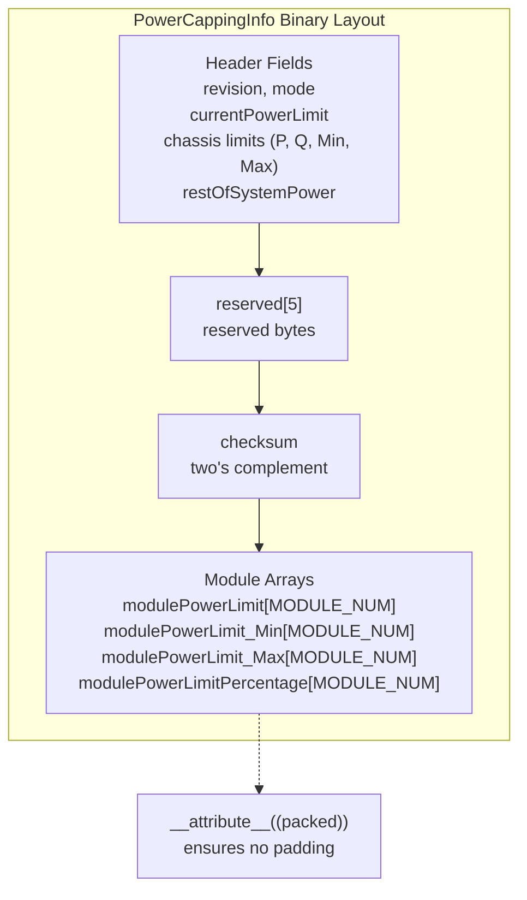

**Sources:** [src/power_manager_property.hpp:37-53]()

### PowerMode Enumeration

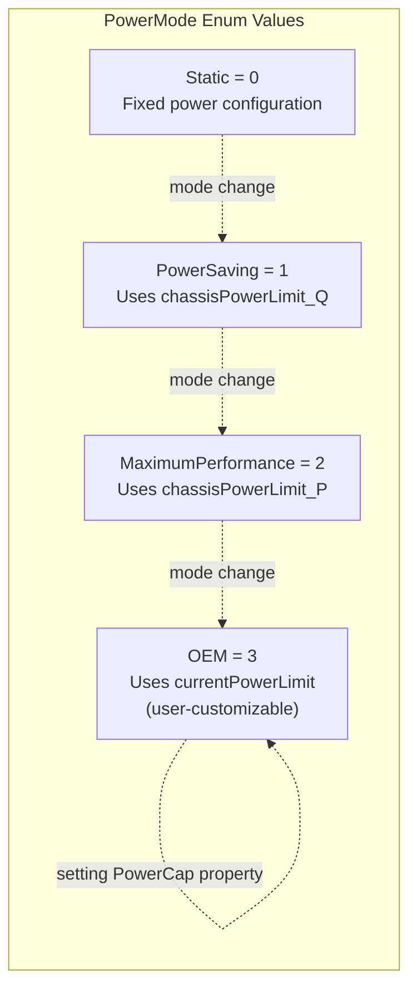

The `PowerMode` enum [src/power_manager_property.hpp:147-154]() maps to OpenBMC standard power mode strings:
- `xyz.openbmc_project.Control.Power.Mode.PowerMode.Static`
- `xyz.openbmc_project.Control.Power.Mode.PowerMode.PowerSaving`
- `xyz.openbmc_project.Control.Power.Mode.PowerMode.MaximumPerformance`
- `xyz.openbmc_project.Control.Power.Mode.PowerMode.OEM`

**Sources:** [src/power_manager_property.hpp:147-165]()

---

## Power Distribution Algorithm

The Power Manager implements a proportional power distribution algorithm that allocates chassis-level power limits to individual modules based on percentages configured in JSON.

### Algorithm Overview

```mermaid
sequenceDiagram
    participant User
    participant DBus["D-Bus System"]
    participant PM["PowerManager"]
    participant JSON["powerCappingAlgorithm<br/>(JSON config)"]
    participant Props["Property Objects"]
    participant File["Binary Persistence"]
    
    User->>DBus: Set PowerCap property<br/>(system level)
    DBus->>PM: PropertyTriggered() callback
    
    PM->>PM: Validate new cap<br/>(chassisPowerLimit_Min ≤ cap ≤ Max)
    
    alt Valid Power Cap
        PM->>JSON: Read powerCappingAlgorithm array
        JSON-->>PM: [{"powerModule": "Module",<br/>"powerCapPercentage": 40,<br/>"numOfDevices": 8}, ...]
        
        loop For each module type
            PM->>PM: Calculate:<br/>modulePowerLimit =<br/>(systemCap * percentage / 100)<br/>/ numOfDevices
            PM->>Props: updateValue(modulePowerLimit, emitsChange=true)
            Props->>DBus: PropertiesChanged signal
        end
        
        PM->>PM: powerCapInfo.mode = OEM
        PM->>PM: Calculate checksum
        PM->>File: Persist PowerCappingInfo
        
    else Invalid (Out of Range)
        PM-->>DBus: Throw ChassisLimitOutOfRange
    end
```

### Implementation Details

The `updatePowerCappingLimit()` method [src/power_manager.cpp:422-470]() implements the core distribution logic:

1. **Determine Active Power Limit:**
   ```
   switch (powerCappingInfo.mode):
     PowerSaving       → use chassisPowerLimit_Q
     MaximumPerformance → use chassisPowerLimit_P
     OEM               → use currentPowerLimit
   ```

2. **Calculate Module Limits:**
   ```
   For each entry in powerCappingAlgorithm JSON:
     modulePowerLimit = (currentLimit * percentage / 100) / numOfDevices
   ```

3. **Update Property Objects:**
   - Iterate through `propertyObjs` collection
   - Match by `powerModule` name and `propertyName == "PowerCap"`
   - Call `updateValue(modulePowerLimit, emitsChange)`

**JSON Configuration Example:**

```json
"powerCappingAlgorithm": [
  {
    "powerModule": "Module",
    "powerCapPercentage": 40,
    "numOfDevices": 8
  }
]
```

This allocates 40% of total chassis power divided among 8 devices, giving each device 5% of total chassis power.

**Validation Rules:**

| Property | Validation | Exception |
|----------|------------|-----------|
| `PowerCap` | `Min ≤ value ≤ Max` | `ChassisLimitOutOfRange` |
| `PowerCapPercentage` | `0 ≤ value ≤ 100` AND `(Max * value / 100) ≥ Min` | `NotAllowed` |
| `PowerMode` | Must be valid enum value | `InvalidEnumString` |

**Sources:** [src/power_manager.cpp:422-470](), [src/power_manager_property.hpp:326-447]()

---

## D-Bus Integration

### Published D-Bus Paths

The Power Manager creates D-Bus objects based on JSON configuration. Typical object paths:

| Object Path | Interface | Properties |
|-------------|-----------|------------|
| `/xyz/openbmc_project/control/power/CurrentChassisLimit` | `xyz.openbmc_project.Control.Power.Cap` | `PowerCap`, `MinPowerCapValue`, `MaxPowerCapValue` |
| `/xyz/openbmc_project/control/power/ChassisLimitP` | `xyz.openbmc_project.Control.Power.Cap` | `MaxPowerCapValue` (read-only) |
| `/xyz/openbmc_project/control/power/ChassisLimitQ` | `xyz.openbmc_project.Control.Power.Cap` | `MaxPowerCapValue` (read-only) |
| `/xyz/openbmc_project/control/power/ProcessorModule_0` | `xyz.openbmc_project.Control.Power.Cap` | `PowerCap`, `PowerCapPercentage`, `MinPowerCapValue`, `MaxPowerCapValue` |
| `/xyz/openbmc_project/control/power/PowerMode` | `xyz.openbmc_project.Control.Power.Mode` | `PowerMode` |

### Property Registration

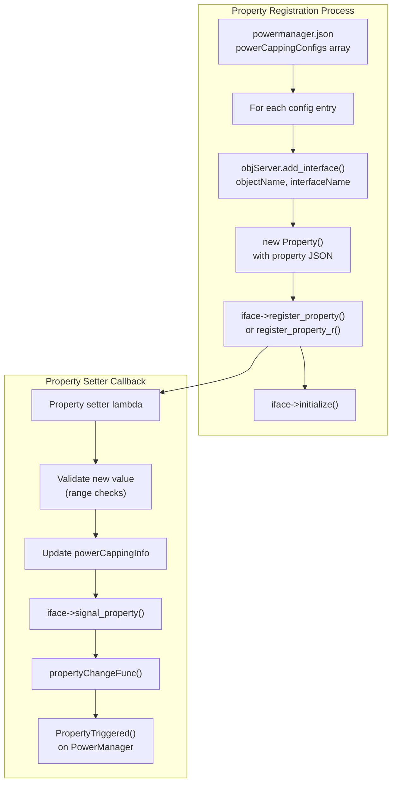

The registration process [src/power_manager.cpp:259-333]() creates D-Bus properties with the following features:

- **Read-Write Properties:** PowerCap, PowerCapPercentage, MinPowerCapValue, MaxPowerCapValue, PowerMode
- **Read-Only Properties:** MaxPowerCapValue (for ChassisLimitP/Q), Value (restOfSystemPower)
- **Setter Validation:** Range checks, mode restrictions
- **Change Signals:** Automatic emission via `signal_property()`
- **Persistence:** Automatic write-back to binary file after validation

**Sources:** [src/power_manager.cpp:259-333](), [src/power_manager_property.hpp:283-448]()

### Associations

The Power Manager registers associations to link power control objects to the system chassis:

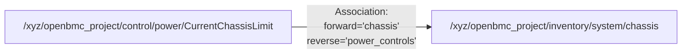

This enables Redfish and other clients to navigate from chassis inventory to power control interfaces.

**Sources:** [src/power_manager.cpp:268-296]()

---

## Persistence Mechanism

### Binary File Format

The Power Manager uses a checksummed binary format for persistence, stored at a path configured in JSON (typically `/var/lib/phosphor-power-manager/PowerCappingInfo`).

**Checksum Algorithm:**

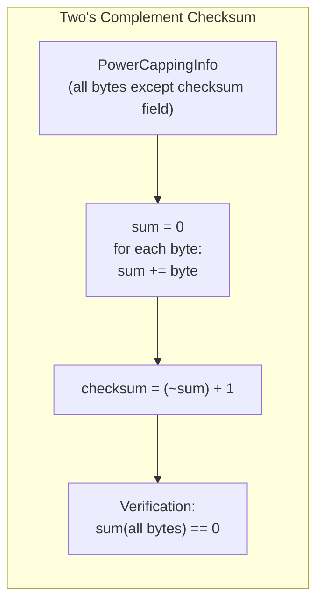

The `caluclateChecksum()` method [src/power_manager.cpp:472-487]() computes a two's complement checksum over all bytes in the structure. The `checkChecksum()` method [src/power_manager.cpp:489-504]() verifies that the sum of all bytes (including checksum field) equals zero.

### Initialization and Recovery

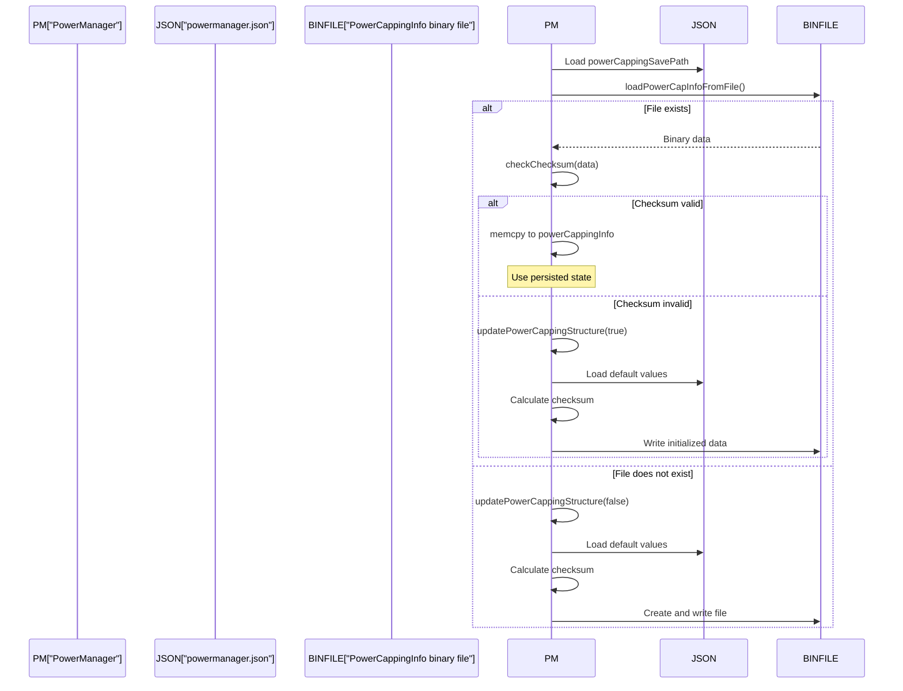

**Initialization Logic:**

1. **Load JSON Configuration:** [src/power_manager.cpp:205-210]()
2. **Attempt Binary Load:** [src/power_manager.cpp:212-214]()
3. **Checksum Validation:** [src/power_manager.cpp:216-227]()
   - Valid: Use persisted state
   - Invalid or missing: Initialize from JSON defaults
4. **Write Back:** Ensure binary file is created with valid checksum

**Runtime Persistence:**

Every property change that modifies `PowerCappingInfo` triggers:
1. Update in-memory `powerCappingInfo` structure
2. Set `checksum` field to 0
3. Calculate new checksum: `caluclateChecksum()`
4. Write to file: `dumpPowerCapIntoFile()`

**Sources:** [src/power_manager.cpp:205-232](), [src/power_manager.cpp:472-504](), [src/power_manager.cpp:1262-1269]()

---

## Power Mode Management

### Mode Transitions

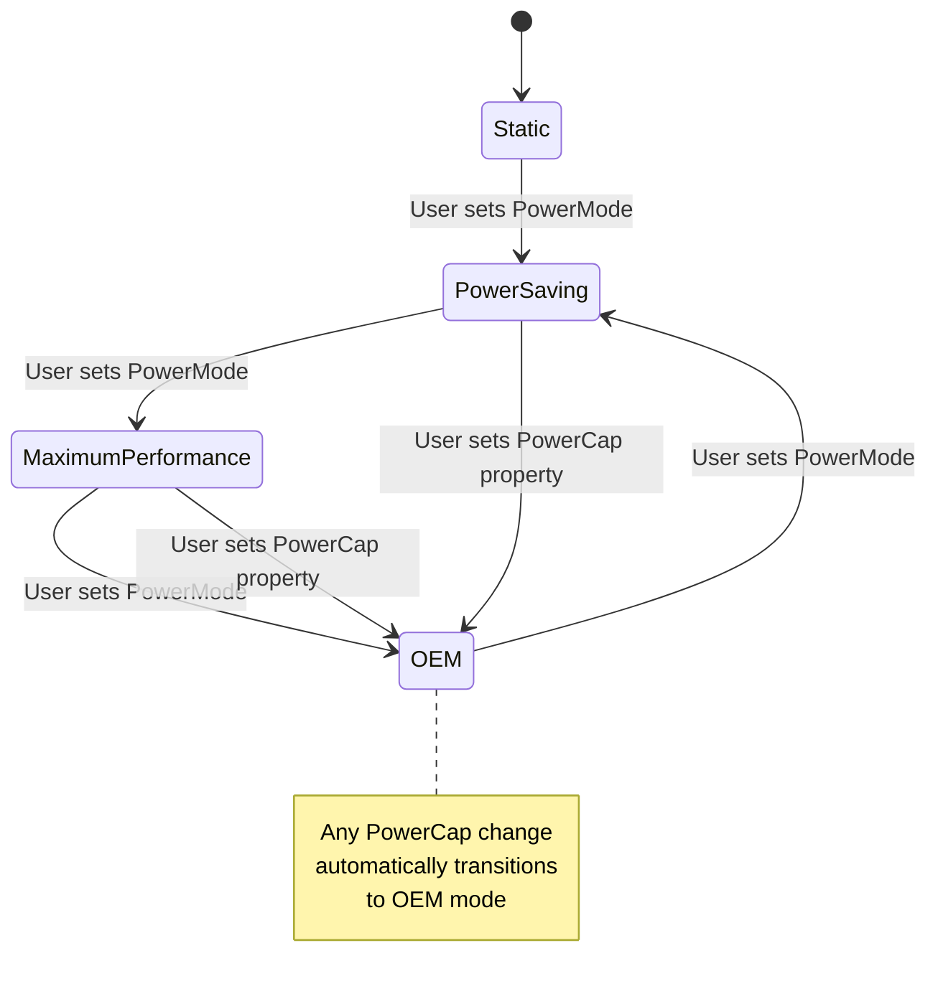

**Mode-Specific Behavior:**

| Mode | Active Limit | PowerCap Property Behavior |
|------|--------------|----------------------------|
| `Static` | N/A (no dynamic adjustment) | Value reflects static configuration |
| `PowerSaving` | `chassisPowerLimit_Q` | Setting PowerCap transitions to OEM mode |
| `MaximumPerformance` | `chassisPowerLimit_P` | Setting PowerCap transitions to OEM mode |
| `OEM` | `currentPowerLimit` | User-controlled, no automatic transitions |

**Implementation:**

The `updatePowerCapPropertyValue()` method [src/power_manager.cpp:1107-1141]() synchronizes the system-level `PowerCap` property with the active mode:

```cpp
if (mode == MaximumPerformance)
    power = chassisPowerLimit_P;
else if (mode == PowerSaving)
    power = chassisPowerLimit_Q;
else
    power = currentPowerLimit;
```

When a user sets the `PowerCap` property, the setter callback [src/power_manager_property.hpp:358-362]() forces OEM mode:

```cpp
if (static_cast<PowerMode>(powerCapInfo.mode) != OEM)
{
    powerCapInfo.mode = static_cast<int>(OEM);
}
```

**Sources:** [src/power_manager.cpp:1107-1161](), [src/power_manager_property.hpp:332-374]()

---

## Event Handling

The Power Manager implements a flexible event-driven architecture based on JSON configuration that supports:
- Chassis power state monitoring
- Power redundancy event handling
- Conditional action execution

### Event Types

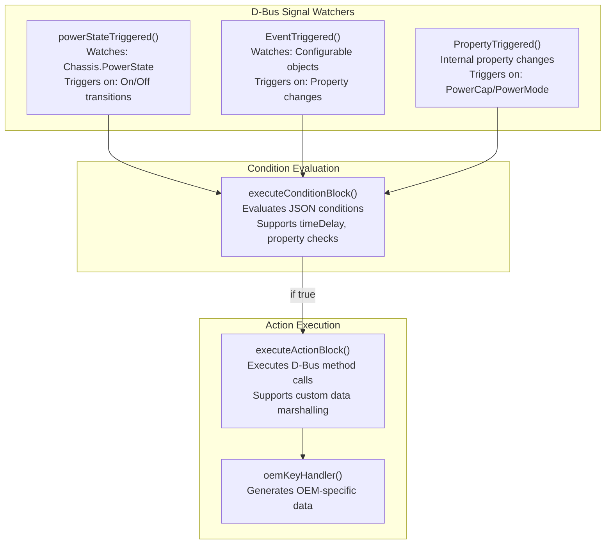

### Chassis Power State Monitoring

The `powerStateTriggered()` handler [src/power_manager.cpp:1277-1327]() monitors chassis power state:

**Monitored States:**
- `xyz.openbmc_project.State.Chassis.PowerState.Off`
- `xyz.openbmc_project.State.Chassis.PowerState.On`
- `xyz.openbmc_project.State.Chassis.PowerState.TransitioningToOff`
- `xyz.openbmc_project.State.Chassis.PowerState.TransitioningToOn`

**Workflow:**

1. D-Bus `PropertiesChanged` signal received
2. Extract new power state from signal
3. Look up configured actions in `powerState.action` JSON array
4. Match action by `trigger` field (or execute if no trigger specified)
5. Evaluate `conditionBlock` if present
6. Execute `executeActionBlock()` with power state as parameter

**Sources:** [src/power_manager.cpp:1277-1327](), [src/power_manager.cpp:336-362]()

### Redundancy Event Handling

The `EventTriggered()` handler [src/power_manager.cpp:1054-1105]() processes power redundancy events:

**Configuration:**

JSON defines watched objects in `PowerRedundancyConfigs`:
```json
{
  "objectName": "/xyz/openbmc_project/...",
  "interfaceName": "xyz.openbmc_project...",
  "propertyName": "Redundant",
  "action": [...]
}
```

**Processing:**

1. D-Bus property change signal received
2. Extract boolean property value (e.g., redundancy status)
3. Match configuration by object path
4. Evaluate condition blocks
5. Execute actions with redundancy state

**Sources:** [src/power_manager.cpp:1054-1105](), [src/power_manager.cpp:248-258]()

### Conditional Action Framework

The `executeConditionBlock()` method [src/power_manager.cpp:907-985]() enables complex decision logic:

**Supported Conditions:**

| Condition Type | Implementation | Use Case |
|----------------|----------------|----------|
| Time delay | `sleep(timeDelay)` | Wait before checking state |
| Property equality | Compare D-Bus property value to expected | Verify system state |
| Internal property check | Compare Power Manager properties | Check current power mode/limits |

**Action Execution:**

The `executeActionBlock()` method [src/power_manager.cpp:987-1053]() performs D-Bus method calls with:
- Dynamic data marshalling based on JSON `dataType` specifications
- Support for property values as method arguments
- OEM-specific data generation via `oemKeyHandler()`
- Error logging with detailed context

**Data Marshalling:**

The `getDataForAppend()` method [src/power_manager.cpp:607-905]() handles type conversion for:
- Primitive types: `int16_t`, `uint32_t`, `double`, `bool`, `string`
- Arrays of primitives
- Dictionary types
- Variant wrapping when specified

**Sources:** [src/power_manager.cpp:607-1053]()

---

## Error Handling

### Custom Exceptions

The Power Manager defines two custom D-Bus exceptions:

**NotSupportedInCurrentMode:**

[src/power_manager_property.hpp:55-71]()

- **Error Name:** `xyz.openbmc_project.Control.Power.Cap.Error.NotSupportedInCurrentMode`
- **Description:** "Current Chassis Limit value can be updated only in OEM Mode"
- **When Thrown:** Attempting to modify certain properties outside OEM mode

**ChassisLimitOutOfRange:**

[src/power_manager_property.hpp:73-91]()

- **Error Name:** `xyz.openbmc_project.Control.Power.Cap.Error.chassisLimitOutOfRange`
- **Description:** "PowerCap value should be between MaxPowerCapValue and MinPowerCapValue"
- **When Thrown:** Property setter receives value outside valid range [src/power_manager_property.hpp:343-374]()

### Validation Strategy

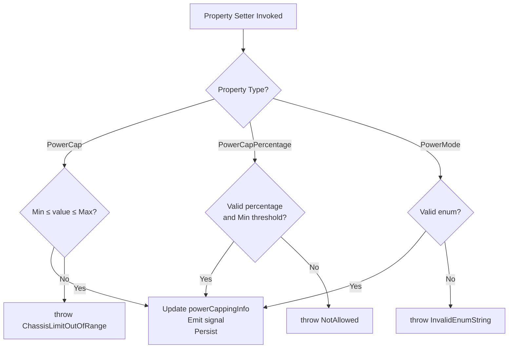

**Sources:** [src/power_manager_property.hpp:326-437]()

---

## Configuration Reference

### JSON Configuration File

The Power Manager loads configuration from `POWERMANAGER_JSON_PATH` (typically `/usr/share/nvidia-power-manager/powermanager.json`).

**Required Sections:**

| Section | Purpose | Key Fields |
|---------|---------|-----------|
| `powerCappingSavePath` | Binary persistence location | File path string |
| `powerCappingConfigs` | D-Bus object definitions | `objectName`, `interfaceName`, `module`, `property[]` |
| `powerCappingAlgorithm` | Distribution algorithm | `powerModule`, `powerCapPercentage`, `numOfDevices` |
| `powerState` | Chassis power monitoring | `objectName`, `interfaceName`, `propertyName`, `action[]` |
| `PowerRedundancyConfigs` | Redundancy event handlers | `objectName`, `interfaceName`, `propertyName`, `action[]` |

**Property Definition Schema:**

```json
{
  "propertyName": "PowerCap",
  "value": 6500,
  "flags": "sdbusplus::asio::PropertyPermission::readWrite"
}
```

**Action Block Schema:**

```json
{
  "trigger": "xyz.openbmc_project.State.Chassis.PowerState.On",
  "conditionBlock": [...],
  "serviceName": "xyz.openbmc_project.Logging",
  "objectpath": "/xyz/openbmc_project/logging",
  "interfaceName": "xyz.openbmc_project.Logging.IPMI",
  "methodName": "IpmiSelAdd",
  "appendData": [...]
}
```

**Sources:** [src/power_manager.cpp:205-368]()

---

## Summary

The Power Manager Service provides enterprise-grade power management capabilities through:

- **Proportional Power Distribution:** JSON-configured algorithms allocate chassis power across modules
- **Persistent State Management:** Checksummed binary format ensures reliable state recovery
- **Flexible Power Modes:** Support for Static, PowerSaving, MaximumPerformance, and OEM modes
- **Event-Driven Architecture:** Monitors chassis power state and redundancy events
- **Standard D-Bus Integration:** Implements OpenBMC power control interfaces
- **Validation and Safety:** Range checking, mode restrictions, and custom exception handling

The service bridges high-level power policy management with module-specific power control, serving as the central authority for system-wide power capping decisions.

**Sources:** [src/power_manager.cpp](), [src/power_manager_property.hpp]()

---

