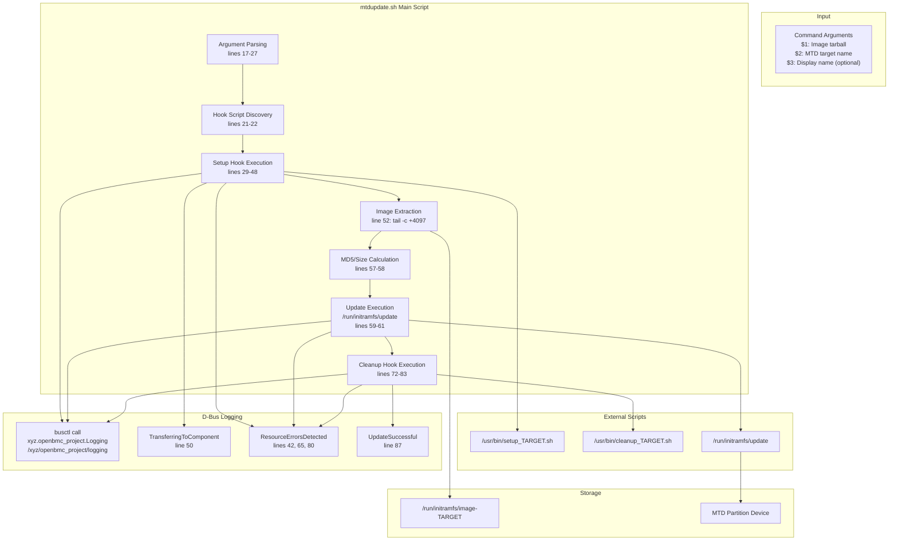
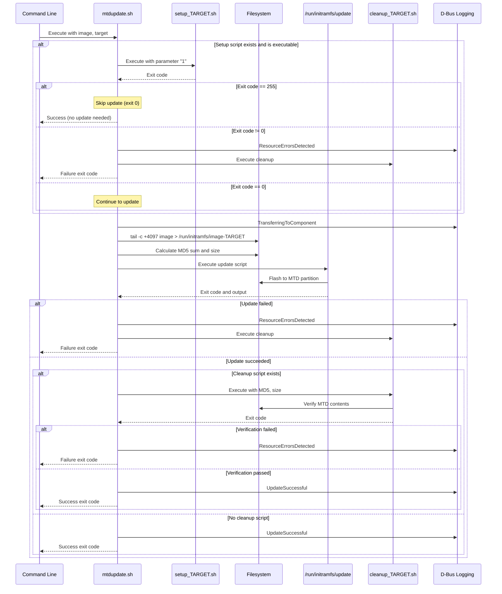
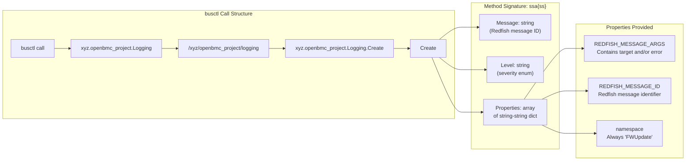
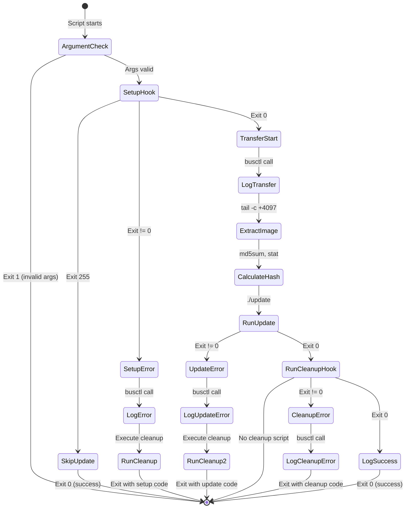

<!-- source: DeepWiki mcp.deepwiki.com · repo NVIDIA/nvidia-power-manager · page 6 MTD Firmware Update Utility · fetched 2026-10-26 -->

# MTD Firmware Update Utility

<details>
<summary>Relevant source files</summary>

The following files were used as context for generating this wiki page:

- [mtd_update/meson.build](mtd_update/meson.build)
- [mtd_update/mtdupdate.sh](mtd_update/mtdupdate.sh)

</details>


## Purpose and Scope

The MTD Firmware Update Utility (`mtdupdate.sh`) is a shell script that manages firmware updates for MTD (Memory Technology Device) partitions on the BMC. This utility provides a standardized interface for flashing firmware images to MTD-backed storage devices while integrating with OpenBMC's D-Bus logging infrastructure to report update progress and status.

This page covers the MTD update script, its command-line interface, hook system, and D-Bus integration. For CPLD firmware updates, see [CPLD Firmware Update Utilities](#3.2). For PSU firmware updates, see [PSU Firmware Update Utilities](#4.2).

## Overview

The `mtdupdate.sh` script serves as a wrapper around platform-specific MTD update implementations. It provides:

- **Hook System**: Optional setup and cleanup scripts for GPIO toggling and pre/post-update operations
- **D-Bus Integration**: Progress reporting via OpenBMC logging interfaces
- **Image Processing**: Extraction of firmware payload from tarball format
- **Verification**: MD5 checksum validation of updated images
- **Error Handling**: Comprehensive error reporting with cleanup on failure

Unlike the CPLD and PSU update utilities which have conditional Dragon Chassis implementations, the MTD updater is platform-agnostic and relies on external scripts for platform-specific behavior.

**Sources:** [mtd_update/mtdupdate.sh:1-89]()

## Script Architecture



**Sources:** [mtd_update/mtdupdate.sh:1-89]()

## Command-Line Interface

The script accepts 2 or 3 positional arguments:

```bash
mtdupdate.sh <image_tarball> <target_name> [display_name]
```

### Arguments

| Position | Parameter | Description |
|----------|-----------|-------------|
| `$1` | `image_tarball` | Path to firmware tarball containing the update image |
| `$2` | `target_name` | MTD target identifier (used to locate hook scripts) |
| `$3` | `display_name` | Optional display name for D-Bus logging (defaults to `$2`) |

The script validates argument count at [mtd_update/mtdupdate.sh:17-19]() and exits with code 1 if the wrong number of arguments is provided.

### Target Name Usage

The `target_name` parameter serves multiple purposes:
- Derives hook script names: `/usr/bin/setup_${target_name}.sh` and `/usr/bin/cleanup_${target_name}.sh`
- Names the extracted image file: `/run/initramfs/image-${target_name}`
- Provides default display name for logging messages

**Sources:** [mtd_update/mtdupdate.sh:17-27]()

## Update Workflow



**Sources:** [mtd_update/mtdupdate.sh:29-88]()

## Hook System

The hook system allows platform-specific scripts to execute before and after the MTD update process.

### Setup Hook

**Location:** `/usr/bin/setup_${target_name}.sh`

**Purpose:** Prepares the system for firmware update by toggling GPIOs, disabling watchdogs, or performing other pre-update operations.

**Invocation:** [mtd_update/mtdupdate.sh:32]()
```bash
result=$("$setup_file" 1)
```

**Parameter:** The script receives parameter `1` to indicate it's running during a firmware update process (as opposed to standalone testing).

**Return Codes:**
| Exit Code | Meaning | Script Behavior |
|-----------|---------|-----------------|
| `0` | Success | Proceed with update |
| `255` | Skip update | Exit successfully without updating [mtd_update/mtdupdate.sh:35-38]() |
| Other | Error | Log error to D-Bus, run cleanup, exit with error code [mtd_update/mtdupdate.sh:40-47]() |

### Cleanup Hook

**Location:** `/usr/bin/cleanup_${target_name}.sh`

**Purpose:** Restores system state after update, verifies flashed firmware, and performs post-update operations.

**Invocation:** [mtd_update/mtdupdate.sh:76]()
```bash
result=$("$cleanup_file" 1 "$expected_md5sum" "$expected_size")
```

**Parameters:**
1. `1` - Indicates running during firmware update process
2. `expected_md5sum` - MD5 checksum of the image written to disk
3. `expected_size` - Size in bytes of the image written to disk

**Return Codes:**
| Exit Code | Meaning | Script Behavior |
|-----------|---------|-----------------|
| `0` | Success | Log success to D-Bus and exit successfully |
| Other | Verification failed | Log error to D-Bus and exit with error code [mtd_update/mtdupdate.sh:78-82]() |

### Hook Discovery

The script checks for hook existence and executability at [mtd_update/mtdupdate.sh:29]() and [mtd_update/mtdupdate.sh:72]() using shell conditionals:
```bash
if [ -f "$setup_file" ] && [ -x "$setup_file" ]; then
```

If hooks don't exist, the script proceeds without them—no error is raised.

**Sources:** [mtd_update/mtdupdate.sh:21-22, 29-48, 72-83]()

## D-Bus Logging Integration

The script integrates with OpenBMC's logging system by calling `busctl` to create log entries that can be consumed by firmware update tasks and exposed via Redfish.

### D-Bus Interface

**Service:** `xyz.openbmc_project.Logging`  
**Object Path:** `/xyz/openbmc_project/logging`  
**Interface:** `xyz.openbmc_project.Logging.Create`  
**Method:** `Create`

### Message Types

The script sends four types of messages:

| Message | Redfish ID | Level | Sent When | Location |
|---------|-----------|-------|-----------|----------|
| Transfer Started | `Update.1.0.TransferringToComponent` | Informational | Before image extraction | [mtd_update/mtdupdate.sh:50]() |
| Setup Failed | `ResourceEvent.1.0.ResourceErrorsDetected` | Warning | Setup hook returns error | [mtd_update/mtdupdate.sh:42]() |
| Update Failed | `ResourceEvent.1.0.ResourceErrorsDetected` | Warning | Update script fails | [mtd_update/mtdupdate.sh:65]() |
| Cleanup Failed | `ResourceEvent.1.0.ResourceErrorsDetected` | Warning | Cleanup hook returns error | [mtd_update/mtdupdate.sh:80]() |
| Update Success | `Update.1.0.UpdateSuccessful` | Informational | All steps succeed | [mtd_update/mtdupdate.sh:87]() |

### Message Format



### Example D-Bus Calls

**Transfer Start:**
```bash
busctl call xyz.openbmc_project.Logging /xyz/openbmc_project/logging \
    xyz.openbmc_project.Logging.Create Create ssa{ss} \
    Update.1.0.TransferringToComponent \
    xyz.openbmc_project.Logging.Entry.Level.Informational 3 \
    'REDFISH_MESSAGE_ARGS' " ,${target}" \
    'REDFISH_MESSAGE_ID' 'Update.1.0.TransferringToComponent' \
    'namespace' 'FWUpdate'
```

**Error Reporting:**
```bash
busctl call xyz.openbmc_project.Logging /xyz/openbmc_project/logging \
    xyz.openbmc_project.Logging.Create Create ssa{ss} \
    org.open_power.Logging.Error.TestError1 \
    xyz.openbmc_project.Logging.Entry.Level.Warning 3 \
    'REDFISH_MESSAGE_ARGS' "${target}:${result}" \
    'REDFISH_MESSAGE_ID' 'ResourceEvent.1.0.ResourceErrorsDetected' \
    'namespace' 'FWUpdate'
```

The `REDFISH_MESSAGE_ARGS` field contains the target name and any error output from failed scripts, allowing detailed diagnostic information to propagate to management interfaces.

**Sources:** [mtd_update/mtdupdate.sh:42, 50, 65, 80, 87]()

## Image Processing

The script performs image extraction and checksum calculation to prepare the firmware payload for flashing.

### Image Extraction

The firmware tarball contains a header followed by the actual firmware payload. The script extracts the payload at [mtd_update/mtdupdate.sh:52]():

```bash
tail -c +4097 $1 > /run/initramfs/image-$2
```

**Details:**
- Uses `tail -c +4097` to skip the first 4096 bytes (header)
- Writes extracted image to `/run/initramfs/image-${target_name}`
- The `/run/initramfs/` location is a RAM-backed filesystem for temporary storage

### Checksum Calculation

Before calling the update script, MD5 hash and file size are calculated at [mtd_update/mtdupdate.sh:57-58]():

```bash
expected_md5sum=$(md5sum "/run/initramfs/image-$2" | awk '{print $1}')
expected_size=$(stat -c%s "/run/initramfs/image-$2")
```

These values are passed to the cleanup hook, which can read back the MTD partition contents to verify the flash operation succeeded.

### Update Script Invocation

The actual MTD flashing is delegated to a platform-specific script at [mtd_update/mtdupdate.sh:59-61]():

```bash
cd /run/initramfs
result=$(run_command "./update")
exit_code=$?
```

The `update` script (located at `/run/initramfs/update`) must be provided by the platform and is responsible for the actual MTD device interaction. The `run_command` helper function captures both stdout and stderr at [mtd_update/mtdupdate.sh:9-15]().

**Sources:** [mtd_update/mtdupdate.sh:9-15, 52, 57-61]()

## Error Handling

The script implements comprehensive error handling with cleanup and logging at every failure point.

### Error Flow



### Error Propagation

1. **Setup Errors:** If setup fails, cleanup hook is called (if it exists) before exit [mtd_update/mtdupdate.sh:43-46]()
2. **Update Errors:** If the update script fails, cleanup hook is called to restore state [mtd_update/mtdupdate.sh:66-68]()
3. **Cleanup Errors:** If cleanup verification fails, no additional cleanup is performed (cleanup already executed) [mtd_update/mtdupdate.sh:78-81]()

### Exit Code Preservation

The script preserves exit codes from failed operations:
- Setup failures exit with setup script's code [mtd_update/mtdupdate.sh:46]()
- Update failures exit with update script's code [mtd_update/mtdupdate.sh:69]()
- Cleanup failures exit with cleanup script's code [mtd_update/mtdupdate.sh:81]()
- Success exits with the final exit code (typically 0) [mtd_update/mtdupdate.sh:88]()

### Output Capture

The `run_command` helper function at [mtd_update/mtdupdate.sh:9-15]() captures both stdout and stderr from executed commands, allowing error messages to be included in D-Bus log entries.

**Sources:** [mtd_update/mtdupdate.sh:9-15, 40-47, 63-70, 78-82]()

## Build Configuration

The MTD update script is installed by the Meson build system.

### Installation

The build configuration at [mtd_update/meson.build:1-5]() installs the script to the system binary directory:

```meson
install_data(
    'mtdupdate.sh',
    install_dir: get_option('bindir'),
    install_mode: 'rwxr-xr-x',
)
```

**Installation Details:**
- **Source:** `mtd_update/mtdupdate.sh`
- **Destination:** `${bindir}/mtdupdate.sh` (typically `/usr/bin/mtdupdate.sh`)
- **Permissions:** `rwxr-xr-x` (755) - executable by all users

Unlike the CPLD and PSU utilities, the MTD updater has no conditional compilation or Dragon Chassis-specific variants—it's always installed when the repository is built.

**Sources:** [mtd_update/meson.build:1-5]()

## Integration with OpenBMC

The MTD update utility integrates with OpenBMC's firmware update infrastructure through several mechanisms:

### Software Update Framework

While not directly implementing OpenBMC's Software.Version or Software.Activation interfaces, the MTD updater is typically invoked by higher-level update management services that do implement these interfaces. The D-Bus logging integration allows these services to track update progress.

### Logging System

All status messages use the `xyz.openbmc_project.Logging` interface, which feeds into:
- BMC logging subsystem for persistent log storage
- Redfish event subscriptions for remote notification
- D-Bus signals for local consumers

The `namespace` property value of `'FWUpdate'` allows log consumers to filter firmware update-related messages.

### RAM Filesystem Usage

The script uses `/run/initramfs/` as the working directory, which is typically a `tmpfs` mount. This provides:
- Fast read/write performance for temporary files
- Automatic cleanup on reboot
- No wear on flash storage during the update process

**Sources:** [mtd_update/mtdupdate.sh:50, 52, 59]()

---

