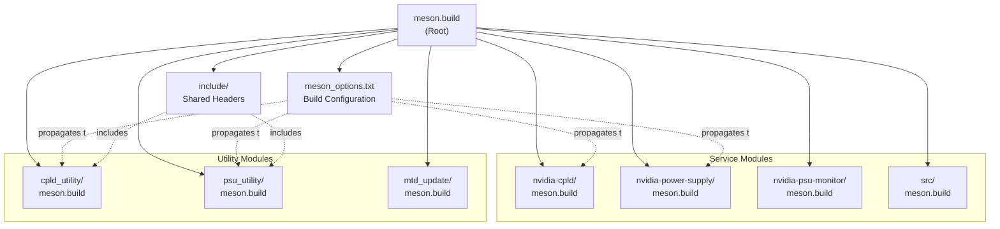
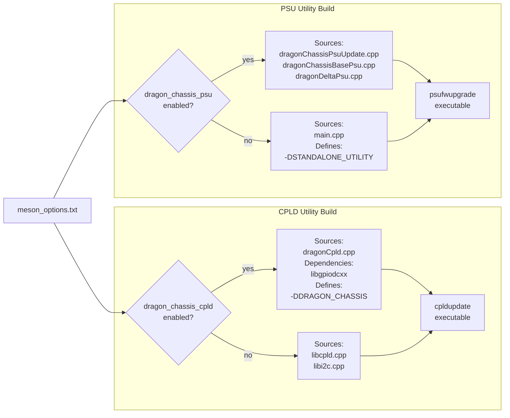
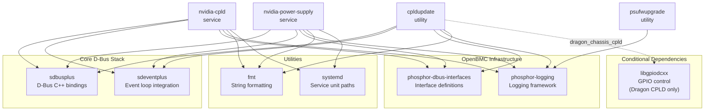
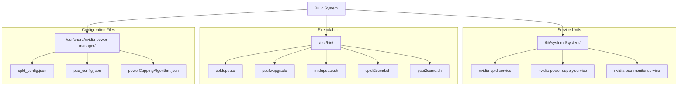
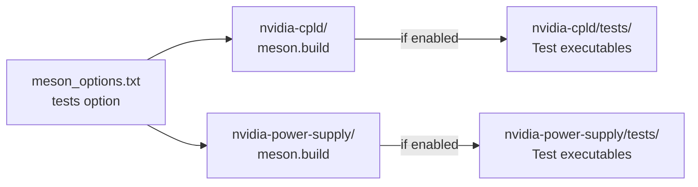

<!-- source: DeepWiki mcp.deepwiki.com · repo NVIDIA/nvidia-power-manager · page 7 Build System · fetched 2026-10-26 -->

# Build System

<details>
<summary>Relevant source files</summary>

The following files were used as context for generating this wiki page:

- [cpld_utility/meson.build](cpld_utility/meson.build)
- [cpld_utility/utils.cpp](cpld_utility/utils.cpp)
- [cpld_utility/utils.hpp](cpld_utility/utils.hpp)
- [meson.build](meson.build)
- [meson_options.txt](meson_options.txt)
- [nvidia-cpld/meson.build](nvidia-cpld/meson.build)
- [nvidia-power-supply/meson.build](nvidia-power-supply/meson.build)
- [psu_utility/meson.build](psu_utility/meson.build)

</details>


## Purpose and Scope

This document describes the Meson build system architecture for the nvidia-power-manager repository. It covers build options, conditional compilation mechanisms, module-specific configurations, dependencies, and installation artifacts. For information about the D-Bus services that are built by this system, see [CPLD D-Bus Service](#3.1), [PSU D-Bus Service](#4.1), and [Power Manager Service](#5). For details on the firmware update utilities produced by the build, see [CPLD Firmware Update Utilities](#3.2) and [PSU Firmware Update Utilities](#4.2).

## Build System Architecture

The nvidia-power-manager uses **Meson** as its build system generator, with a modular architecture that separates concerns across multiple subdirectories. The root build file orchestrates seven primary subsystems, each responsible for a distinct component of the power management infrastructure.

### Root Build Configuration

The root [meson.build:1-17]() establishes the project with C++23 and C language support, enabling link-time optimization (`b_lto=true`) and warning level 3 by default. The build system processes subdirectories in a specific order:

```
nvidia-power-manager/
├── meson.build                 # Root orchestration
├── meson_options.txt           # Centralized build options
├── psu_utility/               # PSU firmware update utility
├── nvidia-power-supply/       # PSU D-Bus service
├── nvidia-cpld/               # CPLD D-Bus service
├── nvidia-psu-monitor/        # PSU monitoring service
├── cpld_utility/              # CPLD firmware update utility
├── src/                       # Power Manager service
└── mtd_update/                # MTD partition update utility
```

**Build System Organization Diagram**



Sources: [meson.build:1-17](), [meson_options.txt:1-40]()

## Build Options and Configuration

The [meson_options.txt:1-40]() file centralizes all configurable build parameters. These options propagate throughout the build tree and control conditional compilation, feature enablement, and path construction.

### Build Options Table

| Option | Type | Default | Description |
|--------|------|---------|-------------|
| `dragon_chassis_psu` | feature | disabled | Enable Dragon Chassis PSU update implementation |
| `dragon_chassis_cpld` | feature | disabled | Enable Dragon Chassis CPLD update implementation |
| `tests` | feature | enabled | Build test suites for D-Bus services |
| `module_num` | integer | 1 | Number of module instances (range: 1-4) |
| `module_obj_path_prefix` | string | "ProcessorModule_" | Prefix for module object paths |
| `platform_prefix` | string | "" | Platform-specific prefix for inventory paths |
| `platform_fw_prefix` | string | "" | Platform-specific prefix for firmware paths |

Sources: [meson_options.txt:1-40]()

### Conditional Compilation Mechanism

The Dragon Chassis build options (`dragon_chassis_psu`, `dragon_chassis_cpld`) trigger **compile-time polymorphism**, selecting between two distinct implementation paths:

**Conditional Compilation Flow**



Sources: [cpld_utility/meson.build:16-24](), [psu_utility/meson.build:7-32]()

When `dragon_chassis_cpld` is enabled, the CPLD utility build ([cpld_utility/meson.build:16-24]()):
1. Adds `dragonCpld.cpp` to the source list
2. Includes `libgpiodcxx` dependency for GPIO control
3. Defines the `DRAGON_CHASSIS` preprocessor macro

When `dragon_chassis_psu` is enabled, the PSU utility build ([psu_utility/meson.build:7-21]()) replaces the generic `main.cpp` with three Dragon Chassis-specific source files implementing the `DragonChassisPsuUpdate` class hierarchy.

## Module-Specific Build Configurations

Each subsystem has its own `meson.build` file that defines compilation units, dependencies, and configuration data.

### CPLD Module Build

The [nvidia-cpld/meson.build:1-36]() configures the CPLD D-Bus service:

**Configuration Data**:
- `CPLD_JSON_PATH`: `/usr/share/nvidia-power-manager/cpld_config.json`
- `BUSNAME`: `com.Nvidia.Cpld`
- `BASE_INV_PATH`: `/xyz/openbmc_project/inventory/system/board`
- `SW_INV_PATH`: `/xyz/openbmc_project/software`
- `PLATFORM_PREFIX`: Value from `get_option('platform_prefix')`
- `PLATFORM_FW_PREFIX`: Value from `get_option('platform_fw_prefix')`

**Dependencies**:
- `sdbusplus`: D-Bus C++ bindings
- `sdeventplus`: Event loop integration
- `fmt`: String formatting library
- `phosphor-dbus-interfaces`: OpenBMC D-Bus interface definitions
- `phosphor-logging`: Logging framework

The build also installs the `cpldi2ccmd.sh` shell script ([nvidia-cpld/meson.build:24-28]()) and processes the `services/` subdirectory for systemd unit files. If tests are enabled, it processes the `tests/` subdirectory ([nvidia-cpld/meson.build:33-35]()).

Sources: [nvidia-cpld/meson.build:1-36]()

### PSU Module Build

The [nvidia-power-supply/meson.build:1-46]() follows a similar pattern to the CPLD build:

**Configuration Data**:
- `PSU_JSON_PATH`: `/usr/share/nvidia-power-manager/psu_config.json`
- `BUSNAME`: `com.Nvidia.Powersupply`
- `BASE_INV_PATH`: `/xyz/openbmc_project/inventory/system/chassis/motherboard`
- `PSU_SENSOR_PATH`: `/xyz/openbmc_project/sensors/system/chassis/motherboard`
- `OBJ_MANAGER_PATH`: `/xyz/openbmc_project/sensors`

**Dependencies**: Same as CPLD module (`sdbusplus`, `sdeventplus`, `fmt`, `phosphor-dbus-interfaces`, `phosphor-logging`)

The PSU module installs `psui2ccmd.sh` ([nvidia-power-supply/meson.build:32-36]()) and conditionally builds tests based on the `tests` option ([nvidia-power-supply/meson.build:43-45]()).

Sources: [nvidia-power-supply/meson.build:1-46]()

### CPLD Utility Build

The [cpld_utility/meson.build:1-41]() builds the `cpldupdate` firmware update executable. The base source set includes:

```
main.cpp
libcpld.cpp
libi2c.cpp
updateCPLDFw_dbus_log_event.cpp
utils.cpp
```

**Conditional Dragon Chassis Extension** ([cpld_utility/meson.build:16-24]()):
```
if get_option('dragon_chassis_cpld').enabled()
    depend += dependency('libgpiodcxx', ...)
    sources += 'dragonCpld.cpp'
    arg += '-DDRAGON_CHASSIS'
endif
```

The build also installs public headers ([cpld_utility/meson.build:35-40]()) for potential external consumers:
- `libcpld.h`
- `libi2c.h`
- `updateCPLDFw_dbus_log_event.h`
- `utils.hpp`

Sources: [cpld_utility/meson.build:1-41]()

### PSU Utility Build

The [psu_utility/meson.build:1-33]() demonstrates **complete source substitution** based on the `dragon_chassis_psu` option:

**Dragon Chassis Build** ([psu_utility/meson.build:7-21]()):
```
dragonChassisPsuUpdate.cpp
dragonChassisBasePsu.cpp
dragonDeltaPsu.cpp
```

**Generic Build** ([psu_utility/meson.build:22-32]()):
```
main.cpp
(with -DSTANDALONE_UTILITY flag)
```

Both variants produce the same executable name (`psufwupgrade`) but with fundamentally different implementations.

Sources: [psu_utility/meson.build:1-33]()

## Dependency Management

The build system uses `dependency()` calls to locate required libraries via pkg-config. All dependencies are OpenBMC-standard packages.

**Common Dependencies Across Modules**



Sources: [nvidia-cpld/meson.build:18-22](), [nvidia-power-supply/meson.build:26-30](), [cpld_utility/meson.build:8-24](), [psu_utility/meson.build:1-6]()

### Conditional GPIO Dependency

The `libgpiodcxx` dependency is only included when Dragon Chassis CPLD support is enabled ([cpld_utility/meson.build:17-21]()):

```
depend += dependency(
    'libgpiodcxx',
    fallback: ['libgpiod', 'gpiodcxx_dep'],
    default_options: ['bindings=cxx'],
)
```

This dependency provides the GPIO control interface used for CPLD refresh signaling in Dragon Chassis platforms (see [Dragon Chassis CPLD Update](#3.2.2) and [Hardware Abstraction Layer](#8)).

Sources: [cpld_utility/meson.build:16-21]()

## Build Artifacts and Installation

The build system produces three categories of artifacts: systemd service units, executable binaries, and configuration files.

**Installation Layout**



Sources: [nvidia-cpld/meson.build:1-2,24-28](), [nvidia-power-supply/meson.build:1-2,32-36](), [cpld_utility/meson.build:26-34](), [psu_utility/meson.build:19-20,29-30]()

### Systemd Service Installation

Service unit files are installed to the directory provided by the `systemd` dependency via pkg-config query:

```
systemd = dependency('systemd')
servicedir = systemd.get_variable(pkgconfig: 'systemdsystemunitdir')
```

This ensures compatibility with the target system's systemd installation path conventions.

Sources: [nvidia-cpld/meson.build:1-2](), [nvidia-power-supply/meson.build:1-2]()

### Executable Installation

All executables are installed to the directory specified by `get_option('bindir')`, which defaults to the Meson standard bindir (typically `/usr/bin`). The CPLD and PSU shell scripts are installed with executable permissions (`install_mode: 'rwxr-xr-x'`).

Sources: [nvidia-cpld/meson.build:24-28](), [nvidia-power-supply/meson.build:32-36](), [cpld_utility/meson.build:26-34]()

### Configuration File Paths

Configuration file paths are compiled into the binaries as string constants using `configuration_data()`. The CPLD service embeds `CPLD_JSON_PATH` ([nvidia-cpld/meson.build:5-8]()), the PSU service embeds `PSU_JSON_PATH` ([nvidia-power-supply/meson.build:5-8]()), and both services receive platform-specific prefixes via `PLATFORM_PREFIX` and `PLATFORM_FW_PREFIX`.

Sources: [nvidia-cpld/meson.build:4-16](), [nvidia-power-supply/meson.build:4-17]()

## D-Bus Integration in Build Configuration

The build system embeds D-Bus interface paths and service names as compile-time constants, ensuring type-safe access to OpenBMC infrastructure.

**Embedded D-Bus Paths and Service Names**

| Module | Bus Name | Inventory Base Path | Software Path |
|--------|----------|---------------------|---------------|
| CPLD | `com.Nvidia.Cpld` | `/xyz/openbmc_project/inventory/system/board` | `/xyz/openbmc_project/software` |
| PSU | `com.Nvidia.Powersupply` | `/xyz/openbmc_project/inventory/system/chassis/motherboard` | `/xyz/openbmc_project/software` |

The utility programs use these constants to interact with D-Bus services. For example, [cpld_utility/utils.hpp:25-27]() defines:

```cpp
const std::string service = "com.Nvidia.Cpld";
const std::string swBasePath = "/xyz/openbmc_project/software/";
```

These constants are used by the `setFwVersion()` function ([cpld_utility/utils.cpp:43-48]()) to update firmware version properties on D-Bus after successful firmware updates.

Sources: [nvidia-cpld/meson.build:10-14](), [nvidia-power-supply/meson.build:10-17](), [cpld_utility/utils.hpp:25-27](), [cpld_utility/utils.cpp:43-48]()

## Test Infrastructure Build

The build system includes conditional test compilation controlled by the `tests` option ([meson_options.txt:13]()), which is enabled by default.

**Test Build Integration**



Both the CPLD and PSU modules check the `tests` option before processing their test subdirectories:

```
if not build_tests.disabled()
    subdir('tests')
endif
```

The PSU module retrieves the option value explicitly ([nvidia-power-supply/meson.build:38]()), while the CPLD module uses it directly from the parent scope.

For detailed test implementation information, see [Testing and Development](#9).

Sources: [nvidia-cpld/meson.build:33-35](), [nvidia-power-supply/meson.build:38,43-45](), [meson_options.txt:13]()

## Build Command Examples

### Standard Build

```bash
meson setup build
meson compile -C build
meson install -C build
```

### Dragon Chassis Platform Build

```bash
meson setup build \
  -Ddragon_chassis_cpld=enabled \
  -Ddragon_chassis_psu=enabled \
  -Dmodule_num=4 \
  -Dplatform_prefix=HGX
meson compile -C build
```

### Test-Disabled Build

```bash
meson setup build -Dtests=disabled
meson compile -C build
```

## Summary

The Meson build system for nvidia-power-manager provides:

1. **Modular Architecture**: Seven independent subdirectories with dedicated build files
2. **Conditional Compilation**: Dragon Chassis features enabled via Meson options, eliminating runtime branching
3. **Compile-Time Configuration**: D-Bus paths, service names, and platform prefixes embedded as constants
4. **Dependency Management**: Automatic pkg-config integration with OpenBMC standard libraries
5. **Flexible Deployment**: Support for generic and platform-specific implementations from a single codebase
6. **Test Integration**: Optional test suite compilation controlled by build options

This architecture enables efficient multi-platform support while maintaining clear separation between runtime services, firmware update utilities, and configuration data.

---

