<!-- source: DeepWiki mcp.deepwiki.com · repo NVIDIA/nvidia-power-manager · page 8 Hardware Abstraction Layer · fetched 2026-10-26 -->

# Hardware Abstraction Layer

<details>
<summary>Relevant source files</summary>

The following files were used as context for generating this wiki page:

- [cpld_utility/dragonCpld.hpp](cpld_utility/dragonCpld.hpp)
- [cpld_utility/meson.build](cpld_utility/meson.build)
- [cpld_utility/utils.cpp](cpld_utility/utils.cpp)
- [cpld_utility/utils.hpp](cpld_utility/utils.hpp)
- [include/dragonChassisBase.hpp](include/dragonChassisBase.hpp)

</details>


## Purpose and Scope

The Hardware Abstraction Layer (HAL) provides a platform-agnostic abstraction for firmware update operations on Dragon Chassis platforms. It centralizes common I2C communication patterns, arbitration mechanisms, GPIO control, and image loading infrastructure used by both CPLD and PSU firmware update utilities.

This page documents the core abstraction classes (`DragonChassisBase`, `I2c`), I2C arbitration protocols, PEC (Packet Error Code) calculation, and retry logic. For information about specific CPLD update implementations using this HAL, see [Dragon Chassis CPLD Update](#3.2.2). For PSU-specific implementations, see [PSU Firmware Update Utilities](#4.2).

## Architecture Overview

The hardware abstraction layer implements a class hierarchy that separates common Dragon Chassis behaviors from device-specific update sequences:

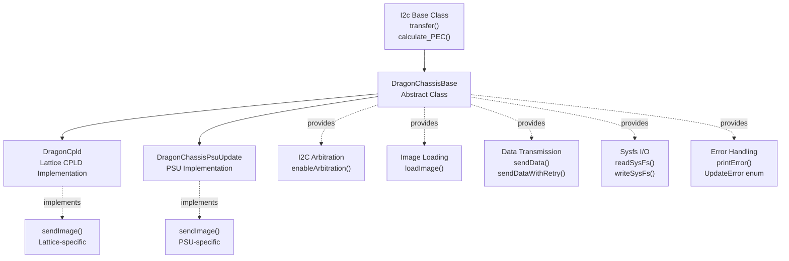

**Sources:** [include/dragonChassisBase.hpp:1-503](), [cpld_utility/dragonCpld.hpp:1-168]()

The abstraction provides three layers:
1. **I2c Base Class**: Low-level I2C transfer operations and PEC calculation
2. **DragonChassisBase**: Common Dragon Chassis behaviors (arbitration, image loading, retry logic)
3. **Derived Classes**: Device-specific update sequences (`DragonCpld`, `DragonChassisPsuUpdate`)

## DragonChassisBase Abstract Class

### Class Definition and Responsibilities

The `DragonChassisBase` class serves as the foundation for all Dragon Chassis firmware update utilities. It inherits from `I2c` and provides platform-specific infrastructure while remaining device-agnostic.

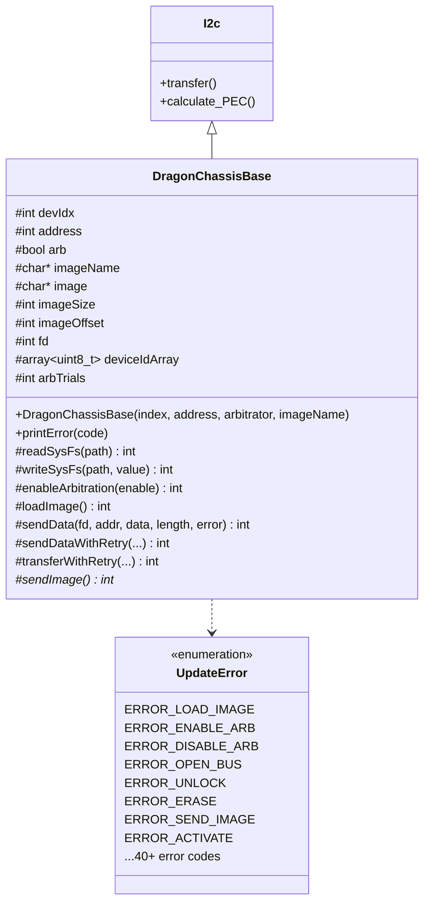

**Sources:** [include/dragonChassisBase.hpp:36-503]()

### Constructor Parameters

The constructor initializes common state required for Dragon Chassis updates:

| Parameter | Type | Purpose |
|-----------|------|---------|
| `index` | `int` | Device index (e.g., CPLD0, CPLD1, PSU0, PSU1) |
| `address` | `int` | I2C slave address of target device |
| `arbitrator` | `bool` | Whether I2C bus requires arbitration |
| `imageName` | `char*` | Path to firmware image file |

**Sources:** [include/dragonChassisBase.hpp:46-49]()

## I2C Communication Infrastructure

### Sysfs Interface Layer

The HAL provides methods to interact with kernel driver sysfs interfaces, primarily for arbitration control:

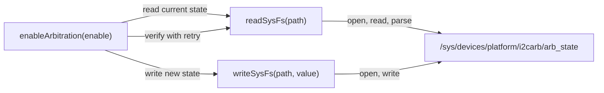

**Sources:** [include/dragonChassisBase.hpp:273-308]()

#### readSysFs() Implementation

The `readSysFs()` method reads an integer value from a sysfs file:

- Opens file at specified path
- Reads content as string
- Converts to integer using `std::stoi()`
- Returns -1 on any error (file not found, parse failure)

**Sources:** [include/dragonChassisBase.hpp:273-291]()

#### writeSysFs() Implementation

The `writeSysFs()` method writes an integer value to a sysfs file:

- Opens file for writing
- Writes integer value
- Returns 0 on success, -1 on failure

**Sources:** [include/dragonChassisBase.hpp:300-308]()

### Data Transmission with PEC

The HAL implements PEC-enabled I2C data transmission for enhanced reliability:

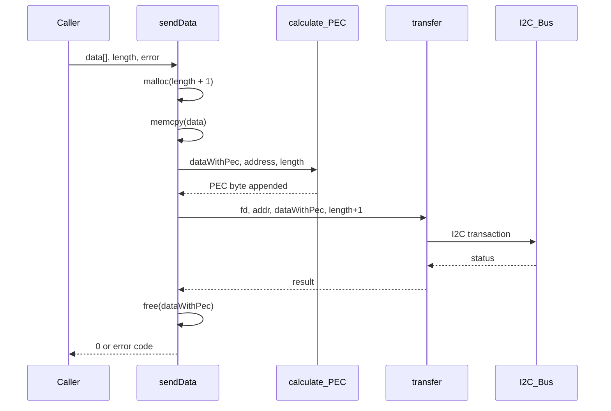

**Sources:** [include/dragonChassisBase.hpp:441-469]()

The `sendData()` method:
1. Allocates buffer with space for PEC byte
2. Copies data to new buffer
3. Calls `calculate_PEC()` to append checksum
4. Performs I2C transfer via `transfer()` method
5. Returns error code on failure, 0 on success

### Retry Logic

Both data transmission and I2C transfer operations support configurable retry mechanisms:

| Method | Purpose | Retry Count |
|--------|---------|-------------|
| `sendDataWithRetry()` | Retry data send with PEC | Configurable parameter |
| `transferWithRetry()` | Retry raw I2C transfer | Configurable parameter |

**Sources:** [include/dragonChassisBase.hpp:471-497]()

The retry methods loop up to `retry` times, breaking on first success:

```cpp
for (int i = 0; i < retry; i++) {
    ret = sendData(send_fd, send_addr, data, length, error);
    if (!ret) break;
}
```

## I2C Arbitration Mechanism

### Arbitration Protocol Overview

Dragon Chassis implements a sophisticated I2C arbitration protocol coordinated between BMC and CPLD via GPIO handshake. The BMC-side implementation is provided by a kernel driver exposed through sysfs.

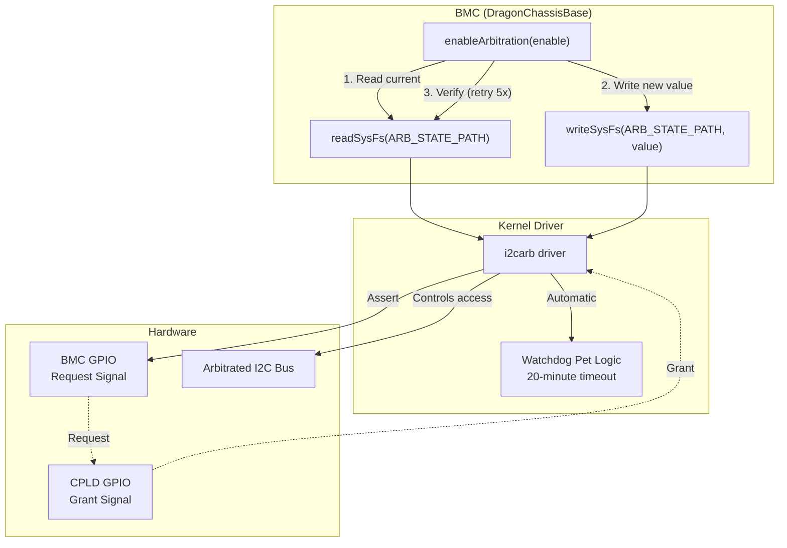

**Sources:** [include/dragonChassisBase.hpp:310-370]()

### Arbitration State Machine

The `enableArbitration()` method implements a state machine with verification and retry:

1. **Read Current State**: Check if arbitration is already in desired state
2. **Write New State**: If different, write to `ARB_STATE_PATH`
3. **Verify with Retry**: Read back state up to `arbTrials` (5) times
4. **Timeout Check**: 20-minute watchdog timeout enforced by kernel driver

**Arbitration Path Constant:**
```cpp
#define ARB_STATE_PATH "/sys/devices/platform/i2carb/arb_state"
```

**Sources:** [include/dragonChassisBase.hpp:28](), [include/dragonChassisBase.hpp:323-370]()

### Arbitration Flow

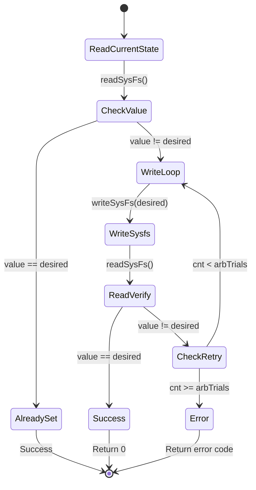

**Sources:** [include/dragonChassisBase.hpp:323-370]()

### Error Handling for Arbitration

Arbitration failures return specific error codes:

| Error Code | Scenario |
|------------|----------|
| `ERROR_ENABLE_ARB` | Failed to enable arbitration |
| `ERROR_DISABLE_ARB` | Failed to disable arbitration |
| `ERROR_ARB_NOT_FOUND` | Arbitration sysfs path not found |

**Sources:** [include/dragonChassisBase.hpp:209-252]()

## Image Loading Infrastructure

### Image Loading Process

The `loadImage()` method handles firmware image file operations:

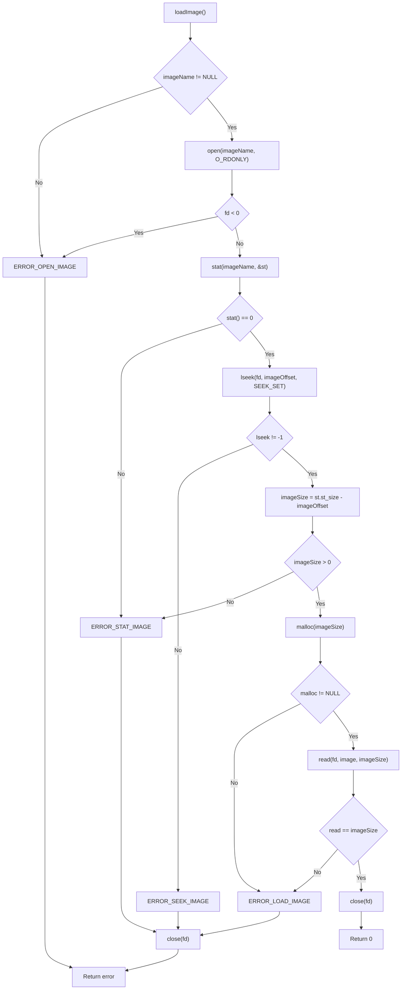

**Sources:** [include/dragonChassisBase.hpp:375-429]()

### Image Memory Management

The base class maintains image state in protected member variables:

| Member | Type | Purpose |
|--------|------|---------|
| `imageName` | `char*` | Path to firmware image file |
| `image` | `char*` | Pointer to loaded image in memory |
| `imageSize` | `int` | Size of loaded image in bytes |
| `imageOffset` | `int` | Bytes to skip from beginning of file |
| `fd` | `int` | File descriptor for image file |

**Sources:** [include/dragonChassisBase.hpp:259-264]()

The destructor ensures proper cleanup:

```cpp
virtual ~DragonChassisBase() {
    if (image)
        free(image);
}
```

**Sources:** [include/dragonChassisBase.hpp:51-55]()

## Error Handling System

### UpdateError Enumeration

The HAL defines a comprehensive error enumeration with over 40 distinct error codes:

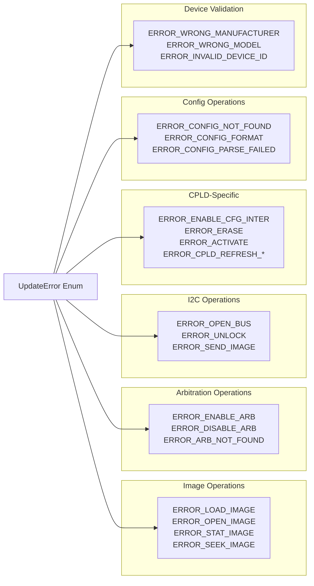

**Sources:** [include/dragonChassisBase.hpp:209-252]()

### Error Reporting

The `printError()` method converts error codes to human-readable messages:

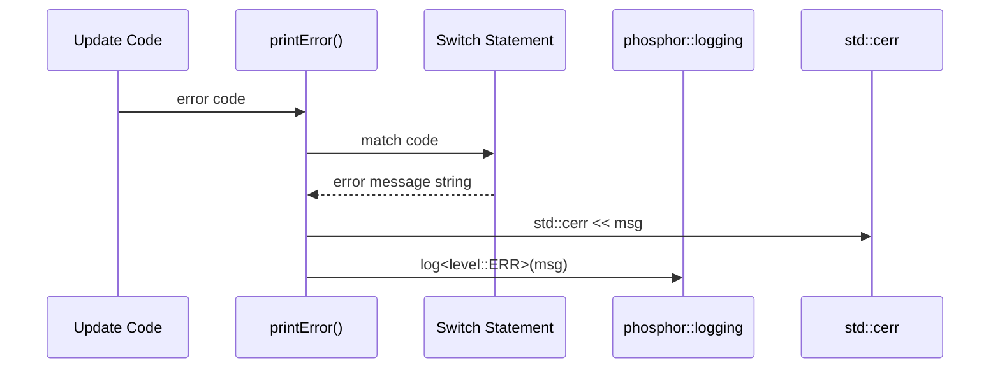

**Sources:** [include/dragonChassisBase.hpp:62-204]()

Example error code mapping:
- `ERROR_ENABLE_ARB` (2) → "UpdateError::ERROR_ENABLE_ARB"
- `ERROR_LOAD_IMAGE` (1) → "UpdateError::ERROR_LOAD_IMAGE"
- `ERROR_CPLD_REFRESH_FAILED` (29) → "UpdateError::ERROR_CPLD_REFRESH_FAILED"
- Success (0) → "Update was successful"

## DragonCpld Implementation Example

### Class Structure

The `DragonCpld` class demonstrates how device-specific implementations extend `DragonChassisBase`:

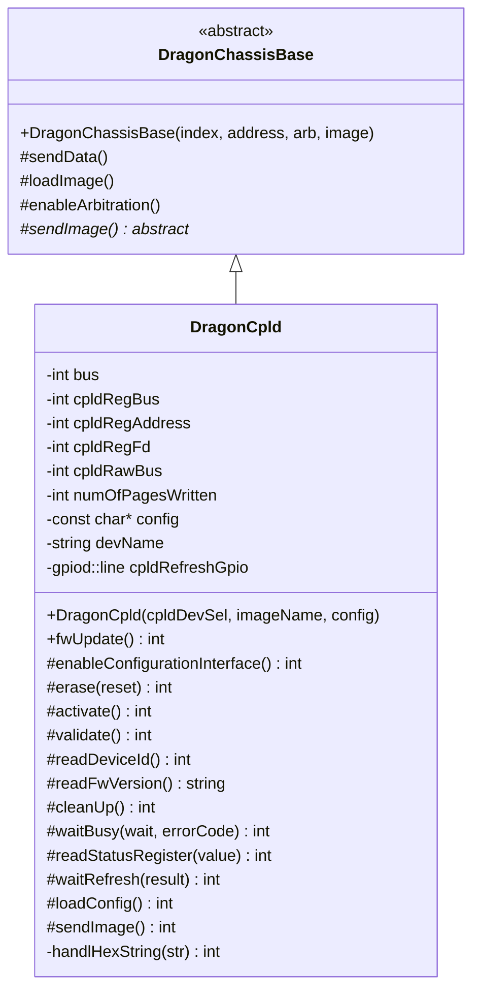

**Sources:** [cpld_utility/dragonCpld.hpp:28-167]()

### Constructor Parameters

The `DragonCpld` constructor requires additional configuration beyond the base class:

| Parameter | Type | Purpose |
|-----------|------|---------|
| `cpldDevSel` | `int` | Index of CPLD to update |
| `imageName` | `char*` | Path to firmware image file |
| `config` | `const char*` | Path to configuration file containing bus mappings |

**Configuration File Necessity:** The config file is required because CPLD updates involve multiple I2C buses:
- **Arbitrated bus**: Main communication path
- **Raw bus**: Non-arbitrated version for refresh commands (used when arbitration is disabled during activation)
- **Register bus**: Separate bus for CPLD register access

**Sources:** [cpld_utility/dragonCpld.hpp:46]()

### GPIO Refresh Signaling

Dragon CPLD updates require GPIO manipulation for the refresh signal:

```cpp
gpiod::line cpldRefreshGpio;
```

This GPIO line is used to signal the CPLD to refresh its configuration after firmware activation. The implementation uses `libgpiodcxx` for GPIO control.

**Sources:** [cpld_utility/dragonCpld.hpp:70](), [cpld_utility/meson.build:16-21]()

### Lattice Update Flow

The `fwUpdate()` method implements the Lattice CPLD update sequence:

1. **enableConfigurationInterface()**: Enter programming mode
2. **erase()**: Erase existing firmware
3. **sendImage()**: Transfer new firmware data
4. **activate()**: Activate new firmware
5. **validate()**: Verify update success

**Sources:** [cpld_utility/dragonCpld.hpp:49-56]()

## Conditional Compilation

### Build-Time Configuration

The HAL is conditionally compiled based on Meson options:

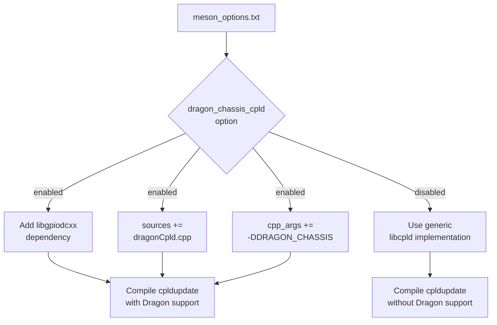

**Sources:** [cpld_utility/meson.build:16-24]()

### Build Configuration

When `dragon_chassis_cpld` option is enabled:
- **Dependency added**: `libgpiodcxx` (for GPIO line control)
- **Source added**: `dragonCpld.cpp` (Dragon-specific implementation)
- **Compile flag**: `-DDRAGON_CHASSIS` (enables conditional code paths)

When disabled:
- Uses generic `libcpld` C library implementation
- No GPIO dependencies
- No C++ abstraction layer

**Sources:** [cpld_utility/meson.build:1-34]()

## Integration with D-Bus Services

### Version Update Utilities

The HAL utilities integrate with D-Bus services to update firmware version properties after successful updates:

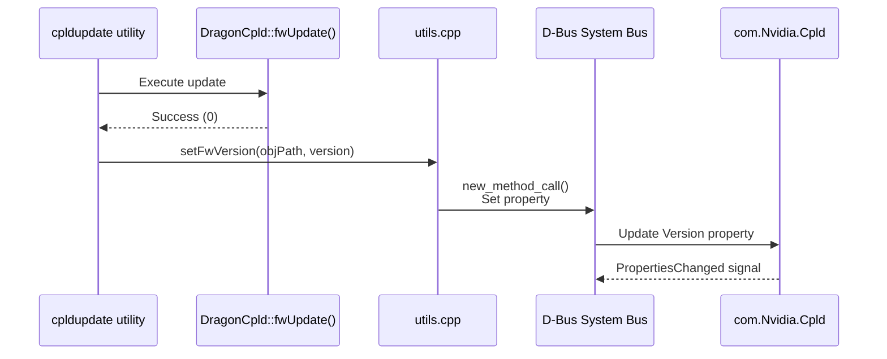

**Sources:** [cpld_utility/utils.cpp:24-48]()

### D-Bus Property Setting

The `setFwVersion()` utility function updates version properties on the D-Bus service:

```cpp
void setFwVersion(const std::string& objPath, const std::string& version)
{
    PropertyValue ver(version);
    setProperty(objPath, "xyz.openbmc_project.Software.Version", "Version", ver);
}
```

- **Service**: `com.Nvidia.Cpld`
- **Interface**: `xyz.openbmc_project.Software.Version`
- **Property**: `Version`
- **Base Path**: `/xyz/openbmc_project/software/`

**Sources:** [cpld_utility/utils.cpp:43-48](), [cpld_utility/utils.hpp:25-27]()

---

**Page Summary**: This Hardware Abstraction Layer provides a robust foundation for Dragon Chassis firmware updates through the `DragonChassisBase` abstract class. It implements I2C arbitration with kernel driver coordination, PEC-enabled data transmission with retry logic, comprehensive error handling with 40+ error codes, and image loading infrastructure. Device-specific implementations like `DragonCpld` extend this base to implement vendor-specific update sequences (e.g., Lattice CPLD flow) while reusing common platform behaviors. The layer is conditionally compiled via Meson build options, enabling a single codebase to support both Dragon Chassis and generic platforms.

---

