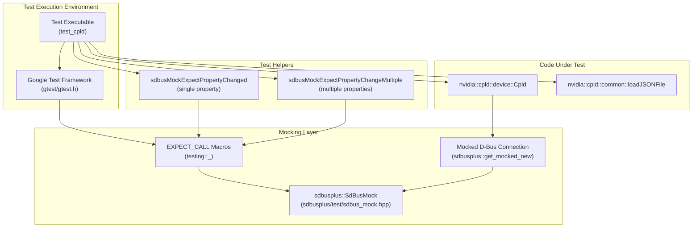
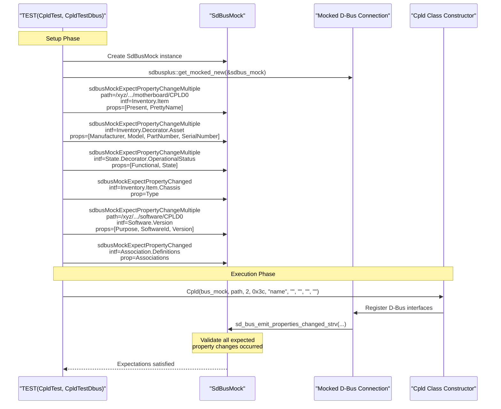
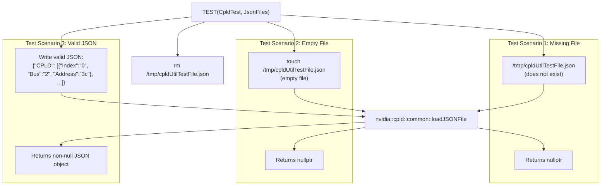

<!-- source: DeepWiki mcp.deepwiki.com · repo NVIDIA/nvidia-power-manager · page 9 Testing and Development · fetched 2026-10-26 -->

# Testing and Development

<details>
<summary>Relevant source files</summary>

The following files were used as context for generating this wiki page:

- [.beautysh-ignore](.beautysh-ignore)
- [.eslintignore](.eslintignore)
- [.flake8-ignore](.flake8-ignore)
- [nvidia-cpld/tests/test_cpld.cpp](nvidia-cpld/tests/test_cpld.cpp)

</details>


## Purpose and Scope

This document describes the test infrastructure, testing methodologies, and code quality tooling used in the nvidia-power-manager repository. The primary focus is on the CPLD D-Bus service test suite, which uses Google Test and sdbusplus mocking frameworks. For information about the build system configuration that controls test compilation, see [Build System](#7). For details on the CPLD D-Bus service being tested, see [CPLD D-Bus Service](#3.1).

The testing infrastructure is **conditionally compiled** based on the `tests` meson option and currently provides test coverage for the CPLD management subsystem. The PSU and Power Manager subsystems do not have automated test suites in the current implementation.

---

## Test Framework Architecture

The test infrastructure uses a combination of industry-standard testing frameworks and OpenBMC-specific mocking utilities to enable unit testing of D-Bus services without requiring actual D-Bus daemon or hardware access.

### Test Framework Components



**Test Framework Stack**

| Layer | Component | Purpose |
|-------|-----------|---------|
| Test Framework | Google Test (`gtest`) | Test discovery, assertions, test case execution |
| Mocking Framework | `sdbusplus::SdBusMock` | Mock D-Bus system calls (`sd_bus_*` functions) |
| Mock Connection | `sdbusplus::get_mocked_new()` | Create mocked D-Bus bus connection |
| Test Helpers | Custom helper functions | Simplify D-Bus property change expectations |
| Code Under Test | `Cpld` class, utility functions | CPLD D-Bus service implementation |

**Sources:** [nvidia-cpld/tests/test_cpld.cpp:1-30]()

---

## D-Bus Mock Infrastructure

The test suite uses the **sdbusplus test mock framework** to intercept D-Bus system calls and validate that the CPLD service correctly publishes D-Bus objects and properties. This approach enables testing without a running D-Bus daemon or actual hardware.

### Mock Helper Functions

The test file defines two custom helper functions to streamline D-Bus property change expectations:

#### sdbusMockExpectPropertyChanged

```cpp
static void sdbusMockExpectPropertyChanged(
    sdbusplus::SdBusMock& sdbus_mock,
    std::string path, 
    std::string intf,
    std::string expectedName)
```

This helper sets up an expectation that `sd_bus_emit_properties_changed_strv` will be called exactly once for a specific D-Bus object path and interface, with a specific property name. The mock validates the emitted property name matches the expected value.

**Usage Pattern:**
- Single property changes on D-Bus interfaces
- Used for properties like `Type` on `Inventory.Item.Chassis`
- Used for `Associations` on `Association.Definitions`

#### sdbusMockExpectPropertyChangeMultiple

```cpp
static void sdbusMockExpectPropertyChangeMultiple(
    sdbusplus::SdBusMock& sdbus_mock,
    std::string path,
    std::string intf,
    std::vector<std::string>& expectedNames)
```

This helper sets up expectations for **multiple** property changes on the same interface, allowing any of the specified properties to be emitted in any order. The mock uses `WillRepeatedly` to accept multiple calls and validates that each emitted property is in the expected list.

**Usage Pattern:**
- Interfaces with multiple related properties
- Used for `Inventory.Item` (`Present`, `PrettyName`)
- Used for `Asset` (`Manufacturer`, `Model`, `PartNumber`, `SerialNumber`)
- Used for `Software.Version` (`Purpose`, `SoftwareId`, `Version`)
- Used for `OperationalStatus` (`Functional`, `State`)

**Sources:** [nvidia-cpld/tests/test_cpld.cpp:39-68]()

---

## CPLD D-Bus Service Test Cases

### Test: CpldTestDbus



This test validates that the `Cpld` class constructor correctly:

1. **Registers inventory object** at `/xyz/openbmc_project/inventory/system/chassis/motherboard/CPLD0`
2. **Emits property changes** for all required D-Bus interfaces:
   - `xyz.openbmc_project.Inventory.Item`: `Present`, `PrettyName`
   - `xyz.openbmc_project.Inventory.Decorator.Asset`: `Manufacturer`, `Model`, `PartNumber`, `SerialNumber`
   - `xyz.openbmc_project.State.Decorator.OperationalStatus`: `Functional`, `State`
   - `xyz.openbmc_project.Inventory.Item.Chassis`: `Type`
3. **Registers software version object** at `/xyz/openbmc_project/software/CPLD0`
4. **Emits software version properties**: `Purpose`, `SoftwareId`, `Version`
5. **Creates association links** between inventory and software objects via `Association.Definitions`

**Test Parameters:**
- Bus: `2`
- I2C Address: `0x3c`
- Device name: `"name"`
- Empty strings for manufacturer, model, part number, serial number (to test default behavior)

**Sources:** [nvidia-cpld/tests/test_cpld.cpp:70-103]()

---

### Test: JsonFiles

This test validates the JSON configuration file loading functionality used to discover CPLD devices on the system.



**Test Coverage:**

| Scenario | File State | Expected Result | Validation |
|----------|------------|-----------------|------------|
| 1 | File does not exist | `nullptr` | `EXPECT_EQ(r, nullptr)` |
| 2 | File exists but is empty | `nullptr` | `EXPECT_EQ(r, nullptr)` |
| 3 | Valid JSON with CPLD array | Non-null object | `EXPECT_NE(r, nullptr)` |

**Valid JSON Structure:**
```json
{
    "CPLD": [
        {
            "Index": "0",
            "Bus": "2",
            "Address": "3c"
        },
        {
            "Index": "1",
            "Bus": "2",
            "Address": "3c"
        }
    ]
}
```

The test uses temporary file creation (`touch`), writing, and cleanup (`rm`) to simulate various file system states. This validates that the `loadJSONFile` function properly handles error conditions (missing/malformed files) and successfully parses valid configuration data.

**Sources:** [nvidia-cpld/tests/test_cpld.cpp:106-144]()

---

## Test Organization and Build Integration

### Directory Structure

```
nvidia-cpld/
├── src/
│   ├── cpld.cpp
│   ├── cpld.hpp
│   └── cpld_util.cpp
├── tests/
│   ├── test_cpld.cpp
│   └── meson.build
└── meson.build
```

### Build Configuration

Tests are built conditionally based on the `tests` meson option defined in the root `meson_options.txt`. When enabled, the test executable is compiled and linked against:

- **Google Test framework** (`gtest`, `gtest_main`)
- **sdbusplus library** (for D-Bus interfaces)
- **sdbusplus test library** (for D-Bus mocking)
- **Code under test** (CPLD service implementation)

The test executable is named `test_cpld` and is registered as a meson test target, enabling execution via `meson test`.

**Build Option:**
```meson
option('tests', type: 'feature', value: 'enabled',
       description: 'Build tests.')
```

**Sources:** [nvidia-cpld/tests/test_cpld.cpp:1-30]()

---

## Code Quality Tools

The repository includes configuration files for multiple code quality and linting tools, though all are currently configured to **ignore all files** (`*` pattern). This suggests either:
1. Code quality checks are disabled project-wide
2. Checks are performed through other mechanisms (CI/CD pipelines with explicit configurations)
3. Configuration is placeholder for future quality enforcement

### Tool Configuration Files

| File | Tool | Language | Purpose |
|------|------|----------|---------|
| `.flake8-ignore` | Flake8 | Python | Python linting and style checking (PEP 8 compliance) |
| `.beautysh-ignore` | beautysh | Shell | Shell script formatting and beautification |
| `.eslintignore` | ESLint | JavaScript | JavaScript/TypeScript linting |

**Current Configuration:**
All three files contain a single wildcard pattern that excludes all files from checking:
```
*
```

**Implications:**
- No automated Python, shell script, or JavaScript linting is currently enforced via these tools
- Developers may use local linting configurations or IDE integrations
- CI/CD pipelines may enforce quality checks through other mechanisms

**Sources:** [.flake8-ignore:1-2](), [.beautysh-ignore:1-2](), [.eslintignore:1-2]()

---

## Development Workflow

### Running Tests

**Prerequisites:**
- Build with `-Dtests=enabled` meson option
- Google Test framework installed
- sdbusplus library and test utilities available

**Execution:**
```bash
# Configure build with tests enabled
meson setup builddir -Dtests=enabled

# Compile tests
ninja -C builddir

# Run all tests
meson test -C builddir

# Run specific test
meson test -C builddir test_cpld

# Run with verbose output
meson test -C builddir --verbose
```

### Adding New Tests

To add tests for other subsystems, follow the pattern established in `nvidia-cpld/tests/`:

1. **Create test directory** under the subsystem module
2. **Implement test cases** using Google Test framework
3. **Add meson.build** in test directory to compile test executable
4. **Use sdbusplus mocks** for D-Bus services
5. **Register test** with meson's `test()` function

**Example Test Case Structure:**
```cpp
#include <gtest/gtest.h>
#include <sdbusplus/test/sdbus_mock.hpp>

TEST(SubsystemTest, FeatureTest)
{
    // Setup mocks
    sdbusplus::SdBusMock sdbus_mock;
    auto bus_mock = sdbusplus::get_mocked_new(&sdbus_mock);
    
    // Set expectations
    EXPECT_CALL(sdbus_mock, sd_bus_emit_properties_changed_strv(...))
        .WillOnce(Return(0));
    
    // Execute code under test
    SubsystemClass obj(bus_mock, ...);
    
    // Assertions handled by EXPECT_CALL validation
}
```

**Sources:** [nvidia-cpld/tests/test_cpld.cpp:23-50]()

---

## Test Coverage Gaps

The current test infrastructure has **limited coverage**:

### Covered Components
- ✅ CPLD D-Bus service initialization
- ✅ D-Bus interface registration and property emission
- ✅ JSON configuration file parsing
- ✅ Association creation between inventory and software objects

### Uncovered Components
- ❌ **PSU D-Bus service** (`nvidia-power-supply`) - No test suite
- ❌ **Power Manager service** - No test suite
- ❌ **Firmware update utilities** (`cpldupdate`, `psufwupgrade`) - No test suite
- ❌ **DragonCpld class** - No test suite
- ❌ **DragonChassisPsuUpdate class** - No test suite
- ❌ **I2C arbitration logic** - No test suite
- ❌ **GPIO refresh signaling** - No test suite
- ❌ **MTD update script** - No test suite
- ❌ **Runtime CPLD/PSU monitoring** - Integration tests needed
- ❌ **Power capping algorithms** - No test suite
- ❌ **PowerCappingInfo persistence** - No test suite

Expanding test coverage to these components would require:
- Mock I2C device interfaces
- Mock GPIO interfaces  
- File system mocking for MTD operations
- Mock D-Bus clients to test service responses
- Integration test framework for end-to-end workflows

**Sources:** [nvidia-cpld/tests/test_cpld.cpp:1-144]()