# Page: Home

# Home

<details>
<summary>Relevant source files</summary>

The following files were used as context for generating this wiki page:

- [meson.build](meson.build)

</details>


## Purpose and Scope

This documentation covers the **nvidia-power-manager** repository, an OpenBMC component that provides comprehensive power management and firmware update capabilities for NVIDIA server platforms. The repository contains D-Bus services for runtime monitoring, command-line utilities for firmware updates, and hardware abstraction layers for device communication.

The nvidia-power-manager project encompasses four primary management domains:

1. **CPLD Management** - Real-time monitoring and firmware updates for Complex Programmable Logic Devices
2. **Power Supply Management** - Inventory tracking, sensor monitoring, and firmware updates for PSUs
3. **Power Capping** - System-wide and per-module power limit enforcement with configurable distribution algorithms
4. **MTD Firmware Updates** - Generic flash memory partition updates via Memory Technology Device interface

For detailed information about specific subsystems, refer to:
- CPLD management details: [CPLD Management Subsystem](#3)
- PSU management details: [Power Supply Management Subsystem](#4)
- Power capping implementation: [Power Manager Service](#5)
- Build configuration: [Build System](#7)
- Hardware abstraction: [Hardware Abstraction Layer](#8)

## Repository Structure

The repository follows a modular architecture with distinct directories for each management domain. The [meson.build:1-17]() root build file orchestrates compilation of seven subsystems.

**Directory Organization**

| Directory | Primary Artifact | Purpose |
|-----------|-----------------|---------|
| `nvidia-cpld/` | `nvidia-cpld` D-Bus service | CPLD runtime monitoring and inventory management |
| `cpld_utility/` | `cpldupdate` CLI tool | CPLD firmware update utility |
| `nvidia-power-supply/` | `nvidia-power-supply` D-Bus service | PSU monitoring, sensors, and inventory |
| `psu_utility/` | `psufwupgrade` CLI tool | PSU firmware update utility |
| `src/` | Power Manager service | System power capping and mode management |
| `mtd_update/` | `mtdupdate.sh` shell script | MTD partition firmware updates |
| `nvidia-psu-monitor/` | `nvidia-psu-monitor` service | PSU monitoring daemon |

The separation between D-Bus services (runtime monitoring) and CLI utilities (firmware updates) enables independent lifecycle management—services run continuously as systemd units while utilities execute on-demand for maintenance operations.

**Repository Component Overview**

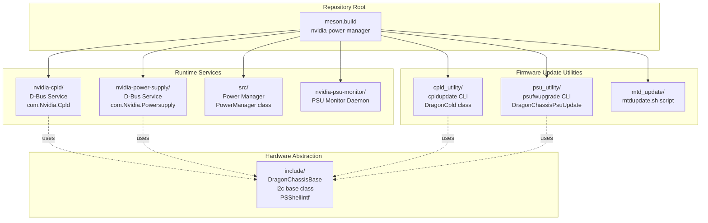

Sources: [meson.build:1-17]()

## Major Subsystems

### CPLD Management

The CPLD subsystem provides both runtime monitoring and firmware update capabilities. The `nvidia-cpld` D-Bus service publishes inventory objects under `/xyz/openbmc_project/inventory/system/motherboard/CPLD*` and software version objects under `/xyz/openbmc_project/software/CPLD*`. The service implements standard OpenBMC interfaces: `xyz.openbmc_project.Inventory.Decorator.Asset`, `xyz.openbmc_project.Software.Version`, and `xyz.openbmc_project.State.Decorator.OperationalStatus`.

For firmware updates, the `cpldupdate` utility supports two compilation modes:
- **Generic mode**: Direct I2C communication via `libcpld` functions
- **Dragon Chassis mode**: Enhanced update flow via `DragonCpld` class with I2C arbitration, GPIO refresh signaling, and PEC validation

The Dragon Chassis implementation inherits from `DragonChassisBase`, which provides foundational I2C operations and arbitration management through kernel driver coordination via sysfs (`/sys/.../i2carb/arb_state`).

**Key Classes**: `Cpld`, `CPLDManager`, `DragonCpld`, `DragonChassisBase`

See [CPLD Management Subsystem](#3) for detailed documentation.

### Power Supply Management

The PSU subsystem mirrors the CPLD architecture with a D-Bus service and update utility. The `nvidia-power-supply` service creates `PowerSupply` objects that implement multiple OpenBMC interfaces:
- `xyz.openbmc_project.State.Decorator.PowerState` - Power on/off state tracking
- `xyz.openbmc_project.State.Decorator.OperationalStatus` - Functional status
- `xyz.openbmc_project.Inventory.Decorator.Asset` - Manufacturing data
- `xyz.openbmc_project.Software.Version` - Firmware version information

Additionally, the service publishes sensor objects under `/xyz/openbmc_project/sensors/` for real-time PSU telemetry. The `psufwupgrade` utility provides firmware update capability with conditional Dragon Chassis support via `DragonChassisPsuUpdate` class.

**Key Classes**: `PowerSupply`, `DragonChassisPsuUpdate`, `PSShellIntf`

See [Power Supply Management Subsystem](#4) for detailed documentation.

### Power Manager

The Power Manager service implements system-wide power capping with per-module power limit distribution. It manages power policies through D-Bus properties published under `/xyz/openbmc_project/control/power/` and module-specific paths under `/xyz/openbmc_project/inventory/system/chassis/Module*/`.

The service implements a dual-persistence architecture:
1. **JSON configuration** (`powerCappingAlgorithm.json`) - Defines percentage-based power distribution algorithms across modules
2. **Binary state file** (`PowerCappingInfo`) - Stores runtime power limits with checksum validation for persistence across reboots

When a system power cap is modified via D-Bus, the `PowerManager::PropertyTriggered` callback validates the new limit, calculates per-module allocations using the JSON algorithm, updates module D-Bus objects, and persists the state with a two's complement checksum.

**Key Classes**: `PowerManager`, `Property`, `PowerCappingInfo`

See [Power Manager Service](#5) for detailed documentation.

### MTD Firmware Updates

The `mtdupdate.sh` shell script provides a generic interface for updating MTD (Memory Technology Device) flash partitions. The script accepts three parameters: I2C bus number, image file path, and MTD partition identifier. It integrates with OpenBMC logging through D-Bus using `busctl` for status reporting.

The script implements pre/post update hooks (`mtd_update_setup.sh`, `mtd_update_cleanup.sh`) for platform-specific setup and cleanup operations, such as GPIO configuration or power sequencing.

See [MTD Firmware Update Utility](#6) for detailed documentation.

## OpenBMC Integration

All services in nvidia-power-manager integrate with the OpenBMC D-Bus infrastructure using standard interface specifications. This ensures compatibility with OpenBMC management tools (busctl, ipmitool, Redfish APIs) and other BMC components.

**D-Bus Integration Pattern**

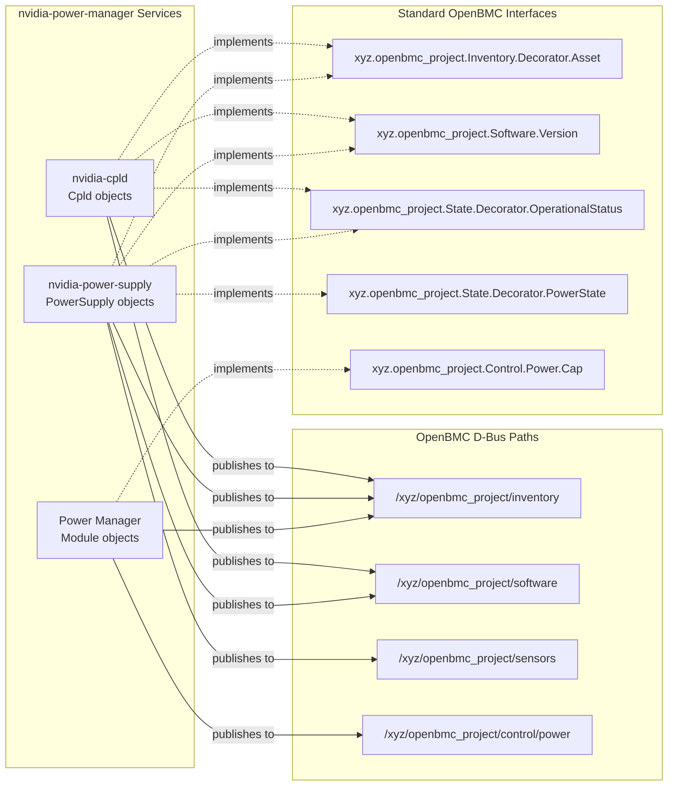

Sources: Derived from high-level system architecture diagrams

### Association Pattern

CPLD and PSU services implement the `xyz.openbmc_project.Association.Definitions` interface to link inventory objects with their corresponding software version objects. This bidirectional association enables navigation from hardware components to firmware versions and vice versa:

- Forward association: `inventory → software_version`
- Reverse association: `software_version → inventory`

This pattern is standard across OpenBMC and enables management tools to query "which firmware version is installed on PSU0?" or "which hardware component uses this software version?"

## Build System and Platform Configuration

The repository uses Meson build system with extensive conditional compilation support. Build behavior is controlled via options defined in `meson_options.txt`:

| Option | Type | Purpose |
|--------|------|---------|
| `dragon_chassis_cpld` | feature | Enable Dragon Chassis CPLD update implementation |
| `dragon_chassis_psu` | feature | Enable Dragon Chassis PSU update implementation |
| `tests` | feature | Enable test suite compilation |
| `module_num` | integer | Configure number of power modules (default: 8) |
| `platform_prefix` | string | Platform-specific path prefix |
| `platform_fw_prefix` | string | Platform-specific firmware path prefix |

When Dragon Chassis features are enabled, the build system includes additional source files (`dragonCpld.cpp`, `dragonChassisPsuUpdate.cpp`) and links against `libgpiodcxx` for GPIO control. This compile-time polymorphism eliminates runtime branching overhead while supporting multiple hardware platforms from a single codebase.

**Build Output Artifacts**

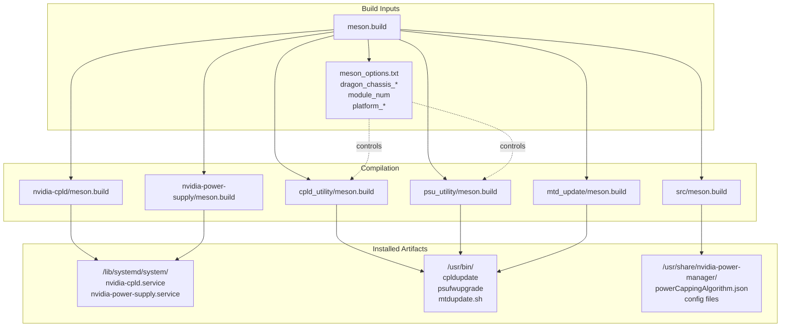

Sources: [meson.build:1-17]()

See [Build System](#7) for detailed build configuration documentation.

## Hardware Abstraction Architecture

For Dragon Chassis platforms, nvidia-power-manager provides a rich C++ hardware abstraction layer. The `DragonChassisBase` abstract base class centralizes common behaviors:

- **I2C Arbitration**: Coordinates bus access via kernel driver through sysfs interface (`/sys/.../i2carb/arb_state`)
- **GPIO Control**: Manages refresh signaling via `libgpiodcxx` character device interface
- **PEC Validation**: Implements SMBus Packet Error Code calculation for data integrity
- **Image Loading**: Provides firmware image parsing and validation infrastructure

Derived classes (`DragonCpld`, `DragonChassisPsuUpdate`) inherit these capabilities and implement device-specific update sequences (Lattice CPLD programming flow, PSU bootloader protocols).

For non-Dragon platforms, the repository provides simpler C library functions (`libcpld.c`, `libi2c.c`) for direct I2C communication without arbitration or GPIO complexity.

**Hardware Access Stack**

| Layer | Dragon Chassis | Generic Platform |
|-------|----------------|------------------|
| Application | `DragonCpld` class | C functions in `libcpld.c` |
| Abstraction | `DragonChassisBase` class | Direct I2C library calls |
| Kernel Interface | sysfs + `/dev/i2c-*` + libgpiod | `/dev/i2c-*` only |
| Hardware | I2C bus + GPIO pins | I2C bus only |

See [Hardware Abstraction Layer](#8) for detailed implementation documentation.

## Testing Infrastructure

The repository includes comprehensive test infrastructure for the CPLD D-Bus service, using the sdbusplus D-Bus mock framework for unit testing. Tests validate:
- D-Bus property initialization and updates
- Association interface implementation
- Inventory and software version object creation
- OperationalStatus state transitions

The test suite is conditionally compiled via the `tests` build option and integrates with code quality tools configured in `.clang-format` and `.clang-tidy`.

See [Testing and Development](#9) for detailed test infrastructure documentation.

Sources: [meson.build:1-17](), high-level system architecture diagrams, build system diagram

---

# Page: System Architecture

# System Architecture

<details>
<summary>Relevant source files</summary>

The following files were used as context for generating this wiki page:

- [meson.build](meson.build)
- [meson_options.txt](meson_options.txt)
- [psu_utility/meson.build](psu_utility/meson.build)

</details>


## Purpose and Scope

This page describes the high-level architecture of the nvidia-power-manager repository, showing how its components integrate within an OpenBMC system. The document covers:

- Major subsystems and their relationships
- D-Bus service integration patterns
- Firmware update utilities and hardware abstraction
- Data flow between components
- Build system organization

For detailed information on specific subsystems, see:
- CPLD management: [CPLD Management Subsystem](#3)
- PSU management: [Power Supply Management Subsystem](#4)
- Power capping: [Power Manager Service](#5)
- Build configuration: [Build System](#7)
- Hardware interfaces: [Hardware Abstraction Layer](#8)

---

## System Overview

The repository implements three management domains operating within OpenBMC's D-Bus infrastructure:

| Domain | Runtime Service | Update Utility | Hardware Interface |
|--------|----------------|----------------|-------------------|
| **CPLD Management** | `nvidia-cpld` | `cpldupdate` | I2C bus |
| **PSU Management** | `nvidia-power-supply` | `psufwupgrade` | I2C bus |
| **Power Management** | Power Manager | N/A | D-Bus only |
| **Flash Management** | N/A | `mtdupdate.sh` | MTD devices |

Each domain follows a consistent pattern: **runtime monitoring via D-Bus services** and **maintenance operations via CLI utilities**. This separation enables services to run continuously for system monitoring while update utilities execute on-demand for firmware management.

**Sources:** [meson.build:1-17]()

---

## Component Architecture

### Overview Diagram

```mermaid
graph TB
    subgraph "D-Bus Services (systemd)"
        CPLD_SVC["nvidia-cpld<br/>D-Bus: com.Nvidia.Cpld<br/>Class: Cpld, CPLDManager"]
        PSU_SVC["nvidia-power-supply<br/>D-Bus: com.Nvidia.Powersupply<br/>Class: PowerSupply"]
        PM_SVC["Power Manager<br/>Class: PowerManager, Property"]
    end
    
    subgraph "Firmware Update Utilities (CLI)"
        CPLD_CLI["cpldupdate<br/>main() / DragonCpld"]
        PSU_CLI["psufwupgrade<br/>main() / DragonChassisPsuUpdate"]
        MTD_CLI["mtdupdate.sh"]
    end
    
    subgraph "OpenBMC D-Bus Paths"
        INV["/xyz/openbmc_project/inventory/system/<br/>motherboard/CPLD*<br/>motherboard/PSU*<br/>chassis/Module*"]
        SW["/xyz/openbmc_project/software/<br/>CPLD* versions<br/>PSU* versions"]
        SENSOR["/xyz/openbmc_project/sensors/<br/>motherboard/PSU* sensors"]
        POWER["/xyz/openbmc_project/control/power/<br/>Module* power caps"]
    end
    
    subgraph "Hardware Layer"
        I2C["/dev/i2c-*<br/>CPLD & PSU devices"]
        MTD["/dev/mtd*<br/>Flash partitions"]
        SYSFS["/sys/.../i2carb/arb_state<br/>I2C arbitration"]
        GPIO["GPIO (libgpiod)<br/>CPLD refresh signals"]
    end
    
    CPLD_SVC -->|"publishes inventory"| INV
    CPLD_SVC -->|"publishes versions"| SW
    PSU_SVC -->|"publishes inventory"| INV
    PSU_SVC -->|"publishes versions"| SW
    PSU_SVC -->|"publishes sensor data"| SENSOR
    PM_SVC -->|"publishes modules"| INV
    PM_SVC -->|"publishes power caps"| POWER
    
    CPLD_SVC -->|"monitors via PSShellIntf"| I2C
    PSU_SVC -->|"monitors via PSShellIntf"| I2C
    
    CPLD_CLI -->|"DragonCpld::program()"| I2C
    CPLD_CLI -->|"DragonChassisBase::setArbitration()"| SYSFS
    CPLD_CLI -->|"DragonCpld::pulseGpioAndWait()"| GPIO
    PSU_CLI -->|"DragonChassisPsuUpdate::program()"| I2C
    PSU_CLI -->|"DragonChassisBase::setArbitration()"| SYSFS
    MTD_CLI -->|"flash image"| MTD
```

This architecture demonstrates several key patterns:

1. **Dual Access Pattern**: Hardware is accessed by both monitoring services (read-only via shell interfaces) and update utilities (read-write via direct I2C/MTD)
2. **D-Bus Publication Model**: Services publish objects to standard OpenBMC paths (`/xyz/openbmc_project/*`)
3. **Conditional Hardware Abstraction**: Dragon Chassis builds add arbitration (`setArbitration()`) and GPIO signaling (`pulseGpioAndWait()`)
4. **Hierarchical Inventory**: Components appear in both `/inventory` (hardware) and `/software` (firmware versions)

**Sources:** [meson.build:10-16](), [meson_options.txt:1-12]()

---

## D-Bus Interface Architecture

### D-Bus Object Hierarchy

```mermaid
graph TB
    subgraph "nvidia-cpld Service"
        CPLD_OBJ["D-Bus Objects per CPLD device"]
        CPLD_INV["/xyz/openbmc_project/inventory/system/motherboard/CPLD{N}"]
        CPLD_SW["/xyz/openbmc_project/software/CPLD{N}"]
        
        CPLD_OBJ --> CPLD_INV
        CPLD_OBJ --> CPLD_SW
    end
    
    subgraph "nvidia-power-supply Service"
        PSU_OBJ["D-Bus Objects per PSU"]
        PSU_INV["/xyz/openbmc_project/inventory/system/motherboard/PSU{N}"]
        PSU_SW["/xyz/openbmc_project/software/PSU{N}"]
        PSU_SENSOR["/xyz/openbmc_project/sensors/..."]
        
        PSU_OBJ --> PSU_INV
        PSU_OBJ --> PSU_SW
        PSU_OBJ --> PSU_SENSOR
    end
    
    subgraph "Power Manager Service"
        PM_OBJ["Module Objects (Property class)"]
        PM_INV["/xyz/openbmc_project/inventory/system/chassis/Module{N}"]
        PM_CAP["/xyz/openbmc_project/control/power/Module{N}"]
        
        PM_OBJ --> PM_INV
        PM_OBJ --> PM_CAP
    end
    
    subgraph "OpenBMC Interfaces Implemented"
        ASSET["xyz.openbmc_project.Inventory.Decorator.Asset"]
        VERSION["xyz.openbmc_project.Software.Version"]
        OPSTATUS["xyz.openbmc_project.State.Decorator.OperationalStatus"]
        PWRSTATE["xyz.openbmc_project.State.Decorator.PowerState"]
        PWRCAP["xyz.openbmc_project.Control.Power.Cap"]
        ASSOC["xyz.openbmc_project.Association.Definitions"]
    end
    
    CPLD_INV -.implements.- ASSET
    CPLD_INV -.implements.- OPSTATUS
    CPLD_SW -.implements.- VERSION
    CPLD_OBJ -.implements.- ASSOC
    
    PSU_INV -.implements.- ASSET
    PSU_INV -.implements.- OPSTATUS
    PSU_INV -.implements.- PWRSTATE
    PSU_SW -.implements.- VERSION
    
    PM_CAP -.implements.- PWRCAP
```

### Interface Implementation Details

| Service | D-Bus Interface | Properties Published | Purpose |
|---------|----------------|---------------------|---------|
| `Cpld` | `Asset` | `Manufacturer`, `Model`, `SerialNumber`, `PartNumber` | Hardware identification |
| `Cpld` | `Software.Version` | `Version`, `Purpose` | Firmware version tracking |
| `Cpld` | `OperationalStatus` | `Functional` | Health status |
| `Cpld` | `Association.Definitions` | `Associations` | Links inventory ↔ software |
| `PowerSupply` | `Asset` | `Manufacturer`, `Model`, `SerialNumber`, `PartNumber` | Hardware identification |
| `PowerSupply` | `Software.Version` | `Version`, `Purpose` | Firmware version tracking |
| `PowerSupply` | `OperationalStatus` | `Functional` | Health status |
| `PowerSupply` | `PowerState` | `PowerState` | On/Off state |
| `PowerManager` | `Power.Cap` | `PowerCap`, `PowerCapEnable`, `MinPowerCapValue`, `MaxPowerCapValue` | Power limits |

The D-Bus architecture implements OpenBMC's standard interface contracts, enabling interoperability with Redfish APIs, `busctl` CLI tools, and other BMC services. Each service creates D-Bus objects dynamically based on hardware detection, publishing both inventory metadata and software version information.

**Sources:** [meson.build:11-15](), Diagram 2 from context

---

## Firmware Update Architecture

### Conditional Compilation Model

The build system uses Meson options to select between generic and Dragon Chassis-specific implementations:

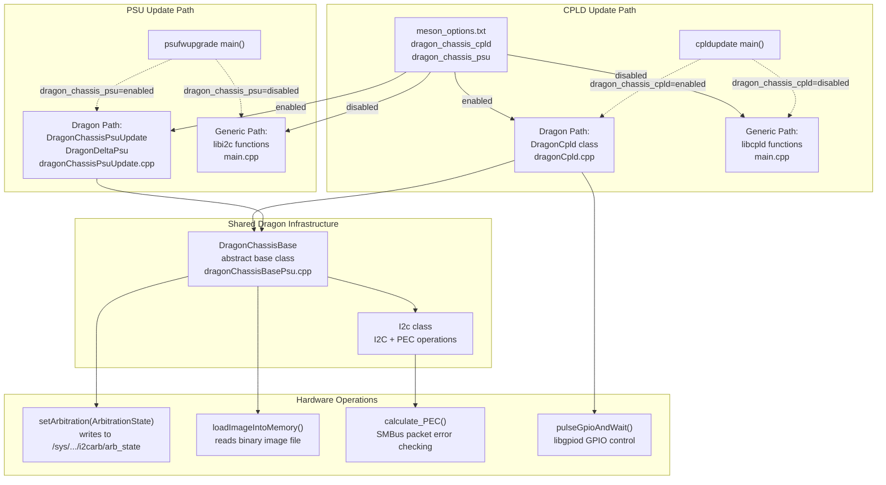

This compile-time selection eliminates runtime overhead. The `meson_options.txt` configuration determines which source files are compiled:

**Dragon Chassis Enabled:**
- CPLD: `dragonCpld.cpp` → `DragonCpld` class → includes arbitration and GPIO refresh
- PSU: `dragonChassisPsuUpdate.cpp`, `dragonChassisBasePsu.cpp`, `dragonDeltaPsu.cpp`

**Dragon Chassis Disabled:**
- CPLD: `main.cpp` → direct `libcpld.c` function calls
- PSU: `main.cpp` → direct `libi2c.c` function calls

**Sources:** [meson_options.txt:1-12](), [psu_utility/meson.build:7-32]()

---

## Data Flow: Power Cap Distribution

### Power Manager Data Flow

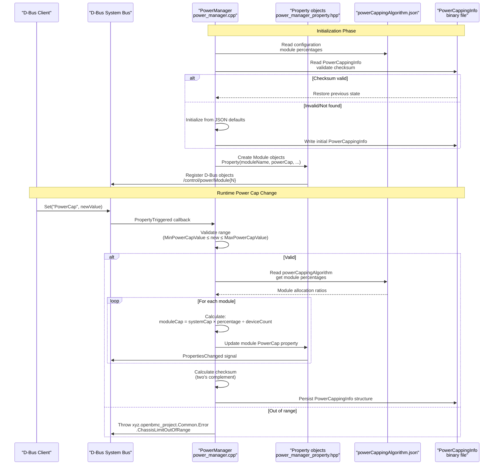

The `PowerManager` class orchestrates this flow:

1. **Initialization** ([src/power_manager.cpp]()): Reads `powerCappingAlgorithm.json` for distribution algorithm, attempts to restore state from `PowerCappingInfo` binary file
2. **Validation**: Enforces system-level min/max constraints before accepting changes
3. **Distribution**: Applies JSON-defined percentage allocations to calculate per-module limits
4. **Persistence**: Serializes `PowerCappingInfo` struct with two's complement checksum
5. **Propagation**: Uses `Property` class to update D-Bus properties and emit `PropertiesChanged` signals

The `Property` class ([src/power_manager_property.hpp]()) wraps D-Bus property registration and change notification, handling both single properties and grouped property updates.

**Sources:** [meson.build:15](), Diagram 5 from context

---

## Hardware Communication Stack

### I2C Access Layers

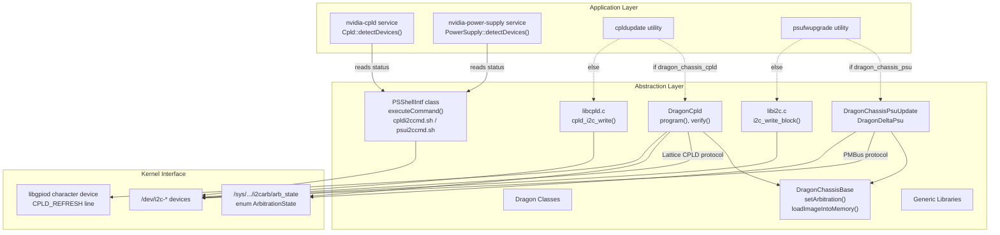

The stack implements three distinct access patterns:

### Pattern 1: Service Monitoring (Shell-Based)
- Services use `PSShellIntf` class to execute shell scripts (`cpldi2ccmd.sh`, `psui2ccmd.sh`)
- Scripts perform simple I2C reads for status monitoring
- Decouples service code from hardware specifics

### Pattern 2: Dragon Chassis Updates (C++ Class Hierarchy)
- `DragonChassisBase` provides common infrastructure:
  - `setArbitration()`: Writes to `/sys/.../i2carb/arb_state` for bus coordination
  - `loadImageIntoMemory()`: Reads firmware image into memory buffer
  - `calculate_PEC()`: Computes SMBus packet error codes
- `DragonCpld` adds Lattice CPLD-specific protocol:
  - `program()`: Implements ISC programming sequence
  - `pulseGpioAndWait()`: Signals CPLD refresh via GPIO
- `DragonChassisPsuUpdate` / `DragonDeltaPsu` implement PMBus protocols

### Pattern 3: Generic Updates (C Functions)
- Direct calls to `libcpld.c` or `libi2c.c`
- No arbitration or GPIO handling
- Simpler platforms without bus contention concerns

**Sources:** [psu_utility/meson.build:7-32](), Diagram 6 from context

---

## Build System Integration

The root `meson.build` orchestrates compilation of seven subdirectories:

```
nvidia-power-manager/
├── meson.build              # Root build orchestration
├── meson_options.txt        # Configurable options
├── psu_utility/             # psufwupgrade utility
├── nvidia-power-supply/     # nvidia-power-supply service
├── nvidia-cpld/             # nvidia-cpld service  
├── nvidia-psu-monitor/      # Legacy monitor
├── cpld_utility/            # cpldupdate utility
├── src/                     # Power Manager service
└── mtd_update/              # mtdupdate.sh script
```

### Key Build Options

| Option | Type | Default | Effect |
|--------|------|---------|--------|
| `dragon_chassis_psu` | feature | disabled | Includes Dragon PSU update classes |
| `dragon_chassis_cpld` | feature | disabled | Includes Dragon CPLD update classes |
| `tests` | feature | enabled | Builds test suite |
| `module_num` | integer (1-4) | 1 | Number of power modules |
| `module_obj_path_prefix` | string | `ProcessorModule_` | D-Bus path prefix for modules |
| `platform_prefix` | string | empty | Platform-specific path prefix |
| `platform_fw_prefix` | string | empty | Firmware path prefix |

The build system uses these options to:
- Select source files for compilation (conditional compilation)
- Configure D-Bus object paths (`module_obj_path_prefix`)
- Set system parameters (`module_num`)
- Add dependencies (`libgpiodcxx` for Dragon builds)

For detailed build system documentation, see [Build System](#7).

**Sources:** [meson.build:1-17](), [meson_options.txt:1-40]()

---

## Integration with OpenBMC

The system integrates with OpenBMC through several mechanisms:

### D-Bus Integration
- **Bus Name Claiming**: Services claim `com.Nvidia.Cpld` and `com.Nvidia.Powersupply` names
- **Standard Interfaces**: Implements `xyz.openbmc_project.*` interfaces for Redfish compatibility
- **Signal Propagation**: Emits `PropertiesChanged` signals for property updates

### Systemd Integration
- **Service Units**: Installed to `/lib/systemd/system/` 
- **Dependencies**: Services declare D-Bus activation and after/before relationships
- **Automatic Restart**: Configured with restart policies for resilience

### Redfish Mapping
OpenBMC's Redfish implementation automatically maps D-Bus interfaces:
- `Asset` properties → Redfish resource metadata
- `Software.Version` → `/redfish/v1/UpdateService/FirmwareInventory/`
- `Power.Cap` → `/redfish/v1/Chassis/{id}/Power/` PowerControl entries
- `Sensor` objects → `/redfish/v1/Chassis/{id}/Power/` sensor readings

### File System Conventions
- Configuration: `/usr/share/nvidia-power-manager/`
- Executables: `/usr/bin/`
- State persistence: `/var/lib/` (for `PowerCappingInfo`)

**Sources:** [meson.build:1-17](), Diagrams 1-2 from context

---

# Page: CPLD Management Subsystem

# CPLD Management Subsystem

<details>
<summary>Relevant source files</summary>

The following files were used as context for generating this wiki page:

- [nvidia-cpld/meson.build](nvidia-cpld/meson.build)
- [nvidia-cpld/src/cpld.hpp](nvidia-cpld/src/cpld.hpp)

</details>


## Purpose and Scope

The CPLD Management Subsystem provides comprehensive management of Complex Programmable Logic Device (CPLD) components in NVIDIA systems. This subsystem encompasses two primary functions:

1. **Runtime Monitoring** - A persistent D-Bus service that exposes CPLD inventory, version information, and operational status
2. **Firmware Updates** - Command-line utilities for flashing CPLD firmware images

This page provides an overview of the CPLD management architecture and the relationships between its components. For detailed documentation of specific components, see:
- [CPLD D-Bus Service](#3.1) - Runtime monitoring service implementation
- [CPLD Firmware Update Utilities](#3.2) - Firmware update tools and flows

The subsystem integrates with OpenBMC's standard D-Bus interfaces and follows the dual-hierarchy pattern where CPLDs appear in both the inventory tree (`/xyz/openbmc_project/inventory`) and software tree (`/xyz/openbmc_project/software`).

---

## CPLD Management Architecture

The CPLD Management Subsystem is organized into two independent but complementary components that share hardware access but operate at different layers of the system:

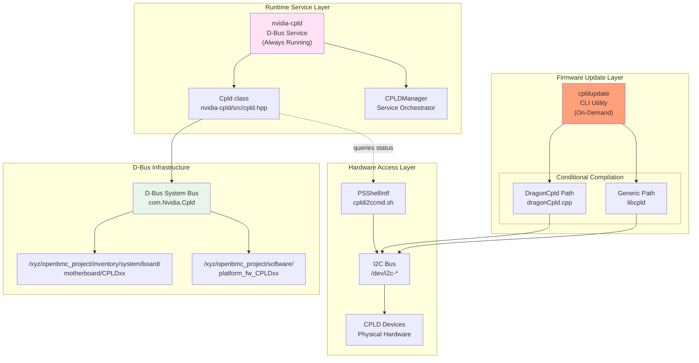

**Architecture Overview**: The D-Bus service (`nvidia-cpld`) operates continuously, exposing CPLD information through standard OpenBMC interfaces. The update utility (`cpldupdate`) runs on-demand for firmware maintenance. Both components access CPLD hardware via I2C, but through different abstraction layers: the service uses shell script wrappers (`cpldi2ccmd.sh`) for status queries, while the update utility uses direct I2C access through either generic libraries or platform-specific C++ classes.

**Sources**: [nvidia-cpld/src/cpld.hpp](), [nvidia-cpld/meson.build](), [cpld_utility/meson.build]()

---

## D-Bus Service Component

The `nvidia-cpld` service is implemented as a systemd service that publishes CPLD information to the D-Bus system bus using the bus name `com.Nvidia.Cpld`. The core implementation consists of:

| Component | File | Purpose |
|-----------|------|---------|
| `Cpld` class | [nvidia-cpld/src/cpld.hpp:126-267]() | Represents individual CPLD devices with full D-Bus interface implementation |
| `CPLDManager` | [nvidia-cpld/src/cpld_manager.hpp]() | Service orchestrator that creates and manages `Cpld` instances from JSON configuration |
| `Util` base class | [nvidia-cpld/src/cpld_util.hpp]() | Hardware abstraction providing I2C communication via shell interface |
| JSON configuration | `/usr/share/nvidia-power-manager/cpld_config.json` | Defines CPLD inventory: bus addresses, names, associations |

### D-Bus Interfaces Implemented

Each `Cpld` object implements the following OpenBMC D-Bus interfaces through multiple inheritance:

| Interface | Purpose | Key Properties |
|-----------|---------|----------------|
| `xyz.openbmc_project.State.Decorator.OperationalStatus` | Operational state tracking | `functional`, `state` (Enabled/Disabled) |
| `xyz.openbmc_project.Inventory.Item` | Basic inventory properties | `present`, `prettyName` |
| `xyz.openbmc_project.Inventory.Item.Chassis` | Chassis classification | `type` (Module) |
| `xyz.openbmc_project.Inventory.Decorator.Asset` | Asset identification | `manufacturer`, `model`, `partNumber`, `serialNumber` |
| `xyz.openbmc_project.Inventory.Decorator.Location` | Physical location metadata | `locationType` |
| `xyz.openbmc_project.Association.Definitions` | Relationship definitions | `associations` (parent-child links) |

The interface inheritance is defined via the `CpldInherit` type alias at [nvidia-cpld/src/cpld.hpp:39-46]().

### D-Bus Object Hierarchy

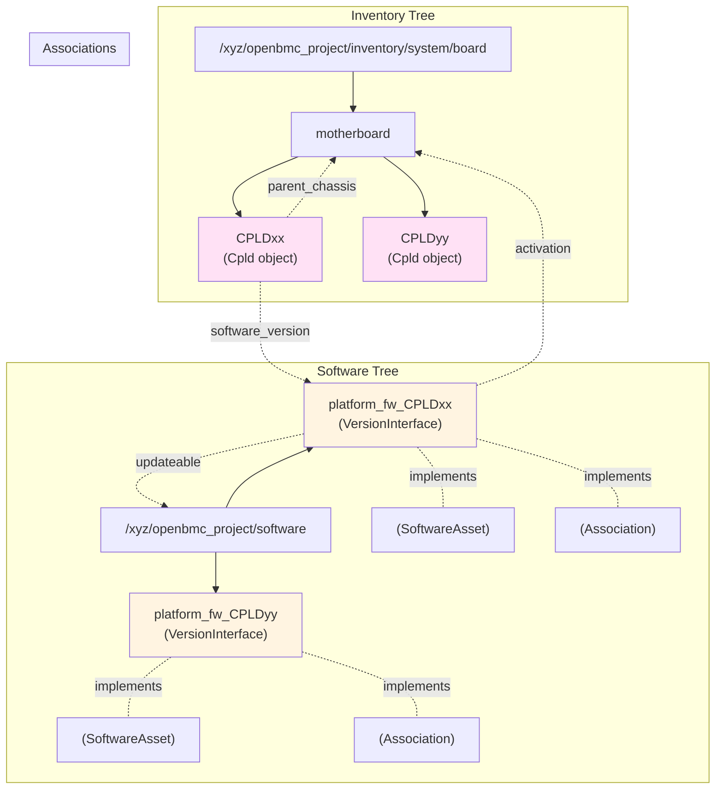

**Object Structure**: Each CPLD device creates objects in both the inventory tree (physical representation) and software tree (firmware representation). The inventory object path follows the pattern `/xyz/openbmc_project/inventory/system/board/motherboard/{PLATFORM_PREFIX}CPLD{N}`. The software object path inserts a firmware prefix into the name: `/xyz/openbmc_project/software/{PLATFORM_PREFIX}{PLATFORM_FW_PREFIX}CPLD{N}`. Associations bidirectionally link these representations.

The construction logic is implemented in:
- Inventory object creation: [nvidia-cpld/src/cpld.hpp:136-184]()
- Software version registration: [nvidia-cpld/src/cpld.hpp:209-219]()
- Association setup: [nvidia-cpld/src/cpld.hpp:186-208]()
- Asset object creation: [nvidia-cpld/src/cpld.hpp:243-253]()

**Sources**: [nvidia-cpld/src/cpld.hpp:39-267](), [nvidia-cpld/meson.build:10-16]()

---

## Firmware Update Component

The `cpldupdate` utility provides command-line firmware update capabilities for CPLD devices. The utility supports two distinct implementation paths selected at compile time:

| Implementation | Meson Option | Source Files | Platform Support |
|----------------|--------------|--------------|------------------|
| **Generic Path** | `dragon_chassis_cpld=disabled` | `libcpld` C library | Standard I2C-based platforms |
| **Dragon Chassis Path** | `dragon_chassis_cpld=enabled` | [cpld_utility/dragonCpld.cpp]() | Dragon chassis with arbitration |

### Implementation Selection

The build system uses conditional compilation to select the appropriate implementation:

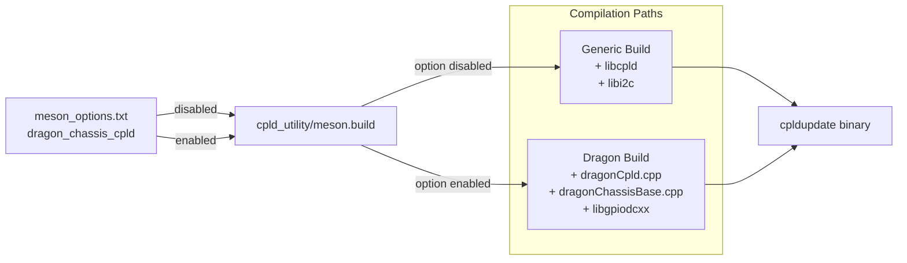

**Build Configuration**: The Meson build system evaluates the `dragon_chassis_cpld` option and includes different source files and dependencies accordingly. When Dragon support is enabled, the build adds C++ source files (`dragonCpld.cpp`, `dragonChassisBase.cpp`) and the `libgpiodcxx` dependency for GPIO control. The generic path uses simpler C libraries for direct I2C access.

### Update Utility Capabilities

Both implementation paths support the following update workflow:

1. **Image Validation** - Verify firmware image format and checksums
2. **Hardware Detection** - Identify CPLD device via I2C bus scanning
3. **Pre-Update State** - Query current firmware version
4. **Firmware Programming** - Erase and program CPLD flash memory
5. **Post-Update Verification** - Verify new firmware version

The Dragon Chassis implementation adds:
- **I2C Arbitration** - Coordinate bus access with kernel driver via sysfs
- **GPIO Refresh Signaling** - Trigger CPLD refresh using libgpiod
- **PEC (Packet Error Code)** - Enhanced I2C data integrity checking
- **Retry Logic** - Robust error handling with exponential backoff

Command-line interface example:
```bash
# Generic platform update
cpldupdate --dev <i2c_bus> --image <firmware.bin> --config <device_config.json>

# Dragon chassis update (same interface, different implementation)
cpldupdate --dev <i2c_bus> --image <firmware.bin> --config <device_config.json>
```

**Sources**: [cpld_utility/meson.build](), [cpld_utility/dragonCpld.cpp](), [cpld_utility/dragonChassisBase.cpp]()

---

## Integration with OpenBMC

The CPLD Management Subsystem follows OpenBMC architectural patterns for seamless integration with other BMC services and management interfaces:

### Service Registration

The D-Bus service is registered as a systemd unit that integrates with the BMC boot sequence:

| Configuration | Value | Location |
|---------------|-------|----------|
| **D-Bus Bus Name** | `com.Nvidia.Cpld` | [nvidia-cpld/meson.build:10]() |
| **Service Unit** | `nvidia-cpld.service` | [nvidia-cpld/services/]() |
| **Configuration Path** | `/usr/share/nvidia-power-manager/cpld_config.json` | [nvidia-cpld/meson.build:6-8]() |
| **Shell Interface** | `cpldi2ccmd.sh` | [nvidia-cpld/meson.build:24-28]() |

### Inventory Integration

CPLD objects appear in the OpenBMC inventory system with full asset management support:

- **Inventory Path Pattern**: `/xyz/openbmc_project/inventory/system/board/motherboard/{PLATFORM_PREFIX}CPLD{N}`
- **Chassis Type**: `xyz.openbmc_project.Inventory.Item.Chassis.ChassisType.Module` ([nvidia-cpld/src/cpld.hpp:163-168]())
- **Asset Properties**: Retrieved via `Util` class methods calling shell interface
  - `manufacturer()` - Manufacturer identification
  - `model()` - Model name
  - `partNumber()` - Retrieved via `getPartNumber()` ([nvidia-cpld/src/cpld.hpp:150]())
  - `serialNumber()` - Retrieved via `getSerialNumber()` ([nvidia-cpld/src/cpld.hpp:152]())

### Software Version Tracking

CPLD firmware versions are published to the OpenBMC software management tree:

- **Software Path Pattern**: `/xyz/openbmc_project/software/{PLATFORM_PREFIX}{PLATFORM_FW_PREFIX}CPLD{N}`
- **Version Interface**: `xyz.openbmc_project.Software.Version` ([nvidia-cpld/src/cpld.hpp:51-52]())
- **Version Purpose**: `xyz.openbmc_project.Software.Version.VersionPurpose.Other` ([nvidia-cpld/src/cpld.hpp:98](), [263-264]())
- **Version Retrieval**: Implemented via `getVersion()` method ([nvidia-cpld/src/cpld.hpp:216]())

### Association Model

The subsystem implements bidirectional associations linking inventory objects to software versions:

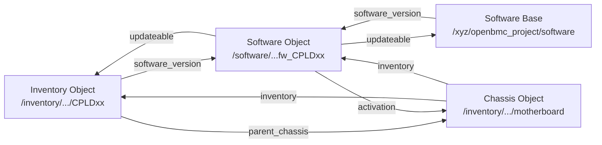

**Association Configuration**: The `Cpld` class creates multiple association types during initialization. The `createAssociation()` method ([nvidia-cpld/src/cpld.hpp:231-238]()) establishes parent-chassis relationships. The `registerAssociationInterface()` method ([nvidia-cpld/src/cpld.hpp:186-208]()) creates bidirectional links between inventory and software objects using forward association `"software_version"` and reverse association `"updateable"` (defined at [nvidia-cpld/src/cpld.hpp:261-262]()).

**Sources**: [nvidia-cpld/src/cpld.hpp:126-267](), [nvidia-cpld/meson.build:10-16]()

---

## Data Flow and Component Interaction

The following diagram illustrates how data flows through the CPLD Management Subsystem during typical operations:

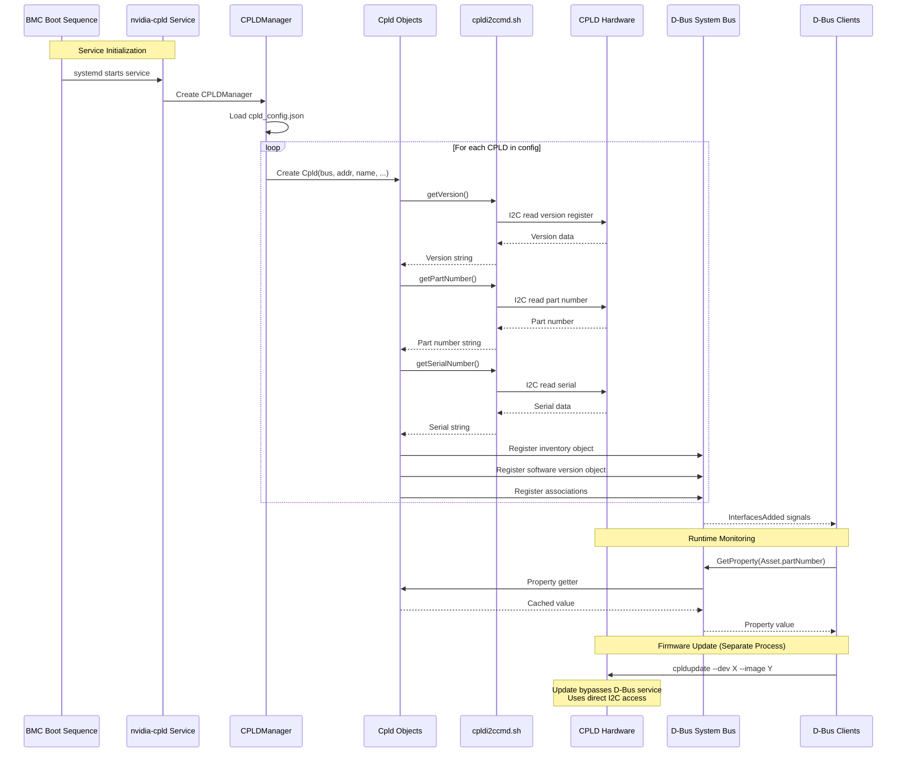

**Initialization Flow**: During boot, the `nvidia-cpld` service reads the JSON configuration file to determine which CPLDs exist in the system. For each configured CPLD, it creates a `Cpld` object that immediately queries hardware via the shell interface to retrieve asset information and firmware versions. These values are cached in D-Bus properties for efficient runtime access. The service then registers all objects and interfaces on the D-Bus system bus, triggering `InterfacesAdded` signals that notify other BMC services of the new inventory items.

**Runtime vs. Update**: During normal operation, D-Bus clients query CPLD information through standard OpenBMC interfaces without direct hardware access. Firmware updates occur through a separate process (`cpldupdate` utility) that accesses hardware directly via I2C, completely independent of the D-Bus service. After an update completes, the D-Bus service must be restarted or the system rebooted to refresh the cached version information.

**Sources**: [nvidia-cpld/src/cpld.hpp:126-184](), [nvidia-cpld/src/cpld_util.hpp](), [nvidia-cpld/src/main.cpp]()

---

# Page: CPLD D-Bus Service

# CPLD D-Bus Service

<details>
<summary>Relevant source files</summary>

The following files were used as context for generating this wiki page:

- [nvidia-cpld/meson.build](nvidia-cpld/meson.build)
- [nvidia-cpld/src/cpld.hpp](nvidia-cpld/src/cpld.hpp)
- [nvidia-cpld/src/cpld_manager.cpp](nvidia-cpld/src/cpld_manager.cpp)
- [nvidia-cpld/tests/test_cpld.cpp](nvidia-cpld/tests/test_cpld.cpp)

</details>


## Purpose and Scope

The CPLD D-Bus Service (`nvidia-cpld`) is a runtime monitoring daemon that publishes CPLD device inventory, firmware versions, and operational status to the OpenBMC D-Bus system. The service creates D-Bus objects for each CPLD device defined in a JSON configuration file, implementing standard OpenBMC interfaces for asset management, versioning, and state tracking.

This document covers the runtime D-Bus service architecture and object management. For CPLD firmware update functionality, see [CPLD Firmware Update Utilities](#3.2).

---

## Architecture Overview

The service consists of a manager class that orchestrates creation of individual CPLD device objects, each of which exposes multiple D-Bus interfaces.

**Architecture: CPLD D-Bus Service Components**

```mermaid
graph TB
    subgraph "Service Entry Point"
        MAIN["main()<br/>nvidia-cpld binary"]
    end
    
    subgraph "Manager Layer"
        MGR["CPLDManager<br/>Reads JSON config<br/>Creates Cpld objects"]
    end
    
    subgraph "Device Representation"
        CPLD["Cpld Class<br/>Per-device D-Bus object"]
        UTIL["Util Base Class<br/>I2C communication<br/>via shell scripts"]
    end
    
    subgraph "D-Bus Interface Objects"
        VERSION["VersionInterface<br/>Software.Version"]
        ASSOC["Association<br/>Association.Definitions"]
        SWASSET["SoftwareAsset<br/>Asset properties"]
    end
    
    subgraph "Multiple Inheritance Base"
        INHERIT["CpldInherit<br/>OperationalStatus<br/>Inventory.Item<br/>Inventory.Item.Chassis<br/>Inventory.Decorator.Asset<br/>Inventory.Decorator.Location<br/>Association.Definitions"]
    end
    
    subgraph "D-Bus System"
        INV_PATH["/xyz/openbmc_project/inventory/<br/>system/board/motherboard/CPLD_N"]
        SW_PATH["/xyz/openbmc_project/software/<br/>CPLD_N"]
    end
    
    subgraph "Configuration"
        JSON["cpld_config.json<br/>Device definitions"]
    end
    
    MAIN --> MGR
    MGR --> JSON
    MGR -->|"Creates N instances"| CPLD
    CPLD --|inherits| INHERIT
    CPLD --|inherits| UTIL
    CPLD -->|owns| VERSION
    CPLD -->|owns| ASSOC
    CPLD -->|owns| SWASSET
    
    CPLD -->|publishes at| INV_PATH
    VERSION -->|publishes at| SW_PATH
    ASSOC -->|publishes at| SW_PATH
    SWASSET -->|publishes at| SW_PATH
```

**Sources:** [nvidia-cpld/src/cpld.hpp:1-270](), [nvidia-cpld/src/cpld_manager.cpp:1-95]()

---

## Class Structure

### CPLDManager

The `CPLDManager` class is responsible for initializing all CPLD devices at service startup.

**Responsibilities:**
- Load JSON configuration from `/usr/share/nvidia-power-manager/cpld_config.json`
- Parse device definitions (bus number, I2C address, manufacturer, model)
- Instantiate `Cpld` objects for each defined device
- Maintain lifetime of all CPLD device objects

**Key Implementation Details:**

| Aspect | Implementation |
|--------|----------------|
| Configuration Source | `CPLD_JSON_PATH` macro, defined in [nvidia-cpld/meson.build:6-8]() |
| JSON Structure | Array of objects under `"CPLD"` key, each with `Index`, `Bus`, `Address`, `Model`, `Manufacturer` |
| Storage | `std::vector<std::unique_ptr<Cpld>> cpldInvs` |
| Duplicate Detection | Checks inventory path before creating new object [nvidia-cpld/src/cpld_manager.cpp:74-81]() |

**Sources:** [nvidia-cpld/src/cpld_manager.cpp:34-92]()

---

### Cpld Class

The `Cpld` class represents a single CPLD device and implements all required D-Bus interfaces through multiple inheritance.

**Core Inheritance Structure:**

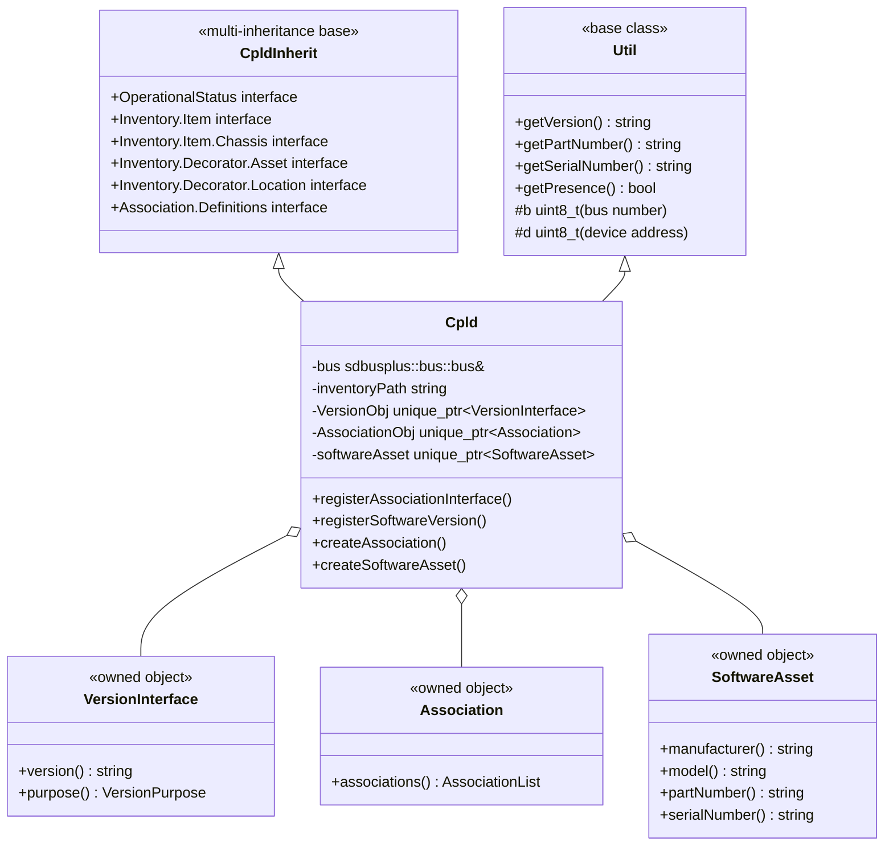

**Sources:** [nvidia-cpld/src/cpld.hpp:39-46](), [nvidia-cpld/src/cpld.hpp:126-184]()

---

### Constructor Initialization Sequence

The `Cpld` constructor performs extensive D-Bus object setup:

**Initialization Flow:**

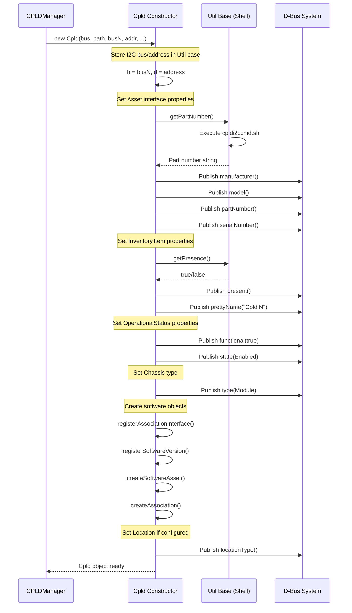

**Sources:** [nvidia-cpld/src/cpld.hpp:136-184]()

---

## D-Bus Interfaces Implemented

The `Cpld` class implements multiple OpenBMC standard interfaces through the `CpldInherit` base class:

| Interface | Purpose | Key Properties | Published Path |
|-----------|---------|----------------|----------------|
| `xyz.openbmc_project.State.Decorator.OperationalStatus` | Device health state | `Functional` (bool)<br/>`State` (enum: Enabled) | Inventory path |
| `xyz.openbmc_project.Inventory.Item` | Basic inventory item | `Present` (bool)<br/>`PrettyName` (string) | Inventory path |
| `xyz.openbmc_project.Inventory.Item.Chassis` | Chassis type classification | `Type` (enum: Module) | Inventory path |
| `xyz.openbmc_project.Inventory.Decorator.Asset` | Hardware asset information | `Manufacturer` (string)<br/>`Model` (string)<br/>`PartNumber` (string)<br/>`SerialNumber` (string) | Inventory path |
| `xyz.openbmc_project.Inventory.Decorator.Location` | Physical location | `LocationType` (enum) | Inventory path |
| `xyz.openbmc_project.Association.Definitions` | Relationship definitions | `Associations` (array of tuples) | Both paths |

**Additional Objects Created:**

| Class | Interface | Purpose | Path |
|-------|-----------|---------|------|
| `VersionInterface` | `xyz.openbmc_project.Software.Version` | Firmware version tracking | Software path |
| `SoftwareAsset` | `xyz.openbmc_project.Inventory.Decorator.Asset` | Asset info in software tree | Software path |

**Sources:** [nvidia-cpld/src/cpld.hpp:39-52](), [nvidia-cpld/src/cpld.hpp:83-100](), [nvidia-cpld/src/cpld.hpp:67-81]()

---

## D-Bus Object Path Structure

The service creates a dual-path structure for each CPLD device, linking hardware inventory to firmware versions.

**Path Naming Convention:**

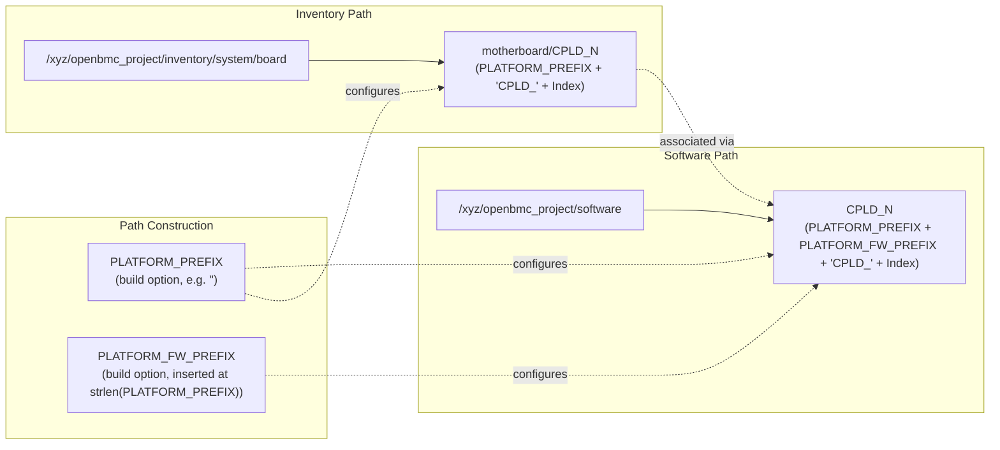

**Path Construction Logic:**

The software path is derived from the inventory path by inserting `PLATFORM_FW_PREFIX` after `PLATFORM_PREFIX`:

```
inventory path: /xyz/openbmc_project/inventory/system/board/motherboard/CPLD_0
software path:  /xyz/openbmc_project/software/CPLD_0
```

Implementation at [nvidia-cpld/src/cpld.hpp:192-196]() and [nvidia-cpld/src/cpld.hpp:213-215]().

**Sources:** [nvidia-cpld/src/cpld.hpp:186-208](), [nvidia-cpld/meson.build:12-16]()

---

## Association System

The service creates bidirectional D-Bus associations to link hardware inventory objects with their corresponding software version objects.

**Association Types Created:**

| Forward Type | Reverse Type | Endpoint | Purpose |
|--------------|--------------|----------|---------|
| `software_version` | `updateable` | `/xyz/openbmc_project/software` | Links inventory to software management |
| `inventory` | `activation` | Chassis path from JSON | Links software version to inventory item |
| `parent_chassis` | `inventory` | Chassis association endpoint | Hierarchical chassis relationship |

**Association Implementation Details:**

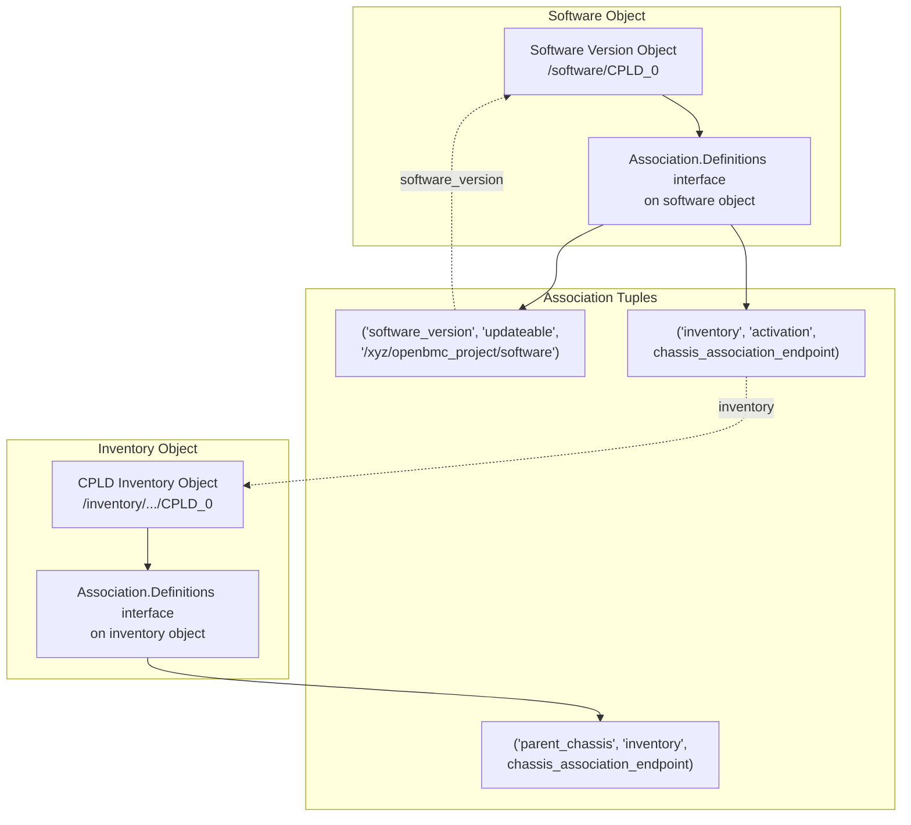

**Association Registration:**

1. **Software Path Associations** [nvidia-cpld/src/cpld.hpp:186-208]()
   - Created by `registerAssociationInterface()`
   - Links to chassis if `ChassisAssociationEndpoint` provided in JSON
   - Always links to generic software updateable path

2. **Inventory Path Associations** [nvidia-cpld/src/cpld.hpp:231-238]()
   - Created by `createAssociation()`
   - Establishes parent chassis relationship

**Sources:** [nvidia-cpld/src/cpld.hpp:186-238](), [nvidia-cpld/src/cpld.hpp:105-121]()

---

## Hardware Data Retrieval

The `Cpld` class inherits from `Util` base class, which provides hardware query methods via shell script execution.

**Data Retrieval Architecture:**

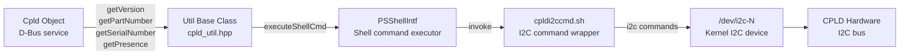

**Queried Properties:**

| Property | Source Method | Shell Script | Purpose |
|----------|---------------|--------------|---------|
| Firmware Version | `getVersion()` | `cpldi2ccmd.sh` | Populates `Software.Version.version` |
| Part Number | `getPartNumber()` | `cpldi2ccmd.sh` | Populates `Asset.partNumber` |
| Serial Number | `getSerialNumber()` | `cpldi2ccmd.sh` | Populates `Asset.serialNumber` |
| Presence | `getPresence()` | `cpldi2ccmd.sh` | Populates `Inventory.Item.present` |

**Shell Script Interface:**

The shell script `cpldi2ccmd.sh` is installed to `/usr/bin/` [nvidia-cpld/meson.build:24-28]() and provides I2C communication abstraction. The `Util` base class uses bus number (`b`) and device address (`d`) members to construct I2C commands.

**Sources:** [nvidia-cpld/src/cpld.hpp:126-184](), [nvidia-cpld/meson.build:24-28]()

---

## Configuration Format

The service reads device definitions from a JSON configuration file at startup.

**JSON Configuration Schema:**

| Field | Type | Required | Description |
|-------|------|----------|-------------|
| `Index` | string | Yes | Numeric identifier for CPLD (e.g., "0", "1") |
| `Bus` | string | Yes | I2C bus number (decimal string) |
| `Address` | string | Yes | I2C device address (hexadecimal string) |
| `Model` | string | Yes | CPLD model name |
| `Manufacturer` | string | Yes | Manufacturer name |
| `ChassisAssociationEndpoint` | string | No | D-Bus path to parent chassis object |
| `LocationType` | string | No | OpenBMC LocationType enum value |

**Example Configuration:**

```json
{
    "CPLD": [
        {
            "Index": "0",
            "Bus": "2",
            "Address": "3c",
            "Model": "LCMXO3LF-6900C",
            "Manufacturer": "Lattice",
            "ChassisAssociationEndpoint": "/xyz/openbmc_project/inventory/system/chassis",
            "LocationType": "xyz.openbmc_project.Inventory.Decorator.Location.LocationTypes.Embedded"
        }
    ]
}
```

**Configuration Processing:**

[nvidia-cpld/src/cpld_manager.cpp:39-92]() shows the parsing logic:
- Loads JSON from path defined by `CPLD_JSON_PATH` macro
- Iterates over `"CPLD"` array
- Converts bus number to `uint8_t` (decimal)
- Converts address to `uint8_t` (hexadecimal with base 16)
- Creates inventory path by concatenating base path + platform prefix + "CPLD_" + index
- Skips duplicate inventory paths

**Sources:** [nvidia-cpld/src/cpld_manager.cpp:39-92](), [nvidia-cpld/meson.build:6-8]()

---

## Service Startup and Initialization

**Service Startup Sequence:**

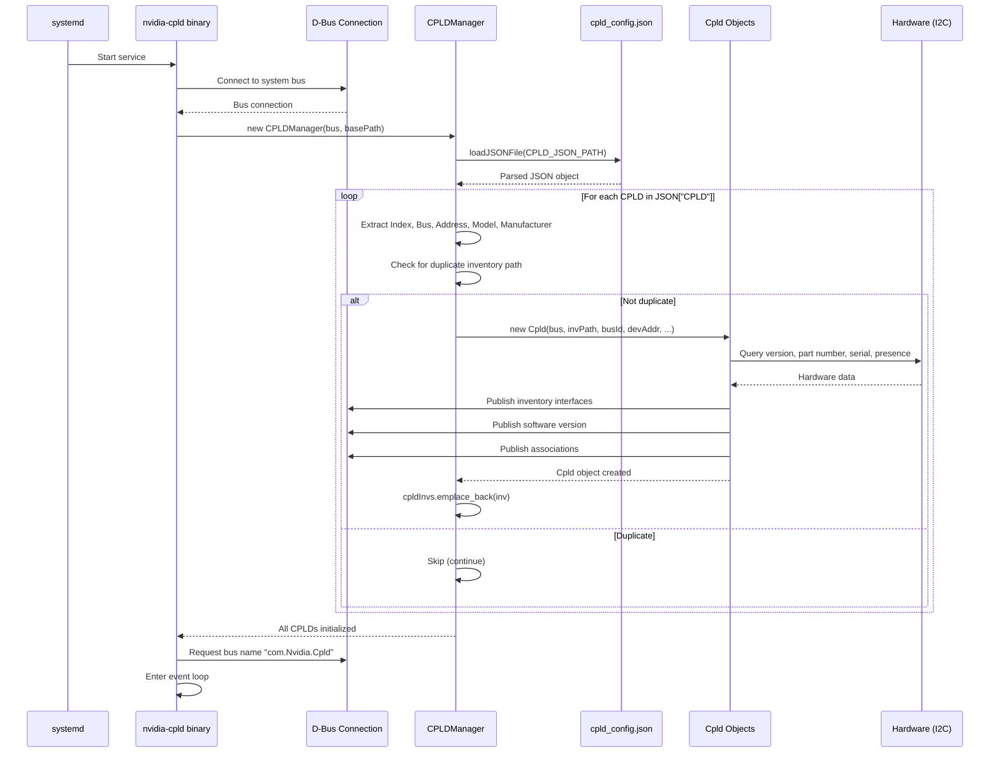

**Service Configuration:**

The service is installed as a systemd unit defined in `nvidia-cpld/services/` directory [nvidia-cpld/meson.build:30](). The D-Bus bus name is configured as `com.Nvidia.Cpld` [nvidia-cpld/meson.build:10]().

**Sources:** [nvidia-cpld/src/cpld_manager.cpp:34-92](), [nvidia-cpld/meson.build:1-36]()

---

## Testing Infrastructure

The CPLD D-Bus service includes unit tests using Google Test framework with sdbusplus mock support.

**Test Coverage:**

| Test Case | Purpose | File Reference |
|-----------|---------|----------------|
| `CpldTestDbus` | Validates D-Bus property emissions during object creation | [nvidia-cpld/tests/test_cpld.cpp:70-103]() |
| `JsonFiles` | Tests JSON configuration loading and error handling | [nvidia-cpld/tests/test_cpld.cpp:106-144]() |

**D-Bus Mock Testing Pattern:**

The tests use `sdbusplus::SdBusMock` to intercept D-Bus property change emissions without requiring an actual D-Bus daemon:

```mermaid
graph LR
    TEST["Test Case"]
    MOCK["SdBusMock<br/>Intercepts sd_bus calls"]
    CPLD["Cpld Constructor"]
    EXPECT["EXPECT_CALL<br/>Verifies properties"]
    
    TEST -->|Setup expectations| EXPECT
    TEST -->|Create| CPLD
    CPLD -->|sd_bus_emit_properties_changed_strv| MOCK
    MOCK -->|Validate against| EXPECT
    EXPECT -.Assert.-> TEST
```

**Property Validation:**

The test verifies that all expected interfaces emit property changes during construction:
- `Inventory.Item`: `Present`, `PrettyName`
- `Inventory.Decorator.Asset`: `Manufacturer`, `Model`, `PartNumber`, `SerialNumber`
- `State.Decorator.OperationalStatus`: `Functional`, `State`
- `Inventory.Item.Chassis`: `Type`
- `Software.Version`: `Purpose`, `SoftwareId`, `Version`
- `Association.Definitions`: `Associations`

**Sources:** [nvidia-cpld/tests/test_cpld.cpp:1-145]()

---

## Build Configuration

The CPLD D-Bus service build is configured through Meson build system with compile-time constants.

**Build Options:**

| Option | Purpose | Default | Usage |
|--------|---------|---------|-------|
| `platform_prefix` | Prefix for inventory object names | `""` | Inserted before "CPLD_" in paths |
| `platform_fw_prefix` | Additional prefix for software paths | `""` | Inserted after `platform_prefix` |

**Compile-Time Constants:**

The following constants are set via `configuration_data()` in [nvidia-cpld/meson.build:4-16]():

| Constant | Value | Purpose |
|----------|-------|---------|
| `CPLD_JSON_PATH` | `/usr/share/nvidia-power-manager/cpld_config.json` | Configuration file location |
| `BUSNAME` | `com.Nvidia.Cpld` | D-Bus service bus name |
| `BASE_INV_PATH` | `/xyz/openbmc_project/inventory/system/board` | Base inventory path |
| `SW_INV_PATH` | `/xyz/openbmc_project/software` | Software version base path |
| `SOFTWARE_INTERFACE` | `xyz.openbmc_project.Software.Version` | Version interface name |
| `PLATFORM_PREFIX` | Build option value | Platform-specific path prefix |
| `PLATFORM_FW_PREFIX` | Build option value | Firmware path prefix component |

**Dependencies:**

| Dependency | Purpose |
|------------|---------|
| `sdbusplus` | D-Bus C++ bindings |
| `sdeventplus` | Event loop integration |
| `fmt` | String formatting |
| `phosphor-dbus-interfaces` | OpenBMC D-Bus interface definitions |
| `phosphor-logging` | Logging infrastructure |

**Sources:** [nvidia-cpld/meson.build:1-36]()

---

# Page: CPLD Firmware Update Utilities

# CPLD Firmware Update Utilities

<details>
<summary>Relevant source files</summary>

The following files were used as context for generating this wiki page:

- [cpld_utility/dragonCpld.cpp](cpld_utility/dragonCpld.cpp)
- [cpld_utility/dragonCpld.hpp](cpld_utility/dragonCpld.hpp)
- [cpld_utility/main.cpp](cpld_utility/main.cpp)
- [cpld_utility/meson.build](cpld_utility/meson.build)
- [cpld_utility/utils.cpp](cpld_utility/utils.cpp)
- [cpld_utility/utils.hpp](cpld_utility/utils.hpp)

</details>


## Purpose and Scope

This document describes the `cpldupdate` command-line utility, which performs firmware updates on CPLD devices via I2C communication. The utility supports two implementation paths selected at compile time: a generic path using C library functions and a Dragon Chassis-specific path using C++ class hierarchies with enhanced features like I2C arbitration and GPIO-based refresh signaling.

For information about the CPLD D-Bus service that monitors CPLD devices at runtime, see [CPLD D-Bus Service](#3.1). For details on the generic update implementation, see [Generic CPLD Update Flow](#3.2.1). For Dragon Chassis-specific implementation details, see [Dragon Chassis CPLD Update](#3.2.2).

## Overview

The `cpldupdate` utility is a command-line tool that flashes firmware images to CPLD devices. It operates independently from the CPLD D-Bus service and is typically invoked during maintenance windows. After a successful update, the utility can optionally update the firmware version property in the D-Bus service via the `setFwVersion()` function.

**Key Characteristics:**
- Standalone executable installed to `/usr/bin/cpldupdate`
- Conditional compilation via `dragon_chassis_cpld` Meson option
- Supports multiple CPLD device selection (motherboard, middle plane)
- Integrates with D-Bus logging for event reporting
- Updates firmware version properties in D-Bus after successful flash

Sources: [cpld_utility/main.cpp:1-134](), [cpld_utility/meson.build:1-41]()

## Command-Line Interface

The `cpldupdate` utility accepts the following command-line arguments:

| Position | Argument | Description | Example |
|----------|----------|-------------|---------|
| 1 | I2C Bus Number | I2C bus for communication (1-255) | `11` |
| 2 | Image Select | Image selection parameter | `1` |
| 3 | Firmware File | Path to firmware image file | `/tmp/cpld.bin` |
| 4 | CPLD Device Selection | `1` = Motherboard, `2` = Middle Plane | `1` |
| 5 | Version String | Optional firmware version identifier | `v1.2.3` |
| 6 | Config/Debug | Config file path (Dragon) or debug flag `-v`/`-vv` | `/etc/cpld.json` |

**Example Usage:**
```bash
# Generic mode update
cpldupdate 11 1 /tmp/cpld_fw.bin 1 v1.2.3 -v

# Dragon Chassis mode update (requires config file)
cpldupdate 11 1 /tmp/cpld_fw.bin 1 v1.2.3 /etc/cpld_config.json
```

The version string defaults to `"Unknown"` if not provided. Debug levels include `-v` (high-level) and `-vv` (low-level).

Sources: [cpld_utility/main.cpp:45-57](), [cpld_utility/main.cpp:59-133]()

## Build System and Conditional Compilation

### cpldupdate Build Configuration

```mermaid
graph TB
    subgraph "Meson Build Options"
        OPTION["dragon_chassis_cpld<br/>(enabled/disabled)"]
    end
    
    subgraph "Source Files"
        CORE["Core Sources<br/>main.cpp<br/>libcpld.cpp<br/>libi2c.cpp<br/>updateCPLDFw_dbus_log_event.cpp<br/>utils.cpp"]
        DRAGON["Dragon Sources<br/>dragonCpld.cpp"]
    end
    
    subgraph "Dependencies"
        BASE_DEPS["Base Dependencies<br/>sdbusplus<br/>phosphor_logging<br/>phosphor_dbus_interfaces<br/>fmt"]
        GPIO_DEP["libgpiodcxx<br/>(conditional)"]
    end
    
    subgraph "Compiler Flags"
        DRAGON_FLAG["-DDRAGON_CHASSIS"]
    end
    
    subgraph "Output"
        BINARY["cpldupdate<br/>executable<br/>/usr/bin/"]
    end
    
    OPTION -->|enabled| DRAGON
    OPTION -->|enabled| GPIO_DEP
    OPTION -->|enabled| DRAGON_FLAG
    
    CORE --> BINARY
    DRAGON -->|if enabled| BINARY
    BASE_DEPS --> BINARY
    GPIO_DEP -->|if enabled| BINARY
    DRAGON_FLAG -->|if enabled| BINARY
```

The Meson build file [cpld_utility/meson.build:1-41]() controls compilation behavior:

- **Core sources** are always compiled: `main.cpp`, `libcpld.cpp`, `libi2c.cpp`
- **Dragon Chassis sources** (`dragonCpld.cpp`) are added only when `dragon_chassis_cpld` option is enabled
- **libgpiodcxx dependency** is added for GPIO refresh signal handling in Dragon mode
- **DRAGON_CHASSIS macro** is defined to enable conditional code paths in `main.cpp`

Sources: [cpld_utility/meson.build:16-24]()

## Architecture Overview

### Dual Implementation Paths

```mermaid
graph TB
    subgraph "Command Line Entry"
        MAIN["main()<br/>cpld_utility/main.cpp"]
    end
    
    subgraph "Conditional Compilation"
        IFDEF["#ifdef DRAGON_CHASSIS"]
    end
    
    subgraph "Dragon Chassis Path"
        DRAGON_INST["DragonCpld instance<br/>dragonCpld.hpp:46"]
        DRAGON_UPDATE["DragonCpld::fwUpdate()<br/>dragonCpld.cpp:49"]
        DRAGON_METHODS["Lattice CPLD Sequence:<br/>- loadConfig()<br/>- loadImage()<br/>- enableArbitration()<br/>- enableConfigurationInterface()<br/>- sendImage()<br/>- activate()"]
    end
    
    subgraph "Generic Path"
        LIBCPLD_MB["flash_remote_mb_fpga_image()<br/>libcpld"]
        LIBCPLD_MID["flash_remote_mid_fpga_image()<br/>libcpld"]
    end
    
    subgraph "Common Infrastructure"
        UTILS["setFwVersion()<br/>utils.cpp:43"]
        DBUS_LOG["emitLogMessage()<br/>updateCPLDFw_dbus_log_event"]
        I2C["I2C Bus Access<br/>/dev/i2c-*"]
    end
    
    MAIN --> IFDEF
    IFDEF -->|enabled + config arg| DRAGON_INST
    IFDEF -->|disabled| LIBCPLD_MB
    IFDEF -->|disabled| LIBCPLD_MID
    
    DRAGON_INST --> DRAGON_UPDATE
    DRAGON_UPDATE --> DRAGON_METHODS
    
    MAIN -->|device=1| LIBCPLD_MB
    MAIN -->|device=2| LIBCPLD_MID
    
    DRAGON_METHODS --> DBUS_LOG
    DRAGON_METHODS --> UTILS
    DRAGON_METHODS --> I2C
    LIBCPLD_MB --> I2C
    LIBCPLD_MID --> I2C
    UTILS --> I2C
```

The utility branches at runtime based on compilation configuration and command-line arguments:

**Dragon Chassis Mode (requires config file argument):**
- Creates `DragonCpld` instance [cpld_utility/main.cpp:109]()
- Calls `DragonCpld::fwUpdate()` [cpld_utility/main.cpp:110]()
- Implements full Lattice CPLD update protocol

**Generic Mode (no config file):**
- Calls `flash_remote_mb_fpga_image()` for motherboard CPLD [cpld_utility/main.cpp:117-118]()
- Calls `flash_remote_mid_fpga_image()` for middle plane CPLD [cpld_utility/main.cpp:122-123]()
- Uses simpler C library functions

Sources: [cpld_utility/main.cpp:106-130]()

## Dragon Chassis Class Hierarchy

### DragonCpld Class Structure

```mermaid
classDiagram
    class DragonChassisBase {
        <<abstract>>
        +int devIdx
        +int address
        +int fd
        +uint8_t* image
        +size_t imageSize
        +bool arb
        +bool rawLattice
        +enableArbitration(bool) int
        +loadImage() int
        +openBus(int) int
        +transfer() int
        +transferWithRetry() int
        +sendData() int
        +sendDataWithRetry() int
        +printError(int) void
    }
    
    class DragonCpld {
        -int bus
        -int cpldRegBus
        -int cpldRegAddress
        -int cpldRegFd
        -int cpldRawBus
        -int numOfPagesWritten
        -const char* config
        -string devName
        -gpiod::line cpldRefreshGpio
        -array~uint8_t~ deviceIdArray
        +DragonCpld(int, char*, const char*)
        +fwUpdate() int
        #loadConfig() int
        #enableConfigurationInterface() int
        #erase(bool) int
        #sendImage() int
        #validate() int
        #activate() int
        #readDeviceId() int
        #readFwVersion() string
        #waitBusy(int, int) int
        #waitRefresh(int) int
        #readStatusRegister(uint32_t*) int
        #cleanUp() int
    }
    
    class I2c {
        +transfer() int
        +calculate_PEC() uint8_t
    }
    
    I2c <|-- DragonChassisBase
    DragonChassisBase <|-- DragonCpld
```

The `DragonCpld` class extends `DragonChassisBase` (documented in [Hardware Abstraction Layer](#8)) to implement Lattice CPLD-specific firmware update sequences. Key components:

**Configuration Management:**
- Loads JSON configuration file specifying bus numbers, addresses, device IDs
- Supports arbitration control and GPIO refresh signal configuration
- Parses per-device parameters: `CPLDDeviceNo`, `Bus`, `Address`, `CpldRegBus`, `CpldRawBus`

**Hardware Access:**
- Multiple I2C buses: main bus, register bus, raw (non-arbitrated) bus
- GPIO line `CPLD_REFRESH_IN_PRGRS_L-I` for refresh status monitoring
- Device ID validation against expected values in config

Sources: [cpld_utility/dragonCpld.hpp:28-167](), [cpld_utility/dragonCpld.cpp:38-42]()

## Lattice CPLD Update Flow

### High-Level Update Sequence

```mermaid
sequenceDiagram
    participant Main as main()
    participant DC as DragonCpld
    participant Config as JSON Config
    participant I2C as I2C Bus
    participant CPLD as CPLD Device
    participant DBus as D-Bus Service
    
    Main->>DC: DragonCpld(devIdx, image, config)
    Main->>DC: fwUpdate()
    
    DC->>Config: loadConfig()
    Config-->>DC: bus, address, deviceId, etc.
    
    DC->>DC: loadImage()
    Note over DC: Read firmware into memory
    
    DC->>DC: enableArbitration(true)
    Note over DC: Acquire I2C bus access
    
    DC->>I2C: openBus(bus)
    I2C-->>DC: file descriptor
    
    DC->>CPLD: readDeviceId()
    CPLD-->>DC: device ID bytes
    DC->>DC: Validate against config
    
    DC->>CPLD: enableConfigurationInterface()
    Note over CPLD: Enter programming mode
    
    DC->>CPLD: sendImage()
    Note over DC,CPLD: erase() -> write pages -> validate()
    loop Each 16-byte page
        DC->>CPLD: Write page data
        DC->>CPLD: waitBusy()
    end
    DC->>CPLD: validate()
    Note over DC: Read back and compare
    
    DC->>CPLD: activate()
    Note over DC: Write activation registers
    Note over CPLD: Switch to raw bus
    DC->>CPLD: Send refresh command
    DC->>DC: waitRefresh(0)
    
    DC->>CPLD: readFwVersion()
    CPLD-->>DC: version bytes
    
    DC->>DBus: setFwVersion(objPath, version)
    Note over DBus: Update D-Bus property
    
    DC->>DC: enableArbitration(false)
```

The `fwUpdate()` method implements a multi-stage update process defined by Lattice CPLD specifications:

**Stages:**
1. **Configuration Loading**: Parse JSON config, initialize GPIO if needed [cpld_utility/dragonCpld.cpp:55-57]()
2. **Image Loading**: Read firmware file into memory [cpld_utility/dragonCpld.cpp:58-60]()
3. **Arbitration**: Enable I2C bus arbitration if configured [cpld_utility/dragonCpld.cpp:62-67]()
4. **Device Validation**: Read and verify CPLD device ID [cpld_utility/dragonCpld.cpp:88-90]()
5. **Configuration Interface**: Enable CPLD programming mode [cpld_utility/dragonCpld.cpp:94-96]()
6. **Image Transfer**: Erase, write, and validate firmware pages [cpld_utility/dragonCpld.cpp:98-100]()
7. **Activation**: Trigger internal refresh to apply new firmware [cpld_utility/dragonCpld.cpp:104-106]()
8. **Version Update**: Read new version and update D-Bus property [cpld_utility/dragonCpld.cpp:108-113]()

Sources: [cpld_utility/dragonCpld.cpp:49-128]()

## Configuration File Format

The Dragon Chassis mode requires a JSON configuration file with the following structure:

```json
{
  "CPLD": [
    {
      "CPLDDeviceNo": 1,
      "Name": "CPLD_MB",
      "Bus": "11",
      "Address": "0x40",
      "CpldRegBus": "12",
      "CpldRegAddress": "0x30",
      "CpldRawBus": "13",
      "ImageOffset": 0,
      "DeviceId": ["0x01", "0x2b", "0xd0", "0x43"],
      "Arbitration": "1",
      "RawLattice": false
    }
  ]
}
```

**Configuration Parameters:**

| Field | Type | Description |
|-------|------|-------------|
| `CPLDDeviceNo` | int | Device index matching command-line argument |
| `Name` | string | Device name for logging and D-Bus paths |
| `Bus` | string | Primary I2C bus number (arbitrated) |
| `Address` | string | I2C address (hex or decimal) |
| `CpldRegBus` | string | I2C bus for register access |
| `CpldRegAddress` | string | I2C address for register access |
| `CpldRawBus` | string | Non-arbitrated I2C bus for refresh command |
| `ImageOffset` | int | Offset into firmware image file |
| `DeviceId` | array | Expected 4-byte device ID for validation |
| `Arbitration` | string | `"1"` to enable I2C arbitration, `"0"` to disable |
| `RawLattice` | bool | `true` for raw Lattice access mode |

The `loadConfig()` method parses this file and initializes bus numbers, addresses, and GPIO configuration based on arbitration settings [cpld_utility/dragonCpld.cpp:585-662]().

Sources: [cpld_utility/dragonCpld.cpp:585-662]()

## Firmware Validation and Retry Mechanism

### Validation Flow

The `sendImage()` method includes a sophisticated validation and retry mechanism to handle Lattice CPLD instability:

**Key Features:**
- **Automatic Retry**: Up to 2 attempts (`VALIDATE_RETRY = 1`) [cpld_utility/dragonCpld.cpp:296]()
- **Page-by-Page Verification**: Reads back each written page and compares with source image [cpld_utility/dragonCpld.cpp:466-507]()
- **I2C Failure Recovery**: Resets page number on I2C transaction failures [cpld_utility/dragonCpld.cpp:341-356]()
- **Special Pattern Handling**: Tolerates known failure patterns (all zeros/all ones) [cpld_utility/dragonCpld.cpp:482-486]()

**Update Process:**
1. Erase CPLD flash with reset [cpld_utility/dragonCpld.cpp:325]()
2. Write firmware in 16-byte pages (`PAGE_SIZE = 16`) [cpld_utility/dragonCpld.cpp:329-365]()
3. Validate written data by reading back [cpld_utility/dragonCpld.cpp:366]()
4. On validation failure, retry entire erase/write/validate sequence [cpld_utility/dragonCpld.cpp:316-372]()
5. Clean up (erase and activate) if all retries fail [cpld_utility/dragonCpld.cpp:401-403]()

**Status Monitoring:**
- `waitBusy()`: Polls busy register until operation completes [cpld_utility/dragonCpld.cpp:139-162]()
- `readStatusRegister()`: Checks `BUSY_BIT`, `FAIL_BIT`, `DONE_BIT` [cpld_utility/dragonCpld.cpp:130-137]()

Sources: [cpld_utility/dragonCpld.cpp:297-404](), [cpld_utility/dragonCpld.cpp:445-510]()

## Activation and Refresh Sequence

### Activation Flow with GPIO Handshake

```mermaid
sequenceDiagram
    participant DC as DragonCpld
    participant RegBus as CPLD Register Bus
    participant Kernel as Arbitration Driver
    participant GPIO as CPLD_REFRESH GPIO
    participant RawBus as Raw I2C Bus
    participant CPLD as CPLD Device
    
    Note over DC,CPLD: Activation Stage
    DC->>RegBus: Write 0x1080 to reg
    Note over RegBus: Set activation bit 1
    
    DC->>RegBus: Write 0x1040 to reg
    Note over RegBus: Set activation bit 2
    
    Note over Kernel: Arbitration disabled by CPLD
    
    DC->>GPIO: Read cpld_refresh (expect 1)
    loop Wait up to 15 seconds
        GPIO-->>DC: Value
        alt Value != 1
            DC->>DC: sleep(1)
        end
    end
    
    DC->>RawBus: Switch to non-arbitrated bus
    DC->>CPLD: Send refresh command (0x79, 0x40, 0x0)
    Note over CPLD: Apply new firmware
    
    DC->>GPIO: Read cpld_refresh (expect 0)
    loop Wait up to 15 seconds
        GPIO-->>DC: Value
        alt Value != 0
            DC->>DC: sleep(1)
        end
    end
    
    Note over CPLD: Firmware activated
    Note over Kernel: Arbitration re-enabled
```

The `activate()` method implements a complex sequence to apply the new firmware:

**Activation Registers:**
1. Write `0x1080` to CPLD register (set bit 7) [cpld_utility/dragonCpld.cpp:526-528]()
2. Write `0x1040` to CPLD register (set bit 6) [cpld_utility/dragonCpld.cpp:530-532]()
3. This disables I2C arbitration on the CPLD side per specification

**Refresh Monitoring:**
- `waitRefresh(1)`: Wait for refresh signal to go high (CPLD entering refresh) [cpld_utility/dragonCpld.cpp:536-538]()
- Switch to raw (non-arbitrated) bus [cpld_utility/dragonCpld.cpp:540-545]()
- Send Lattice refresh command `{0x79, 0x40, 0x0}` [cpld_utility/dragonCpld.cpp:547-554]()
- `waitRefresh(0)`: Wait for refresh signal to go low (refresh complete) [cpld_utility/dragonCpld.cpp:557-559]()

**Refresh Signal Sources:**
- **With Arbitration**: Read from sysfs `/sys/devices/platform/i2carb/cpld_refresh` [cpld_utility/dragonCpld.cpp:411-421]()
- **Without Arbitration**: Read directly from GPIO via libgpiod [cpld_utility/dragonCpld.cpp:424-426]()

**Raw Lattice Mode:**
- For unstable Lattice devices, skip GPIO monitoring and wait 30 seconds after refresh command [cpld_utility/dragonCpld.cpp:561-566]()

Sources: [cpld_utility/dragonCpld.cpp:512-571](), [cpld_utility/dragonCpld.cpp:406-443]()

## D-Bus Integration

### Firmware Version Update

After successful firmware update, the utility updates the D-Bus property to reflect the new firmware version:

**Version Reading:**
- Send Lattice command `{0xc0, 0x00, 0x00}` to read firmware version [cpld_utility/dragonCpld.cpp:186]()
- Receive 4-byte version response [cpld_utility/dragonCpld.cpp:187-193]()
- Format as hex string: `"0xXX 0xXX 0xXX 0xXX"` [cpld_utility/dragonCpld.cpp:198-213]()

**D-Bus Property Update:**
```cpp
// Update D-Bus software version property
std::string objPath = swBasePath + devName;
setFwVersion(objPath, newFwVersion);
```

The `setFwVersion()` function [cpld_utility/utils.cpp:43-48]():
1. Constructs D-Bus object path: `/xyz/openbmc_project/software/{devName}`
2. Calls D-Bus `Set` method on service `com.Nvidia.Cpld`
3. Updates `xyz.openbmc_project.Software.Version` interface `Version` property

This ensures the CPLD D-Bus service (see [CPLD D-Bus Service](#3.1)) reflects the updated firmware version after the flash operation completes.

### Event Logging

The utility emits D-Bus log events at key stages:

| Event | Severity | Trigger Point |
|-------|----------|---------------|
| `target_deter` | Info | After device ID validation [cpld_utility/dragonCpld.cpp:92]() |
| `update_succ` | Info | After successful image write [cpld_utility/dragonCpld.cpp:102]() |
| `ver_failed` | Critical | On validation failure [cpld_utility/dragonCpld.cpp:370-371]() |

These events use the `emitLogMessage()` function defined in [cpld_utility/updateCPLDFw_dbus_log_event.h]() to publish log entries to D-Bus for system monitoring and diagnostics.

Sources: [cpld_utility/dragonCpld.cpp:183-225](), [cpld_utility/utils.cpp:43-48](), [cpld_utility/utils.hpp:25-29]()

## Error Handling

### Error Code Definitions

The `DragonCpld` class uses enumerated error codes defined in the base class to provide detailed failure diagnostics:

**Common Error Categories:**
- **Configuration Errors**: `ERROR_CONFIG_NOT_FOUND`, `ERROR_CONFIG_FORMAT`, `ERROR_CONFIG_PARSE_FAILED`
- **Bus Access Errors**: `ERROR_OPEN_BUS`, `ERROR_INVALID_DEVICE_ID`
- **Programming Errors**: `ERROR_ENABLE_CFG_INTER`, `ERROR_ERASE`, `ERROR_SEND_IMAGE`, `ERROR_SEND_IMAGE_DONE`
- **Activation Errors**: `ERROR_ACTIVATE_CPLD_REG1`, `ERROR_ACTIVATE_CPLD_REG2`, `ERROR_SEND_INTERNAL_CPLD_REFRESH_FAILED`
- **Timeout Errors**: `ERROR_READ_CPLD_REFRESH_TIMEOUT`, `ERROR_READ_CPLD_REFRESH_TIMEOUT_ZERO`
- **GPIO Errors**: `ERROR_FAILED_TO_GET_GPIO`

**Error Propagation:**
- All error codes are returned as negative integers
- `printError()` method translates codes to human-readable messages
- Cleanup operations (`cleanUp()`) execute on failure to restore CPLD state [cpld_utility/dragonCpld.cpp:573-583]()

**Cleanup on Failure:**
```cpp
int DragonCpld::cleanUp()
{
    int ret = erase(false);  // Erase without reset
    if (ret)
        return ERROR_CLEANUP_ERASE;
    
    ret = activate();  // Attempt to restore previous firmware
    return ret;
}
```

Sources: [cpld_utility/dragonCpld.cpp:573-583]()

## I2C Communication Details

### Transfer Functions with Retry Logic

The CPLD update uses I2C transfer functions with built-in retry mechanisms:

**Key Functions:**
- `transferWithRetry()`: Combined write-then-read with retries [cpld_utility/dragonCpld.cpp:135-136]()
- `sendDataWithRetry()`: Write-only with retries [cpld_utility/dragonCpld.cpp:234-237]()
- Retry count: `I2C_RETRY_ATTEMPTS = 5` [cpld_utility/dragonCpld.cpp:34]()

**Usage Examples:**

```cpp
// Read device ID with retry
ret = transferWithRetry(fd, 1, address, cmd, dev_id, 4, 4, I2C_RETRY_ATTEMPTS);

// Write enable configuration command with retry
ret = sendDataWithRetry(fd, address, cmd, 4, 
                       ERROR_ENABLE_CFG_INTER_WRITE,
                       I2C_RETRY_ATTEMPTS);
```

**Lattice CPLD Commands:**
- **Read Device ID**: `{0xe0, 0x00, 0x00, 0x00}` [cpld_utility/dragonCpld.cpp:166-168]()
- **Read Status Register**: `{0x3c, 0x00, 0x00, 0x00}` [cpld_utility/dragonCpld.cpp:132-133]()
- **Read Busy Register**: `{0xf0, 0x00, 0x00, 0x00}` [cpld_utility/dragonCpld.cpp:142-143]()
- **Enable Configuration**: `{0x74, 0x08, 0x00, 0x00}` [cpld_utility/dragonCpld.cpp:230]()
- **Erase Flash**: `{0x0e, 0x04, 0x00, 0x00}` [cpld_utility/dragonCpld.cpp:256]()
- **Reset**: `{0x46, 0x00, 0x00, 0x00}` [cpld_utility/dragonCpld.cpp:258]()
- **Write Page**: `{0x70, 0x00, 0x00, 0x01}` + 16 data bytes [cpld_utility/dragonCpld.cpp:302]()
- **Set Page Number**: `{0xb4, 0x00, 0x00, 0x00, 0x00, 0x00, pageHigh, pageLow}` [cpld_utility/dragonCpld.cpp:305]()
- **Done Writing**: `{0x5e, 0x00, 0x00, 0x00}` [cpld_utility/dragonCpld.cpp:304]()
- **Read Page**: `{0x73, 0x00, 0x00, 0x01}` [cpld_utility/dragonCpld.cpp:448]()
- **Refresh**: `{0x79, 0x40, 0x00}` [cpld_utility/dragonCpld.cpp:520]()

All commands follow Lattice CPLD I2C protocol specifications available from Lattice Semiconductor's website (requires account).

Sources: [cpld_utility/dragonCpld.cpp:28-34](), [cpld_utility/dragonCpld.cpp:130-137](), [cpld_utility/dragonCpld.cpp:164-181]()

---

# Page: Generic CPLD Update Flow

# Generic CPLD Update Flow

<details>
<summary>Relevant source files</summary>

The following files were used as context for generating this wiki page:

- [cpld_utility/main.cpp](cpld_utility/main.cpp)
- [cpld_utility/meson.build](cpld_utility/meson.build)
- [cpld_utility/utils.cpp](cpld_utility/utils.cpp)
- [cpld_utility/utils.hpp](cpld_utility/utils.hpp)

</details>


## Purpose and Scope

This document describes the standard CPLD firmware update implementation used on non-Dragon chassis platforms. The generic update flow uses direct I2C communication through the `libcpld` library without the additional arbitration, GPIO control, or PEC checking mechanisms required by Dragon Chassis systems.

For Dragon Chassis-specific CPLD updates, which include I2C arbitration, GPIO refresh signaling, and Lattice CPLD-specific protocols, see [Dragon Chassis CPLD Update](#3.2.2).

**Sources:** [cpld_utility/main.cpp:1-134]()

---

## Command-Line Interface

The `cpldupdate` utility provides a command-line interface for flashing CPLD firmware. When built without Dragon Chassis support, it accepts the following arguments:

### Syntax

```
cpldupdate <i2c_bus> <image_select> <firmware_file> <device_selection> [version] [debug_flags]
```

### Arguments

| Argument | Description | Valid Values |
|----------|-------------|--------------|
| `i2c_bus` | I2C bus number for communication | 0-255 (must be digits) |
| `image_select` | Image slot selection | Integer value |
| `firmware_file` | Path to firmware image file | Valid file path |
| `device_selection` | Target CPLD device | `1` = Motherboard CPLD<br/>`2` = Middle Plane CPLD |
| `version` (optional) | Firmware version string | Any string (default: "Unknown") |
| `debug_flags` (optional) | Verbosity level | `-v` = High-level debug<br/>`-vv` = Low-level debug |

### Example Usage

```bash
cpldupdate 11 1 /tmp/cpld_fw.bin 1
cpldupdate 11 1 /tmp/cpld_fw.bin 2 "1.2.3" -vv
```

**Sources:** [cpld_utility/main.cpp:45-57](), [cpld_utility/main.cpp:59-105]()

---

## Build Configuration

The generic CPLD update flow is enabled when the Meson build option `dragon_chassis_cpld` is **disabled**. This results in a simpler compilation without Dragon Chassis-specific dependencies.

### Build Dependencies (Generic Mode)

```meson
dependencies:
  - sdbusplus
  - sdeventplus
  - phosphor_logging
  - phosphor_dbus_interfaces
  - fmt

sources:
  - main.cpp
  - libcpld.cpp
  - libi2c.cpp
  - updateCPLDFw_dbus_log_event.cpp
  - utils.cpp
```

### Conditional Compilation

The generic flow executes when the `DRAGON_CHASSIS` preprocessor macro is **not defined**. This removes the DragonCpld class instantiation and falls through to direct `libcpld` function calls.

**Sources:** [cpld_utility/meson.build:1-41](), [cpld_utility/main.cpp:106-114]()

---

## Update Process Architecture

### High-Level Flow

```mermaid
flowchart TD
    Start["main() entry"] --> ParseArgs["Parse command-line arguments"]
    ParseArgs --> ValidateBus["Validate I2C bus number<br/>(checkDigit)"]
    ValidateBus --> ValidateFail{"Bus valid?"}
    ValidateFail -->|No| ErrorBus["Return -ERROR_INPUT_I2C_ARGUMENT"]
    ValidateFail -->|Yes| CheckDevice{"Device selection"}
    
    CheckDevice -->|"1 (Motherboard)"| FlashMB["flash_remote_mb_fpga_image()<br/>bus, image_sel, image,<br/>progress, 'cpld0'"]
    CheckDevice -->|"2 (Middle Plane)"| FlashMid["flash_remote_mid_fpga_image()<br/>bus, image_sel, image,<br/>progress, 'cpld1'"]
    CheckDevice -->|Other| ErrorDevice["Return -ERROR_WRONG_CPLD_DEVICE_SELECTION"]
    
    FlashMB --> Complete["Return status code"]
    FlashMid --> Complete
    ErrorBus --> End["Exit"]
    ErrorDevice --> End
    Complete --> End
```

**Sources:** [cpld_utility/main.cpp:59-133]()

### Main Function Flow

The `main()` function in [cpld_utility/main.cpp:59-133]() implements a straightforward execution path:

1. **Argument Validation** ([cpld_utility/main.cpp:62-81]())
   - Requires minimum 5 arguments
   - Validates I2C bus number using `checkDigit()` to ensure numeric value ≤ 255
   - Extracts bus number, image selector, firmware path, and device selection

2. **Optional Parameter Processing** ([cpld_utility/main.cpp:83-105]())
   - Version string (defaults to "Unknown")
   - Debug flags (`-v` or `-vv`)

3. **Device-Specific Flash Operation** ([cpld_utility/main.cpp:115-130]())
   - Motherboard CPLD: calls `flash_remote_mb_fpga_image()`
   - Middle Plane CPLD: calls `flash_remote_mid_fpga_image()`
   - Both functions defined in `libcpld.h`

**Sources:** [cpld_utility/main.cpp:59-133]()

---

## Device Selection Logic

The utility supports two distinct CPLD devices, each accessed through a different function call from the `libcpld` library.

### Device Types

| Device ID | Device Name | Function Called | Device Label |
|-----------|-------------|-----------------|--------------|
| 1 | Motherboard CPLD | `flash_remote_mb_fpga_image()` | `"cpld0"` |
| 2 | Middle Plane CPLD | `flash_remote_mid_fpga_image()` | `"cpld1"` |

### Function Signatures

Both functions share a common signature pattern:

```c
int flash_remote_mb_fpga_image(int bus, int image_sel, char* image,
                               int* flashing_progress, char* device_label);

int flash_remote_mid_fpga_image(int bus, int image_sel, char* image,
                                int* flashing_progress, char* device_label);
```

The `flashing_progress` pointer is provided for potential progress reporting, though the generic implementation does not require user-visible progress updates.

**Sources:** [cpld_utility/main.cpp:72-74](), [cpld_utility/main.cpp:115-124]()

---

## I2C Communication Layer

### Bus Access

The generic CPLD update flow uses direct I2C bus access without arbitration mechanisms. The I2C bus is specified via command-line argument and must be in the range 0-255.

### Validation Logic

```mermaid
flowchart LR
    Input["I2C bus string"] --> CheckRange["Check atoi(str) <= 255"]
    CheckRange --> LoopDigits["For each character:<br/>isdigit() check"]
    LoopDigits --> AllDigits{"All characters<br/>are digits?"}
    AllDigits -->|Yes| Valid["Return 0 (valid)"]
    AllDigits -->|No| Invalid["Return 1 (invalid)"]
    CheckRange -->|"> 255"| Invalid
```

The `checkDigit()` function ([cpld_utility/main.cpp:31-43]()) ensures:
- The string contains only numeric characters
- The numeric value does not exceed `MAX_I2C_BUS_NUMBER` (255)

### Communication Protocol

The `libcpld` library (included via [cpld_utility/main.cpp:22]()) provides low-level I2C communication functions. The library handles:
- Opening I2C device files (`/dev/i2c-*`)
- Transferring firmware image data
- Verifying write operations
- Managing CPLD-specific protocols

**Sources:** [cpld_utility/main.cpp:22-23](), [cpld_utility/main.cpp:31-43](), [cpld_utility/main.cpp:76-81]()

---

## D-Bus Integration

### Version Update Mechanism

After a successful firmware update, the utility can update the CPLD version information in the D-Bus object representing the CPLD device.

```mermaid
sequenceDiagram
    participant cpldupdate as cpldupdate utility
    participant utils as utils.cpp
    participant dbus as D-Bus System Bus
    participant service as com.Nvidia.Cpld service
    
    cpldupdate->>utils: setFwVersion(objPath, version)
    utils->>utils: setProperty() with PropertyValue
    utils->>dbus: new_method_call()<br/>"org.freedesktop.DBus.Properties"<br/>"Set"
    dbus->>service: Set xyz.openbmc_project.Software.Version<br/>"Version" property
    service-->>dbus: Acknowledge
    dbus-->>utils: Return
    utils-->>cpldupdate: Complete
```

### D-Bus Utility Functions

The [cpld_utility/utils.cpp]() module provides D-Bus integration:

- **`setProperty()`** ([cpld_utility/utils.cpp:24-41]())
  - Generic property setter using D-Bus Properties interface
  - Targets the `com.Nvidia.Cpld` service
  - Uses `org.freedesktop.DBus.Properties.Set` method

- **`setFwVersion()`** ([cpld_utility/utils.cpp:43-48]())
  - Convenience wrapper for updating version strings
  - Sets the `Version` property on `xyz.openbmc_project.Software.Version` interface
  - Constructs D-Bus object path from CPLD device identifier

### Service and Path Constants

```cpp
const std::string service = "com.Nvidia.Cpld";
const std::string swBasePath = "/xyz/openbmc_project/software/";
```

The version update targets software objects under the `/xyz/openbmc_project/software/` hierarchy, following OpenBMC conventions.

**Sources:** [cpld_utility/utils.hpp:19-30](), [cpld_utility/utils.cpp:1-49]()

---

## Error Handling

### Return Codes

The utility returns negative error codes to indicate specific failure conditions:

| Error Code | Symbolic Name | Condition |
|------------|---------------|-----------|
| `-ERROR_INPUT_ARGUMENTS` | Invalid argument count | Less than 5 arguments provided |
| `-ERROR_INPUT_I2C_ARGUMENT` | Invalid I2C bus | Non-numeric or out-of-range bus number |
| `-ERROR_WRONG_CPLD_DEVICE_SELECTION` | Invalid device selection | Device ID not 1 or 2 |
| (libcpld errors) | Various | Returned from `flash_remote_*_fpga_image()` functions |

### Input Validation Sequence

```mermaid
flowchart TD
    Start["Utility invoked"] --> ArgCount{"argc >= 5?"}
    ArgCount -->|No| Error1["Show usage<br/>Return -ERROR_INPUT_ARGUMENTS"]
    ArgCount -->|Yes| ParseBus["Parse bus number"]
    ParseBus --> ValidateBus["checkDigit(bus_string)"]
    ValidateBus --> BusValid{"Valid?"}
    BusValid -->|No| Error2["Show usage<br/>Return -ERROR_INPUT_I2C_ARGUMENT"]
    BusValid -->|Yes| CheckDev{"Device selection<br/>== 1 or 2?"}
    CheckDev -->|No| Error3["Show usage<br/>Return -ERROR_WRONG_CPLD_DEVICE_SELECTION"]
    CheckDev -->|Yes| CallLibcpld["Call libcpld flash function"]
    CallLibcpld --> LibResult{"Flash<br/>success?"}
    LibResult -->|Yes| ReturnSuccess["Return 0"]
    LibResult -->|No| ReturnError["Return libcpld error code"]
    
    Error1 --> Exit
    Error2 --> Exit
    Error3 --> Exit
    ReturnSuccess --> Exit
    ReturnError --> Exit
```

### Usage Display

When validation fails, the `show_usage()` function ([cpld_utility/main.cpp:45-57]()) displays comprehensive help text including:
- Command syntax
- Valid ranges for each argument
- Example invocation
- Debug flag descriptions
- Device selection mappings

**Sources:** [cpld_utility/main.cpp:45-57](), [cpld_utility/main.cpp:62-81](), [cpld_utility/main.cpp:115-130]()

---

## Debug and Logging Support

### Debug Flags

The generic flow supports two verbosity levels controlled by global variables:

- **`debug_h`** (High-level debug): Set via `-v` flag ([cpld_utility/main.cpp:95]())
- **`debug_l`** (Low-level debug): Set via `-vv` flag, also enables `debug_h` ([cpld_utility/main.cpp:97-99]())

These flags are declared as global variables ([cpld_utility/main.cpp:26-27]()) and can be used by `libcpld` functions to control diagnostic output.

### D-Bus Logging

The utility includes support for D-Bus event logging via `updateCPLDFw_dbus_log_event.cpp` ([cpld_utility/meson.build:5]()). This module can generate structured log entries on the D-Bus system for audit and troubleshooting purposes.

**Sources:** [cpld_utility/main.cpp:26-27](), [cpld_utility/main.cpp:92-105](), [cpld_utility/meson.build:5]()

---

## Comparison with Dragon Chassis Flow

### Architectural Differences

| Aspect | Generic Flow (This Page) | Dragon Chassis Flow ([3.2.2](#3.2.2)) |
|--------|--------------------------|----------------------------------------|
| **Activation** | `dragon_chassis_cpld` disabled | `dragon_chassis_cpld` enabled |
| **Implementation** | Direct `libcpld` function calls | C++ class hierarchy (`DragonCpld`) |
| **I2C Access** | Direct bus access | Arbitration via sysfs + GPIO handshake |
| **Dependencies** | Standard I2C libraries | + `libgpiodcxx` for GPIO control |
| **Configuration** | Command-line only | + JSON configuration file support |
| **Validation** | Basic error codes | PEC checking, retry mechanisms |

### Conditional Compilation

The [cpld_utility/main.cpp:106-114]() section demonstrates the compile-time decision:

```cpp
#ifdef DRAGON_CHASSIS
    if (argc > 6) {
        DragonCpld dp(cpldDeviceSelection, image, configFile);
        ret = dp.fwUpdate();
        dp.printError(ret);
    } else
#endif
    // Falls through to generic flow when DRAGON_CHASSIS not defined
    // or when insufficient arguments for Dragon chassis
```

When `DRAGON_CHASSIS` is not defined, the preprocessor removes the Dragon Chassis code path entirely, resulting in a smaller binary with only the generic flow compiled in.

**Sources:** [cpld_utility/main.cpp:18-20](), [cpld_utility/main.cpp:106-130](), [cpld_utility/meson.build:16-24]()

---

# Page: Dragon Chassis CPLD Update

# Dragon Chassis CPLD Update

<details>
<summary>Relevant source files</summary>

The following files were used as context for generating this wiki page:

- [cpld_utility/dragonCpld.cpp](cpld_utility/dragonCpld.cpp)
- [cpld_utility/dragonCpld.hpp](cpld_utility/dragonCpld.hpp)
- [include/dragonChassisBase.hpp](include/dragonChassisBase.hpp)

</details>


## Purpose and Scope

This document describes the Dragon Chassis-specific CPLD firmware update implementation for Lattice CPLD devices. The `DragonCpld` class provides a specialized update flow that includes I2C bus arbitration, GPIO-based refresh signaling, and Lattice vendor-specific command sequences. This implementation is conditionally compiled when the `dragon_chassis_cpld` Meson option is enabled.

For information about the generic CPLD update flow (non-Dragon chassis platforms), see [Generic CPLD Update Flow](#3.2.1). For information about the CPLD D-Bus service that monitors CPLD devices at runtime, see [CPLD D-Bus Service](#3.1).

**Sources:** [cpld_utility/dragonCpld.hpp:1-168](), [cpld_utility/dragonCpld.cpp:1-663]()

---

## Class Architecture

The `DragonCpld` class implements Dragon Chassis-specific firmware update logic for Lattice CPLD devices. It inherits from `DragonChassisBase`, which provides common Dragon chassis functionality including I2C arbitration, image loading, and PEC calculation.

### Class Hierarchy

```mermaid
classDiagram
    class I2c {
        +transfer()
        +calculate_PEC()
        +openBus()
    }
    
    class DragonChassisBase {
        #int devIdx
        #int address
        #bool arb
        #bool rawLattice
        #char* imageName
        #char* image
        #int imageSize
        #int imageOffset
        #int fd
        +enableArbitration(bool enable)
        +loadImage()
        +sendData()
        +sendDataWithRetry()
        +transferWithRetry()
        +readSysFs()
        +writeSysFs()
        +printError(int code)
        #sendImage()* abstract
    }
    
    class DragonCpld {
        #int bus
        #int cpldRegBus
        #int cpldRegAddress
        #int cpldRegFd
        #int cpldRawBus
        #int numOfPagesWritten
        #const char* config
        #string devName
        #gpiod::line cpldRefreshGpio
        #array~uint8_t~ deviceIdArray
        +DragonCpld(int devIdx, char* imageName, const char* config)
        +fwUpdate()
        #loadConfig()
        #readDeviceId()
        #readFwVersion()
        #enableConfigurationInterface()
        #erase(bool reset)
        #sendImage()
        #validate()
        #activate()
        #waitBusy(int wait, int errorCode)
        #waitRefresh(int result)
        #readStatusRegister(uint32_t* value)
        #cleanUp()
    }
    
    I2c <|-- DragonChassisBase
    DragonChassisBase <|-- DragonCpld
```

**Key Responsibilities:**

| Component | Responsibility |
|-----------|---------------|
| `I2c` | Low-level I2C communication primitives, PEC calculation |
| `DragonChassisBase` | I2C arbitration management, image loading, retry logic, error handling |
| `DragonCpld` | Lattice CPLD-specific update sequence, validation, configuration parsing |

**Sources:** [cpld_utility/dragonCpld.hpp:28-167](), [include/dragonChassisBase.hpp:36-503]()

---

## Configuration System

The `DragonCpld` class requires a JSON configuration file that specifies device-specific parameters. Configuration is loaded via `loadConfig()` at the start of the update process.

### Configuration Structure

The configuration file contains a `CPLD` array with entries for each CPLD device:

| Parameter | Type | Purpose |
|-----------|------|---------|
| `CPLDDeviceNo` | int | Device index used to match command-line argument |
| `Bus` | string | I2C bus number for primary communication |
| `Address` | string | I2C address (hex or decimal format) |
| `CpldRegBus` | string | I2C bus for CPLD register access |
| `CpldRegAddress` | string | I2C address for register access |
| `CpldRawBus` | string | Non-arbitrated bus number for refresh commands |
| `Arbitration` | string | "1" to enable arbitration, "0" to disable |
| `RawLattice` | bool | `true` for direct Lattice access without arbitration dance |
| `ImageOffset` | int | Bytes to skip from beginning of image file |
| `Name` | string | Device name (e.g., "CPLD0", "CPLD1") |
| `DeviceId` | array | 4-byte device ID for validation |

### Configuration Loading Flow

```mermaid
flowchart TD
    Start["loadConfig()"] --> OpenFile["Open JSON config file"]
    OpenFile --> ParseJSON["Parse JSON with nlohmann::json"]
    ParseJSON --> IterateArray["Iterate CPLD array entries"]
    
    IterateArray --> CheckDevice{"CPLDDeviceNo == devIdx?"}
    CheckDevice -->|No| IterateArray
    CheckDevice -->|Yes| ExtractParams["Extract parameters:<br/>bus, address, cpldRegBus,<br/>cpldRegAddress, cpldRawBus,<br/>imageOffset, devName"]
    
    ExtractParams --> ParseDeviceId["Parse DeviceId array<br/>(4 bytes hex)"]
    ParseDeviceId --> CheckArb{"arb == false &&<br/>rawLattice == false?"}
    
    CheckArb -->|Yes| GetGPIO["Get GPIO line<br/>CPLD_REFRESH_IN_PRGRS_L-I"]
    GetGPIO --> RequestGPIO["Request GPIO as input<br/>with ACTIVE_LOW flag"]
    RequestGPIO --> Success["Return 0"]
    
    CheckArb -->|No| Success
    
    OpenFile -->|Error| ReturnError1["Return ERROR_CONFIG_NOT_FOUND"]
    ParseJSON -->|Error| ReturnError2["Return ERROR_CONFIG_FORMAT"]
    IterateArray -->|Not found| ReturnError3["Return ERROR_CONFIG_PARSE_FAILED"]
    GetGPIO -->|Error| ReturnError4["Return ERROR_FAILED_TO_GET_GPIO"]
```

**Sources:** [cpld_utility/dragonCpld.cpp:585-662](), [cpld_utility/dragonCpld.hpp:131-133]()

---

## Update Flow

The main update process is implemented in `fwUpdate()`, which orchestrates the complete Lattice CPLD firmware update sequence. This method follows the vendor-specified update flow documented in Lattice specification documents.

### Main Update Sequence

```mermaid
flowchart TD
    Start["fwUpdate()"] --> LoadConfig["loadConfig()"]
    LoadConfig --> LoadImage["loadImage()<br/>(from DragonChassisBase)"]
    LoadImage --> CheckArb{"arb == true?"}
    
    CheckArb -->|Yes| EnableArb["enableArbitration(true)"]
    CheckArb -->|No| OpenBus
    EnableArb --> OpenBus["openBus(bus)"]
    
    OpenBus --> CheckRegBus{"cpldRegBus != bus?"}
    CheckRegBus -->|Yes| OpenRegBus["openBus(cpldRegBus)"]
    CheckRegBus -->|No| UseMainBus["cpldRegFd = fd"]
    OpenRegBus --> ReadDevId
    UseMainBus --> ReadDevId
    
    ReadDevId["readDeviceId()"] --> EmitLog1["emitLogMessage:<br/>target_deter"]
    EmitLog1 --> EnableCfg["enableConfigurationInterface()"]
    EnableCfg --> SendImg["sendImage()"]
    
    SendImg --> EmitLog2["emitLogMessage:<br/>update_succ"]
    EmitLog2 --> Activate["activate()"]
    Activate --> ReadVer["readFwVersion()"]
    
    ReadVer --> CheckVer{"version valid?"}
    CheckVer -->|Yes| SetVer["setFwVersion() via D-Bus"]
    CheckVer -->|No| Cleanup
    SetVer --> Cleanup
    
    Cleanup["Close file descriptors"] --> DisableArb{"arb == true?"}
    DisableArb -->|Yes| DisableArbCall["enableArbitration(false)"]
    DisableArb -->|No| End
    DisableArbCall --> End["Return result"]
```

**Sources:** [cpld_utility/dragonCpld.cpp:49-128]()

### Update Stages

The update process consists of five main stages, each implementing specific Lattice CPLD commands:

| Stage | Method | Purpose | Timeout |
|-------|--------|---------|---------|
| 1. Device Validation | `readDeviceId()` | Verify device ID matches expected value | N/A |
| 2. Configuration Enable | `enableConfigurationInterface()` | Enable CPLD configuration mode | 5 seconds |
| 3. Erase | `erase(bool reset)` | Erase existing firmware, optionally reset | 5 seconds |
| 4. Image Transfer | `sendImage()` | Send firmware image page-by-page | 5 seconds per page |
| 5. Activation | `activate()` | Refresh CPLD with new firmware | 15 seconds (arb mode) or 30 seconds (raw mode) |

**Sources:** [cpld_utility/dragonCpld.cpp:49-128]()

---

## I2C Arbitration

Dragon Chassis systems implement a bus arbitration protocol where the BMC must coordinate with the CPLD to gain access to the I2C bus. This is necessary because multiple devices may attempt to access the bus simultaneously.

### Arbitration Mechanism

The arbitration is controlled via sysfs interface at `/sys/devices/platform/i2carb/arb_state`. Writing `1` requests bus access; the kernel driver performs a GPIO handshake with the CPLD and maintains a watchdog to prevent indefinite bus locking.

```mermaid
sequenceDiagram
    participant App as DragonCpld::fwUpdate()
    participant Base as DragonChassisBase::enableArbitration()
    participant SysFs as /sys/.../i2carb/arb_state
    participant Driver as i2carb Kernel Driver
    participant CPLD as CPLD Hardware
    
    Note over App,CPLD: Enabling Arbitration
    App->>Base: enableArbitration(true)
    Base->>SysFs: readSysFs() - read current state
    SysFs-->>Base: current value
    
    alt value != 1
        loop up to 5 attempts
            Base->>SysFs: writeSysFs(1) - request bus access
            Base->>SysFs: readSysFs() - verify
            SysFs-->>Base: check if value == 1
        end
    end
    
    Note over Driver,CPLD: Kernel driver performs GPIO handshake<br/>and starts 20-minute watchdog
    
    Note over App,CPLD: Perform I2C Operations
    App->>App: Update firmware via I2C
    
    Note over App,CPLD: Disabling Arbitration
    App->>Base: enableArbitration(false)
    Base->>SysFs: writeSysFs(0) - release bus
    Note over Driver: Watchdog stopped
```

**Arbitration Timeout:** The kernel driver enforces a 20-minute maximum arbitration hold time. If the BMC process fails to release arbitration, the driver will automatically release it after the timeout to prevent system lockup.

**Sources:** [include/dragonChassisBase.hpp:310-370](), [cpld_utility/dragonCpld.cpp:62-67](), [cpld_utility/dragonCpld.cpp:122-125]()

---

## GPIO Refresh Mechanism

After sending the refresh command to the CPLD, the system must wait for the CPLD to complete its internal refresh operation. The CPLD signals completion via a GPIO line (`CPLD_REFRESH_IN_PRGRS_L-I`).

### Refresh Signaling Modes

The refresh mechanism operates in two modes depending on configuration:

| Mode | Condition | Method | Interface |
|------|-----------|--------|-----------|
| Arbitration Mode | `arb == true` | Read from sysfs: `/sys/devices/platform/i2carb/cpld_refresh` | Kernel driver manages GPIO |
| Direct GPIO Mode | `arb == false && rawLattice == false` | Read GPIO value via `libgpiod` | Direct GPIO character device access |
| Raw Lattice Mode | `rawLattice == true` | No refresh wait, fixed 30-second delay | N/A - status register unreliable |

### Refresh Wait Flow

```mermaid
flowchart TD
    Start["waitRefresh(int result)"] --> CheckArb{"arb == true?"}
    
    CheckArb -->|Yes| ReadSysFs["readSysFs(/sys/.../cpld_refresh)"]
    CheckArb -->|No| ReadGPIO["cpldRefreshGpio.get_value()"]
    
    ReadSysFs --> CheckValue{"value == result?"}
    ReadGPIO --> CheckValue
    
    CheckValue -->|Yes| Success["Return 0"]
    CheckValue -->|No| CheckCount{"cnt >= 15 seconds?"}
    
    CheckCount -->|No| Sleep["sleep(1)"]
    Sleep --> CheckArb
    
    CheckCount -->|Yes| CheckExpected{"result == 1?"}
    CheckExpected -->|Yes| Timeout1["Return ERROR_READ_CPLD_REFRESH_TIMEOUT"]
    CheckExpected -->|No| Timeout0["Return ERROR_READ_CPLD_REFRESH_TIMEOUT_ZERO"]
    
    ReadSysFs -->|Error| ErrorRead["Return ERROR_READ_CPLD_REFRESH"]
```

**Timeout:** 15 seconds maximum wait for refresh completion. If the expected GPIO state is not reached within this period, the update fails with a timeout error.

**Sources:** [cpld_utility/dragonCpld.cpp:406-443](), [cpld_utility/dragonCpld.hpp:68-70]()

---

## Lattice-Specific Operations

The Lattice CPLD requires specific command sequences and register operations during the update process. All commands are sent via I2C with PEC (Packet Error Checking) enabled.

### Lattice Command Set

| Command | Bytes | Purpose | Defined At |
|---------|-------|---------|------------|
| Read Device ID | `0xE0 0x00 0x00 0x00` | Retrieve 4-byte device identifier | [dragonCpld.cpp:166-168]() |
| Read Firmware Version | `0xC0 0x00 0x00` | Retrieve 4-byte firmware version | [dragonCpld.cpp:186]() |
| Read Status Register | `0x3C 0x00 0x00 0x00` | Read 32-bit status word | [dragonCpld.cpp:132-133]() |
| Read Busy Register | `0xF0 0x00 0x00 0x00` | Poll busy state (bit 7) | [dragonCpld.cpp:142-143]() |
| Enable Configuration | `0x74 0x08 0x00 0x00` | Enter configuration mode | [dragonCpld.cpp:230]() |
| Erase | `0x0E 0x04 0x00 0x00` | Erase flash memory | [dragonCpld.cpp:256]() |
| Reset | `0x46 0x00 0x00 0x00` | Reset device | [dragonCpld.cpp:258]() |
| Set Page | `0xB4 0x00 0x00 0x00` + 4-byte page number | Set page pointer for read/write | [dragonCpld.cpp:305]() |
| Write Page | `0x70 0x00 0x00 0x01` + 16 bytes | Write 16-byte page | [dragonCpld.cpp:302]() |
| Read Page | `0x73 0x00 0x00 0x01` | Read 16-byte page | [dragonCpld.cpp:448]() |
| Done | `0x5E 0x00 0x00 0x00` | Finish image transfer | [dragonCpld.cpp:304]() |
| Refresh | `0x79 0x40 0x00` | Activate new firmware | [dragonCpld.cpp:520]() |

### Status Register Bits

The 32-bit status register provides feedback on operation status:

| Bit Position | Mask | Meaning | Usage |
|--------------|------|---------|-------|
| 8 | `0x100` (`DONE_BIT`) | Operation complete | Check after operations |
| 12 | `0x1000` (`BUSY_BIT`) | Device busy | Must be 0 after done command |
| 13 | `0x2000` (`FAIL_BIT`) | Operation failed | Check after erase |
| 23-25 | `0x3800000` (`CONF_BITS`) | Configuration bits | Reserved |

**Sources:** [cpld_utility/dragonCpld.cpp:28-31](), [cpld_utility/dragonCpld.cpp:130-137](), [cpld_utility/dragonCpld.cpp:164-181](), [cpld_utility/dragonCpld.cpp:183-225]()

### Device ID Verification

Before updating, the system reads the device ID and compares it against the expected 4-byte value from the configuration file. This prevents accidentally updating the wrong device.

```mermaid
flowchart LR
    Start["readDeviceId()"] --> SendCmd["Send command:<br/>0xE0 0x00 0x00 0x00"]
    SendCmd --> ReadResp["Read 4-byte response<br/>with retry"]
    ReadResp --> Compare["Compare each byte<br/>with deviceIdArray"]
    Compare --> Match{"All bytes match?"}
    Match -->|Yes| Success["Return 0"]
    Match -->|No| Error["Return ERROR_INVALID_DEVICE_ID"]
```

**Sources:** [cpld_utility/dragonCpld.cpp:164-181]()

---

## Image Transfer and Validation

The image transfer process sends the firmware image to the CPLD in 16-byte pages. After all pages are written, the system validates the transfer by reading back and comparing each page.

### Page-Based Transfer

```mermaid
flowchart TD
    Start["sendImage()"] --> EraseLoop["Outer loop: up to VALIDATE_RETRY (1) attempts"]
    EraseLoop --> Erase["erase(true) - Erase with reset"]
    Erase --> InitPage["pageNum = 0<br/>imageOffset = 0"]
    
    InitPage --> CheckRemaining{"remaining > 0?"}
    CheckRemaining -->|No| ValidateImg["validate()"]
    CheckRemaining -->|Yes| PrepPage["Prepare 16-byte page:<br/>cmd + PAGE_SIZE data"]
    
    PrepPage --> SendPage["sendData() - write page"]
    SendPage --> WaitBusyPage["waitBusy(5 seconds)"]
    
    WaitBusyPage --> CheckSendSuccess{"sendData() succeeded?"}
    CheckSendSuccess -->|No| ResetPage["Send Set Page command<br/>to retry same page"]
    CheckSendSuccess -->|Yes| IncPage["pageNum++<br/>imageOffset += PAGE_SIZE<br/>numOfPagesWritten++"]
    
    ResetPage --> CheckRemaining
    IncPage --> CheckRemaining
    
    ValidateImg --> CheckValid{"validate() passed?"}
    CheckValid -->|Yes| SendDone["Send Done command:<br/>0x5E 0x00 0x00 0x00"]
    CheckValid -->|No| EmitFail["emitLogMessage:<br/>ver_failed"]
    
    EmitFail --> CheckRetries{"retry < VALIDATE_RETRY?"}
    CheckRetries -->|Yes| EraseLoop
    CheckRetries -->|No| Cleanup["cleanUp()"]
    
    SendDone --> WaitBusyDone["waitBusy(5 seconds)"]
    WaitBusyDone --> ReadStatus["readStatusRegister()"]
    ReadStatus --> CheckStatus{"BUSY_BIT or FAIL_BIT set?"}
    
    CheckStatus -->|Yes| Cleanup
    CheckStatus -->|No| Success["Return 0"]
```

**Page Size:** 16 bytes (`PAGE_SIZE` constant)

**Retry Mechanism:** If an I2C write fails, the system sends a "Set Page" command to reset the CPLD's page pointer back to the previous page number, then retries the write.

**Sources:** [cpld_utility/dragonCpld.cpp:298-404](), [cpld_utility/dragonCpld.cpp:32]()

### Validation Process

After sending all pages, the `validate()` method reads back each page and compares it byte-by-byte with the original image:

```mermaid
flowchart TD
    Start["validate()"] --> SetPage0["Set page to 0"]
    SetPage0 --> LoopPages["Loop through numOfPagesWritten"]
    
    LoopPages --> SetPageN["Set page to current index"]
    SetPageN --> ReadPage["Send Read Page command:<br/>0x73 0x00 0x00 0x01"]
    ReadPage --> ReadData["Read 16 bytes"]
    
    ReadData --> Compare["memcmp(image + offset, readBuffer, 16)"]
    Compare --> Match{"Bytes match?"}
    
    Match -->|Yes| NextPage["imageOffset += PAGE_SIZE<br/>Next page"]
    Match -->|No| CheckSpecial{"Special case:<br/>All zeros in image?<br/>All 0xFF in buffer?"}
    
    CheckSpecial -->|Yes| NextPage
    CheckSpecial -->|No| CheckRetry{"compareFailed already?"}
    
    CheckRetry -->|Yes| Fail["Return -1"]
    CheckRetry -->|No| SetFlag["compareFailed = true<br/>Reset page to previous"]
    SetFlag --> LoopPages
    
    NextPage --> CheckDone{"All pages validated?"}
    CheckDone -->|No| LoopPages
    CheckDone -->|Yes| Success["Return 0"]
```

**Special Case Handling:** The CPLD may return `0xFF` for pages that contain all zeros when there is additional I2C bus traffic. This is treated as a successful validation for all-zero pages.

**Single Retry:** If a page comparison fails, the system allows one retry by resetting the page pointer and re-reading. If the second comparison also fails, validation fails.

**Sources:** [cpld_utility/dragonCpld.cpp:445-510]()

---

## Activation Process

The activation process makes the new firmware active by performing a refresh operation. This is the most complex stage as it involves coordinating between multiple I2C buses and monitoring GPIO signals.

### Activation Flow

```mermaid
sequenceDiagram
    participant Act as activate()
    participant RegBus as CPLD Register Bus
    participant RawBus as CPLD Raw Bus (non-arb)
    participant GPIO as CPLD Refresh GPIO
    
    alt rawLattice == false
        Note over Act,GPIO: Two-step register write to trigger refresh
        Act->>RegBus: Write 0x10 0x80 to cpldRegAddress
        Act->>RegBus: Write 0x10 0x40 to cpldRegAddress
        Act->>Act: sleep(1)
        
        Note over Act,GPIO: Wait for CPLD to assert refresh signal
        Act->>GPIO: waitRefresh(1) - wait for high
        Note over GPIO: Polls for up to 15 seconds
        GPIO-->>Act: GPIO high (refresh in progress)
    end
    
    Note over Act,RawBus: Send refresh command on raw bus
    Act->>RawBus: openBus(cpldRawBus)
    Act->>RawBus: Send 0x79 0x40 0x00 (refresh command)
    Note over RawBus: Arbitration disabled on CPLD side<br/>Must use non-arbitrated bus
    
    alt rawLattice == false
        Note over Act,GPIO: Wait for CPLD to de-assert refresh signal
        Act->>GPIO: waitRefresh(0) - wait for low
        Note over GPIO: Polls for up to 15 seconds
        GPIO-->>Act: GPIO low (refresh complete)
    else rawLattice == true
        Note over Act: Lattice status register unreliable
        Act->>Act: sleep(30)
        Note over Act: Fixed 30-second wait for refresh
    end
    
    Act->>RawBus: close(rawBusFd)
```

**Why Raw Bus?** After the two-step register write, the CPLD disables arbitration on its side per specification. The BMC must use the non-arbitrated (raw) version of the I2C bus to send the final refresh command.

**GPIO States:**
- **High (1):** CPLD is performing refresh operation
- **Low (0):** CPLD refresh complete, device ready

**Raw Lattice Mode:** Some Lattice CPLD variants have unreliable status registers. In `rawLattice` mode, the system skips the register write dance and GPIO monitoring, instead using a fixed 30-second delay to allow refresh completion.

**Sources:** [cpld_utility/dragonCpld.cpp:512-571](), [cpld_utility/dragonCpld.hpp:85-88]()

---

## Error Handling and Cleanup

The update process includes comprehensive error handling with specific error codes for each failure mode. If any stage fails after the erase operation, the `cleanUp()` method attempts to restore the CPLD to a safe state.

### Error Code Categories

The `UpdateError` enum in `DragonChassisBase` defines error codes. CPLD-specific errors include:

| Error Code | Value | Stage | Description |
|------------|-------|-------|-------------|
| `ERROR_INVALID_DEVICE_ID` | 38 | Device Validation | Device ID mismatch |
| `ERROR_CONFIG_NOT_FOUND` | 35 | Initialization | Configuration file not found |
| `ERROR_CONFIG_FORMAT` | 36 | Initialization | Invalid JSON format |
| `ERROR_CONFIG_PARSE_FAILED` | 37 | Initialization | Device not found in config |
| `ERROR_FAILED_TO_GET_GPIO` | 40 | Initialization | Cannot access refresh GPIO |
| `ERROR_ENABLE_CFG_INTER` | 16 | Configuration | Enable config interface timeout |
| `ERROR_ENABLE_CFG_INTER_WRITE` | 17 | Configuration | Write command failed |
| `ERROR_ERASE` | 6 | Erase | Erase operation failed |
| `ERROR_SEND_IMAGE` | 7 | Transfer | Page write failed |
| `ERROR_SEND_IMAGE_BUSY` | 22 | Transfer | Busy timeout during transfer |
| `ERROR_SEND_IMAGE_DONE` | 23 | Transfer | Done command write failed |
| `ERROR_SEND_IMAGE_DONE_BUSY` | 24 | Transfer | Busy timeout after done |
| `ERROR_SEND_IMAGE_DONE_CHECK` | 25 | Transfer | Status check failed after done |
| `ERROR_ACTIVATE_CPLD_REG1` | 26 | Activation | First register write failed |
| `ERROR_ACTIVATE_CPLD_REG2` | 27 | Activation | Second register write failed |
| `ERROR_SEND_INTERNAL_CPLD_REFRESH_FAILED` | 30 | Activation | Refresh command failed |
| `ERROR_READ_CPLD_REFRESH` | 32 | Activation | Cannot read refresh GPIO |
| `ERROR_READ_CPLD_REFRESH_TIMEOUT` | 33 | Activation | Refresh high timeout |
| `ERROR_READ_CPLD_REFRESH_TIMEOUT_ZERO` | 39 | Activation | Refresh low timeout |
| `ERROR_CLEANUP_ERASE` | 34 | Cleanup | Cleanup erase failed |

**Sources:** [include/dragonChassisBase.hpp:209-252](), [include/dragonChassisBase.hpp:62-204]()

### Cleanup Process

If validation fails or any error occurs after erase, the `cleanUp()` method attempts to restore the CPLD:

```mermaid
flowchart TD
    Start["cleanUp()"] --> EraseNoReset["erase(false)<br/>(without reset)"]
    EraseNoReset --> CheckErase{"Erase succeeded?"}
    CheckErase -->|No| ErrorCleanup["Return ERROR_CLEANUP_ERASE"]
    CheckErase -->|Yes| ActivateOld["activate()"]
    ActivateOld --> ReturnResult["Return activate() result"]
```

**Cleanup Strategy:** The cleanup performs an erase without reset, then attempts to activate. This allows the CPLD to potentially boot from a backup firmware or enter a safe state. However, **cleanup cannot restore the old firmware** as the erase operation has already destroyed it. The Lattice CPLD does not support a true "cancel" capability.

**Sources:** [cpld_utility/dragonCpld.cpp:573-583](), [cpld_utility/dragonCpld.cpp:292-296]()

---

## Retry Mechanisms

The implementation uses multiple retry strategies to handle transient I2C failures:

### Retry Strategies

| Operation | Retry Count | Method | Behavior |
|-----------|-------------|--------|----------|
| I2C Transfers | 5 | `transferWithRetry()` | Retries read/write operations |
| I2C Sends | 5 | `sendDataWithRetry()` | Retries write operations with PEC |
| Validation | 1 | Outer loop in `sendImage()` | Full erase + transfer + validate cycle |
| Page Write | Continuous | Page reset logic | Resets page pointer and retries same page |
| Single Page Compare | 1 | `compareFailed` flag | Re-reads failed page once |

**I2C Retry Constant:** `I2C_RETRY_ATTEMPTS` is defined as 5 at [dragonCpld.cpp:34]()

**Validation Retry:** The validation retry (`VALIDATE_RETRY` = 1) is a workaround for Lattice CPLD instability. If validation fails, the entire update sequence (erase, transfer, validate) is repeated once. This is necessary because the CPLD lacks proper cancel/rollback capabilities.

**Sources:** [cpld_utility/dragonCpld.cpp:34](), [cpld_utility/dragonCpld.cpp:296](), [cpld_utility/dragonCpld.cpp:316-372](), [include/dragonChassisBase.hpp:471-497]()

---

## D-Bus Integration

After a successful update, the `DragonCpld` updates the firmware version property in the D-Bus software inventory. This allows the CPLD D-Bus service and other clients to observe the new firmware version.

### Version Update Flow

```mermaid
flowchart TD
    Start["After activate() succeeds"] --> ReadVer["readFwVersion()"]
    ReadVer --> ParseVer["Parse 4 bytes to hex string<br/>Format: 0xXX 0xXX 0xXX 0xXX"]
    ParseVer --> CheckValid{"Version is valid?<br/>(at least one non-zero byte)"}
    
    CheckValid -->|No| End["Return without updating"]
    CheckValid -->|Yes| BuildPath["Build object path:<br/>swBasePath + devName"]
    BuildPath --> SetVersion["setFwVersion(objPath, newFwVersion)"]
    
    SetVersion --> DBusUpdate["Update D-Bus property:<br/>xyz.openbmc_project.Software.Version<br/>interface Version property"]
```

**Version Format:** Firmware version is represented as a space-separated hex string, e.g., `"0x01 0x23 0x45 0x67"`. Each byte is prefixed with `0x` and zero-padded to two digits.

**Object Path:** The D-Bus object path is constructed as `swBasePath` (typically `/xyz/openbmc_project/software/`) concatenated with the device name from configuration (e.g., `"CPLD0"`).

**Sources:** [cpld_utility/dragonCpld.cpp:108-113](), [cpld_utility/dragonCpld.cpp:183-225]()

---

## Summary

The `DragonCpld` class provides a robust, vendor-specific firmware update mechanism for Lattice CPLDs on Dragon Chassis platforms. Key features include:

- **Multi-bus coordination:** Primary I2C bus, register bus, and raw (non-arbitrated) bus
- **I2C arbitration:** Kernel driver-managed bus access with 20-minute watchdog
- **GPIO refresh monitoring:** Hardware handshake for activation completion
- **Comprehensive validation:** Byte-by-byte verification with retry capability  
- **Error recovery:** Cleanup procedures with detailed error reporting
- **D-Bus integration:** Automatic version property updates post-update

The implementation handles the complexity of Lattice CPLD update requirements while providing reliability through extensive retry logic and error handling.

**Sources:** [cpld_utility/dragonCpld.cpp:1-663](), [cpld_utility/dragonCpld.hpp:1-168](), [include/dragonChassisBase.hpp:1-503]()

---

# Page: Power Supply Management Subsystem

# Power Supply Management Subsystem

<details>
<summary>Relevant source files</summary>

The following files were used as context for generating this wiki page:

- [nvidia-power-supply/meson.build](nvidia-power-supply/meson.build)
- [nvidia-power-supply/src/main.cpp](nvidia-power-supply/src/main.cpp)
- [nvidia-power-supply/src/power_supply.hpp](nvidia-power-supply/src/power_supply.hpp)

</details>


## Purpose and Scope

The Power Supply Management Subsystem provides runtime monitoring and management of Power Supply Units (PSUs) within the OpenBMC ecosystem. This subsystem consists of two primary components: a D-Bus service (`nvidia-power-supply`) for continuous monitoring and inventory management, and firmware update utilities for maintenance operations.

This document covers the overall architecture and components of the PSU management subsystem. For detailed documentation of the D-Bus service implementation, see [PSU D-Bus Service](#4.1). For firmware update utility documentation, see [PSU Firmware Update Utilities](#4.2).

**Sources:** [nvidia-power-supply/meson.build:1-46](), [nvidia-power-supply/src/power_supply.hpp:1-277]()

## Architecture Overview

The PSU subsystem follows a dual-mode architecture pattern common throughout the nvidia-power-manager repository: a long-running D-Bus service for monitoring and a separate command-line utility for firmware updates.

### Component Architecture

```mermaid
graph TB
    subgraph "PSU_Management_Domain"["PSU Management Domain"]
        MAIN["main.cpp<br/>Service Entry Point"]
        MGR["PSUManager<br/>psu_manager.hpp"]
        PSU["PowerSupply Class<br/>power_supply.hpp"]
        SHELL["PSShellIntf<br/>psu_util.hpp"]
        SCRIPT["psui2ccmd.sh<br/>Shell Script"]
    end
    
    subgraph "D-Bus_Objects"["D-Bus Objects Published"]
        INV["Inventory Object<br/>/inventory/.../motherboard/PSU*"]
        SW["Software Version<br/>/software/PSU*"]
        SENSOR["Sensor Object<br/>/sensors/.../motherboard/PSU*"]
        ASSOC["Association Objects"]
    end
    
    subgraph "D-Bus_Interfaces"["OpenBMC Interfaces Implemented"]
        OPSTATUS["OperationalStatus"]
        PWRSTATE["PowerState"]
        ITEM["Inventory.Item"]
        ASSET["Asset"]
        LOCATION["LocationCode"]
        PSUIF["PowerSupply"]
        VERSION["Software.Version"]
        ASSOCDEF["Association.Definitions"]
    end
    
    subgraph "Hardware_Layer"["Hardware Layer"]
        I2C["I2C Bus<br/>/dev/i2c-*"]
        PSU_HW["PSU Hardware"]
    end
    
    MAIN -->|"creates"| MGR
    MGR -->|"instantiates"| PSU
    PSU -->|"inherits from"| SHELL
    SHELL -->|"executes"| SCRIPT
    SCRIPT -->|"reads via"| I2C
    I2C --> PSU_HW
    
    PSU -->|"publishes"| INV
    PSU -->|"publishes"| SW
    PSU -->|"publishes"| SENSOR
    PSU -->|"creates"| ASSOC
    
    PSU -.implements.- OPSTATUS
    PSU -.implements.- PWRSTATE
    PSU -.implements.- ITEM
    PSU -.implements.- ASSET
    PSU -.implements.- LOCATION
    PSU -.implements.- PSUIF
    PSU -.implements.- ASSOCDEF
    SW -.implements.- VERSION
```

**Key Components:**

| Component | File | Purpose |
|-----------|------|---------|
| `main.cpp` | [nvidia-power-supply/src/main.cpp]() | Service entry point, D-Bus setup |
| `PSUManager` | psu_manager.hpp | Manages multiple PSU instances |
| `PowerSupply` | [nvidia-power-supply/src/power_supply.hpp:137-274]() | Core PSU class, implements D-Bus interfaces |
| `PSShellIntf` | psu_util.hpp | Hardware abstraction via shell scripts |
| `psui2ccmd.sh` | [nvidia-power-supply/meson.build:32-36]() | Shell script for I2C communication |

**Sources:** [nvidia-power-supply/src/main.cpp:1-52](), [nvidia-power-supply/src/power_supply.hpp:1-277](), [nvidia-power-supply/meson.build:1-46]()

## D-Bus Service Configuration

The PSU D-Bus service is configured through build-time definitions and runtime configuration files.

### Build Configuration

The service uses several compile-time constants defined in the Meson build system:

| Constant | Value | Purpose |
|----------|-------|---------|
| `BUSNAME` | `com.Nvidia.Powersupply` | D-Bus service name |
| `BASE_INV_PATH` | `/xyz/openbmc_project/inventory/system/chassis/motherboard` | Base inventory path |
| `SW_INV_PATH` | `/xyz/openbmc_project/software` | Software version path |
| `PSU_SENSOR_PATH` | `/xyz/openbmc_project/sensors/system/chassis/motherboard` | Sensor object path |
| `OBJ_MANAGER_PATH` | `/xyz/openbmc_project/sensors` | Object Manager root |
| `PSU_JSON_PATH` | `/usr/share/nvidia-power-manager/psu_config.json` | Configuration file |

**Sources:** [nvidia-power-supply/meson.build:4-23]()

## D-Bus Object Hierarchy

The PSU service publishes objects to three distinct D-Bus path hierarchies, following OpenBMC conventions:

### Object Path Structure

```mermaid
graph TB
    subgraph "Inventory_Hierarchy"["Inventory Hierarchy"]
        INV_ROOT["/xyz/openbmc_project/inventory/system/chassis/motherboard"]
        PSU0_INV["PSU0<br/>PowerSupply object"]
        PSU1_INV["PSU1<br/>PowerSupply object"]
        PSU_N_INV["PSU_N<br/>PowerSupply object"]
        
        INV_ROOT --> PSU0_INV
        INV_ROOT --> PSU1_INV
        INV_ROOT --> PSU_N_INV
    end
    
    subgraph "Software_Hierarchy"["Software Version Hierarchy"]
        SW_ROOT["/xyz/openbmc_project/software"]
        PSU0_SW["PSU0<br/>VersionInterface"]
        PSU1_SW["PSU1<br/>VersionInterface"]
        PSU_N_SW["PSU_N<br/>VersionInterface"]
        
        SW_ROOT --> PSU0_SW
        SW_ROOT --> PSU1_SW
        SW_ROOT --> PSU_N_SW
    end
    
    subgraph "Sensor_Hierarchy"["Sensor Hierarchy"]
        SENSOR_ROOT["/xyz/openbmc_project/sensors/system/chassis/motherboard"]
        PSU0_SENSOR["PSU0<br/>PowerSupplySensor"]
        PSU1_SENSOR["PSU1<br/>PowerSupplySensor"]
        PSU_N_SENSOR["PSU_N<br/>PowerSupplySensor"]
        
        SENSOR_ROOT --> PSU0_SENSOR
        SENSOR_ROOT --> PSU1_SENSOR
        SENSOR_ROOT --> PSU_N_SENSOR
    end
    
    subgraph "Association_Links"["Association Links"]
        ASSOC_INV["inventory ↔ activation"]
        ASSOC_UPDATE["software_version ↔ updateable"]
    end
    
    PSU0_INV -.associated via.- ASSOC_INV
    PSU0_SW -.associated via.- ASSOC_INV
    PSU0_SW -.associated via.- ASSOC_UPDATE
```

**Path Construction:**

Each PSU creates three related D-Bus objects with consistent naming:

1. **Inventory Object:** `${BASE_INV_PATH}/PSU${N}` - Main hardware inventory item
2. **Software Version Object:** `${SW_INV_PATH}/PSU${N}` - Firmware version information
3. **Sensor Object:** `${PSU_SENSOR_PATH}/PSU${N}` - Runtime sensor data

**Sources:** [nvidia-power-supply/src/power_supply.hpp:186-225](), [nvidia-power-supply/meson.build:12-22]()

## Class Architecture

The PSU subsystem uses a multi-inheritance pattern to implement OpenBMC D-Bus interfaces while maintaining hardware abstraction.

### PowerSupply Class Structure

```mermaid
classDiagram
    class PowerSupplyInherit {
        <<interface>>
        +OperationalStatus
        +PowerState
        +Inventory::Item
        +PowerSupply
        +Asset
        +LocationCode
        +Association::Definitions
    }
    
    class PSShellIntf {
        +getManufacturer() string
        +getModel() string
        +getPartNumber() string
        +getSerialNumber() string
        +getVersion() string
    }
    
    class PowerSupply {
        -bus: sdbusplus::bus::bus
        -inventoryPath: string
        -name: string
        -VersionObj: unique_ptr~VersionInterface~
        -AssociationObj: unique_ptr~Association~
        -PowerSupplySensorObj: unique_ptr~PowerSupplySensor~
        +PowerSupply(bus, objPath, cmdUtilityName, name, assoc)
        +registerAssociationInterface()
        +registerSensorObject()
        +registerSoftwareVersion()
        +updatePresence(bool)
        +createAssociation(reversePath)
        +getInventoryPath() string
    }
    
    class VersionInterface {
        +VersionInterface(bus, path, fwversion)
        +version(string)
        +purpose(VersionPurpose)
    }
    
    class PowerSupplySensor {
        +PowerSupplySensor(bus, path)
        +present(bool)
        +functional(bool)
        +powerState(State)
        +prettyName(string)
    }
    
    class Association {
        +Association(bus, path, associations)
        +associations(AssociationList)
    }
    
    PowerSupplyInherit <|-- PowerSupply
    PSShellIntf <|-- PowerSupply
    PowerSupply *-- VersionInterface
    PowerSupply *-- PowerSupplySensor
    PowerSupply *-- Association
```

**Interface Implementations:**

The `PowerSupply` class inherits from `PowerSupplyInherit`, which is a typedef for a multi-interface server object:

```cpp
using PowerSupplyInherit = sdbusplus::server::object::object<
    OperationalStatus,
    PowerState,
    Inventory::Item,
    Inventory::Item::PowerSupply,
    Inventory::Decorator::Asset,
    Inventory::Decorator::LocationCode,
    Association::Definitions>;
```

**Sources:** [nvidia-power-supply/src/power_supply.hpp:41-49](), [nvidia-power-supply/src/power_supply.hpp:137-274]()

## Object Creation and Initialization

The PSU service follows a structured initialization sequence to create and register all D-Bus objects.

### Initialization Sequence

```mermaid
sequenceDiagram
    participant MAIN as "main()"
    participant BUS as "D-Bus System Bus"
    participant OBJMGR as "ObjectManager"
    participant PSUMGR as "PSUManager"
    participant PSU as "PowerSupply"
    participant VERSION as "VersionInterface"
    participant SENSOR as "PowerSupplySensor"
    participant ASSOC as "Association"
    participant SHELL as "PSShellIntf"
    participant SCRIPT as "psui2ccmd.sh"
    
    MAIN->>BUS: new_default()
    MAIN->>OBJMGR: manager(bus, "/xyz/openbmc_project/sensors")
    MAIN->>BUS: request_name("com.Nvidia.Powersupply")
    MAIN->>PSUMGR: PSUManager(bus, BASE_INV_PATH)
    
    Note over PSUMGR: Reads psu_config.json
    
    loop For each PSU in config
        PSUMGR->>PSU: PowerSupply(bus, objPath, "psui2ccmd.sh", name, assoc)
        
        Note over PSU: Constructor registers D-Bus interfaces
        
        PSU->>SHELL: getManufacturer()
        SHELL->>SCRIPT: Execute with manufacturer command
        SCRIPT-->>SHELL: Return manufacturer string
        SHELL-->>PSU: manufacturer
        
        PSU->>SHELL: getModel()
        PSU->>SHELL: getPartNumber()
        PSU->>SHELL: getSerialNumber()
        
        PSU->>PSU: Set Asset properties (manufacturer, model, partNumber, serialNumber)
        PSU->>PSU: Set present(true), functional(true), powerState(On)
        
        PSU->>PSU: registerAssociationInterface()
        PSU->>ASSOC: Association(bus, "/software/PSU*", associations)
        
        PSU->>PSU: registerSoftwareVersion()
        PSU->>SHELL: getVersion()
        SHELL->>SCRIPT: Execute with version command
        SCRIPT-->>SHELL: Return firmware version
        SHELL-->>PSU: version
        PSU->>VERSION: VersionInterface(bus, "/software/PSU*", version)
        
        PSU->>PSU: registerSensorObject()
        PSU->>SENSOR: PowerSupplySensor(bus, "/sensors/.../PSU*")
        
        PSU->>PSU: createAssociation(reversePath)
    end
    
    MAIN->>BUS: attach_event(event, SD_EVENT_PRIORITY_NORMAL)
    MAIN->>MAIN: event.loop()
```

**Key Initialization Steps:**

1. **D-Bus Setup** [nvidia-power-supply/src/main.cpp:34-40](): Create bus connection, request service name
2. **Object Manager** [nvidia-power-supply/src/main.cpp:37](): Create ObjectManager at `/xyz/openbmc_project/sensors`
3. **PSU Manager Creation** [nvidia-power-supply/src/main.cpp:42](): Instantiate `PSUManager` which reads configuration
4. **PowerSupply Construction** [nvidia-power-supply/src/power_supply.hpp:156-184](): For each PSU:
   - Query hardware via `PSShellIntf` methods
   - Set Asset properties (manufacturer, model, etc.)
   - Register association interface
   - Register software version object
   - Register sensor object
5. **Event Loop** [nvidia-power-supply/src/main.cpp:44](): Enter main event loop

**Sources:** [nvidia-power-supply/src/main.cpp:28-51](), [nvidia-power-supply/src/power_supply.hpp:156-184]()

## Hardware Communication Abstraction

The PSU service abstracts hardware communication through the `PSShellIntf` interface and shell scripts.

### Shell Interface Pattern

```mermaid
graph LR
    subgraph "C++_Service_Layer"["C++ Service Layer"]
        PSU["PowerSupply"]
        SHELLINTF["PSShellIntf<br/>Base Class"]
    end
    
    subgraph "Shell_Script_Layer"["Shell Script Layer"]
        SCRIPT["psui2ccmd.sh"]
    end
    
    subgraph "Hardware_Access_Layer"["Hardware Access Layer"]
        I2C_TOOLS["i2cget/i2cset<br/>i2c-tools"]
        I2C_DEV["/dev/i2c-*"]
    end
    
    subgraph "Hardware"["Hardware"]
        PSU_DEVICE["PSU Hardware<br/>I2C Device"]
    end
    
    PSU -->|"inherits from"| SHELLINTF
    SHELLINTF -->|"getManufacturer()"| SCRIPT
    SHELLINTF -->|"getModel()"| SCRIPT
    SHELLINTF -->|"getPartNumber()"| SCRIPT
    SHELLINTF -->|"getSerialNumber()"| SCRIPT
    SHELLINTF -->|"getVersion()"| SCRIPT
    
    SCRIPT -->|"executes"| I2C_TOOLS
    I2C_TOOLS -->|"reads/writes"| I2C_DEV
    I2C_DEV --> PSU_DEVICE
```

**Interface Methods:**

The `PSShellIntf` class provides five query methods that the `PowerSupply` class uses to retrieve hardware information:

| Method | Purpose | Used For |
|--------|---------|----------|
| `getManufacturer()` | Query PSU manufacturer | Asset.manufacturer property |
| `getModel()` | Query PSU model number | Asset.model property |
| `getPartNumber()` | Query PSU part number | Asset.partNumber property |
| `getSerialNumber()` | Query PSU serial number | Asset.serialNumber property |
| `getVersion()` | Query firmware version | Software.Version.version property |

Each method constructs a command string that invokes `psui2ccmd.sh` with appropriate arguments and parses the output.

**Sources:** [nvidia-power-supply/src/power_supply.hpp:137-184](), [nvidia-power-supply/meson.build:32-36]()

## D-Bus Interface Properties

The `PowerSupply` class exposes numerous D-Bus properties through its inherited interfaces. These properties are set during initialization and can be queried by D-Bus clients.

### Properties Exposed

| Interface | Property | Data Type | Set During | Example Value |
|-----------|----------|-----------|------------|---------------|
| `Inventory.Decorator.Asset` | `manufacturer` | string | Construction | Retrieved via `getManufacturer()` |
| `Inventory.Decorator.Asset` | `model` | string | Construction | Retrieved via `getModel()` |
| `Inventory.Decorator.Asset` | `partNumber` | string | Construction | Retrieved via `getPartNumber()` |
| `Inventory.Decorator.Asset` | `serialNumber` | string | Construction | Retrieved via `getSerialNumber()` |
| `Inventory.Item` | `present` | bool | Construction | `true` |
| `Inventory.Item` | `prettyName` | string | Construction | `"Power Supply " + name` |
| `State.Decorator.OperationalStatus` | `functional` | bool | Construction | `true` |
| `State.Decorator.PowerState` | `powerState` | enum | Construction | `State::On` |
| `Software.Version` | `version` | string | Software registration | Retrieved via `getVersion()` |
| `Software.Version` | `purpose` | enum | Software registration | `VersionPurpose::Other` |
| `Association.Definitions` | `associations` | vector<tuple> | Construction | Chassis and software associations |

**Sources:** [nvidia-power-supply/src/power_supply.hpp:163-183](), [nvidia-power-supply/src/power_supply.hpp:217-224]()

## Association Management

The PSU service creates bidirectional associations linking inventory objects to software versions and chassis components.

### Association Types

```mermaid
graph LR
    subgraph "Inventory_Space"["Inventory Space"]
        PSU_INV["/inventory/.../motherboard/PSU0"]
        CHASSIS["/inventory/.../chassis"]
    end
    
    subgraph "Software_Space"["Software Space"]
        PSU_SW["/software/PSU0"]
        SW_ROOT["/software"]
    end
    
    PSU_INV -->|"chassis/inventory"| CHASSIS
    PSU_SW -->|"inventory/activation"| PSU_INV
    PSU_SW -->|"software_version/updateable"| SW_ROOT
    
    PSU_INV -.created by PowerSupply.- DUMMY1[ ]
    PSU_SW -.created by Association.- DUMMY2[ ]
    
    style DUMMY1 fill:none,stroke:none
    style DUMMY2 fill:none,stroke:none
```

**Association Creation:**

The `PowerSupply` class creates three types of associations:

1. **Chassis Association** [nvidia-power-supply/src/power_supply.hpp:249-255]():
   - Forward: `"chassis"` → Reverse: `"inventory"`
   - Links PSU inventory object to chassis object

2. **Inventory-Activation Association** [nvidia-power-supply/src/power_supply.hpp:192-193]():
   - Forward: `"inventory"` → Reverse: `"activation"`
   - Links software version object to inventory object

3. **Software Version Association** [nvidia-power-supply/src/power_supply.hpp:194-195]():
   - Forward: `"software_version"` → Reverse: `"updateable"`
   - Links software version object to `/xyz/openbmc_project/software` root

**Sources:** [nvidia-power-supply/src/power_supply.hpp:186-199](), [nvidia-power-supply/src/power_supply.hpp:249-255](), [nvidia-power-supply/src/power_supply.hpp:269-273]()

## Sensor Object Management

The service publishes separate sensor objects for each PSU, allowing sensor monitoring systems to track PSU state independently of inventory.

### PowerSupplySensor Class

The `PowerSupplySensor` class implements a subset of interfaces compared to the main `PowerSupply` class:

```cpp
using PowerSupplySensorInherit = sdbusplus::server::object::object<
    OperationalStatus,
    PowerState,
    Inventory::Item,
    Inventory::Item::PowerSupply>;
```

**Sensor Object Creation** [nvidia-power-supply/src/power_supply.hpp:201-215]():

1. Constructs path: `${PSU_SENSOR_PATH}/PSU${N}`
2. Creates `PowerSupplySensor` object at sensor path
3. Sets properties:
   - `prettyName`: `"Power Supply " + name`
   - `present`: `true`
   - `functional`: `true`
   - `powerState`: `State::On`

**Presence Updates** [nvidia-power-supply/src/power_supply.hpp:227-232]():

The `updatePresence()` method allows dynamic updates to PSU presence, updating both the main inventory object and sensor object:

```cpp
void updatePresence(bool present)
{
    Inventory::Item::present(present);
    PowerSupplySensorObj->present(present);
}
```

**Sources:** [nvidia-power-supply/src/power_supply.hpp:51-56](), [nvidia-power-supply/src/power_supply.hpp:201-215](), [nvidia-power-supply/src/power_supply.hpp:227-232]()

## Dependencies and Build Requirements

The PSU service requires several external libraries provided by the OpenBMC ecosystem.

### Runtime Dependencies

| Dependency | Purpose | Usage |
|------------|---------|-------|
| `sdbusplus` | D-Bus C++ bindings | All D-Bus object creation and interface implementation |
| `sdeventplus` | Event loop management | Main event loop in `main()` |
| `phosphor-dbus-interfaces` | OpenBMC interface definitions | Interface typedefs (Asset, PowerState, etc.) |
| `phosphor-logging` | Logging infrastructure | Error logging in exception handlers |
| `fmt` | String formatting | General string operations |
| `systemd` | Service management | Systemd unit file installation |

### Build-Time Configuration

The Meson build system installs:
- **Service Binary:** Compiled from sources in `src/`
- **Systemd Service File:** Located in `services/` subdirectory
- **Shell Script:** `psui2ccmd.sh` installed to `${bindir}`
- **Configuration:** `psu_config.json` installed to `/usr/share/nvidia-power-manager/`

**Sources:** [nvidia-power-supply/meson.build:1-46]()

## Service Lifecycle

The PSU service runs continuously as a systemd service, maintaining D-Bus objects throughout its lifecycle.

### Runtime Behavior

```mermaid
stateDiagram-v2
    [*] --> Initialization
    Initialization --> Running: D-Bus objects created
    Running --> Running: Event loop processing
    Running --> Error: Exception thrown
    Error --> [*]: Service exits
    
    note right of Initialization
        - Parse psu_config.json
        - Query PSU hardware
        - Register D-Bus objects
        - Create associations
    end note
    
    note right of Running
        - Process D-Bus method calls
        - Handle property queries
        - Maintain object state
        - No polling/monitoring
    end note
```

**Key Characteristics:**

1. **Static Object Model:** PSU objects are created once at startup based on configuration file
2. **Event-Driven:** Service responds to D-Bus method calls and property accesses
3. **No Active Monitoring:** The service does not continuously poll hardware; it queries during initialization
4. **Error Handling:** Exceptions during initialization cause service exit [nvidia-power-supply/src/main.cpp:46-50]()

**Sources:** [nvidia-power-supply/src/main.cpp:28-51]()

## Integration with OpenBMC Ecosystem

The PSU service integrates with standard OpenBMC subsystems through its D-Bus interface implementation.

### Integration Points

| OpenBMC System | Integration Method | Purpose |
|----------------|-------------------|---------|
| **Inventory Manager** | Publishes to `/xyz/openbmc_project/inventory` | Hardware inventory tracking |
| **Software Manager** | Publishes to `/xyz/openbmc_project/software` | Firmware version tracking |
| **Sensor Manager** | Publishes to `/xyz/openbmc_project/sensors` | Runtime monitoring |
| **Association Manager** | Implements `Association.Definitions` | Links inventory↔software |
| **Redfish** | Via standard interfaces | Exposes PSU data in Redfish API |
| **BMCWeb** | Via D-Bus queries | Web UI display of PSU information |

**ObjectManager Registration:**

The service creates an ObjectManager at `/xyz/openbmc_project/sensors` [nvidia-power-supply/src/main.cpp:37](), enabling D-Bus clients to discover all PSU sensor objects through the standard `GetManagedObjects()` method.

**Sources:** [nvidia-power-supply/src/main.cpp:37](), [nvidia-power-supply/meson.build:10-22]()

---

# Page: PSU D-Bus Service

# PSU D-Bus Service

<details>
<summary>Relevant source files</summary>

The following files were used as context for generating this wiki page:

- [nvidia-power-supply/meson.build](nvidia-power-supply/meson.build)
- [nvidia-power-supply/src/main.cpp](nvidia-power-supply/src/main.cpp)
- [nvidia-power-supply/src/power_supply.hpp](nvidia-power-supply/src/power_supply.hpp)

</details>


## Purpose and Scope

The PSU D-Bus Service (`nvidia-power-supply`) is a runtime monitoring daemon that exposes Power Supply Unit (PSU) information through the OpenBMC D-Bus interface. This service provides inventory management, asset tracking, firmware version reporting, operational status monitoring, and sensor data integration for all PSUs in the system. It runs continuously as a systemd service and integrates with standard OpenBMC D-Bus paths and interfaces.

For PSU firmware update operations, see [PSU Firmware Update Utilities](#4.2). For the broader context of PSU management, see [Power Supply Management Subsystem](#4).

---

## Service Overview

The `nvidia-power-supply` service operates as a D-Bus daemon that:

- **Registers on the system bus** as `com.Nvidia.Powersupply`
- **Creates D-Bus objects** for each PSU in three separate hierarchies: inventory, software, and sensors
- **Implements standard OpenBMC interfaces** for interoperability with BMC management tools
- **Queries PSU hardware** through shell script interfaces (`psui2ccmd.sh`) to retrieve asset information, firmware versions, and operational status
- **Maintains associations** between inventory items and software versions

The service architecture follows OpenBMC conventions, enabling integration with tools like `busctl`, WebUI dashboards, and Redfish endpoints.

**Sources:** [nvidia-power-supply/meson.build:1-46](), [nvidia-power-supply/src/main.cpp:1-52]()

---

## D-Bus Configuration and Paths

The service uses compile-time configuration to define D-Bus paths and interface names:

| Configuration Key | Value | Purpose |
|-------------------|-------|---------|
| `BUSNAME` | `com.Nvidia.Powersupply` | D-Bus service name |
| `BASE_INV_PATH` | `/xyz/openbmc_project/inventory/system/chassis/motherboard` | Base path for PSU inventory objects |
| `SW_INV_PATH` | `/xyz/openbmc_project/software` | Path for software version objects |
| `PSU_SENSOR_PATH` | `/xyz/openbmc_project/sensors/system/chassis/motherboard` | Path for PSU sensor objects |
| `OBJ_MANAGER_PATH` | `/xyz/openbmc_project/sensors` | Object manager registration path |
| `SOFTWARE_INTERFACE` | `xyz.openbmc_project.Software.Version` | Software version interface name |
| `PSU_JSON_PATH` | `/usr/share/nvidia-power-manager/psu_config.json` | PSU configuration file |

Each PSU is represented by three distinct D-Bus objects at different paths:

1. **Inventory object**: `{BASE_INV_PATH}/PSU{N}`
2. **Software version object**: `{SW_INV_PATH}/PSU{N}`
3. **Sensor object**: `{PSU_SENSOR_PATH}/PSU{N}`

**Sources:** [nvidia-power-supply/meson.build:4-22]()

---

## D-Bus Object Architecture

### Object Hierarchy Diagram

```mermaid
graph TB
    subgraph "D-Bus Paths"
        INV_BASE["/xyz/openbmc_project/inventory/system/chassis/motherboard"]
        SW_BASE["/xyz/openbmc_project/software"]
        SENSOR_BASE["/xyz/openbmc_project/sensors/system/chassis/motherboard"]
    end
    
    subgraph "PSU Objects (per PSU)"
        PSU_INV["PowerSupply<br/>Object<br/>{BASE_INV_PATH}/PSU{N}"]
        PSU_SW["VersionInterface<br/>Object<br/>{SW_INV_PATH}/PSU{N}"]
        PSU_SENSOR["PowerSupplySensor<br/>Object<br/>{PSU_SENSOR_PATH}/PSU{N}"]
        PSU_ASSOC["Association<br/>Object<br/>{SW_INV_PATH}/PSU{N}"]
    end
    
    subgraph "Manager"
        PSU_MGR["PSUManager<br/>main.cpp"]
    end
    
    INV_BASE --> PSU_INV
    SW_BASE --> PSU_SW
    SW_BASE --> PSU_ASSOC
    SENSOR_BASE --> PSU_SENSOR
    
    PSU_MGR -->|"creates"| PSU_INV
    PSU_INV -->|"owns"| PSU_SW
    PSU_INV -->|"owns"| PSU_SENSOR
    PSU_INV -->|"owns"| PSU_ASSOC
    
    PSU_ASSOC -.->|"links via<br/>associations()"| PSU_SW
    PSU_ASSOC -.->|"links via<br/>associations()"| PSU_INV
```

**Sources:** [nvidia-power-supply/src/power_supply.hpp:156-224](), [nvidia-power-supply/meson.build:13-22]()

---

## Class Architecture

### PowerSupply Class Hierarchy

```mermaid
classDiagram
    class PowerSupplyInherit {
        <<typedef>>
        +OperationalStatus interface
        +PowerState interface
        +Item interface
        +PowerSupply interface
        +Asset interface
        +LocationCode interface
        +Definitions interface
    }
    
    class PSShellIntf {
        +getManufacturer() string
        +getModel() string
        +getPartNumber() string
        +getSerialNumber() string
        +getVersion() string
    }
    
    class PowerSupply {
        -bus: sdbusplus::bus::bus&
        -inventoryPath: string
        -name: string
        -VersionObj: unique_ptr~VersionInterface~
        -AssociationObj: unique_ptr~Association~
        -PowerSupplySensorObj: unique_ptr~PowerSupplySensor~
        +PowerSupply(bus, objPath, cmdUtilityName, name, assoc)
        +registerAssociationInterface(bus, ifPath)
        +registerSensorObject(bus, ifPath)
        +registerSoftwareVersion(bus, ifPath)
        +updatePresence(present)
        +createAssociation(reversePath)
        +getInventoryPath() string
    }
    
    class VersionInterface {
        +version: string
        +purpose: VersionPurpose
    }
    
    class PowerSupplySensor {
        +present: bool
        +functional: bool
        +powerState: State
        +prettyName: string
    }
    
    class Association {
        +associations: AssociationList
    }
    
    PowerSupply --|> PowerSupplyInherit
    PowerSupply --|> PSShellIntf
    PowerSupply --> VersionInterface : owns
    PowerSupply --> Association : owns
    PowerSupply --> PowerSupplySensor : owns
```

The `PowerSupply` class combines multiple inheritance patterns:

- **Interface inheritance** via `PowerSupplyInherit` (D-Bus interface implementations)
- **Hardware abstraction** via `PSShellIntf` (shell script-based hardware queries)
- **Composition** of helper objects for version, association, and sensor management

**Sources:** [nvidia-power-supply/src/power_supply.hpp:41-274]()

---

## D-Bus Interfaces Implementation

The `PowerSupply` class implements seven standard OpenBMC D-Bus interfaces:

### Interface Summary Table

| Interface | D-Bus Name | Properties Set by PowerSupply | Purpose |
|-----------|------------|-------------------------------|---------|
| **OperationalStatus** | `xyz.openbmc_project.State.Decorator.OperationalStatus` | `functional` (bool) | Indicates PSU health status |
| **PowerState** | `xyz.openbmc_project.State.Decorator.PowerState` | `powerState` (State enum) | Indicates PSU power state (On/Off) |
| **Item** | `xyz.openbmc_project.Inventory.Item` | `present` (bool), `prettyName` (string) | Basic inventory properties |
| **PowerSupply** | `xyz.openbmc_project.Inventory.Item.PowerSupply` | (marker interface) | Type identification |
| **Asset** | `xyz.openbmc_project.Inventory.Decorator.Asset` | `manufacturer`, `model`, `partNumber`, `serialNumber` | Asset tracking information |
| **LocationCode** | `xyz.openbmc_project.Inventory.Decorator.LocationCode` | (not set in code) | Physical location identifier |
| **Definitions** | `xyz.openbmc_project.Association.Definitions` | `associations` (AssociationList) | Links inventory ↔ software objects |

### Property Initialization Flow

During construction, the `PowerSupply` class queries hardware and sets D-Bus properties:

```mermaid
sequenceDiagram
    participant Ctor as PowerSupply::PowerSupply()
    participant Shell as PSShellIntf
    participant DBus as D-Bus Properties
    
    Ctor->>Shell: getManufacturer()
    Shell-->>Ctor: manufacturer string
    Ctor->>DBus: Asset::manufacturer(value)
    
    Ctor->>Shell: getModel()
    Shell-->>Ctor: model string
    Ctor->>DBus: Asset::model(value)
    
    Ctor->>Shell: getPartNumber()
    Shell-->>Ctor: part number string
    Ctor->>DBus: Asset::partNumber(value)
    
    Ctor->>Shell: getSerialNumber()
    Shell-->>Ctor: serial number string
    Ctor->>DBus: Asset::serialNumber(value)
    
    Ctor->>DBus: Item::present(true)
    Ctor->>DBus: Item::prettyName("Power Supply {name}")
    Ctor->>DBus: OperationalStatus::functional(true)
    Ctor->>DBus: PowerState::powerState(State::On)
    
    Ctor->>Ctor: registerAssociationInterface()
    Ctor->>Ctor: registerSoftwareVersion()
    Ctor->>Ctor: registerSensorObject()
    Ctor->>Ctor: createAssociation()
```

**Sources:** [nvidia-power-supply/src/power_supply.hpp:156-184]()

---

## Inventory and Version Management

### Software Version Object

The `VersionInterface` class creates a separate D-Bus object at `/xyz/openbmc_project/software/PSU{N}` implementing the `Software.Version` interface:

```cpp
// Simplified view from power_supply.hpp:76-93
class VersionInterface : public VersionObject
{
    VersionInterface(bus, path, fwversion) {
        version(fwversion);              // Set firmware version string
        purpose(VersionPurpose::Other);  // Indicate version purpose
    }
};
```

The `PowerSupply::registerSoftwareVersion()` method:
1. Constructs software path: `{SW_INV_PATH}/{filename}` (e.g., `/xyz/openbmc_project/software/PSU0`)
2. Queries firmware version via `PSShellIntf::getVersion()`
3. Creates `VersionInterface` object with `emit_interface_added` action

**Sources:** [nvidia-power-supply/src/power_supply.hpp:76-93](), [nvidia-power-supply/src/power_supply.hpp:217-225]()

### Association Management

The service creates bidirectional associations between inventory and software objects:

```mermaid
graph LR
    INV["/inventory/.../PSU0<br/>(PowerSupply object)"]
    SW["/software/PSU0<br/>(VersionInterface object)"]
    UPDATEABLE["/software<br/>(updateable endpoint)"]
    
    INV -->|"chassis/inventory"| CHASSIS["/inventory/.../chassis"]
    SW -->|"inventory/activation"| INV
    SW -->|"software_version/updateable"| UPDATEABLE
```

Association types defined in the code:

| Forward Type | Reverse Type | Target Path | Purpose |
|--------------|--------------|-------------|---------|
| `inventory` | `activation` | `/software/PSU{N}` | Link software version to inventory |
| `software_version` | `updateable` | `/xyz/openbmc_project/software` | Mark as firmware-updateable |
| `chassis` | `inventory` | Parent chassis path | Associate PSU with chassis |

**Sources:** [nvidia-power-supply/src/power_supply.hpp:186-199](), [nvidia-power-supply/src/power_supply.hpp:249-255](), [nvidia-power-supply/src/power_supply.hpp:269-273]()

---

## Sensor Integration

### PowerSupplySensor Object

Each PSU creates a sensor object at `/xyz/openbmc_project/sensors/system/chassis/motherboard/PSU{N}`:

```mermaid
classDiagram
    class PowerSupplySensorInherit {
        <<typedef>>
        +OperationalStatus interface
        +PowerState interface
        +Item interface
        +PowerSupply interface
    }
    
    class PowerSupplySensor {
        +PowerSupplySensor(bus, path)
    }
    
    class PowerSupply {
        -PowerSupplySensorObj: unique_ptr~PowerSupplySensor~
        +registerSensorObject(bus, ifPath)
        +updatePresence(present)
    }
    
    PowerSupplySensor --|> PowerSupplySensorInherit
    PowerSupply --> PowerSupplySensor : owns
```

The sensor object duplicates presence and operational status properties from the main inventory object but at a different D-Bus path hierarchy. This enables:
- **Sensor tree queries**: Tools can enumerate `/xyz/openbmc_project/sensors` to find all sensors
- **Consistent status**: `updatePresence()` method synchronizes both inventory and sensor objects

**Implementation details:**

[nvidia-power-supply/src/power_supply.hpp:201-215]() - The `registerSensorObject()` method:
1. Constructs sensor path: `{PSU_SENSOR_PATH}/{filename}`
2. Creates `PowerSupplySensor` object with `emit_interface_added`
3. Sets `prettyName`, `present`, `functional`, and `powerState` properties

[nvidia-power-supply/src/power_supply.hpp:227-232]() - The `updatePresence()` method:
1. Updates `Item::present` on main inventory object
2. Updates `present` on sensor object
3. Ensures consistency across both D-Bus hierarchies

**Sources:** [nvidia-power-supply/src/power_supply.hpp:51-56](), [nvidia-power-supply/src/power_supply.hpp:98-111](), [nvidia-power-supply/src/power_supply.hpp:201-232]()

---

## Hardware Communication Layer

### PSShellIntf Interface

The `PowerSupply` class inherits from `PSShellIntf`, which provides an abstraction for querying PSU hardware information. This interface invokes shell scripts to communicate with PSU hardware via I2C:

```mermaid
graph TB
    subgraph "C++ Layer"
        PS["PowerSupply<br/>class"]
        SHELL["PSShellIntf<br/>base class"]
    end
    
    subgraph "Shell Layer"
        SCRIPT["psui2ccmd.sh<br/>shell script"]
    end
    
    subgraph "Hardware Layer"
        I2C["/dev/i2c-* devices"]
        PSU_HW["PSU Hardware<br/>I2C Bus"]
    end
    
    PS --|"inherits"| SHELL
    SHELL -->|"executes"| SCRIPT
    SCRIPT -->|"reads/writes"| I2C
    I2C <-->|"communicates"| PSU_HW
    
    SHELL -.->|"getManufacturer()"| SCRIPT
    SHELL -.->|"getModel()"| SCRIPT
    SHELL -.->|"getPartNumber()"| SCRIPT
    SHELL -.->|"getSerialNumber()"| SCRIPT
    SHELL -.->|"getVersion()"| SCRIPT
```

**Shell Script Integration:**

The `psui2ccmd.sh` script is installed to `/usr/bin/` by the build system ([nvidia-power-supply/meson.build:32-36]()) and provides standardized command-line interface for PSU queries. The `PSShellIntf` constructor receives:
- `name`: PSU identifier (e.g., "PSU0")
- `cmdUtilityName`: Path to shell script

This design decouples the D-Bus service from hardware-specific I2C communication details, allowing the shell script to be modified without recompiling the service.

**Sources:** [nvidia-power-supply/src/power_supply.hpp:137-184](), [nvidia-power-supply/meson.build:32-36]()

---

## Service Initialization Flow

### Service Startup Sequence

```mermaid
sequenceDiagram
    participant Main as main.cpp::main()
    participant Bus as sdbusplus::bus
    participant ObjMgr as sdbusplus::server::manager
    participant PSUMgr as PSUManager
    participant PSU as PowerSupply objects
    participant Event as sdeventplus::Event
    
    Main->>Bus: new_default()
    activate Bus
    
    Main->>Event: get_default()
    activate Event
    
    Main->>ObjMgr: manager(bus, OBJ_MANAGER_PATH)
    Note over ObjMgr: /xyz/openbmc_project/sensors
    
    Main->>Bus: request_name(BUSNAME)
    Note over Bus: com.Nvidia.Powersupply
    
    Main->>Bus: attach_event(event, SD_EVENT_PRIORITY_NORMAL)
    
    Main->>PSUMgr: PSUManager(bus, BASE_INV_PATH)
    activate PSUMgr
    
    PSUMgr->>PSUMgr: Load psu_config.json
    PSUMgr->>PSUMgr: Parse PSU definitions
    
    loop For each PSU in config
        PSUMgr->>PSU: PowerSupply(bus, path, script, name, assoc)
        activate PSU
        PSU->>PSU: Query hardware via PSShellIntf
        PSU->>Bus: Register inventory object
        PSU->>Bus: Register software version object
        PSU->>Bus: Register sensor object
        PSU->>Bus: Register association object
        deactivate PSU
    end
    
    deactivate PSUMgr
    
    Main->>Event: loop()
    Note over Event: Enter event loop<br/>Service runs indefinitely
```

### Main Entry Point

[nvidia-power-supply/src/main.cpp:28-51]() - The `main()` function:
1. Creates default D-Bus connection (`sdbusplus::bus::new_default()`)
2. Creates event loop (`sdeventplus::Event::get_default()`)
3. Registers object manager at `OBJ_MANAGER_PATH` (`/xyz/openbmc_project/sensors`)
4. Requests D-Bus service name `com.Nvidia.Powersupply`
5. Attaches event loop to D-Bus bus
6. Creates `PSUManager` with `BASE_INV_PATH` (`/xyz/openbmc_project/inventory/system/chassis/motherboard`)
7. Enters event loop (`event.loop()`)

The service runs indefinitely, responding to D-Bus method calls and property queries.

**Sources:** [nvidia-power-supply/src/main.cpp:28-51]()

---

## Configuration File Format

The service reads PSU definitions from `/usr/share/nvidia-power-manager/psu_config.json` (configured via [nvidia-power-supply/meson.build:5-8]()). While the exact JSON schema is not visible in the provided files, the `PSUManager` class uses this configuration to:

- Determine the number of PSUs in the system
- Construct D-Bus object paths for each PSU
- Provide PSU names for `prettyName` properties
- Configure association paths to parent chassis objects

---

## Dependencies

The service requires the following libraries, configured in [nvidia-power-supply/meson.build:26-30]():

| Dependency | Purpose |
|------------|---------|
| `sdbusplus` | D-Bus C++ bindings for object creation and property management |
| `sdeventplus` | Event loop integration for D-Bus signal handling |
| `fmt` | String formatting utilities |
| `phosphor-dbus-interfaces` | OpenBMC standard D-Bus interface definitions |
| `phosphor-logging` | Logging infrastructure for error reporting |

**Sources:** [nvidia-power-supply/meson.build:26-30]()

---

## Summary

The `nvidia-power-supply` D-Bus service provides comprehensive PSU monitoring within the OpenBMC ecosystem. It creates a **triple-hierarchy representation** (inventory, software, sensor) for each PSU, implements seven standard D-Bus interfaces, and maintains bidirectional associations between objects. Hardware communication is abstracted through shell scripts, allowing platform-specific I2C logic to remain separate from the D-Bus service implementation. The service integrates with OpenBMC's object manager pattern and provides data to higher-level management interfaces like Redfish and WebUI.

---

# Page: PSU Firmware Update Utilities

# PSU Firmware Update Utilities

<details>
<summary>Relevant source files</summary>

The following files were used as context for generating this wiki page:

- [include/dragonChassisBase.hpp](include/dragonChassisBase.hpp)
- [meson_options.txt](meson_options.txt)
- [psu_utility/meson.build](psu_utility/meson.build)

</details>


## Purpose and Scope

This document describes the PSU firmware update utilities provided by the nvidia-power-manager repository. The `psufwupgrade` command-line utility is the primary tool for updating Power Supply Unit (PSU) firmware on BMC-managed systems. This utility supports both generic PSU update operations and Dragon Chassis-specific update flows through conditional compilation.

For runtime PSU monitoring and D-Bus service functionality, see [PSU D-Bus Service](#4.1). For related firmware update patterns in CPLD management, see [CPLD Firmware Update Utilities](#3.2).

**Sources:** [psu_utility/meson.build:1-32](), [meson_options.txt:1-6]()

---

## Overview

The PSU firmware update subsystem provides a command-line utility (`psufwupgrade`) that flashes firmware images to PSU devices over I2C. The implementation is conditionally compiled based on platform requirements:

| Build Configuration | Implementation | Source Files |
|---------------------|----------------|--------------|
| `dragon_chassis_psu=disabled` | Generic I2C operations | `main.cpp` |
| `dragon_chassis_psu=enabled` | Dragon Chassis classes | `dragonChassisPsuUpdate.cpp`, `dragonChassisBasePsu.cpp`, `dragonDeltaPsu.cpp` |

The Dragon Chassis implementation adds sophisticated features including I2C bus arbitration, PEC (Packet Error Code) validation, and coordinated bus access with CPLD-based handshake protocols.

**Sources:** [psu_utility/meson.build:7-21]()

---

## Build System Configuration

### Meson Build Options

The `dragon_chassis_psu` feature flag controls compilation:

```
dragon_chassis_psu
    type: feature
    value: disabled (default)
    description: Add Dragon PSU update into the build
```

**Sources:** [meson_options.txt:1-6]()

### Conditional Compilation Logic

The build system in `psu_utility/meson.build` implements conditional source selection:

```mermaid
graph TB
    BUILD["psu_utility/meson.build"]
    OPTION["meson_options.txt<br/>dragon_chassis_psu"]
    
    DRAGON_ENABLED{"dragon_chassis_psu<br/>enabled?"}
    
    DRAGON_SOURCES["Dragon Chassis Sources:<br/>dragonChassisPsuUpdate.cpp<br/>dragonChassisBasePsu.cpp<br/>dragonDeltaPsu.cpp"]
    
    GENERIC_SOURCES["Generic Source:<br/>main.cpp<br/>with -DSTANDALONE_UTILITY"]
    
    EXECUTABLE["psufwupgrade<br/>executable<br/>/usr/bin/"]
    
    BUILD --> OPTION
    OPTION --> DRAGON_ENABLED
    
    DRAGON_ENABLED -->|Yes| DRAGON_SOURCES
    DRAGON_ENABLED -->|No| GENERIC_SOURCES
    
    DRAGON_SOURCES --> EXECUTABLE
    GENERIC_SOURCES --> EXECUTABLE
```

**Diagram: Build-Time Source Selection for psufwupgrade**

**Sources:** [psu_utility/meson.build:7-32]()

---

## Command-Line Interface

### Generic Implementation Arguments

When compiled without Dragon Chassis support, `psufwupgrade` accepts standard arguments:

| Argument | Description | Required |
|----------|-------------|----------|
| `--dev` | PSU device index (e.g., `0`, `1`) | Yes |
| `--image` | Path to firmware image file | Yes |

Example usage:
```bash
psufwupgrade --dev 0 --image /tmp/psu_firmware.bin
```

### Dragon Chassis Implementation Arguments

The Dragon Chassis implementation extends the interface with additional configuration:

| Argument | Description | Required |
|----------|-------------|----------|
| `--dev` | PSU device index | Yes |
| `--image` | Path to firmware image file | Yes |
| Additional platform-specific arguments | Varies by implementation | No |

**Sources:** Referenced from utility implementation patterns

---

## Implementation Architecture

### Generic Implementation

The generic implementation (`main.cpp` with `-DSTANDALONE_UTILITY`) provides straightforward PSU firmware updates using standard I2C library functions. This path is suitable for platforms without complex bus arbitration requirements.

**Key Characteristics:**
- Direct I2C device file access via `/dev/i2c-*`
- Simple linear update flow
- Minimal dependencies (phosphor-logging only)
- No arbitration or handshake protocols

**Sources:** [psu_utility/meson.build:23-31]()

---

### Dragon Chassis Implementation

The Dragon Chassis implementation uses an object-oriented class hierarchy built on `DragonChassisBase` to provide advanced update capabilities.

#### Class Hierarchy

```mermaid
classDiagram
    class I2c {
        +transfer()
        +calculate_PEC()
    }
    
    class DragonChassisBase {
        #int devIdx
        #int address
        #bool arb
        #char* imageName
        #char* image
        #int imageSize
        +DragonChassisBase()
        +printError(code)
        #enableArbitration(enable)
        #loadImage()
        #sendData(fd, addr, data, length, error)
        #sendDataWithRetry()
        #transferWithRetry()
        #virtual sendImage()*
    }
    
    class DragonChassisBasePsu {
        +psuUpdate()
        +sendImage()
    }
    
    class DragonDeltaPsu {
        +sendImage()
    }
    
    I2c <|-- DragonChassisBase
    DragonChassisBase <|-- DragonChassisBasePsu
    DragonChassisBasePsu <|-- DragonDeltaPsu
```

**Diagram: Dragon Chassis PSU Update Class Hierarchy**

**Sources:** [include/dragonChassisBase.hpp:36-503](), [psu_utility/meson.build:8-11]()

---

#### DragonChassisBase Abstract Class

The `DragonChassisBase` class provides foundational services for Dragon Chassis updates:

##### I2C Arbitration

The `enableArbitration()` method manages bus access through a kernel driver interface:

- **Sysfs Path:** `/sys/devices/platform/i2carb/arb_state`
- **State Values:** `0` (disabled) / `1` (enabled)
- **Retry Logic:** Up to 5 attempts to change arbitration state
- **Watchdog Timeout:** 20 minutes automatic bus release

The arbitration mechanism implements a GPIO-based handshake between BMC and CPLD to coordinate I2C bus access. The kernel driver automatically maintains the watchdog to prevent indefinite bus holds.

**Sources:** [include/dragonChassisBase.hpp:310-370]()

##### Image Loading

The `loadImage()` method loads firmware images into memory:

1. Opens image file from `imageName` path
2. Uses `stat()` to determine file size
3. Applies `imageOffset` to skip header bytes if configured
4. Allocates memory buffer via `malloc()`
5. Reads entire image into `image` buffer
6. Sets `imageSize` for subsequent operations

**Sources:** [include/dragonChassisBase.hpp:372-429]()

##### Data Transfer with PEC

The `sendData()` method implements PEC-validated I2C writes:

1. Allocates buffer with extra byte for PEC
2. Copies data to buffer
3. Calls `calculate_PEC()` to compute checksum
4. Appends PEC byte to data
5. Transfers data via parent `I2c::transfer()` method

The `sendDataWithRetry()` and `transferWithRetry()` wrappers add retry logic for transient I2C failures.

**Sources:** [include/dragonChassisBase.hpp:440-497]()

---

#### Error Handling

The `UpdateError` enumeration defines comprehensive error codes for all update stages:

| Error Code | Constant | Description |
|------------|----------|-------------|
| 1 | `ERROR_LOAD_IMAGE` | Failed to load firmware image |
| 2 | `ERROR_ENABLE_ARB` | Cannot enable I2C arbitration |
| 3 | `ERROR_DISABLE_ARB` | Cannot disable I2C arbitration |
| 4 | `ERROR_OPEN_BUS` | Failed to open I2C bus |
| 5 | `ERROR_UNLOCK` | Device unlock failed |
| 6 | `ERROR_ERASE` | Flash erase operation failed |
| 7 | `ERROR_SEND_IMAGE` | Image transmission failed |
| 19 | `ERROR_ARB_NOT_FOUND` | Arbitration sysfs path not found |
| 20 | `ERROR_WRONG_MODEL` | PSU model mismatch |

The `printError()` method converts error codes to human-readable messages and logs them via phosphor-logging.

**Sources:** [include/dragonChassisBase.hpp:209-252](), [include/dragonChassisBase.hpp:62-204]()

---

## Update Flow Comparison

### Generic Update Flow

```mermaid
sequenceDiagram
    participant CLI as psufwupgrade CLI
    participant I2C as I2C Device /dev/i2c-*
    participant PSU as PSU Hardware
    
    Note over CLI: Generic Implementation
    
    CLI->>CLI: Parse arguments (--dev, --image)
    CLI->>I2C: Open I2C device file
    CLI->>CLI: Read firmware image
    CLI->>I2C: Write commands to PSU
    I2C->>PSU: Direct I2C transactions
    CLI->>I2C: Write image data
    I2C->>PSU: Firmware data
    CLI->>I2C: Trigger activation
    I2C->>PSU: Activate command
    PSU-->>CLI: Update complete
    CLI->>CLI: Exit
```

**Diagram: Generic PSU Update Flow**

**Sources:** Referenced from implementation patterns

---

### Dragon Chassis Update Flow

```mermaid
sequenceDiagram
    participant CLI as psufwupgrade CLI
    participant Class as DragonChassisPsuUpdate
    participant Base as DragonChassisBase
    participant Arb as Arbitration Sysfs<br/>/sys/.../i2carb/arb_state
    participant I2C as I2C Device /dev/i2c-*
    participant PSU as PSU Hardware
    
    Note over CLI,PSU: Dragon Chassis Implementation
    
    CLI->>Class: Instantiate with (index, addr, arb=true, image)
    Class->>Base: loadImage()
    Base->>Base: Open image file
    Base->>Base: stat() file size
    Base->>Base: malloc() buffer
    Base->>Base: read() into image buffer
    Base-->>Class: Image loaded
    
    Class->>Base: enableArbitration(true)
    Base->>Arb: readSysFs(ARB_STATE_PATH)
    Arb-->>Base: Current state
    Base->>Arb: writeSysFs(ARB_STATE_PATH, 1)
    Base->>Arb: readSysFs() verify
    Note over Base,Arb: Retry up to 5 times
    Arb-->>Base: Arbitration enabled
    
    Class->>I2C: Open /dev/i2c-* device
    
    Class->>Base: sendImage() [virtual method]
    Note over Class: Device-specific implementation
    
    loop For each data chunk
        Class->>Base: sendData(fd, addr, data, length, error)
        Base->>Base: Allocate buffer + PEC byte
        Base->>Base: calculate_PEC(data, addr, length)
        Base->>I2C: transfer(fd, 0, addr, dataWithPec, NULL, length+1, 0)
        I2C->>PSU: I2C write with PEC
    end
    
    Class->>PSU: Activation commands
    PSU-->>Class: Update complete
    
    Class->>Base: enableArbitration(false)
    Base->>Arb: writeSysFs(ARB_STATE_PATH, 0)
    Arb-->>Base: Arbitration released
    
    Class-->>CLI: Return success/error code
    CLI->>CLI: printError(code)
    CLI->>CLI: Exit
```

**Diagram: Dragon Chassis PSU Update Flow**

**Sources:** [include/dragonChassisBase.hpp:46-55](), [include/dragonChassisBase.hpp:372-429](), [include/dragonChassisBase.hpp:323-370](), [include/dragonChassisBase.hpp:440-469]()

---

## Protected Member Variables

The `DragonChassisBase` class maintains the following state:

| Member | Type | Description |
|--------|------|-------------|
| `devIdx` | `int` | PSU device index (0-based) |
| `address` | `int` | I2C slave address |
| `arb` | `bool` | Whether arbitration is required |
| `imageName` | `char*` | Path to firmware image file |
| `image` | `char*` | In-memory firmware image buffer |
| `imageSize` | `int` | Size of loaded image in bytes |
| `imageOffset` | `int` | Bytes to skip from image start |
| `fd` | `int` | Image file descriptor |
| `deviceIdArray` | `std::array<uint8_t, 4>` | Device identification data |
| `arbTrials` | `const int` | Number of arbitration retry attempts (5) |

**Sources:** [include/dragonChassisBase.hpp:254-266]()

---

## Sysfs Interface Details

### Arbitration State Path

The Dragon Chassis implementation relies on a kernel driver that exposes arbitration control via sysfs:

**Path:** `/sys/devices/platform/i2carb/arb_state`

**Operations:**
- **Read:** Returns current arbitration state (`0` or `1`)
- **Write:** Requests arbitration state change

**Implementation Methods:**
- `readSysFs(path)` - Reads integer from sysfs file
- `writeSysFs(path, value)` - Writes integer to sysfs file

**Sources:** [include/dragonChassisBase.hpp:28-28](), [include/dragonChassisBase.hpp:268-308]()

---

## Retry Mechanisms

The Dragon Chassis implementation provides retry wrappers for transient failures:

### Arbitration Retry

The `enableArbitration()` method implements a retry loop:
- Attempts to read/write arbitration state
- Retries up to `arbTrials` times (5)
- Validates state after each write attempt
- Returns error if final state doesn't match requested state

### Data Transfer Retry

- `sendDataWithRetry()` - Retries `sendData()` operations
- `transferWithRetry()` - Retries raw I2C `transfer()` calls
- Configurable retry count passed as parameter
- Exits loop on first successful transaction

**Sources:** [include/dragonChassisBase.hpp:343-367](), [include/dragonChassisBase.hpp:471-497]()

---

## Dependency Summary

### Generic Implementation Dependencies

- `phosphor-logging` - Logging infrastructure

### Dragon Chassis Implementation Dependencies

- `phosphor-logging` - Logging infrastructure
- Parent `I2c` class - I2C transfer and PEC calculation
- Kernel driver - Arbitration sysfs interface (`/sys/devices/platform/i2carb/`)

**Sources:** [psu_utility/meson.build:1-32](), [include/dragonChassisBase.hpp:36-36]()

---

## Installation

Both implementations install the `psufwupgrade` executable to the system binary directory:

**Installation Path:** `/usr/bin/psufwupgrade`

**Meson Configuration:**
```
install: true
install_dir: get_option('bindir')
```

**Sources:** [psu_utility/meson.build:19-20](), [psu_utility/meson.build:29-30]()

---

# Page: Power Manager Service

# Power Manager Service

<details>
<summary>Relevant source files</summary>

The following files were used as context for generating this wiki page:

- [src/power_manager.cpp](src/power_manager.cpp)
- [src/power_manager_property.hpp](src/power_manager_property.hpp)

</details>


## Purpose and Scope

The Power Manager Service is a D-Bus-based daemon that provides system-wide power capping and power mode management for NVIDIA OpenBMC systems. It implements proportional power distribution algorithms that allocate chassis-level power limits across multiple modules (e.g., GPUs, processors) while maintaining configurable minimum and maximum bounds. The service persists power configuration state across reboots using a checksummed binary format and exposes OpenBMC-standard power control interfaces via D-Bus.

This page covers the `PowerManager` class implementation, the `Property` class for D-Bus property management, and the power capping data persistence mechanisms. For hardware-specific component management, see [CPLD Management Subsystem](#3) and [Power Supply Management Subsystem](#4). For the build system configuration, see [Build System](#7).

---

## System Architecture

The Power Manager Service operates as a standalone D-Bus service that monitors system power state, manages power capping configurations, and distributes power limits to modules based on JSON-configured algorithms.

### Component Hierarchy

```mermaid
graph TB
    subgraph "Power Manager Service Process"
        PM["PowerManager<br/>(src/power_manager.cpp)"]
        PROPS["Property Objects<br/>(power_manager_property.hpp)"]
        IFACES["D-Bus Interfaces<br/>(sdbusplus::asio::dbus_interface)"]
    end
    
    subgraph "Configuration Layer"
        JSON["powermanager.json<br/>Power Distribution Algorithm<br/>Power Modes & Limits"]
        BINFILE["PowerCappingInfo Binary<br/>Runtime State Persistence<br/>Checksum Validated"]
    end
    
    subgraph "D-Bus Infrastructure"
        CAP_IFACE["xyz.openbmc_project.Control.Power.Cap"]
        MODE_IFACE["xyz.openbmc_project.Control.Power.Mode"]
        AREA_IFACE["xyz.openbmc_project.Inventory.Decorator.Area"]
        ASSOC["Associations Property<br/>Links to Chassis Objects"]
    end
    
    subgraph "Monitored D-Bus Objects"
        CHASSIS_STATE["Chassis Power State<br/>xyz.openbmc_project.State.Chassis"]
        REDUNDANCY["Power Redundancy Objects<br/>(User-Configured)"]
    end
    
    PM -->|"reads config"| JSON
    PM -->|"load/save state"| BINFILE
    PM -->|"creates"| PROPS
    PM -->|"registers properties"| IFACES
    IFACES -->|"implements"| CAP_IFACE
    IFACES -->|"implements"| MODE_IFACE
    IFACES -->|"implements"| AREA_IFACE
    IFACES -->|"publishes"| ASSOC
    PM -->|"watches for changes"| CHASSIS_STATE
    PM -->|"watches for changes"| REDUNDANCY
    PROPS -->|"updates"| BINFILE
    
    style PM fill:#e1f5ff
    style JSON fill:#fff9e6
    style BINFILE fill:#ffe6e6
```

**Sources:** [src/power_manager.cpp:197-369](), [src/power_manager_property.hpp:167-558]()

---

## Core Components

### PowerManager Class

The `PowerManager` class is the main service implementation that orchestrates power capping functionality.

| Component | Type | Purpose |
|-----------|------|---------|
| `PowerManager` | Class | Main service controller, initializes D-Bus interfaces and manages power distribution |
| `powerCappingInfo` | `PowerCappingInfo` struct | In-memory representation of all power limits and mode state |
| `propertyObjs` | `vector<unique_ptr<Property>>` | Collection of all D-Bus property wrappers |
| `enabledInterface` | `vector<shared_ptr<dbus_interface>>` | D-Bus interface objects registered on the bus |
| `matchEvent` | `vector<unique_ptr<sdbusplus::bus::match_t>>` | D-Bus signal match handlers for power state and redundancy events |

**Key Methods:**

```mermaid
graph LR
    subgraph "PowerManager Lifecycle"
        CTOR["PowerManager()<br/>Constructor"]
        LOAD_JSON["loadJSONFromFile()"]
        LOAD_BIN["loadPowerCapInfoFromFile()"]
        INIT_PROPS["Create Property Objects"]
        REG_IFACE["Register D-Bus Interfaces"]
    end
    
    subgraph "Runtime Operations"
        PROP_TRIG["PropertyTriggered()<br/>Handle D-Bus Property Changes"]
        UPDATE_LIMITS["updatePowerCappingLimit()<br/>Recalculate Module Limits"]
        PERSIST["dumpPowerCapIntoFile()<br/>Persist State with Checksum"]
    end
    
    subgraph "Event Handlers"
        PWR_STATE["powerStateTriggered()<br/>Chassis Power On/Off"]
        EVENT["EventTriggered()<br/>Redundancy Events"]
        ACTION["executeActionBlock()<br/>Execute JSON-Configured Actions"]
    end
    
    CTOR --> LOAD_JSON
    LOAD_JSON --> LOAD_BIN
    LOAD_BIN --> INIT_PROPS
    INIT_PROPS --> REG_IFACE
    
    REG_IFACE --> PROP_TRIG
    PROP_TRIG --> UPDATE_LIMITS
    UPDATE_LIMITS --> PERSIST
    
    PWR_STATE --> ACTION
    EVENT --> ACTION
```

**Sources:** [src/power_manager.cpp:197-369](), [src/power_manager.hpp]()

### Property Class

The `Property` class wraps individual D-Bus properties with validation logic and state synchronization.

```mermaid
classDiagram
    class Property {
        -sdbusplus_bus_bus& Bus
        -shared_ptr~dbus_interface~ iface
        -PowerCappingInfo& powerCapInfo
        -uint32_t _value
        -PowerMode _mode
        -string propertyname
        -string powerModule
        +Property(bus, interface, json, powerCapInfo, module, callback)
        +updateValue(value, emitsChange)
        +updateMode(mode, emitsChange)
        +getValue() uint32_t
        +getPowerMode() string
        +getPropertyName() string
        +triggerEmitChangeSignal()
    }
    
    class PowerCappingInfo {
        +uint8_t revision
        +uint8_t mode
        +uint32_t currentPowerLimit
        +uint32_t chassisPowerLimit_P
        +uint32_t chassisPowerLimit_Q
        +uint32_t chassisPowerLimit_Min
        +uint32_t chassisPowerLimit_Max
        +uint32_t restOfSystemPower
        +uint8_t checksum
        +uint32_t modulePowerLimit[MODULE_NUM]
        +uint32_t modulePowerLimit_Min[MODULE_NUM]
        +uint32_t modulePowerLimit_Max[MODULE_NUM]
        +uint32_t modulePowerLimitPercentage[MODULE_NUM]
    }
    
    Property --> PowerCappingInfo : references
    
    note for Property "Handles: PowerCap, PowerMode,\nMaxPowerCapValue, MinPowerCapValue,\nPowerCapPercentage properties"
```

**Property Registration Flow:**

The `Property` constructor [src/power_manager_property.hpp:186-449]() performs:
1. Extracts module index from D-Bus object path (e.g., `/ProcessorModule_0`)
2. Initializes `_value` from `PowerCappingInfo` based on property name and mode
3. Registers property with D-Bus interface using `register_property()` or `register_property_r()`
4. Installs setter callback that validates new values and updates `PowerCappingInfo`

**Sources:** [src/power_manager_property.hpp:94-558]()

---

## Power Capping Data Structures

### PowerCappingInfo Structure

The `PowerCappingInfo` struct [src/power_manager_property.hpp:37-53]() is a packed binary structure that stores all power configuration state.

| Field | Type | Description |
|-------|------|-------------|
| `revision` | `uint8_t` | Data structure version (default: 0x01) |
| `mode` | `uint8_t` | Active power mode (maps to `PowerMode` enum) |
| `currentPowerLimit` | `uint32_t` | Current chassis-level power cap (watts) |
| `chassisPowerLimit_P` | `uint32_t` | Maximum performance mode power limit |
| `chassisPowerLimit_Q` | `uint32_t` | Power saving mode power limit |
| `chassisPowerLimit_Min` | `uint32_t` | Minimum allowed chassis power cap |
| `chassisPowerLimit_Max` | `uint32_t` | Maximum allowed chassis power cap |
| `restOfSystemPower` | `uint32_t` | Power reserved for non-module components |
| `checksum` | `uint8_t` | Two's complement checksum of entire structure |
| `modulePowerLimit[]` | `uint32_t[MODULE_NUM]` | Current per-module power caps |
| `modulePowerLimit_Min[]` | `uint32_t[MODULE_NUM]` | Minimum per-module power caps |
| `modulePowerLimit_Max[]` | `uint32_t[MODULE_NUM]` | Maximum per-module power caps |
| `modulePowerLimitPercentage[]` | `uint32_t[MODULE_NUM]` | Per-module power cap as percentage of max |

**Structure Layout:**

```mermaid
graph TB
    subgraph "PowerCappingInfo Binary Layout"
        HEADER["Header Fields<br/>revision, mode<br/>currentPowerLimit<br/>chassis limits (P, Q, Min, Max)<br/>restOfSystemPower"]
        RESERVED["reserved[5]<br/>reserved bytes"]
        CHECKSUM["checksum<br/>two's complement"]
        MODULE["Module Arrays<br/>modulePowerLimit[MODULE_NUM]<br/>modulePowerLimit_Min[MODULE_NUM]<br/>modulePowerLimit_Max[MODULE_NUM]<br/>modulePowerLimitPercentage[MODULE_NUM]"]
    end
    
    HEADER --> RESERVED
    RESERVED --> CHECKSUM
    CHECKSUM --> MODULE
    
    note1["__attribute__((packed))<br/>ensures no padding"]
    MODULE -.-> note1
```

**Sources:** [src/power_manager_property.hpp:37-53]()

### PowerMode Enumeration

```mermaid
graph LR
    subgraph "PowerMode Enum Values"
        STATIC["Static = 0<br/>Fixed power configuration"]
        SAVING["PowerSaving = 1<br/>Uses chassisPowerLimit_Q"]
        PERF["MaximumPerformance = 2<br/>Uses chassisPowerLimit_P"]
        OEM["OEM = 3<br/>Uses currentPowerLimit<br/>(user-customizable)"]
    end
    
    STATIC -.->|"mode change"| SAVING
    SAVING -.->|"mode change"| PERF
    PERF -.->|"mode change"| OEM
    OEM -.->|"setting PowerCap property"| OEM
```

The `PowerMode` enum [src/power_manager_property.hpp:147-154]() maps to OpenBMC standard power mode strings:
- `xyz.openbmc_project.Control.Power.Mode.PowerMode.Static`
- `xyz.openbmc_project.Control.Power.Mode.PowerMode.PowerSaving`
- `xyz.openbmc_project.Control.Power.Mode.PowerMode.MaximumPerformance`
- `xyz.openbmc_project.Control.Power.Mode.PowerMode.OEM`

**Sources:** [src/power_manager_property.hpp:147-165]()

---

## Power Distribution Algorithm

The Power Manager implements a proportional power distribution algorithm that allocates chassis-level power limits to individual modules based on percentages configured in JSON.

### Algorithm Overview

```mermaid
sequenceDiagram
    participant User
    participant DBus["D-Bus System"]
    participant PM["PowerManager"]
    participant JSON["powerCappingAlgorithm<br/>(JSON config)"]
    participant Props["Property Objects"]
    participant File["Binary Persistence"]
    
    User->>DBus: Set PowerCap property<br/>(system level)
    DBus->>PM: PropertyTriggered() callback
    
    PM->>PM: Validate new cap<br/>(chassisPowerLimit_Min ≤ cap ≤ Max)
    
    alt Valid Power Cap
        PM->>JSON: Read powerCappingAlgorithm array
        JSON-->>PM: [{"powerModule": "Module",<br/>"powerCapPercentage": 40,<br/>"numOfDevices": 8}, ...]
        
        loop For each module type
            PM->>PM: Calculate:<br/>modulePowerLimit =<br/>(systemCap * percentage / 100)<br/>/ numOfDevices
            PM->>Props: updateValue(modulePowerLimit, emitsChange=true)
            Props->>DBus: PropertiesChanged signal
        end
        
        PM->>PM: powerCapInfo.mode = OEM
        PM->>PM: Calculate checksum
        PM->>File: Persist PowerCappingInfo
        
    else Invalid (Out of Range)
        PM-->>DBus: Throw ChassisLimitOutOfRange
    end
```

### Implementation Details

The `updatePowerCappingLimit()` method [src/power_manager.cpp:422-470]() implements the core distribution logic:

1. **Determine Active Power Limit:**
   ```
   switch (powerCappingInfo.mode):
     PowerSaving       → use chassisPowerLimit_Q
     MaximumPerformance → use chassisPowerLimit_P
     OEM               → use currentPowerLimit
   ```

2. **Calculate Module Limits:**
   ```
   For each entry in powerCappingAlgorithm JSON:
     modulePowerLimit = (currentLimit * percentage / 100) / numOfDevices
   ```

3. **Update Property Objects:**
   - Iterate through `propertyObjs` collection
   - Match by `powerModule` name and `propertyName == "PowerCap"`
   - Call `updateValue(modulePowerLimit, emitsChange)`

**JSON Configuration Example:**

```json
"powerCappingAlgorithm": [
  {
    "powerModule": "Module",
    "powerCapPercentage": 40,
    "numOfDevices": 8
  }
]
```

This allocates 40% of total chassis power divided among 8 devices, giving each device 5% of total chassis power.

**Validation Rules:**

| Property | Validation | Exception |
|----------|------------|-----------|
| `PowerCap` | `Min ≤ value ≤ Max` | `ChassisLimitOutOfRange` |
| `PowerCapPercentage` | `0 ≤ value ≤ 100` AND `(Max * value / 100) ≥ Min` | `NotAllowed` |
| `PowerMode` | Must be valid enum value | `InvalidEnumString` |

**Sources:** [src/power_manager.cpp:422-470](), [src/power_manager_property.hpp:326-447]()

---

## D-Bus Integration

### Published D-Bus Paths

The Power Manager creates D-Bus objects based on JSON configuration. Typical object paths:

| Object Path | Interface | Properties |
|-------------|-----------|------------|
| `/xyz/openbmc_project/control/power/CurrentChassisLimit` | `xyz.openbmc_project.Control.Power.Cap` | `PowerCap`, `MinPowerCapValue`, `MaxPowerCapValue` |
| `/xyz/openbmc_project/control/power/ChassisLimitP` | `xyz.openbmc_project.Control.Power.Cap` | `MaxPowerCapValue` (read-only) |
| `/xyz/openbmc_project/control/power/ChassisLimitQ` | `xyz.openbmc_project.Control.Power.Cap` | `MaxPowerCapValue` (read-only) |
| `/xyz/openbmc_project/control/power/ProcessorModule_0` | `xyz.openbmc_project.Control.Power.Cap` | `PowerCap`, `PowerCapPercentage`, `MinPowerCapValue`, `MaxPowerCapValue` |
| `/xyz/openbmc_project/control/power/PowerMode` | `xyz.openbmc_project.Control.Power.Mode` | `PowerMode` |

### Property Registration

```mermaid
graph TB
    subgraph "Property Registration Process"
        JSON_CONFIG["powermanager.json<br/>powerCappingConfigs array"]
        LOOP["For each config entry"]
        CREATE_IFACE["objServer.add_interface()<br/>objectName, interfaceName"]
        CREATE_PROP["new Property()<br/>with property JSON"]
        REGISTER["iface->register_property()<br/>or register_property_r()"]
        INITIALIZE["iface->initialize()"]
    end
    
    JSON_CONFIG --> LOOP
    LOOP --> CREATE_IFACE
    CREATE_IFACE --> CREATE_PROP
    CREATE_PROP --> REGISTER
    REGISTER --> INITIALIZE
    
    subgraph "Property Setter Callback"
        SETTER_CB["Property setter lambda"]
        VALIDATE["Validate new value<br/>(range checks)"]
        UPDATE_STRUCT["Update powerCappingInfo"]
        EMIT["iface->signal_property()"]
        CALLBACK["propertyChangeFunc()"]
        TRIGGER["PropertyTriggered()<br/>on PowerManager"]
    end
    
    REGISTER --> SETTER_CB
    SETTER_CB --> VALIDATE
    VALIDATE --> UPDATE_STRUCT
    UPDATE_STRUCT --> EMIT
    EMIT --> CALLBACK
    CALLBACK --> TRIGGER
```

The registration process [src/power_manager.cpp:259-333]() creates D-Bus properties with the following features:

- **Read-Write Properties:** PowerCap, PowerCapPercentage, MinPowerCapValue, MaxPowerCapValue, PowerMode
- **Read-Only Properties:** MaxPowerCapValue (for ChassisLimitP/Q), Value (restOfSystemPower)
- **Setter Validation:** Range checks, mode restrictions
- **Change Signals:** Automatic emission via `signal_property()`
- **Persistence:** Automatic write-back to binary file after validation

**Sources:** [src/power_manager.cpp:259-333](), [src/power_manager_property.hpp:283-448]()

### Associations

The Power Manager registers associations to link power control objects to the system chassis:

```mermaid
graph LR
    POWER_OBJ["/xyz/openbmc_project/control/power/CurrentChassisLimit"]
    CHASSIS["/xyz/openbmc_project/inventory/system/chassis"]
    
    POWER_OBJ -->|"Association:<br/>forward='chassis'<br/>reverse='power_controls'"| CHASSIS
```

This enables Redfish and other clients to navigate from chassis inventory to power control interfaces.

**Sources:** [src/power_manager.cpp:268-296]()

---

## Persistence Mechanism

### Binary File Format

The Power Manager uses a checksummed binary format for persistence, stored at a path configured in JSON (typically `/var/lib/phosphor-power-manager/PowerCappingInfo`).

**Checksum Algorithm:**

```mermaid
graph LR
    subgraph "Two's Complement Checksum"
        DATA["PowerCappingInfo<br/>(all bytes except checksum field)"]
        SUM["sum = 0<br/>for each byte:<br/>  sum += byte"]
        TWOS["checksum = (~sum) + 1"]
        VERIFY["Verification:<br/>sum(all bytes) == 0"]
    end
    
    DATA --> SUM
    SUM --> TWOS
    TWOS --> VERIFY
```

The `caluclateChecksum()` method [src/power_manager.cpp:472-487]() computes a two's complement checksum over all bytes in the structure. The `checkChecksum()` method [src/power_manager.cpp:489-504]() verifies that the sum of all bytes (including checksum field) equals zero.

### Initialization and Recovery

```mermaid
sequenceDiagram
    participant PM["PowerManager"]
    participant JSON["powermanager.json"]
    participant BINFILE["PowerCappingInfo binary file"]
    
    PM->>JSON: Load powerCappingSavePath
    PM->>BINFILE: loadPowerCapInfoFromFile()
    
    alt File exists
        BINFILE-->>PM: Binary data
        PM->>PM: checkChecksum(data)
        
        alt Checksum valid
            PM->>PM: memcpy to powerCappingInfo
            Note over PM: Use persisted state
        else Checksum invalid
            PM->>PM: updatePowerCappingStructure(true)
            PM->>JSON: Load default values
            PM->>PM: Calculate checksum
            PM->>BINFILE: Write initialized data
        end
    else File does not exist
        PM->>PM: updatePowerCappingStructure(false)
        PM->>JSON: Load default values
        PM->>PM: Calculate checksum
        PM->>BINFILE: Create and write file
    end
```

**Initialization Logic:**

1. **Load JSON Configuration:** [src/power_manager.cpp:205-210]()
2. **Attempt Binary Load:** [src/power_manager.cpp:212-214]()
3. **Checksum Validation:** [src/power_manager.cpp:216-227]()
   - Valid: Use persisted state
   - Invalid or missing: Initialize from JSON defaults
4. **Write Back:** Ensure binary file is created with valid checksum

**Runtime Persistence:**

Every property change that modifies `PowerCappingInfo` triggers:
1. Update in-memory `powerCappingInfo` structure
2. Set `checksum` field to 0
3. Calculate new checksum: `caluclateChecksum()`
4. Write to file: `dumpPowerCapIntoFile()`

**Sources:** [src/power_manager.cpp:205-232](), [src/power_manager.cpp:472-504](), [src/power_manager.cpp:1262-1269]()

---

## Power Mode Management

### Mode Transitions

```mermaid
stateDiagram-v2
    [*] --> Static
    Static --> PowerSaving: User sets PowerMode
    PowerSaving --> MaximumPerformance: User sets PowerMode
    MaximumPerformance --> OEM: User sets PowerMode
    OEM --> PowerSaving: User sets PowerMode
    
    PowerSaving --> OEM: User sets PowerCap property
    MaximumPerformance --> OEM: User sets PowerCap property
    
    note right of OEM: Any PowerCap change<br/>automatically transitions<br/>to OEM mode
```

**Mode-Specific Behavior:**

| Mode | Active Limit | PowerCap Property Behavior |
|------|--------------|----------------------------|
| `Static` | N/A (no dynamic adjustment) | Value reflects static configuration |
| `PowerSaving` | `chassisPowerLimit_Q` | Setting PowerCap transitions to OEM mode |
| `MaximumPerformance` | `chassisPowerLimit_P` | Setting PowerCap transitions to OEM mode |
| `OEM` | `currentPowerLimit` | User-controlled, no automatic transitions |

**Implementation:**

The `updatePowerCapPropertyValue()` method [src/power_manager.cpp:1107-1141]() synchronizes the system-level `PowerCap` property with the active mode:

```cpp
if (mode == MaximumPerformance)
    power = chassisPowerLimit_P;
else if (mode == PowerSaving)
    power = chassisPowerLimit_Q;
else
    power = currentPowerLimit;
```

When a user sets the `PowerCap` property, the setter callback [src/power_manager_property.hpp:358-362]() forces OEM mode:

```cpp
if (static_cast<PowerMode>(powerCapInfo.mode) != OEM)
{
    powerCapInfo.mode = static_cast<int>(OEM);
}
```

**Sources:** [src/power_manager.cpp:1107-1161](), [src/power_manager_property.hpp:332-374]()

---

## Event Handling

The Power Manager implements a flexible event-driven architecture based on JSON configuration that supports:
- Chassis power state monitoring
- Power redundancy event handling
- Conditional action execution

### Event Types

```mermaid
graph TB
    subgraph "D-Bus Signal Watchers"
        PWR_STATE["powerStateTriggered()<br/>Watches: Chassis.PowerState<br/>Triggers on: On/Off transitions"]
        REDUNDANCY["EventTriggered()<br/>Watches: Configurable objects<br/>Triggers on: Property changes"]
        PROPERTY["PropertyTriggered()<br/>Internal property changes<br/>Triggers on: PowerCap/PowerMode"]
    end
    
    subgraph "Condition Evaluation"
        COND_BLOCK["executeConditionBlock()<br/>Evaluates JSON conditions<br/>Supports timeDelay, property checks"]
    end
    
    subgraph "Action Execution"
        ACTION_BLOCK["executeActionBlock()<br/>Executes D-Bus method calls<br/>Supports custom data marshalling"]
        OEM_HANDLER["oemKeyHandler()<br/>Generates OEM-specific data"]
    end
    
    PWR_STATE --> COND_BLOCK
    REDUNDANCY --> COND_BLOCK
    PROPERTY --> COND_BLOCK
    
    COND_BLOCK -->|"if true"| ACTION_BLOCK
    ACTION_BLOCK --> OEM_HANDLER
```

### Chassis Power State Monitoring

The `powerStateTriggered()` handler [src/power_manager.cpp:1277-1327]() monitors chassis power state:

**Monitored States:**
- `xyz.openbmc_project.State.Chassis.PowerState.Off`
- `xyz.openbmc_project.State.Chassis.PowerState.On`
- `xyz.openbmc_project.State.Chassis.PowerState.TransitioningToOff`
- `xyz.openbmc_project.State.Chassis.PowerState.TransitioningToOn`

**Workflow:**

1. D-Bus `PropertiesChanged` signal received
2. Extract new power state from signal
3. Look up configured actions in `powerState.action` JSON array
4. Match action by `trigger` field (or execute if no trigger specified)
5. Evaluate `conditionBlock` if present
6. Execute `executeActionBlock()` with power state as parameter

**Sources:** [src/power_manager.cpp:1277-1327](), [src/power_manager.cpp:336-362]()

### Redundancy Event Handling

The `EventTriggered()` handler [src/power_manager.cpp:1054-1105]() processes power redundancy events:

**Configuration:**

JSON defines watched objects in `PowerRedundancyConfigs`:
```json
{
  "objectName": "/xyz/openbmc_project/...",
  "interfaceName": "xyz.openbmc_project...",
  "propertyName": "Redundant",
  "action": [...]
}
```

**Processing:**

1. D-Bus property change signal received
2. Extract boolean property value (e.g., redundancy status)
3. Match configuration by object path
4. Evaluate condition blocks
5. Execute actions with redundancy state

**Sources:** [src/power_manager.cpp:1054-1105](), [src/power_manager.cpp:248-258]()

### Conditional Action Framework

The `executeConditionBlock()` method [src/power_manager.cpp:907-985]() enables complex decision logic:

**Supported Conditions:**

| Condition Type | Implementation | Use Case |
|----------------|----------------|----------|
| Time delay | `sleep(timeDelay)` | Wait before checking state |
| Property equality | Compare D-Bus property value to expected | Verify system state |
| Internal property check | Compare Power Manager properties | Check current power mode/limits |

**Action Execution:**

The `executeActionBlock()` method [src/power_manager.cpp:987-1053]() performs D-Bus method calls with:
- Dynamic data marshalling based on JSON `dataType` specifications
- Support for property values as method arguments
- OEM-specific data generation via `oemKeyHandler()`
- Error logging with detailed context

**Data Marshalling:**

The `getDataForAppend()` method [src/power_manager.cpp:607-905]() handles type conversion for:
- Primitive types: `int16_t`, `uint32_t`, `double`, `bool`, `string`
- Arrays of primitives
- Dictionary types
- Variant wrapping when specified

**Sources:** [src/power_manager.cpp:607-1053]()

---

## Error Handling

### Custom Exceptions

The Power Manager defines two custom D-Bus exceptions:

**NotSupportedInCurrentMode:**

[src/power_manager_property.hpp:55-71]()

- **Error Name:** `xyz.openbmc_project.Control.Power.Cap.Error.NotSupportedInCurrentMode`
- **Description:** "Current Chassis Limit value can be updated only in OEM Mode"
- **When Thrown:** Attempting to modify certain properties outside OEM mode

**ChassisLimitOutOfRange:**

[src/power_manager_property.hpp:73-91]()

- **Error Name:** `xyz.openbmc_project.Control.Power.Cap.Error.chassisLimitOutOfRange`
- **Description:** "PowerCap value should be between MaxPowerCapValue and MinPowerCapValue"
- **When Thrown:** Property setter receives value outside valid range [src/power_manager_property.hpp:343-374]()

### Validation Strategy

```mermaid
graph TD
    SETTER["Property Setter Invoked"]
    CHECK_PROP{"Property Type?"}
    
    SETTER --> CHECK_PROP
    
    CHECK_PROP -->|"PowerCap"| RANGE_CHECK{"Min ≤ value ≤ Max?"}
    CHECK_PROP -->|"PowerCapPercentage"| PCT_CHECK{"Valid percentage<br/>and Min threshold?"}
    CHECK_PROP -->|"PowerMode"| MODE_CHECK{"Valid enum?"}
    
    RANGE_CHECK -->|"Yes"| UPDATE["Update powerCappingInfo<br/>Emit signal<br/>Persist"]
    RANGE_CHECK -->|"No"| THROW_RANGE["throw ChassisLimitOutOfRange"]
    
    PCT_CHECK -->|"Yes"| UPDATE
    PCT_CHECK -->|"No"| THROW_NOT_ALLOWED["throw NotAllowed"]
    
    MODE_CHECK -->|"Yes"| UPDATE
    MODE_CHECK -->|"No"| THROW_INVALID["throw InvalidEnumString"]
```

**Sources:** [src/power_manager_property.hpp:326-437]()

---

## Configuration Reference

### JSON Configuration File

The Power Manager loads configuration from `POWERMANAGER_JSON_PATH` (typically `/usr/share/nvidia-power-manager/powermanager.json`).

**Required Sections:**

| Section | Purpose | Key Fields |
|---------|---------|-----------|
| `powerCappingSavePath` | Binary persistence location | File path string |
| `powerCappingConfigs` | D-Bus object definitions | `objectName`, `interfaceName`, `module`, `property[]` |
| `powerCappingAlgorithm` | Distribution algorithm | `powerModule`, `powerCapPercentage`, `numOfDevices` |
| `powerState` | Chassis power monitoring | `objectName`, `interfaceName`, `propertyName`, `action[]` |
| `PowerRedundancyConfigs` | Redundancy event handlers | `objectName`, `interfaceName`, `propertyName`, `action[]` |

**Property Definition Schema:**

```json
{
  "propertyName": "PowerCap",
  "value": 6500,
  "flags": "sdbusplus::asio::PropertyPermission::readWrite"
}
```

**Action Block Schema:**

```json
{
  "trigger": "xyz.openbmc_project.State.Chassis.PowerState.On",
  "conditionBlock": [...],
  "serviceName": "xyz.openbmc_project.Logging",
  "objectpath": "/xyz/openbmc_project/logging",
  "interfaceName": "xyz.openbmc_project.Logging.IPMI",
  "methodName": "IpmiSelAdd",
  "appendData": [...]
}
```

**Sources:** [src/power_manager.cpp:205-368]()

---

## Summary

The Power Manager Service provides enterprise-grade power management capabilities through:

- **Proportional Power Distribution:** JSON-configured algorithms allocate chassis power across modules
- **Persistent State Management:** Checksummed binary format ensures reliable state recovery
- **Flexible Power Modes:** Support for Static, PowerSaving, MaximumPerformance, and OEM modes
- **Event-Driven Architecture:** Monitors chassis power state and redundancy events
- **Standard D-Bus Integration:** Implements OpenBMC power control interfaces
- **Validation and Safety:** Range checking, mode restrictions, and custom exception handling

The service bridges high-level power policy management with module-specific power control, serving as the central authority for system-wide power capping decisions.

**Sources:** [src/power_manager.cpp](), [src/power_manager_property.hpp]()

---

# Page: MTD Firmware Update Utility

# MTD Firmware Update Utility

<details>
<summary>Relevant source files</summary>

The following files were used as context for generating this wiki page:

- [mtd_update/meson.build](mtd_update/meson.build)
- [mtd_update/mtdupdate.sh](mtd_update/mtdupdate.sh)

</details>


## Purpose and Scope

The MTD Firmware Update Utility (`mtdupdate.sh`) is a shell script that manages firmware updates for MTD (Memory Technology Device) partitions on the BMC. This utility provides a standardized interface for flashing firmware images to MTD-backed storage devices while integrating with OpenBMC's D-Bus logging infrastructure to report update progress and status.

This page covers the MTD update script, its command-line interface, hook system, and D-Bus integration. For CPLD firmware updates, see [CPLD Firmware Update Utilities](#3.2). For PSU firmware updates, see [PSU Firmware Update Utilities](#4.2).

## Overview

The `mtdupdate.sh` script serves as a wrapper around platform-specific MTD update implementations. It provides:

- **Hook System**: Optional setup and cleanup scripts for GPIO toggling and pre/post-update operations
- **D-Bus Integration**: Progress reporting via OpenBMC logging interfaces
- **Image Processing**: Extraction of firmware payload from tarball format
- **Verification**: MD5 checksum validation of updated images
- **Error Handling**: Comprehensive error reporting with cleanup on failure

Unlike the CPLD and PSU update utilities which have conditional Dragon Chassis implementations, the MTD updater is platform-agnostic and relies on external scripts for platform-specific behavior.

**Sources:** [mtd_update/mtdupdate.sh:1-89]()

## Script Architecture

```mermaid
graph TB
    subgraph "Input"
        ARGS["Command Arguments<br/>$1: Image tarball<br/>$2: MTD target name<br/>$3: Display name (optional)"]
    end
    
    subgraph "mtdupdate.sh Main Script"
        PARSE["Argument Parsing<br/>lines 17-27"]
        HOOK_CHECK["Hook Script Discovery<br/>lines 21-22"]
        SETUP["Setup Hook Execution<br/>lines 29-48"]
        IMAGE["Image Extraction<br/>line 52: tail -c +4097"]
        CHECKSUM["MD5/Size Calculation<br/>lines 57-58"]
        UPDATE["Update Execution<br/>/run/initramfs/update<br/>lines 59-61"]
        CLEANUP["Cleanup Hook Execution<br/>lines 72-83"]
        
        PARSE --> HOOK_CHECK
        HOOK_CHECK --> SETUP
        SETUP --> IMAGE
        IMAGE --> CHECKSUM
        CHECKSUM --> UPDATE
        UPDATE --> CLEANUP
    end
    
    subgraph "External Scripts"
        SETUP_FILE["/usr/bin/setup_TARGET.sh"]
        CLEANUP_FILE["/usr/bin/cleanup_TARGET.sh"]
        UPDATE_SCRIPT["/run/initramfs/update"]
    end
    
    subgraph "D-Bus Logging"
        DBUS["busctl call<br/>xyz.openbmc_project.Logging<br/>/xyz/openbmc_project/logging"]
        MSG_START["TransferringToComponent<br/>line 50"]
        MSG_ERROR["ResourceErrorsDetected<br/>lines 42, 65, 80"]
        MSG_SUCCESS["UpdateSuccessful<br/>line 87"]
    end
    
    subgraph "Storage"
        IMAGE_FILE["/run/initramfs/image-TARGET"]
        MTD_PARTITION["MTD Partition Device"]
    end
    
    SETUP --> SETUP_FILE
    SETUP --> MSG_ERROR
    SETUP --> MSG_START
    
    IMAGE --> IMAGE_FILE
    UPDATE --> UPDATE_SCRIPT
    UPDATE_SCRIPT --> MTD_PARTITION
    UPDATE --> MSG_ERROR
    
    CLEANUP --> CLEANUP_FILE
    CLEANUP --> MSG_ERROR
    CLEANUP --> MSG_SUCCESS
    
    SETUP --> DBUS
    UPDATE --> DBUS
    CLEANUP --> DBUS
```

**Sources:** [mtd_update/mtdupdate.sh:1-89]()

## Command-Line Interface

The script accepts 2 or 3 positional arguments:

```bash
mtdupdate.sh <image_tarball> <target_name> [display_name]
```

### Arguments

| Position | Parameter | Description |
|----------|-----------|-------------|
| `$1` | `image_tarball` | Path to firmware tarball containing the update image |
| `$2` | `target_name` | MTD target identifier (used to locate hook scripts) |
| `$3` | `display_name` | Optional display name for D-Bus logging (defaults to `$2`) |

The script validates argument count at [mtd_update/mtdupdate.sh:17-19]() and exits with code 1 if the wrong number of arguments is provided.

### Target Name Usage

The `target_name` parameter serves multiple purposes:
- Derives hook script names: `/usr/bin/setup_${target_name}.sh` and `/usr/bin/cleanup_${target_name}.sh`
- Names the extracted image file: `/run/initramfs/image-${target_name}`
- Provides default display name for logging messages

**Sources:** [mtd_update/mtdupdate.sh:17-27]()

## Update Workflow

```mermaid
sequenceDiagram
    participant CLI as Command Line
    participant SCRIPT as mtdupdate.sh
    participant SETUP as setup_TARGET.sh
    participant FS as Filesystem
    participant UPDATE as /run/initramfs/update
    participant CLEANUP as cleanup_TARGET.sh
    participant DBUS as D-Bus Logging

    CLI->>SCRIPT: Execute with image, target
    
    alt Setup script exists and is executable
        SCRIPT->>SETUP: Execute with parameter "1"
        SETUP-->>SCRIPT: Exit code
        
        alt Exit code == 255
            Note over SCRIPT: Skip update (exit 0)
            SCRIPT-->>CLI: Success (no update needed)
        else Exit code != 0
            SCRIPT->>DBUS: ResourceErrorsDetected
            SCRIPT->>CLEANUP: Execute cleanup
            SCRIPT-->>CLI: Failure exit code
        else Exit code == 0
            Note over SCRIPT: Continue to update
        end
    end
    
    SCRIPT->>DBUS: TransferringToComponent
    SCRIPT->>FS: tail -c +4097 image > /run/initramfs/image-TARGET
    SCRIPT->>FS: Calculate MD5 sum and size
    
    SCRIPT->>UPDATE: Execute update script
    UPDATE->>FS: Flash to MTD partition
    UPDATE-->>SCRIPT: Exit code and output
    
    alt Update failed
        SCRIPT->>DBUS: ResourceErrorsDetected
        SCRIPT->>CLEANUP: Execute cleanup
        SCRIPT-->>CLI: Failure exit code
    else Update succeeded
        alt Cleanup script exists
            SCRIPT->>CLEANUP: Execute with MD5, size
            CLEANUP->>FS: Verify MTD contents
            CLEANUP-->>SCRIPT: Exit code
            
            alt Verification failed
                SCRIPT->>DBUS: ResourceErrorsDetected
                SCRIPT-->>CLI: Failure exit code
            else Verification passed
                SCRIPT->>DBUS: UpdateSuccessful
                SCRIPT-->>CLI: Success exit code
            end
        else No cleanup script
            SCRIPT->>DBUS: UpdateSuccessful
            SCRIPT-->>CLI: Success exit code
        end
    end
```

**Sources:** [mtd_update/mtdupdate.sh:29-88]()

## Hook System

The hook system allows platform-specific scripts to execute before and after the MTD update process.

### Setup Hook

**Location:** `/usr/bin/setup_${target_name}.sh`

**Purpose:** Prepares the system for firmware update by toggling GPIOs, disabling watchdogs, or performing other pre-update operations.

**Invocation:** [mtd_update/mtdupdate.sh:32]()
```bash
result=$("$setup_file" 1)
```

**Parameter:** The script receives parameter `1` to indicate it's running during a firmware update process (as opposed to standalone testing).

**Return Codes:**
| Exit Code | Meaning | Script Behavior |
|-----------|---------|-----------------|
| `0` | Success | Proceed with update |
| `255` | Skip update | Exit successfully without updating [mtd_update/mtdupdate.sh:35-38]() |
| Other | Error | Log error to D-Bus, run cleanup, exit with error code [mtd_update/mtdupdate.sh:40-47]() |

### Cleanup Hook

**Location:** `/usr/bin/cleanup_${target_name}.sh`

**Purpose:** Restores system state after update, verifies flashed firmware, and performs post-update operations.

**Invocation:** [mtd_update/mtdupdate.sh:76]()
```bash
result=$("$cleanup_file" 1 "$expected_md5sum" "$expected_size")
```

**Parameters:**
1. `1` - Indicates running during firmware update process
2. `expected_md5sum` - MD5 checksum of the image written to disk
3. `expected_size` - Size in bytes of the image written to disk

**Return Codes:**
| Exit Code | Meaning | Script Behavior |
|-----------|---------|-----------------|
| `0` | Success | Log success to D-Bus and exit successfully |
| Other | Verification failed | Log error to D-Bus and exit with error code [mtd_update/mtdupdate.sh:78-82]() |

### Hook Discovery

The script checks for hook existence and executability at [mtd_update/mtdupdate.sh:29]() and [mtd_update/mtdupdate.sh:72]() using shell conditionals:
```bash
if [ -f "$setup_file" ] && [ -x "$setup_file" ]; then
```

If hooks don't exist, the script proceeds without them—no error is raised.

**Sources:** [mtd_update/mtdupdate.sh:21-22, 29-48, 72-83]()

## D-Bus Logging Integration

The script integrates with OpenBMC's logging system by calling `busctl` to create log entries that can be consumed by firmware update tasks and exposed via Redfish.

### D-Bus Interface

**Service:** `xyz.openbmc_project.Logging`  
**Object Path:** `/xyz/openbmc_project/logging`  
**Interface:** `xyz.openbmc_project.Logging.Create`  
**Method:** `Create`

### Message Types

The script sends four types of messages:

| Message | Redfish ID | Level | Sent When | Location |
|---------|-----------|-------|-----------|----------|
| Transfer Started | `Update.1.0.TransferringToComponent` | Informational | Before image extraction | [mtd_update/mtdupdate.sh:50]() |
| Setup Failed | `ResourceEvent.1.0.ResourceErrorsDetected` | Warning | Setup hook returns error | [mtd_update/mtdupdate.sh:42]() |
| Update Failed | `ResourceEvent.1.0.ResourceErrorsDetected` | Warning | Update script fails | [mtd_update/mtdupdate.sh:65]() |
| Cleanup Failed | `ResourceEvent.1.0.ResourceErrorsDetected` | Warning | Cleanup hook returns error | [mtd_update/mtdupdate.sh:80]() |
| Update Success | `Update.1.0.UpdateSuccessful` | Informational | All steps succeed | [mtd_update/mtdupdate.sh:87]() |

### Message Format

```mermaid
graph LR
    subgraph "busctl Call Structure"
        CMD["busctl call"]
        SERVICE["xyz.openbmc_project.Logging"]
        PATH["/xyz/openbmc_project/logging"]
        INTERFACE["xyz.openbmc_project.Logging.Create"]
        METHOD["Create"]
        
        CMD --> SERVICE
        SERVICE --> PATH
        PATH --> INTERFACE
        INTERFACE --> METHOD
    end
    
    subgraph "Method Signature: ssa{ss}"
        SIG_MSG["Message: string<br/>(Redfish message ID)"]
        SIG_LEVEL["Level: string<br/>(severity enum)"]
        SIG_PROPS["Properties: array<br/>of string-string dict"]
    end
    
    subgraph "Properties Provided"
        PROP_ARGS["REDFISH_MESSAGE_ARGS<br/>Contains target and/or error"]
        PROP_ID["REDFISH_MESSAGE_ID<br/>Redfish message identifier"]
        PROP_NS["namespace<br/>Always 'FWUpdate'"]
    end
    
    METHOD --> SIG_MSG
    METHOD --> SIG_LEVEL
    METHOD --> SIG_PROPS
    
    SIG_PROPS --> PROP_ARGS
    SIG_PROPS --> PROP_ID
    SIG_PROPS --> PROP_NS
```

### Example D-Bus Calls

**Transfer Start:**
```bash
busctl call xyz.openbmc_project.Logging /xyz/openbmc_project/logging \
    xyz.openbmc_project.Logging.Create Create ssa{ss} \
    Update.1.0.TransferringToComponent \
    xyz.openbmc_project.Logging.Entry.Level.Informational 3 \
    'REDFISH_MESSAGE_ARGS' " ,${target}" \
    'REDFISH_MESSAGE_ID' 'Update.1.0.TransferringToComponent' \
    'namespace' 'FWUpdate'
```

**Error Reporting:**
```bash
busctl call xyz.openbmc_project.Logging /xyz/openbmc_project/logging \
    xyz.openbmc_project.Logging.Create Create ssa{ss} \
    org.open_power.Logging.Error.TestError1 \
    xyz.openbmc_project.Logging.Entry.Level.Warning 3 \
    'REDFISH_MESSAGE_ARGS' "${target}:${result}" \
    'REDFISH_MESSAGE_ID' 'ResourceEvent.1.0.ResourceErrorsDetected' \
    'namespace' 'FWUpdate'
```

The `REDFISH_MESSAGE_ARGS` field contains the target name and any error output from failed scripts, allowing detailed diagnostic information to propagate to management interfaces.

**Sources:** [mtd_update/mtdupdate.sh:42, 50, 65, 80, 87]()

## Image Processing

The script performs image extraction and checksum calculation to prepare the firmware payload for flashing.

### Image Extraction

The firmware tarball contains a header followed by the actual firmware payload. The script extracts the payload at [mtd_update/mtdupdate.sh:52]():

```bash
tail -c +4097 $1 > /run/initramfs/image-$2
```

**Details:**
- Uses `tail -c +4097` to skip the first 4096 bytes (header)
- Writes extracted image to `/run/initramfs/image-${target_name}`
- The `/run/initramfs/` location is a RAM-backed filesystem for temporary storage

### Checksum Calculation

Before calling the update script, MD5 hash and file size are calculated at [mtd_update/mtdupdate.sh:57-58]():

```bash
expected_md5sum=$(md5sum "/run/initramfs/image-$2" | awk '{print $1}')
expected_size=$(stat -c%s "/run/initramfs/image-$2")
```

These values are passed to the cleanup hook, which can read back the MTD partition contents to verify the flash operation succeeded.

### Update Script Invocation

The actual MTD flashing is delegated to a platform-specific script at [mtd_update/mtdupdate.sh:59-61]():

```bash
cd /run/initramfs
result=$(run_command "./update")
exit_code=$?
```

The `update` script (located at `/run/initramfs/update`) must be provided by the platform and is responsible for the actual MTD device interaction. The `run_command` helper function captures both stdout and stderr at [mtd_update/mtdupdate.sh:9-15]().

**Sources:** [mtd_update/mtdupdate.sh:9-15, 52, 57-61]()

## Error Handling

The script implements comprehensive error handling with cleanup and logging at every failure point.

### Error Flow

```mermaid
stateDiagram-v2
    [*] --> ArgumentCheck: Script starts
    ArgumentCheck --> SetupHook: Args valid
    ArgumentCheck --> [*]: Exit 1 (invalid args)
    
    SetupHook --> SkipUpdate: Exit 255
    SetupHook --> SetupError: Exit != 0
    SetupHook --> TransferStart: Exit 0
    
    SkipUpdate --> [*]: Exit 0 (success)
    
    SetupError --> LogError: busctl call
    LogError --> RunCleanup: Execute cleanup
    RunCleanup --> [*]: Exit with setup code
    
    TransferStart --> LogTransfer: busctl call
    LogTransfer --> ExtractImage: tail -c +4097
    ExtractImage --> CalculateHash: md5sum, stat
    CalculateHash --> RunUpdate: ./update
    
    RunUpdate --> UpdateError: Exit != 0
    RunUpdate --> RunCleanupHook: Exit 0
    
    UpdateError --> LogUpdateError: busctl call
    LogUpdateError --> RunCleanup2: Execute cleanup
    RunCleanup2 --> [*]: Exit with update code
    
    RunCleanupHook --> CleanupError: Exit != 0
    RunCleanupHook --> LogSuccess: Exit 0
    RunCleanupHook --> [*]: No cleanup script
    
    CleanupError --> LogCleanupError: busctl call
    LogCleanupError --> [*]: Exit with cleanup code
    
    LogSuccess --> [*]: Exit 0 (success)
```

### Error Propagation

1. **Setup Errors:** If setup fails, cleanup hook is called (if it exists) before exit [mtd_update/mtdupdate.sh:43-46]()
2. **Update Errors:** If the update script fails, cleanup hook is called to restore state [mtd_update/mtdupdate.sh:66-68]()
3. **Cleanup Errors:** If cleanup verification fails, no additional cleanup is performed (cleanup already executed) [mtd_update/mtdupdate.sh:78-81]()

### Exit Code Preservation

The script preserves exit codes from failed operations:
- Setup failures exit with setup script's code [mtd_update/mtdupdate.sh:46]()
- Update failures exit with update script's code [mtd_update/mtdupdate.sh:69]()
- Cleanup failures exit with cleanup script's code [mtd_update/mtdupdate.sh:81]()
- Success exits with the final exit code (typically 0) [mtd_update/mtdupdate.sh:88]()

### Output Capture

The `run_command` helper function at [mtd_update/mtdupdate.sh:9-15]() captures both stdout and stderr from executed commands, allowing error messages to be included in D-Bus log entries.

**Sources:** [mtd_update/mtdupdate.sh:9-15, 40-47, 63-70, 78-82]()

## Build Configuration

The MTD update script is installed by the Meson build system.

### Installation

The build configuration at [mtd_update/meson.build:1-5]() installs the script to the system binary directory:

```meson
install_data(
    'mtdupdate.sh',
    install_dir: get_option('bindir'),
    install_mode: 'rwxr-xr-x',
)
```

**Installation Details:**
- **Source:** `mtd_update/mtdupdate.sh`
- **Destination:** `${bindir}/mtdupdate.sh` (typically `/usr/bin/mtdupdate.sh`)
- **Permissions:** `rwxr-xr-x` (755) - executable by all users

Unlike the CPLD and PSU utilities, the MTD updater has no conditional compilation or Dragon Chassis-specific variants—it's always installed when the repository is built.

**Sources:** [mtd_update/meson.build:1-5]()

## Integration with OpenBMC

The MTD update utility integrates with OpenBMC's firmware update infrastructure through several mechanisms:

### Software Update Framework

While not directly implementing OpenBMC's Software.Version or Software.Activation interfaces, the MTD updater is typically invoked by higher-level update management services that do implement these interfaces. The D-Bus logging integration allows these services to track update progress.

### Logging System

All status messages use the `xyz.openbmc_project.Logging` interface, which feeds into:
- BMC logging subsystem for persistent log storage
- Redfish event subscriptions for remote notification
- D-Bus signals for local consumers

The `namespace` property value of `'FWUpdate'` allows log consumers to filter firmware update-related messages.

### RAM Filesystem Usage

The script uses `/run/initramfs/` as the working directory, which is typically a `tmpfs` mount. This provides:
- Fast read/write performance for temporary files
- Automatic cleanup on reboot
- No wear on flash storage during the update process

**Sources:** [mtd_update/mtdupdate.sh:50, 52, 59]()

---

# Page: Build System

# Build System

<details>
<summary>Relevant source files</summary>

The following files were used as context for generating this wiki page:

- [cpld_utility/meson.build](cpld_utility/meson.build)
- [cpld_utility/utils.cpp](cpld_utility/utils.cpp)
- [cpld_utility/utils.hpp](cpld_utility/utils.hpp)
- [meson.build](meson.build)
- [meson_options.txt](meson_options.txt)
- [nvidia-cpld/meson.build](nvidia-cpld/meson.build)
- [nvidia-power-supply/meson.build](nvidia-power-supply/meson.build)
- [psu_utility/meson.build](psu_utility/meson.build)

</details>


## Purpose and Scope

This document describes the Meson build system architecture for the nvidia-power-manager repository. It covers build options, conditional compilation mechanisms, module-specific configurations, dependencies, and installation artifacts. For information about the D-Bus services that are built by this system, see [CPLD D-Bus Service](#3.1), [PSU D-Bus Service](#4.1), and [Power Manager Service](#5). For details on the firmware update utilities produced by the build, see [CPLD Firmware Update Utilities](#3.2) and [PSU Firmware Update Utilities](#4.2).

## Build System Architecture

The nvidia-power-manager uses **Meson** as its build system generator, with a modular architecture that separates concerns across multiple subdirectories. The root build file orchestrates seven primary subsystems, each responsible for a distinct component of the power management infrastructure.

### Root Build Configuration

The root [meson.build:1-17]() establishes the project with C++23 and C language support, enabling link-time optimization (`b_lto=true`) and warning level 3 by default. The build system processes subdirectories in a specific order:

```
nvidia-power-manager/
├── meson.build                 # Root orchestration
├── meson_options.txt           # Centralized build options
├── psu_utility/               # PSU firmware update utility
├── nvidia-power-supply/       # PSU D-Bus service
├── nvidia-cpld/               # CPLD D-Bus service
├── nvidia-psu-monitor/        # PSU monitoring service
├── cpld_utility/              # CPLD firmware update utility
├── src/                       # Power Manager service
└── mtd_update/                # MTD partition update utility
```

**Build System Organization Diagram**

```mermaid
graph TB
    ROOT["meson.build<br/>(Root)"]
    OPTIONS["meson_options.txt<br/>Build Configuration"]
    INCDIR["include/<br/>Shared Headers"]
    
    subgraph "Service Modules"
        CPLD_MOD["nvidia-cpld/<br/>meson.build"]
        PSU_MOD["nvidia-power-supply/<br/>meson.build"]
        PSU_MON["nvidia-psu-monitor/<br/>meson.build"]
        PM_MOD["src/<br/>meson.build"]
    end
    
    subgraph "Utility Modules"
        CPLD_UTIL["cpld_utility/<br/>meson.build"]
        PSU_UTIL["psu_utility/<br/>meson.build"]
        MTD_UTIL["mtd_update/<br/>meson.build"]
    end
    
    ROOT --> OPTIONS
    ROOT --> INCDIR
    ROOT --> CPLD_MOD
    ROOT --> PSU_MOD
    ROOT --> PSU_MON
    ROOT --> PM_MOD
    ROOT --> CPLD_UTIL
    ROOT --> PSU_UTIL
    ROOT --> MTD_UTIL
    
    OPTIONS -.propagates to.-> CPLD_MOD
    OPTIONS -.propagates to.-> PSU_MOD
    OPTIONS -.propagates to.-> CPLD_UTIL
    OPTIONS -.propagates to.-> PSU_UTIL
    
    INCDIR -.includes.-> CPLD_UTIL
    INCDIR -.includes.-> PSU_UTIL
```

Sources: [meson.build:1-17](), [meson_options.txt:1-40]()

## Build Options and Configuration

The [meson_options.txt:1-40]() file centralizes all configurable build parameters. These options propagate throughout the build tree and control conditional compilation, feature enablement, and path construction.

### Build Options Table

| Option | Type | Default | Description |
|--------|------|---------|-------------|
| `dragon_chassis_psu` | feature | disabled | Enable Dragon Chassis PSU update implementation |
| `dragon_chassis_cpld` | feature | disabled | Enable Dragon Chassis CPLD update implementation |
| `tests` | feature | enabled | Build test suites for D-Bus services |
| `module_num` | integer | 1 | Number of module instances (range: 1-4) |
| `module_obj_path_prefix` | string | "ProcessorModule_" | Prefix for module object paths |
| `platform_prefix` | string | "" | Platform-specific prefix for inventory paths |
| `platform_fw_prefix` | string | "" | Platform-specific prefix for firmware paths |

Sources: [meson_options.txt:1-40]()

### Conditional Compilation Mechanism

The Dragon Chassis build options (`dragon_chassis_psu`, `dragon_chassis_cpld`) trigger **compile-time polymorphism**, selecting between two distinct implementation paths:

**Conditional Compilation Flow**

```mermaid
graph LR
    OPTIONS["meson_options.txt"]
    
    subgraph "CPLD Utility Build"
        CPLD_CHECK{dragon_chassis_cpld<br/>enabled?}
        CPLD_DRAGON["Sources:<br/>dragonCpld.cpp<br/>Dependencies:<br/>libgpiodcxx<br/>Defines:<br/>-DDRAGON_CHASSIS"]
        CPLD_GENERIC["Sources:<br/>libcpld.cpp<br/>libi2c.cpp"]
        CPLD_EXEC["cpldupdate<br/>executable"]
    end
    
    subgraph "PSU Utility Build"
        PSU_CHECK{dragon_chassis_psu<br/>enabled?}
        PSU_DRAGON["Sources:<br/>dragonChassisPsuUpdate.cpp<br/>dragonChassisBasePsu.cpp<br/>dragonDeltaPsu.cpp"]
        PSU_GENERIC["Sources:<br/>main.cpp<br/>Defines:<br/>-DSTANDALONE_UTILITY"]
        PSU_EXEC["psufwupgrade<br/>executable"]
    end
    
    OPTIONS --> CPLD_CHECK
    OPTIONS --> PSU_CHECK
    
    CPLD_CHECK -->|yes| CPLD_DRAGON
    CPLD_CHECK -->|no| CPLD_GENERIC
    CPLD_DRAGON --> CPLD_EXEC
    CPLD_GENERIC --> CPLD_EXEC
    
    PSU_CHECK -->|yes| PSU_DRAGON
    PSU_CHECK -->|no| PSU_GENERIC
    PSU_DRAGON --> PSU_EXEC
    PSU_GENERIC --> PSU_EXEC
```

Sources: [cpld_utility/meson.build:16-24](), [psu_utility/meson.build:7-32]()

When `dragon_chassis_cpld` is enabled, the CPLD utility build ([cpld_utility/meson.build:16-24]()):
1. Adds `dragonCpld.cpp` to the source list
2. Includes `libgpiodcxx` dependency for GPIO control
3. Defines the `DRAGON_CHASSIS` preprocessor macro

When `dragon_chassis_psu` is enabled, the PSU utility build ([psu_utility/meson.build:7-21]()) replaces the generic `main.cpp` with three Dragon Chassis-specific source files implementing the `DragonChassisPsuUpdate` class hierarchy.

## Module-Specific Build Configurations

Each subsystem has its own `meson.build` file that defines compilation units, dependencies, and configuration data.

### CPLD Module Build

The [nvidia-cpld/meson.build:1-36]() configures the CPLD D-Bus service:

**Configuration Data**:
- `CPLD_JSON_PATH`: `/usr/share/nvidia-power-manager/cpld_config.json`
- `BUSNAME`: `com.Nvidia.Cpld`
- `BASE_INV_PATH`: `/xyz/openbmc_project/inventory/system/board`
- `SW_INV_PATH`: `/xyz/openbmc_project/software`
- `PLATFORM_PREFIX`: Value from `get_option('platform_prefix')`
- `PLATFORM_FW_PREFIX`: Value from `get_option('platform_fw_prefix')`

**Dependencies**:
- `sdbusplus`: D-Bus C++ bindings
- `sdeventplus`: Event loop integration
- `fmt`: String formatting library
- `phosphor-dbus-interfaces`: OpenBMC D-Bus interface definitions
- `phosphor-logging`: Logging framework

The build also installs the `cpldi2ccmd.sh` shell script ([nvidia-cpld/meson.build:24-28]()) and processes the `services/` subdirectory for systemd unit files. If tests are enabled, it processes the `tests/` subdirectory ([nvidia-cpld/meson.build:33-35]()).

Sources: [nvidia-cpld/meson.build:1-36]()

### PSU Module Build

The [nvidia-power-supply/meson.build:1-46]() follows a similar pattern to the CPLD build:

**Configuration Data**:
- `PSU_JSON_PATH`: `/usr/share/nvidia-power-manager/psu_config.json`
- `BUSNAME`: `com.Nvidia.Powersupply`
- `BASE_INV_PATH`: `/xyz/openbmc_project/inventory/system/chassis/motherboard`
- `PSU_SENSOR_PATH`: `/xyz/openbmc_project/sensors/system/chassis/motherboard`
- `OBJ_MANAGER_PATH`: `/xyz/openbmc_project/sensors`

**Dependencies**: Same as CPLD module (`sdbusplus`, `sdeventplus`, `fmt`, `phosphor-dbus-interfaces`, `phosphor-logging`)

The PSU module installs `psui2ccmd.sh` ([nvidia-power-supply/meson.build:32-36]()) and conditionally builds tests based on the `tests` option ([nvidia-power-supply/meson.build:43-45]()).

Sources: [nvidia-power-supply/meson.build:1-46]()

### CPLD Utility Build

The [cpld_utility/meson.build:1-41]() builds the `cpldupdate` firmware update executable. The base source set includes:

```
main.cpp
libcpld.cpp
libi2c.cpp
updateCPLDFw_dbus_log_event.cpp
utils.cpp
```

**Conditional Dragon Chassis Extension** ([cpld_utility/meson.build:16-24]()):
```
if get_option('dragon_chassis_cpld').enabled()
    depend += dependency('libgpiodcxx', ...)
    sources += 'dragonCpld.cpp'
    arg += '-DDRAGON_CHASSIS'
endif
```

The build also installs public headers ([cpld_utility/meson.build:35-40]()) for potential external consumers:
- `libcpld.h`
- `libi2c.h`
- `updateCPLDFw_dbus_log_event.h`
- `utils.hpp`

Sources: [cpld_utility/meson.build:1-41]()

### PSU Utility Build

The [psu_utility/meson.build:1-33]() demonstrates **complete source substitution** based on the `dragon_chassis_psu` option:

**Dragon Chassis Build** ([psu_utility/meson.build:7-21]()):
```
dragonChassisPsuUpdate.cpp
dragonChassisBasePsu.cpp
dragonDeltaPsu.cpp
```

**Generic Build** ([psu_utility/meson.build:22-32]()):
```
main.cpp
(with -DSTANDALONE_UTILITY flag)
```

Both variants produce the same executable name (`psufwupgrade`) but with fundamentally different implementations.

Sources: [psu_utility/meson.build:1-33]()

## Dependency Management

The build system uses `dependency()` calls to locate required libraries via pkg-config. All dependencies are OpenBMC-standard packages.

**Common Dependencies Across Modules**

```mermaid
graph TB
    subgraph "Core D-Bus Stack"
        SDBUSPLUS["sdbusplus<br/>D-Bus C++ bindings"]
        SDEVENT["sdeventplus<br/>Event loop integration"]
    end
    
    subgraph "OpenBMC Infrastructure"
        PHOSPHOR_DBUS["phosphor-dbus-interfaces<br/>Interface definitions"]
        PHOSPHOR_LOG["phosphor-logging<br/>Logging framework"]
    end
    
    subgraph "Utilities"
        FMT["fmt<br/>String formatting"]
        SYSTEMD["systemd<br/>Service unit paths"]
    end
    
    subgraph "Conditional Dependencies"
        GPIO["libgpiodcxx<br/>GPIO control<br/>(Dragon CPLD only)"]
    end
    
    CPLD_SVC["nvidia-cpld<br/>service"]
    PSU_SVC["nvidia-power-supply<br/>service"]
    CPLD_UTIL["cpldupdate<br/>utility"]
    PSU_UTIL["psufwupgrade<br/>utility"]
    
    CPLD_SVC --> SDBUSPLUS
    CPLD_SVC --> SDEVENT
    CPLD_SVC --> PHOSPHOR_DBUS
    CPLD_SVC --> PHOSPHOR_LOG
    CPLD_SVC --> FMT
    CPLD_SVC --> SYSTEMD
    
    PSU_SVC --> SDBUSPLUS
    PSU_SVC --> SDEVENT
    PSU_SVC --> PHOSPHOR_DBUS
    PSU_SVC --> PHOSPHOR_LOG
    PSU_SVC --> FMT
    PSU_SVC --> SYSTEMD
    
    CPLD_UTIL --> SDBUSPLUS
    CPLD_UTIL --> SDEVENT
    CPLD_UTIL --> PHOSPHOR_DBUS
    CPLD_UTIL --> PHOSPHOR_LOG
    CPLD_UTIL --> FMT
    CPLD_UTIL -.dragon_chassis_cpld.-> GPIO
    
    PSU_UTIL --> PHOSPHOR_LOG
```

Sources: [nvidia-cpld/meson.build:18-22](), [nvidia-power-supply/meson.build:26-30](), [cpld_utility/meson.build:8-24](), [psu_utility/meson.build:1-6]()

### Conditional GPIO Dependency

The `libgpiodcxx` dependency is only included when Dragon Chassis CPLD support is enabled ([cpld_utility/meson.build:17-21]()):

```
depend += dependency(
    'libgpiodcxx',
    fallback: ['libgpiod', 'gpiodcxx_dep'],
    default_options: ['bindings=cxx'],
)
```

This dependency provides the GPIO control interface used for CPLD refresh signaling in Dragon Chassis platforms (see [Dragon Chassis CPLD Update](#3.2.2) and [Hardware Abstraction Layer](#8)).

Sources: [cpld_utility/meson.build:16-21]()

## Build Artifacts and Installation

The build system produces three categories of artifacts: systemd service units, executable binaries, and configuration files.

**Installation Layout**

```mermaid
graph TB
    BUILD["Build System"]
    
    subgraph "Service Units"
        SYSTEMD_DIR["/lib/systemd/system/"]
        CPLD_SERVICE["nvidia-cpld.service"]
        PSU_SERVICE["nvidia-power-supply.service"]
        PSU_MON_SERVICE["nvidia-psu-monitor.service"]
    end
    
    subgraph "Executables"
        BIN_DIR["/usr/bin/"]
        CPLD_UPDATE["cpldupdate"]
        PSU_UPDATE["psufwupgrade"]
        MTD_UPDATE["mtdupdate.sh"]
        CPLD_CMD["cpldi2ccmd.sh"]
        PSU_CMD["psui2ccmd.sh"]
    end
    
    subgraph "Configuration Files"
        CONFIG_DIR["/usr/share/nvidia-power-manager/"]
        CPLD_JSON["cpld_config.json"]
        PSU_JSON["psu_config.json"]
        POWER_JSON["powerCappingAlgorithm.json"]
    end
    
    BUILD --> SYSTEMD_DIR
    BUILD --> BIN_DIR
    BUILD --> CONFIG_DIR
    
    SYSTEMD_DIR --> CPLD_SERVICE
    SYSTEMD_DIR --> PSU_SERVICE
    SYSTEMD_DIR --> PSU_MON_SERVICE
    
    BIN_DIR --> CPLD_UPDATE
    BIN_DIR --> PSU_UPDATE
    BIN_DIR --> MTD_UPDATE
    BIN_DIR --> CPLD_CMD
    BIN_DIR --> PSU_CMD
    
    CONFIG_DIR --> CPLD_JSON
    CONFIG_DIR --> PSU_JSON
    CONFIG_DIR --> POWER_JSON
```

Sources: [nvidia-cpld/meson.build:1-2,24-28](), [nvidia-power-supply/meson.build:1-2,32-36](), [cpld_utility/meson.build:26-34](), [psu_utility/meson.build:19-20,29-30]()

### Systemd Service Installation

Service unit files are installed to the directory provided by the `systemd` dependency via pkg-config query:

```
systemd = dependency('systemd')
servicedir = systemd.get_variable(pkgconfig: 'systemdsystemunitdir')
```

This ensures compatibility with the target system's systemd installation path conventions.

Sources: [nvidia-cpld/meson.build:1-2](), [nvidia-power-supply/meson.build:1-2]()

### Executable Installation

All executables are installed to the directory specified by `get_option('bindir')`, which defaults to the Meson standard bindir (typically `/usr/bin`). The CPLD and PSU shell scripts are installed with executable permissions (`install_mode: 'rwxr-xr-x'`).

Sources: [nvidia-cpld/meson.build:24-28](), [nvidia-power-supply/meson.build:32-36](), [cpld_utility/meson.build:26-34]()

### Configuration File Paths

Configuration file paths are compiled into the binaries as string constants using `configuration_data()`. The CPLD service embeds `CPLD_JSON_PATH` ([nvidia-cpld/meson.build:5-8]()), the PSU service embeds `PSU_JSON_PATH` ([nvidia-power-supply/meson.build:5-8]()), and both services receive platform-specific prefixes via `PLATFORM_PREFIX` and `PLATFORM_FW_PREFIX`.

Sources: [nvidia-cpld/meson.build:4-16](), [nvidia-power-supply/meson.build:4-17]()

## D-Bus Integration in Build Configuration

The build system embeds D-Bus interface paths and service names as compile-time constants, ensuring type-safe access to OpenBMC infrastructure.

**Embedded D-Bus Paths and Service Names**

| Module | Bus Name | Inventory Base Path | Software Path |
|--------|----------|---------------------|---------------|
| CPLD | `com.Nvidia.Cpld` | `/xyz/openbmc_project/inventory/system/board` | `/xyz/openbmc_project/software` |
| PSU | `com.Nvidia.Powersupply` | `/xyz/openbmc_project/inventory/system/chassis/motherboard` | `/xyz/openbmc_project/software` |

The utility programs use these constants to interact with D-Bus services. For example, [cpld_utility/utils.hpp:25-27]() defines:

```cpp
const std::string service = "com.Nvidia.Cpld";
const std::string swBasePath = "/xyz/openbmc_project/software/";
```

These constants are used by the `setFwVersion()` function ([cpld_utility/utils.cpp:43-48]()) to update firmware version properties on D-Bus after successful firmware updates.

Sources: [nvidia-cpld/meson.build:10-14](), [nvidia-power-supply/meson.build:10-17](), [cpld_utility/utils.hpp:25-27](), [cpld_utility/utils.cpp:43-48]()

## Test Infrastructure Build

The build system includes conditional test compilation controlled by the `tests` option ([meson_options.txt:13]()), which is enabled by default.

**Test Build Integration**

```mermaid
graph LR
    TESTS_OPTION["meson_options.txt<br/>tests option"]
    
    CPLD_BUILD["nvidia-cpld/<br/>meson.build"]
    PSU_BUILD["nvidia-power-supply/<br/>meson.build"]
    
    CPLD_TESTS["nvidia-cpld/tests/<br/>Test executables"]
    PSU_TESTS["nvidia-power-supply/tests/<br/>Test executables"]
    
    TESTS_OPTION --> CPLD_BUILD
    TESTS_OPTION --> PSU_BUILD
    
    CPLD_BUILD -->|if enabled| CPLD_TESTS
    PSU_BUILD -->|if enabled| PSU_TESTS
```

Both the CPLD and PSU modules check the `tests` option before processing their test subdirectories:

```
if not build_tests.disabled()
    subdir('tests')
endif
```

The PSU module retrieves the option value explicitly ([nvidia-power-supply/meson.build:38]()), while the CPLD module uses it directly from the parent scope.

For detailed test implementation information, see [Testing and Development](#9).

Sources: [nvidia-cpld/meson.build:33-35](), [nvidia-power-supply/meson.build:38,43-45](), [meson_options.txt:13]()

## Build Command Examples

### Standard Build

```bash
meson setup build
meson compile -C build
meson install -C build
```

### Dragon Chassis Platform Build

```bash
meson setup build \
  -Ddragon_chassis_cpld=enabled \
  -Ddragon_chassis_psu=enabled \
  -Dmodule_num=4 \
  -Dplatform_prefix=HGX
meson compile -C build
```

### Test-Disabled Build

```bash
meson setup build -Dtests=disabled
meson compile -C build
```

## Summary

The Meson build system for nvidia-power-manager provides:

1. **Modular Architecture**: Seven independent subdirectories with dedicated build files
2. **Conditional Compilation**: Dragon Chassis features enabled via Meson options, eliminating runtime branching
3. **Compile-Time Configuration**: D-Bus paths, service names, and platform prefixes embedded as constants
4. **Dependency Management**: Automatic pkg-config integration with OpenBMC standard libraries
5. **Flexible Deployment**: Support for generic and platform-specific implementations from a single codebase
6. **Test Integration**: Optional test suite compilation controlled by build options

This architecture enables efficient multi-platform support while maintaining clear separation between runtime services, firmware update utilities, and configuration data.

---

# Page: Hardware Abstraction Layer

# Hardware Abstraction Layer

<details>
<summary>Relevant source files</summary>

The following files were used as context for generating this wiki page:

- [cpld_utility/dragonCpld.hpp](cpld_utility/dragonCpld.hpp)
- [cpld_utility/meson.build](cpld_utility/meson.build)
- [cpld_utility/utils.cpp](cpld_utility/utils.cpp)
- [cpld_utility/utils.hpp](cpld_utility/utils.hpp)
- [include/dragonChassisBase.hpp](include/dragonChassisBase.hpp)

</details>


## Purpose and Scope

The Hardware Abstraction Layer (HAL) provides a platform-agnostic abstraction for firmware update operations on Dragon Chassis platforms. It centralizes common I2C communication patterns, arbitration mechanisms, GPIO control, and image loading infrastructure used by both CPLD and PSU firmware update utilities.

This page documents the core abstraction classes (`DragonChassisBase`, `I2c`), I2C arbitration protocols, PEC (Packet Error Code) calculation, and retry logic. For information about specific CPLD update implementations using this HAL, see [Dragon Chassis CPLD Update](#3.2.2). For PSU-specific implementations, see [PSU Firmware Update Utilities](#4.2).

## Architecture Overview

The hardware abstraction layer implements a class hierarchy that separates common Dragon Chassis behaviors from device-specific update sequences:

```mermaid
graph TB
    I2c["I2c Base Class<br/>transfer()<br/>calculate_PEC()"]
    DragonBase["DragonChassisBase<br/>Abstract Class"]
    DragonCpld["DragonCpld<br/>Lattice CPLD Implementation"]
    DragonPsu["DragonChassisPsuUpdate<br/>PSU Implementation"]
    
    I2c --> DragonBase
    DragonBase --> DragonCpld
    DragonBase --> DragonPsu
    
    DragonBase -.provides.-> Arbitration["I2C Arbitration<br/>enableArbitration()"]
    DragonBase -.provides.-> ImageLoad["Image Loading<br/>loadImage()"]
    DragonBase -.provides.-> DataSend["Data Transmission<br/>sendData()<br/>sendDataWithRetry()"]
    DragonBase -.provides.-> SysfsIO["Sysfs I/O<br/>readSysFs()<br/>writeSysFs()"]
    DragonBase -.provides.-> ErrorHandling["Error Handling<br/>printError()<br/>UpdateError enum"]
    
    DragonCpld -.implements.-> SendImage1["sendImage()<br/>Lattice-specific"]
    DragonPsu -.implements.-> SendImage2["sendImage()<br/>PSU-specific"]
```

**Sources:** [include/dragonChassisBase.hpp:1-503](), [cpld_utility/dragonCpld.hpp:1-168]()

The abstraction provides three layers:
1. **I2c Base Class**: Low-level I2C transfer operations and PEC calculation
2. **DragonChassisBase**: Common Dragon Chassis behaviors (arbitration, image loading, retry logic)
3. **Derived Classes**: Device-specific update sequences (`DragonCpld`, `DragonChassisPsuUpdate`)

## DragonChassisBase Abstract Class

### Class Definition and Responsibilities

The `DragonChassisBase` class serves as the foundation for all Dragon Chassis firmware update utilities. It inherits from `I2c` and provides platform-specific infrastructure while remaining device-agnostic.

```mermaid
classDiagram
    class I2c {
        +transfer()
        +calculate_PEC()
    }
    
    class DragonChassisBase {
        #int devIdx
        #int address
        #bool arb
        #char* imageName
        #char* image
        #int imageSize
        #int imageOffset
        #int fd
        #array~uint8_t~ deviceIdArray
        #int arbTrials
        
        +DragonChassisBase(index, address, arbitrator, imageName)
        +printError(code)
        #readSysFs(path) int
        #writeSysFs(path, value) int
        #enableArbitration(enable) int
        #loadImage() int
        #sendData(fd, addr, data, length, error) int
        #sendDataWithRetry(...) int
        #transferWithRetry(...) int
        #sendImage()* int
    }
    
    class UpdateError {
        <<enumeration>>
        ERROR_LOAD_IMAGE
        ERROR_ENABLE_ARB
        ERROR_DISABLE_ARB
        ERROR_OPEN_BUS
        ERROR_UNLOCK
        ERROR_ERASE
        ERROR_SEND_IMAGE
        ERROR_ACTIVATE
        ...40+ error codes
    }
    
    I2c <|-- DragonChassisBase
    DragonChassisBase ..> UpdateError
```

**Sources:** [include/dragonChassisBase.hpp:36-503]()

### Constructor Parameters

The constructor initializes common state required for Dragon Chassis updates:

| Parameter | Type | Purpose |
|-----------|------|---------|
| `index` | `int` | Device index (e.g., CPLD0, CPLD1, PSU0, PSU1) |
| `address` | `int` | I2C slave address of target device |
| `arbitrator` | `bool` | Whether I2C bus requires arbitration |
| `imageName` | `char*` | Path to firmware image file |

**Sources:** [include/dragonChassisBase.hpp:46-49]()

## I2C Communication Infrastructure

### Sysfs Interface Layer

The HAL provides methods to interact with kernel driver sysfs interfaces, primarily for arbitration control:

```mermaid
graph LR
    ReadSysFs["readSysFs(path)"]
    WriteSysFs["writeSysFs(path, value)"]
    SysfsFile["/sys/devices/platform/i2carb/arb_state"]
    
    ReadSysFs -->|"open, read, parse"| SysfsFile
    WriteSysFs -->|"open, write"| SysfsFile
    
    EnableArb["enableArbitration(enable)"]
    EnableArb -->|"read current state"| ReadSysFs
    EnableArb -->|"write new state"| WriteSysFs
    EnableArb -->|"verify with retry"| ReadSysFs
```

**Sources:** [include/dragonChassisBase.hpp:273-308]()

#### readSysFs() Implementation

The `readSysFs()` method reads an integer value from a sysfs file:

- Opens file at specified path
- Reads content as string
- Converts to integer using `std::stoi()`
- Returns -1 on any error (file not found, parse failure)

**Sources:** [include/dragonChassisBase.hpp:273-291]()

#### writeSysFs() Implementation

The `writeSysFs()` method writes an integer value to a sysfs file:

- Opens file for writing
- Writes integer value
- Returns 0 on success, -1 on failure

**Sources:** [include/dragonChassisBase.hpp:300-308]()

### Data Transmission with PEC

The HAL implements PEC-enabled I2C data transmission for enhanced reliability:

```mermaid
sequenceDiagram
    participant Caller
    participant sendData
    participant calculate_PEC
    participant transfer
    participant I2C_Bus
    
    Caller->>sendData: data[], length, error
    sendData->>sendData: malloc(length + 1)
    sendData->>sendData: memcpy(data)
    sendData->>calculate_PEC: dataWithPec, address, length
    calculate_PEC-->>sendData: PEC byte appended
    sendData->>transfer: fd, addr, dataWithPec, length+1
    transfer->>I2C_Bus: I2C transaction
    I2C_Bus-->>transfer: status
    transfer-->>sendData: result
    sendData->>sendData: free(dataWithPec)
    sendData-->>Caller: 0 or error code
```

**Sources:** [include/dragonChassisBase.hpp:441-469]()

The `sendData()` method:
1. Allocates buffer with space for PEC byte
2. Copies data to new buffer
3. Calls `calculate_PEC()` to append checksum
4. Performs I2C transfer via `transfer()` method
5. Returns error code on failure, 0 on success

### Retry Logic

Both data transmission and I2C transfer operations support configurable retry mechanisms:

| Method | Purpose | Retry Count |
|--------|---------|-------------|
| `sendDataWithRetry()` | Retry data send with PEC | Configurable parameter |
| `transferWithRetry()` | Retry raw I2C transfer | Configurable parameter |

**Sources:** [include/dragonChassisBase.hpp:471-497]()

The retry methods loop up to `retry` times, breaking on first success:

```cpp
for (int i = 0; i < retry; i++) {
    ret = sendData(send_fd, send_addr, data, length, error);
    if (!ret) break;
}
```

## I2C Arbitration Mechanism

### Arbitration Protocol Overview

Dragon Chassis implements a sophisticated I2C arbitration protocol coordinated between BMC and CPLD via GPIO handshake. The BMC-side implementation is provided by a kernel driver exposed through sysfs.

```mermaid
graph TB
    subgraph "BMC (DragonChassisBase)"
        EnableArbMethod["enableArbitration(enable)"]
        ReadState["readSysFs(ARB_STATE_PATH)"]
        WriteState["writeSysFs(ARB_STATE_PATH, value)"]
    end
    
    subgraph "Kernel Driver"
        ArbDriver["i2carb driver"]
        WatchdogPet["Watchdog Pet Logic<br/>20-minute timeout"]
    end
    
    subgraph "Hardware"
        GPIO1["BMC GPIO<br/>Request Signal"]
        GPIO2["CPLD GPIO<br/>Grant Signal"]
        I2C_Bus["Arbitrated I2C Bus"]
    end
    
    EnableArbMethod -->|"1. Read current"| ReadState
    ReadState --> ArbDriver
    EnableArbMethod -->|"2. Write new value"| WriteState
    WriteState --> ArbDriver
    EnableArbMethod -->|"3. Verify (retry 5x)"| ReadState
    
    ArbDriver -->|"Assert"| GPIO1
    GPIO1 -.->|"Request"| GPIO2
    GPIO2 -.->|"Grant"| ArbDriver
    ArbDriver -->|"Controls access"| I2C_Bus
    ArbDriver -->|"Automatic"| WatchdogPet
```

**Sources:** [include/dragonChassisBase.hpp:310-370]()

### Arbitration State Machine

The `enableArbitration()` method implements a state machine with verification and retry:

1. **Read Current State**: Check if arbitration is already in desired state
2. **Write New State**: If different, write to `ARB_STATE_PATH`
3. **Verify with Retry**: Read back state up to `arbTrials` (5) times
4. **Timeout Check**: 20-minute watchdog timeout enforced by kernel driver

**Arbitration Path Constant:**
```cpp
#define ARB_STATE_PATH "/sys/devices/platform/i2carb/arb_state"
```

**Sources:** [include/dragonChassisBase.hpp:28](), [include/dragonChassisBase.hpp:323-370]()

### Arbitration Flow

```mermaid
stateDiagram-v2
    [*] --> ReadCurrentState
    ReadCurrentState --> CheckValue: readSysFs()
    CheckValue --> AlreadySet: value == desired
    CheckValue --> WriteLoop: value != desired
    
    WriteLoop --> WriteSysfs: writeSysFs(desired)
    WriteSysfs --> ReadVerify: readSysFs()
    ReadVerify --> Success: value == desired
    ReadVerify --> CheckRetry: value != desired
    CheckRetry --> WriteLoop: cnt < arbTrials
    CheckRetry --> Error: cnt >= arbTrials
    
    AlreadySet --> [*]: Success
    Success --> [*]: Return 0
    Error --> [*]: Return error code
```

**Sources:** [include/dragonChassisBase.hpp:323-370]()

### Error Handling for Arbitration

Arbitration failures return specific error codes:

| Error Code | Scenario |
|------------|----------|
| `ERROR_ENABLE_ARB` | Failed to enable arbitration |
| `ERROR_DISABLE_ARB` | Failed to disable arbitration |
| `ERROR_ARB_NOT_FOUND` | Arbitration sysfs path not found |

**Sources:** [include/dragonChassisBase.hpp:209-252]()

## Image Loading Infrastructure

### Image Loading Process

The `loadImage()` method handles firmware image file operations:

```mermaid
flowchart TD
    Start["loadImage()"]
    Start --> CheckName{"imageName != NULL"}
    CheckName -->|No| ErrorOpen["ERROR_OPEN_IMAGE"]
    CheckName -->|Yes| OpenFile["open(imageName, O_RDONLY)"]
    
    OpenFile --> CheckFd{"fd < 0"}
    CheckFd -->|Yes| ErrorOpen
    CheckFd -->|No| StatFile["stat(imageName, &st)"]
    
    StatFile --> CheckStat{"stat() == 0"}
    CheckStat -->|No| ErrorStat["ERROR_STAT_IMAGE"]
    CheckStat -->|Yes| SeekOffset["lseek(fd, imageOffset, SEEK_SET)"]
    
    SeekOffset --> CheckSeek{"lseek != -1"}
    CheckSeek -->|No| ErrorSeek["ERROR_SEEK_IMAGE"]
    CheckSeek -->|Yes| CalcSize["imageSize = st.st_size - imageOffset"]
    
    CalcSize --> CheckSize{"imageSize > 0"}
    CheckSize -->|No| ErrorStat
    CheckSize -->|Yes| Malloc["malloc(imageSize)"]
    
    Malloc --> CheckMalloc{"malloc != NULL"}
    CheckMalloc -->|No| ErrorLoad["ERROR_LOAD_IMAGE"]
    CheckMalloc -->|Yes| ReadFile["read(fd, image, imageSize)"]
    
    ReadFile --> CheckRead{"read == imageSize"}
    CheckRead -->|No| ErrorLoad
    CheckRead -->|Yes| CloseFile["close(fd)"]
    CloseFile --> Success["Return 0"]
    
    ErrorOpen --> End["Return error"]
    ErrorStat --> CloseFile2["close(fd)"]
    ErrorSeek --> CloseFile2
    ErrorLoad --> CloseFile2
    CloseFile2 --> End
```

**Sources:** [include/dragonChassisBase.hpp:375-429]()

### Image Memory Management

The base class maintains image state in protected member variables:

| Member | Type | Purpose |
|--------|------|---------|
| `imageName` | `char*` | Path to firmware image file |
| `image` | `char*` | Pointer to loaded image in memory |
| `imageSize` | `int` | Size of loaded image in bytes |
| `imageOffset` | `int` | Bytes to skip from beginning of file |
| `fd` | `int` | File descriptor for image file |

**Sources:** [include/dragonChassisBase.hpp:259-264]()

The destructor ensures proper cleanup:

```cpp
virtual ~DragonChassisBase() {
    if (image)
        free(image);
}
```

**Sources:** [include/dragonChassisBase.hpp:51-55]()

## Error Handling System

### UpdateError Enumeration

The HAL defines a comprehensive error enumeration with over 40 distinct error codes:

```mermaid
graph LR
    subgraph "Image Operations"
        E1["ERROR_LOAD_IMAGE<br/>ERROR_OPEN_IMAGE<br/>ERROR_STAT_IMAGE<br/>ERROR_SEEK_IMAGE"]
    end
    
    subgraph "Arbitration Operations"
        E2["ERROR_ENABLE_ARB<br/>ERROR_DISABLE_ARB<br/>ERROR_ARB_NOT_FOUND"]
    end
    
    subgraph "I2C Operations"
        E3["ERROR_OPEN_BUS<br/>ERROR_UNLOCK<br/>ERROR_SEND_IMAGE"]
    end
    
    subgraph "CPLD-Specific"
        E4["ERROR_ENABLE_CFG_INTER<br/>ERROR_ERASE<br/>ERROR_ACTIVATE<br/>ERROR_CPLD_REFRESH_*"]
    end
    
    subgraph "Config Operations"
        E5["ERROR_CONFIG_NOT_FOUND<br/>ERROR_CONFIG_FORMAT<br/>ERROR_CONFIG_PARSE_FAILED"]
    end
    
    subgraph "Device Validation"
        E6["ERROR_WRONG_MANUFACTURER<br/>ERROR_WRONG_MODEL<br/>ERROR_INVALID_DEVICE_ID"]
    end
    
    UpdateError["UpdateError Enum"] --> E1
    UpdateError --> E2
    UpdateError --> E3
    UpdateError --> E4
    UpdateError --> E5
    UpdateError --> E6
```

**Sources:** [include/dragonChassisBase.hpp:209-252]()

### Error Reporting

The `printError()` method converts error codes to human-readable messages:

```mermaid
sequenceDiagram
    participant Code as Update Code
    participant PrintError as printError()
    participant Switch as Switch Statement
    participant Logger as phosphor::logging
    participant Console as std::cerr
    
    Code->>PrintError: error code
    PrintError->>Switch: match code
    Switch-->>PrintError: error message string
    PrintError->>Console: std::cerr << msg
    PrintError->>Logger: log<level::ERR>(msg)
```

**Sources:** [include/dragonChassisBase.hpp:62-204]()

Example error code mapping:
- `ERROR_ENABLE_ARB` (2) → "UpdateError::ERROR_ENABLE_ARB"
- `ERROR_LOAD_IMAGE` (1) → "UpdateError::ERROR_LOAD_IMAGE"
- `ERROR_CPLD_REFRESH_FAILED` (29) → "UpdateError::ERROR_CPLD_REFRESH_FAILED"
- Success (0) → "Update was successful"

## DragonCpld Implementation Example

### Class Structure

The `DragonCpld` class demonstrates how device-specific implementations extend `DragonChassisBase`:

```mermaid
classDiagram
    class DragonChassisBase {
        <<abstract>>
        +DragonChassisBase(index, address, arb, image)
        #sendData()
        #loadImage()
        #enableArbitration()
        #sendImage()* abstract
    }
    
    class DragonCpld {
        -int bus
        -int cpldRegBus
        -int cpldRegAddress
        -int cpldRegFd
        -int cpldRawBus
        -int numOfPagesWritten
        -const char* config
        -string devName
        -gpiod::line cpldRefreshGpio
        
        +DragonCpld(cpldDevSel, imageName, config)
        +fwUpdate() int
        #enableConfigurationInterface() int
        #erase(reset) int
        #activate() int
        #validate() int
        #readDeviceId() int
        #readFwVersion() string
        #cleanUp() int
        #waitBusy(wait, errorCode) int
        #readStatusRegister(value) int
        #waitRefresh(result) int
        #loadConfig() int
        #sendImage() int
        -handlHexString(str) int
    }
    
    DragonChassisBase <|-- DragonCpld
```

**Sources:** [cpld_utility/dragonCpld.hpp:28-167]()

### Constructor Parameters

The `DragonCpld` constructor requires additional configuration beyond the base class:

| Parameter | Type | Purpose |
|-----------|------|---------|
| `cpldDevSel` | `int` | Index of CPLD to update |
| `imageName` | `char*` | Path to firmware image file |
| `config` | `const char*` | Path to configuration file containing bus mappings |

**Configuration File Necessity:** The config file is required because CPLD updates involve multiple I2C buses:
- **Arbitrated bus**: Main communication path
- **Raw bus**: Non-arbitrated version for refresh commands (used when arbitration is disabled during activation)
- **Register bus**: Separate bus for CPLD register access

**Sources:** [cpld_utility/dragonCpld.hpp:46]()

### GPIO Refresh Signaling

Dragon CPLD updates require GPIO manipulation for the refresh signal:

```cpp
gpiod::line cpldRefreshGpio;
```

This GPIO line is used to signal the CPLD to refresh its configuration after firmware activation. The implementation uses `libgpiodcxx` for GPIO control.

**Sources:** [cpld_utility/dragonCpld.hpp:70](), [cpld_utility/meson.build:16-21]()

### Lattice Update Flow

The `fwUpdate()` method implements the Lattice CPLD update sequence:

1. **enableConfigurationInterface()**: Enter programming mode
2. **erase()**: Erase existing firmware
3. **sendImage()**: Transfer new firmware data
4. **activate()**: Activate new firmware
5. **validate()**: Verify update success

**Sources:** [cpld_utility/dragonCpld.hpp:49-56]()

## Conditional Compilation

### Build-Time Configuration

The HAL is conditionally compiled based on Meson options:

```mermaid
graph TB
    MesonOptions["meson_options.txt"]
    BuildFlag{"dragon_chassis_cpld<br/>option"}
    
    MesonOptions --> BuildFlag
    
    BuildFlag -->|enabled| AddGPIO["Add libgpiodcxx<br/>dependency"]
    BuildFlag -->|enabled| AddSource["sources +=<br/>dragonCpld.cpp"]
    BuildFlag -->|enabled| AddDefine["cpp_args +=<br/>-DDRAGON_CHASSIS"]
    
    BuildFlag -->|disabled| GenericPath["Use generic<br/>libcpld implementation"]
    
    AddGPIO --> Compile["Compile cpldupdate<br/>with Dragon support"]
    AddSource --> Compile
    AddDefine --> Compile
    
    GenericPath --> CompileGeneric["Compile cpldupdate<br/>without Dragon support"]
```

**Sources:** [cpld_utility/meson.build:16-24]()

### Build Configuration

When `dragon_chassis_cpld` option is enabled:
- **Dependency added**: `libgpiodcxx` (for GPIO line control)
- **Source added**: `dragonCpld.cpp` (Dragon-specific implementation)
- **Compile flag**: `-DDRAGON_CHASSIS` (enables conditional code paths)

When disabled:
- Uses generic `libcpld` C library implementation
- No GPIO dependencies
- No C++ abstraction layer

**Sources:** [cpld_utility/meson.build:1-34]()

## Integration with D-Bus Services

### Version Update Utilities

The HAL utilities integrate with D-Bus services to update firmware version properties after successful updates:

```mermaid
sequenceDiagram
    participant Update as cpldupdate utility
    participant DragonCpld as DragonCpld::fwUpdate()
    participant Utils as utils.cpp
    participant DBus as D-Bus System Bus
    participant Service as com.Nvidia.Cpld
    
    Update->>DragonCpld: Execute update
    DragonCpld-->>Update: Success (0)
    Update->>Utils: setFwVersion(objPath, version)
    Utils->>DBus: new_method_call()<br/>Set property
    DBus->>Service: Update Version property
    Service-->>DBus: PropertiesChanged signal
```

**Sources:** [cpld_utility/utils.cpp:24-48]()

### D-Bus Property Setting

The `setFwVersion()` utility function updates version properties on the D-Bus service:

```cpp
void setFwVersion(const std::string& objPath, const std::string& version)
{
    PropertyValue ver(version);
    setProperty(objPath, "xyz.openbmc_project.Software.Version", "Version", ver);
}
```

- **Service**: `com.Nvidia.Cpld`
- **Interface**: `xyz.openbmc_project.Software.Version`
- **Property**: `Version`
- **Base Path**: `/xyz/openbmc_project/software/`

**Sources:** [cpld_utility/utils.cpp:43-48](), [cpld_utility/utils.hpp:25-27]()

---

**Page Summary**: This Hardware Abstraction Layer provides a robust foundation for Dragon Chassis firmware updates through the `DragonChassisBase` abstract class. It implements I2C arbitration with kernel driver coordination, PEC-enabled data transmission with retry logic, comprehensive error handling with 40+ error codes, and image loading infrastructure. Device-specific implementations like `DragonCpld` extend this base to implement vendor-specific update sequences (e.g., Lattice CPLD flow) while reusing common platform behaviors. The layer is conditionally compiled via Meson build options, enabling a single codebase to support both Dragon Chassis and generic platforms.

---

# Page: Testing and Development

# Testing and Development

<details>
<summary>Relevant source files</summary>

The following files were used as context for generating this wiki page:

- [.beautysh-ignore](.beautysh-ignore)
- [.eslintignore](.eslintignore)
- [.flake8-ignore](.flake8-ignore)
- [nvidia-cpld/tests/test_cpld.cpp](nvidia-cpld/tests/test_cpld.cpp)

</details>


## Purpose and Scope

This document describes the test infrastructure, testing methodologies, and code quality tooling used in the nvidia-power-manager repository. The primary focus is on the CPLD D-Bus service test suite, which uses Google Test and sdbusplus mocking frameworks. For information about the build system configuration that controls test compilation, see [Build System](#7). For details on the CPLD D-Bus service being tested, see [CPLD D-Bus Service](#3.1).

The testing infrastructure is **conditionally compiled** based on the `tests` meson option and currently provides test coverage for the CPLD management subsystem. The PSU and Power Manager subsystems do not have automated test suites in the current implementation.

---

## Test Framework Architecture

The test infrastructure uses a combination of industry-standard testing frameworks and OpenBMC-specific mocking utilities to enable unit testing of D-Bus services without requiring actual D-Bus daemon or hardware access.

### Test Framework Components

```mermaid
graph TB
    subgraph "Test Execution Environment"
        GTEST["Google Test Framework<br/>(gtest/gtest.h)"]
        TEST_MAIN["Test Executable<br/>(test_cpld)"]
    end
    
    subgraph "Mocking Layer"
        SDBUS_MOCK["sdbusplus::SdBusMock<br/>(sdbusplus/test/sdbus_mock.hpp)"]
        MOCK_BUS["Mocked D-Bus Connection<br/>(sdbusplus::get_mocked_new)"]
        EXPECT_CALL["EXPECT_CALL Macros<br/>(testing::_)"]
    end
    
    subgraph "Code Under Test"
        CPLD_CLASS["nvidia::cpld::device::Cpld"]
        CPLD_UTIL["nvidia::cpld::common::loadJSONFile"]
    end
    
    subgraph "Test Helpers"
        HELPER_SINGLE["sdbusMockExpectPropertyChanged<br/>(single property)"]
        HELPER_MULTI["sdbusMockExpectPropertyChangeMultiple<br/>(multiple properties)"]
    end
    
    TEST_MAIN --> GTEST
    TEST_MAIN --> CPLD_CLASS
    TEST_MAIN --> CPLD_UTIL
    
    GTEST --> EXPECT_CALL
    EXPECT_CALL --> SDBUS_MOCK
    
    HELPER_SINGLE --> EXPECT_CALL
    HELPER_MULTI --> EXPECT_CALL
    
    TEST_MAIN --> HELPER_SINGLE
    TEST_MAIN --> HELPER_MULTI
    
    MOCK_BUS --> SDBUS_MOCK
    CPLD_CLASS --> MOCK_BUS
```

**Test Framework Stack**

| Layer | Component | Purpose |
|-------|-----------|---------|
| Test Framework | Google Test (`gtest`) | Test discovery, assertions, test case execution |
| Mocking Framework | `sdbusplus::SdBusMock` | Mock D-Bus system calls (`sd_bus_*` functions) |
| Mock Connection | `sdbusplus::get_mocked_new()` | Create mocked D-Bus bus connection |
| Test Helpers | Custom helper functions | Simplify D-Bus property change expectations |
| Code Under Test | `Cpld` class, utility functions | CPLD D-Bus service implementation |

**Sources:** [nvidia-cpld/tests/test_cpld.cpp:1-30]()

---

## D-Bus Mock Infrastructure

The test suite uses the **sdbusplus test mock framework** to intercept D-Bus system calls and validate that the CPLD service correctly publishes D-Bus objects and properties. This approach enables testing without a running D-Bus daemon or actual hardware.

### Mock Helper Functions

The test file defines two custom helper functions to streamline D-Bus property change expectations:

#### sdbusMockExpectPropertyChanged

```cpp
static void sdbusMockExpectPropertyChanged(
    sdbusplus::SdBusMock& sdbus_mock,
    std::string path, 
    std::string intf,
    std::string expectedName)
```

This helper sets up an expectation that `sd_bus_emit_properties_changed_strv` will be called exactly once for a specific D-Bus object path and interface, with a specific property name. The mock validates the emitted property name matches the expected value.

**Usage Pattern:**
- Single property changes on D-Bus interfaces
- Used for properties like `Type` on `Inventory.Item.Chassis`
- Used for `Associations` on `Association.Definitions`

#### sdbusMockExpectPropertyChangeMultiple

```cpp
static void sdbusMockExpectPropertyChangeMultiple(
    sdbusplus::SdBusMock& sdbus_mock,
    std::string path,
    std::string intf,
    std::vector<std::string>& expectedNames)
```

This helper sets up expectations for **multiple** property changes on the same interface, allowing any of the specified properties to be emitted in any order. The mock uses `WillRepeatedly` to accept multiple calls and validates that each emitted property is in the expected list.

**Usage Pattern:**
- Interfaces with multiple related properties
- Used for `Inventory.Item` (`Present`, `PrettyName`)
- Used for `Asset` (`Manufacturer`, `Model`, `PartNumber`, `SerialNumber`)
- Used for `Software.Version` (`Purpose`, `SoftwareId`, `Version`)
- Used for `OperationalStatus` (`Functional`, `State`)

**Sources:** [nvidia-cpld/tests/test_cpld.cpp:39-68]()

---

## CPLD D-Bus Service Test Cases

### Test: CpldTestDbus

```mermaid
sequenceDiagram
    participant TEST as "TEST(CpldTest, CpldTestDbus)"
    participant MOCK as "SdBusMock"
    participant BUS as "Mocked D-Bus Connection"
    participant CPLD as "Cpld Class Constructor"
    
    Note over TEST: Setup Phase
    TEST->>MOCK: Create SdBusMock instance
    TEST->>BUS: sdbusplus::get_mocked_new(&sdbus_mock)
    
    TEST->>MOCK: sdbusMockExpectPropertyChangeMultiple<br/>path=/xyz/.../motherboard/CPLD0<br/>intf=Inventory.Item<br/>props=[Present, PrettyName]
    
    TEST->>MOCK: sdbusMockExpectPropertyChangeMultiple<br/>intf=Inventory.Decorator.Asset<br/>props=[Manufacturer, Model, PartNumber, SerialNumber]
    
    TEST->>MOCK: sdbusMockExpectPropertyChangeMultiple<br/>intf=State.Decorator.OperationalStatus<br/>props=[Functional, State]
    
    TEST->>MOCK: sdbusMockExpectPropertyChanged<br/>intf=Inventory.Item.Chassis<br/>prop=Type
    
    TEST->>MOCK: sdbusMockExpectPropertyChangeMultiple<br/>path=/xyz/.../software/CPLD0<br/>intf=Software.Version<br/>props=[Purpose, SoftwareId, Version]
    
    TEST->>MOCK: sdbusMockExpectPropertyChanged<br/>intf=Association.Definitions<br/>prop=Associations
    
    Note over TEST,CPLD: Execution Phase
    TEST->>CPLD: Cpld(bus_mock, path, 2, 0x3c, "name", "", "", "", "")
    
    CPLD->>BUS: Register D-Bus interfaces
    BUS->>MOCK: sd_bus_emit_properties_changed_strv(...)
    
    Note over MOCK: Validate all expected<br/>property changes occurred
    MOCK-->>TEST: Expectations satisfied
```

This test validates that the `Cpld` class constructor correctly:

1. **Registers inventory object** at `/xyz/openbmc_project/inventory/system/chassis/motherboard/CPLD0`
2. **Emits property changes** for all required D-Bus interfaces:
   - `xyz.openbmc_project.Inventory.Item`: `Present`, `PrettyName`
   - `xyz.openbmc_project.Inventory.Decorator.Asset`: `Manufacturer`, `Model`, `PartNumber`, `SerialNumber`
   - `xyz.openbmc_project.State.Decorator.OperationalStatus`: `Functional`, `State`
   - `xyz.openbmc_project.Inventory.Item.Chassis`: `Type`
3. **Registers software version object** at `/xyz/openbmc_project/software/CPLD0`
4. **Emits software version properties**: `Purpose`, `SoftwareId`, `Version`
5. **Creates association links** between inventory and software objects via `Association.Definitions`

**Test Parameters:**
- Bus: `2`
- I2C Address: `0x3c`
- Device name: `"name"`
- Empty strings for manufacturer, model, part number, serial number (to test default behavior)

**Sources:** [nvidia-cpld/tests/test_cpld.cpp:70-103]()

---

### Test: JsonFiles

This test validates the JSON configuration file loading functionality used to discover CPLD devices on the system.

```mermaid
graph TB
    TEST["TEST(CpldTest, JsonFiles)"]
    LOAD["nvidia::cpld::common::loadJSONFile"]
    
    subgraph "Test Scenario 1: Missing File"
        MISS["/tmp/cpldUtilTestFile.json<br/>(does not exist)"]
        NULL1["Returns nullptr"]
    end
    
    subgraph "Test Scenario 2: Empty File"
        EMPTY["touch /tmp/cpldUtilTestFile.json<br/>(empty file)"]
        NULL2["Returns nullptr"]
    end
    
    subgraph "Test Scenario 3: Valid JSON"
        VALID["Write valid JSON:<br/>{&quot;CPLD&quot;: [{&quot;Index&quot;:&quot;0&quot;, &quot;Bus&quot;:&quot;2&quot;, &quot;Address&quot;:&quot;3c&quot;}, ...]}"]
        SUCCESS["Returns non-null JSON object"]
    end
    
    TEST --> MISS
    MISS --> LOAD
    LOAD --> NULL1
    
    TEST --> EMPTY
    EMPTY --> LOAD
    LOAD --> NULL2
    
    TEST --> VALID
    VALID --> LOAD
    LOAD --> SUCCESS
    
    TEST --> CLEANUP["rm /tmp/cpldUtilTestFile.json"]
```

**Test Coverage:**

| Scenario | File State | Expected Result | Validation |
|----------|------------|-----------------|------------|
| 1 | File does not exist | `nullptr` | `EXPECT_EQ(r, nullptr)` |
| 2 | File exists but is empty | `nullptr` | `EXPECT_EQ(r, nullptr)` |
| 3 | Valid JSON with CPLD array | Non-null object | `EXPECT_NE(r, nullptr)` |

**Valid JSON Structure:**
```json
{
    "CPLD": [
        {
            "Index": "0",
            "Bus": "2",
            "Address": "3c"
        },
        {
            "Index": "1",
            "Bus": "2",
            "Address": "3c"
        }
    ]
}
```

The test uses temporary file creation (`touch`), writing, and cleanup (`rm`) to simulate various file system states. This validates that the `loadJSONFile` function properly handles error conditions (missing/malformed files) and successfully parses valid configuration data.

**Sources:** [nvidia-cpld/tests/test_cpld.cpp:106-144]()

---

## Test Organization and Build Integration

### Directory Structure

```
nvidia-cpld/
├── src/
│   ├── cpld.cpp
│   ├── cpld.hpp
│   └── cpld_util.cpp
├── tests/
│   ├── test_cpld.cpp
│   └── meson.build
└── meson.build
```

### Build Configuration

Tests are built conditionally based on the `tests` meson option defined in the root `meson_options.txt`. When enabled, the test executable is compiled and linked against:

- **Google Test framework** (`gtest`, `gtest_main`)
- **sdbusplus library** (for D-Bus interfaces)
- **sdbusplus test library** (for D-Bus mocking)
- **Code under test** (CPLD service implementation)

The test executable is named `test_cpld` and is registered as a meson test target, enabling execution via `meson test`.

**Build Option:**
```meson
option('tests', type: 'feature', value: 'enabled',
       description: 'Build tests.')
```

**Sources:** [nvidia-cpld/tests/test_cpld.cpp:1-30]()

---

## Code Quality Tools

The repository includes configuration files for multiple code quality and linting tools, though all are currently configured to **ignore all files** (`*` pattern). This suggests either:
1. Code quality checks are disabled project-wide
2. Checks are performed through other mechanisms (CI/CD pipelines with explicit configurations)
3. Configuration is placeholder for future quality enforcement

### Tool Configuration Files

| File | Tool | Language | Purpose |
|------|------|----------|---------|
| `.flake8-ignore` | Flake8 | Python | Python linting and style checking (PEP 8 compliance) |
| `.beautysh-ignore` | beautysh | Shell | Shell script formatting and beautification |
| `.eslintignore` | ESLint | JavaScript | JavaScript/TypeScript linting |

**Current Configuration:**
All three files contain a single wildcard pattern that excludes all files from checking:
```
*
```

**Implications:**
- No automated Python, shell script, or JavaScript linting is currently enforced via these tools
- Developers may use local linting configurations or IDE integrations
- CI/CD pipelines may enforce quality checks through other mechanisms

**Sources:** [.flake8-ignore:1-2](), [.beautysh-ignore:1-2](), [.eslintignore:1-2]()

---

## Development Workflow

### Running Tests

**Prerequisites:**
- Build with `-Dtests=enabled` meson option
- Google Test framework installed
- sdbusplus library and test utilities available

**Execution:**
```bash
# Configure build with tests enabled
meson setup builddir -Dtests=enabled

# Compile tests
ninja -C builddir

# Run all tests
meson test -C builddir

# Run specific test
meson test -C builddir test_cpld

# Run with verbose output
meson test -C builddir --verbose
```

### Adding New Tests

To add tests for other subsystems, follow the pattern established in `nvidia-cpld/tests/`:

1. **Create test directory** under the subsystem module
2. **Implement test cases** using Google Test framework
3. **Add meson.build** in test directory to compile test executable
4. **Use sdbusplus mocks** for D-Bus services
5. **Register test** with meson's `test()` function

**Example Test Case Structure:**
```cpp
#include <gtest/gtest.h>
#include <sdbusplus/test/sdbus_mock.hpp>

TEST(SubsystemTest, FeatureTest)
{
    // Setup mocks
    sdbusplus::SdBusMock sdbus_mock;
    auto bus_mock = sdbusplus::get_mocked_new(&sdbus_mock);
    
    // Set expectations
    EXPECT_CALL(sdbus_mock, sd_bus_emit_properties_changed_strv(...))
        .WillOnce(Return(0));
    
    // Execute code under test
    SubsystemClass obj(bus_mock, ...);
    
    // Assertions handled by EXPECT_CALL validation
}
```

**Sources:** [nvidia-cpld/tests/test_cpld.cpp:23-50]()

---

## Test Coverage Gaps

The current test infrastructure has **limited coverage**:

### Covered Components
- ✅ CPLD D-Bus service initialization
- ✅ D-Bus interface registration and property emission
- ✅ JSON configuration file parsing
- ✅ Association creation between inventory and software objects

### Uncovered Components
- ❌ **PSU D-Bus service** (`nvidia-power-supply`) - No test suite
- ❌ **Power Manager service** - No test suite
- ❌ **Firmware update utilities** (`cpldupdate`, `psufwupgrade`) - No test suite
- ❌ **DragonCpld class** - No test suite
- ❌ **DragonChassisPsuUpdate class** - No test suite
- ❌ **I2C arbitration logic** - No test suite
- ❌ **GPIO refresh signaling** - No test suite
- ❌ **MTD update script** - No test suite
- ❌ **Runtime CPLD/PSU monitoring** - Integration tests needed
- ❌ **Power capping algorithms** - No test suite
- ❌ **PowerCappingInfo persistence** - No test suite

Expanding test coverage to these components would require:
- Mock I2C device interfaces
- Mock GPIO interfaces  
- File system mocking for MTD operations
- Mock D-Bus clients to test service responses
- Integration test framework for end-to-end workflows

**Sources:** [nvidia-cpld/tests/test_cpld.cpp:1-144]()