<!-- source: DeepWiki mcp.deepwiki.com · repo NVIDIA/nvidia-power-manager · extra page Dragon Chassis CPLD Update · fetched 2026-10-26 -->

# Dragon Chassis CPLD Update

Relevant source files

The following files were used as context for generating this wiki page:

- [cpld_utility/dragonCpld.cpp](cpld_utility/dragonCpld.cpp)
- [cpld_utility/dragonCpld.hpp](cpld_utility/dragonCpld.hpp)
- [include/dragonChassisBase.hpp](include/dragonChassisBase.hpp)

## Purpose and Scope

This document describes the Dragon Chassis-specific CPLD firmware update implementation for Lattice CPLD devices. The `DragonCpld` class provides a specialized update flow that includes I2C bus arbitration, GPIO-based refresh signaling, and Lattice vendor-specific command sequences. This implementation is conditionally compiled when the `dragon_chassis_cpld` Meson option is enabled.

For information about the generic CPLD update flow (non-Dragon chassis platforms), see [Generic CPLD Update Flow](#3.2.1). For information about the CPLD D-Bus service that monitors CPLD devices at runtime, see [CPLD D-Bus Service](#3.1).

**Sources:** [cpld_utility/dragonCpld.hpp:1-168](), [cpld_utility/dragonCpld.cpp:1-663]()

---

## Class Architecture

The `DragonCpld` class implements Dragon Chassis-specific firmware update logic for Lattice CPLD devices. It inherits from `DragonChassisBase`, which provides common Dragon chassis functionality including I2C arbitration, image loading, and PEC calculation.

### Class Hierarchy

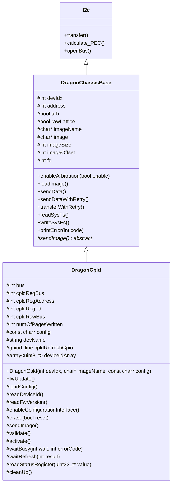

**Key Responsibilities:**

| Component | Responsibility |
|-----------|---------------|
| `I2c` | Low-level I2C communication primitives, PEC calculation |
| `DragonChassisBase` | I2C arbitration management, image loading, retry logic, error handling |
| `DragonCpld` | Lattice CPLD-specific update sequence, validation, configuration parsing |

**Sources:** [cpld_utility/dragonCpld.hpp:28-167](), [include/dragonChassisBase.hpp:36-503]()

---

## Configuration System

The `DragonCpld` class requires a JSON configuration file that specifies device-specific parameters. Configuration is loaded via `loadConfig()` at the start of the update process.

### Configuration Structure

The configuration file contains a `CPLD` array with entries for each CPLD device:

| Parameter | Type | Purpose |
|-----------|------|---------|
| `CPLDDeviceNo` | int | Device index used to match command-line argument |
| `Bus` | string | I2C bus number for primary communication |
| `Address` | string | I2C address (hex or decimal format) |
| `CpldRegBus` | string | I2C bus for CPLD register access |
| `CpldRegAddress` | string | I2C address for register access |
| `CpldRawBus` | string | Non-arbitrated bus number for refresh commands |
| `Arbitration` | string | "1" to enable arbitration, "0" to disable |
| `RawLattice` | bool | `true` for direct Lattice access without arbitration dance |
| `ImageOffset` | int | Bytes to skip from beginning of image file |
| `Name` | string | Device name (e.g., "CPLD0", "CPLD1") |
| `DeviceId` | array | 4-byte device ID for validation |

### Configuration Loading Flow

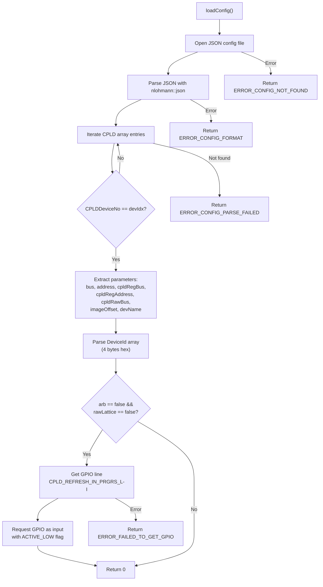

**Sources:** [cpld_utility/dragonCpld.cpp:585-662](), [cpld_utility/dragonCpld.hpp:131-133]()

---

## Update Flow

The main update process is implemented in `fwUpdate()`, which orchestrates the complete Lattice CPLD firmware update sequence. This method follows the vendor-specified update flow documented in Lattice specification documents.

### Main Update Sequence

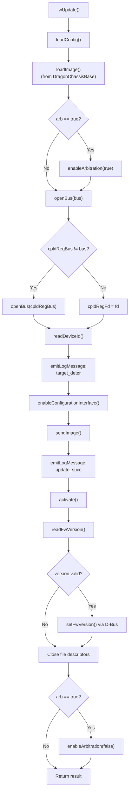

**Sources:** [cpld_utility/dragonCpld.cpp:49-128]()

### Update Stages

The update process consists of five main stages, each implementing specific Lattice CPLD commands:

| Stage | Method | Purpose | Timeout |
|-------|--------|---------|---------|
| 1. Device Validation | `readDeviceId()` | Verify device ID matches expected value | N/A |
| 2. Configuration Enable | `enableConfigurationInterface()` | Enable CPLD configuration mode | 5 seconds |
| 3. Erase | `erase(bool reset)` | Erase existing firmware, optionally reset | 5 seconds |
| 4. Image Transfer | `sendImage()` | Send firmware image page-by-page | 5 seconds per page |
| 5. Activation | `activate()` | Refresh CPLD with new firmware | 15 seconds (arb mode) or 30 seconds (raw mode) |

**Sources:** [cpld_utility/dragonCpld.cpp:49-128]()

---

## I2C Arbitration

Dragon Chassis systems implement a bus arbitration protocol where the BMC must coordinate with the CPLD to gain access to the I2C bus. This is necessary because multiple devices may attempt to access the bus simultaneously.

### Arbitration Mechanism

The arbitration is controlled via sysfs interface at `/sys/devices/platform/i2carb/arb_state`. Writing `1` requests bus access; the kernel driver performs a GPIO handshake with the CPLD and maintains a watchdog to prevent indefinite bus locking.

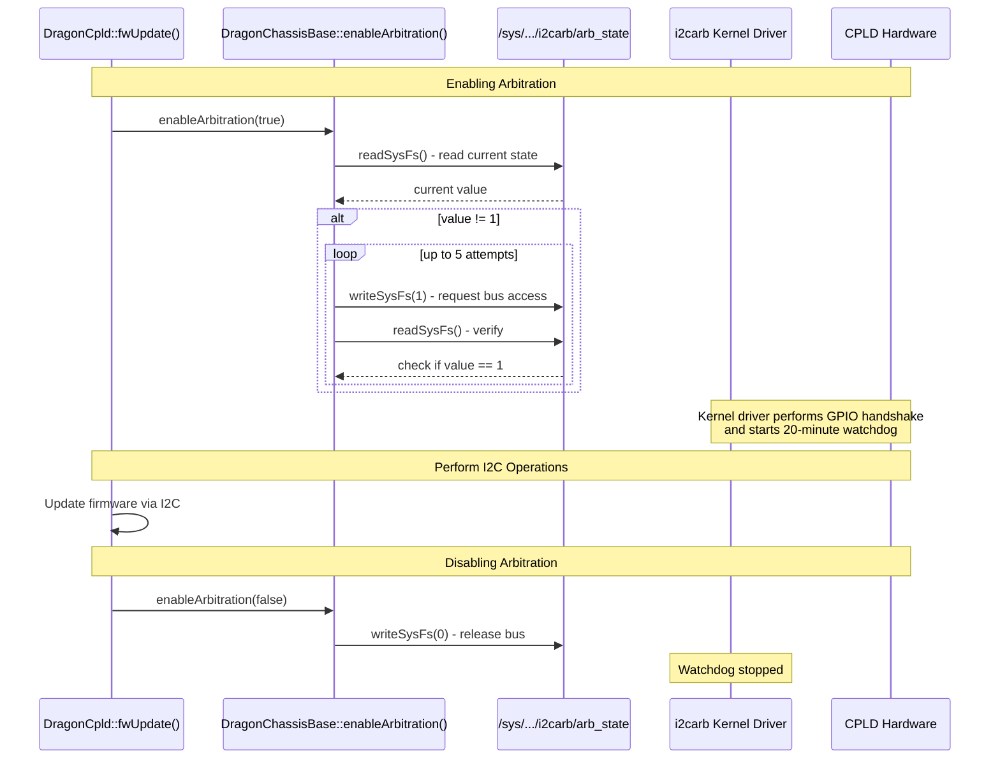

**Arbitration Timeout:** The kernel driver enforces a 20-minute maximum arbitration hold time. If the BMC process fails to release arbitration, the driver will automatically release it after the timeout to prevent system lockup.

**Sources:** [include/dragonChassisBase.hpp:310-370](), [cpld_utility/dragonCpld.cpp:62-67](), [cpld_utility/dragonCpld.cpp:122-125]()

---

## GPIO Refresh Mechanism

After sending the refresh command to the CPLD, the system must wait for the CPLD to complete its internal refresh operation. The CPLD signals completion via a GPIO line (`CPLD_REFRESH_IN_PRGRS_L-I`).

### Refresh Signaling Modes

The refresh mechanism operates in two modes depending on configuration:

| Mode | Condition | Method | Interface |
|------|-----------|--------|-----------|
| Arbitration Mode | `arb == true` | Read from sysfs: `/sys/devices/platform/i2carb/cpld_refresh` | Kernel driver manages GPIO |
| Direct GPIO Mode | `arb == false && rawLattice == false` | Read GPIO value via `libgpiod` | Direct GPIO character device access |
| Raw Lattice Mode | `rawLattice == true` | No refresh wait, fixed 30-second delay | N/A - status register unreliable |

### Refresh Wait Flow

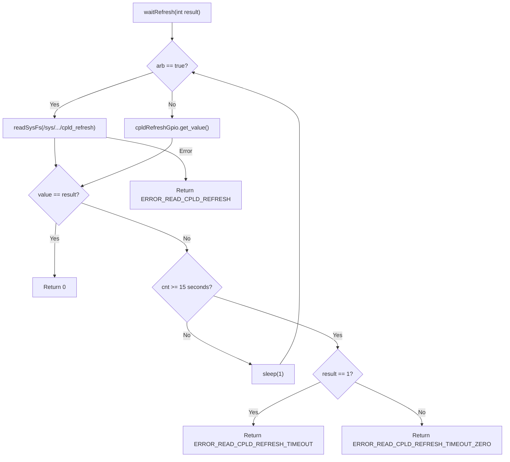

**Timeout:** 15 seconds maximum wait for refresh completion. If the expected GPIO state is not reached within this period, the update fails with a timeout error.

**Sources:** [cpld_utility/dragonCpld.cpp:406-443](), [cpld_utility/dragonCpld.hpp:68-70]()

---

## Lattice-Specific Operations

The Lattice CPLD requires specific command sequences and register operations during the update process. All commands are sent via I2C with PEC (Packet Error Checking) enabled.

### Lattice Command Set

| Command | Bytes | Purpose | Defined At |
|---------|-------|---------|------------|
| Read Device ID | `0xE0 0x00 0x00 0x00` | Retrieve 4-byte device identifier | [dragonCpld.cpp:166-168]() |
| Read Firmware Version | `0xC0 0x00 0x00` | Retrieve 4-byte firmware version | [dragonCpld.cpp:186]() |
| Read Status Register | `0x3C 0x00 0x00 0x00` | Read 32-bit status word | [dragonCpld.cpp:132-133]() |
| Read Busy Register | `0xF0 0x00 0x00 0x00` | Poll busy state (bit 7) | [dragonCpld.cpp:142-143]() |
| Enable Configuration | `0x74 0x08 0x00 0x00` | Enter configuration mode | [dragonCpld.cpp:230]() |
| Erase | `0x0E 0x04 0x00 0x00` | Erase flash memory | [dragonCpld.cpp:256]() |
| Reset | `0x46 0x00 0x00 0x00` | Reset device | [dragonCpld.cpp:258]() |
| Set Page | `0xB4 0x00 0x00 0x00` + 4-byte page number | Set page pointer for read/write | [dragonCpld.cpp:305]() |
| Write Page | `0x70 0x00 0x00 0x01` + 16 bytes | Write 16-byte page | [dragonCpld.cpp:302]() |
| Read Page | `0x73 0x00 0x00 0x01` | Read 16-byte page | [dragonCpld.cpp:448]() |
| Done | `0x5E 0x00 0x00 0x00` | Finish image transfer | [dragonCpld.cpp:304]() |
| Refresh | `0x79 0x40 0x00` | Activate new firmware | [dragonCpld.cpp:520]() |

### Status Register Bits

The 32-bit status register provides feedback on operation status:

| Bit Position | Mask | Meaning | Usage |
|--------------|------|---------|-------|
| 8 | `0x100` (`DONE_BIT`) | Operation complete | Check after operations |
| 12 | `0x1000` (`BUSY_BIT`) | Device busy | Must be 0 after done command |
| 13 | `0x2000` (`FAIL_BIT`) | Operation failed | Check after erase |
| 23-25 | `0x3800000` (`CONF_BITS`) | Configuration bits | Reserved |

**Sources:** [cpld_utility/dragonCpld.cpp:28-31](), [cpld_utility/dragonCpld.cpp:130-137](), [cpld_utility/dragonCpld.cpp:164-181](), [cpld_utility/dragonCpld.cpp:183-225]()

### Device ID Verification

Before updating, the system reads the device ID and compares it against the expected 4-byte value from the configuration file. This prevents accidentally updating the wrong device.

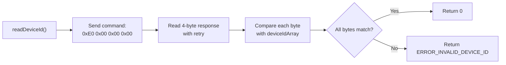

**Sources:** [cpld_utility/dragonCpld.cpp:164-181]()

---

## Image Transfer and Validation

The image transfer process sends the firmware image to the CPLD in 16-byte pages. After all pages are written, the system validates the transfer by reading back and comparing each page.

### Page-Based Transfer

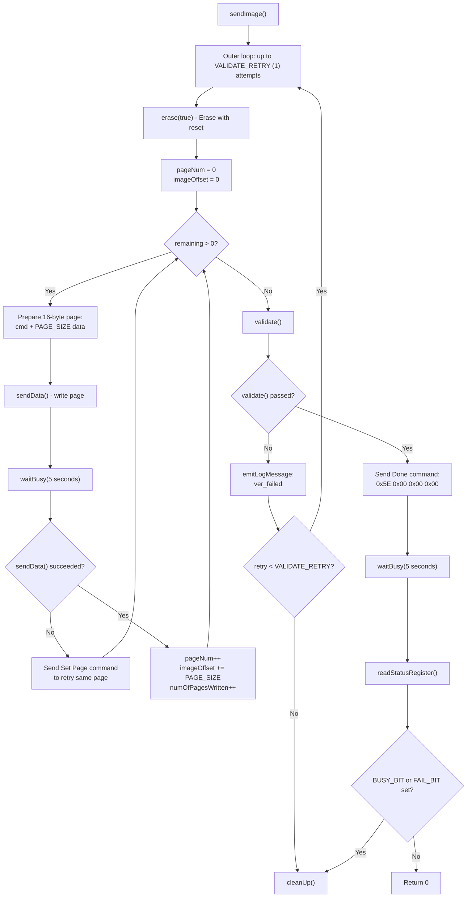

**Page Size:** 16 bytes (`PAGE_SIZE` constant)

**Retry Mechanism:** If an I2C write fails, the system sends a "Set Page" command to reset the CPLD's page pointer back to the previous page number, then retries the write.

**Sources:** [cpld_utility/dragonCpld.cpp:298-404](), [cpld_utility/dragonCpld.cpp:32]()

### Validation Process

After sending all pages, the `validate()` method reads back each page and compares it byte-by-byte with the original image:

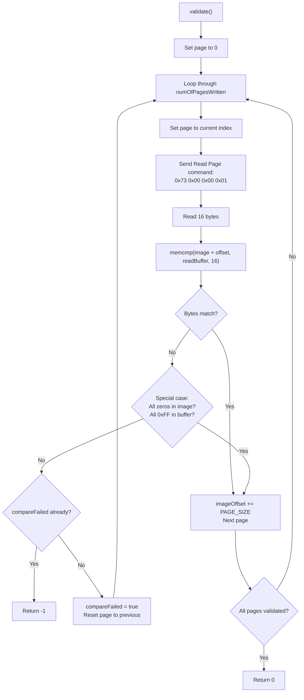

**Special Case Handling:** The CPLD may return `0xFF` for pages that contain all zeros when there is additional I2C bus traffic. This is treated as a successful validation for all-zero pages.

**Single Retry:** If a page comparison fails, the system allows one retry by resetting the page pointer and re-reading. If the second comparison also fails, validation fails.

**Sources:** [cpld_utility/dragonCpld.cpp:445-510]()

---

## Activation Process

The activation process makes the new firmware active by performing a refresh operation. This is the most complex stage as it involves coordinating between multiple I2C buses and monitoring GPIO signals.

### Activation Flow

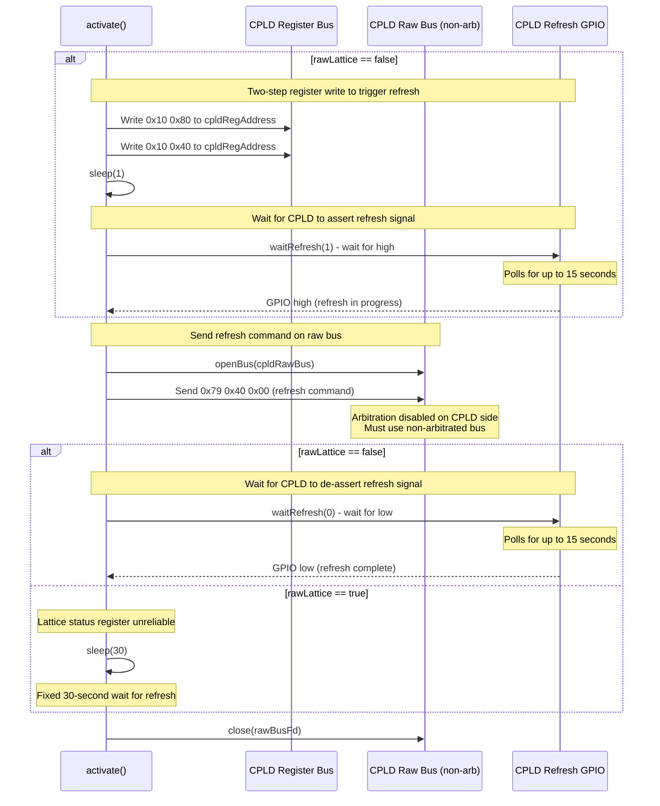

**Why Raw Bus?** After the two-step register write, the CPLD disables arbitration on its side per specification. The BMC must use the non-arbitrated (raw) version of the I2C bus to send the final refresh command.

**GPIO States:**
- **High (1):** CPLD is performing refresh operation
- **Low (0):** CPLD refresh complete, device ready

**Raw Lattice Mode:** Some Lattice CPLD variants have unreliable status registers. In `rawLattice` mode, the system skips the register write dance and GPIO monitoring, instead using a fixed 30-second delay to allow refresh completion.

**Sources:** [cpld_utility/dragonCpld.cpp:512-571](), [cpld_utility/dragonCpld.hpp:85-88]()

---

## Error Handling and Cleanup

The update process includes comprehensive error handling with specific error codes for each failure mode. If any stage fails after the erase operation, the `cleanUp()` method attempts to restore the CPLD to a safe state.

### Error Code Categories

The `UpdateError` enum in `DragonChassisBase` defines error codes. CPLD-specific errors include:

| Error Code | Value | Stage | Description |
|------------|-------|-------|-------------|
| `ERROR_INVALID_DEVICE_ID` | 38 | Device Validation | Device ID mismatch |
| `ERROR_CONFIG_NOT_FOUND` | 35 | Initialization | Configuration file not found |
| `ERROR_CONFIG_FORMAT` | 36 | Initialization | Invalid JSON format |
| `ERROR_CONFIG_PARSE_FAILED` | 37 | Initialization | Device not found in config |
| `ERROR_FAILED_TO_GET_GPIO` | 40 | Initialization | Cannot access refresh GPIO |
| `ERROR_ENABLE_CFG_INTER` | 16 | Configuration | Enable config interface timeout |
| `ERROR_ENABLE_CFG_INTER_WRITE` | 17 | Configuration | Write command failed |
| `ERROR_ERASE` | 6 | Erase | Erase operation failed |
| `ERROR_SEND_IMAGE` | 7 | Transfer | Page write failed |
| `ERROR_SEND_IMAGE_BUSY` | 22 | Transfer | Busy timeout during transfer |
| `ERROR_SEND_IMAGE_DONE` | 23 | Transfer | Done command write failed |
| `ERROR_SEND_IMAGE_DONE_BUSY` | 24 | Transfer | Busy timeout after done |
| `ERROR_SEND_IMAGE_DONE_CHECK` | 25 | Transfer | Status check failed after done |
| `ERROR_ACTIVATE_CPLD_REG1` | 26 | Activation | First register write failed |
| `ERROR_ACTIVATE_CPLD_REG2` | 27 | Activation | Second register write failed |
| `ERROR_SEND_INTERNAL_CPLD_REFRESH_FAILED` | 30 | Activation | Refresh command failed |
| `ERROR_READ_CPLD_REFRESH` | 32 | Activation | Cannot read refresh GPIO |
| `ERROR_READ_CPLD_REFRESH_TIMEOUT` | 33 | Activation | Refresh high timeout |
| `ERROR_READ_CPLD_REFRESH_TIMEOUT_ZERO` | 39 | Activation | Refresh low timeout |
| `ERROR_CLEANUP_ERASE` | 34 | Cleanup | Cleanup erase failed |

**Sources:** [include/dragonChassisBase.hpp:209-252](), [include/dragonChassisBase.hpp:62-204]()

### Cleanup Process

If validation fails or any error occurs after erase, the `cleanUp()` method attempts to restore the CPLD:

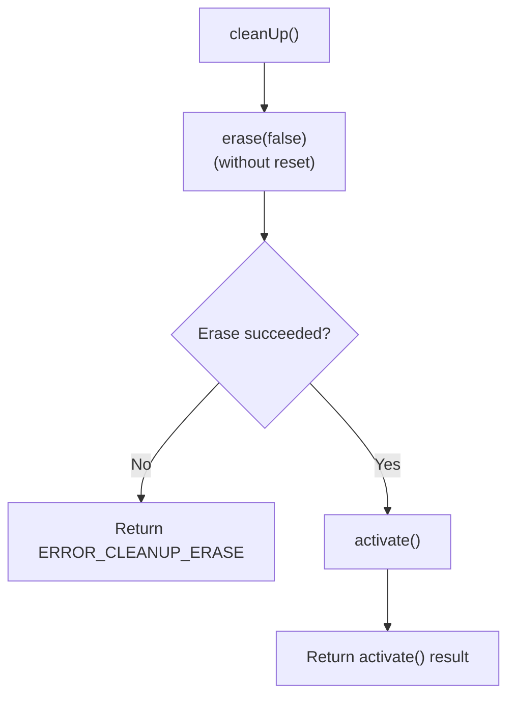

**Cleanup Strategy:** The cleanup performs an erase without reset, then attempts to activate. This allows the CPLD to potentially boot from a backup firmware or enter a safe state. However, **cleanup cannot restore the old firmware** as the erase operation has already destroyed it. The Lattice CPLD does not support a true "cancel" capability.

**Sources:** [cpld_utility/dragonCpld.cpp:573-583](), [cpld_utility/dragonCpld.cpp:292-296]()

---

## Retry Mechanisms

The implementation uses multiple retry strategies to handle transient I2C failures:

### Retry Strategies

| Operation | Retry Count | Method | Behavior |
|-----------|-------------|--------|----------|
| I2C Transfers | 5 | `transferWithRetry()` | Retries read/write operations |
| I2C Sends | 5 | `sendDataWithRetry()` | Retries write operations with PEC |
| Validation | 1 | Outer loop in `sendImage()` | Full erase + transfer + validate cycle |
| Page Write | Continuous | Page reset logic | Resets page pointer and retries same page |
| Single Page Compare | 1 | `compareFailed` flag | Re-reads failed page once |

**I2C Retry Constant:** `I2C_RETRY_ATTEMPTS` is defined as 5 at [dragonCpld.cpp:34]()

**Validation Retry:** The validation retry (`VALIDATE_RETRY` = 1) is a workaround for Lattice CPLD instability. If validation fails, the entire update sequence (erase, transfer, validate) is repeated once. This is necessary because the CPLD lacks proper cancel/rollback capabilities.

**Sources:** [cpld_utility/dragonCpld.cpp:34](), [cpld_utility/dragonCpld.cpp:296](), [cpld_utility/dragonCpld.cpp:316-372](), [include/dragonChassisBase.hpp:471-497]()

---

## D-Bus Integration

After a successful update, the `DragonCpld` updates the firmware version property in the D-Bus software inventory. This allows the CPLD D-Bus service and other clients to observe the new firmware version.

### Version Update Flow

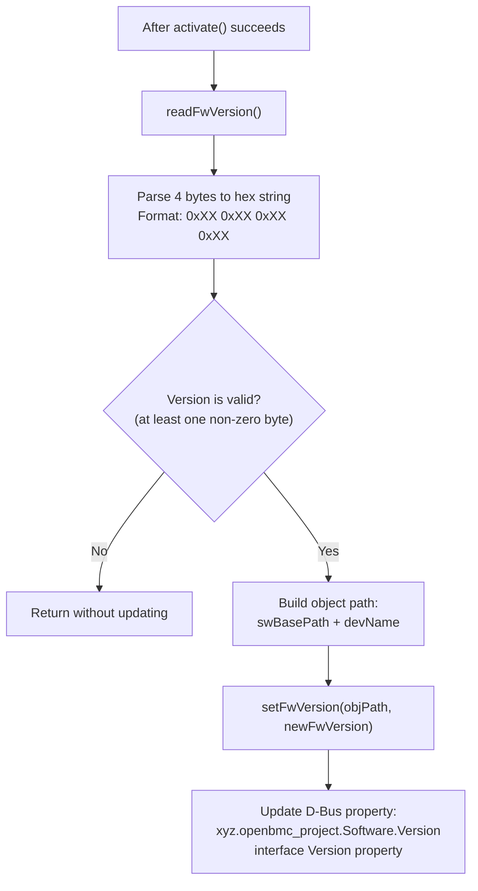

**Version Format:** Firmware version is represented as a space-separated hex string, e.g., `"0x01 0x23 0x45 0x67"`. Each byte is prefixed with `0x` and zero-padded to two digits.

**Object Path:** The D-Bus object path is constructed as `swBasePath` (typically `/xyz/openbmc_project/software/`) concatenated with the device name from configuration (e.g., `"CPLD0"`).

**Sources:** [cpld_utility/dragonCpld.cpp:108-113](), [cpld_utility/dragonCpld.cpp:183-225]()

---

## Summary

The `DragonCpld` class provides a robust, vendor-specific firmware update mechanism for Lattice CPLDs on Dragon Chassis platforms. Key features include:

- **Multi-bus coordination:** Primary I2C bus, register bus, and raw (non-arbitrated) bus
- **I2C arbitration:** Kernel driver-managed bus access with 20-minute watchdog
- **GPIO refresh monitoring:** Hardware handshake for activation completion
- **Comprehensive validation:** Byte-by-byte verification with retry capability  
- **Error recovery:** Cleanup procedures with detailed error reporting
- **D-Bus integration:** Automatic version property updates post-update

The implementation handles the complexity of Lattice CPLD update requirements while providing reliability through extensive retry logic and error handling.

**Sources:** [cpld_utility/dragonCpld.cpp:1-663](), [cpld_utility/dragonCpld.hpp:1-168](), [include/dragonChassisBase.hpp:1-503]()

---

