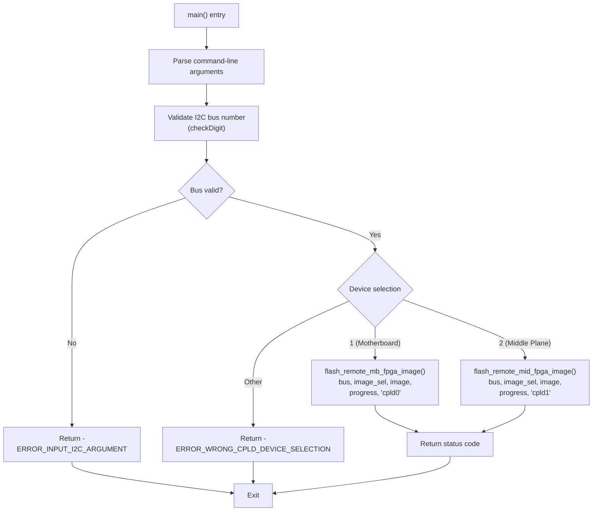
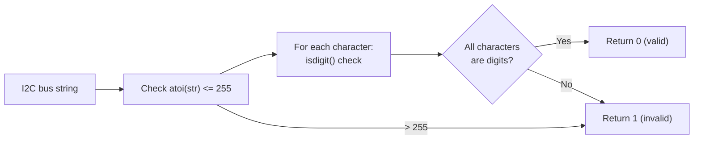
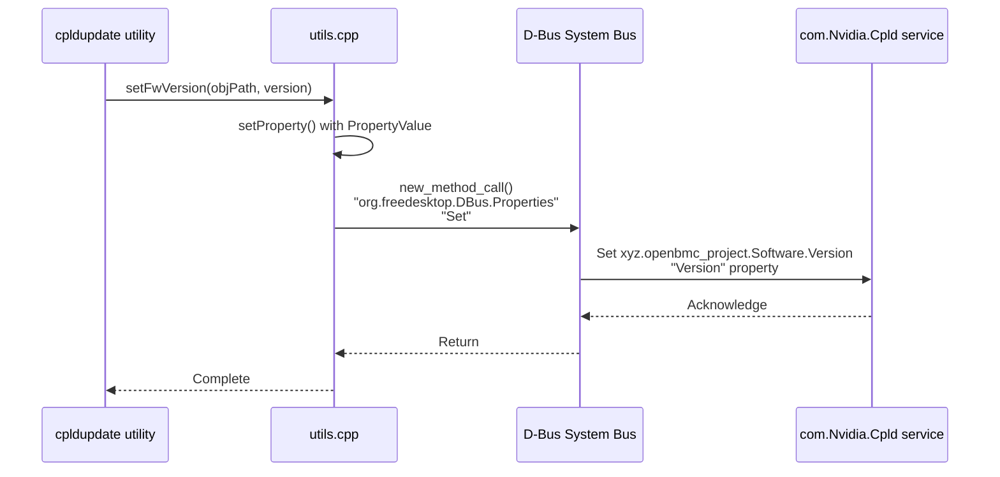
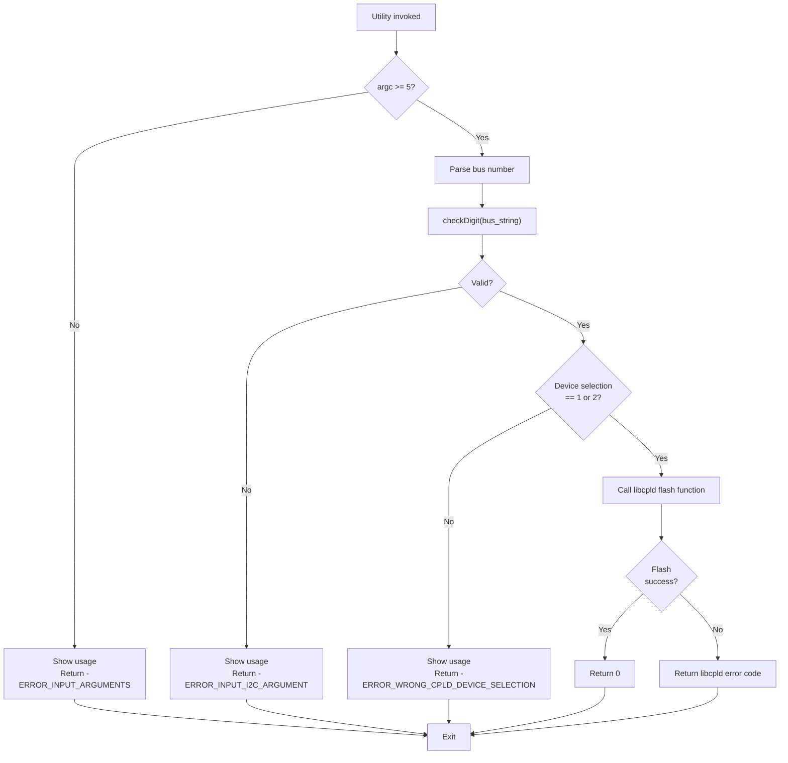

<!-- source: DeepWiki mcp.deepwiki.com · repo NVIDIA/nvidia-power-manager · extra page Generic CPLD Update Flow · fetched 2026-10-26 -->

# Generic CPLD Update Flow

<details>
<summary>Relevant source files</summary>

The following files were used as context for generating this wiki page:

- [cpld_utility/main.cpp](cpld_utility/main.cpp)
- [cpld_utility/meson.build](cpld_utility/meson.build)
- [cpld_utility/utils.cpp](cpld_utility/utils.cpp)
- [cpld_utility/utils.hpp](cpld_utility/utils.hpp)

</details>


## Purpose and Scope

This document describes the standard CPLD firmware update implementation used on non-Dragon chassis platforms. The generic update flow uses direct I2C communication through the `libcpld` library without the additional arbitration, GPIO control, or PEC checking mechanisms required by Dragon Chassis systems.

For Dragon Chassis-specific CPLD updates, which include I2C arbitration, GPIO refresh signaling, and Lattice CPLD-specific protocols, see [Dragon Chassis CPLD Update](#3.2.2).

**Sources:** [cpld_utility/main.cpp:1-134]()

---

## Command-Line Interface

The `cpldupdate` utility provides a command-line interface for flashing CPLD firmware. When built without Dragon Chassis support, it accepts the following arguments:

### Syntax

```
cpldupdate <i2c_bus> <image_select> <firmware_file> <device_selection> [version] [debug_flags]
```

### Arguments

| Argument | Description | Valid Values |
|----------|-------------|--------------|
| `i2c_bus` | I2C bus number for communication | 0-255 (must be digits) |
| `image_select` | Image slot selection | Integer value |
| `firmware_file` | Path to firmware image file | Valid file path |
| `device_selection` | Target CPLD device | `1` = Motherboard CPLD<br/>`2` = Middle Plane CPLD |
| `version` (optional) | Firmware version string | Any string (default: "Unknown") |
| `debug_flags` (optional) | Verbosity level | `-v` = High-level debug<br/>`-vv` = Low-level debug |

### Example Usage

```bash
cpldupdate 11 1 /tmp/cpld_fw.bin 1
cpldupdate 11 1 /tmp/cpld_fw.bin 2 "1.2.3" -vv
```

**Sources:** [cpld_utility/main.cpp:45-57](), [cpld_utility/main.cpp:59-105]()

---

## Build Configuration

The generic CPLD update flow is enabled when the Meson build option `dragon_chassis_cpld` is **disabled**. This results in a simpler compilation without Dragon Chassis-specific dependencies.

### Build Dependencies (Generic Mode)

```meson
dependencies:
  - sdbusplus
  - sdeventplus
  - phosphor_logging
  - phosphor_dbus_interfaces
  - fmt

sources:
  - main.cpp
  - libcpld.cpp
  - libi2c.cpp
  - updateCPLDFw_dbus_log_event.cpp
  - utils.cpp
```

### Conditional Compilation

The generic flow executes when the `DRAGON_CHASSIS` preprocessor macro is **not defined**. This removes the DragonCpld class instantiation and falls through to direct `libcpld` function calls.

**Sources:** [cpld_utility/meson.build:1-41](), [cpld_utility/main.cpp:106-114]()

---

## Update Process Architecture

### High-Level Flow



**Sources:** [cpld_utility/main.cpp:59-133]()

### Main Function Flow

The `main()` function in [cpld_utility/main.cpp:59-133]() implements a straightforward execution path:

1. **Argument Validation** ([cpld_utility/main.cpp:62-81]())
   - Requires minimum 5 arguments
   - Validates I2C bus number using `checkDigit()` to ensure numeric value ≤ 255
   - Extracts bus number, image selector, firmware path, and device selection

2. **Optional Parameter Processing** ([cpld_utility/main.cpp:83-105]())
   - Version string (defaults to "Unknown")
   - Debug flags (`-v` or `-vv`)

3. **Device-Specific Flash Operation** ([cpld_utility/main.cpp:115-130]())
   - Motherboard CPLD: calls `flash_remote_mb_fpga_image()`
   - Middle Plane CPLD: calls `flash_remote_mid_fpga_image()`
   - Both functions defined in `libcpld.h`

**Sources:** [cpld_utility/main.cpp:59-133]()

---

## Device Selection Logic

The utility supports two distinct CPLD devices, each accessed through a different function call from the `libcpld` library.

### Device Types

| Device ID | Device Name | Function Called | Device Label |
|-----------|-------------|-----------------|--------------|
| 1 | Motherboard CPLD | `flash_remote_mb_fpga_image()` | `"cpld0"` |
| 2 | Middle Plane CPLD | `flash_remote_mid_fpga_image()` | `"cpld1"` |

### Function Signatures

Both functions share a common signature pattern:

```c
int flash_remote_mb_fpga_image(int bus, int image_sel, char* image,
                               int* flashing_progress, char* device_label);

int flash_remote_mid_fpga_image(int bus, int image_sel, char* image,
                                int* flashing_progress, char* device_label);
```

The `flashing_progress` pointer is provided for potential progress reporting, though the generic implementation does not require user-visible progress updates.

**Sources:** [cpld_utility/main.cpp:72-74](), [cpld_utility/main.cpp:115-124]()

---

## I2C Communication Layer

### Bus Access

The generic CPLD update flow uses direct I2C bus access without arbitration mechanisms. The I2C bus is specified via command-line argument and must be in the range 0-255.

### Validation Logic



The `checkDigit()` function ([cpld_utility/main.cpp:31-43]()) ensures:
- The string contains only numeric characters
- The numeric value does not exceed `MAX_I2C_BUS_NUMBER` (255)

### Communication Protocol

The `libcpld` library (included via [cpld_utility/main.cpp:22]()) provides low-level I2C communication functions. The library handles:
- Opening I2C device files (`/dev/i2c-*`)
- Transferring firmware image data
- Verifying write operations
- Managing CPLD-specific protocols

**Sources:** [cpld_utility/main.cpp:22-23](), [cpld_utility/main.cpp:31-43](), [cpld_utility/main.cpp:76-81]()

---

## D-Bus Integration

### Version Update Mechanism

After a successful firmware update, the utility can update the CPLD version information in the D-Bus object representing the CPLD device.



### D-Bus Utility Functions

The [cpld_utility/utils.cpp]() module provides D-Bus integration:

- **`setProperty()`** ([cpld_utility/utils.cpp:24-41]())
  - Generic property setter using D-Bus Properties interface
  - Targets the `com.Nvidia.Cpld` service
  - Uses `org.freedesktop.DBus.Properties.Set` method

- **`setFwVersion()`** ([cpld_utility/utils.cpp:43-48]())
  - Convenience wrapper for updating version strings
  - Sets the `Version` property on `xyz.openbmc_project.Software.Version` interface
  - Constructs D-Bus object path from CPLD device identifier

### Service and Path Constants

```cpp
const std::string service = "com.Nvidia.Cpld";
const std::string swBasePath = "/xyz/openbmc_project/software/";
```

The version update targets software objects under the `/xyz/openbmc_project/software/` hierarchy, following OpenBMC conventions.

**Sources:** [cpld_utility/utils.hpp:19-30](), [cpld_utility/utils.cpp:1-49]()

---

## Error Handling

### Return Codes

The utility returns negative error codes to indicate specific failure conditions:

| Error Code | Symbolic Name | Condition |
|------------|---------------|-----------|
| `-ERROR_INPUT_ARGUMENTS` | Invalid argument count | Less than 5 arguments provided |
| `-ERROR_INPUT_I2C_ARGUMENT` | Invalid I2C bus | Non-numeric or out-of-range bus number |
| `-ERROR_WRONG_CPLD_DEVICE_SELECTION` | Invalid device selection | Device ID not 1 or 2 |
| (libcpld errors) | Various | Returned from `flash_remote_*_fpga_image()` functions |

### Input Validation Sequence



### Usage Display

When validation fails, the `show_usage()` function ([cpld_utility/main.cpp:45-57]()) displays comprehensive help text including:
- Command syntax
- Valid ranges for each argument
- Example invocation
- Debug flag descriptions
- Device selection mappings

**Sources:** [cpld_utility/main.cpp:45-57](), [cpld_utility/main.cpp:62-81](), [cpld_utility/main.cpp:115-130]()

---

## Debug and Logging Support

### Debug Flags

The generic flow supports two verbosity levels controlled by global variables:

- **`debug_h`** (High-level debug): Set via `-v` flag ([cpld_utility/main.cpp:95]())
- **`debug_l`** (Low-level debug): Set via `-vv` flag, also enables `debug_h` ([cpld_utility/main.cpp:97-99]())

These flags are declared as global variables ([cpld_utility/main.cpp:26-27]()) and can be used by `libcpld` functions to control diagnostic output.

### D-Bus Logging

The utility includes support for D-Bus event logging via `updateCPLDFw_dbus_log_event.cpp` ([cpld_utility/meson.build:5]()). This module can generate structured log entries on the D-Bus system for audit and troubleshooting purposes.

**Sources:** [cpld_utility/main.cpp:26-27](), [cpld_utility/main.cpp:92-105](), [cpld_utility/meson.build:5]()

---

## Comparison with Dragon Chassis Flow

### Architectural Differences

| Aspect | Generic Flow (This Page) | Dragon Chassis Flow ([3.2.2](#3.2.2)) |
|--------|--------------------------|----------------------------------------|
| **Activation** | `dragon_chassis_cpld` disabled | `dragon_chassis_cpld` enabled |
| **Implementation** | Direct `libcpld` function calls | C++ class hierarchy (`DragonCpld`) |
| **I2C Access** | Direct bus access | Arbitration via sysfs + GPIO handshake |
| **Dependencies** | Standard I2C libraries | + `libgpiodcxx` for GPIO control |
| **Configuration** | Command-line only | + JSON configuration file support |
| **Validation** | Basic error codes | PEC checking, retry mechanisms |

### Conditional Compilation

The [cpld_utility/main.cpp:106-114]() section demonstrates the compile-time decision:

```cpp
#ifdef DRAGON_CHASSIS
    if (argc > 6) {
        DragonCpld dp(cpldDeviceSelection, image, configFile);
        ret = dp.fwUpdate();
        dp.printError(ret);
    } else
#endif
    // Falls through to generic flow when DRAGON_CHASSIS not defined
    // or when insufficient arguments for Dragon chassis
```

When `DRAGON_CHASSIS` is not defined, the preprocessor removes the Dragon Chassis code path entirely, resulting in a smaller binary with only the generic flow compiled in.

**Sources:** [cpld_utility/main.cpp:18-20](), [cpld_utility/main.cpp:106-130](), [cpld_utility/meson.build:16-24]()

---

