<!-- source: DeepWiki mcp.deepwiki.com · repo NVIDIA/nvidia-resiliency-ext · page 1 Overview · fetched 2026-10-26 -->

# Overview

<details>
<summary>Relevant source files</summary>

The following files were used as context for generating this wiki page:

- [.github/workflows/build_docs.yml](.github/workflows/build_docs.yml)
- [.github/workflows/lint_code.yml](.github/workflows/lint_code.yml)
- [.github/workflows/unit_test.yml](.github/workflows/unit_test.yml)
- [CONTRIBUTING.md](CONTRIBUTING.md)
- [README.md](README.md)
- [docs/source/attribution/features/index.rst](docs/source/attribution/features/index.rst)
- [docs/source/attribution/features/progressive-ft-launcher-attribution.rst](docs/source/attribution/features/progressive-ft-launcher-attribution.rst)
- [docs/source/attribution/features/requirements-template.rst](docs/source/attribution/features/requirements-template.rst)
- [docs/source/attribution/index.rst](docs/source/attribution/index.rst)
- [docs/source/index.rst](docs/source/index.rst)
- [docs/source/release-notes.md](docs/source/release-notes.md)
- [examples/attribution/README.md](examples/attribution/README.md)
- [pyproject.toml](pyproject.toml)
- [src/nvidia_resiliency_ext/__init__.py](src/nvidia_resiliency_ext/__init__.py)
- [src/nvidia_resiliency_ext/attribution/orchestration/http_api.py](src/nvidia_resiliency_ext/attribution/orchestration/http_api.py)
- [src/nvidia_resiliency_ext/fault_tolerance/cycle_info_writer.py](src/nvidia_resiliency_ext/fault_tolerance/cycle_info_writer.py)
- [src/nvidia_resiliency_ext/services/attrsvc/routes.py](src/nvidia_resiliency_ext/services/attrsvc/routes.py)
- [src/nvidia_resiliency_ext/shared_utils/proto/nvrx_interface.proto](src/nvidia_resiliency_ext/shared_utils/proto/nvrx_interface.proto)
- [tests/fault_tolerance/unit/test_cycle_info_writer.py](tests/fault_tolerance/unit/test_cycle_info_writer.py)
- [tests/fault_tolerance/unit/test_timeouts_calc.py](tests/fault_tolerance/unit/test_timeouts_calc.py)
- [tests/fault_tolerance/unit/utils.py](tests/fault_tolerance/unit/utils.py)
- [tests/straggler/unit/_utils.py](tests/straggler/unit/_utils.py)

</details>


NVIDIA Resiliency Extensions (NVRx) is a Python library that provides comprehensive fault tolerance, diagnostics, and checkpointing capabilities for PyTorch-based distributed training workloads. The system enables automatic detection and recovery from hardware failures, software hangs, and performance anomalies while minimizing checkpoint overhead and training disruption.

## Purpose and Scope

NVRx addresses critical challenges in large-scale distributed training:

| Challenge | Impact | NVRx Solution |
|-----------|--------|---------------|
| **Hardware Failures** | GPU/NIC/NVLink failures halt entire jobs | Health checks (`GPUHealthCheck`, `NicHealthCheck`, `NVLHealthCheck`) detect failures; automatic restart via `ft_launcher` or `inprocess.Wrapper` |
| **Hung Training** | Deadlocked collectives or stalled ranks freeze progress | `RankMonitorServer` detects hangs via heartbeat protocol; `TrainingProgressTracker` detects stagnation; automatic abort and restart |
| **Recovery Overhead** | Process restart takes minutes (container init, Python imports, CUDA context) | In-process restart via `inprocess.Wrapper` bypasses process lifecycle; sub-second recovery for function-level faults |
| **Checkpoint I/O** | Synchronous saves block training for minutes | `AsyncCallsQueue` with `FileSystemWriterAsync` offloads I/O to background workers; training continues during save |
| **Failure Attribution** | Opaque errors make debugging difficult | `nvrx-attrsvc` LLM-based log analysis; `TorchFRTraceCollector` captures NCCL traces; post-mortem diagnostics |

NVRx integrates with PyTorch's distributed primitives (`torch.distributed`, `TCPStore`) and extends torchrun's elastic agent architecture with fault tolerance capabilities.

**Sources:** [README.md:1-33](), [pyproject.toml:41-65](), [docs/source/index.rst:1-19]()

## System Architecture

NVRx consists of four primary subsystems that can operate independently or in combination. The architecture builds on PyTorch's distributed primitives while adding comprehensive fault tolerance and diagnostics capabilities.

### High-Level Architecture

**Diagram: NVRx Complete System Architecture**

```mermaid
graph TB
    subgraph "User_Application_Layer"
        App["Distributed Training Application<br/>Megatron-LM, NeMo, PTL"]
    end
    
    subgraph "Fault_Tolerance_Subsystem"
        FTLauncher["ft_launcher CLI<br/>LocalElasticAgent"]
        Rendezvous["FtRendezvousBarrierHandler<br/>Barrier-based Rendezvous"]
        RankMonitor["RankMonitorServer<br/>RankMonitorClient"]
        HealthChecks["Health Check Suite<br/>GPU, NVL, NIC, Node"]
        ProgressTracker["TrainingProgressTracker"]
    end
    
    subgraph "Attribution_Diagnostics_Subsystem"
        AttrService["nvrx-attrsvc<br/>FastAPI Service"]
        TraceCollector["TorchFRTraceCollector<br/>NCCL Trace Capture"]
        Profiler["FaultToleranceProfiler"]
        LogSystem["NVRxLogAnalyzer<br/>LLM Attribution"]
    end
    
    subgraph "Checkpointing_Subsystem"
        AsyncCkpt["AsyncCallsQueue<br/>Persistent Worker"]
        FileWriter["FileSystemWriterAsync<br/>Multithread File IO"]
        LocalCkpt["LocalCheckpointManager<br/>Replication Strategy"]
    end
    
    subgraph "In-Process_Resiliency_Subsystem"
        Wrapper["Wrapper Decorator<br/>CallWrapper"]
        MonitorProc["MonitorProcess<br/>ProgressWatchdog"]
        RankAssign["RankAssignment<br/>Tree, ShiftRanks"]
        Store["StoreMixin<br/>TCPStore/PrefixStore"]
    end
    
    subgraph "External_Integrations"
        Slurm["nvrx-smonsvc<br/>SLURM Job Monitor"]
        WandB["WandBExporterAsync"]
        Slack["Slack Notifications"]
    end
    
    App -->|"launches via"| FTLauncher
    App -->|"decorated by"| Wrapper
    App -->|"saves checkpoints"| AsyncCkpt
    
    FTLauncher -->|"coordinates"| Rendezvous
    FTLauncher -->|"spawns"| RankMonitor
    FTLauncher -->|"checks"| HealthChecks
    
    Wrapper -->|"spawns"| MonitorProc
    Wrapper -->|"reassigns ranks via"| RankAssign
    Wrapper -->|"coordinates via"| Store
    
    FTLauncher -->|"analyzes logs"| AttrService
    AttrService -->|"notifies via"| Slack
    Slurm -->|"polls logs for"| AttrService
```



The architecture provides two integration methods:
1. **Process-level integration** via `ft_launcher` CLI (wraps torchrun) [pyproject.toml:68-68]()
2. **Function-level integration** via `@inprocess.Wrapper` decorator

Both approaches share health checks, distributed coordination, and checkpointing subsystems.

**Sources:** [README.md:12-33](), [docs/source/index.rst:10-18](), [docs/source/release-notes.md:9-38]()

## Key Subsystems

### Fault Tolerance Subsystem

Provides job-level restart capabilities with automatic failure detection and recovery. It uses `NVRxCycleInfo` to track metadata across training cycles.

| Component | Function |
|-----------|----------|
| `LocalElasticAgent` | Manages worker processes, implements restart policies, coordinates rendezvous |
| `FtRendezvousBarrierHandler` | Barrier-based rendezvous protocol with segment-aware rank assignment for NVSwitch systems |
| `RankMonitorServer` | Per-rank daemon that detects hangs via heartbeat protocol and section timeouts |
| `CycleInfoWriter` | Atomic JSON writer for cycle metadata (job_id, ranks, logs) [src/nvidia_resiliency_ext/fault_tolerance/cycle_info_writer.py:100-119]() |

**Key Features:**
- Automatic worker restart on failures without SLURM job reallocation [README.md:15-16]()
- Barrier-based rendezvous (v2) for improved stability and scalability [docs/source/release-notes.md:10-18]()
- Heartbeat-based hang detection with configurable section timeouts
- Stagnation detection to avoid infinite restart cycles

**Sources:** [src/nvidia_resiliency_ext/fault_tolerance/cycle_info_writer.py:17-58](), [src/nvidia_resiliency_ext/shared_utils/proto/nvrx_interface.proto:23-58]()

### In-Process Resiliency Subsystem

Enables function-level automatic restart without process termination.

| Component | Function |
|-----------|----------|
| `Wrapper` | Decorator that wraps training functions with restart capabilities |
| `CallWrapper` | Manages single function invocation, implements restart loop, handles state lifecycle |
| `MonitorProcess` | Daemon process that survives main process hangs, enforces soft/hard timeouts |
| `RankAssignment` | Policies for reassigning ranks after failures (`Tree`, `FillGaps`, `ShiftRanks`) |

**Key Features:**
- Sub-second restart for function-level faults [README.md:18-19]()
- Automatic health check chaining (`ChainedGPUHealthCheck`, `ChainedNVLHealthCheck`) [docs/source/release-notes.md:20-26]()
- Flexible rank reassignment strategies including infrastructure-aligned rank assignment [docs/source/release-notes.md:15-16]()
- NCCL < v2.28.3 or >= 2.28.9 support to avoid segmentation faults [docs/source/release-notes.md:52]()

### Checkpointing Subsystem

Asynchronous and local checkpointing with background I/O workers.

| Component | Function |
|-----------|----------|
| `AsyncCallsQueue` | Queue for async requests with persistent worker strategies |
| `FileSystemWriterAsync` | PyTorch-compatible writer with multithread File IO option [docs/source/release-notes.md:33-35]() |
| `LocalCheckpointManager` | Manages node-local checkpoints with replication for redundancy |

**Key Features:**
- Non-blocking checkpoint saves (training continues during I/O) [README.md:21-25]()
- Transition from `fork` to `spawn` for improved stability [docs/source/release-notes.md:34-34]()
- Persistent async checkpoint workers now default to simplify error propagation [docs/source/release-notes.md:36-36]()
- Ability to abort async checkpoint processes during failures [docs/source/release-notes.md:37-37]()

### Attribution & Diagnostics Subsystem

Post-mortem analysis and real-time telemetry using LLMs.

| Component | Function |
|-----------|----------|
| `nvrx-attrsvc` | FastAPI service for LLM-based log analysis [pyproject.toml:71-71]() |
| `nvrx-smonsvc` | SLURM job monitor that polls for completed jobs and submits logs for analysis [pyproject.toml:72-72]() |
| `TorchFRTraceCollector` | Captures PyTorch Flight Recorder traces for NCCL collective analysis [docs/source/release-notes.md:41-43]() |

**Key Features:**
- LLM-powered attribution using `nemotron-super-49b` via `ChatNVIDIA` [pyproject.toml:51-52]()
- Log analysis and failure policy determination (RESTART vs STOP) [docs/source/release-notes.md:39-44]()
- NCCL trace capture via Flight Recorder for collective analysis on hangs [docs/source/release-notes.md:41-43]()

**Sources:** [docs/source/release-notes.md:5-44](), [pyproject.toml:67-88]()

## Integration Methods

### Method 1: ft_launcher (Process-Level)

Used for SLURM-based multi-node training. Wraps torchrun with automatic restart capabilities.

**Example:**
```bash
ft_launcher \
  --nnodes=8 \
  --nproc-per-node=8 \
  --ft-use-infra-group-rank \
  training_script.py
```
The `--ft-use-infra-group-rank` flag allows in-job scaling to follow infrastructure scheduler rank assignments [docs/source/release-notes.md:15-16]().

### Method 2: inprocess.Wrapper (Function-Level)

Used for programmatic control and single-process recovery.

**Example:**
```python
from nvidia_resiliency_ext.inprocess import Wrapper

@Wrapper(soft_timeout=300)
def train_function():
    # Training code here
    pass
```

**Sources:** [pyproject.toml:68-68](), [docs/source/release-notes.md:9-18](), [README.md:12-33]()

## Installation

### From PyPI

```bash
pip install nvidia-resiliency-ext
pip install 'nvidia-resiliency-ext[attribution]'  # For LLM attribution services
```

### From Source

```bash
git clone https://github.com/NVIDIA/nvidia-resiliency-ext
cd nvidia-resiliency-ext
pip install .
```

**Sources:** [README.md:35-47](), [pyproject.toml:4-65]()

For details on specific features, see:
- [Core Features](#1.1)
- [System Architecture](#1.2)
- [Getting Started](#1.3)

---

