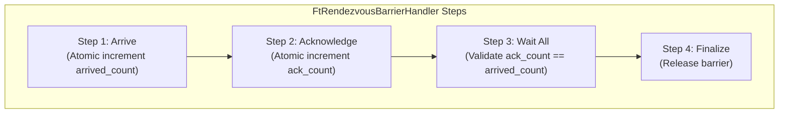
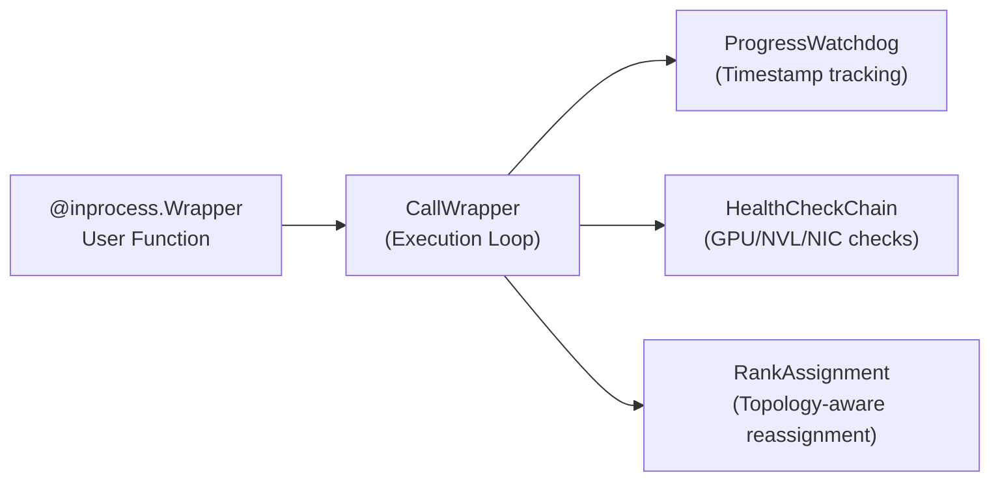
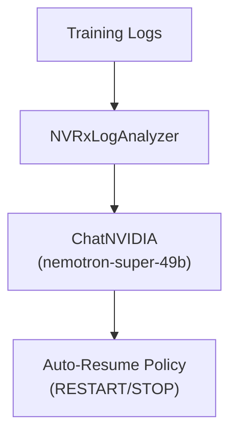

<!-- source: DeepWiki mcp.deepwiki.com · repo NVIDIA/nvidia-resiliency-ext · page 1.1 Core Features · fetched 2026-10-26 -->

# Core Features

Relevant source files

The following files were used as context for generating this wiki page:

- [.github/workflows/build_docs.yml](.github/workflows/build_docs.yml)
- [.github/workflows/lint_code.yml](.github/workflows/lint_code.yml)
- [.github/workflows/unit_test.yml](.github/workflows/unit_test.yml)
- [README.md](README.md)
- [docs/source/release-notes.md](docs/source/release-notes.md)
- [examples/attribution/README.md](examples/attribution/README.md)
- [src/nvidia_resiliency_ext/__init__.py](src/nvidia_resiliency_ext/__init__.py)
- [tests/fault_tolerance/unit/test_timeouts_calc.py](tests/fault_tolerance/unit/test_timeouts_calc.py)
- [tests/fault_tolerance/unit/utils.py](tests/fault_tolerance/unit/utils.py)
- [tests/straggler/unit/_utils.py](tests/straggler/unit/_utils.py)

This page enumerates the key capabilities provided by NVIDIA Resiliency Extensions (NVRx) across all subsystems. Each feature is described with references to its implementation components and data flow.

For detailed architecture and component relationships, see [System Architecture](1.2). For subsystem-specific documentation, see [Fault Tolerance System](2), [In-Process Restart System](3), [Checkpointing System](4), and [Attribution and Diagnostics](6).

---

## Feature Overview by Subsystem

The following table summarizes the primary features organized by subsystem:

| Subsystem | Key Features |
|-----------|-------------|
| **Fault Tolerance** | Worker lifecycle management, barrier-based rendezvous, rank monitoring, health checks, progress tracking, segment-aware assignment, hot spare support |
| **In-Process Resiliency** | Function-level restart decorator, dual monitoring, timeout enforcement, dynamic rank reassignment, distributed state management |
| **Checkpointing** | Asynchronous I/O offloading, GPU-to-CPU staging, parallel file writing, distributed coordination, abort mechanisms |
| **Attribution & Diagnostics** | LLM-based log analysis, auto-resume policy, trace collection, telemetry export, fault attribution |
| **Straggler Detection** | CUPTI-based GPU kernel timing, relative performance scoring, PTL integration |

Sources: [README.md:12-33](), [docs/source/release-notes.md:5-44]()

---

## Fault Tolerance Features

### Automatic Worker Restart
The `ft_launcher` manages worker processes via the `LocalElasticAgent`. It monitors for failures and coordinates restarts across the distributed job.

**Key Implementation Entities:**
- `LocalElasticAgent`: Orchestrates the worker lifecycle.
- `_invoke_run_with_any_failed_policy`: Restarts all workers if any fail.
- `_invoke_run_with_min_healthy_policy`: Allows training to continue if a minimum number of healthy nodes remain.

Sources: [README.md:14-16](), [docs/source/release-notes.md:9-14]()

### Barrier-Based Rendezvous Coordination
The `FtRendezvousBarrierHandler` implements a 4-step atomic barrier protocol for node coordination. This redesign (v2) provides more predictable and scalable behavior compared to earlier dynamic rendezvous.

**Features:**
- **Atomic State Management**: Uses a distributed store to track participant counts.
- **Hot Spare Support**: Future-planned alignment for barrier-based rendezvous to allow spare nodes to join when primary nodes fail.
- **Infra-Aligned Rank Assignment**: Uses `--ft-use-infra-group-rank` to preserve topology-aware placement from the infrastructure scheduler.

Sources: [docs/source/release-notes.md:10-18](), [docs/source/release-notes.md:47-50]()

### Rank Monitoring and Progress Tracking
The `RankMonitorServer` provides per-worker hang detection via heartbeat and section timeouts.

**Features:**
- **Heartbeat-based Hang Detection**: Workers must periodically check in with the monitor.
- **Section Timeouts**: Supports specific timeouts for different phases of training (e.g., initialization, training loop).
- **Stagnation Detection**: The `TrainingProgressTracker` monitors progress to detect if the model has stopped converging or moving through iterations.

Sources: [README.md:15-16](), [tests/fault_tolerance/unit/test_timeouts_calc.py:25-30]()

### Segment-Aware Rank Assignment
Optimized for NVSwitch systems (e.g., DGX/HGX), this feature ensures that rank assignment respects physical NVLink boundaries (segments). It groups nodes into segments to maximize inter-GPU bandwidth.

Sources: [docs/source/release-notes.md:15-16]()

---

## In-Process Resiliency Features

### Function-Level Restart Decorator
The `@inprocess.Wrapper` decorator provides automatic restart at the function level, enabling "in-process" recovery without terminating the entire application process.

**Features:**
- **Dual Monitoring**: Utilizes both a `MonitorProcess` daemon and a `MonitorThread` for robust failure detection.
- **Health Check Chaining**: Automatically chains `GPUHealthCheck`, `NVLHealthCheck`, and `NicHealthCheck` before attempting a restart.
- **Distributed State**: Synchronizes restart state using `StoreMixin` (TCPStore, PrefixStore).

Sources: [README.md:18-19](), [docs/source/release-notes.md:21-26](), [docs/source/release-notes.md:52-52]()

---

## Checkpointing Features

### Asynchronous and Local Checkpointing
The checkpointing subsystem offloads heavy I/O operations to background workers, minimizing training "downtime" during saves.

**Features:**
- **AsyncCallsQueue**: Manages the lifecycle of background save requests.
- **Multithread File I/O**: A stable alternative to multiprocessing for file operations to simplify error propagation.
- **GPU-to-CPU Staging**: Tensors are staged to CPU memory before being written to disk in the background.
- **Local Checkpointing**: Provides replication strategies for same-machine redundancy to recover from local disk failures.

Sources: [README.md:21-25](), [docs/source/release-notes.md:33-38](), [docs/source/release-notes.md:61-66]()

---

## Straggler Detection Features

### Performance Scoring and Profiling
Identifies slow or underperforming ranks that impede overall training efficiency.

**Features:**
- **CUPTI Profiling**: Uses `CuptiProfiler` C++ extensions for precise GPU kernel timing.
- **Relative Scoring**: Compares individual GPU performance scores against the cluster average to identify outliers.
- **PTL Integration**: `StragglerDetectionCallback` for seamless use with PyTorch Lightning.

Sources: [README.md:27-29](), [tests/straggler/unit/_utils.py:88-118]()

---

## Attribution and Diagnostics Features

### LLM-Based Log Analysis
The `nvrx-attrsvc` service provides automated fault attribution by analyzing logs with Large Language Models.

**Features:**
- **Log Chunking**: Analyzes logs by training cycle.
- **NCCL Trace Analysis**: `TorchFRTraceCollector` dumps PyTorch Flight Recorder traces for collective analysis during hangs.
- **Hardware Health Suite**: Integrated checks for GPU, NIC link state, NVLink, and storage path health.

Sources: [README.md:41-41](), [docs/source/release-notes.md:39-44](), [examples/attribution/README.md:1-16]()

---
**Sources:**
- [README.md:1-60]()
- [docs/source/release-notes.md:1-53]()
- [tests/fault_tolerance/unit/test_timeouts_calc.py:25-30]()
- [tests/straggler/unit/_utils.py:88-118]()
- [examples/attribution/README.md:1-16]()

---

