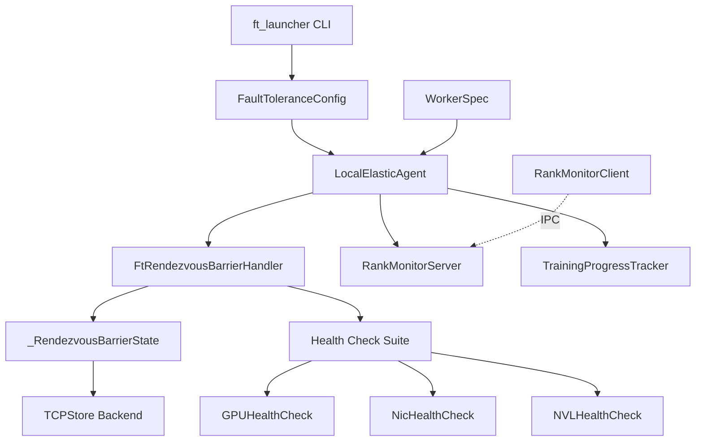
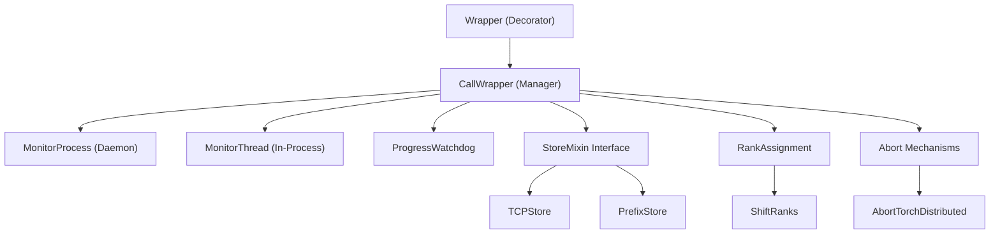
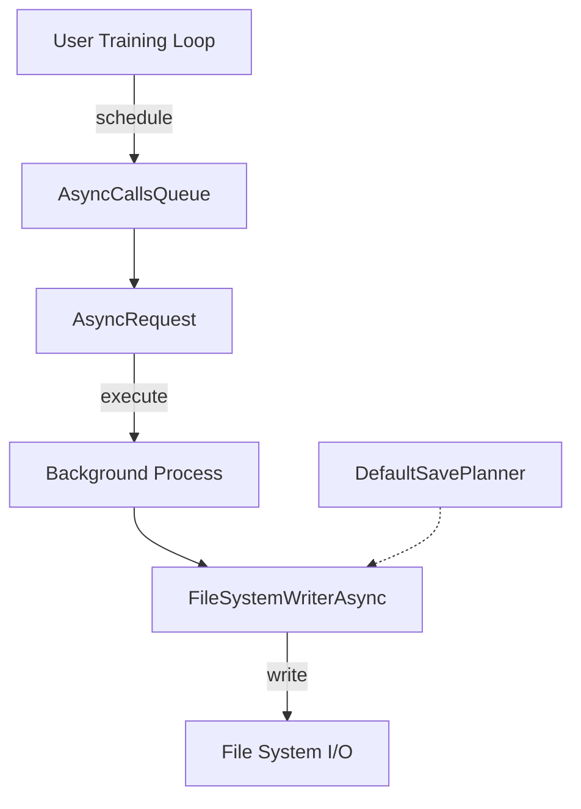

<!-- source: DeepWiki mcp.deepwiki.com · repo NVIDIA/nvidia-resiliency-ext · page 1.2 System Architecture · fetched 2026-10-26 -->

# System Architecture

Relevant source files

The following files were used as context for generating this wiki page:

- [.github/workflows/build_docs.yml](.github/workflows/build_docs.yml)
- [.github/workflows/lint_code.yml](.github/workflows/lint_code.yml)
- [.github/workflows/unit_test.yml](.github/workflows/unit_test.yml)
- [README.md](README.md)
- [docs/source/release-notes.md](docs/source/release-notes.md)
- [examples/attribution/README.md](examples/attribution/README.md)
- [pyproject.toml](pyproject.toml)
- [src/nvidia_resiliency_ext/fault_tolerance/cycle_info_writer.py](src/nvidia_resiliency_ext/fault_tolerance/cycle_info_writer.py)
- [src/nvidia_resiliency_ext/fault_tolerance/rank_monitor_state_machine.py](src/nvidia_resiliency_ext/fault_tolerance/rank_monitor_state_machine.py)
- [src/nvidia_resiliency_ext/fault_tolerance/utils.py](src/nvidia_resiliency_ext/fault_tolerance/utils.py)
- [src/nvidia_resiliency_ext/shared_utils/profiling.py](src/nvidia_resiliency_ext/shared_utils/profiling.py)
- [src/nvidia_resiliency_ext/shared_utils/proto/nvrx_interface.proto](src/nvidia_resiliency_ext/shared_utils/proto/nvrx_interface.proto)
- [src/nvidia_resiliency_ext/testing_utils/__init__.py](src/nvidia_resiliency_ext/testing_utils/__init__.py)
- [src/nvidia_resiliency_ext/testing_utils/health_check_injector.py](src/nvidia_resiliency_ext/testing_utils/health_check_injector.py)
- [tests/fault_tolerance/unit/test_cycle_info_writer.py](tests/fault_tolerance/unit/test_cycle_info_writer.py)
- [tests/fault_tolerance/unit/test_layered_restart_v1.py](tests/fault_tolerance/unit/test_layered_restart_v1.py)
- [tests/fault_tolerance/unit/test_timeouts_calc.py](tests/fault_tolerance/unit/test_timeouts_calc.py)
- [tests/fault_tolerance/unit/utils.py](tests/fault_tolerance/unit/utils.py)
- [tests/straggler/unit/_utils.py](tests/straggler/unit/_utils.py)

This page explains the high-level architecture of NVIDIA Resiliency Extensions (NVRx), describing how the major subsystems integrate to provide fault-tolerant distributed training. It covers component relationships, integration patterns, and data flow between subsystems.

## Architectural Overview

NVIDIA Resiliency Extensions is organized into four major subsystems that can be used independently or in combination. The architecture supports two primary deployment models: process-level fault tolerance via `ft_launcher` and function-level restart via the `@inprocess.Wrapper` decorator.

### Core Subsystems

```mermaid
graph TB
    subgraph "1. Fault Tolerance Subsystem"
        FT["ft_launcher (CLI)"]
        Agent["LocalElasticAgent"]
        Rdzv["FtRendezvousBarrierHandler"]
        RankMon["RankMonitorServer/Client"]
        Progress["TrainingProgressTracker"]
    end
    
    subgraph "2. Attribution & Diagnostics Subsystem"
        AttrSvc["nvrx-attrsvc (FastAPI)"]
        Trace["TorchFRTraceCollector"]
        Profiler["FaultToleranceProfiler"]
        Logs["PipeBasedLogsSpecs"]
        CycleInfo["CycleInfoWriter"]
    end
    
    subgraph "3. Checkpointing Subsystem"
        AsyncQ["AsyncCallsQueue"]
        Writer["FileSystemWriterAsync"]
        StateSaver["save_state_dict_async_plan"]
    end
    
    subgraph "4. In-Process Resiliency Subsystem"
        Wrapper["@inprocess.Wrapper"]
        CallWrap["CallWrapper"]
        MonProc["MonitorProcess"]
        RankAssign["RankAssignment"]
    end
    
    subgraph "Shared Components"
        Store["StoreMixin / TCPStore"]
        Health["HealthCheck Suite"]
        Config["FaultToleranceConfig"]
    end
    
    FT -->|uses| Store
    FT -->|uses| Health
    FT -->|configured by| Config
    
    Wrapper -->|uses| Store
    Wrapper -->|uses| Health
    
    FT -->|logs to| Logs
    FT -->|analyzes via| AttrSvc
    FT -->|records events| Profiler
    FT -->|writes metadata| CycleInfo
    
    Wrapper -->|records events| Profiler
    Wrapper -->|collects traces| Trace
    
    Agent -->|coordinates| Rdzv
    Agent -->|spawns| RankMon
    Agent -->|tracks| Progress
    
    CallWrap -->|spawns| MonProc
    CallWrap -->|uses| RankAssign
```

**Sources:** [src/nvidia_resiliency_ext/fault_tolerance/launcher.py:116-177](), [src/nvidia_resiliency_ext/inprocess/wrap.py:81-169](), [src/nvidia_resiliency_ext/checkpointing/async_ckpt/core.py:187-215](), [src/nvidia_resiliency_ext/fault_tolerance/cycle_info_writer.py:100-121]()

### Deployment Models

The system supports two integration patterns:

| **Integration Method** | **Entry Point** | **Scope** | **Primary Use Case** |
|------------------------|-----------------|-----------|---------------------|
| **Process-level** | `ft_launcher` CLI | Multi-node job | SLURM-based distributed training with worker processes managed by an elastic agent. |
| **Function-level** | `@inprocess.Wrapper` | Python function | Programmatic control within a single process; allows restarting training loops without process exit. |

**Sources:** [src/nvidia_resiliency_ext/fault_tolerance/launcher.py:324-376](), [src/nvidia_resiliency_ext/inprocess/wrap.py:81-138]()

---

## Component Architecture

### Fault Tolerance Subsystem

The `ft_launcher` is the primary entry point for managing distributed training. It extends PyTorch Elastic with custom rendezvous and monitoring logic.

**Sources:** [src/nvidia_resiliency_ext/fault_tolerance/launcher.py:461-550](), [src/nvidia_resiliency_ext/fault_tolerance/ft_rendezvous_barrier.py:364-449](), [src/nvidia_resiliency_ext/fault_tolerance/config.py:28-109](), [docs/source/release-notes.md:20-26]()

The `LocalElasticAgent` serves as the central orchestrator, managing:
- **Worker Lifecycle**: Spawning and monitoring worker processes via `WorkerSpec`.
- **Rendezvous Coordination**: Synchronizing nodes through `FtRendezvousBarrierHandler`, which implements a 4-step barrier protocol [src/nvidia_resiliency_ext/fault_tolerance/ft_rendezvous_barrier.py:722-1047]().
- **Rank Monitoring**: Launching `RankMonitorServer` subprocesses that communicate with `RankMonitorClient` in workers via IPC sockets [src/nvidia_resiliency_ext/fault_tolerance/launcher.py:75-81]().
- **Progress Tracking**: Using `TrainingProgressTracker` to detect training stagnation [src/nvidia_resiliency_ext/fault_tolerance/launcher.py:80]().
- **Infrastructure Alignment**: Using `get_infrastructure_rank` to derive ranks from SLURM topology or node names [src/nvidia_resiliency_ext/fault_tolerance/utils.py:42-83]().

### In-Process Resiliency Subsystem

The In-Process system allows a training function to restart internally without the OS process exiting. This is managed by the `Wrapper` class.

**Sources:** [src/nvidia_resiliency_ext/inprocess/wrap.py:81-169](), [src/nvidia_resiliency_ext/inprocess/monitor_process.py:126-148](), [src/nvidia_resiliency_ext/inprocess/monitor_thread.py:49-50]()

The `Wrapper` manages:
- **Dual Monitoring**: A `MonitorThread` for low-latency detection within the process and a `MonitorProcess` (daemon) that survives main process hangs [src/nvidia_resiliency_ext/inprocess/wrap.py:153-158]().
- **Progress Tracking**: `ProgressWatchdog` tracks timestamps to detect stalls [src/nvidia_resiliency_ext/inprocess/wrap.py:156]().
- **Distributed State**: Uses `PrefixStore` to namespace iteration-specific data in the `TCPStore` [src/nvidia_resiliency_ext/inprocess/store.py:353-389]().
- **Abort Mechanisms**: `AbortTorchDistributed` ensures NCCL and distributed backends are safely shut down before restart [src/nvidia_resiliency_ext/inprocess/abort.py:35-36]().

---

## Checkpointing Architecture

The checkpointing system offloads I/O to background processes to minimize training downtime.

**Sources:** [src/nvidia_resiliency_ext/checkpointing/async_ckpt/core.py:120-144](), [src/nvidia_resiliency_ext/checkpointing/async_ckpt/filesystem_async.py:140-184]()

- **`AsyncCallsQueue`**: Manages the lifecycle of background workers. In recent versions, persistent workers using `spawn` are preferred over `fork` for stability [src/nvidia_resiliency_ext/checkpointing/async_ckpt/core.py:187-215](), [docs/source/release-notes.md:34-38]().
- **`FileSystemWriterAsync`**: Extends PyTorch's `FileSystemWriter` to support non-blocking writes and shared memory (SHM) staging of GPU tensors [src/nvidia_resiliency_ext/checkpointing/async_ckpt/filesystem_async.py:140-184]().
- **`AsyncRequest`**: Encapsulates the save function, preloading logic (GPU-to-CPU transfer), and finalization hooks [src/nvidia_resiliency_ext/checkpointing/async_ckpt/core.py:120-144]().

---

## Shared Infrastructure

### Health Check Suite

Health checks are modular and used by both the Fault Tolerance and In-Process subsystems.

| Component | Purpose | Source |
|-----------|---------|--------|
| `GPUHealthCheck` | Checks for CUDA errors and GPU liveness. | [src/nvidia_resiliency_ext/shared_utils/health_check.py:60]() |
| `NicHealthCheck` | Monitors InfiniBand/Ethernet link status and counters. | [src/nvidia_resiliency_ext/shared_utils/health_check.py:61]() |
| `NVLHealthCheck` | Validates NVLink connectivity and health. | [src/nvidia_resiliency_ext/shared_utils/health_check.py:63]() |
| `NodeHealthCheck` | General node-level health check via gRPC (e.g., `nvhcd`). | [docs/source/release-notes.md:27-32]() |

### Profiling and Metadata

NVRx includes dedicated systems for tracking the history of restarts and failures.
- **`FaultToleranceProfiler`**: Records high-level events like `FAILURE_DETECTED` and `RENDEZVOUS_COMPLETED` with cycle-level granularity [src/nvidia_resiliency_ext/shared_utils/profiling.py:28-40]().
- **`CycleInfoWriter`**: Writes atomic JSON metadata for each training cycle to a shared filesystem (e.g., Lustre), enabling post-mortem attribution [src/nvidia_resiliency_ext/fault_tolerance/cycle_info_writer.py:100-121]().

---

## Data Flow Patterns

### Fault Tolerance Lifecycle
1. **Launch**: `ft_launcher` parses `FaultToleranceConfig` [src/nvidia_resiliency_ext/fault_tolerance/launcher.py:222-323]().
2. **Rendezvous**: Nodes coordinate via `FtRendezvousBarrierHandler`. Health checks are performed here [src/nvidia_resiliency_ext/fault_tolerance/ft_rendezvous_barrier.py:722-1047]().
3. **Execution**: `LocalElasticAgent` spawns worker processes and `RankMonitorServer` [src/nvidia_resiliency_ext/fault_tolerance/launcher.py:461-550]().
4. **Monitoring**: Workers send heartbeats via IPC to the monitor server [src/nvidia_resiliency_ext/fault_tolerance/launcher.py:75-81]().
5. **Restart**: On failure, the agent terminates workers, waits for GPU memory reclaim, and triggers a new rendezvous [src/nvidia_resiliency_ext/fault_tolerance/launcher.py:1000-1103]().

### In-Process Restart Lifecycle
1. **Decoration**: `@inprocess.Wrapper` wraps the training function [src/nvidia_resiliency_ext/inprocess/wrap.py:81-138]().
2. **Monitoring**: `MonitorProcess` starts and watches the main training process [src/nvidia_resiliency_ext/inprocess/monitor_process.py:126-148]().
3. **Failure**: A timeout or exception triggers `AbortTorchDistributed` [src/nvidia_resiliency_ext/inprocess/abort.py:35-36]().
4. **Reassignment**: `RankAssignment` logic (e.g., `ShiftRanks`) determines the new configuration [src/nvidia_resiliency_ext/inprocess/rank_assignment.py:101-124]().
5. **Recovery**: The wrapper calls the training function again with the updated rank/world size [src/nvidia_resiliency_ext/inprocess/wrap.py:490-715]().

**Sources:** [src/nvidia_resiliency_ext/fault_tolerance/launcher.py:1-1103](), [src/nvidia_resiliency_ext/inprocess/wrap.py:1-715](), [src/nvidia_resiliency_ext/checkpointing/async_ckpt/core.py:1-215](), [src/nvidia_resiliency_ext/shared_utils/profiling.py:1-148]()

---

