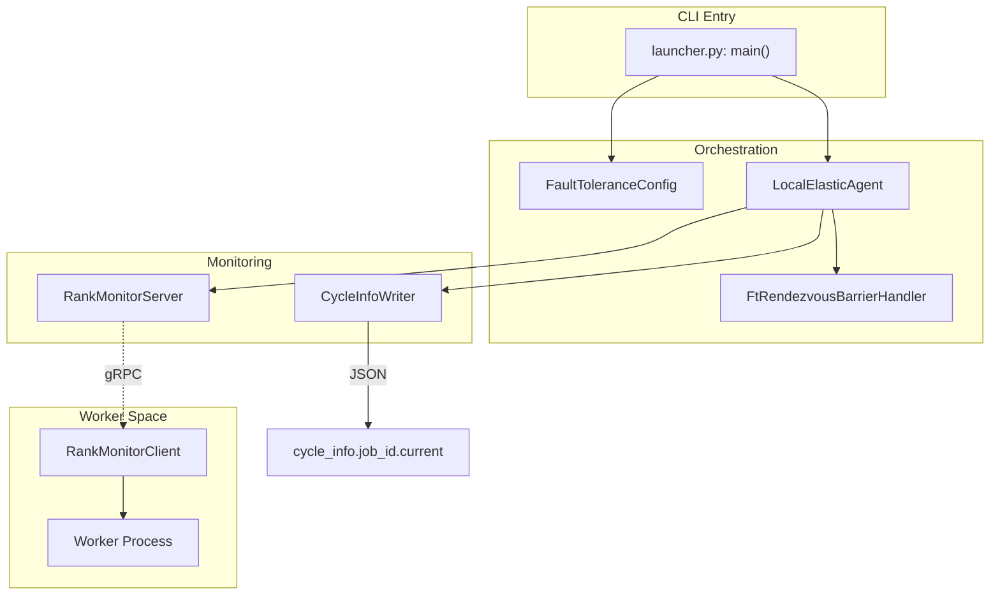
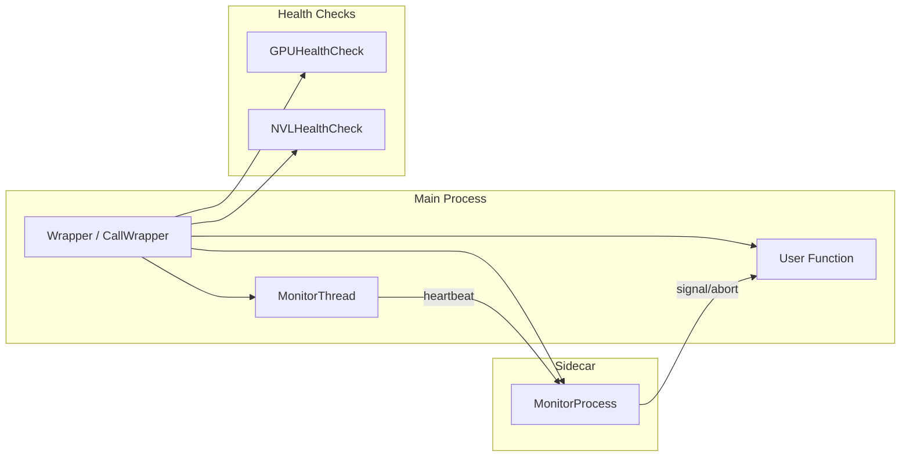

<!-- source: DeepWiki mcp.deepwiki.com · repo NVIDIA/nvidia-resiliency-ext · page 1.3 Getting Started · fetched 2026-10-26 -->

# Getting Started

<details>
<summary>Relevant source files</summary>

The following files were used as context for generating this wiki page:

- [.github/workflows/build_docs.yml](.github/workflows/build_docs.yml)
- [.github/workflows/lint_code.yml](.github/workflows/lint_code.yml)
- [.github/workflows/unit_test.yml](.github/workflows/unit_test.yml)
- [README.md](README.md)
- [docs/source/fault_tolerance/README-pci-topo-file.md](docs/source/fault_tolerance/README-pci-topo-file.md)
- [docs/source/fault_tolerance/examples/train_ddp_heartbeats.rst](docs/source/fault_tolerance/examples/train_ddp_heartbeats.rst)
- [docs/source/fault_tolerance/examples/train_ddp_sections.rst](docs/source/fault_tolerance/examples/train_ddp_sections.rst)
- [docs/source/fault_tolerance/integration/heartbeats.rst](docs/source/fault_tolerance/integration/heartbeats.rst)
- [docs/source/release-notes.md](docs/source/release-notes.md)
- [examples/attribution/README.md](examples/attribution/README.md)
- [examples/fault_tolerance/basic_ft_example.py](examples/fault_tolerance/basic_ft_example.py)
- [examples/fault_tolerance/train_ddp_heartbeats_api.py](examples/fault_tolerance/train_ddp_heartbeats_api.py)
- [examples/fault_tolerance/train_ddp_sections_api.py](examples/fault_tolerance/train_ddp_sections_api.py)
- [examples/inprocess/basic_example.py](examples/inprocess/basic_example.py)
- [pyproject.toml](pyproject.toml)
- [src/nvidia_resiliency_ext/fault_tolerance/cycle_info_writer.py](src/nvidia_resiliency_ext/fault_tolerance/cycle_info_writer.py)
- [src/nvidia_resiliency_ext/shared_utils/proto/nvrx_interface.proto](src/nvidia_resiliency_ext/shared_utils/proto/nvrx_interface.proto)
- [tests/fault_tolerance/unit/test_cycle_info_writer.py](tests/fault_tolerance/unit/test_cycle_info_writer.py)
- [tests/fault_tolerance/unit/test_timeouts_calc.py](tests/fault_tolerance/unit/test_timeouts_calc.py)
- [tests/fault_tolerance/unit/utils.py](tests/fault_tolerance/unit/utils.py)
- [tests/straggler/unit/_utils.py](tests/straggler/unit/_utils.py)

</details>


This page provides installation instructions, basic configuration examples, and simple usage patterns to help you quickly start using NVIDIA Resiliency Extensions (NVRx). It covers the two primary entry points: the `ft_launcher` for job-level fault tolerance and the `inprocess.Wrapper` for function-level recovery.

---

## Installation

### Package Installation

NVRx can be installed directly from source or via PyPI.

**From source:**
```bash
git clone https://github.com/NVIDIA/nvidia-resiliency-ext
cd nvidia-resiliency-ext
pip install .
```
[README.md:37-40]()

**From PyPI:**
```bash
pip install nvidia-resiliency-ext
```
[README.md:44-45]()

### Optional Dependencies
For LLM-based log analysis and automated fault attribution, install the `attribution` extras:
```bash
pip install 'nvidia-resiliency-ext[attribution]'
```
[README.md:41-46](), [pyproject.toml:74-88]()

### Platform Requirements
| Component | Requirement |
| :--- | :--- |
| **Python** | >= 3.10, < 3.13 |
| **PyTorch** | >= 2.5.1 (Fault Attribution requires >= 2.8.0) |
| **CUDA** | >= 12.8 |
| **NVML Driver** | >= 535 (570+ required for GPU health checks) |
| **NCCL** | < 2.28.3 OR >= 2.28.9 (Avoids specific in-process segment faults) |

Sources: [README.md:50-60](), [docs/source/release-notes.md:52]()

---

## Configuration Overview

NVRx configuration is primarily managed through the `FaultToleranceConfig` object. It supports a hierarchical precedence model to allow flexible overrides.

### Configuration Precedence
1. **Python API parameters**: Arguments passed directly to constructors (e.g., `LocalElasticAgent`).
2. **CLI arguments / Environment variables**: Flags like `--ft-rank-heartbeat-timeout`.
3. **YAML configuration**: Defined via `--ft-cfg-path`.
4. **Default values**: Hardcoded system defaults.

Sources: [docs/source/release-notes.md:28-30](), [examples/fault_tolerance/train_ddp_sections_api.py:19-20]()

---

## Quick Start: ft_launcher

The `ft_launcher` is a CLI tool that replaces `torchrun`. It manages the training lifecycle, detects hung ranks via a `RankMonitorServer`, and performs in-job restarts without reallocating SLURM nodes.

### Basic CLI Usage
```bash
# Standard launch with 8 processes per node
ft_launcher --nproc-per-node=8 train.py --args...

# Launch with section-based timeout configuration
ft_launcher \
    --nproc-per-node=2 \
    --ft-cfg-path=./fault_tol_cfg.yaml \
    train.py
```
[pyproject.toml:68](), [examples/fault_tolerance/train_ddp_sections_api.py:20]()

### Launch Flow Architecture

The following diagram maps the natural language "Launch" concept to specific code entities within the `fault_tolerance` subsystem.


Sources: [src/nvidia_resiliency_ext/fault_tolerance/launcher.py:68](), [src/nvidia_resiliency_ext/fault_tolerance/cycle_info_writer.py:100-120](), [src/nvidia_resiliency_ext/shared_utils/proto/nvrx_interface.proto:23-58]()

---

## Quick Start: In-Process Wrapper

The `@inprocess.Wrapper` provides a decorator-based approach to resiliency. It allows a function to restart internally if a failure or timeout is detected, maintaining the same OS process.

### Basic Usage Pattern
```python
from nvidia_resiliency_ext.inprocess import Wrapper

@Wrapper(
    max_restarts=3,
    initial_world_size=8,
    heartbeat_timeout=30.0
)
def train_loop():
    # Your training code here
    pass
```
[docs/source/release-notes.md:24](), [examples/inprocess/basic_example.py:1-10]()

### In-Process Monitoring Architecture

This diagram illustrates how the `Wrapper` manages execution and monitoring via sidecar threads and processes.


Sources: [docs/source/release-notes.md:21-25](), [src/nvidia_resiliency_ext/fault_tolerance/cycle_info_writer.py:27-30]()

---

## Cycle Tracking and Logging

NVRx introduces the concept of a **Cycle**. A cycle represents one attempt of a training run within a single job allocation.

### Cycle Info Writing
The `CycleInfoWriter` records metadata about each restart cycle to a JSON file (typically on a shared filesystem like Lustre). This is critical for the Attribution Service to analyze logs.
* **File Pattern**: `cycle_info.<job_id>.<attempt>.<cycle_number>`
* **Symlink**: `cycle_info.<job_id>.current` always points to the active cycle.

[src/nvidia_resiliency_ext/fault_tolerance/cycle_info_writer.py:43-50](), [src/nvidia_resiliency_ext/shared_utils/proto/nvrx_interface.proto:19-23]()

---

## Essential Configuration Flags

| Flag | Description | Default |
| :--- | :--- | :--- |
| `--ft-cfg-path` | Path to the YAML configuration file. | `None` |
| `--ft-use-infra-group-rank` | Align ranks with the infrastructure scheduler's topology. | `False` |
| `--ft-node-health-check-endpoint` | UDS endpoint for external node health services (e.g., `unix:///var/run/nvhcd.sock`). | `None` |
| `--ft-rank-heartbeat-timeout` | Seconds to wait for a rank heartbeat before declaring a hang. | `2700.0` |

Sources: [docs/source/release-notes.md:15-31](), [examples/fault_tolerance/train_ddp_sections_api.py:20]()

---

## Next Steps
* **Fault Tolerance System**: Deep dive into `LocalElasticAgent` and rendezvous protocols in [Fault Tolerance System](#2).
* **In-Process Restart**: Learn about `RankAssignment` and `ProgressWatchdog` in [In-Process Restart System](#3).
* **Checkpointing**: Explore `AsyncCallsQueue` for non-blocking saves in [Checkpointing System](#4).

---

