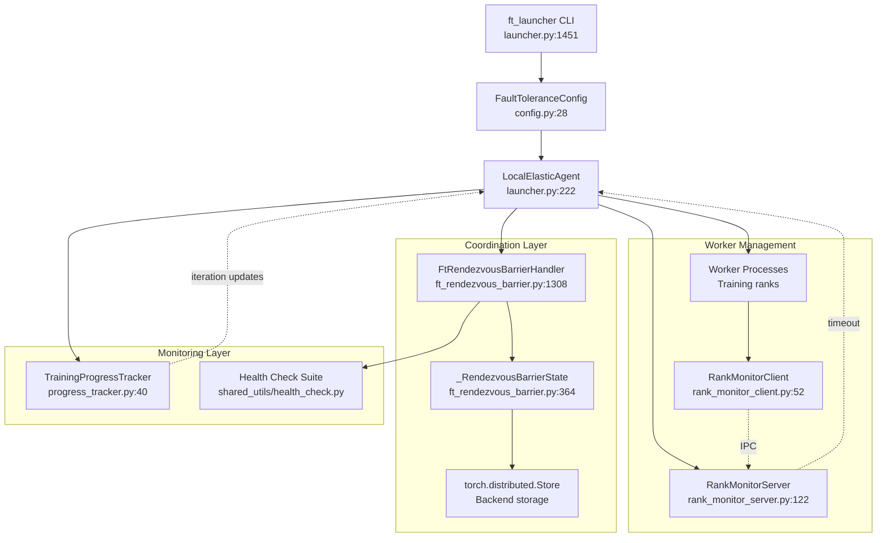
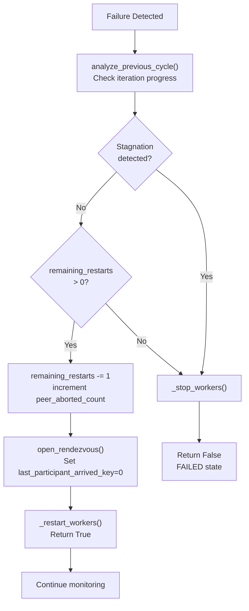

<!-- source: DeepWiki mcp.deepwiki.com · repo NVIDIA/nvidia-resiliency-ext · page 2 Fault Tolerance System · fetched 2026-10-26 -->

# Fault Tolerance System

<details>
<summary>Relevant source files</summary>

The following files were used as context for generating this wiki page:

- [src/nvidia_resiliency_ext/fault_tolerance/_ft_rendezvous.py](src/nvidia_resiliency_ext/fault_tolerance/_ft_rendezvous.py)
- [src/nvidia_resiliency_ext/fault_tolerance/config.py](src/nvidia_resiliency_ext/fault_tolerance/config.py)
- [src/nvidia_resiliency_ext/fault_tolerance/data.py](src/nvidia_resiliency_ext/fault_tolerance/data.py)
- [src/nvidia_resiliency_ext/fault_tolerance/ft_rendezvous_barrier.py](src/nvidia_resiliency_ext/fault_tolerance/ft_rendezvous_barrier.py)
- [src/nvidia_resiliency_ext/fault_tolerance/launcher.py](src/nvidia_resiliency_ext/fault_tolerance/launcher.py)
- [src/nvidia_resiliency_ext/fault_tolerance/progress_tracker.py](src/nvidia_resiliency_ext/fault_tolerance/progress_tracker.py)
- [src/nvidia_resiliency_ext/fault_tolerance/rank_monitor_client.py](src/nvidia_resiliency_ext/fault_tolerance/rank_monitor_client.py)
- [src/nvidia_resiliency_ext/fault_tolerance/rank_monitor_server.py](src/nvidia_resiliency_ext/fault_tolerance/rank_monitor_server.py)
- [tests/fault_tolerance/unit/test_barrier_rendezvous.py](tests/fault_tolerance/unit/test_barrier_rendezvous.py)
- [tests/fault_tolerance/unit/test_dynamic_rendezvous.py](tests/fault_tolerance/unit/test_dynamic_rendezvous.py)
- [tests/fault_tolerance/unit/test_launcher.py](tests/fault_tolerance/unit/test_launcher.py)
- [tests/fault_tolerance/unit/test_progress_tracker.py](tests/fault_tolerance/unit/test_progress_tracker.py)
- [tests/fault_tolerance/unit/test_rank_monitor_client.py](tests/fault_tolerance/unit/test_rank_monitor_client.py)
- [tests/fault_tolerance/unit/test_utils.py](tests/fault_tolerance/unit/test_utils.py)
- [tests/straggler/unit/test_cupti_ext.py](tests/straggler/unit/test_cupti_ext.py)

</details>


## Purpose and Scope

This document provides an overview of the fault tolerance subsystem, which manages distributed training across multiple nodes with automatic worker restart and coordination. The system is built around the `ft_launcher` command-line tool and the `LocalElasticAgent` class, which orchestrates worker processes, detects failures, performs health validation, and coordinates cluster-wide restarts.

For detailed information on specific components:
- Launcher implementation and worker lifecycle: see [ft_launcher and LocalElasticAgent](#2.1)
- Rendezvous protocol and coordination: see [Rendezvous and Coordination](#2.2)
- Health monitoring and progress tracking: see [Rank Monitoring and Progress Tracking](#2.3)
- Configuration options: see [Configuration Guide](#2.4)

For the complementary in-process restart mechanism that operates within a single process: see [In-Process Restart System](#3).

## System Overview

The fault tolerance system orchestrates distributed training by launching and monitoring worker processes across a cluster, detecting failures, performing health checks, and automatically restarting training when failures occur. The system ensures training can continue despite hardware faults, software errors, or transient issues.

Key capabilities:
- **Automatic worker restart**: Detects failures and restarts all workers across the cluster.
- **Dynamic node coordination**: Manages node participation through a barrier-based rendezvous protocol.
- **Health validation**: Validates GPU, NIC, storage, and node health before each training cycle.
- **Hot spare support**: Allows standby nodes to wait and replace failed nodes when needed.
- **Progress tracking**: Detects training stagnation via iteration monitoring to prevent infinite restart loops.
- **Segment-aware scheduling**: Groups nodes by NVLink domain for optimal resource utilization on NVSwitch systems.

The system operates at the job level, managing entire distributed training jobs with multiple nodes and workers per node. It integrates with PyTorch's Elastic framework while providing enhanced fault tolerance capabilities.

Sources: [src/nvidia_resiliency_ext/fault_tolerance/launcher.py:222-323](), [src/nvidia_resiliency_ext/fault_tolerance/ft_rendezvous_barrier.py:364-401](), [src/nvidia_resiliency_ext/fault_tolerance/progress_tracker.py:19-30]()

## Architecture Overview



**Architecture Diagram**: Core components of the fault tolerance system showing class names and file locations

The system is organized into three layers:
1. **Launcher Layer**: `ft_launcher` CLI and `FaultToleranceConfig` provide entry points and configuration.
2. **Orchestration Layer**: `LocalElasticAgent` manages worker lifecycle and coordinates restarts.
3. **Coordination Layer**: `FtRendezvousBarrierHandler` synchronizes nodes and assigns ranks.

Sources: [src/nvidia_resiliency_ext/fault_tolerance/launcher.py:222-376](), [src/nvidia_resiliency_ext/fault_tolerance/ft_rendezvous_barrier.py:1308-1401](), [src/nvidia_resiliency_ext/fault_tolerance/rank_monitor_server.py:122-181](), [src/nvidia_resiliency_ext/fault_tolerance/rank_monitor_client.py:52-118]()

## Key Components

### LocalElasticAgent

The `LocalElasticAgent` is the central orchestrator that manages worker processes on each node. It extends PyTorch's `SimpleElasticAgent` with fault-tolerant capabilities.

**Location**: [src/nvidia_resiliency_ext/fault_tolerance/launcher.py:222-356]()

**Responsibilities**:
- Spawn and monitor worker processes on the local node.
- Coordinate with `FtRendezvousBarrierHandler` for cluster-wide synchronization.
- Manage rank monitor servers for per-worker health tracking.
- Execute restart policies when failures occur.
- Track training progress to detect stagnation.

**Key Methods**:
- `run()` - Main execution loop [src/nvidia_resiliency_ext/fault_tolerance/launcher.py:461-482]().
- `_invoke_run()` - Dispatches to restart policy implementation [src/nvidia_resiliency_ext/fault_tolerance/launcher.py:548-557]().
- `_start_workers()` - Spawns worker processes with environment setup [src/nvidia_resiliency_ext/fault_tolerance/launcher.py:1006-1156]().
- `_monitor_workers()` - Checks worker status [src/nvidia_resiliency_ext/fault_tolerance/launcher.py:1260-1319]().
- `_stop_workers()` - Terminates workers and waits for GPU memory reclaim [src/nvidia_resiliency_ext/fault_tolerance/launcher.py:954-1001]().
- `_handle_restart_decision()` - Determines whether to restart or terminate [src/nvidia_resiliency_ext/fault_tolerance/launcher.py:503-546]().

Sources: [src/nvidia_resiliency_ext/fault_tolerance/launcher.py:222-376]()

### FtRendezvousBarrierHandler

The `FtRendezvousBarrierHandler` implements a barrier-based protocol for coordinating node participation in training. It replaces PyTorch's default C10d rendezvous with a design optimized for fault tolerance and flexible node participation.

**Location**: [src/nvidia_resiliency_ext/fault_tolerance/ft_rendezvous_barrier.py:1308-1401]()

**Key Features**:
- **Barrier-based coordination**: Uses atomic increments instead of compare-and-swap operations [src/nvidia_resiliency_ext/fault_tolerance/ft_rendezvous_barrier.py:9-11]().
- **Segment-aware rank assignment**: Groups nodes by NVLink domain (ClusterUUID) for NVSwitch systems [src/nvidia_resiliency_ext/fault_tolerance/ft_rendezvous_barrier.py:501-644]().
- **Health validation**: Executes GPU, NIC, storage checks before each rendezvous [src/nvidia_resiliency_ext/fault_tolerance/ft_rendezvous_barrier.py:1597-1646]().
- **Hot spare management**: Allows standby nodes to wait without disrupting training [src/nvidia_resiliency_ext/fault_tolerance/ft_rendezvous_barrier.py:821-1095]().
- **Stale round detection**: Enables nodes to sync with newer rendezvous rounds via `_StaleRendezvousRoundError` [src/nvidia_resiliency_ext/fault_tolerance/ft_rendezvous_barrier.py:1078-1089]().

**Core State Machine** ([src/nvidia_resiliency_ext/fault_tolerance/ft_rendezvous_barrier.py:364-441]()):
- Managed by `_RendezvousBarrierState` class.
- Tracks rendezvous round number, participant counts, and health status.
- Coordinates through distributed store keys: `arrived_count_key`, `ack_count_key`, and `last_participant_arrived_key`.

Sources: [src/nvidia_resiliency_ext/fault_tolerance/ft_rendezvous_barrier.py:1308-1527](), [src/nvidia_resiliency_ext/fault_tolerance/ft_rendezvous_barrier.py:364-441]()

### Rank Monitor System

The rank monitor system provides per-worker health tracking using a client-server architecture with bidirectional IPC.

**Components**:
- `RankMonitorServer`: Dedicated process per local worker, monitors heartbeats and section timeouts [src/nvidia_resiliency_ext/fault_tolerance/rank_monitor_server.py:122-181]().
- `RankMonitorClient`: Embedded in worker, sends heartbeats and section entry/exit messages [src/nvidia_resiliency_ext/fault_tolerance/rank_monitor_client.py:52-118]().
- `RankMonitorStateMachine`: Tracks restart cycles and iteration progress [src/nvidia_resiliency_ext/fault_tolerance/rank_monitor_server.py:168]().

**Communication**: Bidirectional IPC via Unix domain sockets [src/nvidia_resiliency_ext/fault_tolerance/launcher.py:754-883]().
- Worker → Monitor: Heartbeats, section boundaries, iteration updates via `HeartbeatMsg` and `SectionMsg` [src/nvidia_resiliency_ext/fault_tolerance/rank_monitor_server.py:40-44]().
- Monitor → Launcher: Timeout detection and iteration progress tracking [src/nvidia_resiliency_ext/fault_tolerance/launcher.py:840-883]().

**Timeout Types** ([src/nvidia_resiliency_ext/fault_tolerance/config.py:32-51]()):
- `initial_rank_heartbeat_timeout`: First heartbeat from worker.
- `rank_heartbeat_timeout`: Subsequent heartbeat interval.
- `rank_section_timeouts`: Per-section timeouts (e.g., "step", "forward", "backward").
- `rank_out_of_section_timeout`: Default timeout for unmarked code sections.

Sources: [src/nvidia_resiliency_ext/fault_tolerance/launcher.py:754-883](), [src/nvidia_resiliency_ext/fault_tolerance/config.py:32-51](), [src/nvidia_resiliency_ext/fault_tolerance/rank_monitor_server.py:122-181]()

### Health Validation

The system validates multiple aspects of node health before each rendezvous through `ensure_node_is_healthy()` [src/nvidia_resiliency_ext/fault_tolerance/ft_rendezvous_barrier.py:1597-1646]().

| Health Check | Class | Purpose | Configuration |
|--------------|-------|---------|---------------|
| GPU | `GPUHealthCheck` | Validates GPU accessibility | Always enabled |
| NIC Link State | `NicLinkStateHealthCheck` | Checks network interface ports are ACTIVE | `--ft-enable-nic-healthcheck` |
| NVLink | `NVLHealthCheck` | Validates NVLink fabric connectivity | Always enabled |
| Storage (Distributed) | `DistributedStorageHealthCheck` | Checks Lustre/NFS mount health | `--ft-enable-dist-storage-healthcheck` |
| Storage (Path) | `StoragePathHealthCheck` | Validates specific paths are readable | `--ft-storage-healthcheck-path` |
| Node Service | `NodeHealthCheck` | Queries external health service (gRPC/UDS) | `--ft-node-health-check-endpoint` |

If any check fails, the node increments `unhealthy_count_key` in the store and raises `UnhealthyNodeException`, causing the node to exit.

Sources: [src/nvidia_resiliency_ext/fault_tolerance/ft_rendezvous_barrier.py:1597-1646](), [src/nvidia_resiliency_ext/fault_tolerance/config.py:52-69]()

### Progress Tracking

The `TrainingProgressTracker` detects training stagnation to prevent infinite restart loops when training is stuck.

**How It Works**:
1. Rank monitors send iteration updates to the launcher via IPC [src/nvidia_resiliency_ext/fault_tolerance/launcher.py:829-838]().
2. The launcher tracks progress across cycles (including cycle 0) [src/nvidia_resiliency_ext/fault_tolerance/progress_tracker.py:43-48]().
3. If iteration progress is less than `min_progress_iterations` for `max_no_progress_cycles` consecutive restarts, the tracker recommends early termination [src/nvidia_resiliency_ext/fault_tolerance/progress_tracker.py:150-165]().

**Configuration** ([src/nvidia_resiliency_ext/fault_tolerance/config.py:130-137]()):
- `min_progress_iterations`: Minimum iteration delta required (default 1).
- `max_no_progress_cycles`: Max consecutive stagnant cycles before termination (default 2).
- `checkpoint_iteration_file`: Optional path to read the latest iteration baseline [src/nvidia_resiliency_ext/fault_tolerance/progress_tracker.py:116-134]().

Sources: [src/nvidia_resiliency_ext/fault_tolerance/launcher.py:829-838](), [src/nvidia_resiliency_ext/fault_tolerance/progress_tracker.py:40-93](), [src/nvidia_resiliency_ext/fault_tolerance/config.py:130-137]()

## Worker Lifecycle

```mermaid
sequenceDiagram
    participant CLI as "ft_launcher CLI"
    participant Agent as "LocalElasticAgent"
    participant Rdzv as "FtRendezvousBarrierHandler"
    participant Health as "Health Checks"
    participant Worker as "Worker Process"
    participant RMon as "RankMonitorServer"
    
    CLI->>Agent: "run()"
    
    loop Training Cycle
        Agent->>Rdzv: "_rendezvous()"
        Rdzv->>Rdzv: "perform_rendezvous()<br/>Step 0: _wait_for_rendezvous_open()"
        Rdzv->>Rdzv: "Step 1: Join barrier (atomic add)"
        Rdzv->>Health: "ensure_node_is_healthy()"
        Health-->>Rdzv: "Pass/Fail"
        
        alt Health check failed
            Rdzv->>Rdzv: "_maybe_increment_unhealthy_count()"
            Rdzv-->>Agent: "UnhealthyNodeException"
            Agent->>Agent: "Exit process"
        end
        
        Rdzv->>Rdzv: "Step 2: Wait for completion"
        Rdzv->>Rdzv: "Step 3: Acknowledge + assign ranks"
        Rdzv-->>Agent: "group_rank, world_size"
        
        Agent->>RMon: "setup_rank_monitors()"
        Agent->>Worker: "_start_workers()"
        
        loop Monitor Loop
            Worker->>RMon: "Heartbeat + section messages"
            RMon->>Agent: "Iteration updates"
            Agent->>Agent: "_monitor_workers()"
            
            alt Worker failed
                Agent->>Agent: "_handle_restart_decision()"
                Agent->>Rdzv: "open_rendezvous()"
                Agent->>Worker: "_stop_workers()"
                break Restart
            end
            
            alt Cluster changes detected
                Agent->>Agent: "_handle_restart_decision()"
                Agent->>Worker: "_stop_workers()"
                break Restart
            end
        end
        
        Worker-->>Agent: "SUCCESS"
        Agent->>Agent: "_exit_barrier()"
    end
    
    Agent-->>CLI: "RunResult"
```

**Worker Lifecycle Diagram**: Sequence showing method calls from launch to completion

**Phases**:

1. **Rendezvous** ([src/nvidia_resiliency_ext/fault_tolerance/launcher.py:1345-1355]()): All nodes synchronize using `perform_rendezvous()` [src/nvidia_resiliency_ext/fault_tolerance/ft_rendezvous_barrier.py:821-1095]().
2. **Health Validation** ([src/nvidia_resiliency_ext/fault_tolerance/ft_rendezvous_barrier.py:1597-1646]()): Each node validates GPU, NIC, and storage health.
3. **Rank Assignment** ([src/nvidia_resiliency_ext/fault_tolerance/ft_rendezvous_barrier.py:1199-1252]()): Store host assigns group ranks based on infrastructure topology and segment configuration.
4. **Worker Spawn** ([src/nvidia_resiliency_ext/fault_tolerance/launcher.py:1006-1156]()): Each node spawns local workers with environment variables (`RANK`, `WORLD_SIZE`, etc.).
5. **Monitoring** ([src/nvidia_resiliency_ext/fault_tolerance/launcher.py:1260-1319]()): Agent polls worker status via `_monitor_workers()`, rank monitors track health.
6. **Restart or Complete**: On failure, `_handle_restart_decision()` determines whether to restart; on success, `_exit_barrier()` synchronizes and returns.

Sources: [src/nvidia_resiliency_ext/fault_tolerance/launcher.py:461-614](), [src/nvidia_resiliency_ext/fault_tolerance/ft_rendezvous_barrier.py:821-1095]()

## Restart Policies

The system supports two restart policies configured via `--restart-policy`:

### any-failed Policy

**Implementation**: `_invoke_run_with_any_failed_policy()` [src/nvidia_resiliency_ext/fault_tolerance/launcher.py:559-648]().

**Behavior**:
- Any worker failure triggers cluster-wide restart.
- All nodes detect failure through worker state monitoring or peer abortion notification.
- The node detecting failure calls `open_rendezvous()` to allow a new round.
- All nodes synchronize to restart together.

### min-healthy Policy

**Implementation**: `_invoke_run_with_min_healthy_policy()` [src/nvidia_resiliency_ext/fault_tolerance/launcher.py:650-752]().

**Behavior**:
- Training continues as long as `min_nodes` workers can succeed.
- Cluster restarts only if the maximum possible successful nodes drop below `min_nodes`.
- Supports partial failure tolerance with reduced world size.

Sources: [src/nvidia_resiliency_ext/fault_tolerance/launcher.py:559-752]()

## Restart Decision Logic



**Restart Decision Flow**: Logic implemented in `_handle_restart_decision()` [src/nvidia_resiliency_ext/fault_tolerance/launcher.py:503-546]()

**Decision Criteria**:

1. **Progress Check**: `analyze_previous_cycle()` examines iteration history via `TrainingProgressTracker`.
   - If training stagnates across multiple restarts → terminate early [src/nvidia_resiliency_ext/fault_tolerance/progress_tracker.py:164-165]().
2. **Restart Budget**: `_remaining_restarts` counter.
   - Initialized from `spec.max_restarts` minus global restart count.
   - Accounts for previous restarts in job array deployments via `_get_global_restart_count()` [src/nvidia_resiliency_ext/fault_tolerance/launcher.py:437-456]().
3. **Rendezvous Open**: For barrier-based rendezvous.
   - Call `open_rendezvous()` to set `last_participant_arrived_key=0`.
   - Enables hot spares and restarting nodes to join a new round.

Sources: [src/nvidia_resiliency_ext/fault_tolerance/launcher.py:503-546](), [src/nvidia_resiliency_ext/fault_tolerance/progress_tracker.py:135-174]()

## Segment-Aware Rank Assignment

For systems with multiple NVLink domains (e.g., DGX H200, HGX B200), the system supports segment-aware rank assignment.

**Configuration**: `--ft-segment N` where N is the minimum number of nodes required per NVLink domain [src/nvidia_resiliency_ext/fault_tolerance/config.py:70-79]().

**Domain Detection**: Queries GPU ClusterUUID via `nvidia-smi` [src/nvidia_resiliency_ext/fault_tolerance/ft_rendezvous_barrier.py:300-361]().

**Assignment Algorithm** ([src/nvidia_resiliency_ext/fault_tolerance/ft_rendezvous_barrier.py:501-644]()):
1. Group participants by domain (ClusterUUID).
2. Sort domains by SLURM topology (smallest `infra_rank`).
3. Select complete segments from each domain.
4. Assign active ranks [0..world_size) from selected segments.
5. Assign standby ranks to remaining nodes.

Sources: [src/nvidia_resiliency_ext/fault_tolerance/ft_rendezvous_barrier.py:501-644](), [src/nvidia_resiliency_ext/fault_tolerance/config.py:70-79]()

## Configuration

The system is configured through `FaultToleranceConfig` which supports multiple loading methods:

**Loading Methods**:
- YAML file: `FaultToleranceConfig.from_yaml_file(path)` [src/nvidia_resiliency_ext/fault_tolerance/config.py:170-196]().
- CLI arguments: `FaultToleranceConfig.from_args(args)` [src/nvidia_resiliency_ext/fault_tolerance/config.py:242-297]().

**Key Categories**:
- **Timeouts**: Heartbeat and section timeouts [src/nvidia_resiliency_ext/fault_tolerance/config.py:32-51]().
- **Health Checks**: NIC, storage, and node health settings [src/nvidia_resiliency_ext/fault_tolerance/config.py:52-69]().
- **Resource Management**: GPU memory reclaim parameters [src/nvidia_resiliency_ext/fault_tolerance/config.py:83-88]().

For comprehensive configuration options and CLI flags, see [Configuration Guide](#2.4).

Sources: [src/nvidia_resiliency_ext/fault_tolerance/config.py:27-141](), [src/nvidia_resiliency_ext/fault_tolerance/config.py:242-297]()

---

