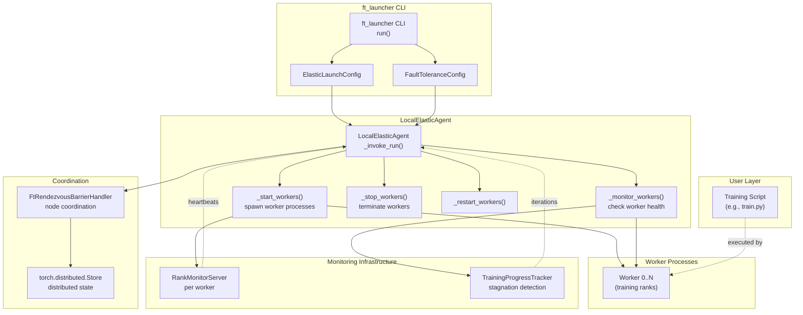
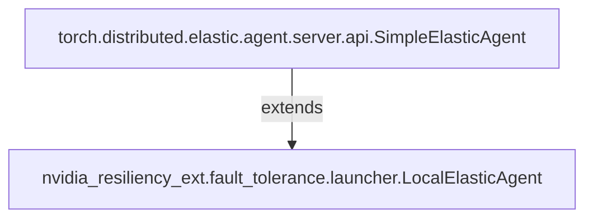
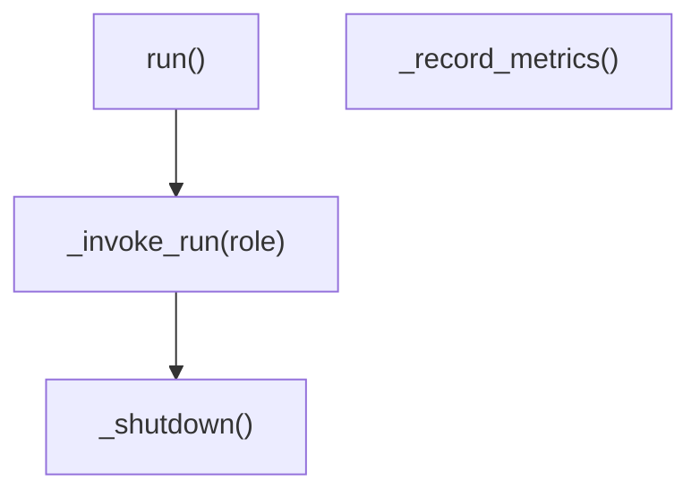
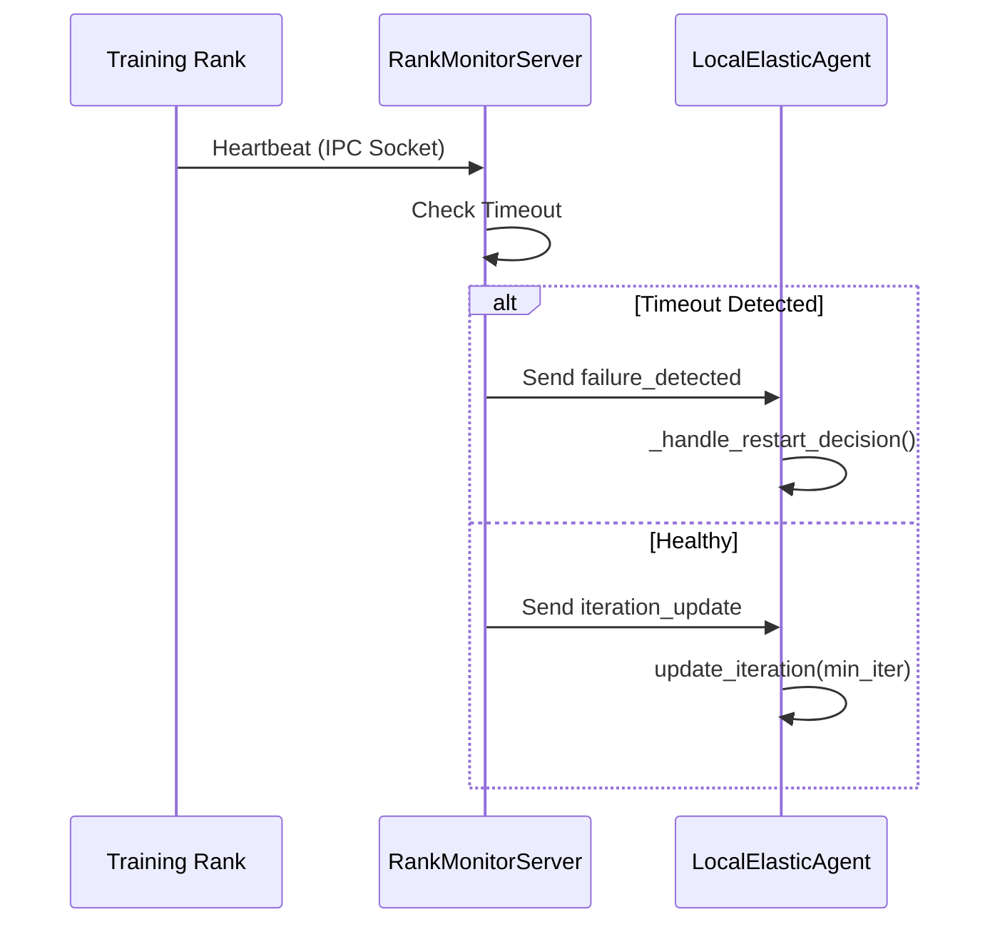

<!-- source: DeepWiki mcp.deepwiki.com · repo NVIDIA/nvidia-resiliency-ext · page 2.1 ft_launcher and LocalElasticAgent · fetched 2026-10-26 -->

# ft_launcher and LocalElasticAgent

Relevant source files

The following files were used as context for generating this wiki page:

- [src/nvidia_resiliency_ext/fault_tolerance/c10d_monkey_patch.py](src/nvidia_resiliency_ext/fault_tolerance/c10d_monkey_patch.py)
- [src/nvidia_resiliency_ext/fault_tolerance/cli_args.py](src/nvidia_resiliency_ext/fault_tolerance/cli_args.py)
- [src/nvidia_resiliency_ext/fault_tolerance/config.py](src/nvidia_resiliency_ext/fault_tolerance/config.py)
- [src/nvidia_resiliency_ext/fault_tolerance/control_plane.py](src/nvidia_resiliency_ext/fault_tolerance/control_plane.py)
- [src/nvidia_resiliency_ext/fault_tolerance/ft_rendezvous_barrier.py](src/nvidia_resiliency_ext/fault_tolerance/ft_rendezvous_barrier.py)
- [src/nvidia_resiliency_ext/fault_tolerance/launcher.py](src/nvidia_resiliency_ext/fault_tolerance/launcher.py)
- [src/nvidia_resiliency_ext/fault_tolerance/rdzv_utils.py](src/nvidia_resiliency_ext/fault_tolerance/rdzv_utils.py)
- [tests/fault_tolerance/unit/test_barrier_rendezvous.py](tests/fault_tolerance/unit/test_barrier_rendezvous.py)
- [tests/fault_tolerance/unit/test_c10d_monkey_patch.py](tests/fault_tolerance/unit/test_c10d_monkey_patch.py)
- [tests/fault_tolerance/unit/test_control_plane.py](tests/fault_tolerance/unit/test_control_plane.py)
- [tests/fault_tolerance/unit/test_launcher.py](tests/fault_tolerance/unit/test_launcher.py)

## Purpose and Scope

This document covers the **ft_launcher** CLI tool and the **LocalElasticAgent** class, which form the core of the fault tolerance subsystem. These components manage distributed training job lifecycle across multiple nodes, handling worker process spawning, monitoring, and coordinated restarts on failures.

`ft_launcher` is a command-line wrapper around PyTorch's `torchrun` that adds fault-tolerant capabilities. `LocalElasticAgent` extends PyTorch Elastic's `SimpleElasticAgent` to implement worker lifecycle management with automatic restart logic.

For information about the rendezvous and coordination mechanism, see [Rendezvous and Coordination](2.2). For rank-level monitoring details, see [Rank Monitoring and Progress Tracking](2.3). For configuration details, see [Configuration Guide](2.4).

---

## System Architecture Overview

The following diagram shows how `ft_launcher` and `LocalElasticAgent` fit into the overall fault tolerance system:

**Sources:** [src/nvidia_resiliency_ext/fault_tolerance/launcher.py:15-102](), [src/nvidia_resiliency_ext/fault_tolerance/launcher.py:222-356]()

---

## ft_launcher CLI Tool

### Overview

`ft_launcher` is the primary entry point for launching fault-tolerant distributed training jobs. It wraps PyTorch's `torchrun` launcher with additional capabilities:

- Health checks before rendezvous (NIC, Storage, GPU) [src/nvidia_resiliency_ext/fault_tolerance/launcher.py:136-144]().
- Rank-level hang detection via `RankMonitorServer` [src/nvidia_resiliency_ext/fault_tolerance/launcher.py:93-93]().
- Progress tracking with stagnation detection [src/nvidia_resiliency_ext/fault_tolerance/launcher.py:92-92]().
- Per-cycle log aggregation via `PipeBasedLogsSpecs` [src/nvidia_resiliency_ext/fault_tolerance/launcher.py:91-91]().
- GPU memory reclaim on restarts [src/nvidia_resiliency_ext/fault_tolerance/launcher.py:1158-1244]().
- Segment-aware rank assignment for NVSwitch systems [src/nvidia_resiliency_ext/fault_tolerance/config.py:70-79]().

### Command-Line Interface

The launcher accepts all standard `torchrun` arguments plus fault-tolerance-specific flags defined in `FaultToleranceConfig`:

| Flag | Type | Description |
|------|------|-------------|
| `--ft-cfg-path` | str | Path to YAML configuration file [src/nvidia_resiliency_ext/fault_tolerance/cli_args.py:93-93]() |
| `--ft-workload-check-interval` | float | Interval (seconds) for rank monitoring checks [src/nvidia_resiliency_ext/fault_tolerance/config.py:32-32]() |
| `--ft-initial-rank-heartbeat-timeout` | float | Timeout for first heartbeat from rank [src/nvidia_resiliency_ext/fault_tolerance/config.py:33-37]() |
| `--ft-rank-heartbeat-timeout` | float | Timeout for subsequent heartbeats [src/nvidia_resiliency_ext/fault_tolerance/config.py:38-41]() |
| `--ft-segment` | int | Segment-aware mode for NVSwitch systems [src/nvidia_resiliency_ext/fault_tolerance/cli_args.py:126-140]() |
| `--ft-enable-nic-healthcheck` | bool | Enable NIC link state health check [src/nvidia_resiliency_ext/fault_tolerance/config.py:53-56]() |
| `--ft-enable-dist-storage-healthcheck` | bool | Enable storage health check [src/nvidia_resiliency_ext/fault_tolerance/config.py:62-63]() |
| `--ft-gpu-memory-reclaim-timeout` | float | Timeout for GPU memory reclaim [src/nvidia_resiliency_ext/fault_tolerance/config.py:83-84]() |

**Sources:** [src/nvidia_resiliency_ext/fault_tolerance/config.py:27-109](), [src/nvidia_resiliency_ext/fault_tolerance/cli_args.py:126-140]()

### Configuration Resolution

Configuration is resolved in this order (later sources override earlier):

1. **Default values** in `FaultToleranceConfig` [src/nvidia_resiliency_ext/fault_tolerance/config.py:27-109]().
2. **YAML file** specified via `--ft-cfg-path` [src/nvidia_resiliency_ext/fault_tolerance/config.py:242-262]().
3. **CLI arguments** prefixed with `--ft-` which are parsed and converted to `FaultToleranceConfig` fields [src/nvidia_resiliency_ext/fault_tolerance/launcher.py:1418-1529]().

---

## LocalElasticAgent Core Lifecycle

### Class Hierarchy

`LocalElasticAgent` extends PyTorch Elastic's `SimpleElasticAgent` to add rank monitoring via `RankMonitorServer`, progress tracking, and GPU memory reclaim [src/nvidia_resiliency_ext/fault_tolerance/launcher.py:222-225]().

### Main Control Loop

The `run()` method implements the top-level lifecycle, dispatching to policy-specific implementations like `_invoke_run_with_any_failed_policy()` [src/nvidia_resiliency_ext/fault_tolerance/launcher.py:461-482]().

**Sources:** [src/nvidia_resiliency_ext/fault_tolerance/launcher.py:461-482](), [src/nvidia_resiliency_ext/fault_tolerance/launcher.py:548-557]()

---

## Worker Lifecycle Methods

### _start_workers

Spawns worker processes for the current rendezvous round [src/nvidia_resiliency_ext/fault_tolerance/launcher.py:1006-1156]().

**Key Steps:**
1. Retrieve cycle number and rendezvous info from rendezvous handler [src/nvidia_resiliency_ext/fault_tolerance/launcher.py:1016-1025]().
2. Construct environment variables including `FT_LAUNCHER_IPC_SOCKET` and `FT_RANK_MONITOR_IPC_SOCKET` [src/nvidia_resiliency_ext/fault_tolerance/launcher.py:1056-1100]().
3. Apply `numactl` for NUMA binding if configured [src/nvidia_resiliency_ext/fault_tolerance/launcher.py:1108-1121]().
4. Setup rank monitors via `setup_rank_monitors()` [src/nvidia_resiliency_ext/fault_tolerance/launcher.py:1134-1134]().
5. Start processes using `start_processes()` [src/nvidia_resiliency_ext/fault_tolerance/launcher.py:1140-1151]().

### _monitor_workers

Checks worker status without blocking using `self._pcontext.wait(0)` [src/nvidia_resiliency_ext/fault_tolerance/launcher.py:1260-1319](). It returns `WorkerState.HEALTHY` if all processes are running, or `WorkerState.FAILED` / `WorkerState.SUCCEEDED` based on return codes [src/nvidia_resiliency_ext/fault_tolerance/launcher.py:1290-1318]().

### _stop_workers

Gracefully terminates workers and ensures GPU memory is reclaimed [src/nvidia_resiliency_ext/fault_tolerance/launcher.py:954-1001]().

**GPU Memory Reclaim:**
The agent polls GPU memory usage using `GPUMemoryLogger` until usage drops below `gpu_memory_tolerance_mb` or `gpu_memory_reclaim_timeout` is reached [src/nvidia_resiliency_ext/fault_tolerance/launcher.py:1158-1244]().

---

## Restart Policies

### any-failed Policy

The `_invoke_run_with_any_failed_policy()` method implements the standard policy where any worker failure triggers a full cluster restart [src/nvidia_resiliency_ext/fault_tolerance/launcher.py:559-648]().

**Decision Logic:**
- If a local worker fails, trigger `_handle_restart_decision()` [src/nvidia_resiliency_ext/fault_tolerance/launcher.py:596-602]().
- If rendezvous handler indicates `num_nodes_waiting()` > 0 or peers have aborted, a restart is initiated [src/nvidia_resiliency_ext/fault_tolerance/launcher.py:615-635]().

### min-healthy Policy

A partial failure tolerance policy where training continues as long as a minimum number of workers succeed [src/nvidia_resiliency_ext/fault_tolerance/launcher.py:650-752](). Ranks report state to the rendezvous store, and the agent aggregates these to decide if the overall job has succeeded [src/nvidia_resiliency_ext/fault_tolerance/launcher.py:716-745]().

---

## Restart Decision and Progress Tracking

### _handle_restart_decision

Centralizes the logic for whether to attempt a restart [src/nvidia_resiliency_ext/fault_tolerance/launcher.py:503-546]().

**Progress Tracking Integration:**
It calls `_progress_tracker.analyze_previous_cycle()` to evaluate if training is actually progressing [src/nvidia_resiliency_ext/fault_tolerance/launcher.py:512-512](). If `should_terminate_early()` is true (e.g., `max_no_progress_restarts` reached), it stops workers and exits [src/nvidia_resiliency_ext/fault_tolerance/launcher.py:513-520]().

**Sources:** [src/nvidia_resiliency_ext/fault_tolerance/launcher.py:503-546](), [src/nvidia_resiliency_ext/fault_tolerance/progress_tracker.py:1-92]()

---

## Rank Monitoring and IPC

Each worker process is monitored by a `RankMonitorServer` [src/nvidia_resiliency_ext/fault_tolerance/launcher.py:93-93]().

**Sources:** [src/nvidia_resiliency_ext/fault_tolerance/launcher.py:757-883](), [src/nvidia_resiliency_ext/fault_tolerance/rank_monitor_server.py:1-93]()

### setup_rank_monitors

Spawns monitor processes and establishes Unix domain socket connections [src/nvidia_resiliency_ext/fault_tolerance/launcher.py:757-785](). It assigns the monitor for local rank 0 on the store host as the "restarter logger" to centralize logging [src/nvidia_resiliency_ext/fault_tolerance/launcher.py:771-775]().

**Sources:** [src/nvidia_resiliency_ext/fault_tolerance/launcher.py:757-806]()

---

