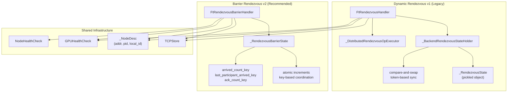
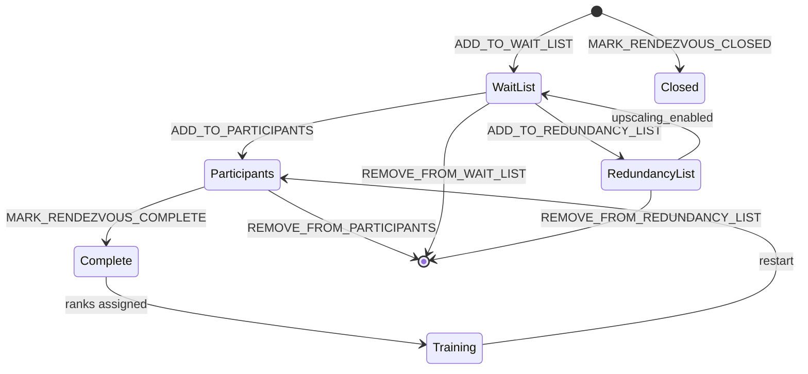
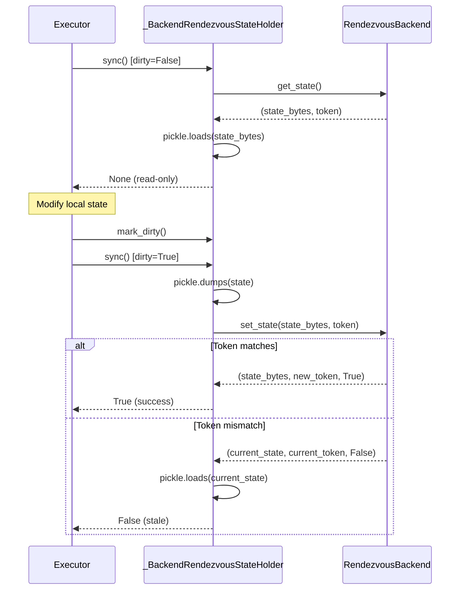
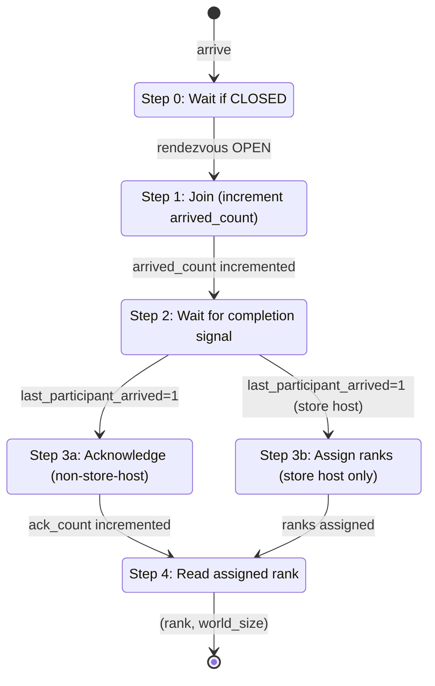
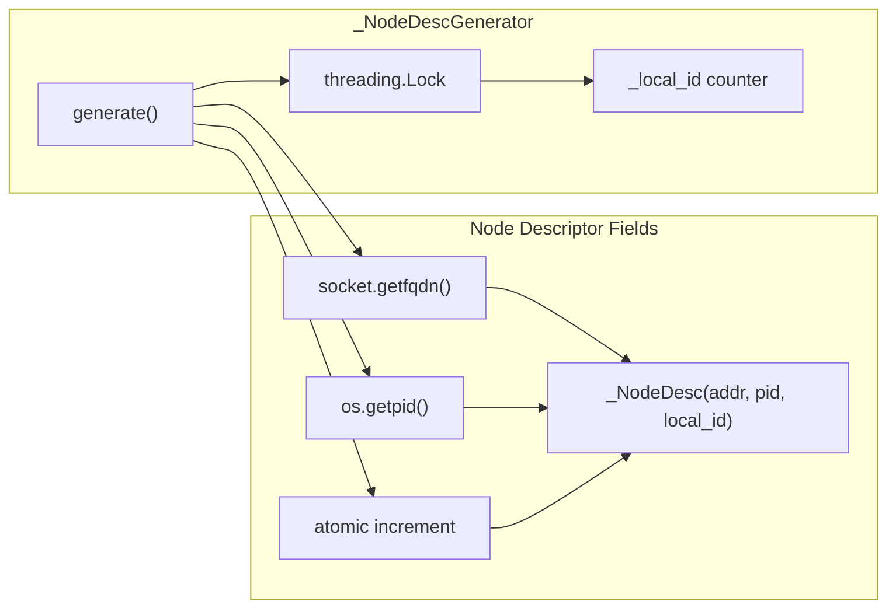

<!-- source: DeepWiki mcp.deepwiki.com · repo NVIDIA/nvidia-resiliency-ext · page 2.2 Rendezvous and Coordination · fetched 2026-10-26 -->

# Rendezvous and Coordination

<details>
<summary>Relevant source files</summary>

The following files were used as context for generating this wiki page:

- [pyproject.toml](pyproject.toml)
- [src/nvidia_resiliency_ext/fault_tolerance/_ft_rendezvous.py](src/nvidia_resiliency_ext/fault_tolerance/_ft_rendezvous.py)
- [src/nvidia_resiliency_ext/fault_tolerance/config.py](src/nvidia_resiliency_ext/fault_tolerance/config.py)
- [src/nvidia_resiliency_ext/fault_tolerance/cycle_info_writer.py](src/nvidia_resiliency_ext/fault_tolerance/cycle_info_writer.py)
- [src/nvidia_resiliency_ext/fault_tolerance/ft_rendezvous_barrier.py](src/nvidia_resiliency_ext/fault_tolerance/ft_rendezvous_barrier.py)
- [src/nvidia_resiliency_ext/fault_tolerance/launcher.py](src/nvidia_resiliency_ext/fault_tolerance/launcher.py)
- [src/nvidia_resiliency_ext/shared_utils/proto/nvrx_interface.proto](src/nvidia_resiliency_ext/shared_utils/proto/nvrx_interface.proto)
- [tests/fault_tolerance/unit/test_barrier_rendezvous.py](tests/fault_tolerance/unit/test_barrier_rendezvous.py)
- [tests/fault_tolerance/unit/test_cycle_info_writer.py](tests/fault_tolerance/unit/test_cycle_info_writer.py)
- [tests/fault_tolerance/unit/test_dynamic_rendezvous.py](tests/fault_tolerance/unit/test_dynamic_rendezvous.py)
- [tests/fault_tolerance/unit/test_launcher.py](tests/fault_tolerance/unit/test_launcher.py)
- [tests/fault_tolerance/unit/test_rdzv_utils.py](tests/fault_tolerance/unit/test_rdzv_utils.py)
- [tests/fault_tolerance/unit/test_utils.py](tests/fault_tolerance/unit/test_utils.py)
- [tests/straggler/unit/test_cupti_ext.py](tests/straggler/unit/test_cupti_ext.py)

</details>


The fault tolerance system provides two rendezvous mechanisms for distributed node coordination during training. **Dynamic Rendezvous v1** (legacy) uses compare-and-swap operations for state synchronization, while **Barrier-based Rendezvous v2** (recommended) uses atomic increments and simpler key-based coordination for improved stability and scalability.

Both mechanisms coordinate nodes via a shared `TCPStore` to establish training groups, assign ranks, and handle failures. The barrier-based approach is recommended for production deployments due to better performance, segment-awareness for NVSwitch systems, and simplified failure handling.

## Architecture Comparison

Both rendezvous mechanisms share common components but differ in their state synchronization approach.

### High-Level Architecture Comparison



**Sources:** [src/nvidia_resiliency_ext/fault_tolerance/_ft_rendezvous.py:31-48](), [src/nvidia_resiliency_ext/fault_tolerance/ft_rendezvous_barrier.py:49-81]()

## Dynamic Rendezvous v1 (Legacy)

Dynamic Rendezvous v1 is based on PyTorch's elastic rendezvous with NVRx extensions for health checking and worker state tracking. It uses compare-and-swap operations with pickle-serialized state objects.

### State Machine and Operations

Dynamic rendezvous operates as a distributed state machine where nodes execute operations (`_Action` enum) to transition between states.

#### Dynamic Rendezvous State Machine



**Sources:** [src/nvidia_resiliency_ext/fault_tolerance/_ft_rendezvous.py:567-583]()

### _RendezvousState Structure

The `_RendezvousState` class holds all rendezvous coordination data, serialized and synchronized via pickle.

| Field | Type | Purpose |
|-------|------|---------|
| `round` | `int` | Current rendezvous round number |
| `complete` | `bool` | Whether current round is complete |
| `deadline` | `Optional[datetime]` | Last call timeout deadline |
| `closed` | `bool` | Whether rendezvous is permanently closed |
| `participants` | `Dict[_NodeDesc, int]` | Active training nodes and their ranks |
| `wait_list` | `Set[_NodeDesc]` | Nodes waiting for next round |
| `redundancy_list` | `Set[_NodeDesc]` | Hot spare nodes ready to join |
| `last_heartbeats` | `Dict[_NodeDesc, datetime]` | Node liveness tracking |
| `worker_states` | `Dict[_NodeDesc, WorkerState]` | Worker group health status |

**Sources:** [src/nvidia_resiliency_ext/fault_tolerance/_ft_rendezvous.py:292-348]()

### Operation Executor

The `_DistributedRendezvousOpExecutor` implements the state machine loop with compare-and-swap synchronization.

#### Executor State Machine Loop

```mermaid
graph TB
    START["run(state_handler, deadline)"]
    SYNC["state_holder.sync()<br/>(read from backend)"]
    HANDLER["state_handler(ctx, deadline)"]
    ACTION{"_Action type"}
    
    EXECUTE_KEEP["_keep_alive()"]
    EXECUTE_ADD_P["_add_to_participants()"]
    EXECUTE_ADD_W["_add_to_wait_list()"]
    EXECUTE_REM["_remove_from_*()"]
    EXECUTE_COMPLETE["_mark_rendezvous_complete()"]
    
    MARK["state_holder.mark_dirty()"]
    FINISH{"FINISH?"}
    ERROR{"ERROR?"}
    
    START --> SYNC
    SYNC --> HANDLER
    HANDLER --> ACTION
    
    ACTION -->|KEEP_ALIVE| EXECUTE_KEEP
    ACTION -->|ADD_TO_PARTICIPANTS| EXECUTE_ADD_P
    ACTION -->|ADD_TO_WAIT_LIST| EXECUTE_ADD_W
    ACTION -->|REMOVE_FROM_*| EXECUTE_REM
    ACTION -->|MARK_RENDEZVOUS_COMPLETE| EXECUTE_COMPLETE
    
    EXECUTE_KEEP --> MARK
    EXECUTE_ADD_P --> MARK
    EXECUTE_ADD_W --> MARK
    EXECUTE_REM --> MARK
    EXECUTE_COMPLETE --> MARK
    
    MARK --> SYNC
    ACTION -->|SYNC| SYNC
    ACTION -->|FINISH| FINISH
    ACTION -->|ERROR_*| ERROR
    
    FINISH -->|false| SYNC
    FINISH -->|true| [*]
    ERROR --> [*]
```

**Sources:** [src/nvidia_resiliency_ext/fault_tolerance/_ft_rendezvous.py:638-768]()

### Rank Assignment Algorithm

Dynamic rendezvous supports two rank assignment modes controlled by `use_infra_group_rank` setting.

#### Dynamic Rendezvous Rank Assignment Logic

```python
@staticmethod
def _assign_ranks(
    participants: Dict[_NodeDesc, int],
    prev: Dict[_NodeDesc, int],
    use_infra_group_rank: bool = False,
) -> Dict[_NodeDesc, int]:
```

**Mode 1: Infrastructure Rank (use_infra_group_rank=True)**
- Uses ranks from `SLURM_PROCID` or `GROUP_RANK` environment variables [src/nvidia_resiliency_ext/fault_tolerance/_ft_rendezvous.py:798-812]()
- Direct mapping: `group_rank = infra_rank`
- Previous assignments are ignored
- Validates all ranks are unique and in range `[0, world_size)`
- **Note:** Hot spare/redundancy not supported due to inability to guarantee lower ranks join first

**Mode 2: Arrival-based Assignment (use_infra_group_rank=False)**
- Preserves previous rank assignments when possible
- Fills gaps left by failed nodes with new participants
- Two-pass algorithm:
  1. Existing nodes reclaim their previous ranks if available
  2. New nodes fill remaining gaps

**Sources:** [src/nvidia_resiliency_ext/fault_tolerance/_ft_rendezvous.py:894-962]()

### Backend State Synchronization

The `_BackendRendezvousStateHolder` manages optimistic concurrency control with token-based validation.

#### Synchronization Flow



**Sources:** [src/nvidia_resiliency_ext/fault_tolerance/_ft_rendezvous.py:396-565]()

## Barrier-based Rendezvous v2 (Recommended)

Barrier-based rendezvous (`FtRendezvousBarrierHandler`) eliminates compare-and-swap operations in favor of atomic increments and simple key-based coordination. This design improves scalability and reduces coordination overhead.

### Design Philosophy

The barrier implementation prioritizes flexibility and fault tolerance over strict synchronization:

1. **Atomic Barrier:** Uses atomic increments (`store.add()`) instead of compare-and-swap [src/nvidia_resiliency_ext/fault_tolerance/ft_rendezvous_barrier.py:10-11]()
2. **Graceful Completion:** Completes on `join_timeout` rather than waiting for `max_nodes` [src/nvidia_resiliency_ext/fault_tolerance/ft_rendezvous_barrier.py:124-144]()
3. **Segment Awareness:** Supports NVSwitch systems by enforcing complete segments (e.g., full NVLink domains) [src/nvidia_resiliency_ext/fault_tolerance/ft_rendezvous_barrier.py:203-204]()
4. **Race Tolerance:** Uses an acknowledgment phase to ensure all nodes have reached Step 2 before the store host assigns ranks [src/nvidia_resiliency_ext/fault_tolerance/ft_rendezvous_barrier.py:780-800]()

**Sources:** [src/nvidia_resiliency_ext/fault_tolerance/ft_rendezvous_barrier.py:263-287]()

### Barrier State Machine

The barrier rendezvous uses a 4-step coordination protocol with key-based synchronization.

#### Barrier Rendezvous Protocol Steps



**Sources:** [src/nvidia_resiliency_ext/fault_tolerance/ft_rendezvous_barrier.py:624-756]()

### Key-Based Coordination

The barrier state uses specific keys in the `TCPStore` for coordination.

| Key | Purpose | Value |
|-----|---------|-------|
| `arrived_count_key` | Atomic counter for joined nodes | Integer (atomic increment) |
| `last_participant_arrived_key` | Completion signal | 0=OPEN, 1=CLOSED |
| `ack_count_key` | Acknowledgment counter | Integer (atomic increment) |
| `arrived_<N>` | Participant information | JSON-encoded `RendezvousParticipantInfo` |
| `arrived_<N>_group_rank` | Assigned rank | "rank,round" format |
| `closed_key` | Permanent shutdown flag | "1" if closed |
| `unhealthy_count_key` | Failed node counter | Integer |
| `peer_aborted_count_key` | Restart signal counter | Integer |

**Sources:** [src/nvidia_resiliency_ext/fault_tolerance/ft_rendezvous_barrier.py:288-313]()

### Segment-Aware Rank Assignment

For NVSwitch-based systems (e.g., DGX H200, HGX B200), the rendezvous can enforce segment constraints. This ensures that only nodes belonging to complete NVLink domains are selected for training.

1. **Domain Identification:** Nodes query their GPU ClusterUUID via `nvidia-smi` to identify their NVLink domain [src/nvidia_resiliency_ext/fault_tolerance/config.py:74-77]().
2. **Segment Filtering:** The store host validates that each domain has at least `segment` nodes. Domains with fewer nodes are excluded [src/nvidia_resiliency_ext/fault_tolerance/ft_rendezvous_barrier.py:203-204]().
3. **Hot Spare Management:** Extra nodes within a domain or nodes in incomplete domains become hot spares, waiting in Step 0 [src/nvidia_resiliency_ext/fault_tolerance/ft_rendezvous_barrier.py:546-622]().

**Sources:** [src/nvidia_resiliency_ext/fault_tolerance/config.py:70-79](), [src/nvidia_resiliency_ext/fault_tolerance/ft_rendezvous_barrier.py:315-380]()

### Rank Assignment Algorithm

Barrier rendezvous uses infrastructure ranks with gap-filling for hardware failures.

#### Barrier Rendezvous Rank Assignment with Gap Filling

```python
def _assign_group_ranks_with_infra_rank(
    self,
    participants: List[Tuple[_NodeDesc, int]],
    min_nodes: int,
) -> Dict[_NodeDesc, int]:
```

**Core Principle:** `group_rank = infra_rank` (direct deterministic mapping).

**Exception:** Fill gaps in `[0, min_nodes)` caused by hardware failures using spare nodes.

**Example with Hardware Failure:**
```
min_nodes=5, arrivals: infra_ranks [0, 1, 3, 4, 10, 11]  (rank 2 missing)

Assignments:
- Node(infra=0)  → group_rank=0  (primary active)
- Node(infra=1)  → group_rank=1  (primary active)
- Node(infra=3)  → group_rank=3  (primary active)
- Node(infra=4)  → group_rank=4  (primary active)
- Node(infra=10) → group_rank=2  (promoted to fill gap)
- Node(infra=11) → group_rank=11 (unpromoted spare)
```

**Sources:** [src/nvidia_resiliency_ext/fault_tolerance/ft_rendezvous_barrier.py:382-478]()

### Distributed State Synchronization (Cycle Info)

The TCPStore host is responsible for writing distributed state synchronization files to Lustre or local storage. This is managed by the `CycleInfoWriter`.

1. **Cycle Info Generation:** After a successful rendezvous, rank 0 writes a `NVRxCycleInfo` JSON file containing active nodes, standby nodes, and the cycle start time [src/nvidia_resiliency_ext/fault_tolerance/cycle_info_writer.py:122-149]().
2. **Atomic Updates:** Updates (like recording the cycle end time) are performed atomically using temp files and `os.replace` [src/nvidia_resiliency_ext/fault_tolerance/cycle_info_writer.py:151-175]().
3. **Current Symlink:** A symlink `cycle_info.<job_id>.current` always points to the latest cycle info, allowing workers to discover their context [src/nvidia_resiliency_ext/fault_tolerance/cycle_info_writer.py:47-48]().

**Sources:** [src/nvidia_resiliency_ext/fault_tolerance/cycle_info_writer.py:100-181](), [src/nvidia_resiliency_ext/shared_utils/proto/nvrx_interface.proto:23-58]()

## Comparison: Dynamic v1 vs Barrier v2

The two mechanisms have different performance and operational characteristics.

### Feature Comparison

| Feature | Dynamic v1 | Barrier v2 |
|---------|------------|------------|
| **State Synchronization** | Compare-and-swap with tokens | Atomic increments |
| **State Serialization** | Pickle entire `_RendezvousState` | Individual keys (JSON) |
| **Coordination Overhead** | Higher (retry loops on conflicts) | Lower (atomic ops always succeed) |
| **Scalability** | Limited by pickle size | Better (per-participant keys) |
| **Hot Spare Support** | Via `redundancy_list` | Via Step 0 wait mechanism |
| **Segment Awareness** | No | Yes (NVSwitch/NVLink domains) |
| **Production Status** | Legacy | **Recommended** |

**Sources:** [src/nvidia_resiliency_ext/fault_tolerance/_ft_rendezvous.py:16-18](), [src/nvidia_resiliency_ext/fault_tolerance/ft_rendezvous_barrier.py:9-11]()

## Node Identity and Health Checking

Both rendezvous mechanisms share common node identification and health checking infrastructure.

### Node Descriptor Generation

Each node is uniquely identified by `_NodeDesc` combining FQDN, process ID, and local ID.

#### Node Identity Components



**Sources:** [src/nvidia_resiliency_ext/fault_tolerance/_ft_rendezvous.py:264-290](), [src/nvidia_resiliency_ext/fault_tolerance/ft_rendezvous_barrier.py:191-214]()

### Health Check Integration

Both handlers call `ensure_node_is_healthy()` before joining rendezvous, raising `UnhealthyNodeException` if GPU health checks fail. The system also supports `NodeHealthCheck` which connects to an external service (e.g., InJob) via UDS [src/nvidia_resiliency_ext/fault_tolerance/launcher.py:136-144]().

**Dynamic v1:** [src/nvidia_resiliency_ext/fault_tolerance/_ft_rendezvous.py:1270-1289]()

**Barrier v2:** [src/nvidia_resiliency_ext/fault_tolerance/ft_rendezvous_barrier.py:1161-1179]()

## Configuration Parameters

### RendezvousTimeout Configuration

| Parameter | Default | Purpose |
|-----------|---------|---------|
| `join` | 600s | Maximum time to complete rendezvous |
| `close` | 30s | Time to close rendezvous cleanly |
| `heartbeat` | 5s | Keep-alive heartbeat interval |

**Sources:** [src/nvidia_resiliency_ext/fault_tolerance/_ft_rendezvous.py:151-210](), [src/nvidia_resiliency_ext/fault_tolerance/ft_rendezvous_barrier.py:112-184]()

### Selecting Rendezvous Mechanism

The mechanism is selected via the `--ft-rdzv-impl` CLI flag or the `rendezvous_backend` parameter:

- `barrier` (default): Uses `FtRendezvousBarrierHandler` [src/nvidia_resiliency_ext/fault_tolerance/launcher.py:167-172]().
- `legacy`: Uses `_ft_rendezvous` compare-and-set [src/nvidia_resiliency_ext/fault_tolerance/launcher.py:174-186]().

**Sources:** [src/nvidia_resiliency_ext/fault_tolerance/launcher.py:146-190](), [src/nvidia_resiliency_ext/fault_tolerance/config.py:70-79]()

---

