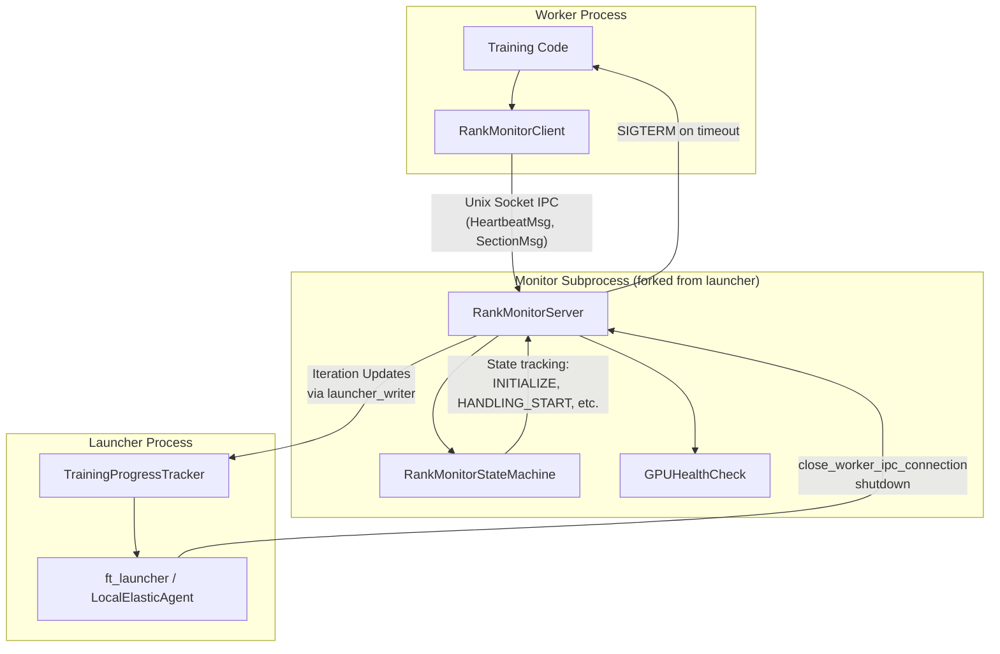
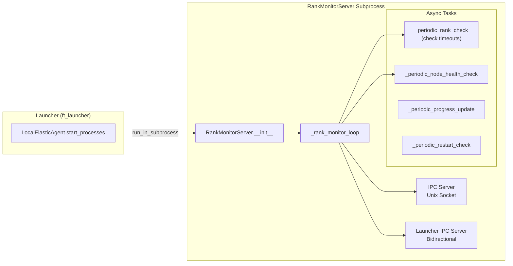
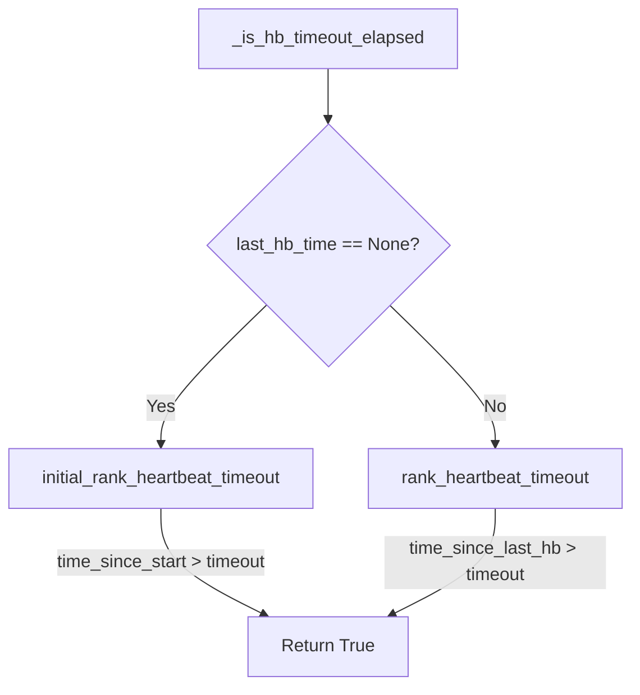
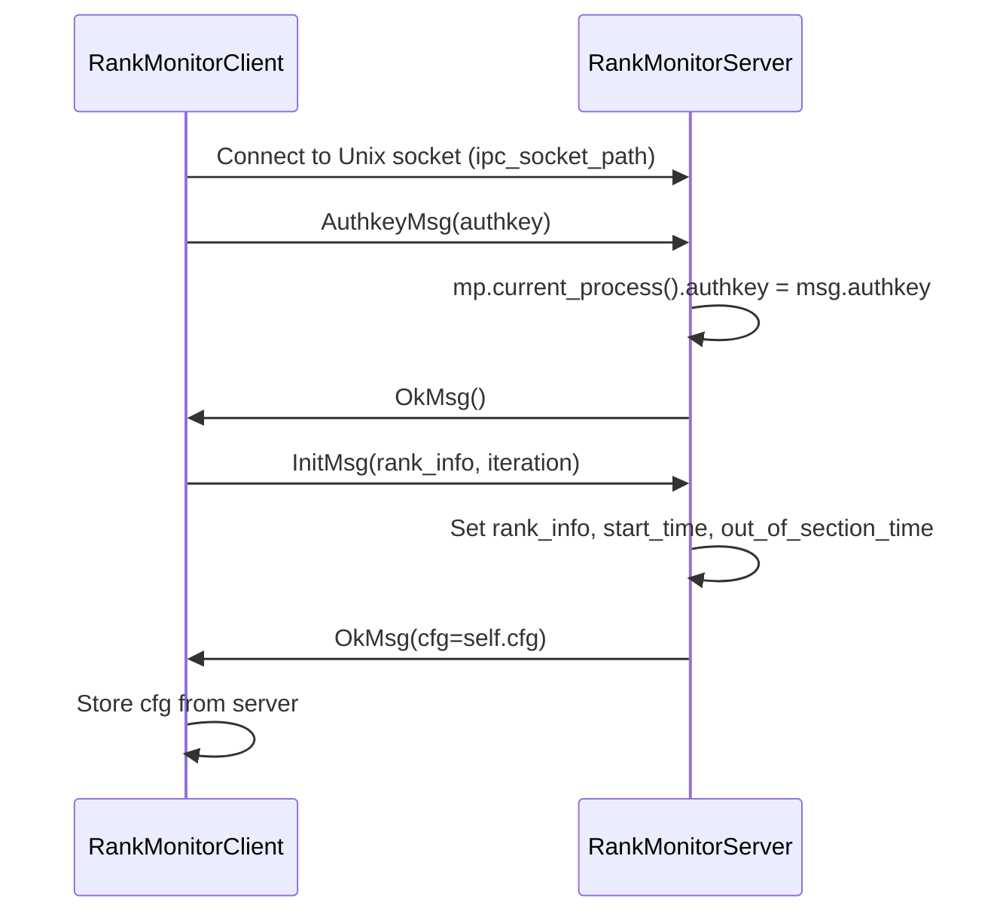
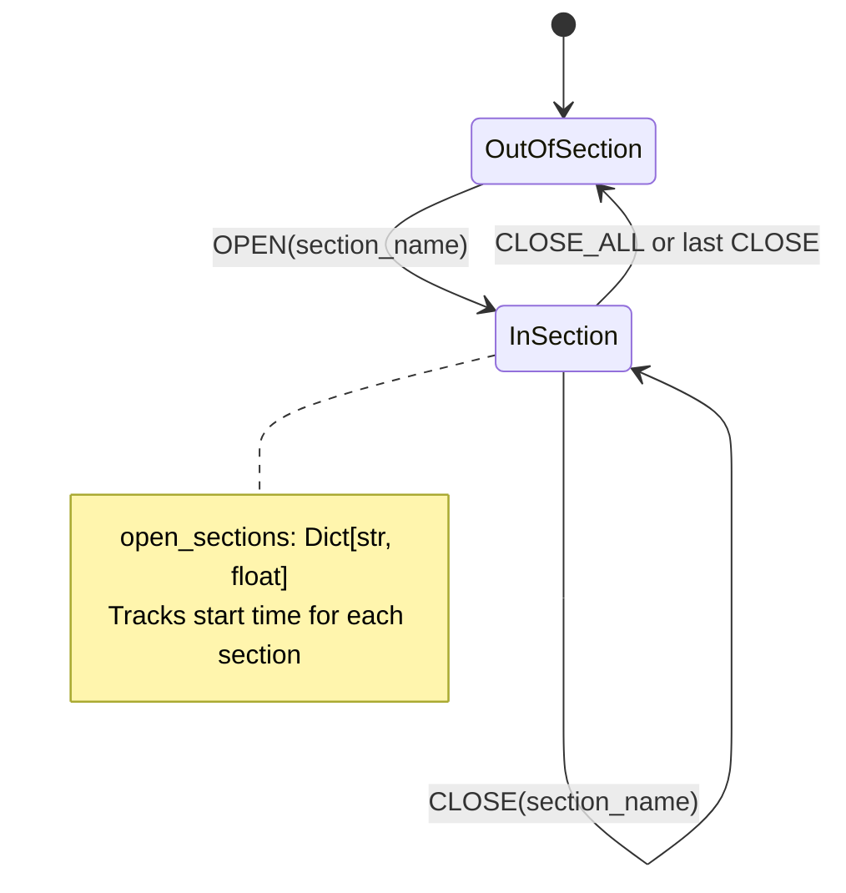
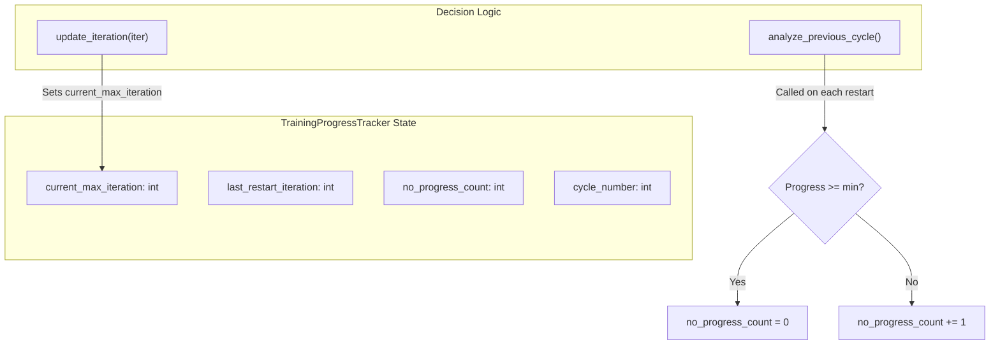

<!-- source: DeepWiki mcp.deepwiki.com · repo NVIDIA/nvidia-resiliency-ext · page 2.3 Rank Monitoring and Progress Tracking · fetched 2026-10-26 -->

# Rank Monitoring and Progress Tracking

<details>
<summary>Relevant source files</summary>

The following files were used as context for generating this wiki page:

- [src/nvidia_resiliency_ext/fault_tolerance/data.py](src/nvidia_resiliency_ext/fault_tolerance/data.py)
- [src/nvidia_resiliency_ext/fault_tolerance/progress_tracker.py](src/nvidia_resiliency_ext/fault_tolerance/progress_tracker.py)
- [src/nvidia_resiliency_ext/fault_tolerance/rank_monitor_client.py](src/nvidia_resiliency_ext/fault_tolerance/rank_monitor_client.py)
- [src/nvidia_resiliency_ext/fault_tolerance/rank_monitor_server.py](src/nvidia_resiliency_ext/fault_tolerance/rank_monitor_server.py)
- [src/nvidia_resiliency_ext/fault_tolerance/rank_monitor_state_machine.py](src/nvidia_resiliency_ext/fault_tolerance/rank_monitor_state_machine.py)
- [src/nvidia_resiliency_ext/fault_tolerance/utils.py](src/nvidia_resiliency_ext/fault_tolerance/utils.py)
- [src/nvidia_resiliency_ext/shared_utils/profiling.py](src/nvidia_resiliency_ext/shared_utils/profiling.py)
- [src/nvidia_resiliency_ext/testing_utils/__init__.py](src/nvidia_resiliency_ext/testing_utils/__init__.py)
- [src/nvidia_resiliency_ext/testing_utils/health_check_injector.py](src/nvidia_resiliency_ext/testing_utils/health_check_injector.py)
- [tests/fault_tolerance/unit/test_layered_restart_v1.py](tests/fault_tolerance/unit/test_layered_restart_v1.py)
- [tests/fault_tolerance/unit/test_progress_tracker.py](tests/fault_tolerance/unit/test_progress_tracker.py)
- [tests/fault_tolerance/unit/test_rank_monitor_client.py](tests/fault_tolerance/unit/test_rank_monitor_client.py)
- [tests/fault_tolerance/unit/test_rank_monitor_server.py](tests/fault_tolerance/unit/test_rank_monitor_server.py)

</details>


## Purpose and Scope

This page documents the rank monitoring and training progress tracking subsystems that enable fault detection and intelligent restart decisions in the Fault Tolerance system. Rank monitoring detects hung or failed worker processes through heartbeats and section timeouts, while progress tracking prevents infinite restart loops by monitoring training iteration progress. For information about the launcher that orchestrates these components, see [ft_launcher and LocalElasticAgent](2.1). For rendezvous coordination after failures are detected, see [Rendezvous and Coordination](2.2).

## Overview

The rank monitoring system implements a 1:1 mapping between worker processes and monitor subprocesses. Each worker embeds a `RankMonitorClient` that communicates via Unix domain sockets with its dedicated `RankMonitorServer` subprocess. The monitors detect hangs through two independent mechanisms: **heartbeats** (periodic liveness signals) and **sections** (instrumented code regions with timeouts). When a hang is detected, the monitor terminates the worker and notifies the launcher. The `TrainingProgressTracker` then analyzes whether meaningful progress was made before the failure to determine if restarting is worthwhile.

Title: Rank Monitoring Architecture


**Key Components:**
- `RankMonitorClient`: Embedded in worker, sends heartbeats and section updates [src/nvidia_resiliency_ext/fault_tolerance/rank_monitor_client.py:52-87]()
- `RankMonitorServer`: Subprocess that monitors timeouts and enforces termination [src/nvidia_resiliency_ext/fault_tolerance/rank_monitor_server.py:122-181]()
- `TrainingProgressTracker`: Analyzes iteration progress across restarts [src/nvidia_resiliency_ext/fault_tolerance/progress_tracker.py:40-51]()
- `RankMonitorStateMachine`: Tracks monitor state transitions for the `InJob` restarter [src/nvidia_resiliency_ext/fault_tolerance/rank_monitor_state_machine.py:35-129]()

Sources: [src/nvidia_resiliency_ext/fault_tolerance/rank_monitor_server.py:122-181](), [src/nvidia_resiliency_ext/fault_tolerance/rank_monitor_client.py:52-87](), [src/nvidia_resiliency_ext/fault_tolerance/progress_tracker.py:40-51]()

## RankMonitorServer Architecture

### Subprocess Lifecycle

The `RankMonitorServer` runs as a daemon subprocess forked by the launcher. Each server monitors exactly one worker process for its entire lifecycle. The server is initialized with an IPC socket path and runs an asyncio event loop that handles multiple concurrent tasks.

Title: RankMonitorServer Internal Tasks


The server maintains two IPC socket servers:
1. **Worker IPC** (`ipc_socket_path`): Receives messages from the monitored worker [src/nvidia_resiliency_ext/fault_tolerance/rank_monitor_server.py:154-162]()
2. **Launcher IPC** (`launcher_ipc_socket_path`): Bidirectional communication with launcher for iteration updates and control commands [src/nvidia_resiliency_ext/fault_tolerance/rank_monitor_server.py:175-180]()

Sources: [src/nvidia_resiliency_ext/fault_tolerance/rank_monitor_server.py:122-181](), [src/nvidia_resiliency_ext/fault_tolerance/rank_monitor_server.py:154-180]()

### Message Handling and State Management

The server handles incoming messages via `_handle_ipc_connection`, which dispatches to specialized handlers based on message type. State is tracked using `RankMonitorStateMachine` for logging and restart coordination.

| Message Type | Handler | Purpose |
|--------------|---------|---------|
| `AuthkeyMsg` | `_handle_authkey_msg` | Set multiprocessing authkey for pickled objects [src/nvidia_resiliency_ext/fault_tolerance/rank_monitor_server.py:245-246]() |
| `InitMsg` | `_handle_init_msg` | Initialize session, receive rank info and iteration [src/nvidia_resiliency_ext/fault_tolerance/rank_monitor_server.py:248-305]() |
| `HeartbeatMsg` | `_handle_heartbeat_msg` | Update last heartbeat time [src/nvidia_resiliency_ext/fault_tolerance/rank_monitor_server.py:307-317]() |
| `SectionMsg` | `_handle_section_msg` | Track section open/close, record iteration [src/nvidia_resiliency_ext/fault_tolerance/rank_monitor_server.py:319-365]() |
| `UpdateConfigMsg` | `_handle_update_config_msg` | Update timeouts dynamically [src/nvidia_resiliency_ext/fault_tolerance/rank_monitor_server.py:367-381]() |

Sources: [src/nvidia_resiliency_ext/fault_tolerance/rank_monitor_server.py:245-381](), [src/nvidia_resiliency_ext/fault_tolerance/data.py:142-213]()

### Timeout Detection and Termination

The `_periodic_rank_check` task evaluates timeout conditions based on heartbeat and section timestamps.

Title: Timeout Detection Logic


**Section Timeout:**
- If sections are open: check `rank_section_timeouts[section_name]` for each open section [src/nvidia_resiliency_ext/fault_tolerance/rank_monitor_server.py:491-504]()
- If no sections open: check `rank_out_of_section_timeout` [src/nvidia_resiliency_ext/fault_tolerance/rank_monitor_server.py:506-509]()

When timeout is detected, `_handle_timeout` is called, which invokes `_shutdown_rank`:
1. Send `SIGCONT` to wake up potentially sleeping process [src/nvidia_resiliency_ext/fault_tolerance/rank_monitor_server.py:217-218]()
2. Send `rank_termination_signal` (default: `SIGTERM`) [src/nvidia_resiliency_ext/fault_tolerance/rank_monitor_server.py:219-220]()

Sources: [src/nvidia_resiliency_ext/fault_tolerance/rank_monitor_server.py:466-509](), [src/nvidia_resiliency_ext/fault_tolerance/rank_monitor_server.py:209-223]()

### Health Check Integration

The server integrates with hardware health checks that run in parallel:

```python
# GPU health check (always enabled)
self.health_checker = GPUHealthCheck(
    interval=self.cfg.node_health_check_interval,
    on_failure=self._handle_unhealthy_node
)
```

When health checks detect failures, the callbacks terminate the worker via `_shutdown_rank_if_alive` [src/nvidia_resiliency_ext/fault_tolerance/rank_monitor_server.py:225-243]().

Sources: [src/nvidia_resiliency_ext/fault_tolerance/rank_monitor_server.py:171-174](), [src/nvidia_resiliency_ext/fault_tolerance/rank_monitor_server.py:225-243]()

## RankMonitorClient Interface

### Initialization and Connection

The client is embedded in the worker process and connects to its monitor during `init_workload_monitoring`. The connection sequence follows a handshake protocol:

Title: Client Handshake Protocol


The `InitMsg` includes an optional `iteration` parameter for progress tracking:
- If workload framework (e.g., Megatron-LM) is detected, initial iteration is sent to "arm" progress tracking [src/nvidia_resiliency_ext/fault_tolerance/rank_monitor_client.py:125-133]()
- If no framework detected, `iteration=None` disables progress tracking [src/nvidia_resiliency_ext/fault_tolerance/data.py:154-175]()

Sources: [src/nvidia_resiliency_ext/fault_tolerance/rank_monitor_client.py:91-133](), [src/nvidia_resiliency_ext/fault_tolerance/rank_monitor_server.py:248-305]()

### Heartbeat Mechanism

Heartbeats are signals sent periodically by the worker:

```python
# Send heartbeat
client.send_heartbeat()
```

**Optimization:** By default, `skip_section_response=True` enables unidirectional communication, reducing IPC latency [src/nvidia_resiliency_ext/fault_tolerance/rank_monitor_client.py:280-301]().

Sources: [src/nvidia_resiliency_ext/fault_tolerance/rank_monitor_client.py:280-301](), [src/nvidia_resiliency_ext/fault_tolerance/rank_monitor_server.py:307-317]()

### Section Mechanism

Sections instrument specific code regions with named timeouts:

```python
# Start a timed section
client.start_section("forward_pass")
# ... code ...
client.end_section("forward_pass")
```

Title: Section State Transitions


Sources: [src/nvidia_resiliency_ext/fault_tolerance/rank_monitor_client.py:448-476](), [src/nvidia_resiliency_ext/fault_tolerance/rank_monitor_server.py:319-365]()

## Training Progress Tracking

### TrainingProgressTracker Architecture

The `TrainingProgressTracker` runs in the launcher process and analyzes training progress across restart cycles. It detects when restarts are stuck at the same iteration (indicating persistent failures) and triggers early termination.

Title: Progress Tracker Logic


**Key Parameters:**
- `min_progress_iterations`: Minimum iterations to count as "making progress" [src/nvidia_resiliency_ext/fault_tolerance/progress_tracker.py:75-76]()
- `max_no_progress_cycles`: Max consecutive cycles without progress before termination [src/nvidia_resiliency_ext/fault_tolerance/progress_tracker.py:76-80]()

Sources: [src/nvidia_resiliency_ext/fault_tolerance/progress_tracker.py:40-71](), [src/nvidia_resiliency_ext/fault_tolerance/progress_tracker.py:135-185]()

### Progress Analysis and Early Termination

The `analyze_previous_cycle` method is called at the start of each restart to evaluate the previous cycle's progress. If the `no_progress_count` exceeds `max_no_progress_cycles`, it recommends termination [src/nvidia_resiliency_ext/fault_tolerance/progress_tracker.py:187-195]().

Sources: [src/nvidia_resiliency_ext/fault_tolerance/progress_tracker.py:135-185](), [src/nvidia_resiliency_ext/fault_tolerance/progress_tracker.py:187-195]()

---

